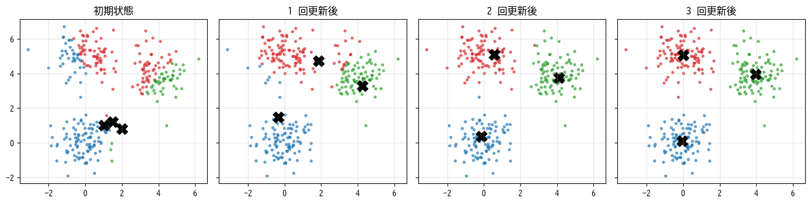
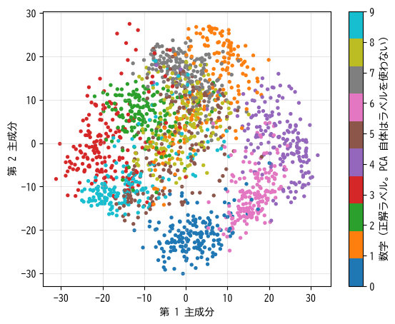

教師なし学習
============

この章では、正解ラベルを使わずにデータの構造を見つける教師なし学習のうち、代表的な 3 つのタスクであるクラスタリング、次元削減、異常検知を説明する。教師なし学習は、それ単体で使うだけでなく、データの理解や教師あり学習の前処理としても役立つ。

クラスタリング
--------------

似たサンプルどうしを集めてグループ（**クラスタ**）に分けることを\ :term:`クラスタリング`\ と呼ぶ。購買履歴から顧客をいくつかのタイプに分ける、似た文書をまとめる、といった用途に使われる。分類と似ているが、あらかじめ決められたクラスやラベルはなく、どのようなグループができるかはデータ次第である。

k-means 法
^^^^^^^^^^

最も基本的なクラスタリングの手法が **k-means 法**\ である。クラスタの数 :math:`k` をあらかじめ決めておき、次の手順を繰り返す。

1. :math:`k` 個のクラスタの中心を、ランダムに選んだサンプルの位置で初期化する。
2. 各サンプルを、最も近い中心のクラスタに割り当てる。
3. 各クラスタに属するサンプルの平均を、そのクラスタの新しい中心とする。
4. 中心が変化しなくなるまで 2〜3 を繰り返す。

この手順は、各サンプルと所属するクラスタの中心との距離の 2 乗和を、少しずつ小さくしていく。:numref:`fig-ch08-kmeans` に、3 つのまとまりを持つデータに k-means 法を適用した様子を示す。中心（黒い × 印）の初期位置が偏っていても、数回の更新で各まとまりの中心に移動している。

.. _fig-ch08-kmeans:

   k-means 法によるクラスタリングの過程。点の色は割り当てられたクラスタを表す。

k-means 法を NumPy で実装すると次のようになる。

.. literalinclude:: ../examples/ch08_unsupervised.py
   :language: python
   :linenos:
   :pyobject: kmeans
   :caption: k-means 法の実装（ch08_unsupervised.py より抜粋）

* 8 行目では、ブロードキャストを使って全サンプルと全中心の距離を一度に計算している。``x[:, None, :]`` は形状 :math:`(n, 1, d)`、``centers[None, :, :]`` は形状 :math:`(1, k, d)` であり、差を取ると形状 :math:`(n, k, d)` の配列になる。
* 11 行目で、各クラスタの平均を新しい中心としている。

k-means 法には次の注意点がある。

* クラスタの数 :math:`k` を事前に決める必要がある。:math:`k` を変えながら距離の 2 乗和の減り方を見る\ **エルボー法**\ や、クラスタのまとまりの良さを測る\ **シルエット係数**\ などを参考にして決める。
* 結果が初期値に依存する。scikit-learn の ``KMeans`` は、初期の中心どうしが離れるように選ぶ k-means++ という方法を使う。また、引数 ``n_init`` で試行回数を指定すれば、複数回の試行から最良の結果を選べる。
* 距離を使うため、特徴量の標準化が必要である。
* 球状で大きさのそろったクラスタを想定しているため、細長いクラスタや入り組んだ形のクラスタはうまく分けられない。そのような場合は、密度にもとづく DBSCAN などの手法を使う。

次元削減
--------

特徴量の数（次元）が多いデータを、情報をなるべく失わずに少ない次元で表すことを\ :term:`次元削減`\ と呼ぶ。次元削減には次のような目的がある。

* 2 次元や 3 次元に削減して、データを可視化する。
* 互いに相関の強い特徴量をまとめ、ノイズを除く。
* 特徴量を減らして、後に続く機械学習の計算を軽くし、過学習を防ぐ。

主成分分析
^^^^^^^^^^

最も基本的な次元削減の手法が\ :term:`主成分分析`\ （Principal Component Analysis、PCA）である。主成分分析では、データのばらつき（分散）が最も大きい方向を第 1 主成分とし、それと直交する方向の中で分散が最も大きい方向を第 2 主成分とする、というように新しい座標軸を順に求める。そして、上位のいくつかの主成分だけを残すことで次元を削減する。

分散が大きい方向にはデータの違いがよく表れており、分散が小さい方向は情報が少ないと考えられる。主成分分析は、情報の多い方向だけを残す手法といえる。各主成分の分散が全体の分散に占める割合を\ **寄与率**\ と呼ぶ。上位の主成分の寄与率を足し合わせた\ **累積寄与率**\ を見れば、何次元まで残せば十分かの目安になる。

:numref:`fig-ch08-pca-digits` は、8 × 8 画素の手書き数字画像（64 次元）を主成分分析で 2 次元に削減して描いたものである。

.. _fig-ch08-pca-digits:

   手書き数字データを主成分分析で 2 次元に削減した結果

主成分分析自体は正解ラベルを使っていないが、同じ数字どうしがある程度まとまって配置されている。一方、上位 2 成分の累積寄与率は 0.285 にすぎず、多くの情報が失われているため、一部の数字は重なり合っている。

.. code-block:: text
   :linenos:

   各主成分の寄与率: [0.149 0.136 0.118 0.084 0.058 0.049 0.043 0.037 0.034 0.031]
   上位 2 成分の累積寄与率 = 0.285, 上位 10 成分 = 0.738

主成分分析は線形の変換なので、データが曲がった構造を持つ場合には限界がある。可視化が目的であれば、非線形の手法である t-SNE や UMAP もよく使われる。ただし、これらで得られた図の距離や大きさは、元のデータの距離を正確には反映しないことに注意が必要である。

異常検知
--------

大多数のデータと異なる振る舞いをするデータを見つけることを\ **異常検知**\ と呼ぶ。設備の故障の予兆の検出、クレジットカードの不正利用の検出、システムの異常監視などに使われる。

異常のデータは数が少なく、種類もさまざまで、事前にすべてを集めることが難しい。そのため、教師あり学習で「異常」というクラスを学習させるのではなく、正常なデータの性質を学習し、そこから外れたものを異常とみなす教師なし学習のアプローチがよく使われる。

* **距離・密度にもとづく方法**: 近くに他のサンプルが少ないサンプルを異常とする（k 近傍法の距離、Local Outlier Factor など）。
* **Isolation Forest**: ランダムな分割を繰り返したとき、少ない回数の分割で他から切り離されるサンプルを異常とする。異常なサンプルは他から離れているため、早く孤立するという考え方である。
* **再構成誤差にもとづく方法**: 主成分分析やニューラルネットワーク（オートエンコーダ）でデータを圧縮・復元し、うまく復元できないサンプルを異常とする。

次のサンプルでは、3 つのまとまりからなる正常なデータに外れ値を 10 件加え、Isolation Forest で異常を検出している。``contamination`` は異常の割合の想定値で、異常と判定するしきい値を決めるのに使われる。

.. literalinclude:: ../examples/ch08_unsupervised.py
   :language: python
   :linenos:
   :lines: 51-57
   :dedent: 4
   :caption: Isolation Forest による異常検知（ch08_unsupervised.py より抜粋）

.. code-block:: text
   :linenos:

   異常と判定された件数: 10
   追加した外れ値のうち異常と判定された件数: 8

追加した外れ値 10 件のうち 8 件を検出できている。外れ値は一様乱数で生成しているため、たまたま正常なデータの近くに生成されたものは検出しにくい。また、異常と判定された 10 件のうち 2 件は、正常なデータのうち分布の端にあるものである。

サンプルコードの全体は :download:`ch08_unsupervised.py <../examples/ch08_unsupervised.py>` からダウンロードできる。

異常検知の評価は難しい。異常のラベルが少しでも得られるなら、それを使って適合率・再現率（第 6 章）を確認するとよい。

まとめ
------

* クラスタリングは似たサンプルをグループに分ける。k-means 法は中心への割り当てと中心の更新を繰り返す。
* 次元削減は、情報をなるべく保ったまま特徴量の数を減らす。主成分分析は分散の大きい方向を残す線形の手法である。
* 異常検知では、正常なデータの性質を学習し、そこから外れたものを異常とみなすことが多い。
