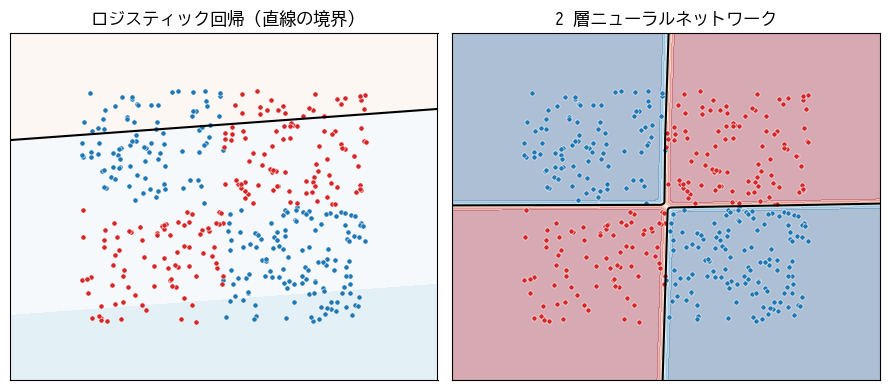
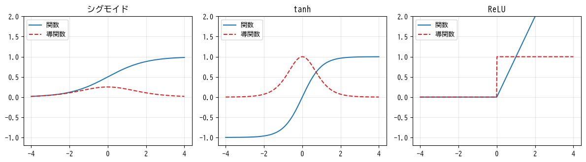

ニューラルネットワークの基礎
============================

この章から深層学習に入る。深層学習で使われるモデルは\ :term:`ニューラルネットワーク`\ と呼ばれ、単純な計算を行う「層」を何段にも重ねた構造を持つ。この章では、ニューラルネットワークの構造と、その学習を可能にする誤差逆伝播法を説明し、NumPy で一から実装する。

パーセプトロン
--------------

ニューラルネットワークの起源は、生物の神経細胞（ニューロン）の働きを単純化した数理モデルにある。神経細胞は、他の多数の神経細胞から信号を受け取り、その合計がある値を超えると次の神経細胞に信号を送る。

1958 年に提案された\ **パーセプトロン** [Rosenblatt1958]_ は、これを次のような計算で表した。

.. math::

   y = \begin{cases} 1 & (\boldsymbol{w}^\top \boldsymbol{x} + b > 0) \\ 0 & (\text{それ以外}) \end{cases}

入力の重み付きの和を計算し、それが 0 を超えたら 1 を出力する。これは第 5 章のロジスティック回帰と同じく、決定境界が直線（平面）になる線形分類器である。

線形分類器には、直線で分けられないデータを分類できないという根本的な限界がある。その典型的な例が **XOR**\ （排他的論理和）の問題である。:numref:`fig-ch09-xor` の左図のように、第 1 象限と第 3 象限の点をクラス 1、第 2 象限と第 4 象限の点をクラス 0 とするデータは、1 本の直線ではどうやっても分けられない。

.. _fig-ch09-xor:

   XOR 型のデータ。線形分類器（左）では分離できないが、2 層のニューラルネットワーク（右）では分離できる。

この限界は、パーセプトロンを多層に重ねることで克服できる。

多層ニューラルネットワーク
--------------------------

ネットワークの構造
^^^^^^^^^^^^^^^^^^

ニューラルネットワークは、複数の\ **ユニット**\ （ニューロン）を並べた\ **層**\ を何段にも重ねた構造を持つ。入力を受け取る\ **入力層**、予測を出力する\ **出力層**、その間にある\ **中間層**\ （隠れ層）からなる。次の図は、2 つの入力、4 つのユニットを持つ中間層、1 つの出力からなるネットワークである。

.. graphviz::
   :align: center
   :caption: 2 層のニューラルネットワーク（入力 2、中間層 4、出力 1）

   digraph mlp {
       rankdir=LR;
       splines=line;
       nodesep=0.3;
       node [shape=circle, style=filled, fillcolor="#eef4fb", fontsize=11, width=0.5, fixedsize=true];
       subgraph cluster_in { label="入力層"; style=dashed; x1 [label="x1"]; x2 [label="x2"]; }
       subgraph cluster_h { label="中間層"; style=dashed; h1 [label="h1"]; h2 [label="h2"]; h3 [label="h3"]; h4 [label="h4"]; }
       subgraph cluster_out { label="出力層"; style=dashed; y [label="y", fillcolor="#fdf0e0"]; }
       {x1 x2} -> {h1 h2 h3 h4} [arrowsize=0.5, color="#667"];
       {h1 h2 h3 h4} -> y [arrowsize=0.5, color="#667"];
   }

各矢印は 1 つの重みを持つ。中間層の各ユニットは、入力層のすべてのユニットから入力を受け取り、重み付きの和にバイアスを加えたものを\ **活性化関数** :math:`f` に通して出力する。

.. math::

   h_j = f\left( \sum_i w_{ij} x_i + b_j \right)

前の層のすべてのユニットが次の層のすべてのユニットとつながっている層を\ **全結合層**\ と呼ぶ。:math:`n` 件の入力をまとめた行列 :math:`X`\ （:math:`n \times d`）を使えば、全結合層の計算は行列の積で書ける。

.. math::

   H = f(X W + \boldsymbol{b})

ここで :math:`W` は :math:`d \times m` の重み行列（:math:`m` は中間層のユニット数）、:math:`\boldsymbol{b}` は :math:`m` 次元のバイアスであり、:math:`\boldsymbol{b}` はブロードキャストによって各行に加えられる。活性化関数 :math:`f` は要素ごとに適用される。

層を重ねたネットワーク全体は、全結合層と活性化関数を交互に適用する関数の合成になる。

.. math::

   \hat{\boldsymbol{y}} = f_2(f_1(X W_1 + \boldsymbol{b}_1) W_2 + \boldsymbol{b}_2)

このように入力から出力に向かって順に計算することを\ **順伝播**\ と呼ぶ。全結合層を重ねたネットワークは\ **多層パーセプトロン**\ （Multi-Layer Perceptron、MLP）とも呼ばれる。中間層を何層も重ねた深いネットワークを使う機械学習が深層学習である。

層の数え方には流儀があるが、本書では重みを持つ層の数で数え、上の図のネットワークを「2 層」と呼ぶ。

活性化関数
^^^^^^^^^^

活性化関数は、ニューラルネットワークに非線形性を与える重要な役割を持つ。もし活性化関数がなければ（あるいは線形の関数なら）、何層重ねても

.. math::

   (X W_1 + \boldsymbol{b}_1) W_2 + \boldsymbol{b}_2 = X (W_1 W_2) + (\boldsymbol{b}_1 W_2 + \boldsymbol{b}_2)

のように 1 層の線形変換と同じになってしまい、層を重ねる意味がない。代表的な\ :term:`活性化関数`\ を\ :numref:`fig-ch09-activations` に示す。

.. _fig-ch09-activations:

   代表的な活性化関数（実線）とその導関数（破線）

.. list-table:: 代表的な活性化関数
   :header-rows: 1
   :widths: 20 30 50

   * - 名前
     - 式
     - 特徴
   * - シグモイド
     - :math:`\dfrac{1}{1 + e^{-z}}`
     - 出力は 0〜1。導関数の最大値が 0.25 と小さく、入力の絶対値が大きいと導関数がほぼ 0 になるため、深いネットワークの中間層では学習が進みにくい。
   * - tanh
     - :math:`\dfrac{e^z - e^{-z}}{e^z + e^{-z}}`
     - 出力は -1〜1。出力の中心が 0 なのでシグモイドより学習しやすいが、入力の絶対値が大きいと導関数がほぼ 0 になる点は同じ。
   * - ReLU
     - :math:`\max(0, z)`
     - 入力が正なら導関数は常に 1 で、深いネットワークでも勾配が小さくなりにくい。計算も軽い。現在の中間層の標準的な選択肢。

ReLU（Rectified Linear Unit）は入力が負のとき出力も導関数も 0 になるため、学習中にあるユニットへの入力が常に負になると、そのユニットは二度と学習されなくなる。これを避けるため、負の側にもわずかな傾きを持たせた Leaky ReLU や、滑らかにした GELU などの変種も使われる。GELU は第 12 章の Transformer で広く使われている。

出力層と損失関数
^^^^^^^^^^^^^^^^

出力層の活性化関数と損失関数は、タスクに応じて次のように組み合わせる。これは第 4 章・第 5 章で学んだ線形回帰・ロジスティック回帰と同じ組み合わせである。

.. list-table:: 出力層と損失関数の組み合わせ
   :header-rows: 1
   :widths: 25 25 25 25

   * - タスク
     - 出力層のユニット数
     - 出力層の活性化関数
     - 損失関数
   * - 回帰
     - 予測する値の数
     - なし（恒等関数）
     - 平均二乗誤差
   * - 2 値分類
     - 1
     - シグモイド関数
     - 2 値交差エントロピー
   * - 多クラス分類
     - クラス数
     - ソフトマックス関数
     - 交差エントロピー

見方を変えると、ニューラルネットワークは「中間層で入力を変換して新しい特徴量を作り、出力層でその特徴量に線形回帰やロジスティック回帰を適用するモデル」と考えられる。第 4 章の多項式回帰では人間が特徴量の変換方法を決めたが、ニューラルネットワークでは、どのような変換が予測に役立つかもデータから学習する。

ニューラルネットワークの表現力
^^^^^^^^^^^^^^^^^^^^^^^^^^^^^^

中間層が 1 つでも、ユニットの数を十分に増やせば、任意の連続関数をいくらでも精度よく近似できることが知られている（**万能近似定理**）。ただし、これは「近似できるパラメータが存在する」ことを保証するだけで、それを学習で見つけられるか、必要なユニット数が現実的かは別の問題である。実際には、浅く幅の広いネットワークよりも、深いネットワークの方が少ないパラメータで複雑な関数を表現でき、学習もうまくいくことが多い。

誤差逆伝播法
------------

勾配の計算が問題になる
^^^^^^^^^^^^^^^^^^^^^^

ニューラルネットワークも、損失関数を勾配降下法で最小化して学習する。そのためには、損失関数をすべての重みとバイアスで偏微分した勾配が必要である。

現在の深層学習のモデルは、数百万から数兆個のパラメータを持つ。第 2 章の数値微分では、パラメータ 1 個ごとに損失を 2 回計算する必要があるため、とても間に合わない。この問題を解決したのが\ :term:`誤差逆伝播法`\ （バックプロパゲーション）\ [Rumelhart1986]_ である。誤差逆伝播法を使うと、順伝播 1 回分と同程度の計算量で、すべてのパラメータの勾配を一度に求められる。

計算グラフ
^^^^^^^^^^

誤差逆伝播法を理解するには、計算を\ **計算グラフ**\ で表すとよい。計算グラフは、個々の演算をノード、値の流れを矢印で表したものである。例として、:math:`L = (wx + b - y)^2` という計算を考える。:math:`u = wx`、:math:`a = u + b`、:math:`e = a - y`、:math:`L = e^2` と分解すると、次の計算グラフになる。

.. graphviz::
   :align: center
   :caption: :math:`L = (wx + b - y)^2` の計算グラフ。黒字は順伝播で求めた値、赤字は逆伝播で求めた勾配を表す。

   digraph cg {
       rankdir=LR;
       nodesep=0.15;
       ranksep=0.35;
       node [fontsize=14];
       edge [fontsize=13];
       x [label="x = 2", shape=plaintext]; w [label="w = 3", shape=plaintext];
       b [label="b = 1", shape=plaintext]; y [label="y = 5", shape=plaintext];
       mul [label="×", shape=circle, style=filled, fillcolor="#eef4fb"];
       add [label="+", shape=circle, style=filled, fillcolor="#eef4fb"];
       sub [label="−", shape=circle, style=filled, fillcolor="#eef4fb"];
       sq  [label="2 乗", shape=circle, style=filled, fillcolor="#eef4fb"];
       L [label="L = 4", shape=plaintext];
       x -> mul;
       w -> mul [label=<∂L/∂w = 8>];
       mul -> add [label=<u = 6 ∂L/∂u = 4>];
       b -> add [label=<∂L/∂b = 4>];
       add -> sub [label=<a = 7 ∂L/∂a = 4>];
       y -> sub;
       sub -> sq [label=<e = 2 ∂L/∂e = 4>];
       sq -> L;
   }

順伝播では、左から右に値を計算する。逆伝播では、出力 :math:`L` から入力に向かって、各ノードでの偏微分を連鎖律で順に求めていく。

1. :math:`L = e^2` より、:math:`\partial L / \partial e = 2e = 4`。
2. :math:`e = a - y` より :math:`\partial e / \partial a = 1` なので、:math:`\partial L / \partial a = 4 \times 1 = 4`。
3. :math:`a = u + b` より :math:`\partial a / \partial u = 1` なので、:math:`\partial L / \partial u = 4`。同様に :math:`\partial L / \partial b = 4`。
4. :math:`u = wx` より :math:`\partial u / \partial w = x = 2` なので、:math:`\partial L / \partial w = 4 \times 2 = 8`。

各ノードは、「出力側から伝わってきた勾配」に「そのノード自身の局所的な微分」を掛けて、入力側に渡すだけでよい。加算ノードは勾配をそのまま流し、乗算ノードは相手側の入力の値を掛けて流す。この局所的な計算の積み重ねで、どれほど複雑なネットワークでも勾配を求められる。また、途中の勾配（:math:`\partial L / \partial a` など）は一度計算すれば、それより入力側のすべてのパラメータの勾配の計算で共有できる。これが誤差逆伝播法が効率的である理由である。

全結合層の逆伝播
^^^^^^^^^^^^^^^^

同じ考え方を行列の計算に当てはめると、全結合層 :math:`A = XW + \boldsymbol{b}` の逆伝播は次のようになる。出力側から勾配 :math:`\partial L / \partial A` が伝わってきたとき、

.. math::

   \frac{\partial L}{\partial W} = X^\top \frac{\partial L}{\partial A}, \qquad
   \frac{\partial L}{\partial \boldsymbol{b}} = \sum_{i=1}^{n} \left( \frac{\partial L}{\partial A} \right)_{i}, \qquad
   \frac{\partial L}{\partial X} = \frac{\partial L}{\partial A} W^\top

最後の :math:`\partial L / \partial X` が、さらに前の層へ伝える勾配である。活性化関数の逆伝播は、伝わってきた勾配に活性化関数の導関数を要素ごとに掛けるだけである。ReLU なら、入力が正だった要素の勾配はそのまま通し、それ以外は 0 にする。

NumPy による実装
----------------

ここまでの内容を使い、「入力 2 → 全結合層 → ReLU → 全結合層 → シグモイド → 出力 1」という 2 層のニューラルネットワークを実装して、XOR 型のデータを学習させる。

順伝播
^^^^^^

.. literalinclude:: ../examples/ch09_two_layer_net.py
   :language: python
   :linenos:
   :pyobject: forward
   :caption: 順伝播（ch09_two_layer_net.py より抜粋）

逆伝播で使うため、中間の値（全結合層の出力 ``a1`` と ReLU の出力 ``h1``）を ``cache`` に保存して返している。

逆伝播
^^^^^^

.. literalinclude:: ../examples/ch09_two_layer_net.py
   :language: python
   :linenos:
   :pyobject: backward
   :caption: 誤差逆伝播法（ch09_two_layer_net.py より抜粋）

* 5 行目: 第 5 章で見たとおり、シグモイド関数と 2 値交差エントロピーを組み合わせると、出力層の入力についての勾配は :math:`(p - y) / n` という簡単な形になる。
* 6〜9 行目: 2 層目の全結合層の重みとバイアスの勾配を、上の式で計算している。
* 10 行目: 1 層目へ伝える勾配を計算している。
* 11 行目: ReLU の逆伝播である。``cache["a1"] > 0.0`` は入力が正の要素だけが ``True`` になる配列であり、これを掛けることで負の要素の勾配を 0 にしている。
* 12〜13 行目: 1 層目の全結合層の勾配を計算している。

勾配確認と学習
^^^^^^^^^^^^^^

誤差逆伝播法の実装は誤りが入り込みやすい。そこで、学習の前に、第 2 章で説明した勾配確認を行い、数値微分で求めた勾配と比較して実装が正しいことを確かめる。その後、訓練データをランダムに並べ替えて 32 件ずつのミニバッチに分け、確率的勾配降下法で学習する。

.. literalinclude:: ../examples/ch09_two_layer_net.py
   :language: python
   :linenos:
   :pyobject: main
   :caption: 勾配確認と学習（ch09_two_layer_net.py より抜粋）

.. code-block:: text
   :linenos:

   勾配確認 W1: 最大誤差 = 9.53e-12
   勾配確認 b1: 最大誤差 = 1.05e-11
   勾配確認 W2: 最大誤差 = 7.59e-12
   勾配確認 b2: 最大誤差 = 5.34e-12
   epoch   0: loss = 0.4767, 正解率 = 0.895
   epoch  50: loss = 0.0574, 正解率 = 0.990
   epoch 100: loss = 0.0410, 正解率 = 0.993
   epoch 150: loss = 0.0357, 正解率 = 0.988
   epoch 200: loss = 0.0293, 正解率 = 0.990
   epoch 250: loss = 0.0256, 正解率 = 0.995
   epoch 300: loss = 0.0279, 正解率 = 0.983

誤差逆伝播法と数値微分の差は :math:`10^{-11}` 程度で、実装が正しいことが確認できる。学習後は 98〜99 % 程度の正解率で分類できており、:numref:`fig-ch09-xor` の右図のように、直線では分けられなかったデータを分ける決定境界が学習されている。ミニバッチごとにランダムな誤差が入るため、損失や正解率はエポック（訓練データ全体を 1 周する単位。第 10 章で説明する）ごとに多少上下する。

サンプルコードの全体は :download:`ch09_two_layer_net.py <../examples/ch09_two_layer_net.py>` からダウンロードできる。

PyTorch による自動微分
----------------------

実務では、誤差逆伝播法を自分で実装することはない。PyTorch などの深層学習フレームワークは、順伝播の計算を記録して計算グラフを自動的に作り、逆伝播で勾配を自動的に計算する\ **自動微分**\ の機能を持つ。本章の計算グラフの例を PyTorch で書くと次のようになる。

.. code-block:: python
   :linenos:

   import torch

   x = torch.tensor(2.0)
   y = torch.tensor(5.0)
   w = torch.tensor(3.0, requires_grad=True)  # 勾配を求めたいパラメータ
   b = torch.tensor(1.0, requires_grad=True)

   loss = (w * x + b - y) ** 2  # 順伝播 (計算グラフが記録される)
   loss.backward()              # 逆伝播
   print(w.grad, b.grad)        # tensor(8.) tensor(4.)

PyTorch では、データやパラメータを\ **テンソル**\ （NumPy の ``ndarray`` に相当する多次元配列で、GPU での計算や自動微分に対応したもの）で表す。``requires_grad=True`` を指定したテンソルについて、``backward`` を呼ぶと勾配が ``grad`` 属性に格納される。結果は、先ほど手計算で求めた :math:`\partial L / \partial w = 8`、:math:`\partial L / \partial b = 4` と一致する。PyTorch を使ったネットワークの学習は第 10 章で扱う。

まとめ
------

* ニューラルネットワークは、全結合層と活性化関数を交互に重ねたモデルである。非線形の活性化関数によって、線形分類器では扱えない複雑な関係を表現できる。
* 中間層の活性化関数には ReLU がよく使われる。出力層の活性化関数と損失関数はタスクに応じて選ぶ。
* 誤差逆伝播法は、計算グラフを出力側から入力側へたどりながら連鎖律を適用し、すべてのパラメータの勾配を効率よく求める方法である。
* 誤差逆伝播法を自作した場合は、数値微分による勾配確認で実装を検証する。実務では PyTorch などの自動微分を使う。
