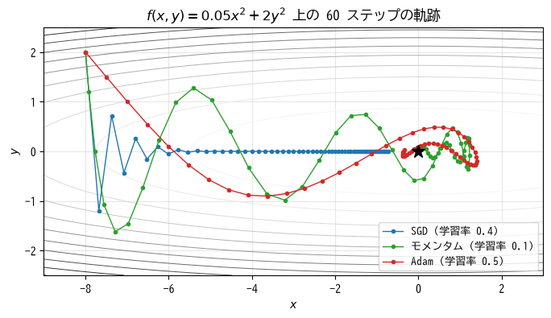
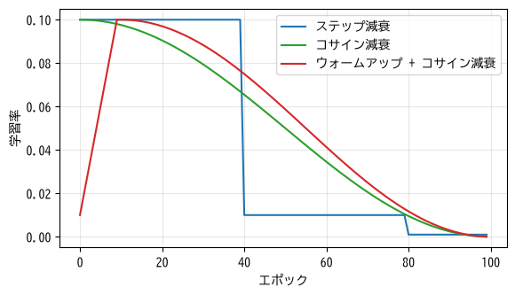

深層学習の学習テクニック
========================

第 9 章で、ニューラルネットワークを誤差逆伝播法と勾配降下法で学習できることを説明した。しかし、層を深くしたネットワークを実際にうまく学習させるには、さまざまな工夫が必要になる。この章では、深層学習で標準的に使われる学習のテクニックを説明し、PyTorch による学習の実装方法を示す。

ミニバッチ学習
--------------

深層学習では、第 4 章で紹介した確率的勾配降下法を使い、訓練データを小さなまとまり（:term:`ミニバッチ`）に分けてパラメータを更新する。

* **バッチサイズ**: 1 つのミニバッチに含めるサンプル数。32〜512 程度がよく使われる。
* **イテレーション**: パラメータの更新 1 回。
* :term:`エポック`: 訓練データ全体を 1 周すること。訓練データが 1000 件、バッチサイズが 100 なら、1 エポックは 10 イテレーションである。

各エポックの最初に訓練データの順序をシャッフルし、毎回異なる組み合わせのミニバッチを作る。ミニバッチから求めた勾配は全データでの勾配の近似なのでノイズを含むが、このノイズには、損失関数の浅い谷に捕まるのを防ぎ、汎化性能の高い解を見つけやすくする効果もあるとされる。

バッチサイズを大きくすると、GPU で並列に計算できるため 1 エポックの計算は速くなるが、メモリの消費が増える。また、バッチサイズを変えたときは、学習率も合わせて調整する必要があることが多い。

最適化手法
----------

勾配を使ってパラメータを更新する方法を\ **最適化手法**\ （オプティマイザ）と呼ぶ。単純な SGD は、損失関数の形によっては学習が非常に遅くなる。:numref:`fig-ch10-optimizers` は、横方向にはゆるやかで縦方向には急な、細長い谷の形をした関数の最小値（★印）を探す様子である。

.. _fig-ch10-optimizers:

   最適化手法による更新の軌跡の違い

SGD
^^^

SGD（確率的勾配降下法）は、勾配に学習率を掛けて引くだけの最も単純な方法である。

.. math::

   \boldsymbol{w} \leftarrow \boldsymbol{w} - \eta \boldsymbol{g}

ここで :math:`\boldsymbol{g}` はミニバッチから求めた勾配である。図の SGD は、縦方向には勾配が大きいため最初に振動し、横方向には勾配が小さいためなかなか進まない。縦方向の振動を抑えようとして学習率を下げると、横方向の進みがさらに遅くなる。

モメンタム
^^^^^^^^^^

**モメンタム**\ は、ボールが坂を転がるように、過去の更新の方向を「速度」として引き継ぐ方法である。

.. math::

   \boldsymbol{v} \leftarrow \beta \boldsymbol{v} - \eta \boldsymbol{g}, \qquad
   \boldsymbol{w} \leftarrow \boldsymbol{w} + \boldsymbol{v}

:math:`\beta` は過去の速度をどれだけ残すかを決める値で、0.9 がよく使われる。一貫して同じ方向を向く勾配（図の横方向）は積み重なって加速し、向きが交互に変わる勾配（縦方向）は打ち消し合う。図では、勢いがついて最小値を行き過ぎる動きも見られるが、SGD よりも早く最小値に近づいている。

Adam
^^^^

**Adam** [Kingma2015]_ は、モメンタムの考え方に加えて、パラメータごとに学習率を自動的に調整する方法である。勾配の移動平均 :math:`\boldsymbol{m}` と、勾配の 2 乗の移動平均 :math:`\boldsymbol{v}` を記録し、:math:`\boldsymbol{m}` を :math:`\sqrt{\boldsymbol{v}}` で割った値で更新する。

.. math::

   \boldsymbol{m} &\leftarrow \beta_1 \boldsymbol{m} + (1 - \beta_1) \boldsymbol{g} \\
   \boldsymbol{v} &\leftarrow \beta_2 \boldsymbol{v} + (1 - \beta_2) \boldsymbol{g}^2 \\
   \boldsymbol{w} &\leftarrow \boldsymbol{w} - \eta \frac{\hat{\boldsymbol{m}}}{\sqrt{\hat{\boldsymbol{v}}} + \epsilon}

:math:`\hat{\boldsymbol{m}}` と :math:`\hat{\boldsymbol{v}}` は、:math:`\boldsymbol{m}` と :math:`\boldsymbol{v}` を 0 で初期化したことによる偏りを補正した値である（実装を参照）。2 乗や割り算は要素ごとに行う。勾配の大きい方向では更新幅が抑えられ、勾配の小さい方向では更新幅が相対的に大きくなるため、方向によって勾配の大きさが異なる場合でも効率よく進める。

.. literalinclude:: ../examples/ch10_optimizers.py
   :language: python
   :linenos:
   :pyobject: Adam
   :caption: Adam の実装（ch10_optimizers.py より抜粋）

各手法で 100 ステップ更新した後の位置を次に示す。最小値は :math:`(0, 0)` である。

.. code-block:: text
   :linenos:

   SGD (lr=0.4): 100 ステップ後の位置 = (-0.1350,  0.0000), f = 0.000911
   モメンタム (lr=0.1): 100 ステップ後の位置 = ( 0.0211, -0.0105), f = 0.000241
   Adam (lr=0.5): 100 ステップ後の位置 = (-0.0408,  0.0060), f = 0.000156

サンプルコードの全体は :download:`ch10_optimizers.py <../examples/ch10_optimizers.py>` からダウンロードできる。

Adam はハイパーパラメータの調整をあまりしなくても安定して学習できるため、深層学習で最もよく使われる最適化手法の 1 つである。:math:`\beta_1 = 0.9`、:math:`\beta_2 = 0.999` が標準的な値で、学習率は 0.001 前後から試すことが多い。正則化（重み減衰）を Adam と正しく組み合わせた **AdamW** [Loshchilov2019]_ も広く使われている。一方、画像認識の分野では、モメンタム付きの SGD を丁寧に調整した方が汎化性能が高くなることもある。

重みの初期化
------------

重みをすべて 0 で初期化すると、同じ層のユニットがすべて同じ値を出力し、同じ勾配を受け取るため、いつまでも同じ値のまま学習が進まない。そこで、重みは乱数で初期化する。

乱数の大きさ（分散）も重要である。大きすぎると層を通るたびに値が大きくなって発散し、小さすぎると値が 0 に近づいて信号が消えてしまう。層を通っても出力の分散が保たれるように、前の層のユニット数 :math:`n_{\text{in}}` に応じて分散を決める方法が使われる。

* **Xavier の初期化**\ （Glorot の初期化）\ [Glorot2010]_: 分散を :math:`2 / (n_{\text{in}} + n_{\text{out}})` にする（:math:`n_{\text{out}}` は次の層のユニット数）。簡略化して :math:`1 / n_{\text{in}}` とすることもある。シグモイドや tanh に適している。
* **He の初期化** [He2015]_: 分散を :math:`2 / n_{\text{in}}` にする。ReLU は入力の半分を 0 にするため、その分だけ分散を大きくしている。ReLU に適している。

第 9 章のサンプルコードでは He の初期化を使っている。PyTorch の全結合層（``nn.Linear``）は、これらに近い方法で自動的に初期化される。

勾配消失と勾配爆発
------------------

誤差逆伝播法では、出力側から入力側へ、各層の局所的な微分を次々と掛け合わせていく。層が深いと、この掛け算の回数が多くなる。

* 掛け合わせる値が 1 より小さいと、入力側の層に届く勾配が指数的に小さくなり、入力に近い層がほとんど学習されなくなる。これを\ :term:`勾配消失`\ と呼ぶ。導関数の最大値が 0.25 のシグモイド関数を中間層に使うと起こりやすい。
* 逆に、掛け合わせる値が 1 より大きいと、勾配が指数的に大きくなって学習が発散する。これを\ **勾配爆発**\ と呼ぶ。

勾配消失・勾配爆発への対策として、次のようなものがある。

* 中間層の活性化関数に ReLU を使う。
* 適切な重みの初期化を使う。
* 次節のバッチ正規化などの正規化層を使う。
* 層を飛び越えて入力を出力に足し合わせる残差接続を使う（第 11 章）。
* 勾配の大きさ（ノルム）が上限を超えたら縮小する\ **勾配クリッピング**\ を使う。系列データを扱うモデルで特に有効である。

バッチ正規化
------------

:term:`バッチ正規化` [Ioffe2015]_ は、中間層の出力を、ミニバッチごとに平均 0、分散 1 になるように正規化する層である。第 3 章で入力の特徴量を標準化したのと同じことを、ネットワークの内部でも行うと考えればよい。正規化の後に、学習可能なパラメータ :math:`\gamma`、:math:`\beta` で :math:`\gamma \hat{x} + \beta` と変換し、必要なら元の分布に戻せるようにしている。

バッチ正規化には、学習を安定させ、大きな学習率を使えるようにし、初期値への依存を減らす効果がある。全結合層や畳み込み層の後、活性化関数の前に挿入することが多い。

注意点として、バッチ正規化は学習時と推論時で動作が異なる。学習時はミニバッチの平均と分散を使うが、推論時は 1 件ずつ予測することもあるため、学習中に記録しておいた平均と分散の移動平均を使う。PyTorch では、``model.train()`` と ``model.eval()`` でこの切り替えを行う。

ミニバッチの統計量に依存しない\ **レイヤー正規化** [Ba2016]_ という方法もあり、第 12 章の Transformer ではこちらが使われる。

深層学習での過学習対策
----------------------

深層学習のモデルは非常に多くのパラメータを持つため、過学習しやすい。第 6 章で説明した正則化に加えて、次の方法がよく使われる。

重み減衰
^^^^^^^^

**重み減衰**\ （weight decay）は、更新のたびに重みを少しずつ 0 に近づける方法である。SGD では L2 正則化と同じ効果を持つ。PyTorch では、最適化手法の ``weight_decay`` 引数で指定する。

ドロップアウト
^^^^^^^^^^^^^^

:term:`ドロップアウト` [Srivastava2014]_ は、学習時に中間層のユニットをランダムに一定の割合（例: 30 %）で無効化する（出力を 0 にする）方法である。毎回異なるユニットの組み合わせで学習することになるため、特定のユニットに頼りきった学習が防がれ、多数のネットワークを平均するアンサンブル学習（第 7 章）に似た効果が得られる。推論時にはすべてのユニットを使う。PyTorch の ``nn.Dropout`` は、学習時に残したユニットの出力を :math:`1 / (1 - \text{割合})` 倍することで、推論時との出力の大きさの違いを補正している。

早期終了
^^^^^^^^

:term:`早期終了`\ は、エポックごとに検証データでの性能を測り、性能が一定のエポック数（**patience**）の間改善しなければ学習を打ち切る方法である。学習を続けると訓練データでの損失は下がり続けるが、ある時点から検証データでの性能が悪化し始める。早期終了を使うと、検証データでの性能が最も良かった時点のモデルを得られる。

データ拡張
^^^^^^^^^^

訓練データに意味を変えない範囲の変換を加えてデータを水増しする方法である。詳しくは第 11 章で説明する。

学習率のスケジューリング
------------------------

学習の初期は大きな学習率で素早く進み、終盤は小さな学習率で細かく調整するのが効果的である。そこで、学習の進行に応じて学習率を変える\ **学習率スケジューリング**\ がよく使われる（:numref:`fig-ch10-lr-schedule`）。

.. _fig-ch10-lr-schedule:

   代表的な学習率スケジュール

* **ステップ減衰**: 決められたエポックごとに学習率を一定の倍率（例: 0.1 倍）で下げる。
* **コサイン減衰** [Loshchilov2017]_: コサイン関数の形に沿って、学習率を滑らかに 0 付近まで下げる。
* **ウォームアップ**: 学習の最初の数エポックは小さな学習率から始めて徐々に上げる。学習の初期はパラメータがランダムで勾配が不安定なため、大きな学習率をいきなり使うと発散することがある。Transformer の学習ではほぼ必須である。

PyTorch による学習の実装
------------------------

ここまでのテクニックを組み合わせて、PyTorch で多層パーセプトロンを学習する。データには、scikit-learn に付属する手書き数字のデータセット（8 × 8 画素のグレースケール画像 1797 枚、0〜9 の 10 クラス）を使う。各画像を 64 次元のベクトルとして扱う。

データの準備
^^^^^^^^^^^^

PyTorch では、データセットを ``Dataset`` クラスで表し、``DataLoader`` でミニバッチに分割して取り出す。

.. literalinclude:: ../examples/ch10_pytorch_mlp.py
   :language: python
   :linenos:
   :pyobject: make_loaders
   :caption: DataLoader の作成（ch10_pytorch_mlp.py より抜粋）

* 6〜8 行目で、データを訓練・検証・テストに分割している。
* 14 行目の ``shuffle=True`` により、訓練データはエポックごとにシャッフルされる。

モデルの定義
^^^^^^^^^^^^

``nn.Sequential`` を使うと、層を順に並べるだけでモデルを定義できる。

.. literalinclude:: ../examples/ch10_pytorch_mlp.py
   :language: python
   :linenos:
   :pyobject: build_model
   :caption: モデルの定義（ch10_pytorch_mlp.py より抜粋）

全結合層（``nn.Linear``）、バッチ正規化（``nn.BatchNorm1d``）、ReLU、ドロップアウト（``nn.Dropout``）を 2 回繰り返し、最後に 10 クラスのロジットを出力する全結合層を置いている。出力層にソフトマックス関数がないのは、損失関数の ``nn.CrossEntropyLoss`` がソフトマックス関数と交差エントロピーをまとめて計算するためである。まとめて計算した方が数値的に安定する。

学習ループ
^^^^^^^^^^

.. literalinclude:: ../examples/ch10_pytorch_mlp.py
   :language: python
   :linenos:
   :pyobject: main
   :caption: 学習ループ（ch10_pytorch_mlp.py より抜粋）

* 8 行目で最適化手法として AdamW を、9 行目で学習率のスケジュールとしてコサイン減衰を指定している。
* 13 行目の ``model.train()`` で、ドロップアウトとバッチ正規化を学習時の動作にしている。
* 18〜21 行目が学習の中心となる 4 つの手順である。PyTorch では勾配が累積される仕様のため、18 行目でミニバッチごとに勾配をリセットする必要がある。
* 26 行目で検証データの正解率を計算している。``evaluate`` 関数の中では ``model.eval()`` で推論時の動作に切り替え、``torch.no_grad()`` で計算グラフの記録を止めてメモリと計算を節約している。
* 31〜37 行目は早期終了の処理である。検証正解率が最良になったときのパラメータを保存しておき、39 行目で読み戻している。

.. code-block:: text
   :linenos:

   epoch   1: 訓練損失 = 1.9782, 検証正解率 = 0.799
   epoch  10: 訓練損失 = 0.2675, 検証正解率 = 0.958
   epoch  20: 訓練損失 = 0.1176, 検証正解率 = 0.972
   epoch  30: 訓練損失 = 0.0603, 検証正解率 = 0.972
   38 エポック目で早期終了
   最良の検証正解率 = 0.983
   テストデータでの正解率 = 0.983

38 エポック目で早期終了し、テストデータで 98.3 % の正解率が得られた。

サンプルコードの全体は :download:`ch10_pytorch_mlp.py <../examples/ch10_pytorch_mlp.py>` からダウンロードできる。

学習がうまくいかないときは
--------------------------

深層学習では、コードにエラーがなくても、学習が進まない、性能が出ないということがよく起こる。次の順に確認するとよい。

1. **最初の損失の値を確認する**: :math:`K` クラス分類で、初期状態の予測がほぼ一様なら、交差エントロピーは :math:`\log K` 程度になるはずである（10 クラスなら約 2.3）。大きく異なる場合は、ラベルや損失関数の使い方を疑う。
2. **少量のデータで過学習させてみる**: 数十件程度の訓練データで学習し、損失がほぼ 0 になることを確認する。ここで損失が下がらなければ、モデルや学習ループのどこかに誤りがある。
3. **学習率を変えてみる**: 損失が発散する（``nan`` になる）なら学習率を下げ、損失がほとんど変化しないなら上げる。
4. **入力データを確認する**: 正規化を忘れていないか、画像とラベルの対応がずれていないか、データ拡張で意味が変わっていないかを確認する。
5. **訓練データと検証データの損失の推移（学習曲線）を見る**: 両方とも高いなら未学習なのでモデルを大きくするか学習を長くする。訓練データの損失だけが下がるなら過学習なので、正則化やデータ拡張を強める。
6. ``model.train()`` と ``model.eval()`` の切り替えを忘れていないか確認する。

まとめ
------

* 深層学習では、ミニバッチ単位でパラメータを更新し、データ全体を 1 周する単位をエポックと呼ぶ。
* 最適化手法には SGD、モメンタム、Adam などがあり、Adam（AdamW）は調整の手間が少なく広く使われる。
* 重みの初期化、ReLU、バッチ正規化、残差接続などにより、勾配消失・勾配爆発を防いで深いネットワークを学習できる。
* 重み減衰、ドロップアウト、早期終了、データ拡張で過学習を防ぐ。
* PyTorch の学習ループは「勾配のリセット → 順伝播と損失の計算 → 逆伝播 → パラメータの更新」の繰り返しである。
