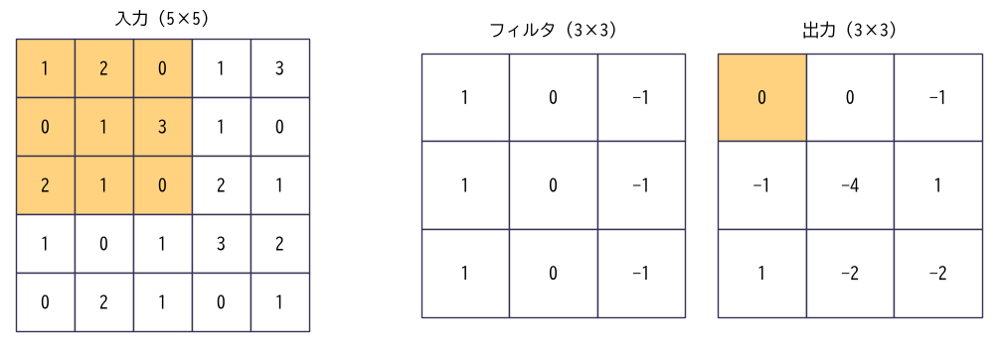
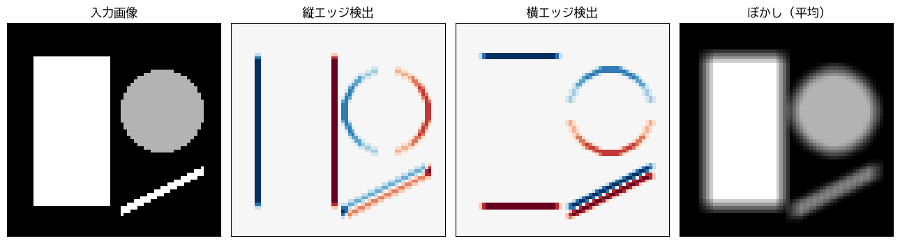

畳み込みニューラルネットワーク
==============================

この章では、画像認識で大きな成功を収めた\ :term:`畳み込みニューラルネットワーク`\ （Convolutional Neural Network、CNN）を説明する。CNN は、画像の「近くの画素どうしが関係し合う」という性質を利用した構造を持ち、全結合層だけのネットワークよりもはるかに少ないパラメータで高い性能を発揮する。

画像データと全結合層の問題点
----------------------------

コンピュータの中で、画像は画素ごとの明るさを並べた配列として表される。グレースケール画像は「高さ × 幅」の 2 次元配列、カラー画像は赤・緑・青の 3 つの\ **チャネル**\ を持つ「チャネル × 高さ × 幅」の 3 次元配列である。PyTorch では、ミニバッチを含めて「バッチ × チャネル × 高さ × 幅」の 4 次元のテンソルで画像を扱う。

第 10 章では、8 × 8 画素の画像を 64 次元のベクトルに平らに並べ直して全結合層に入力した。この方法には次の問題がある。

* **パラメータが多すぎる**: 224 × 224 画素のカラー画像は約 15 万次元になる。これを 1000 ユニットの全結合層に入力すると、それだけで 1.5 億個の重みが必要になる。
* **画像の空間的な構造を使っていない**: 平らに並べ直すと、どの画素とどの画素が隣り合っていたかという情報がモデルの構造から失われる。
* **位置のずれに弱い**: 同じ物体でも、画像の中の位置が少しずれると、全結合層にとってはまったく別の入力になる。

CNN は、畳み込み層とプーリング層によってこれらの問題を解決する。

畳み込み層
----------

畳み込み演算
^^^^^^^^^^^^

**畳み込み層**\ では、**フィルタ**\ （カーネル）と呼ばれる小さな重みの配列を、画像の上で少しずつずらしながら適用する。各位置で、フィルタと重なった画像の部分の要素ごとの積の和を計算し、それを出力の 1 画素とする（:numref:`fig-ch11-conv-operation`）。

.. _fig-ch11-conv-operation:

   畳み込み演算。入力の色の付いた 3 × 3 の領域とフィルタの要素ごとの積の和 :math:`(1 + 0 + 2) - (0 + 3 + 0) = 0` が、出力の色の付いた画素の値になる。

厳密には、この演算は数学でいう畳み込みではなく相互相関と呼ばれる演算だが（数学の畳み込みではフィルタを上下左右に反転させる）、深層学習ではこれを畳み込みと呼ぶ慣習になっている。フィルタの値は学習によって決まるため、反転するかどうかは本質的な違いにならない。

畳み込み演算を NumPy で実装すると次のようになる。

.. literalinclude:: ../examples/ch11_convolution_numpy.py
   :language: python
   :linenos:
   :pyobject: conv2d
   :caption: 畳み込み演算の実装（ch11_convolution_numpy.py より抜粋）

フィルタの役割
^^^^^^^^^^^^^^

フィルタの値によって、畳み込みはさまざまな特徴を取り出す。:numref:`fig-ch11-convolution` は、図形を描いた画像に 3 種類のフィルタを適用した結果である。縦エッジ検出のフィルタは明るさが左右で変化する部分（縦の輪郭）に、横エッジ検出のフィルタは上下で変化する部分（横の輪郭）に強く反応している。赤と青は、明るさの変化の向きが逆であることを表す。

.. _fig-ch11-convolution:

   フィルタによる特徴の抽出

従来の画像処理では、このようなフィルタを人間が設計していた。CNN では、フィルタの値を重みとして学習し、タスクに役立つ特徴を取り出すフィルタを自動的に獲得する。畳み込み層の出力は、入力のどこにどの特徴があるかを表す地図であることから、**特徴マップ**\ と呼ばれる。

CNN の 2 つの重要な性質
^^^^^^^^^^^^^^^^^^^^^^^

* **局所的な結合**: 出力の各画素は、入力の近傍の小さな領域だけから計算される。近くの画素どうしが強く関係するという画像の性質に合っている。
* **重みの共有**: 同じフィルタを画像のすべての位置で使う。そのため、パラメータの数はフィルタの大きさとチャネル数で決まり、画像の大きさには依存しない。また、ある位置で学習した特徴の検出方法を、別の位置でもそのまま使える。

ストライドとパディング
^^^^^^^^^^^^^^^^^^^^^^

フィルタをずらす間隔を\ **ストライド**\ と呼ぶ。ストライドを 2 にすると、出力の高さと幅はおよそ半分になる。

畳み込みを行うと、出力は入力より小さくなる（5 × 5 の入力に 3 × 3 のフィルタを適用すると 3 × 3 になる）。これを避けるため、入力の周囲を 0 などの値で埋めてから畳み込むことを\ **パディング**\ と呼ぶ。3 × 3 のフィルタなら、周囲を 1 画素ずつ埋めると出力の大きさが入力と同じになる。

入力の高さを :math:`H`、フィルタの大きさを :math:`F`、パディングを :math:`P`、ストライドを :math:`S` とすると、出力の高さ :math:`H_{\text{out}}` は次の式で求められる（幅も同様）。

.. math::

   H_{\text{out}} = \left\lfloor \frac{H + 2P - F}{S} \right\rfloor + 1

:math:`\lfloor \cdot \rfloor` は小数点以下の切り捨てを表す。

複数のチャネル
^^^^^^^^^^^^^^

入力が複数のチャネルを持つ場合（カラー画像や、前の畳み込み層の出力）、フィルタも同じ数のチャネルを持ち、全チャネルにわたって積の和を取る。つまり、:math:`C_{\text{in}}` チャネルの入力に対するフィルタ 1 枚は :math:`C_{\text{in}} \times F \times F` の重みを持ち、1 チャネルの特徴マップを出力する。

このフィルタを :math:`C_{\text{out}}` 枚用意すれば、:math:`C_{\text{out}}` チャネルの特徴マップが得られる。畳み込み層のパラメータ数は、バイアスを含めて :math:`C_{\text{out}} \times (C_{\text{in}} \times F \times F + 1)` である。たとえば 16 チャネルの入力から 3 × 3 のフィルタで 32 チャネルを出力する層のパラメータ数は :math:`32 \times (16 \times 9 + 1) = 4640` であり、画像の大きさには依存しない。

プーリング層
------------

**プーリング層**\ は、特徴マップを小さな領域に区切り、各領域を 1 つの値に要約して縮小する層である。領域内の最大値を取る\ **最大プーリング**\ がよく使われる。2 × 2 の最大プーリングを使うと、特徴マップの高さと幅は半分になる。

プーリング層には学習するパラメータがない。プーリング層には次の効果がある。

* 特徴マップを縮小して、後に続く層の計算量を減らす。
* 特徴の位置が少しずれても出力が変わりにくくなる。

NumPy の実装と実行結果を次に示す。縦線が 1 本ある 6 × 6 の画像に縦エッジ検出のフィルタを適用すると、線の左右に正負の反応が現れる。最大プーリングでは、正の反応だけが残って 3 × 3 に縮小される。

.. literalinclude:: ../examples/ch11_convolution_numpy.py
   :language: python
   :linenos:
   :pyobject: max_pool
   :caption: 最大プーリングの実装（ch11_convolution_numpy.py より抜粋）

.. code-block:: text
   :linenos:

   畳み込みの出力 (特徴マップ):
    [[ 0.  0. -2.  0.  2.  0.]
    [ 0.  0. -3.  0.  3.  0.]
    [ 0.  0. -3.  0.  3.  0.]
    [ 0.  0. -3.  0.  3.  0.]
    [ 0.  0. -3.  0.  3.  0.]
    [ 0.  0. -2.  0.  2.  0.]]
   2x2 最大プーリングの出力:
    [[0. 0. 3.]
    [0. 0. 3.]
    [0. 0. 3.]]
   PyTorch の結果と一致するか: True

サンプルコードの全体は :download:`ch11_convolution_numpy.py <../examples/ch11_convolution_numpy.py>` からダウンロードできる。サンプルコードでは、自作の畳み込みの結果が PyTorch の ``torch.nn.functional.conv2d`` の結果と一致することも確認している。

CNN の全体構造
--------------

典型的な CNN は、「畳み込み層 → 活性化関数（ReLU）→ プーリング層」のまとまりを何回か繰り返して特徴マップを徐々に小さく、チャネル数を多くしていき、最後に特徴マップを平らに並べ直して全結合層で分類する。

.. graphviz::
   :align: center
   :caption: 典型的な CNN の構造

   digraph cnn {
       rankdir=LR;
       node [shape=box, style="rounded,filled", fillcolor="#eef4fb", fontsize=10];
       in [label="入力画像\n3×224×224", fillcolor="#fdf0e0"];
       b1 [label="畳み込み + ReLU\nプーリング\n64×112×112"];
       b2 [label="畳み込み + ReLU\nプーリング\n128×56×56"];
       b3 [label="…"];
       b4 [label="畳み込み + ReLU\nプーリング\n512×7×7"];
       fc [label="平坦化\n全結合層"];
       out [label="各クラスの\n確率", fillcolor="#fdf0e0"];
       in -> b1 -> b2 -> b3 -> b4 -> fc -> out;
   }

入力に近い層のフィルタはエッジや色の変化のような単純な特徴に反応し、層が深くなるにつれて、それらを組み合わせた模様、物体の部品、物体全体のような、より複雑で抽象的な特徴に反応するようになることが知られている。この「単純な特徴から複雑な特徴を階層的に組み立てる」ことが、深層学習の強みである。

代表的な CNN の構造
-------------------

CNN の構造は、画像認識のコンテストなどを通じて改良されてきた。

* **LeNet**\ （1998 年）\ [LeCun1998]_: 手書き数字の認識のために提案された、畳み込み層とプーリング層を交互に重ねた初期の CNN である。現在の CNN の基本形となっている。
* **AlexNet**\ （2012 年）\ [Krizhevsky2012]_: 大規模な画像認識のコンテスト（ImageNet）で、従来の手法を大きく上回る性能を示し、深層学習が注目されるきっかけとなった。ReLU、ドロップアウト、データ拡張、GPU による学習などを組み合わせた。
* **VGG**\ （2014 年）\ [Simonyan2014]_: 3 × 3 の小さなフィルタの畳み込み層を多数重ねる単純な構造で、深さが性能に重要であることを示した。
* **ResNet**\ （2015 年）\ [He2016]_: 層を飛び越えて入力を出力に足し合わせる\ **残差接続**\ （スキップ接続）を導入し、100 層を超えるネットワークの学習を可能にした。

残差接続では、いくつかの層からなる変換 :math:`F(\boldsymbol{x})` の出力に、入力 :math:`\boldsymbol{x}` をそのまま足す。

.. math::

   \boldsymbol{y} = F(\boldsymbol{x}) + \boldsymbol{x}

こうすると、各ブロックは入力からの「差分」だけを学習すればよくなる。また、逆伝播では足し算のノードが勾配をそのまま流すため（第 9 章）、勾配が入力側の層まで減衰せずに届く。残差接続は、第 12 章の Transformer を含め、現在のほとんどの深層学習のモデルで使われている。

データ拡張
----------

CNN は多くのパラメータを持つため、訓練データが少ないと過学習しやすい。そこで、訓練データの画像に、ラベルが変わらない範囲の変換をランダムに加えて、データを水増しする\ :term:`データ拡張`\ がよく使われる。

* 平行移動、拡大・縮小、切り抜き
* 左右反転（文字のように反転すると意味が変わるものには使わない）
* 回転
* 明るさ・コントラスト・色合いの変更

データ拡張は学習時にのみ行い、毎回異なる変換を加える。これにより、モデルは位置や明るさが少し変わっても同じ物体だと認識できるようになる。PyTorch では、``torchvision.transforms`` モジュールにさまざまな変換が用意されている。

PyTorch による CNN の実装
-------------------------

第 10 章と同じ手書き数字のデータセットを、今度は 1 チャネル × 8 × 8 画素の画像として CNN で分類する。

.. literalinclude:: ../examples/ch11_cnn_pytorch.py
   :language: python
   :linenos:
   :pyobject: SmallCNN
   :caption: CNN の定義（ch11_cnn_pytorch.py より抜粋）

* 4〜12 行目の ``features`` は、3 × 3 の畳み込み層を 2 つ重ね、最後に 2 × 2 の最大プーリングで特徴マップを 4 × 4 に縮小している。``padding=1`` によって、畳み込み層の前後で特徴マップの大きさは変わらない。``nn.BatchNorm2d`` は、チャネルごとにバッチ正規化を行う。
* 13〜17 行目の ``classifier`` は、32 チャネル × 4 × 4 の特徴マップを 512 次元のベクトルに平らにし、全結合層で 10 クラスのロジットを出力する。
* コメントに、各層を通過した後のテンソルの形状を書いている。CNN を実装するときは、このように形状を追跡するとよい。

訓練時には、データ拡張としてミニバッチの画像を上下左右に最大 1 画素ずらしている。

.. literalinclude:: ../examples/ch11_cnn_pytorch.py
   :language: python
   :linenos:
   :pyobject: random_shift
   :caption: 簡単なデータ拡張（ch11_cnn_pytorch.py より抜粋）

``torch.roll`` は配列を循環的にずらす関数で、はみ出した画素は反対側に回り込む。この画像は周囲が黒（値が 0）なので、回り込みはほとんど影響しない。

学習ループは第 10 章とほぼ同じなので省略する。このサンプルでは、実行のたびに結果が変わらないように CPU で計算している。データの分割も第 10 章と同じであり、検証データで学習の進み具合を確認し、最後にテストデータで一度だけ評価している。

.. code-block:: text
   :linenos:

   パラメータ数 = 10026
   epoch  5: 検証正解率 = 0.948
   epoch 10: 検証正解率 = 0.962
   epoch 15: 検証正解率 = 0.965
   epoch 20: 検証正解率 = 0.979
   epoch 25: 検証正解率 = 0.986
   epoch 30: 検証正解率 = 0.986
   テストデータでの正解率 = 0.986

第 10 章の多層パーセプトロンのパラメータ数は 17610 であったのに対し、この CNN は約 6 割の 10026 個のパラメータで、同等以上の正解率（98.6 %）を達成している。

サンプルコードの全体は :download:`ch11_cnn_pytorch.py <../examples/ch11_cnn_pytorch.py>` からダウンロードできる。

転移学習
--------

大規模な CNN を一から学習するには、数十万〜数百万枚のラベル付き画像と大きな計算資源が必要になる。実務でそれだけのデータを用意できることはまれである。

そこで、ImageNet のような大規模なデータセットで学習済みのモデルを出発点として、手元の少量のデータで追加の学習を行う\ :term:`転移学習`\ がよく使われる。大規模なデータで学習した CNN の入力に近い層は、エッジや模様のような、多くの画像認識に共通して役立つ特徴を抽出できるようになっている。この能力を別のタスクに転用するのである。

転移学習には、主に次の 2 つのやり方がある。

* **特徴抽出器として使う**: 学習済みモデルのパラメータを固定し、最後の全結合層だけを手元のタスク用に付け替えて学習する。データが少ない場合に向いている。
* **ファインチューニング**: 最後の層を付け替えた後、学習済みのパラメータも含めて、小さな学習率でネットワーク全体を追加学習する。データがある程度ある場合に向いている。

PyTorch の画像向けライブラリ torchvision を使うと、学習済みの ResNet を次のように読み込んで、5 クラスの分類用に付け替えられる（学習済みの重みは初回実行時にインターネットからダウンロードされる）。

.. code-block:: python
   :linenos:

   from torch import nn
   from torchvision.models import ResNet18_Weights, resnet18

   model = resnet18(weights=ResNet18_Weights.DEFAULT)  # ImageNet で学習済みの重みを読み込む

   # 特徴抽出器として使う場合は、既存のパラメータを固定する
   for param in model.parameters():
       param.requires_grad = False

   # 最後の全結合層を 5 クラス用に付け替える (新しい層のパラメータは学習される)
   model.fc = nn.Linear(model.fc.in_features, 5)

学習済みモデルを使う場合は、そのモデルの学習時と同じ方法で入力画像を前処理（大きさの変更や正規化）する必要がある。torchvision では、``ResNet18_Weights.DEFAULT.transforms()`` で対応する前処理を取得できる。

画像認識に深層学習を使う場合、まず転移学習を検討するのが定石である。

まとめ
------

* 畳み込み層は、小さなフィルタを画像の上でずらしながら積の和を計算する。局所的な結合と重みの共有により、少ないパラメータで画像の特徴を抽出できる。
* プーリング層は特徴マップを縮小し、位置のずれに強くする。
* CNN は、層が深くなるにつれて単純な特徴から複雑な特徴を階層的に組み立てる。
* 残差接続によって非常に深いネットワークを学習できるようになった。
* データ拡張で過学習を防ぎ、転移学習で少量のデータでも高い性能を得られる。
