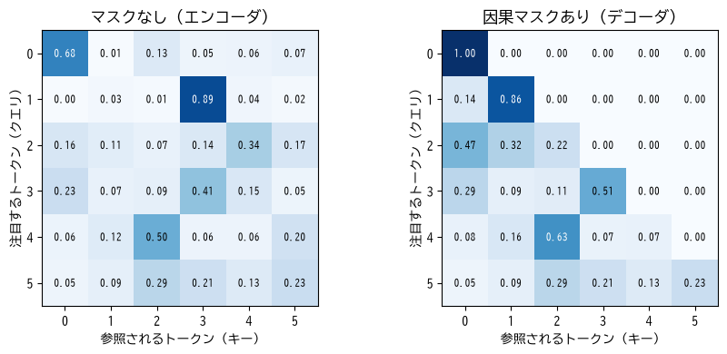
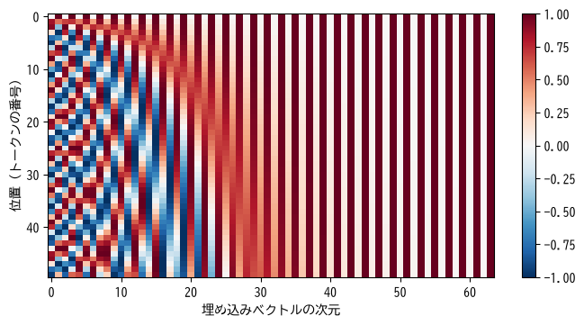

系列データと Transformer
========================

この章では、文章や音声、時系列のように、要素の並び順に意味がある\ **系列データ**\ を扱うモデルを説明する。従来使われてきた RNN を簡単に紹介した後、現在の自然言語処理の中心であり、大規模言語モデルの基盤となっている Attention と Transformer の仕組みを説明する。

系列データの特徴
----------------

系列データには次のような特徴がある。

* **順序に意味がある**: 「犬が猫を追う」と「猫が犬を追う」は、同じ単語からなるが意味が異なる。
* **長さが一定ではない**: 文章の長さは文ごとに異なる。
* **離れた要素どうしが関係する**: 「私は昨日、駅前の新しくできた店で買った本を読んだ」という文では、「私は」と「読んだ」が、間に多くの語を挟んで関係している。

第 9 章の全結合層は固定長の入力しか扱えず、要素の順序や位置関係を構造として持たない。系列データには、これらの特徴に対応したモデルが必要である。

トークンと埋め込み
------------------

文章をモデルに入力するには、まず文章を\ **トークン**\ と呼ばれる単位に分割し、各トークンに番号（ID）を割り当てる。トークンは単語や文字のこともあるが、現在の言語モデルでは、出現頻度にもとづいて単語をさらに細かく分けた\ **サブワード**\ がよく使われる。

トークンの ID は単なる番号であり、大小関係に意味はない。そこで、各トークンを学習可能な実数のベクトルに対応させる。これを\ :term:`埋め込み`\ （embedding）と呼ぶ。語彙数 :math:`V`、ベクトルの次元 :math:`d` の埋め込みは、:math:`V \times d` の行列として表され、トークン ID に対応する行を取り出すことで埋め込みベクトルを得る。PyTorch では ``nn.Embedding`` で実現できる。

これは、第 3 章で説明した one-hot 符号化したベクトルに重み行列を掛けることと同じだが、行を取り出すだけなので効率がよい。埋め込みベクトルは学習によって調整され、意味の近いトークンどうしが近いベクトルになることが知られている [Mikolov2013]_。

RNN
---

再帰型ニューラルネットワーク
^^^^^^^^^^^^^^^^^^^^^^^^^^^^

**RNN**\ （Recurrent Neural Network、再帰型ニューラルネットワーク）は、系列の要素を先頭から 1 つずつ読み込み、それまでの情報を\ **隠れ状態**\ と呼ばれるベクトルに蓄えながら処理するモデルである。時刻 :math:`t` の入力 :math:`\boldsymbol{x}_t` と 1 つ前の隠れ状態 :math:`\boldsymbol{h}_{t-1}` から、新しい隠れ状態 :math:`\boldsymbol{h}_t` を計算する。

.. math::

   \boldsymbol{h}_t = \tanh(W_x \boldsymbol{x}_t + W_h \boldsymbol{h}_{t-1} + \boldsymbol{b})

すべての時刻で同じ重み :math:`W_x`、:math:`W_h` を使うため、任意の長さの系列を扱える。時間方向に展開すると、次の図のように同じ層を何段にも重ねた深いネットワークとみなせる。

.. graphviz::
   :align: center
   :caption: 時間方向に展開した RNN

   digraph rnn {
       rankdir=LR;
       node [fontsize=11];
       h0 [label="h0", shape=plaintext];
       c1 [label="RNN", shape=box, style="rounded,filled", fillcolor="#eef4fb"];
       c2 [label="RNN", shape=box, style="rounded,filled", fillcolor="#eef4fb"];
       c3 [label="RNN", shape=box, style="rounded,filled", fillcolor="#eef4fb"];
       h3 [label="h3", shape=plaintext];
       x1 [label="x1: 犬が", shape=plaintext]; x2 [label="x2: 猫を", shape=plaintext]; x3 [label="x3: 追う", shape=plaintext];
       h0 -> c1; c1 -> c2 [label="h1"]; c2 -> c3 [label="h2"]; c3 -> h3;
       x1 -> c1; x2 -> c2; x3 -> c3;
       {rank=same; c1; x1;} {rank=same; c2; x2;} {rank=same; c3; x3;}
   }

RNN の問題点
^^^^^^^^^^^^

RNN には次の問題がある。

* **長い系列で勾配が消失しやすい**: 時間方向に展開した RNN は非常に深いネットワークと同じであり、第 10 章で説明した勾配消失が起こりやすい。そのため、遠く離れた要素どうしの関係を学習しにくい。
* **並列計算ができない**: 時刻 :math:`t` の計算には時刻 :math:`t - 1` の結果が必要なため、系列の要素を順番にしか処理できない。GPU の並列計算能力を生かせず、学習に時間がかかる。

勾配消失の問題を緩和するため、情報をどの程度残すか・忘れるかを制御する「ゲート」の仕組みを持つ **LSTM**\ （Long Short-Term Memory）\ [Hochreiter1997]_ や、それを簡略化した GRU [Cho2014]_ が考案され、2010 年代の自然言語処理や音声認識で広く使われた。しかし、並列計算ができない問題は残った。

Attention
---------

Attention の考え方
^^^^^^^^^^^^^^^^^^

:term:`Attention`\ （注意機構）は、系列の各要素が、系列の中のどの要素にどれだけ注目するかを計算し、注目度に応じて情報を集める仕組みである [Bahdanau2014]_。RNN のように情報を順に受け渡すのではなく、離れた要素どうしを直接結び付けられる。

Attention は、辞書の検索にたとえると分かりやすい。各要素は、次の 3 つのベクトルを持つ。

* **クエリ**\ （query）: 「自分はどのような情報を探しているか」を表す。
* **キー**\ （key）: 「自分はどのような情報を持っているか」を表す見出し。
* **バリュー**\ （value）: 実際に渡す情報の中身。

ある要素のクエリと、すべての要素のキーとの類似度（内積）を計算し、類似度が高い要素のバリューほど大きな重みで足し合わせる。通常の辞書では見出しが完全に一致した 1 つの項目だけを取り出すが、Attention では類似度に応じてすべての項目を少しずつ混ぜ合わせる「柔らかい検索」を行う。

Scaled Dot-Product Attention
^^^^^^^^^^^^^^^^^^^^^^^^^^^^

系列の長さを :math:`n` とし、各要素のクエリ・キー・バリューを行として並べた行列を :math:`Q`、:math:`K`、:math:`V` とする。Transformer で使われる **Scaled Dot-Product Attention** は次の式で計算される。

.. math::

   \text{Attention}(Q, K, V) = \text{softmax}\left( \frac{Q K^\top}{\sqrt{d_k}} \right) V

1. :math:`Q K^\top` は :math:`n \times n` の行列で、:math:`i` 行 :math:`j` 列の要素は「要素 :math:`i` のクエリ」と「要素 :math:`j` のキー」の内積（類似度）である。
2. :math:`\sqrt{d_k}`\ （:math:`d_k` はキーの次元）で割って値の大きさを調整する。次元が大きいと内積の値が大きくなり、ソフトマックス関数の出力が 1 つの要素に極端に偏って勾配が小さくなるのを防ぐためである。
3. 行ごとにソフトマックス関数を適用して、合計が 1 になる重み（**Attention の重み**）に変換する。
4. 重みを使ってバリューの加重平均を取る。

クエリ・キー・バリューは、入力の埋め込みベクトルを並べた行列 :math:`X` に、それぞれ学習可能な重み行列を掛けて作る（:math:`Q = X W_Q`、:math:`K = X W_K`、:math:`V = X W_V`）。このように、同じ系列の中で要素どうしが注目し合う Attention を **Self-Attention**\ （自己注意）と呼ぶ。

NumPy で実装すると次のようになる。

.. literalinclude:: ../examples/ch12_attention.py
   :language: python
   :linenos:
   :pyobject: scaled_dot_product_attention
   :caption: Scaled Dot-Product Attention の実装（ch12_attention.py より抜粋）

4 個のトークンに対する Attention の重みの例を次に示す。各行が 1 つのトークン（クエリ）に対応し、行の和は 1 になる。

.. code-block:: text
   :linenos:

   Attention の重み (各行の和は 1):
    [[0.344 0.127 0.332 0.198]
    [0.775 0.004 0.053 0.168]
    [0.252 0.278 0.286 0.184]
    [0.216 0.278 0.211 0.295]]
   出力の形状: (4, 8)

この例では重み行列を乱数で作っているため、重みの値自体に意味はない。学習によって重み行列が調整されると、たとえば代名詞のトークンが、それが指す名詞のトークンに大きな重みを置くようになる。

サンプルコードの全体は :download:`ch12_attention.py <../examples/ch12_attention.py>` からダウンロードできる。サンプルコードでは、結果が PyTorch の ``torch.nn.functional.scaled_dot_product_attention`` と一致することも確認している。

因果マスク
^^^^^^^^^^

文章を先頭から 1 トークンずつ生成するモデルでは、あるトークンを予測するときに、それより後ろのトークンを見てはいけない。そこで、Attention の重みを計算する前に、自分より後ろの位置の類似度を :math:`-\infty` にしておく。ソフトマックス関数を通すと、それらの位置の重みは 0 になる（:numref:`fig-ch12-causal-mask`）。これを\ **因果マスク**\ と呼ぶ。

.. _fig-ch12-causal-mask:

   Attention の重みの例。因果マスクを適用すると、各トークンは自分自身とそれより前のトークンだけに注目する。

Multi-Head Attention
^^^^^^^^^^^^^^^^^^^^

1 組のクエリ・キー・バリューでは、1 種類の観点でしか注目先を選べない。そこで、異なる重み行列で作った複数組のクエリ・キー・バリューで並行して Attention を計算し、結果を連結する。これを **Multi-Head Attention** と呼び、各組を\ **ヘッド**\ と呼ぶ。ヘッドごとに、文法的な関係や意味的な関係など、異なる種類の関係に注目できるようになる。

Transformer
-----------

全体の構造
^^^^^^^^^^

:term:`Transformer` [Vaswani2017]_ は、RNN を使わず、Attention を中心に構成されたモデルである。もともとは機械翻訳のために提案されたが、現在では自然言語処理だけでなく、画像や音声などさまざまな分野で使われている。

Transformer は、次の図のブロックを何層も重ねた構造を持つ。

.. graphviz::
   :align: center
   :caption: Transformer のブロックの構造（入力側に正規化を置く方式）

   digraph tblock {
       rankdir=BT;
       node [shape=box, style="rounded,filled", fillcolor="#eef4fb", fontsize=10, width=2.4];
       in [label="入力（系列長 × d_model）", fillcolor="#fdf0e0"];
       ln1 [label="レイヤー正規化"];
       mha [label="Multi-Head Attention", fillcolor="#dbe9f6"];
       add1 [label="+", shape=circle, width=0.3];
       ln2 [label="レイヤー正規化"];
       ffn [label="全結合層 → 活性化関数 → 全結合層\n（位置ごとに適用）", fillcolor="#dbe9f6"];
       add2 [label="+", shape=circle, width=0.3];
       out [label="出力（系列長 × d_model）", fillcolor="#fdf0e0"];
       in -> ln1 -> mha -> add1 -> ln2 -> ffn -> add2 -> out;
       in -> add1 [label="残差接続", fontsize=9, style=dashed];
       add1 -> add2 [label="残差接続", fontsize=9, style=dashed];
   }

* **Multi-Head Attention**: トークンどうしで情報をやり取りする。
* **位置ごとの全結合層**\ （Feed-Forward Network）: 各トークンのベクトルを個別に変換する。2 層の全結合層からなり、中間層の次元は入力の 4 倍程度にすることが多い。
* **残差接続**\ （第 11 章）と\ **レイヤー正規化**\ （第 10 章）: 深いネットワークを安定して学習するために使う。正規化を各処理の前に置く方式と後に置く方式があり、図は前に置く方式である。

Attention は系列内のすべての要素の組み合わせを一度に計算するため、RNN と違って系列全体を並列に処理できる。これにより、GPU を使って大量のデータで効率よく学習できるようになった。一方、計算量が系列の長さの 2 乗に比例するため、非常に長い系列の扱いは課題となる。

位置エンコーディング
^^^^^^^^^^^^^^^^^^^^

Attention の計算は、要素の並び順を入れ替えても、出力の並び順が同じように入れ替わるだけで、各要素の出力自体は変わらない。つまり、Attention だけではトークンの順序を区別できない。そこで、各位置に固有のベクトルを埋め込みベクトルに足して、位置の情報を与える。これを\ **位置エンコーディング**\ と呼ぶ。

元の Transformer では、:numref:`fig-ch12-positional-encoding` のように、周期の異なる sin 関数と cos 関数を組み合わせたベクトルを使った。位置ごとに学習可能なベクトルを使う方法や、Attention の計算の中で相対的な位置を考慮する方法もある。

.. _fig-ch12-positional-encoding:

   sin 関数と cos 関数による位置エンコーディング。次元ごとに周期が異なり、各位置が固有のパターンを持つ。

エンコーダとデコーダ
^^^^^^^^^^^^^^^^^^^^

元の Transformer は、入力文を処理する\ **エンコーダ**\ と、出力文を生成する\ **デコーダ**\ からなる。エンコーダは因果マスクなしの Self-Attention で入力文全体を見渡し、デコーダは因果マスク付きの Self-Attention で生成済みのトークンを参照しながら、次のトークンを予測する。

その後、エンコーダだけを使うモデル（文章の分類や情報抽出に向く。BERT [Devlin2019]_ など）や、デコーダだけを使うモデル（文章の生成に向く。GPT など）が登場した。現在の大規模言語モデルの多くは、デコーダだけを使う構造である。

PyTorch による Transformer の実装
---------------------------------

PyTorch には Transformer の部品が用意されている。次のサンプルでは、長さ 8 のトークン列（0〜9 の整数）について、「先頭のトークンが 2 番目以降にもう一度現れるか」を判定する分類問題を、小さな Transformer エンコーダで学習する。答えるには、先頭と離れた位置のトークンを比較する必要がある。

.. literalinclude:: ../examples/ch12_transformer_pytorch.py
   :language: python
   :linenos:
   :pyobject: TinyTransformer
   :caption: 小さな Transformer エンコーダ（ch12_transformer_pytorch.py より抜粋）

* 4 行目の ``nn.Embedding`` でトークンを埋め込みベクトルに変換し、6 行目で位置ごとに学習可能な位置エンコーディングを用意している。
* 7〜8 行目で、Multi-Head Attention（4 ヘッド）と位置ごとの全結合層からなるブロックを 2 層重ねている。``batch_first=True`` は、入力の形状を「バッチ × 系列長 × 次元」とする指定である。なお、``nn.TransformerEncoderLayer`` は、既定ではレイヤー正規化を各処理の後に置く方式であり、``norm_first=True`` を指定すると前に置く方式になる。
* 14 行目で、先頭の位置の出力ベクトルを使って 2 クラスに分類している。Attention によって、先頭の位置の出力には系列全体の情報が集められている。

.. code-block:: text
   :linenos:

   検証データで正例 (再出現する) の割合 = 0.531
   step  400: loss = 0.0269, 検証正解率 = 0.994
   step  800: loss = 0.0005, 検証正解率 = 0.999
   step 1200: loss = 0.0003, 検証正解率 = 1.000
   step 1600: loss = 0.1507, 検証正解率 = 0.982
   step 2000: loss = 0.0002, 検証正解率 = 1.000

ほぼ 100 % の正解率で判定できるようになっている。step 1600 で損失が一時的に上がっているのは、学習率を一定にしているために学習が一時的に不安定になったものと考えられる。実際の Transformer の学習では、第 10 章で説明したウォームアップや学習率の減衰を組み合わせることが多い。

サンプルコードの全体は :download:`ch12_transformer_pytorch.py <../examples/ch12_transformer_pytorch.py>` からダウンロードできる。

大規模言語モデルとの関係
------------------------

事前学習
^^^^^^^^

:term:`大規模言語モデル`\ （Large Language Model、LLM）は、デコーダ型の Transformer を、膨大な量の文章で学習したモデルである。学習のタスクは「それまでのトークン列から、次のトークンを予測する」という単純なもので、損失関数は第 5 章の多クラス分類の交差エントロピー（クラス数は語彙数）である。

この学習では、文章そのものから正解（次のトークン）を作れるため、人手でラベルを付ける必要がない。第 1 章で触れた自己教師あり学習の一種であり、インターネット上の大量の文章をそのまま学習に使える。このように、特定のタスクに使う前に大量のデータで行う汎用的な学習を\ **事前学習**\ と呼ぶ。

次のトークンを正確に予測するには、文法だけでなく、単語の意味、世の中の知識、文脈の流れなどを捉える必要がある。モデルの規模（パラメータ数）、データ量、計算量を大きくするほど性能が向上することが経験的に知られており、数十億〜数兆個のパラメータを持つモデルが作られている。

事前学習の後
^^^^^^^^^^^^

事前学習だけのモデルは「もっともらしい続きの文章を書く」ことはできるが、質問に答えたり指示に従ったりするのは得意ではない。そこで、次のような追加の学習を行う。

* **ファインチューニング**: 第 11 章の転移学習と同じく、事前学習したモデルを出発点として、特定のタスクのデータで追加学習する。指示と望ましい応答の組で学習することを\ **インストラクションチューニング**\ と呼ぶ。
* **人間のフィードバックによる強化学習**: 複数の応答のうちどれが良いかという人間の評価を使い、より好ましい応答を出力するように調整する。

また、学習済みのモデルは、入力文（プロンプト）の中にいくつかの例を示すだけで、パラメータを更新せずに新しいタスクをこなせることがある。これを\ **文脈内学習**\ （in-context learning）と呼ぶ。

注意点
^^^^^^

大規模言語モデルは、事前学習のデータに含まれるパターンにもとづいて、もっともらしいトークンの並びを生成している。そのため、事実と異なる内容をもっともらしく生成することがある（**ハルシネーション**）。また、訓練データに含まれる偏りを反映することもある。業務で利用する場合は、出力を検証する仕組みや、外部の信頼できる情報を検索して入力に加える方法（検索拡張生成、RAG）などを組み合わせることが重要である。

まとめ
------

* 系列データは順序に意味があり、長さが一定でない。トークンは埋め込みによってベクトルに変換する。
* RNN は隠れ状態を受け渡しながら系列を順に処理するが、長い系列の学習と並列化に課題がある。
* Attention は、クエリとキーの類似度にもとづいてバリューを加重平均し、離れた要素どうしを直接結び付ける。
* Transformer は Multi-Head Attention、位置ごとの全結合層、残差接続、レイヤー正規化からなるブロックを重ねたモデルで、系列全体を並列に処理できる。
* 大規模言語モデルは、デコーダ型の Transformer を大量の文章で次のトークンの予測によって事前学習したモデルである。
