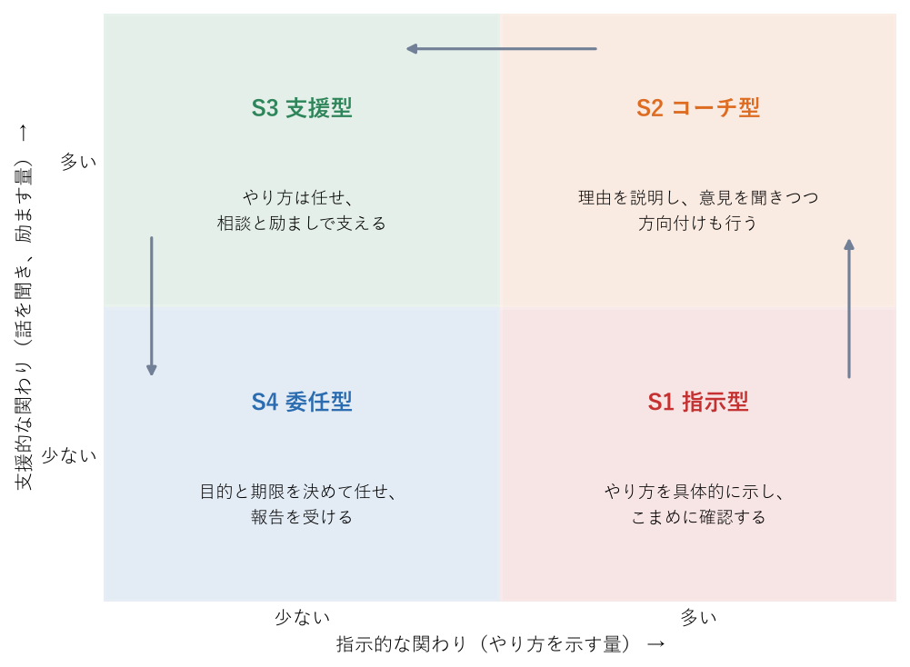

.. _chap-delegation:

仕事を任せる
==================================

.. admonition:: この章で学ぶこと
   :class: note

   * 仕事を任せることが、マネージャーとメンバーの双方にとってなぜ必要か
   * 任せられない心理の正体と、任せる仕事・任せにくい仕事の見分け方
   * 委任のレベルと、状況対応型リーダーシップ（S1〜S4）による関わり方の変え方
   * 任せるときに伝えるべきことと、任せた後のフォローの仕方

プレイヤーとして優秀だった人ほど、マネージャーになったときに「仕事を任せる」ことに苦労する。自分でやれば早く確実に終わる仕事を、あえて他の人に任せるのは、もどかしく不安なものである。しかし、マネージャーがすべての仕事を抱え込めば、チームの成果はマネージャー 1 人の能力と時間を超えられない。

この章では、仕事を任せる、つまり\ :term:`権限委譲`\ の考え方と実践を扱う。任せる相手や仕事の性質に応じて任せ方を変える方法、任せるときに伝えること、任せた後の関わり方を順に説明する。

なぜ任せるのか
----------------------------------------------

マネージャーの時間のてこ
^^^^^^^^^^^^^^^^^^^^^^^^^^^^^^^^^^^^^^^^^^^^

グローブは、マネージャーの成果を「自分の組織の成果と、自分が影響を及ぼす周囲の組織の成果の合計」と定義した\ [Grove2017]_\ 。この考え方に立つと、マネージャーが自分で作業してこなせる量は、チーム全体の成果のごく一部にすぎない。マネージャーの 1 時間が、チーム全体の成果をどれだけ動かすかという「てこ」の大きさが重要になる。

任せることは、このてこを大きくする代表的な方法である。マネージャーが手放した仕事をメンバーが担えば、マネージャーは目標設定、優先順位付け、育成、他部署との調整など、マネージャーにしかできない仕事に時間を使える。マネージャーの役割の全体像は\ :ref:`chap-what-is-management`\ を参照のこと。

メンバーの成長
^^^^^^^^^^^^^^^^^^^^^^^^^^^^^^^^^^^^^^^^^^^^

任せるもう 1 つの理由は、メンバーの成長である。人は、研修や本よりも、実際の仕事で少し背伸びした経験を積むことで最も大きく成長するといわれる（\ :ref:`chap-feedback`\ を参照）。マネージャーが難しい仕事や判断を伴う仕事をすべて自分で引き受けていると、メンバーは成長の機会を失う。任せることは、メンバーに成長の機会を渡すことでもある。

また、メンバーが育てばマネージャーが不在でもチームが回るようになる。特定の人に頼り切った状態は、その人が休んだり異動したりしたときのリスクになる。これはマネージャー自身にも当てはまる。

任せられない理由と心理
----------------------------------------------

任せた方がよいと頭で分かっていても、実際にはなかなか任せられない。その背景には、次のような心理がある。

* **自分でやった方が早い。** 説明する時間を考えると、自分でやった方が早いのは事実であることが多い。しかしそれは今回 1 回だけの話である。同じ種類の仕事が繰り返し発生するなら、最初に説明する時間は後で何倍にもなって返ってくる。
* **品質への不安がある。** 自分と同じ品質で仕上がらないのではないかという不安である。実際、最初は品質が落ちることもある。しかし「自分のやり方と違う」ことと「品質が低い」ことは別である。結果が目的を満たしていれば、やり方の違いは受け入れる。
* **仕事を奪われる不安がある。** 得意な仕事を手放すと、自分の存在価値がなくなるように感じることがある。プレイヤーとして評価されてきた人ほど、この不安は強い。マネージャーの価値は、自分で作業する量ではなく、チームの成果で測られることを思い出す。
* **相手に負担をかけるのが申し訳ない。** 忙しそうなメンバーに仕事を頼むのをためらう気持ちである。この場合は、任せる代わりにその人の別の仕事を減らせないかを考える。

自分がどの理由で任せられずにいるのかを自覚するだけでも、行動は変わりやすい。「今週、自分で抱えている仕事のうち、本当に自分でなければできないものはどれか」を一度書き出してみるとよい。

何を任せるか
----------------------------------------------

すべての仕事を同じように任せられるわけではない。任せてよい仕事と、任せにくい仕事の例を示す。

.. list-table:: 任せてよい仕事と任せにくい仕事の例
   :header-rows: 1
   :widths: 50 50

   * - 任せてよい仕事（任せることを積極的に考える）
     - 任せにくい仕事（マネージャーが担うか、慎重に扱う）
   * - 繰り返し発生する定型的な仕事
     - 人事評価や処遇の最終判断
   * - メンバーの成長につながる、少し難しい仕事
     - メンバーの個人的な事情に関わる対応や機密性の高い情報の扱い
   * - メンバーの方が詳しい、または得意な仕事
     - チームの目的や優先順位の最終決定
   * - マネージャー自身が以前担当していて、手放せずにいる仕事
     - 重大なトラブルの初期対応での責任ある判断
   * - 失敗しても取り返しがつき、学びが大きい仕事
     - 会社のルールや法令上、管理職が行うと決められている仕事

任せにくい仕事でも、一部を切り出して任せることはできる。たとえば、評価の最終判断はマネージャーが行うが、成果の資料をまとめる作業は本人に任せる、といった形である。また、任せる仕事は「面倒な仕事」ばかりにならないよう注意する。やりがいのある仕事や目立つ仕事も任せることで、メンバーの意欲と成長につながる。

任せ方の段階
----------------------------------------------

「任せる」には、全部を丸投げするか、全部を自分でやるかの二択ではなく、いくつかの段階がある。誰が決めるのか、いつ報告するのかによって、委任のレベルを次のように分けて考えられる。

.. list-table:: 委任のレベル
   :header-rows: 1
   :widths: 10 35 25 30

   * - レベル
     - 進め方
     - 決めるのは誰か
     - 向いている場面
   * - 1
     - マネージャーが決めた手順どおりに実行してもらう
     - マネージャー
     - 初めて取り組む仕事、ミスが許されない仕事
   * - 2
     - 調べて選択肢を出してもらい、マネージャーが選ぶ
     - マネージャー
     - 判断の材料集めから経験させたいとき
   * - 3
     - 案を出してもらい、マネージャーが承認してから実行する
     - 本人が提案し、マネージャーが承認
     - ある程度経験があり、判断の練習をさせたいとき
   * - 4
     - 本人が決めて実行し、結果を報告してもらう
     - 本人
     - 経験と実績があり、判断を信頼できるとき
   * - 5
     - 完全に任せ、必要なときだけ報告してもらう
     - 本人
     - その仕事について本人が十分に熟達しているとき

仕事を任せるときに「この件はレベル 3 でお願いしたい。案ができたら一度見せてほしい」のように段階をはっきり伝えると、「どこまで自分で決めてよいのか分からない」という迷いを防げる。最初は低いレベルから始め、うまくいったら段階を上げていくのが基本である。

状況対応型リーダーシップ
----------------------------------------------

任せ方を相手に合わせて変えるための考え方として、ハーシーとブランチャードによる\ :term:`状況対応型リーダーシップ`\ がある\ [Hersey1969]_\ 。この理論は、すべての場面に通用する唯一のリーダーシップのスタイルはなく、相手の状態に応じて関わり方を変えるべきだとする。関わり方は、やり方を具体的に示す「指示的な関わり」と、話を聞き励ます「支援的な関わり」の 2 つの軸で、4 つのスタイルに分けられる（\ :numref:`fig-delegation-styles`\ ）。

   状況対応型リーダーシップの 4 つのスタイル

.. list-table:: 4 つのスタイルと相手の状態
   :header-rows: 1
   :widths: 15 35 50

   * - スタイル
     - 相手の状態の目安
     - 関わり方
   * - S1 指示型
     - その仕事の経験が少なく、やり方がまだ分からない
     - やり方を具体的に示し、こまめに確認する
   * - S2 コーチ型
     - 少しできるようになったが、壁に当たって自信や意欲が揺らいでいる
     - 方向付けを続けながら、理由を説明し、意見を聞き、励ます
   * - S3 支援型
     - 能力は十分にあるが、自信や意欲に波がある
     - やり方は任せ、相談に乗り、励まして支える
   * - S4 委任型
     - 能力も意欲も高く、自分で判断して進められる
     - 目的と期限を決めて任せ、報告を受ける

この理論から実践で生かせる点は、次の 2 つである。

1 つ目は、**相手に合わない関わり方は逆効果になる**\ ことである。経験の浅いメンバーに「任せたから自由にやって」と S4 で接すれば、本人は何をすればよいか分からず不安になる。逆に、十分に経験のあるメンバーに S1 で細かく指示すれば、信頼されていないと感じて意欲を失う。

2 つ目は、**同じ人でも仕事の種類によって段階が変わる**\ ことである。資料作成では S4 で任せられるベテランでも、初めて担当する予算管理では S1 や S2 の関わりが必要かもしれない。「この人は S3」と人に固定のラベルを貼るのではなく、「この人のこの仕事は S3」と仕事ごとに考える。グローブも、同じ人でも仕事ごとの成熟度に応じてマネジメントのスタイルを変えるべきだと述べている\ [Grove2017]_\ 。

なお、状況対応型リーダーシップは後にいくつかの版に分かれ、呼び名や細部が異なる。また、理論の有効性を裏付ける研究結果は一様ではないとも指摘されている。厳密な理論として当てはめるより、「相手と仕事に応じて関わり方を変える」という考え方の手がかりとして使うのがよい。S2 や S3 で必要になる\ :term:`コーチング`\ と\ :term:`ティーチング`\ の使い分けについては\ :ref:`chap-feedback`\ で扱う。

任せるときに伝えること
----------------------------------------------

任せた仕事がうまくいかない原因の多くは、任せる時点での伝え漏れにある。仕事を任せるときは、少なくとも次の項目を伝える。

.. list-table:: 任せるときに伝える項目
   :header-rows: 1
   :widths: 20 35 45

   * - 項目
     - 内容
     - 伝え方の例
   * - 目的
     - なぜこの仕事をするのか。誰の役に立つのか
     - 「新しく来た人が早く仕事に慣れられるようにしたい」
   * - 期待する成果
     - 何ができあがれば完了か。品質の基準は何か
     - 「主な業務 10 件の手順書。新任者が手順書だけで作業できる状態が目標」
   * - 期限
     - 最終の期限と、途中の区切り
     - 「11 月末までに完成。11 月 10 日に目次案を見せてほしい」
   * - 権限の範囲
     - どこまで自分で決めてよいか。委任のレベル
     - 「書式や構成は任せる。他部署に協力を頼む場合は事前に相談してほしい」
   * - 使えるリソース
     - 使ってよい時間、予算、協力者、資料など
     - 「週に 4 時間程度を充ててよい。昨年の資料は共有フォルダーにある」
   * - 報告のタイミング
     - いつ、どのような形で進み具合を共有するか
     - 「毎週の :term:`1on1` で状況を教えてほしい。困ったらいつでも声をかけて」

特に重要なのは\ **目的**\ である。目的が伝わっていれば、想定外のことが起きてもメンバーは自分で判断できる。逆に、手順だけを伝えて目的を伝えないと、手順どおりに進めても目的を外した成果になることがある。

伝えた後は、メンバーに自分の言葉で理解した内容を説明してもらうと、認識のずれに早く気付ける。「何か質問はある？」と聞くだけでは、分かったつもりのまま進んでしまうことが多い。

任せた後のフォロー
----------------------------------------------

マイクロマネジメントと放任の間
^^^^^^^^^^^^^^^^^^^^^^^^^^^^^^^^^^^^^^^^^^^^

任せた後の関わり方には、2 つの失敗がある。1 つは、任せたはずなのに細部まで口を出し、やり方を指示し続ける\ :term:`マイクロマネジメント`\ である。メンバーの意欲と自分で考える力を奪い、マネージャー自身の時間も減らす。もう 1 つは、任せたきり何も確認しない放任である。問題が手遅れになってから発覚する。グローブは、フォローをしない委任は放棄にすぎないと述べている\ [Grove2017]_\ 。

目指すのはその間である。関わりの量は、前節の委任のレベルや状況対応型リーダーシップのスタイルに合わせて調整する。経験の浅い仕事では確認の頻度を高くし、慣れてきたら頻度を下げていく。

チェックポイントを設ける
^^^^^^^^^^^^^^^^^^^^^^^^^^^^^^^^^^^^^^^^^^^^

任せるときに、途中で状況を確認するチェックポイントをあらかじめ決めておく。たとえば「目次案ができた時点」「半分まで進んだ時点」などである。事前に合意しておけば、確認することが監視ではなく約束どおりの段取りになり、メンバーも構えずに済む。

チェックポイントでは、マネージャーが答えを出すのではなく、まずメンバーに状況と考えを話してもらう。問題があっても、すぐに取り上げて自分でやり直すのではなく、本人が直せるように手がかりを示す。ただし、期限や品質に重大な影響が出そうなときは、ためらわずに介入する。

失敗したときの責任はマネージャーが負う
^^^^^^^^^^^^^^^^^^^^^^^^^^^^^^^^^^^^^^^^^^^^

任せた仕事で失敗が起きることはある。そのとき、対外的な責任はマネージャーが負う。仕事を任せても、チームの成果に対する責任までは手放せない。上司や他部署に対して「担当者がミスをしたので」と説明するのではなく、「私の確認が不十分だった」として対応する。

そのうえで、メンバーとは失敗から学ぶための振り返りを行う。何が起きたのか、どこで気付けたか、次にどうするかを一緒に考える。失敗したメンバーを責めたり、すぐに仕事を取り上げたりすると、メンバーは挑戦しなくなり、問題を隠すようになる。失敗を学びに変える関わり方は\ :ref:`chap-feedback`\ 、失敗を話しやすい雰囲気づくりは\ :ref:`chap-team-building`\ で扱う。

仕事がうまくいったときは、成果をメンバーのものとして上司や周囲に伝える。失敗の責任はマネージャーが引き受け、成功の手柄はメンバーに渡す。この姿勢が、メンバーが安心して挑戦できる土台になる。

エンジニアのチームで任せる
----------------------------------------------

.. admonition:: エンジニアのチームでは
   :class: tip

   **設計判断の任せ方**: 設計判断には、後から簡単に変えられるものと、一度決めると変更に大きな費用がかかるものがある。前者は担当者に広く任せ、後者（システム全体の構造、データの形式、外部に公開する仕組みなど）は設計の文書を書いてもらい、チームやテックリードのレビューを経て決めるとよい。どの種類の判断を誰が決めるかを事前に合意しておくと、判断のたびに迷わずに済む。マネージャーとは別に\ :term:`テックリード`\ がいる場合は、技術的な判断はテックリードに任せ、マネージャーは目的や制約、人の割り当てを担うといった役割分担を明確にしておく。

   **コードレビューでの介入の度合い**: コードレビューは、品質を守る仕組みであると同時に、任せ方が表れやすい場面でもある。マネージャーやベテランが細かな好みの違いまで修正を求めると、レビューがマイクロマネジメントになる。「必ず直してほしい指摘」と「好みの範囲の提案」を区別して伝え、後者は本人の判断に任せる。レビューで自分が書き直してしまうのではなく、なぜそうした方がよいのかを説明し、本人に直してもらう。

   **技術選定**: 新しいライブラリーやサービスの採用など、技術選定をメンバーに任せる場面も多い。この場合、マネージャーは選定の結論を指示するのではなく、判断の基準（保守のしやすさ、チームの習熟度、費用、セキュリティー、社内のルールなど）と制約を示し、比較した結果と推奨を出してもらう。委任のレベルでいえば 3 から始め、実績に応じて 4 に上げていくのが一つの目安である。

よくある失敗
----------------------------------------------

.. list-table:: 仕事を任せるときによくある失敗と対策
   :header-rows: 1
   :widths: 35 65

   * - 失敗例
     - 対策
   * - 「自分でやった方が早い」と考え、いつまでも仕事を抱え込む。
     - 繰り返し発生する仕事から任せ、最初の説明の時間を投資と考える。
   * - 目的や期待する成果を伝えずに任せ、期待と違う成果物が出てくる。
     - 目的、成果、期限、権限、リソース、報告のタイミングを伝え、本人の言葉で説明してもらう。
   * - 任せた後に細部まで口を出し、メンバーの意欲を下げる。
     - 委任のレベルを事前に合意し、やり方の違いは結果が目的を満たす限り受け入れる。
   * - 任せたきり確認せず、締め切り直前に問題が発覚する。
     - チェックポイントを事前に決め、仕事の難しさに応じて確認の頻度を調整する。
   * - 経験の浅いメンバーにいきなり全部を任せ、本人が困り果てる。
     - 相手のその仕事に対する経験と意欲に応じて、S1 から段階的に任せる。
   * - 一度「この人はできる」と判断し、どの仕事でも同じ任せ方をする。
     - 同じ人でも仕事の種類ごとに段階を判断する。
   * - 面倒な仕事ばかりを任せ、やりがいのある仕事は自分で抱える。
     - 成長につながる仕事や目立つ仕事も任せる。
   * - 失敗したメンバーを上司の前で責め、すぐに仕事を取り上げる。
     - 対外的な責任はマネージャーが負い、メンバーとは学びのための振り返りを行う。

チェックリスト
----------------------------------------------

* 自分が抱えている仕事のうち、自分でなければできない仕事を区別しているか。
* 任せない理由が「自分でやった方が早い」だけになっていないか。
* 任せる仕事に、メンバーの成長につながる仕事が含まれているか。
* 任せるときに、委任のレベル（どこまで本人が決めてよいか）を伝えているか。
* 相手のその仕事に対する経験と意欲に合わせて、関わり方を選んでいるか。
* 目的、期待する成果、期限、権限の範囲、使えるリソース、報告のタイミングを伝えたか。
* 伝えた内容を、メンバー自身の言葉で説明してもらったか。
* 途中のチェックポイントを事前に合意しているか。
* やり方の違いを、品質の低さと混同していないか。
* 失敗したとき、対外的な責任を自分が引き受けているか。
* 成功したとき、成果をメンバーのものとして周囲に伝えているか。

まとめ
----------------------------------------------

* 任せることは、マネージャーの時間のてこを大きくし、メンバーに成長の機会を渡すことである。
* 任せられない心理を自覚し、任せてよい仕事から段階を決めて任せる。
* 状況対応型リーダーシップに沿って、相手と仕事ごとに指示的な関わりと支援的な関わりの量を変える。
* 任せるときは目的を中心に必要な項目を伝え、任せた後はマイクロマネジメントと放任の間でチェックポイントを設けてフォローする。
* 失敗の責任はマネージャーが負い、成功の手柄はメンバーに渡す。
