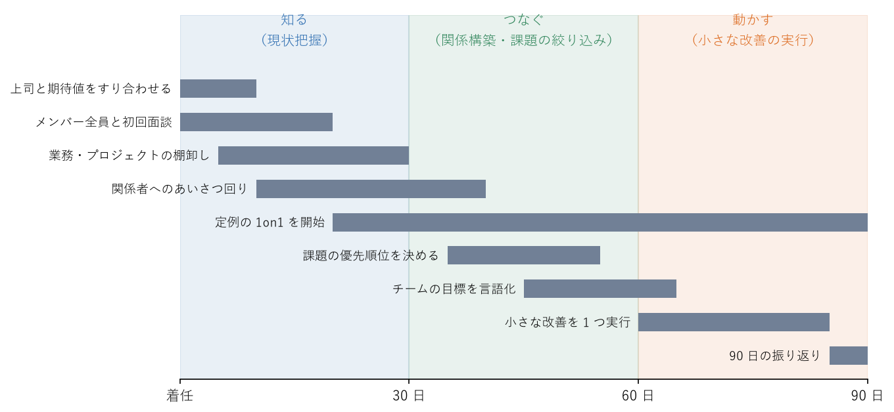

.. _chap-first-90-days:

着任直後にやること
============================

.. admonition:: この章で学ぶこと
   :class: note

   * 着任後 90 日を「知る」「つなぐ」「動かす」の 3 段階で進める考え方
   * 上司、前任者、メンバー、関係者と最初に話すべきこと
   * 業務の棚卸しと、取り組む課題の選び方
   * 外部から着任した場合と内部から昇格した場合の注意点

着任直後の数か月は、マネージャーにとって特別な期間である。周囲はまだ新しいマネージャーを評価しておらず、質問をしても不自然に思われない。一方で、この時期の振る舞いは第一印象として長く残る。焦って大きな変更をすれば反発を招き、何もしなければ「何をしたいのか分からない人」と見られる。この章では、着任から約 90 日をどう過ごすかを、具体的な行動に落として説明する。

最初の 90 日の考え方
------------------------------------

着任後の 90 日は、\ :numref:`fig-first-90-days` のように「知る」「つなぐ」「動かす」の 3 段階で考えるとよい。

   着任後 90 日のタイムライン

.. list-table:: 3 つの段階でやること
   :header-rows: 1
   :widths: 18 18 64

   * - 段階
     - 目安の時期
     - 主にやること
   * - 知る
     - 0〜30 日
     - 上司との期待値のすり合わせ、前任者からの引き継ぎ、メンバーとの初回面談と定例の :term:`1on1` の開始、業務・プロジェクトの棚卸し
   * - つなぐ
     - 30〜60 日
     - 他部署や顧客など関係者との関係づくり、会議など仕事の進め方の仕組みづくり、課題の整理と優先順位付け
   * - 動かす
     - 60〜90 日
     - 小さな改善の実行と成果の共有、次の四半期や半期に向けた目標と計画づくり

期間は目安であり、厳密に区切る必要はない。チームの状況によっては、着任初日から重要な判断を迫られることもある。大切なのは、**理解する前に大きく変えない**\ 、\ **理解したら小さく始めて早めに成果を示す**\ という順序である。

上司との期待値のすり合わせ
------------------------------------

着任して最初にやるべきことは、上司との期待値のすり合わせである。マネージャーの成果はチームの成果で測られるが（\ :ref:`chap-what-is-management`\ を参照）、何をもって「成果」とするかは上司や組織によって異なる。ここをあいまいにしたまま動くと、自分は頑張っているのに評価されないという事態になりかねない。

着任後 1〜2 週間のうちに、上司と 1 時間程度の時間をとり、次のような質問で確認するとよい。

.. list-table:: 上司に確認すべき質問の例
   :header-rows: 1
   :widths: 22 78

   * - 観点
     - 質問の例
   * - 期待
     - 「このチームに、半年後・1 年後にどうなっていてほしいですか」「私に一番期待していることは何ですか」
   * - 評価
     - 「私の仕事は、何を基準に評価されますか」「最初の 3 か月で、どのような状態になっていれば合格だと考えますか」
   * - 現状認識
     - 「このチームの強みと課題は何だと見ていますか」「すぐに手を打つべき問題はありますか」
   * - 優先順位
     - 「今のチームの仕事のうち、最も優先すべきものはどれですか」「やめてもよい仕事はありますか」
   * - 権限
     - 「私が自分で決めてよいことと、相談が必要なことの線引きはどこですか」「予算や採用にはどこまで関われますか」
   * - 人
     - 「メンバーについて、知っておくべきことはありますか」「特に気にかけるべき人はいますか」
   * - 関係者
     - 「関係を築いておくべき人や部署はどこですか」
   * - 報告・相談
     - 「どのくらいの頻度で、どのような形で報告すればよいですか」「どのような問題は、すぐに知らせてほしいですか」

上司の答えがあいまいな場合は、自分の理解を言葉にして「つまり、最初の 3 か月は○○を優先すればよいという理解で合っていますか」と確認する。話した内容は簡単なメモにして共有しておくと、後で認識のずれに気付きやすい。上司との関係づくりの詳細は\ :ref:`chap-managing-up`\ で扱う。

前任者からの引き継ぎ
------------------------------------

前任者がいる場合は、異動や退職で連絡が取りにくくなる前に、できるだけ早く引き継ぎの時間をとる。資料を受け取るだけでなく、資料に書かれていない背景や経緯を聞くことが大切である。

次のような点を確認するとよい。

* 進行中のプロジェクトと、その状況・期限・リスク
* 他部署や顧客と交わしている約束、締め切りが近い案件
* 定例会議、定期的に出している報告、承認が必要な手続きなど、マネージャーとして続ける必要がある仕事
* メンバーそれぞれの担当業務、強み、育成上の課題、評価の経緯
* 過去に起きた大きな問題と、その対応の経緯
* 前任者が「やりたかったが、できなかったこと」

メンバーに関する前任者の評価は参考にとどめ、うのみにしない。前任者の見方には前任者との関係が反映されており、新しいマネージャーのもとでは違う面が見えることも多い。メンバーについては、自分の目で見て判断する。

また、評価や処遇、個人的な事情など、機微な情報の扱いには注意する。前任者から聞いた個人的な事情を、本人の確認なしに他の人に話してはならない。

メンバーとの初回面談
------------------------------------

着任後なるべく早く、メンバー一人ひとりと個別に話す時間をとる。チーム全体への挨拶だけでは、メンバーは本音を話さない。1 人 30 分〜1 時間程度を目安に、着任後 2 週間以内には全員と話し終えたい。

目的
^^^^^^^^^^^^

初回面談の目的は、評価や指示ではなく、お互いを知り、信頼関係の土台をつくることである。具体的には次の 3 つを意識する。

* 相手を知る: 担当している仕事、得意なこと、これまでの経緯、今後やりたいこと
* チームの現状を知る: うまくいっていること、困っていること、変えたほうがよいと思うこと
* 自分を知ってもらう: 自分の経歴、大切にしていること、どのように仕事を進めたいか

最初の面談で、自分の方針を長々と語ったり、その場で問題の解決策を約束したりするのは避ける。聞いた内容は「まずは全員の話を聞いてから考えたい」と受け止めるにとどめ、後で必ず何らかの形で応える。

質問例
^^^^^^^^^^^^

.. list-table:: 初回面談の質問例
   :header-rows: 1
   :widths: 25 75

   * - 目的
     - 質問の例
   * - 仕事を知る
     - 「今はどのような仕事を担当していますか」「1 週間のうち、どの仕事に一番時間を使っていますか」
   * - 現状を知る
     - 「チームでうまくいっていることは何ですか」「仕事を進めるうえで困っていることや、障害になっていることはありますか」
   * - 改善の種を知る
     - 「あなたがマネージャーだったら、最初に何を変えますか」「やめてもよいと思う仕事や会議はありますか」
   * - 本人を知る
     - 「得意なこと、やっていて楽しい仕事は何ですか」「これから伸ばしたいことや、挑戦したいことはありますか」
   * - 関わり方を知る
     - 「マネージャーにはどのように関わってほしいですか」「相談しやすいのは、どのような形（チャット、対面など）ですか」
   * - 聞き漏らしを防ぐ
     - 「ほかに、私が知っておいたほうがよいことはありますか」

すべてを聞く必要はなく、相手の様子を見ながら選ぶ。初回面談の後は、定例の 1on1 に移行する。1on1 の目的と進め方は\ :ref:`chap-communication`\ で詳しく説明する。

業務・プロジェクトの棚卸し
------------------------------------

チームが今どのような仕事を抱えているかを、一覧にして把握する。マネージャーが把握していない仕事は、優先順位付けも割り振りの見直しもできない。

棚卸しでは、仕事ごとに次の項目を整理するとよい。

.. list-table:: 棚卸しで整理する項目の例
   :header-rows: 1
   :widths: 25 75

   * - 項目
     - 内容
   * - 仕事の名前と目的
     - 何のための仕事か、誰のための仕事か
   * - 担当者
     - 誰が担当しているか、その人以外にできる人はいるか
   * - 期限と状況
     - いつまでに何を終える必要があるか、予定どおり進んでいるか
   * - 規模
     - どのくらいの工数がかかっているか（おおよそでよい）
   * - 依頼元・関係者
     - 誰からの依頼か、誰に影響するか
   * - 問題・リスク
     - 遅れや品質の問題、担当者への負荷の偏りなど

棚卸しをすると、目的が分からなくなった仕事、特定の人にしかできない仕事、期限が迫っているのに誰も気付いていない仕事などが見えてくる。これらは後述する課題の候補になる。一覧はメンバーにも共有し、抜けや誤りを指摘してもらうと精度が上がる。

関係者との関係づくり
------------------------------------

チームの成果は、他部署、顧客、協力会社など、チームの外の人との協力に大きく左右される。困ったときに初めて連絡するのではなく、着任の挨拶を兼ねて早めに顔を合わせておく。

* 上司から聞いた「関係を築いておくべき人や部署」と、棚卸しで分かった依頼元・関係者を一覧にする
* 主要な関係者には個別に時間をもらい、「私たちのチームに期待していること」「今困っていること」「これまでのやり取りで改善してほしいこと」を聞く
* 同じ立場のマネージャー（同僚のマネージャー）とも関係をつくる。社内の暗黙のルールや、困ったときの相談先を教えてもらえることが多い
* 人事部門など、メンバーの労務や評価で相談することになる窓口を確認しておく

関係者から聞いた不満は、チームの課題を知る手がかりになる。ただし、関係者の話だけを根拠にメンバーを責めることはしない。双方の話を聞いてから判断する。

課題の見極めと優先順位付け
------------------------------------

知る段階とつなぐ段階で集めた情報をもとに、チームの課題を整理し、何から手を付けるかを決める。

いきなり大きく変えない
^^^^^^^^^^^^^^^^^^^^^^^^^^^^^^^^^^^^

新しいマネージャーは、着任直後にチームのやり方の非効率や問題に気付きやすい。しかし、今のやり方には、外から見えない理由があることも多い。理由を知らないまま大きく変えると、メンバーの反発を招き、ときには以前の問題を再発させる。一見おかしなやり方を見つけたら、まず「なぜこうなっているのか」を聞く。

ただし、法令違反、安全や健康に関わる問題、顧客に大きな損害を与えるおそれがある問題など、放置できない問題はこの限りではない。そうした問題を見つけた場合は、すぐに上司に報告し、対応を相談する。

小さな成果から始める
^^^^^^^^^^^^^^^^^^^^^^^^^^^^^^^^^^^^

最初に取り組む課題は、次の条件を満たすものから選ぶとよい。

* メンバーが困っていると口をそろえて言っていること
* 数週間で効果が見えること
* マネージャーの権限の範囲で実行できること

たとえば、目的の分からない定例会議を見直す、承認の手続きで止まっている仕事を流す、特定の人に偏った問い合わせ対応を分担するなどである。小さくても「新しいマネージャーは話を聞いて、実際に動いてくれた」という経験は、メンバーの信頼につながる。大きな課題は、その信頼を土台にして、次の四半期以降の目標として取り組む。課題の優先順位の付け方は\ :ref:`chap-goals`\ で扱う。

外部から来た場合と内部昇格の場合の違い
------------------------------------------------------------------------

着任の仕方によって、気を付けるべき点が異なる。

外部から着任した場合
^^^^^^^^^^^^^^^^^^^^^^^^^^^^^^^^^^^^^^^^

他部署や他社から着任した場合は、チームの仕事や文化、社内の人間関係を知らないところから始まる。メンバーからは「自分たちの仕事を分かっていない人」と見られやすい。

* 知らないことは素直に聞く。分かったふりをしない
* 「前の職場ではこうだった」という話を繰り返さない。比較されているように感じたり、今のやり方を否定されているように感じたりするメンバーが多い
* 社内の仕組み（承認の流れ、人事制度、会議体など）は早めに確認する。分からないことは上司や同僚のマネージャーに聞く

内部から昇格した場合
^^^^^^^^^^^^^^^^^^^^^^^^^^^^^^^^^^^^^^^^

同じチームのメンバーから昇格した場合は、仕事や人をよく知っている強みがある。一方で、元同僚がメンバーになるという難しさがある。

* 関係が変わったことを、自分から言葉にする。「立場が変わったので、これまでと違う関わり方をすることもあると思う。その分、話はちゃんと聞きたい」のように伝えておくと、お互いに戸惑いが減る
* 親しかった同僚とそうでない同僚とで、扱いに差をつけない。昼食や雑談の相手が偏るだけでも、えこひいきと受け取られることがある
* マネージャーに選ばれなかった同僚がいる場合は、その人の気持ちに配慮しつつ、本人の強みや今後のキャリアについて早めに話す機会をつくる
* 元同僚に対して、遠慮から必要な指摘を避けない。指摘を先送りすると、他のメンバーからの信頼を失う
* 「自分が一番この仕事を知っている」という意識から、自分で手を動かし続けやすい。マネージャーとしての仕事に時間を割く（\ :ref:`chap-what-is-management`\ を参照）

.. admonition:: エンジニアのチームでは
   :class: tip

   エンジニアのチームでは、上記に加えて、チームが担当するシステムの状態を早めに把握する。マネージャー自身が細部まで理解する必要はないが、全体像とリスクの所在を知らないと、障害時の判断や優先順位付けができない。

   * **システム構成**: チームが担当するシステムやサービスの一覧、全体の構成図、依存している他チームのシステムや外部サービスを確認する。構成図がなければ、メンバーにホワイトボードで説明してもらうだけでも全体像がつかめる
   * **障害履歴**: 過去 1 年程度の主な障害と、その原因・対応・再発防止策を確認する。障害報告書や振り返りの記録があれば読む。繰り返し起きている障害は、優先すべき課題の候補である
   * **技術的負債**: 短期的な都合を優先した設計や実装のために将来の変更や保守の手間が増えている部分、つまり\ :term:`技術的負債`\ がどこにあり、開発の速度や障害にどう影響しているかをメンバーに聞く。負債の解消にどの程度の時間を割いているかも確認する
   * **オンコール体制**: 夜間・休日の障害対応（オンコール）の当番体制、連絡の流れ、\ :term:`エスカレーション`\ 先、負荷の偏りを確認する。オンコールの負荷が特定の人に集中していないか、労働時間の管理が適切かも見ておく（労働時間の扱いは\ :ref:`chap-rules`\ を参照）
   * **属人化**: 特定の人しか分からないシステムや作業がないかを確認する。何人が不在になると仕事が止まるかを表す\ :term:`バス係数`\ が 1 の領域（1 人いなくなるだけで止まる領域）は、リスクとして記録しておく

   着任直後に技術選定や設計方針を大きく変えたくなっても、まずは経緯を聞く。チームにテックリードがいる場合は、技術面の判断を誰が担うかを早めにすり合わせておく。

よくある失敗
------------------------------------

.. list-table:: 着任直後によくある失敗と対策
   :header-rows: 1
   :widths: 35 65

   * - 失敗
     - 対策
   * - 状況を理解する前に、大きな方針転換や体制変更を打ち出す
     - 最初の 1 か月は話を聞くことに徹し、変える前に「なぜ今のやり方なのか」を確認する。放置できない問題だけは上司に相談のうえで先に対処する
   * - 上司と期待値をすり合わせないまま、自分が大事だと思うことに取り組む
     - 着任後 1〜2 週間のうちに、期待、評価の基準、優先順位、権限を上司と確認し、メモにして共有する
   * - 一部のメンバーとしか話さず、全体像をつかめない
     - 着任後 2 週間以内に全員と個別に話す。声の大きい人の意見だけで判断しない
   * - 初回面談で聞いた要望に、何も応えないまま時間が過ぎる
     - 聞いた内容を整理し、「すぐやること」「検討すること」「今はやらないこと」に分けてチームに伝える
   * - 前任者の評価をそのまま信じ、メンバーに先入観を持つ
     - 前任者の話は参考にとどめ、自分で一緒に仕事をしてから判断する
   * - 知る段階に時間をかけすぎ、90 日たっても何も動いていない
     - 遅くとも「動かす」段階（60〜90 日）では小さな改善を 1 つ以上実行し、成果をチームと上司に共有する
   * - 元同僚に遠慮して、必要な指摘や判断を先送りする
     - 関係が変わったことを自分から伝え、全員に同じ基準で接する

チェックリスト
------------------------------------

* 上司と、期待・評価の基準・優先順位・権限の範囲をすり合わせ、メモにして共有したか
* 前任者から、進行中の案件、関係者との約束、続けるべき定例業務を引き継いだか
* 着任後 2 週間以内に、メンバー全員と個別に話したか
* 初回面談で聞いた内容を整理し、何らかの形でメンバーに応えたか
* 定例の 1on1 の予定を全員分設定したか
* チームの仕事を一覧にし、担当者、期限、状況、リスクを把握したか
* 主要な関係者（他部署、顧客、同僚のマネージャー、人事など）と顔を合わせたか
* 放置できない問題（法令、安全・健康、顧客への重大な影響）がないかを確認し、あれば上司に報告したか
* 最初に取り組む小さな課題を決め、実行したか
* （内部昇格の場合）立場が変わったことを、元同僚に自分の言葉で伝えたか
* （エンジニアのチームの場合）システム構成、障害履歴、技術的負債、オンコール体制を把握したか

まとめ
------------------------------------

* 着任後 90 日は「知る」「つなぐ」「動かす」の順で進め、理解する前に大きく変えない。
* 最初に上司と期待値をすり合わせ、メンバー全員と個別に話し、チームの仕事を棚卸しする。
* 関係者とは困る前に関係をつくっておく。
* 取り組む課題は小さく始め、早めに成果を示して信頼の土台をつくる。
* 外部から来た場合は謙虚に学び、内部昇格の場合は関係の変化を自分から言葉にする。
