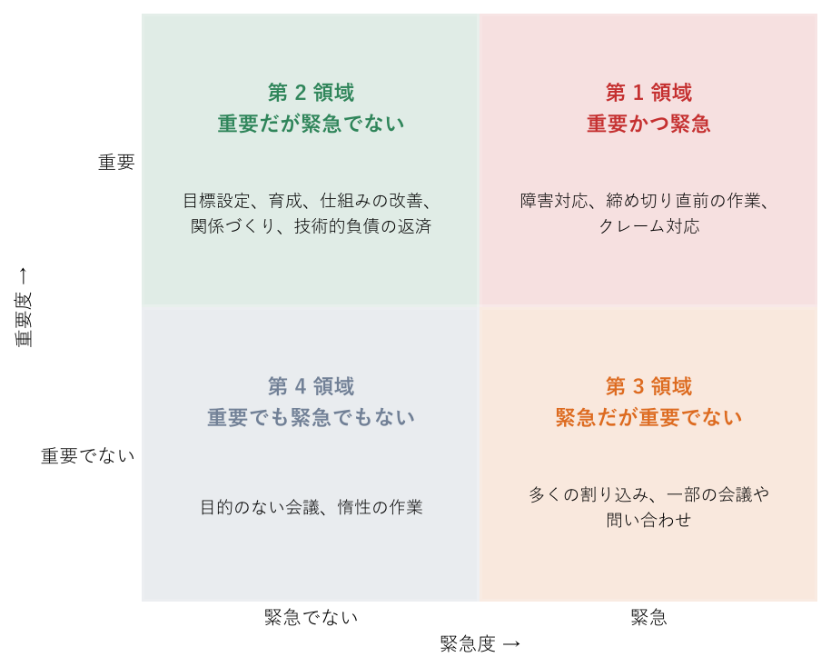

.. _chap-goals:

目的と目標を定める
==================================

.. admonition:: この章で学ぶこと
   :class: note

   * 目的と目標の違いと、チームの存在意義を言葉にする方法
   * SMART を使ってあいまいな目標を具体的な目標に書き換える方法
   * KGI と KPI、OKR と MBO の考え方と違い
   * 緊急度と重要度のマトリクスで優先順位を付け、やらないことを決める方法
   * 目標をメンバーと共有し、定期的に見直す方法

チームを持つと、毎日のように「これは急ぎですか」「どちらを先にやればよいですか」と聞かれる。そのたびにマネージャーが個別に判断していては、マネージャーが判断の渋滞を起こし、チームの動きは遅くなる。逆に、チームが何のために存在し、いつまでに何を達成するのかがはっきりしていれば、メンバーは自分で判断して動ける。目的と目標を定めることは、マネジメントの仕事の中でも最も影響範囲が大きい仕事の 1 つである。

この章では、目的と目標の考え方から、具体的な目標の書き方、指標の選び方、優先順位の付け方、そして目標をチームで共有し見直す方法までを扱う。目標を人事評価にどう使うかは\ :ref:`chap-evaluation`\ で扱う。

なぜ目的と目標が必要か
----------------------------------------------

目的と目標は似た言葉だが、役割が違う。**目的は「なぜやるのか」**、つまり仕事の意味や行き先を示す。**目標は「いつまでに、どこまでやるのか」**、つまり目的に近づいたかどうかを確かめる目印である。たとえば「お客様が迷わずに製品を使える状態をつくる」は目的であり、「9 月末までに問い合わせへの初回回答時間を 4 時間以内にする」は目標である。

目的と目標がそろうと、次のような効果がある。

* **判断の基準になる。** 複数の依頼が重なったとき、目的に照らしてどれを優先するか決められる。
* **自律的に動けるようになる。** メンバーは、細かい指示を待たずに自分で手段を選べる。
* **進み具合が分かる。** 目標があるから、順調なのか遅れているのかを判断できる。
* **成果を説明できる。** 上司や他部署に、チームが何を達成したかを具体的に伝えられる。

目標だけがあって目的がないと、数字を達成すること自体が目的になり、本来の意図から外れた行動を招きやすい。反対に目的だけがあって目標がないと、頑張っているのに前進しているかどうかが分からない。両方をセットで持つことが大切である。

チームの存在意義を言葉にする
----------------------------------------------

ミッションとビジョン
^^^^^^^^^^^^^^^^^^^^^^^^^^^^^^^^^^^^^^^^^^^^

会社全体には経営理念やミッション、ビジョンがある。一般に、ミッションは「組織が果たす役割・使命」、ビジョンは「目指す将来の姿」を表す。チームにも同じ考え方を当てはめられる。大げさな言葉は要らないが、「このチームは誰のために、何をするために存在するのか」を 1〜2 文で説明できるようにしておくとよい。

例として、社内の情報システム担当チームなら次のように書ける。

* ミッション（役割）: 社員が IT 環境のことで仕事を止めずに済むようにする。
* ビジョン（目指す姿）: 社員が困ったときに迷わず頼れ、困る前に手を打てるチームになる。

この文章を考える過程で、上司や関係部署、メンバーの意見を聞くとよい。マネージャー 1 人で作った言葉より、メンバーと一緒に作った言葉の方が日々の判断に使われやすい。

上位組織の目標から分解する
^^^^^^^^^^^^^^^^^^^^^^^^^^^^^^^^^^^^^^^^^^^^

チームの目標は、マネージャーが自由に決めてよいものではない。会社や部門の目標があり、チームはその一部を担っている。まず上司に「部門として今期最も重要な目標は何か」「その中で私のチームに期待されていることは何か」を確認する。そのうえで、上位の目標を達成するためにチームが貢献できることを洗い出し、チームの目標に落とし込む。

上位の目標があいまいなこともある。その場合は、自分なりの解釈で目標案を作り、上司に「このように理解しましたが合っていますか」と確認するのが早い。上司との目標のすり合わせについては\ :ref:`chap-managing-up`\ も参照のこと。また、着任直後の時期にチームの現状を把握する方法は\ :ref:`chap-first-90-days`\ で扱う。

.. _sec-goals-smart:

目標設定の基本: SMART
----------------------------------------------

目標を具体的にするための代表的なチェック項目が :term:`SMART` である。SMART は 5 つの要素の頭文字を並べたもので、文献によって A を Assignable（担当者を割り当てられる）、R を Realistic（現実的）とするなど細部の言葉は異なるが、考え方は共通している。

SMART の 5 つの要素
^^^^^^^^^^^^^^^^^^^^^^^^^^^^^^^^^^^^^^^^^^^^

.. list-table:: SMART の各要素
   :header-rows: 1
   :widths: 20 20 60

   * - 要素
     - 意味
     - 確認する問い
   * - Specific
     - 具体的である
     - 誰が読んでも同じ内容を思い浮かべられるか。「改善する」「強化する」のような言葉だけで終わっていないか。
   * - Measurable
     - 測定できる
     - 達成したかどうかを数値や事実で判断できるか。測る方法とデータの出どころは決まっているか。
   * - Achievable
     - 達成可能である
     - 今のメンバーと時間で、努力すれば届く水準か。高すぎて最初からあきらめる水準になっていないか。
   * - Relevant
     - 目的と関連している
     - チームの目的や上位組織の目標につながっているか。達成したときに誰が喜ぶか説明できるか。
   * - Time-bound
     - 期限がある
     - いつまでに達成するか決まっているか。途中で確認する時期も決まっているか。

目標を書き換えてみる
^^^^^^^^^^^^^^^^^^^^^^^^^^^^^^^^^^^^^^^^^^^^

よくあるあいまいな目標を SMART に沿って書き換えた例を示す。

.. list-table:: 目標の書き換え例
   :header-rows: 1
   :widths: 25 45 30

   * - 悪い例
     - 良い例
     - 改善した点
   * - 顧客対応の品質を上げる。
     - 9 月末までに、問い合わせへの初回回答時間の中央値を現在の 8 時間から 4 時間以内にする。
     - 何をどれだけ変えるか、期限、測り方を明確にした。
   * - 業務の引き継ぎ資料を整備する。
     - 12 月末までに、新任者が着任後 2 週間で行う業務 10 件の手順書を作り、次に着任する 2 名が手順書だけで作業できることを確認する。
     - 範囲（10 件）と完了の判定方法（実際に使えるか）を決めた。
   * - 残業を減らす。
     - 来期末までに、チームの月平均残業時間を 25 時間から 15 時間に減らす。そのために定例会議の時間を 3 割減らす。
     - 現状値と目標値、手段の目安を示した。

書き換えるときのコツは、**「達成したかどうかを、後から第三者が判定できるか」**\ を自問することである。判定できない目標は、期末に「頑張ったかどうか」の議論になりがちである。

ただし、すべての目標を無理に数値化する必要はない。チームの雰囲気や学習のように数値にしにくいものは、「どのような状態になっていれば達成とみなすか」を具体的な行動や事実で書けば十分である。

.. _sec-goals-kpi:

KGI と KPI
----------------------------------------------

目標を指標で管理する考え方として、\ :term:`KGI` と :term:`KPI` がある。KGI（Key Goal Indicator、重要目標達成指標）は最終的に達成したい結果を表す指標、KPI（Key Performance Indicator、重要業績評価指標）は KGI に至る途中の過程が順調かどうかを表す指標である。KGI という言葉は主に日本で使われ、海外では KPI だけで両方を指すことも多い。

たとえば営業チームなら、KGI を「四半期の受注金額」とし、KPI を「商談件数」「提案から受注に至る割合」などに置く。KGI だけを追っていると、結果が出るまで手を打てない。KPI を置くことで、途中で問題に気付いて対策できる。

先行指標と遅行指標
^^^^^^^^^^^^^^^^^^^^^^^^^^^^^^^^^^^^^^^^^^^^

指標は、結果が出る時期によって先行指標と遅行指標に分けて考えるとよい。

* **遅行指標**\ は、行動の結果として後から確定する指標である。売上、顧客満足度、離職率などが該当する。重要だが、分かったときには手遅れのことがある。
* **先行指標**\ は、遅行指標より先に動き、将来の結果を予測する手がかりになる指標である。商談件数、問い合わせの未対応件数、\ :term:`1on1` の実施率などが該当する。日々の行動で動かしやすい。

KGI は遅行指標になりやすく、KPI には先行指標を選ぶと管理しやすい。ただし、先行指標が本当に結果につながっているかは仮説にすぎない。KPI を達成しているのに KGI が動かない場合は、指標の選び方そのものを見直す。

指標の落とし穴
^^^^^^^^^^^^^^^^^^^^^^^^^^^^^^^^^^^^^^^^^^^^

指標を目標にすると、人はその数字を良くしようと行動する。それ自体は狙いどおりだが、数字だけが良くなり本来の目的が損なわれることがある。たとえば「問い合わせの解決件数」だけを目標にすると、難しい問い合わせを後回しにしたり、十分に解決しないまま完了扱いにしたりする行動を招きかねない。「指標が目標になると、その指標は良い指標ではなくなる」という指摘は、経済学者 C. グッドハートの名前を取ってグッドハートの法則と呼ばれる。

対策として、グローブは、ある指標を追うときにはその副作用を測る指標を組にして見ることを勧めている\ [Grove2017]_\ 。たとえば「解決件数」と「再問い合わせの割合」を組にすれば、件数を増やすために品質を落としていないかを確認できる。

.. _sec-goals-okr-mbo:

OKR と MBO
----------------------------------------------

目標管理の代表的な枠組みとして :term:`OKR` と :term:`MBO` がある。どちらを使うかは会社の制度で決まっていることが多いが、両者の考え方を知っておくと、制度の意図を理解して運用しやすくなる。

OKR
^^^^^^^^^^^^^^^^^^^^^^^^^^^^^^^^^^^^^^^^^^^^

OKR（Objectives and Key Results）は、定性的で意欲をかき立てる目標（Objective）と、その達成度を測る 3〜5 個程度の主要な成果（Key Results）を組み合わせる方法である。インテルで生まれ、ジョン・ドーアが Google に紹介したことで広く知られるようになった\ [Doerr2018]_\ 。

OKR の例を示す。

* Objective: お客様が迷わずに使えるサポートをつくる
* Key Result 1: 問い合わせへの初回回答時間の中央値を 8 時間から 4 時間にする
* Key Result 2: FAQ を見て自己解決できたお客様の割合を 30% から 50% にする
* Key Result 3: 問い合わせ後アンケートの満足度を 5 点満点で 3.6 から 4.2 にする

Key Results には「FAQ を 20 本書く」のような活動ではなく、活動の結果として起きてほしい変化を書く点が重要である。活動は、Key Results を達成するための手段として別に計画する。

OKR では、すぐには届かない高めの目標（ストレッチ目標）を置くことが多い。そのため、達成度を 0.0〜1.0 で採点し、6〜7 割程度の達成を良しとする運用が多く見られる。いつも 100% 達成しているなら、目標が低すぎる可能性がある。また、高い目標に挑戦しやすくするために、OKR の達成度を報酬や人事評価と直接結び付けないことが推奨されている\ [Doerr2018]_\ 。評価に直結させると、メンバーは達成しやすい低い目標を書くようになるからである。

MBO
^^^^^^^^^^^^^^^^^^^^^^^^^^^^^^^^^^^^^^^^^^^^

MBO（Management by Objectives、目標による管理）は、ドラッカーが提唱した考え方で、上から命令で管理するのではなく、組織の目標と結び付いた目標を各自が設定し、自分で進み具合を管理することを重視する\ [Drucker2001]_\ 。日本では、期初に上司とメンバーが目標を合意し、期末に達成度を振り返って人事評価に反映する「目標管理制度」として多くの会社に取り入れられている。

MBO は評価と結び付きやすいため、目標は達成可能な水準で設定されることが多い。その結果、確実に達成できる目標ばかりが並び、挑戦が生まれにくいという課題も指摘される。本来の MBO は自己管理を重んじる考え方なので、制度として運用する場合も、目標をメンバー自身の言葉で書いてもらうことを意識するとよい。

違いと使い分け
^^^^^^^^^^^^^^^^^^^^^^^^^^^^^^^^^^^^^^^^^^^^

.. list-table:: OKR と MBO の比較
   :header-rows: 1
   :widths: 20 40 40

   * - 観点
     - OKR
     - MBO（日本の目標管理制度として運用される場合）
   * - 主な狙い
     - 組織の方向をそろえ、挑戦的な成果を目指す
     - 個人の目標を組織目標と結び付け、自己管理を促す
   * - 目標の水準
     - ストレッチ目標。6〜7 割程度の達成を良しとすることが多い
     - 達成可能な水準。100% 達成を前提とすることが多い
   * - 人事評価との関係
     - 切り離すことが推奨される
     - 評価に結び付けて運用されることが多い
   * - 見直しの頻度
     - 四半期ごとなど短い周期が多い
     - 半期または年 1 回が多い
   * - 公開範囲
     - 組織内で広く公開することが多い
     - 本人と上司の間にとどまることが多い

両者は対立するものではない。会社の評価制度が MBO で、チームの運営に OKR の考え方を取り入れるという組み合わせも可能である。その場合は、どの目標が評価に使われ、どの目標が挑戦のためのものかをメンバーに明確に伝え、混乱させないようにする。

目標をメンバーの目標へつなげる
----------------------------------------------

チームの目標が決まったら、それを各メンバーの目標や担当につなげる。ここで大切なのは、上から数字を割り振るだけで終わらせないことである。次の手順で進めるとよい。

#. チームの目的と目標を、背景も含めてメンバー全員に説明する。
#. 各メンバーに「この目標に自分はどう貢献できそうか」を考えてもらう。
#. 1on1 などの場で、メンバーの案とマネージャーの期待をすり合わせる。
#. メンバーの成長したい方向や得意分野も考慮して、担当と個人目標を決める。
#. 誰がどの目標を担当しているかをチーム内で見えるようにする。

メンバーが自分で考えた目標は、与えられた目標より主体的に取り組まれやすい。ただし、すべてを本人任せにするのではなく、チームとして抜けや重複がないかをマネージャーが確認する。1on1 の進め方は\ :ref:`chap-communication`\ 、目標と意欲の関係は\ :ref:`chap-motivation`\ で扱う。

.. _sec-goals-priority:

優先順位を付ける
----------------------------------------------

目標を決めても、日々の仕事は目の前の依頼や問い合わせで埋まりがちである。そこで役に立つのが、コヴィーが紹介した\ :term:`緊急度と重要度のマトリクス`\ である\ [Covey2013]_\ 。仕事を「緊急かどうか」「重要かどうか」の 2 つの軸で 4 つの領域に分ける（\ :numref:`fig-priority-matrix`\ ）。

   緊急度と重要度のマトリクス

* **第 1 領域（重要かつ緊急）**: 障害対応、締め切り直前の作業、クレーム対応など。やらざるを得ないが、ここばかりだと疲弊する。
* **第 2 領域（重要だが緊急でない）**: 目標設定、育成、仕組みの改善、関係づくりなど。放っておいても誰にも催促されないが、将来の成果を左右する。
* **第 3 領域（緊急だが重要でない）**: 多くの割り込み、一部の会議や問い合わせなど。急いでいるように見えるため重要だと錯覚しやすい。
* **第 4 領域（重要でも緊急でもない）**: 目的のない会議、惰性で続けている作業など。減らす対象である。

マネージャーにとって特に大切なのは、**第 2 領域の時間を意識して確保する**\ ことである。第 2 領域の仕事は締め切りがないため、何もしなければ後回しになる。育成や仕組みの改善を怠ると、やがて第 1 領域の緊急事態が増え、さらに第 2 領域の時間がなくなるという悪循環に陥る。週に数時間でも、カレンダーに第 2 領域の作業時間をあらかじめ予約しておくとよい。

第 3 領域の仕事は、断る、まとめて処理する、他の人に任せるなどで減らす。任せ方は\ :ref:`chap-delegation`\ 、マネージャー自身の時間の使い方は\ :ref:`chap-self-management`\ で扱う。

やらないことを決める
----------------------------------------------

優先順位を付けるとは、裏返せば\ **後回しにすること、やらないことを決める**\ ことである。チームの時間には限りがあり、すべての依頼に応えようとすると、どれも中途半端になる。

やらないことを決めるときは、次の点を意識する。

* **明示する。** 「今期はこの改善には手を付けない」とチーム内外に伝える。黙って後回しにすると、依頼者は待ち続けることになる。
* **理由を添える。** チームの目標と照らし合わせて、なぜやらないのかを説明する。
* **上司と合意する。** 上位組織の期待とずれていないかを確認し、必要なら上司から関係部署に説明してもらう。
* **見直しの時期を決める。** 「次の四半期に改めて検討する」のように、永久に却下するわけではないことを示す。

新しい仕事を引き受けるときは、「これを引き受けるなら、どれをやめるか」をセットで考える習慣を持つとよい。仕事を足すだけで引かないチームは、いずれ限界を超える。

目標を共有し、見直す
----------------------------------------------

目標は、決めた瞬間よりも、その後に何度も参照されることで効果を発揮する。期初に資料を作って終わりにせず、次のような場面で繰り返し触れる。

* 週次の定例会議の冒頭で、目標に対する進み具合を確認する。
* 新しい依頼の優先順位を決めるとき、目標を判断の根拠として示す。
* 1on1 で、メンバーの担当する目標の状況や困りごとを聞く。
* 新しく加わったメンバーには、最初に目的と目標を説明する。

また、目標は一度決めたら変えてはいけないものではない。事業環境や上位組織の方針が変われば、目標も変わる。四半期ごとなど定期的に見直しの機会を設け、「この目標はまだ妥当か」「やめるべき目標はないか」を確認する。ただし、頻繁に変えすぎるとメンバーが振り回されるので、変更するときは理由を丁寧に説明する。

エンジニアのチームの目標
----------------------------------------------

.. admonition:: エンジニアのチームでは
   :class: tip

   エンジニアのチームには、新機能の開発のように成果が見えやすい仕事と、\ :term:`技術的負債`\ （その場しのぎの設計や実装が積み重なり、将来の変更を難しくしている状態）の返済や、システムの信頼性向上のように成果が見えにくい仕事がある。後者は第 2 領域の典型であり、明示的に目標に入れないと後回しにされ続ける。

   見えにくい仕事を目標にするときは、その仕事が何を改善するのかを指標で示すとよい。たとえば「リリース作業にかかる時間」「障害の発生件数や復旧までの時間」「特定の機能の変更にかかる日数」などである。こうした指標を使うと、エンジニアでない上司や他部署にも価値を説明しやすい。チームの開発時間の一定割合を改善に充てるとあらかじめ決めておく方法もある。

   一方、コードの行数や処理したチケットの数のような\ **出力量**\ を目標にするのは避ける。コードは短く書けた方が保守しやすいことが多く、行数を目標にすると冗長なコードを書く動機を生む。チケット数を目標にすると、チケットを細かく分割したり、簡単なものから片付けたりする行動を招く。いずれも先に述べた指標の落とし穴の典型例である。目標には、利用者や事業にとっての変化（成果）を置く。

よくある失敗
----------------------------------------------

.. list-table:: 目標設定でよくある失敗と対策
   :header-rows: 1
   :widths: 35 65

   * - 失敗例
     - 対策
   * - 目標が多すぎて、どれが重要か分からない。
     - チームの目標は 3 つ程度に絞る。それ以外は通常業務として扱う。
   * - 「改善する」「強化する」のようなあいまいな目標で、期末に達成したか判断できない。
     - SMART に沿って書き換え、達成の判定方法を期初に決めておく。
   * - 上位組織の目標と関係のない目標を立て、成果が評価されない。
     - 目標を立てる前に上司と期待をすり合わせ、上位の目標とのつながりを説明できるようにする。
   * - 目標を期初に決めた後、期末まで誰も見ない。
     - 週次の会議や 1on1 で目標の進み具合を確認する仕組みを作る。
   * - 数字を追うあまり、品質や顧客の満足が損なわれる。
     - 副作用を測る指標を組にして見る。数字の背後にある目的を繰り返し伝える。
   * - OKR のストレッチ目標を評価に直結させ、メンバーが低い目標しか書かなくなる。
     - 挑戦のための目標と評価に使う目標を分けて扱い、その方針をメンバーに伝える。
   * - 緊急の仕事に追われ、育成や改善が進まない。
     - 第 2 領域の時間をカレンダーに予約し、やらないことを決めて時間を空ける。

チェックリスト
----------------------------------------------

* チームが誰のために何をするために存在するのかを、1〜2 文で説明できるか。
* 上司から、部門の目標とチームへの期待を確認したか。
* チームの目標は 3 つ程度に絞られているか。
* 各目標は SMART の 5 つの要素を満たしているか。
* 結果を表す指標だけでなく、途中の状態が分かる先行指標を決めているか。
* 指標の副作用を確認する方法を考えたか。
* 評価に使う目標と挑戦のための目標の区別を、メンバーに伝えているか。
* 各メンバーが、自分の担当がチームの目標にどうつながるかを説明できるか。
* 第 2 領域の仕事に充てる時間を、カレンダーに確保しているか。
* 今期やらないことを決め、関係者に伝えているか。
* 目標を見直す時期（例: 四半期ごと）を決めているか。

まとめ
----------------------------------------------

* 目的は「なぜやるのか」、目標は「いつまでにどこまでやるのか」であり、両方をセットで持つ。
* チームの目標は上位組織の目標から分解し、SMART で具体的にし、KGI と KPI で進み具合を測る。
* OKR は挑戦的な目標で方向をそろえる方法、MBO は評価と結び付きやすい目標管理であり、それぞれの意図を理解して運用する。
* 緊急度と重要度のマトリクスで第 2 領域の時間を確保し、やらないことを決める。
* 目標は繰り返し共有し、四半期ごとなどに見直す。
