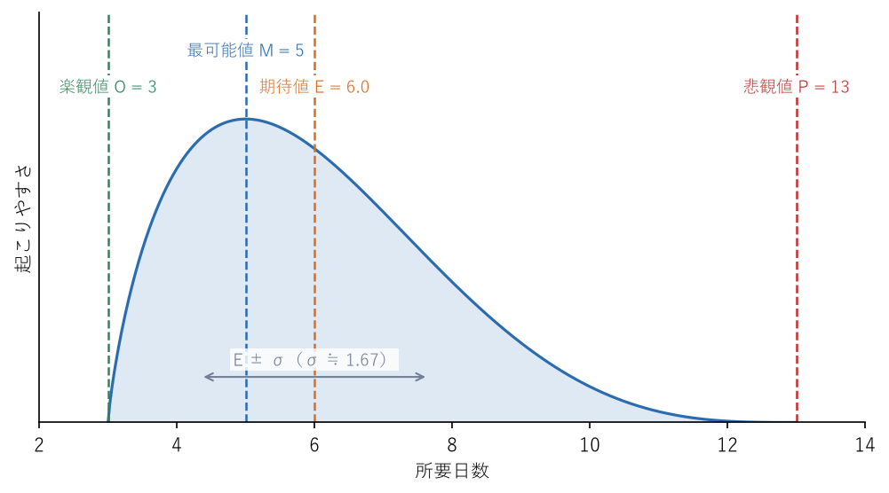

.. _chap-running-work:

仕事を回す
==================================

.. admonition:: この章で学ぶこと
   :class: note

   * 仕事の全体像をつかみ、WBS でタスクに分解する方法
   * 見積りを予測として扱う考え方と、三点見積りの使い方
   * 依存関係とクリティカルパスを踏まえたスケジュールとバッファの置き方
   * リスクを洗い出し、評価し、対応策を決める方法
   * 進捗の見える化、変更への対応、振り返りの進め方

目標が決まっても、それだけで仕事が進むわけではない。目標を達成するには、やるべきことを洗い出し、誰がいつまでに何をするかを決め、進み具合を確かめ、問題があれば手を打つ必要がある。この一連の流れを回すことが、マネージャーの日常的な仕事の大部分を占める。

この章では、プロジェクトマネジメントの基本的な考え方を、数名〜10 名程度のチームで使える範囲に絞って紹介する。体系的に学びたい場合は PMBOK ガイド\ [PMI2021]_\ が参考になる。目標の決め方は\ :ref:`chap-goals`\ 、メンバーへの仕事の任せ方は\ :ref:`chap-delegation`\ で扱う。

仕事の全体像を把握する
----------------------------------------------

仕事を始める前に、まず全体像をつかむ。いきなり手を動かすと、途中で「そもそも何のためにやっているのか」「どこまでやれば終わりなのか」が分からなくなりやすい。最初に次の問いに答えられるようにしておく。

* **目的**: この仕事は何のためにやるのか。誰が喜ぶのか。
* **成果物**: 最終的に何ができあがれば完了か。
* **範囲**: 何をやり、何をやらないのか。
* **期限**: いつまでに終える必要があるのか。その期限は動かせるのか。
* **制約**: 予算、人員、使える道具、守るべきルールなどの制約は何か。
* **関係者**: 誰が依頼者で、誰の協力が必要で、誰に影響があるのか。

これらを 1 枚の文書にまとめ、依頼者や上司と合意しておくとよい。特に「やらないこと」を明記しておくと、後から範囲が際限なく広がることを防げる。

タスクに分解する
----------------------------------------------

全体像がつかめたら、仕事を作業単位に分解する。このとき使われる代表的な手法が :term:`WBS`\ （Work Breakdown Structure、作業分解構成図）である。WBS は、最終的な成果物を上から順に細かく分解し、木構造で表したものである。

社内イベントを開催する場合の WBS の例を\ :numref:`fig-wbs-event` に示す。

.. graphviz::
   :caption: 社内イベント開催の WBS の例
   :name: fig-wbs-event
   :align: center

   digraph wbs {
     rankdir=LR;
     node [shape=box, style="rounded,filled", fillcolor="#ebf4ff", color="#5b7fb5"];
     edge [color="#7a8aa0", arrowhead=none];

     root [label="社内イベント\n開催", fillcolor="#c9defa"];

     p1 [label="1 企画"];
     p2 [label="2 会場・設備"];
     p3 [label="3 登壇者"];
     p4 [label="4 告知・参加登録"];
     p5 [label="5 当日運営"];
     p6 [label="6 事後対応"];

     root -> {p1 p2 p3 p4 p5 p6};

     p1 -> {t11 t12 t13};
     t11 [label="1.1 目的・対象者\nの決定", fillcolor="#ffffff"];
     t12 [label="1.2 予算の確保", fillcolor="#ffffff"];
     t13 [label="1.3 プログラム\n作成", fillcolor="#ffffff"];

     p2 -> {t21 t22};
     t21 [label="2.1 会場予約", fillcolor="#ffffff"];
     t22 [label="2.2 機材・備品\n手配", fillcolor="#ffffff"];

     p3 -> {t31 t32};
     t31 [label="3.1 登壇依頼", fillcolor="#ffffff"];
     t32 [label="3.2 資料の確認", fillcolor="#ffffff"];

     p4 -> {t41 t42};
     t41 [label="4.1 告知文作成", fillcolor="#ffffff"];
     t42 [label="4.2 参加登録\n受付", fillcolor="#ffffff"];

     p5 -> {t51 t52};
     t51 [label="5.1 役割分担", fillcolor="#ffffff"];
     t52 [label="5.2 リハーサル", fillcolor="#ffffff"];

     p6 -> {t61 t62};
     t61 [label="6.1 アンケート", fillcolor="#ffffff"];
     t62 [label="6.2 振り返り", fillcolor="#ffffff"];
   }

分解するときは、次の点を意識する。

* **成果物を基準に分解する。** 「何をするか」より「何ができあがるか」で分けると、抜けや重複に気付きやすい。
* **最下層は、担当者と期限を決められる大きさにする。** 目安として、1 人が数日以内で終えられる程度まで分解する。
* **分解しすぎない。** 数時間単位まで細かくすると、管理の手間ばかり増える。細かい手順は担当者に任せる。
* **メンバーと一緒に作る。** 実際に作業する人の方が必要な作業をよく知っている。マネージャー 1 人で作るより抜けが少なくなる。

見積る
----------------------------------------------

見積りは約束ではなく予測である
^^^^^^^^^^^^^^^^^^^^^^^^^^^^^^^^^^^^^^^^^^^^

タスクに分解したら、それぞれにかかる時間を見積る。ここで最初に押さえておきたいのは、**見積りは約束ではなく予測である**\ ということである。未来のことは誰にも正確には分からない。見積りが外れること自体は失敗ではなく、外れたことに早く気付いて手を打てないことが問題である。

マネージャーが見積りを「約束」として扱い、外れたメンバーを責めると、メンバーは見積りに大きな余裕を隠し持つようになる。そうなると見積りが計画の役に立たなくなる。見積りの精度を上げるには、外れたときに責めるのではなく、なぜ外れたのかを一緒に振り返ることが大切である。

一方で、上司や依頼者に対しては、いつまでに何を届けるかを約束しなければならない場面もある。その場合は、見積り（予測）に不確実性への備えを加えたうえで、約束する日付を決める。予測と約束を区別して話すことが重要である。

三点見積り
^^^^^^^^^^^^^^^^^^^^^^^^^^^^^^^^^^^^^^^^^^^^

1 つの数字だけで見積ると、その数字にどれだけの不確実性があるかが伝わらない。そこで、3 つの値を使って見積る\ :term:`三点見積り`\ という方法がある。

* **楽観値 O**\ （Optimistic）: すべてが順調に進んだ場合の所要時間
* **最可能値 M**\ （Most likely）: 最も起こりそうな所要時間
* **悲観値 P**\ （Pessimistic）: 問題が重なった場合の所要時間

この 3 つから、期待値 :math:`E` と、ばらつきの目安となる標準偏差 :math:`\sigma` を次の式で求める。

.. math::

   E = \frac{O + 4M + P}{6}, \qquad \sigma = \frac{P - O}{6}

たとえば、あるタスクを楽観値 3 日、最可能値 5 日、悲観値 13 日と見積ったとする。このとき、期待値と標準偏差は次のようになる。

.. math::

   E = \frac{3 + 4 \times 5 + 13}{6} = \frac{36}{6} = 6.0, \qquad \sigma = \frac{13 - 3}{6} \approx 1.67

この例を図にしたものが\ :numref:`fig-three-point-estimate` である。

   三点見積りの例（O = 3、M = 5、P = 13）

この図から分かるように、仕事の所要時間は「予定より早く終わる幅」より「予定より遅れる幅」の方が大きくなりやすい。そのため、期待値 6.0 日は最可能値 5 日より大きくなる。「たぶん 5 日」という感覚で計画を立てると、遅れる可能性を見落としやすい。三点見積りは、楽観値と悲観値を考える過程で「何が起きたら遅れるか」を話し合うきっかけにもなる。

複数のタスクを合計するとき、期待値はそのまま足し合わせればよい。標準偏差は単純に足すのではなく、各タスクの分散（標準偏差の 2 乗）の和の平方根で近似できる。たとえば、上の例と同じタスクが 3 つあれば、期待値の合計は 18 日、標準偏差は :math:`\sqrt{3 \times 1.67^2} \approx 2.9` 日となり、標準偏差を単純に足した 5 日より小さい。ただし、この計算は各タスクの遅れが互いに独立であることを仮定している。実際には、担当者の体調不良や仕様の変更のように複数のタスクを同時に遅らせる要因も多いため、目安として使うにとどめる。

スケジュールを組む
----------------------------------------------

依存関係とクリティカルパス
^^^^^^^^^^^^^^^^^^^^^^^^^^^^^^^^^^^^^^^^^^^^

タスクには、「A が終わらないと B を始められない」という依存関係がある。スケジュールを組むときは、各タスクの所要時間と依存関係を整理する。社内イベントの準備の一部を例にとる。

.. list-table:: 社内イベント準備のタスクと依存関係の例
   :header-rows: 1
   :widths: 10 40 20 30

   * - 記号
     - タスク
     - 所要日数
     - 先に終わっている必要があるタスク
   * - A
     - プログラム作成
     - 3 日
     - なし
   * - B
     - 会場予約
     - 2 日
     - A
   * - C
     - 登壇依頼
     - 5 日
     - A
   * - D
     - 告知文作成
     - 3 日
     - B、C
   * - E
     - 参加登録受付
     - 10 日
     - D
   * - F
     - 機材・備品手配
     - 4 日
     - B

この例では、A → C → D → E の経路が合計 21 日で最も長い。A → B → D → E は 18 日、A → B → F は 9 日である。このように、始めから終わりまでの経路のうち最も長いものを\ :term:`クリティカルパス`\ と呼ぶ。クリティカルパス上のタスクが 1 日遅れると、全体の完了も 1 日遅れる。一方、F（機材・備品手配）は数日遅れても全体には影響しない。

クリティカルパスが分かると、どこに注意を集中すべきかが分かる。進捗確認ではクリティカルパス上のタスクを重点的に見る。全体を早めたいなら、クリティカルパス上のタスクを短縮するか、並行して進められるように分割する。クリティカルパス以外のタスクを急がせても、全体は早まらない。

バッファの置き方
^^^^^^^^^^^^^^^^^^^^^^^^^^^^^^^^^^^^^^^^^^^^

見積りは予測なので外れることがある。その備えとして、スケジュールに\ :term:`バッファ`\ （余裕時間）を設ける。バッファの置き方には注意が必要である。

各タスクにこっそり余裕を上乗せすると、その余裕は使い切られることが多い。締め切りまでに時間があると作業を後回しにしたり、早く終わっても次のタスクに早く引き渡さなかったりするからである。そこで、個々のタスクは余裕を上乗せしない値で見積り、余裕は\ **仕事全体の締め切りの手前にまとめて置く**\ 方が効果的とされる。この考え方は、クリティカルチェーン・プロジェクトマネジメントと呼ばれる手法でも用いられている。

バッファの大きさは、三点見積りの標準偏差を参考に決めるとよい。不確実性の大きい仕事ほどバッファを大きくとる。また、バッファの消費状況を見ていれば、計画全体がどれだけ危ないかを早めに判断できる。

リスクを管理する
----------------------------------------------

リスクとは、起きるかどうか分からないが、起きたら目標に影響する出来事である。リスク管理は、問題が起きてから慌てるのではなく、起きる前に備えておくための活動である。次の 3 つの段階で進める。

#. **洗い出す**: チームで「何が起きたら困るか」を自由に挙げる。過去の似た仕事で起きたことも参考にする。
#. **評価する**: 各リスクについて、起きたときの影響度と発生確率をそれぞれ高・中・低などで見積る。影響度と発生確率を掛け合わせた大きさで、優先して対応するリスクを決める。
#. **対応策を決める**: 優先度の高いリスクについて、対応の方針と担当者を決める。

対応策の方針は、次の 4 つに分けて考えるのが一般的である。PMBOK ガイドでは、これに上位の組織へ対応を委ねる「エスカレーション」を加えた分類も示されている\ [PMI2021]_\ 。

.. list-table:: リスクへの対応策の種類
   :header-rows: 1
   :widths: 15 40 45

   * - 種類
     - 内容
     - 例（社内イベントの場合）
   * - 回避
     - 計画を変えて、リスクそのものをなくす
     - 雨天のおそれがある屋外会場をやめ、屋内会場にする
   * - 軽減
     - 発生確率や影響度を下げる
     - 登壇者の急な欠席に備え、代わりの登壇者に予備の依頼をしておく
   * - 移転
     - 影響を第三者に移す
     - 機材の故障に備え、保守が付いたレンタル機材を使う
   * - 受容
     - 対策をとらず、起きたら対処する。小さいリスクや対策の費用が見合わないリスクに用いる
     - 参加者が想定より少し少ない可能性は受け入れ、当日の配布物の余りは許容する

洗い出したリスクは、一覧表（リスク登録簿）にまとめておく。

.. list-table:: リスク一覧の例
   :header-rows: 1
   :widths: 30 12 12 12 34

   * - リスク
     - 影響度
     - 発生確率
     - 優先度
     - 対応策（担当）
   * - 登壇者が当日急に欠席する
     - 高
     - 低
     - 中
     - 軽減: 予備の登壇者を確保する（田中）
   * - 告知が遅れ、参加者が集まらない
     - 高
     - 中
     - 高
     - 軽減: 告知の締め切りを前倒しし、部門長経由でも周知する（佐藤）
   * - 会場の音響機材が故障する
     - 中
     - 低
     - 低
     - 移転: 保守付きのレンタル機材を使う（鈴木）

リスク一覧は作って終わりではない。週次の会議などで見直し、新しいリスクを加え、状況が変わったリスクの評価を更新する。

進捗を見える化する
----------------------------------------------

仕事が進み始めたら、進み具合をチーム全員が同じように把握できる状態をつくる。マネージャーが 1 人ずつに「どうなっている？」と聞いて回るのは、聞く側にも聞かれる側にも負担が大きい。代表的な方法を挙げる。

* **タスクボード**: 「未着手」「作業中」「完了」などの列を作り、タスクを書いたカードを移動させる。ホワイトボードと付箋でも、オンラインのツールでもよい。誰が何をしていて、どこで仕事が滞っているかが一目で分かる。
* **バーンダウンチャート**: 残っている作業量を縦軸、日付を横軸にとり、残量が減っていく様子をグラフにする。理想の減り方の線と比べることで、遅れているかどうかが分かる。
* **信号の色による状況報告**: 各タスクやプロジェクト全体の状況を、緑（順調）、黄（注意）、赤（危険）で示す。上司や他部署への報告にも使いやすい。

見える化の仕組み以上に大切なのは、**悪い知らせが早く上がってくる雰囲気をつくる**\ ことである。遅れや問題の報告を受けたときに、マネージャーが不機嫌になったり責めたりすると、メンバーは報告を遅らせるようになる。問題は小さいうちに分かれば打てる手が多い。報告を受けたら、まず「早く教えてくれてありがとう」と伝え、それから一緒に対策を考える。こうした雰囲気づくりは、\ :ref:`chap-team-building`\ で扱う\ :term:`心理的安全性`\ とも深く関係する。

また、マネージャー自身が対応しきれない問題は、ためらわずに上司へ\ :term:`エスカレーション`\ する。抱え込んで手遅れになるより、早めに相談して判断を仰ぐ方が、組織にとっても自分にとっても良い結果になる。

変更に対応する
----------------------------------------------

仕事の途中で、依頼者から要望が追加されたり、優先順位が変わったりすることは珍しくない。変更をすべて拒むのは現実的ではないが、何でも受け入れると計画が崩れる。変更の依頼を受けたら、次の手順で対応する。

#. 変更の内容と理由を確認する。
#. 変更が範囲、期限、人員、品質にどのような影響を与えるかを見積る。
#. 「この変更を入れるなら、期限を 1 週間延ばすか、この機能を次の段階に回す必要がある」のように、選択肢と影響を依頼者に示す。
#. 依頼者や上司と相談して決め、決めた内容を記録してチームに共有する。

ポイントは、変更を受け入れるかどうかをマネージャーやメンバーが勝手に決めず、影響を見える形にしたうえで依頼者と一緒に決めることである。範囲、期限、人員のどれも変えずに仕事だけを増やすと、そのしわ寄せはメンバーの長時間労働や品質の低下として現れる。

なお、遅れを取り戻すために途中から人を増やしても、すぐには効果が出ない。新しく加わった人が仕事を覚えるまでの時間や、説明・調整の手間が増えるからである。ソフトウェア開発では「遅れているプロジェクトに人を追加すると、さらに遅れる」という経験則が、F. P. ブルックスの名前を取ってブルックスの法則として知られている。

振り返る
----------------------------------------------

仕事の区切りや一定の期間ごとに、チームで\ :term:`振り返り`\ を行う。振り返りの目的は、うまくいったことを続け、うまくいかなかったことを改善し、次の仕事をより良く進めることである。誰かの責任を追及する場ではない。

振り返りの代表的な型として :term:`KPT` がある。KPT は次の 3 つの観点で意見を出し合う方法である。

* **Keep**: うまくいったので続けたいこと
* **Problem**: うまくいかなかったこと、困ったこと
* **Try**: 次に試したいこと（Problem の解決策や Keep をさらに良くする工夫）

進め方の例を示す。

#. 各自が Keep と Problem を付箋などに書き出す（5〜10 分）。
#. 1 人ずつ内容を説明し、似た意見をまとめる。
#. 特に重要な Problem を選び、Try を話し合う。
#. Try の中から実行するものを 1〜3 個に絞り、担当者と期限を決める。
#. 次の振り返りの最初に、前回の Try を実行できたか確認する。

Try を出しすぎると実行されずに終わる。数を絞って確実に実行し、効果を確かめる方が、振り返りへの信頼が高まる。

エンジニアのチームで仕事を回す
----------------------------------------------

.. admonition:: エンジニアのチームでは
   :class: tip

   **見積りの難しさ**: ソフトウェア開発は、作るものの細部が作りながら明らかになることが多く、他の仕事より見積りが外れやすい。特に、前例のない技術を使う仕事や、既存のシステムの中身がよく分からない仕事は不確実性が大きい。こうした仕事では、まず短期間の調査（技術的な検証）を行ってから見積る、見積りに幅を持たせて伝える、作業が進むごとに見積りを更新する、といった工夫が有効である。

   **障害対応と割り込み**: 稼働中のシステムを持つチームでは、障害対応や問い合わせなどの割り込みが必ず発生する。計画を立てるときにチームの稼働をすべて予定に入れてしまうと、割り込みのたびに計画が崩れる。過去の実績をもとに、割り込み対応に使う時間をあらかじめ確保しておく。割り込みの窓口を当番制にして、他のメンバーが集中できる時間を守る方法もある。

   **バス係数**: :term:`バス係数`\ とは、何人のメンバーが突然いなくなるとプロジェクトが立ち行かなくなるかを表す数である。特定のシステムを 1 人しか理解していない状態はバス係数が 1 であり、その人の休暇や異動が大きなリスクになる。ペアでの作業、コードレビュー、ドキュメント作成、担当の交代などで、知識を複数の人に広げておく。

   **アジャイル開発との関係**: アジャイル開発では、1〜4 週間程度の短い期間（イテレーション、スクラムではスプリントと呼ぶ）を区切って計画、開発、振り返りを繰り返す。この章で紹介したタスク分解、見積り、見える化、振り返りは、イテレーションの中で小さく繰り返し行われる。最初に詳細な計画をすべて作るのではなく、短い周期で計画を見直しながら進める点が特徴である。エンジニアリング組織の運営については\ [Larson2019]_\ も参考になる。

よくある失敗
----------------------------------------------

.. list-table:: 仕事を回すときによくある失敗と対策
   :header-rows: 1
   :widths: 35 65

   * - 失敗例
     - 対策
   * - 目的や範囲があいまいなまま作業を始め、途中で手戻りが起きる。
     - 着手前に目的、成果物、範囲、期限を文書にまとめ、依頼者と合意する。
   * - 見積りを約束として扱い、外れたメンバーを責める。
     - 見積りは予測であると明言し、外れた理由をチームで振り返って次に生かす。
   * - 最可能値だけで計画を立て、毎回遅れる。
     - 三点見積りを使い、期待値とばらつきを考慮してバッファを置く。
   * - クリティカルパスを把握しておらず、重要でないタスクを急がせる。
     - 依存関係を整理してクリティカルパスを特定し、進捗確認ではそこを重点的に見る。
   * - リスク一覧を作ったが、その後一度も見直さない。
     - 週次の会議でリスク一覧を確認する時間を設ける。
   * - 遅れの報告が締め切り直前まで上がってこない。
     - 悪い知らせを歓迎する態度を示し、進捗を見える化して早く気付ける仕組みを作る。
   * - 変更の依頼をそのまま受け入れ、メンバーの負担が増え続ける。
     - 変更による影響を示し、範囲、期限、人員のどれを調整するか依頼者と決める。
   * - 振り返りで Try をたくさん出したが、何も実行されない。
     - Try を 1〜3 個に絞り、担当者と期限を決めて次回確認する。

チェックリスト
----------------------------------------------

* 仕事の目的、成果物、範囲、期限、制約、関係者を説明できるか。
* 「やらないこと」を依頼者と合意しているか。
* WBS の最下層のタスクに、担当者と期限が決まっているか。
* 不確実性の大きいタスクについて、三点見積りなどで幅を考えたか。
* 見積り（予測）と約束を区別して上司や依頼者に伝えているか。
* クリティカルパスがどこかを把握しているか。
* バッファを個々のタスクに分散させず、まとめて管理しているか。
* 優先度の高いリスクに、対応策と担当者が決まっているか。
* チーム全員が進捗を同じように把握できる仕組みがあるか。
* 悪い知らせを受けたとき、まず報告に感謝しているか。
* 変更の依頼に対して、影響を示したうえで依頼者と決めているか。
* 定期的に振り返りを行い、前回の Try の結果を確認しているか。

まとめ
----------------------------------------------

* 着手前に仕事の全体像をつかみ、WBS で担当者と期限を決められる大きさまで分解する。
* 見積りは約束ではなく予測であり、三点見積りで不確実性を見える形にする。
* 依存関係からクリティカルパスを特定し、バッファは全体の締め切りの手前にまとめて置く。
* リスクは影響度と発生確率で評価して対応策を決め、進捗は見える化して悪い知らせが早く上がるようにする。
* 変更は影響を示して依頼者と決め、KPT などで定期的に振り返って改善を続ける。
