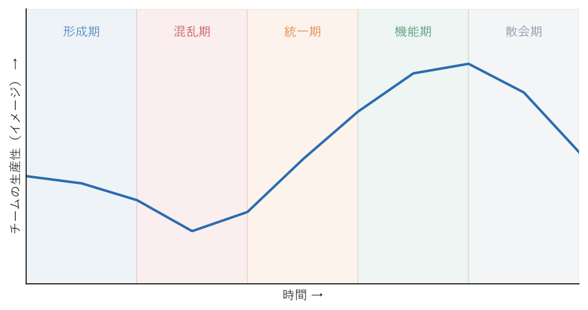

.. _chap-team-building:

チームをつくる
==============================

.. admonition:: この章で学ぶこと
   :class: note

   * 人が集まっただけの「グループ」と、共通の目的に向かって協力する「チーム」の違い
   * 心理的安全性の意味と、マネージャーがそれを高めるためにできる行動
   * タックマンモデルによるチームの発達段階と、各段階での関わり方
   * RACI やワーキングアグリーメントによる役割と約束事の明確化
   * 対立、新メンバーの受け入れ、ナレッジの属人化など、チーム運営でよく出合う課題への対処

マネージャーになると、自分一人の成果ではなく、チーム全体の成果で評価されるようになる。メンバーが優秀でも、互いに情報を共有せず、困りごとを言い出せず、役割があいまいなままでは、チームとしての力は出ない。逆に、一人ひとりは突出していなくても、目的を共有し、率直に意見を言い合い、助け合えるチームは大きな成果を出す。チームは自然にできあがるものではなく、マネージャーが意図して「つくる」ものである。この章では、チームづくりの考え方と具体的な手立てを紹介する。

グループとチームの違い
----------------------------------------

同じ部署に所属し、同じ上司の下で働いていても、それだけではチームとは言えない。人が集まっているだけの状態を\ **グループ**\ 、共通の目的に向かって互いに依存し合いながら協力する状態を\ **チーム**\ と呼んで区別すると、マネージャーが目指すべきものが見えやすくなる。

.. list-table:: グループとチームの違い
   :header-rows: 1
   :widths: 20 40 40

   * - 観点
     - グループ
     - チーム
   * - 目的
     - 各自が自分の担当業務の目的を持つ
     - チーム全体で共有された目的がある
   * - 成果の単位
     - 個人の成果の合計
     - 協力によって個人の合計以上の成果を目指す
   * - 責任
     - 自分の担当範囲だけに責任を持つ
     - 自分の担当に加え、チームの成果にも責任を持つ
   * - 情報共有
     - 必要最小限。報告は上司に向かう
     - メンバー同士が日常的に共有し合う
   * - 問題が起きたとき
     - 担当者個人の問題として扱われる
     - チームの問題として一緒に解決する

すべての仕事にチームが必要なわけではない。各自が独立した定型業務を担当している場合は、グループとしてうまく回っていれば十分なこともある。しかし、仕事が複雑で、メンバー同士の連携や知恵の出し合いが成果を左右する場合には、グループをチームへと育てることがマネージャーの重要な仕事になる。目的と目標をチームで共有する方法は\ :ref:`chap-goals`\ で扱う。

.. _sec-team-building-psychological-safety:

心理的安全性
----------------------------------------

心理的安全性とは何か
^^^^^^^^^^^^^^^^^^^^^^^^^^^^^^^^^^^^^^^^

:term:`心理的安全性`\ は、ハーバード・ビジネス・スクールのエイミー・エドモンドソンが研究してきた概念で、「このチームでは対人関係のリスクをとっても安全だ」という、チームのメンバーに共有された信念と定義されている\ [Edmondson1999]_\ 。対人関係のリスクとは、質問する、分からないと言う、ミスを報告する、反対意見を述べる、新しいアイデアを出すといった、「無知だ」「無能だ」「邪魔だ」と思われるかもしれない行動のことである。

心理的安全性が低いチームでは、メンバーは評価を下げないように黙ることを選ぶ。その結果、ミスの報告が遅れ、問題が大きくなってから発覚し、改善のアイデアも出てこない。心理的安全性は「居心地の良さ」のためではなく、チームが学習し、成果を出すための土台である。

心理的安全性はぬるま湯ではない
^^^^^^^^^^^^^^^^^^^^^^^^^^^^^^^^^^^^^^^^

心理的安全性はしばしば「仲が良い」「厳しいことを言わない」「何をしても許される」と誤解される。しかし、エドモンドソンは心理的安全性と仕事の基準（求める成果の水準）の高さは別の軸であり、両方を高めることが大切だと述べている\ [Edmondson2021]_\ 。2 つの軸で 4 つの状態に分けると、次のようになる。

.. list-table:: 心理的安全性と仕事の基準の高さによる 4 つの状態
   :header-rows: 1
   :widths: 25 35 40

   * - 状態
     - 組み合わせ
     - チームの様子
   * - 無気力ゾーン
     - 心理的安全性が低い、基準が低い
     - 発言もせず、高い成果も求められない。メンバーは最低限のことだけをこなす。
   * - ぬるま湯（快適ゾーン）
     - 心理的安全性が高い、基準が低い
     - 和気あいあいとしているが、挑戦や成長が少ない。率直な指摘も起きにくい。
   * - 不安ゾーン
     - 心理的安全性が低い、基準が高い
     - 高い成果を求められるが、失敗や困りごとを言い出せない。問題が隠れ、疲弊しやすい。
   * - 学習ゾーン
     - 心理的安全性が高い、基準が高い
     - 高い目標に向かい、率直に意見を言い合い、失敗から学ぶ。マネージャーが目指す状態。

マネージャーが目指すのは「学習ゾーン」である。求める水準は下げずに、そこへ向かう途中での質問、相談、失敗の報告、反対意見を歓迎する。厳しさと安心は両立する。

プロジェクト・アリストテレス
^^^^^^^^^^^^^^^^^^^^^^^^^^^^^^^^^^^^^^^^

心理的安全性が広く知られるきっかけになったのが、Google が社内のチームを対象に行った調査「プロジェクト・アリストテレス」である。この調査では、誰がチームにいるかよりもチームがどのように協力しているかが重要であり、効果的なチームを生む要因の中で心理的安全性が最も重要だとされた\ [Duhigg2016]_\ 。Google はほかの要因として、相互信頼（メンバーが期限内に質の高い仕事をする）、構造と明確さ（役割・計画・目標が明確である）、仕事の意味（仕事が自分にとって意味を持つ）、インパクト（自分の仕事が意味のある変化を生んでいると感じる）を挙げている。

心理的安全性を高めるためにマネージャーができること
^^^^^^^^^^^^^^^^^^^^^^^^^^^^^^^^^^^^^^^^^^^^^^^^^^^^^^^^^^^^

心理的安全性は、スローガンを掲げても高まらない。マネージャーの日々の言動が、メンバーに「ここでは言っても大丈夫だ」と思わせるかどうかを決める。

* **仕事を「学習の問題」として位置付ける**: 「この仕事は不確実なことが多いので、みんなの気付きが必要だ」と伝え、発言が求められている理由を示す。
* **自分の分からないこと、間違いを認める**: 「自分も見落としているかもしれない」「その点は詳しくないので教えてほしい」とマネージャーが言うと、メンバーも言いやすくなる。
* **問いかける**: 「何か懸念はある？」ではなく「この計画で一番うまくいかなさそうなところはどこだと思う？」のように、具体的に意見を求める。
* **発言に感謝し、反応を丁寧にする**: 悪い知らせや反対意見を持ってきたメンバーには、まず「言ってくれてありがとう」と伝える。報告者を責めたり、不機嫌な態度を見せたりすると、次からは報告が来なくなる。
* **失敗を責めず、原因と次の手を一緒に考える**: ただし、ルールの意図的な無視など許容できない行動には、きちんと対応する。何を許容し、何を許容しないかの線引きを明確にすることも心理的安全性の一部である。
* **会議で発言の偏りを減らす**: 声の大きい人だけで決まらないよう、順番に意見を聞く、事前に書き出してもらうなどの工夫をする。

メンバー一人ひとりとの関係づくりには :term:`1on1` も有効である。1on1 の進め方は\ :ref:`chap-communication`\ で扱う。

.. _sec-team-building-tuckman:

チームの発達段階（タックマンモデル）
----------------------------------------------------------------------

チームは結成した直後から機能するわけではなく、段階を経て成熟していく。心理学者ブルース・タックマンは、小集団の発達を形成期、混乱期、統一期、機能期の 4 段階で説明した\ [Tuckman1965]_\ 。1977 年には、チームの解散や終結に当たる散会期が加えられ、5 段階のモデルとして知られるようになった\ [Tuckman1977]_\ 。これを\ :term:`タックマンモデル`\ と呼ぶ（\ :numref:`fig-tuckman`\ ）。

   タックマンモデルの 5 段階と生産性のイメージ

各段階の特徴と、マネージャーの関わり方を表にまとめる。

.. list-table:: タックマンモデルの各段階とマネージャーの関わり方
   :header-rows: 1
   :widths: 15 40 45

   * - 段階
     - チームの様子
     - マネージャーの関わり方
   * - 形成期
     - メンバーが互いをよく知らず、遠慮がある。様子見が多く、表面上は穏やか。
     - チームの目的、目標、役割を明確に示す。自己紹介や雑談の機会をつくり、互いを知る場を設ける。
   * - 混乱期
     - 仕事の進め方や役割、価値観の違いが表面化し、意見の衝突や不満が出る。
     - 対立を避けずに話し合いの場を持つ。意見の違いを目的に照らして整理し、約束事（ワーキングアグリーメント）を一緒に決める。
   * - 統一期
     - 進め方や役割が定まり、チームとしての規範ができる。協力が増える。
     - 決めた規範が守られているかを見守り、良い協力の例を言葉にして認める。少しずつ判断をメンバーに任せる。
   * - 機能期
     - メンバーが自律的に動き、高い成果を出す。問題もチームで解決できる。
     - 任せる範囲を広げ、障害を取り除くことに集中する。次の挑戦や育成の機会を用意する。
   * - 散会期
     - プロジェクトの終了やメンバーの異動でチームが解散する。寂しさや次への不安が出る。
     - 成果と貢献をきちんと認め、振り返りで学びを残す。各メンバーの次の役割への移行を支援する。

実際のチームは、きれいに一方向に進むとは限らない。メンバーの入れ替わりや目標の大きな変更があると、機能期にあったチームが混乱期に戻ることもある。大切なのは、混乱期を「失敗」と捉えないことである。意見の衝突は、メンバーが本音を出し始めた証拠でもある。マネージャーが混乱を恐れて対立を抑え込むと、チームは表面的な平穏のまま統一期に進めない。任せ方を段階に応じて変える考え方は\ :ref:`chap-delegation`\ で扱う。

役割と責任を明確にする
----------------------------------------

チームで起きる混乱の多くは、「誰がやるのか」「誰が決めるのか」があいまいなことから生まれる。全員がやると思っていた仕事を誰もやっていなかった、決めたはずのことを別の人がひっくり返した、という事態は珍しくない。

役割と責任を整理する道具として :term:`RACI` がある。RACI は、仕事ごとに関わる人の役割を次の 4 つに分けて表にする手法である。

* **R（Responsible、実行責任者）**\ : 実際に作業を行う人。複数いてもよい。
* **A（Accountable、説明責任者）**\ : 最終的な決定と結果に責任を持つ人。1 つの仕事につき 1 人にする。
* **C（Consulted、相談先）**\ : 事前に意見を聞くべき人。双方向のやり取りをする。
* **I（Informed、報告先）**\ : 結果や進捗を知らせるべき人。一方向の連絡でよい。

ある新機能のリリースを例にした RACI 表を示す。

.. list-table:: RACI の例（新機能のリリース）
   :header-rows: 1
   :widths: 28 18 18 18 18

   * - 仕事
     - マネージャー
     - 開発担当
     - 品質保証担当
     - 営業部門
   * - 要件の決定
     - A
     - C
     - C
     - C
   * - 設計と実装
     - I
     - A、R
     - C
     - －
   * - テスト
     - I
     - C
     - A、R
     - －
   * - リリース判断
     - A
     - R
     - R
     - I
   * - 顧客への案内
     - C
     - I
     - I
     - A、R

RACI 表を作るときは、A が 1 つの仕事に 1 人だけになっているか、R のいない仕事がないか、C が多すぎて決定が遅くなっていないかを確認する。表を作ること自体よりも、作る過程でメンバーと「ここは誰が決めるのか」をすり合わせることに価値がある。

チームの約束事を決める
----------------------------------------

チームの働き方に関する約束事を、メンバー全員で話し合って明文化したものを\ **ワーキングアグリーメント**\ と呼ぶ。マネージャーが一方的に決めたルールではなく、チームで合意したものである点が大切である。

約束事の例として、次のようなものがある。

* 会議は開始時刻ちょうどに始め、議事録と決定事項をその日のうちに共有する。
* チャットの質問には、急ぎでなければ半日以内に反応する。急ぎのときは電話か通知付きの呼びかけを使う。
* 集中したい時間帯はカレンダーに入れ、その時間には会議を入れない。
* 困ったら 30 分悩んだ時点で誰かに相談する。
* 決まったことに反対がある場合は、陰で言わず、チームの場で提起する。

約束事は一度決めたら終わりではない。定期的な\ :term:`振り返り`\ の場で「守れているか」「実態に合っているか」を確認し、必要に応じて見直す。新しいメンバーが加わったときにも見直しの機会にするとよい。

多様なメンバーと協働する
----------------------------------------

チームには、さまざまな背景を持つメンバーがいる。違いは摩擦の原因にもなるが、多様な視点はチームの判断の質を上げる源泉でもある。

* **働き方の違い**: 在宅勤務と出社、短時間勤務、育児や介護との両立など、働く時間と場所はメンバーによって異なる。会議の時間帯や情報共有の方法を、一部の人だけが参加しやすい形にしていないかを確認する。決定事項は口頭だけでなく文書に残し、その場にいなかった人も追えるようにする。
* **経験の違い**: 新卒、中途入社、ベテランでは、当たり前と感じることが違う。ベテランの暗黙の前提を言葉にしてもらい、新しい人の素朴な疑問を歓迎する。
* **価値観の違い**: 仕事のスピードを重視する人もいれば、品質を重視する人もいる。どちらが正しいかではなく、目的に照らして今回はどちらを優先するかを話し合う。

マネージャー自身も、自分と似た考え方のメンバーの意見を無意識に重く扱っていないかを振り返るとよい。この傾向は評価の場面でも問題になる（\ :ref:`chap-evaluation`\ ）。

チーム内の対立に対処する
----------------------------------------

チームで仕事をすれば対立は必ず起きる。対立そのものは悪ではない。大切なのは、対立の種類を見分けて扱い方を変えることである。

* **タスクの対立**\ : 仕事の内容、方針、進め方についての意見の違い。「この設計ではなく別の方式にすべきだ」といったもの。適切に扱えば、より良い結論につながる。
* **人間関係の対立**\ : 相手の人柄や態度への反感、感情的なわだかまり。放置すると協力が失われ、チームの雰囲気が悪くなる。

タスクの対立は、論点を明確にし、判断の基準（目的、顧客への影響、期限、コストなど）を共有したうえで議論させればよい。マネージャーは意見の違いを抑え込まず、「どちらの案にも理がある。判断の基準は何か」と問いかけて議論を前に進める。

注意したいのは、タスクの対立が人間関係の対立に変わることである。議論が相手の人格への批判に移ったり、特定の人同士が常にぶつかったりするようになったら、早めに個別に話を聞く。当事者だけでは解決が難しい深刻な対立への対応は\ :ref:`chap-difficult-situations`\ で扱う。

新メンバーを迎える（オンボーディング）
----------------------------------------------------------------------

新しいメンバーが早くチームになじみ、力を発揮できるよう支援する取り組みを\ :term:`オンボーディング`\ と呼ぶ。最初の数週間の体験は、その後の働き方やチームへの信頼に大きく影響する。

受け入れの準備
^^^^^^^^^^^^^^^^^^^^^^^^^^^^^^^^^^^^^^^^

* PC、アカウント、各種ツールの権限を初日までに用意する。初日に何もできない状態はできるだけ避ける。
* チームの目的、メンバーの役割、主要な関係者、よく使う資料の場所をまとめた案内を用意する。
* 最初の数週間で取り組む小さな仕事を選んでおく。
* チームのメンバーに、新メンバーの経歴と担当予定を事前に伝えておく。

最初の 1 週間
^^^^^^^^^^^^^^^^^^^^^^^^^^^^^^^^^^^^^^^^

* 初日はマネージャーが直接迎え、チームの目的と、新メンバーに期待することを伝える。
* チームのメンバーや関係者と短く話す機会をつくる。
* 小さくても成果が見える仕事を任せ、最初の成功体験をつくる。
* 週の終わりに時間をとり、分からないこと、困っていることを聞く。

メンターを付ける
^^^^^^^^^^^^^^^^^^^^^^^^^^^^^^^^^^^^^^^^

マネージャーとは別に、日々の細かい質問に答えるメンター（相談役）を付けると、新メンバーは質問しやすくなる。メンターには、期間（例: 最初の 3 か月）と期待する役割を伝え、メンター自身の業務量も調整する。メンター役は、メンバーにとって教える経験を積む育成の機会にもなる。

新メンバーの「なぜこうなっているのか」という疑問は、チームの慣習を見直すきっかけになる。疑問を歓迎し、案内資料の改善に反映するとよい。

.. admonition:: エンジニアのチームでは
   :class: tip

   **ポストモーテムを責めない形で行う。** システム障害などの後に行う振り返り（とその報告書）をポストモーテムと呼ぶ。ポストモーテムの目的は、再発を防ぐ仕組みを考えることであり、誰が悪かったかを決めることではない。「誰がミスをしたか」ではなく「なぜそのミスが起きやすい状態だったのか」「なぜ検知が遅れたのか」を問う。個人を責めると、次の障害で事実が隠され、チームの心理的安全性も下がる。

   **ナレッジの属人化を防ぐ。** 特定の人しか分からないシステムや手順があると、その人が休んだり異動したりしたときに仕事が止まる。ある仕事を担える人が何人いなくなると止まってしまうかを示す指標を\ :term:`バス係数`\ と呼ぶ。バス係数が 1 の領域は、ドキュメント化、ペアプログラミング（2 人で 1 つの作業を行う進め方）、コードレビューのローテーション、担当の入れ替えなどで少しずつ広げる。属人化している本人は忙しいことが多いので、ナレッジの共有を「本人の空き時間でやること」にせず、正式な仕事として時間を確保する。

   **開発環境の構築で新メンバーを詰まらせない。** 環境構築の手順書を新メンバーに実際に使ってもらい、詰まった点をその場で直してもらうと、手順書の改善と新メンバーの貢献を同時に実現できる。

よくある失敗
----------------------------------------

.. list-table:: チームづくりでよくある失敗と対策
   :header-rows: 1
   :widths: 40 60

   * - よくある失敗
     - 対策
   * - 心理的安全性を「優しくすること」と誤解し、成果の基準や率直な指摘まで手放す
     - 仕事の基準は高く保ったまま、質問や失敗の報告を歓迎する。学習ゾーンを目指す。
   * - 悪い知らせを持ってきたメンバーに不機嫌な態度をとる
     - まず報告への感謝を伝え、それから対策を一緒に考える。
   * - 混乱期の衝突を恐れ、対立を抑え込む
     - 意見の違いを目的に照らして議論させる。約束事をチームで決める。
   * - 役割分担があいまいなまま進め、抜け漏れや二重作業が起きる
     - RACI などで役割を明確にし、A を 1 人に決める。
   * - マネージャーが決めたルールを一方的に押し付ける
     - 約束事はチームで話し合って決め、定期的に見直す。
   * - 新メンバーを初日から放置する
     - 受け入れ準備、最初の 1 週間の計画、メンターを用意する。
   * - 障害の振り返りで個人を責める
     - 仕組みの問題として原因を探り、再発防止策を考える。

チェックリスト
----------------------------------------

* チームの目的を、メンバー全員が自分の言葉で説明できるか。
* 悪い知らせや反対意見を持ってきたメンバーに、まず感謝を伝えているか。
* 自分の分からないことや間違いを、メンバーの前で認めているか。
* 心理的安全性を保ちつつ、仕事の基準を高く保っているか。
* チームが今タックマンモデルのどの段階にあるかを考え、関わり方を変えているか。
* 主要な仕事について、誰が実行し、誰が最終的に決めるかが明確か。
* チームの約束事を全員で決め、定期的に見直しているか。
* 新メンバーの受け入れ準備とメンターを用意しているか。
* 特定の人しか分からない仕事を把握し、共有を進めているか。

まとめ
----------------------------------------

* チームは、人を集めれば自然にできるものではなく、マネージャーが意図してつくるものである。
* チームの土台は心理的安全性であり、仕事の基準の高さと両立させてこそ意味を持つ。
* タックマンモデルでチームの段階を見極め、段階に応じて関わり方を変える。
* RACI と約束事で、役割と働き方を明確にする。
* 対立や新メンバーの受け入れに丁寧に向き合うことで、グループはチームへと育っていく。
