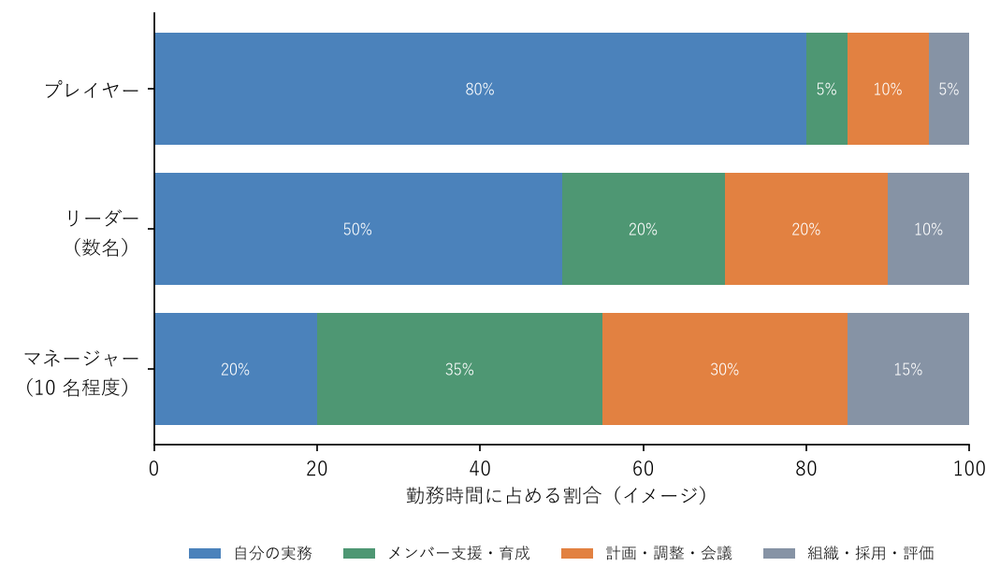

.. _chap-what-is-management:

マネジメントとは
========================

.. admonition:: この章で学ぶこと
   :class: note

   * マネジメントとは何か、マネージャーの成果は何で測られるのか
   * 人のマネジメントと仕事のマネジメントの違い
   * プレイヤーからマネージャーになるときに変わること
   * マネージャーの主な仕事と、リーダーシップとの関係
   * マネジメントについてのよくある誤解

マネージャーになったばかりの人の多くは、「自分は何をすれば評価されるのか」が分からないまま日々を過ごす。担当者のときは、自分が書いたコードや資料、自分が担当した顧客の数字が成果だった。マネージャーになると、その物差しが通用しなくなる。物差しが変わったことに気付かないまま、担当者のときと同じ働き方を続けると、自分は忙しいのにチームの成果は上がらない状態に陥る。この章では、マネジメントとは何か、マネージャーの成果は何かを整理し、以降の章を読むための土台をつくる。

マネジメントの定義
------------------------------------

本資料では、\ :term:`マネジメント`\ を「組織に成果を上げさせること」と定義する。

この定義は、経営学者 P. F. ドラッカーの考え方にもとづく\ [Drucker2001]_\ 。ドラッカーは、マネジメントを組織に成果を上げさせるための機能（はたらき）としてとらえた。ここで大切なのは、マネジメントが「管理すること」や「偉くなること」ではなく、組織が成果を上げるための役割だという点である。会社やチームは、一人では成し遂げられない成果を上げるために人が集まった場であり、その成果を実際に生み出すための仕事がマネジメントである。

ドラッカーは、マネジメントの役割として、組織の目的を果たすこと、仕事を生産的なものにし働く人に成果を上げさせること、社会への影響に責任を持つことを挙げている\ [Drucker2001]_\ 。本資料が扱うのは、このうち主に 2 つ目、つまりチームの仕事を進め、メンバーが力を発揮できるようにする部分である。

マネージャーの成果は何か
------------------------------------

担当者の成果は、自分が生み出したものである。一方、\ :term:`マネージャー`\ の成果は、自分が影響を与えるチームの成果である。

インテルの経営者だった A. S. グローブは、これを次のように表現した\ [Grove2017]_\ 。

.. math::

   \text{マネージャーのアウトプット} = \text{自分の組織のアウトプット} + \text{影響を及ぼす隣接組織のアウトプット}

この式から分かることは 2 つある。

* マネージャー個人がどれだけ手を動かしたかは、それ自体は成果ではない。自分が 1 日かけて作業するより、メンバー 5 名が詰まっている問題を 1 時間で解消するほうが、チームのアウトプットを大きく増やせる場合がある
* 自分のチームだけでなく、他部署や関係するチームの成果に良い影響を与えることもマネージャーの成果に含まれる。他部署との調整や情報共有は「本来の仕事の邪魔」ではなく、成果を生む仕事の一部である

グローブは、同じ時間を使ってもアウトプットへの影響が大きい活動を「レバレッジの高い活動」と呼び、マネージャーはそうした活動に時間を使うべきだと述べている\ [Grove2017]_\ 。たとえば、メンバーに判断基準を一度共有しておけば、その後の多くの判断をメンバーが自分でできるようになる。これはレバレッジの高い活動の例である。

人のマネジメントと仕事のマネジメント
------------------------------------------------------------

マネジメントの対象は、大きく「仕事」と「人」に分けられる。

.. list-table:: 仕事のマネジメントと人のマネジメント
   :header-rows: 1
   :widths: 20 40 40

   * - 観点
     - 仕事のマネジメント
     - 人のマネジメント
   * - 問い
     - 何を、いつまでに、どの順で、誰がやるか
     - メンバーが力を発揮し、成長し、続けて働けるか
   * - 主な活動
     - 目標設定、計画、見積り、割り振り、進捗管理、リスク対応
     - :term:`1on1`\ 、\ :term:`フィードバック`\ 、育成、動機付け、評価、チームづくり
   * - うまくいかないと
     - 締め切りに遅れる、品質が落ちる、優先順位がぶれる
     - メンバーが疲弊する、離職する、チームの雰囲気が悪くなる
   * - 主に扱う章
     - :ref:`chap-goals`\ 、\ :ref:`chap-running-work`\ 、\ :ref:`chap-delegation`
     - :ref:`chap-communication`\ 、\ :ref:`chap-feedback`\ 、\ :ref:`chap-motivation`\ 、\ :ref:`chap-team-building`\ 、\ :ref:`chap-evaluation`

この 2 つは切り離せない。仕事の割り振りはメンバーの成長機会にもなり、メンバーのやる気は仕事の進み方に直結する。担当者出身のマネージャーは、慣れている仕事のマネジメントに偏り、人のマネジメントを後回しにしがちである。人のマネジメントは効果が出るまでに時間がかかるため、早いうちから意識して時間を確保したい。

プレイヤーからの役割転換
------------------------------------

マネージャーになると、仕事の対象そのものが変わる。担当者（プレイヤー）は自分で仕事をして成果を出す。マネージャーは、メンバーやチーム、周囲の組織に働きかけ、チームとして成果を出す。

.. graphviz::
   :caption: プレイヤーとマネージャーの仕事の対象の違い
   :name: fig-player-vs-manager
   :align: center

   digraph player_vs_manager {
     rankdir=LR;
     node [shape=box, style="rounded,filled", fillcolor="#ebf4ff"];
     edge [color="#555555"];

     subgraph cluster_manager {
       label="マネージャー";
       style="rounded";
       m_me [label="自分", fillcolor="#fff4d6"];
       m_members [label="メンバー"];
       m_team [label="チームの\n仕事の仕組み"];
       m_neighbor [label="上司・他部署"];
       m_out [label="チームと\n周囲の成果", fillcolor="#e3f5e1"];
       m_me -> m_members;
       m_me -> m_team;
       m_me -> m_neighbor;
       m_members -> m_out;
       m_team -> m_out;
       m_neighbor -> m_out;
     }

     subgraph cluster_player {
       label="プレイヤー";
       style="rounded";
       p_me [label="自分", fillcolor="#fff4d6"];
       p_task [label="自分の仕事"];
       p_out [label="自分の成果", fillcolor="#e3f5e1"];
       p_me -> p_task -> p_out;
     }
   }

:numref:`fig-player-vs-manager` のとおり、マネージャーは成果に直接手を下すのではなく、成果を生む人や仕組みに働きかける。この違いから、次の 3 つが変わる。

成果の測り方が変わる
^^^^^^^^^^^^^^^^^^^^^^^^^^^^^^^^^^^^

プレイヤーの成果は自分のアウトプットで測られるが、マネージャーの成果はチームのアウトプットで測られる。自分がどれだけ作業したかではなく、チームが目標を達成したか、メンバーが成長したか、チームが続けて成果を出せる状態にあるかが問われる。自分が手を動かすと「仕事をした」実感が得やすいが、その実感と成果は必ずしも一致しない。

時間の使い方が変わる
^^^^^^^^^^^^^^^^^^^^^^^^^^^^^^^^^^^^

マネージャーになると、自分の実務に使う時間は減り、メンバーの支援、計画や調整、組織に関わる仕事の時間が増える。\ :numref:`fig-time-allocation` は、役割ごとの時間配分のイメージである。数字は目安であり、会社やチームによって大きく異なる。

   役割ごとの時間配分のイメージ

また、マネージャーの 1 日は会議や相談で細切れになりやすい。まとまった時間を前提とした働き方は難しくなる。具体的な時間の使い方の工夫は\ :ref:`chap-self-management`\ で扱う。

評価のされ方が変わる
^^^^^^^^^^^^^^^^^^^^^^^^^^^^^^^^^^^^

プレイヤーのときは、自分の成果を見れば自分の評価がおおよそ予想できた。マネージャーの評価は、チームの成果、メンバーの育成、周囲との協力など、自分だけではコントロールできない要素で決まる。成果が出るまでに時間がかかり、手応えを感じにくいため、最初の数か月は不安になりやすい。上司とは、自分に何が期待されているか、何で評価されるかを早めにすり合わせておくとよい（\ :ref:`chap-first-90-days`\ を参照）。

マネージャーの主な仕事
------------------------------------

マネージャーの仕事は幅広いが、本資料では次の 5 つに整理する。J. ズオも、マネージャーの仕事をチームがより良い成果を出せるよう助けることとし、目的（なぜやるか）、人（誰がやるか）、プロセス（どうやるか）に働きかけるものとして説明している\ [Zhuo2019]_\ 。

.. list-table:: マネージャーの主な仕事
   :header-rows: 1
   :widths: 18 52 30

   * - 仕事
     - 内容
     - 主に扱う章
   * - 方向を示す
     - チームの目的と目標を明確にし、何を優先し何をやらないかを決めて伝える
     - :ref:`chap-goals`
   * - 仕事を回す
     - 計画を立て、仕事を割り振り、進捗を把握し、問題があれば手を打つ
     - :ref:`chap-running-work`\ 、\ :ref:`chap-delegation`
   * - 人を育てる
     - フィードバックや仕事の任せ方を通じて、メンバーの成長を支える。評価を行う
     - :ref:`chap-feedback`\ 、\ :ref:`chap-evaluation`
   * - チームをつくる
     - 役割分担や関係性を整え、メンバーが安心して意見を言い、協力できる状態をつくる
     - :ref:`chap-team-building`\ 、\ :ref:`chap-motivation`
   * - 周囲とつなぐ
     - 上司や他部署、顧客との関係をつくり、チームに必要な情報や資源を取ってくる。チームの成果を外に伝える
     - :ref:`chap-managing-up`

5 つの仕事は同時並行で進む。どれか 1 つだけをやればよいわけではないが、着任直後は「仕事を回す」と「周囲とつなぐ」に追われ、「人を育てる」と「チームをつくる」が手薄になりやすい。

リーダーシップとマネジメントの関係
------------------------------------------------------------

リーダーシップとマネジメントは、しばしば対比して語られる。よく使われる整理は、リーダーシップは「どこへ向かうかを示し、人を動かすこと」、マネジメントは「決めた方向に向かって仕事を確実に進めること」というものである。

この整理は 2 つの働きを区別するには便利だが、現場のマネージャーにはどちらも必要である。方向を示しても仕事が回らなければ成果は出ないし、仕事を回すことだけに集中してもチームはどこへ向かえばよいか分からなくなる。本資料では、リーダーシップを「マネージャーが持つ役職とは別の、人を動かす働き」としてとらえる。リーダーシップは役職がなくても発揮できるものであり、チームの中ではマネージャー以外のメンバーがリーダーシップを発揮する場面も多い。マネージャーは自らリーダーシップを発揮するとともに、メンバーがリーダーシップを発揮できる場をつくることも求められる。

よくある誤解
------------------------------------

マネージャーという役割には、多くの誤解がある。思い込みのまま動くと、自分もチームも苦しくなる。

.. list-table:: マネジメントについてのよくある誤解
   :header-rows: 1
   :widths: 30 70

   * - 誤解
     - 実際
   * - マネージャーは一番優秀な人がやる仕事である
     - マネジメントは担当者の仕事の延長ではなく、別の職種に近い。担当者として優秀であることと、チームに成果を上げさせることは別の能力である。担当者として最も優秀である必要はなく、自分より詳しいメンバーがいるのは当たり前である
   * - マネージャーの仕事は指示や命令をすることである
     - 指示が必要な場面はあるが、指示だけではメンバーは自分で考えなくなり、マネージャーが判断のボトルネックになる。目的と判断基準を共有し、任せることのほうが多い（\ :ref:`chap-delegation`\ を参照）
   * - 全部自分でやったほうが早い
     - 目の前の 1 件だけを見れば正しいことも多い。しかし、自分がやり続ける限りメンバーは育たず、チームの処理能力は自分の時間で頭打ちになる。任せることは、将来の時間への投資である
   * - マネージャーは答えを知っていなければならない
     - マネージャーがすべての答えを持っている必要はない。むしろ「分からない」と言えるマネージャーのほうが、メンバーも意見を言いやすくなる。マネージャーの仕事は、答えが出る状態をつくることである
   * - マネージャーは嫌われてはいけない
     - 好かれることを目的にすると、必要な指摘や難しい判断を避けるようになる。目指すべきは好かれることではなく、信頼されることである。耳の痛いことでも、相手を大切に思って率直に伝える姿勢が信頼につながる\ [Scott2019]_

.. admonition:: エンジニアのチームでは
   :class: tip

   **テックリードとエンジニアリングマネージャーの役割分担**

   エンジニアのチームでは、技術面の判断を主に担う\ :term:`テックリード`\ と、人とチームの運営を主に担うエンジニアリングマネージャーを分けることがある。役割の分け方は会社によって異なるが、一般にテックリードは設計方針、技術選定、コードレビューの方針、技術的な課題の優先順位などを担い、エンジニアリングマネージャーは 1on1、育成、評価、採用、他部署との調整、プロジェクトの進め方などを担う\ [Fournier2018]_\ 。小さなチームでは 1 人が両方を兼ねることも多い。

   両者がいる場合は、どちらが何を決めるのかを明確にし、メンバーにも伝えておくことが大切である。たとえば「技術選定の最終判断はテックリード、スケジュールと人の割り当てはマネージャー」のように決めておくと、メンバーが誰に相談すればよいか迷わずに済む。

   **技術から離れる不安**

   エンジニア出身のマネージャーの多くは、コードを書く時間が減ることで「技術が錆びつくのではないか」「現場の感覚を失うのではないか」という不安を抱く。この不安は自然なものである。ただし、マネージャーがチームの重要な実装を抱え込むと、会議や相談で作業が中断され、その部分がチームの遅れの原因になりやすい。技術との接点は、設計レビューへの参加、障害の振り返りへの参加、小さな改善や調査の担当など、遅れても他のメンバーを止めない形で保つとよい\ [Fournier2018]_\ 。

   **プレイングマネージャーの現実**

   日本の職場では、自分も実務を担当しながらチームを見る\ :term:`プレイングマネージャー`\ が多い。人が足りない中で実務を手放せない事情もある。その場合も、「自分の実務」と「マネージャーとしての仕事」を意識して分け、マネージャーとしての仕事が後回しになり続けていないかを定期的に確認したい。実務の時間配分の考え方は\ :ref:`chap-self-management`\ で扱う。

よくある失敗
------------------------------------

役割転換がうまくいかないとき、次のような失敗が起きやすい。

.. list-table:: 役割転換でよくある失敗と対策
   :header-rows: 1
   :widths: 35 65

   * - 失敗
     - 対策
   * - 担当者のときと同じ働き方を続け、自分の作業で 1 日が埋まる
     - 週に一度、自分の時間の使い方を振り返り、「自分でなければできない仕事か」「チームの成果を増やす仕事か」を確認する
   * - 難しい仕事やおもしろい仕事を自分で引き取り、メンバーの成長機会を奪う
     - 自分が引き取る前に、任せられるメンバーがいないかを考える。任せた後の支援の仕方を決める（\ :ref:`chap-delegation`\ を参照）
   * - 自分が判断や確認の窓口になりすぎて、チームの仕事が自分の手元で止まる
     - 判断基準を言葉にしてメンバーと共有し、自分がいなくても決められる範囲を広げる
   * - 自分の評価軸が分からず、手応えのなさから不安になる
     - 何が期待されているか、何で評価されるかを上司と具体的にすり合わせる。自分の成果をチームの成果として記録しておく
   * - 細かい作業手順まで口を出し、\ :term:`マイクロマネジメント`\ になる
     - 目的、期待する結果、締め切りを伝え、やり方はメンバーに任せる。気になる点は途中の確認の場で話す

チェックリスト
------------------------------------

* マネジメントとは何かを、自分の言葉で 1〜2 文で説明できるか
* 自分の成果は自分の作業量ではなくチームの成果で測られることを、自分の中で受け入れられているか
* この 1 週間の時間の使い方を振り返り、人のマネジメントにも時間を使ったか
* マネージャーの 5 つの仕事（方向を示す、仕事を回す、人を育てる、チームをつくる、周囲とつなぐ）のうち、手薄になっているものを把握しているか
* 「全部自分でやったほうが早い」と考えて、任せられる仕事を抱え込んでいないか
* 自分に何が期待され、何で評価されるのかを上司と確認したか
* （エンジニアのチームの場合）技術面の判断とチーム運営の判断を、誰が担うかが明確になっているか

まとめ
------------------------------------

* マネジメントとは、組織に成果を上げさせることである。
* マネージャーの成果は、自分の作業量ではなく、自分のチームと影響を及ぼす周囲の成果で測られる。
* マネージャーは仕事と人の両方をマネジメントする。人のマネジメントは後回しにされやすいので、意識して時間を確保する。
* 「一番優秀な人がやる」「答えを知っていなければならない」といった誤解を手放し、チームが成果を出せる状態をつくることに集中する。
