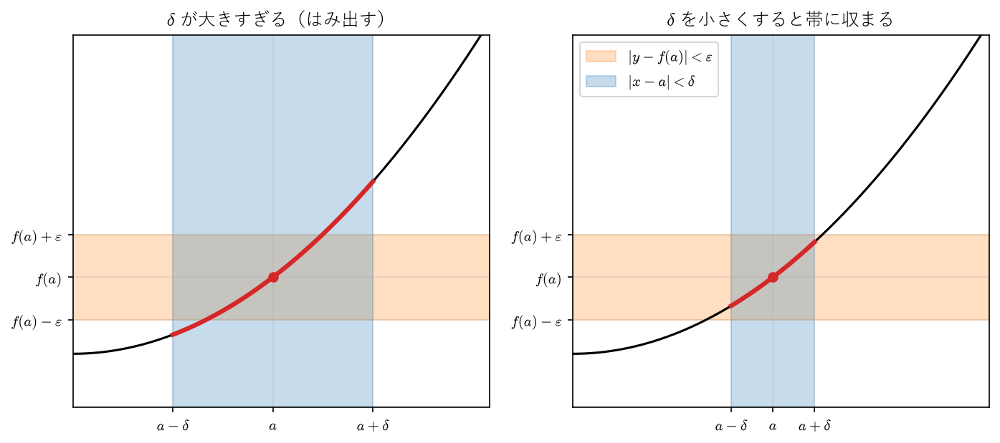
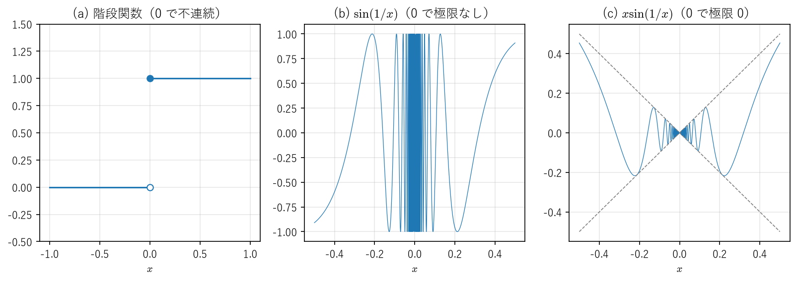
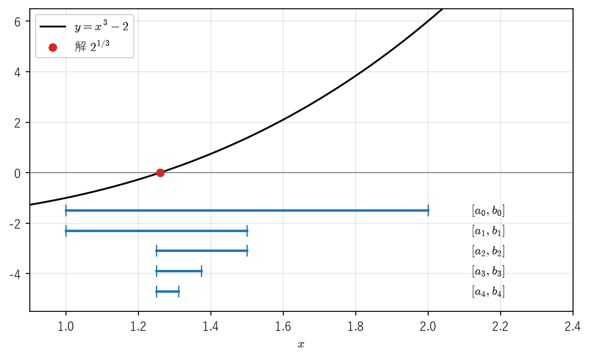
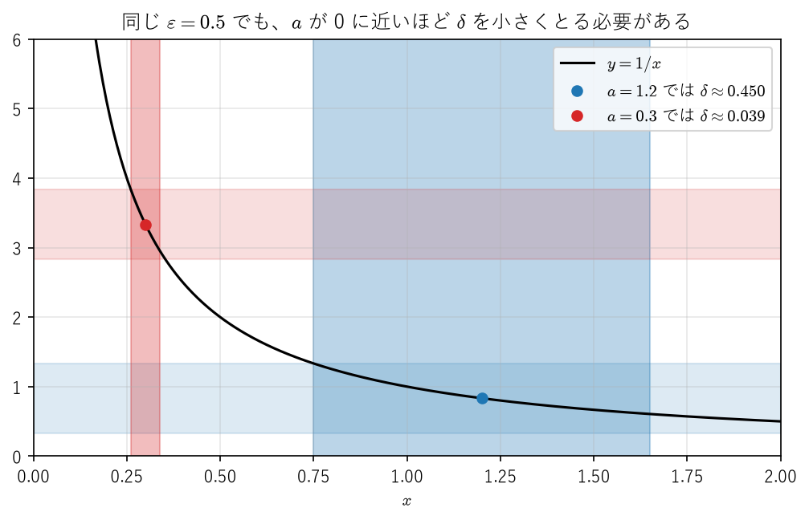

関数の極限と連続性
==================

「入力を少し変えても出力は少ししか変わらない」という性質は、工学のあらゆる場面で暗黙のうちに仮定されている。計算機に入力できる数には必ず丸め誤差があるが、関数が連続であれば、入力の誤差を十分小さくすることで出力の誤差を望みの大きさ以下に抑えられる。逆に、連続でない関数ではそのような保証がない。

本章では、まず関数の極限を ε-δ 論法で定義し、数列の極限との関係を調べる。次に連続関数を定義し、連続関数がもつ 2 つの基本的な性質である中間値の定理と最大値・最小値の定理を証明する。中間値の定理の証明はそのまま方程式の数値解法である二分法になり、誤差の上界も同時に得られる。最後に、点によらない連続性である一様連続性と、工学で頻繁に使われるリプシッツ連続性を扱う。

関数の極限
----------

高校では「:math:`x` が :math:`a` に限りなく近づくとき :math:`f(x)` が :math:`L` に限りなく近づく」ことを :math:`\lim_{x \to a} f(x) = L` と書いた。「限りなく近づく」を不等式で言い換えたのが次の定義である。

.. _ch04-def-limit:

.. admonition:: 定義 4.1（関数の極限）
   :class: definition

   :math:`a` を含む開区間 :math:`I` から点 :math:`a` を除いた集合で関数 :math:`f` が定義されているとする。任意の :math:`\varepsilon > 0` に対してある :math:`\delta > 0` が存在し、

   .. math::

      x \in I, \quad 0 < |x - a| < \delta \quad \Longrightarrow \quad |f(x) - L| < \varepsilon

   が成り立つとき、:math:`x \to a` のとき :math:`f(x)` は :math:`L` に収束するといい、:math:`\lim_{x \to a} f(x) = L` と書く。

:math:`\varepsilon` は「出力の誤差として許す大きさ」、:math:`\delta` は「それを達成するために入力に要求する精度」と読むとよい。どんなに厳しい :math:`\varepsilon` を指定されても、それに応じた :math:`\delta` を用意できることが収束の意味である。条件 :math:`0 < |x - a|` により、:math:`x = a` での値（定義されていなくてもよい）は極限に関係しない。

.. _ch04-ex-square:

.. admonition:: 例 4.1
   :class: example

   :math:`\lim_{x \to 2} x^2 = 4` を示す。:math:`|x^2 - 4| = |x - 2| \, |x + 2|` である。:math:`|x - 2| < 1` ならば :math:`1 < x < 3` なので :math:`|x + 2| < 5` である。そこで :math:`\varepsilon > 0` に対して :math:`\delta = \min(1, \varepsilon/5)` とおくと、:math:`0 < |x - 2| < \delta` ならば

   .. math::

      |x^2 - 4| = |x - 2| \, |x + 2| < \frac{\varepsilon}{5} \cdot 5 = \varepsilon

   となる。このように、:math:`\delta` を :math:`\varepsilon` の式として具体的に与えるのが ε-δ 論法による証明の典型である。

関数の極限は、数列の極限を使って言い換えられる。これにより、第 2 章（:doc:`sequences`）で示した数列の極限の性質をそのまま関数の極限に移すことができる。

.. _ch04-thm-sequential:

.. admonition:: 定理 4.1（極限の点列による特徴付け）
   :class: theorem

   定義 4.1 と同じ状況で、次の 2 条件は同値である。

   1. :math:`\lim_{x \to a} f(x) = L`
   2. :math:`I` から :math:`a` を除いた集合に含まれ :math:`a` に収束する任意の数列 :math:`(x_n)` に対して、:math:`\lim_{n \to \infty} f(x_n) = L`

.. admonition:: 証明
   :class: proof

   1 ならば 2：:math:`\varepsilon > 0` に対して、定義 4.1 の :math:`\delta` をとる。:math:`x_n \to a` なので、ある :math:`N` があって :math:`n \geq N` ならば :math:`|x_n - a| < \delta` となる。:math:`x_n \neq a` なので :math:`0 < |x_n - a| < \delta` であり、:math:`|f(x_n) - L| < \varepsilon` となる。よって :math:`f(x_n) \to L` である。

   2 ならば 1：対偶を示す。1 が成り立たないとすると、ある :math:`\varepsilon_0 > 0` があって、どんな :math:`\delta > 0` に対しても :math:`0 < |x - a| < \delta` かつ :math:`|f(x) - L| \geq \varepsilon_0` を満たす :math:`x \in I` が存在する（否定の作り方は\ :doc:`appendix_logic`\ を参照）。:math:`\delta = 1/n` としたときのそのような :math:`x` を :math:`x_n` とすると、:math:`0 < |x_n - a| < 1/n` なので :math:`x_n \neq a` かつ :math:`x_n \to a` であるが、すべての :math:`n` で :math:`|f(x_n) - L| \geq \varepsilon_0` なので :math:`f(x_n)` は :math:`L` に収束しない。よって 2 も成り立たない。

.. _ch04-cor-limit-arith:

.. admonition:: 系 4.2（極限の四則演算）
   :class: theorem

   :math:`\lim_{x \to a} f(x) = L`、:math:`\lim_{x \to a} g(x) = M` とする。このとき

   .. math::

      \lim_{x \to a} (f(x) \pm g(x)) = L \pm M, \qquad \lim_{x \to a} f(x) g(x) = LM

   である。さらに :math:`M \neq 0` ならば、:math:`a` の十分近く（:math:`a` を除く）で :math:`g(x) \neq 0` であり、:math:`\lim_{x \to a} f(x)/g(x) = L/M` である。

.. admonition:: 証明
   :class: proof

   :math:`a` に収束する数列 :math:`(x_n)`\ （:math:`x_n \neq a`）を任意にとると、定理 4.1 により :math:`f(x_n) \to L`、:math:`g(x_n) \to M` である。数列の極限の四則演算により :math:`f(x_n) \pm g(x_n) \to L \pm M`、:math:`f(x_n) g(x_n) \to LM` となり、再び定理 4.1 により和・差・積の主張を得る。商については、:math:`\varepsilon = |M|/2` に対する定義 4.1 の :math:`\delta` をとると、:math:`0 < |x - a| < \delta` で :math:`|g(x) - M| < |M|/2`、したがって :math:`|g(x)| > |M|/2 > 0` となる。この範囲で同じ議論を行えばよい。

定理 4.1 は、極限が存在しないことを示すのにも便利である。

.. _ch04-ex-sin-inverse:

.. admonition:: 例 4.2（:math:`\sin(1/x)` は 0 で極限をもたない）
   :class: example

   :math:`x_n = \frac{1}{2n\pi}`、:math:`y_n = \frac{1}{2n\pi + \pi/2}` とおくと、どちらも 0 でなく 0 に収束するが、:math:`\sin(1/x_n) = 0`、:math:`\sin(1/y_n) = 1` である。収束先が異なるので、定理 4.1 により :math:`\lim_{x \to 0} \sin(1/x)` は存在しない（:numref:`ch04-fig-discontinuous` の (b)）。

.. _ch04-ex-x-sin-inverse:

.. admonition:: 例 4.3（:math:`x \sin(1/x)` の極限）
   :class: example

   :math:`|x \sin(1/x)| \leq |x|` なので、:math:`\varepsilon > 0` に対して :math:`\delta = \varepsilon` とおけば、:math:`0 < |x| < \delta` で :math:`|x \sin(1/x) - 0| < \varepsilon` となる。よって :math:`\lim_{x \to 0} x \sin(1/x) = 0` である（:numref:`ch04-fig-discontinuous` の (c)）。振動しても、振幅が 0 に近づけば極限は存在する。

片側からの極限や、:math:`x` を限りなく大きくしたときの極限も同様に定義する。

.. _ch04-def-one-sided:

.. admonition:: 定義 4.2（片側極限・無限遠での極限）
   :class: definition

   1. 任意の :math:`\varepsilon > 0` に対してある :math:`\delta > 0` が存在し、:math:`a < x < a + \delta` ならば :math:`|f(x) - L| < \varepsilon` となるとき、:math:`\lim_{x \to a+0} f(x) = L` と書き、右極限という。:math:`a - \delta < x < a` とした左極限 :math:`\lim_{x \to a-0} f(x)` も同様に定める。
   2. 任意の :math:`\varepsilon > 0` に対してある :math:`R` が存在し、:math:`x > R` ならば :math:`|f(x) - L| < \varepsilon` となるとき、:math:`\lim_{x \to \infty} f(x) = L` と書く。:math:`x \to -\infty` の場合も同様に定める。

連続関数
--------

.. _ch04-def-continuity:

.. admonition:: 定義 4.3（連続性）
   :class: definition

   :math:`I` を区間とし、:math:`f \colon I \to \mathbb{R}` とする。点 :math:`a \in I` において、任意の :math:`\varepsilon > 0` に対してある :math:`\delta > 0` が存在し、

   .. math::

      x \in I, \quad |x - a| < \delta \quad \Longrightarrow \quad |f(x) - f(a)| < \varepsilon

   が成り立つとき、:math:`f` は :math:`a` で連続であるという。:math:`I` のすべての点で連続であるとき、:math:`f` は :math:`I` で連続である、または :math:`I` 上の連続関数であるという。

:math:`a` が :math:`I` の内部の点ならば、:math:`f` が :math:`a` で連続であることは :math:`\lim_{x \to a} f(x) = f(a)` と同じである。:math:`a` が区間の端点ならば、区間の内側からの片側極限が :math:`f(a)` に一致することと同じである。:numref:`ch04-fig-epsilon-delta` は定義 4.3 を図示したものである。:math:`x` を :math:`a` の :math:`\delta` 近く（縦の帯）に制限すると、グラフ（太線）が :math:`f(a)` の :math:`\varepsilon` 近く（横の帯）に収まる。

.. _ch04-fig-epsilon-delta:

   ε-δ 論法による連続性の図解

定理 4.1 と同じ証明により、連続性も数列で言い換えられる。

.. _ch04-thm-sequential-continuity:

.. admonition:: 定理 4.3（連続性の点列による特徴付け）
   :class: theorem

   :math:`f \colon I \to \mathbb{R}` が :math:`a \in I` で連続であるための必要十分条件は、:math:`I` に含まれ :math:`a` に収束する任意の数列 :math:`(x_n)` に対して :math:`f(x_n) \to f(a)` となることである。

.. admonition:: 証明
   :class: proof

   定理 4.1 の証明で :math:`L` を :math:`f(a)` に置き換えればよい。ただし :math:`x_n = a` となる項があっても :math:`|f(x_n) - f(a)| = 0 < \varepsilon` なので、:math:`x_n \neq a` を仮定する必要はない。

.. _ch04-thm-continuity-arith:

.. admonition:: 定理 4.4（連続関数の演算）
   :class: theorem

   1. :math:`f, g \colon I \to \mathbb{R}` が :math:`a \in I` で連続ならば、:math:`f \pm g` と :math:`fg` は :math:`a` で連続である。さらに :math:`g(a) \neq 0` ならば、:math:`f/g` は :math:`a` で連続である（:math:`a` の近くで :math:`g(x) \neq 0` となる範囲で考える）。
   2. :math:`f \colon I \to \mathbb{R}` が :math:`a` で連続で、:math:`g \colon J \to \mathbb{R}` が :math:`f(a)` で連続であり、:math:`f(I) \subset J` とする。このとき合成関数 :math:`g \circ f` は :math:`a` で連続である。

.. admonition:: 証明
   :class: proof

   1 は系 4.2 と同様に、定理 4.3 と数列の極限の四則演算から従う。2 を示す。:math:`I` に含まれ :math:`a` に収束する数列 :math:`(x_n)` をとると、:math:`f` の連続性から :math:`f(x_n) \to f(a)` であり、:math:`f(x_n) \in J` である。:math:`g` の :math:`f(a)` での連続性から :math:`g(f(x_n)) \to g(f(a))` となる。定理 4.3 により :math:`g \circ f` は :math:`a` で連続である。

定数関数と :math:`f(x) = x` は明らかに連続なので、定理 4.4 から多項式関数は :math:`\mathbb{R}` で連続であり、有理関数は分母が 0 にならない点で連続である。:math:`\sin x`、:math:`\cos x`、:math:`e^x`、:math:`\log x` が定義域で連続であることは、本書では既知として使う（証明は [Sugiura1980]_ などを参照）。

.. _ch04-ex-discontinuous:

.. admonition:: 例 4.4（不連続な関数と連続な関数）
   :class: example

   1. 階段関数 :math:`H(x) = 0 \ (x < 0)`、:math:`H(x) = 1 \ (x \geq 0)` は 0 で連続でない。実際、:math:`x_n = -1/n \to 0` であるが :math:`H(x_n) = 0` は :math:`H(0) = 1` に収束しない。
   2. :math:`f(x) = \sin(1/x) \ (x \neq 0)` は、:math:`f(0)` をどのように定めても 0 で連続にならない。0 での極限が存在しないためである（例 4.2）。
   3. :math:`f(x) = x \sin(1/x) \ (x \neq 0)`、:math:`f(0) = 0` と定めると、例 4.3 により :math:`f` は 0 で連続である。

.. _ch04-fig-discontinuous:

   階段関数 (a)、:math:`\sin(1/x)` (b)、:math:`x \sin(1/x)` (c) のグラフ

中間値の定理と二分法
--------------------

連続関数のグラフは「途切れない」。これを厳密に述べたものが中間値の定理である。ここでは、区間を半分ずつに狭めていく構成的な方法で証明する。この証明はそのまま方程式の数値解法になる。

.. _ch04-thm-ivt:

.. admonition:: 定理 4.5（中間値の定理）
   :class: theorem

   :math:`f \colon [a, b] \to \mathbb{R}` が連続で、:math:`f(a) \neq f(b)` とする。:math:`f(a)` と :math:`f(b)` の間の任意の値 :math:`\gamma` に対して、:math:`f(c) = \gamma` を満たす :math:`c \in (a, b)` が存在する。

.. admonition:: 証明
   :class: proof

   :math:`f(a) < \gamma < f(b)` の場合を示す（:math:`f(a) > \gamma > f(b)` の場合は :math:`-f` と :math:`-\gamma` に適用すればよい）。:math:`g(x) = f(x) - \gamma` とおくと、:math:`g` は連続で :math:`g(a) < 0 < g(b)` である。

   :math:`a_0 = a`、:math:`b_0 = b` とし、:math:`k = 0, 1, 2, \ldots` に対して中点 :math:`m_k = (a_k + b_k)/2` を用いて次のように定める。

   * :math:`g(m_k) < 0` ならば :math:`a_{k+1} = m_k`、:math:`b_{k+1} = b_k`
   * :math:`g(m_k) \geq 0` ならば :math:`a_{k+1} = a_k`、:math:`b_{k+1} = m_k`

   帰納的に、すべての :math:`k` で :math:`g(a_k) < 0 \leq g(b_k)`、:math:`a \leq a_k \leq a_{k+1} \leq b_{k+1} \leq b_k \leq b`、:math:`b_k - a_k = (b - a)/2^k` が成り立つ。:math:`(a_k)` は単調増加で :math:`b` で上に有界、:math:`(b_k)` は単調減少で :math:`a` で下に有界なので、:ref:`単調収束定理 <ch02-thm-monotone>`\ によりそれぞれ収束する。:math:`b_k - a_k \to 0` なので両者の極限は等しく、これを :math:`c` とおく。:math:`a \leq a_k \leq b` なので :math:`c \in [a, b]` である。

   :math:`g` は連続なので、定理 4.3 により :math:`g(a_k) \to g(c)`、:math:`g(b_k) \to g(c)` である。:math:`g(a_k) < 0` から :math:`g(c) \leq 0`、:math:`g(b_k) \geq 0` から :math:`g(c) \geq 0` が従う（極限をとると不等号は等号付きで保たれる）。よって :math:`g(c) = 0`、すなわち :math:`f(c) = \gamma` である。さらに :math:`g(a) < 0`、:math:`g(b) > 0` なので :math:`c \neq a, b` であり、:math:`c \in (a, b)` である。

連続性の仮定は外せない。たとえば階段関数 :math:`H` は :math:`[-1, 1]` で値 0 と 1 をとるが、値 :math:`1/2` をとる点はない。

.. _ch04-ex-odd-degree:

.. admonition:: 例 4.5（奇数次の多項式は実数解をもつ）
   :class: example

   :math:`p(x) = x^n + c_{n-1} x^{n-1} + \cdots + c_0`\ （:math:`n` は奇数）とする。:math:`x \neq 0` で :math:`p(x)/x^n = 1 + c_{n-1}/x + \cdots + c_0/x^n` であり、これは :math:`x \to \pm\infty` で 1 に収束する。したがって十分大きい :math:`R > 0` に対して :math:`p(R)/R^n > 0`、:math:`p(-R)/(-R)^n > 0` となる。:math:`n` は奇数なので :math:`(-R)^n < 0` であり、:math:`p(R) > 0`、:math:`p(-R) < 0` となる。中間値の定理により、:math:`p(c) = 0` となる :math:`c \in (-R, R)` が存在する。

二分法
^^^^^^

定理 4.5 の証明の手順を :math:`\gamma = 0` として実行し、有限回で打ち切ったものが二分法である。連続関数 :math:`f` が :math:`f(a)` と :math:`f(b)` で異符号ならば、二分法は必ず :math:`f(x) = 0` の解に近づく。しかも、誤差の上界が事前に分かる。

.. _ch04-prop-bisection:

.. admonition:: 命題 4.6（二分法の誤差）
   :class: theorem

   :math:`f \colon [a, b] \to \mathbb{R}` は連続で :math:`f(a) f(b) < 0` とする。二分法を :math:`k` 回行った後の区間を :math:`[a_k, b_k]`、その中点を :math:`c_k = (a_k + b_k)/2` とする。このとき、:math:`f(c) = 0` を満たすある :math:`c \in (a, b)` に対して

   .. math::
      :label: ch04-eq-bisection-error

      |c_k - c| \leq \frac{b - a}{2^{k+1}}

   が成り立つ。したがって、誤差を :math:`\tau > 0` 以下にするには :math:`k \geq \log_2 \frac{b - a}{\tau} - 1` を満たす回数だけ反復すればよい。

.. admonition:: 証明
   :class: proof

   定理 4.5 の証明で得た :math:`c` は、すべての :math:`k` について :math:`a_k \leq c \leq b_k` を満たす。中点 :math:`c_k` と区間内の点 :math:`c` との距離は区間の幅の半分以下なので、:math:`|c_k - c| \leq (b_k - a_k)/2 = (b - a)/2^{k+1}` である。後半は :math:`(b - a)/2^{k+1} \leq \tau` を :math:`k` について解けばよい。

サンプルコード :download:`ch04_bisection.py <../examples/ch04_bisection.py>` は、方程式 :math:`x^3 - 2 = 0` の解 :math:`2^{1/3}` を区間 :math:`[1, 2]` で二分法により求める。二分法の本体は次の関数である。

.. literalinclude:: ../examples/ch04_bisection.py
   :language: python
   :linenos:
   :pyobject: bisection

実行結果は次のとおりである（3 回ごとに表示している）。

.. code-block:: text
   :linenos:

   方程式 x^3 - 2 = 0 を区間 [1, 2] で二分法により解く
   c_k: 区間の中点、error: |c_k - 2^(1/3)|、bound: 誤差の上界 (b - a) / 2^(k+1)
     k            a_k            b_k            c_k        error        bound
     0   1.0000000000   2.0000000000   1.5000000000    2.401e-01    5.000e-01
     3   1.2500000000   1.3750000000   1.3125000000    5.258e-02    6.250e-02
     6   1.2500000000   1.2656250000   1.2578125000    2.109e-03    7.812e-03
     9   1.2597656250   1.2617187500   1.2607421875    8.211e-04    9.766e-04
    12   1.2597656250   1.2600097656   1.2598876953    3.335e-05    1.221e-04
    15   1.2599182129   1.2599487305   1.2599334717    1.242e-05    1.526e-05
    18   1.2599182129   1.2599220276   1.2599201202    9.297e-07    1.907e-06
    21   1.2599205971   1.2599210739   1.2599208355    2.144e-07    2.384e-07
    24   1.2599210143   1.2599210739   1.2599210441    5.784e-09    2.980e-08
    27   1.2599210441   1.2599210516   1.2599210478    2.058e-09    3.725e-09
    30   1.2599210497   1.2599210506   1.2599210502    2.700e-10    4.657e-10

   真の値 2^(1/3) = 1.2599210499
   誤差 1e-10 以下に必要な反復回数: 33

実際の誤差（error）は必ず上界（bound）以下になっている。実際の誤差は反復ごとに単調に減るとは限らないが、上界は 1 回の反復でちょうど半分になる。:numref:`ch04-fig-bisection` は、最初の 5 つの区間が解を挟みながら縮んでいく様子を示している。

.. _ch04-fig-bisection:

   二分法による区間の縮小（:math:`f(x) = x^3 - 2`）

二分法は、:math:`f` の連続性と端点での符号の違いだけを仮定して収束が保証される、非常に頑健な方法である。その代わり、誤差の上界は 1 回の反復で半分（2 進数で 1 桁）しか減らない。第 2 章（:doc:`sequences`）の数値実験で扱ったニュートン法は、より強い仮定のもとではるかに速く収束する（その証明は第 6 章「\ :doc:`taylor`\ 」で行う）。実用上は、二分法で解のおおよその位置を絞り込んでから速い方法に切り替えることも多い。

.. admonition:: 注意
   :class: note

   サンプルコードでは符号の判定に積 ``fa * fc`` を使っているが、:math:`|f|` が非常に小さい値や大きい値をとる場合、浮動小数点数の積がアンダーフローして 0 になったりオーバーフローしたりして、判定を誤ることがある。実用的な実装では、``math.copysign`` などで符号だけを比べるのが安全である。また、区間の幅が浮動小数点数の間隔より小さくなると、それ以上の反復は意味をもたない。

最大値・最小値の定理
--------------------

.. _ch04-thm-extreme:

.. admonition:: 定理 4.7（最大値・最小値の定理）
   :class: theorem

   有界閉区間 :math:`[a, b]` 上の連続関数 :math:`f` は、最大値と最小値をもつ。すなわち、すべての :math:`x \in [a, b]` に対して :math:`f(x_{\min}) \leq f(x) \leq f(x_{\max})` となる :math:`x_{\min}, x_{\max} \in [a, b]` が存在する。

.. admonition:: 証明
   :class: proof

   最大値について示す（最小値は :math:`-f` に適用すればよい）。

   まず :math:`f` が上に有界であることを示す。上に有界でないとすると、各 :math:`n \in \mathbb{N}` に対して :math:`f(x_n) > n` となる :math:`x_n \in [a, b]` がある。:math:`(x_n)` は有界なので、:ref:`ボルツァーノ・ワイエルシュトラスの定理 <ch02-thm-bw>`\ により収束する部分列 :math:`(x_{n_k})` をもつ。その極限を :math:`c` とすると、:math:`a \leq x_{n_k} \leq b` から :math:`c \in [a, b]` である。:math:`f` は :math:`c` で連続なので :math:`f(x_{n_k}) \to f(c)` となるが、:math:`f(x_{n_k}) > n_k \geq k` なので :math:`(f(x_{n_k}))` は有界でなく、収束しない。これは矛盾である。

   次に、:math:`f` の値の集合 :math:`\{f(x) \mid x \in [a, b]\}` は空でなく上に有界なので、:ref:`実数の連続性 <ch01-thm-sup>`\ により上限 :math:`M` が存在する。上限の定義から、各 :math:`n` に対して :math:`M - 1/n < f(x_n) \leq M` となる :math:`x_n \in [a, b]` がある。前段と同様に収束する部分列 :math:`x_{n_k} \to c \in [a, b]` をとると、:math:`f(x_{n_k}) \to f(c)` であり、はさみうちにより :math:`f(x_{n_k}) \to M` でもある。よって :math:`f(c) = M` であり、:math:`x_{\max} = c` とすればよい。

定理の仮定はどれも外せない。

* 区間が閉じていない場合：:math:`f(x) = x` は :math:`[0, 1)` で最大値をもたない。:math:`f(x) = 1/x` は :math:`(0, 1]` で上に有界でない。
* 区間が有界でない場合：:math:`f(x) = x` は :math:`[0, \infty)` で最大値をもたない。
* 連続でない場合：:math:`f(x) = x \ (0 \leq x < 1)`、:math:`f(1) = 0` は :math:`[0, 1]` で最大値をもたない。

証明では、閉区間であることが「部分列の極限が区間からはみ出さない」ことに、連続性が「部分列の極限で関数値も収束する」ことに使われている。

工学では、設計変数を制約の範囲で動かして目的関数を最小化する最適化問題がよく現れる。目的関数が連続で、制約の範囲が有界閉区間（多変数では有界閉集合。:doc:`multivariable_differentiation`\ を参照）であれば、最適解が必ず存在することがこの定理から保証される。解の存在が保証されない問題に対して数値的な最適化を行うと、反復が収束しなかったり、境界に向かって発散したりする。

一様連続性
----------

定義 4.3 の :math:`\delta` は、一般に :math:`\varepsilon` だけでなく点 :math:`a` にも依存する。点によらない共通の :math:`\delta` がとれる場合を一様連続という。

.. _ch04-def-uniform-continuity:

.. admonition:: 定義 4.4（一様連続性）
   :class: definition

   :math:`f \colon I \to \mathbb{R}` が :math:`I` で一様連続であるとは、任意の :math:`\varepsilon > 0` に対してある :math:`\delta > 0` が存在し、

   .. math::

      x, y \in I, \quad |x - y| < \delta \quad \Longrightarrow \quad |f(x) - f(y)| < \varepsilon

   が成り立つことである。

連続性との違いは量化子の順序にある。連続性は「任意の :math:`a` と任意の :math:`\varepsilon` に対して :math:`\delta` が存在する」であり、:math:`\delta` は :math:`a` に依存してよい。一様連続性は「任意の :math:`\varepsilon` に対して、すべての点で共通に使える :math:`\delta` が存在する」である。一様連続ならば連続であることは定義から明らかである。

.. _ch04-ex-not-uniform:

.. admonition:: 例 4.6（:math:`1/x` は :math:`(0, 1]` で一様連続でない）
   :class: example

   :math:`f(x) = 1/x` は :math:`(0, 1]` で連続である。:math:`x_n = \frac{1}{n}`、:math:`y_n = \frac{1}{n+1}` とおくと :math:`|x_n - y_n| = \frac{1}{n(n+1)} \to 0` であるが、:math:`|f(x_n) - f(y_n)| = 1` である。したがって :math:`\varepsilon = 1/2` に対しては、どんな :math:`\delta > 0` をとっても、:math:`\frac{1}{n(n+1)} < \delta` となる :math:`n` について :math:`|x_n - y_n| < \delta` かつ :math:`|f(x_n) - f(y_n)| \geq \varepsilon` となる。よって一様連続でない。

   :numref:`ch04-fig-uniform` に示すように、同じ :math:`\varepsilon` に対して必要な :math:`\delta` は、点が 0 に近づくほど小さくなり、すべての点に共通の正の :math:`\delta` はとれない。

.. _ch04-fig-uniform:

   :math:`y = 1/x` で必要な :math:`\delta` は点によって異なる

ところが、有界閉区間ではこのようなことは起こらない。

.. _ch04-thm-heine:

.. admonition:: 定理 4.8（ハイネの定理）
   :class: theorem

   有界閉区間 :math:`[a, b]` 上の連続関数は、:math:`[a, b]` で一様連続である。

.. admonition:: 証明
   :class: proof

   一様連続でないと仮定する。定義 4.4 を否定すると、ある :math:`\varepsilon_0 > 0` があって、どんな :math:`\delta > 0` に対しても :math:`|x - y| < \delta` かつ :math:`|f(x) - f(y)| \geq \varepsilon_0` を満たす :math:`x, y \in [a, b]` が存在する。:math:`\delta = 1/n` に対するそのような点を :math:`x_n, y_n` とする。

   :math:`(x_n)` は有界なので、:ref:`ボルツァーノ・ワイエルシュトラスの定理 <ch02-thm-bw>`\ により収束する部分列 :math:`x_{n_k} \to c` をもち、:math:`c \in [a, b]` である。:math:`|y_{n_k} - x_{n_k}| < 1/n_k \to 0` なので :math:`y_{n_k} \to c` でもある。:math:`f` は :math:`c` で連続なので、:math:`f(x_{n_k}) \to f(c)`、:math:`f(y_{n_k}) \to f(c)` となり、:math:`|f(x_{n_k}) - f(y_{n_k})| \to 0` である。これはすべての :math:`k` で :math:`|f(x_{n_k}) - f(y_{n_k})| \geq \varepsilon_0` であることに矛盾する。

一様連続性は、第 7 章（:doc:`integration`）で連続関数が積分可能であることを示す際に本質的に使われる。工学的には次のように解釈できる。関数の値を間隔 :math:`\delta` の格子点だけで計算して表にしておけば、一様連続な関数では、格子点の間のどの点でも値は最寄りの格子点の値と :math:`\varepsilon` 未満しか違わない。一様連続でなければ、どれほど細かい格子をとっても、どこかで格子点の間の値を見誤る。

リプシッツ連続性
----------------

一様連続性をさらに定量的にしたものがリプシッツ連続性である。

.. _ch04-def-lipschitz:

.. admonition:: 定義 4.5（リプシッツ連続性）
   :class: definition

   :math:`f \colon I \to \mathbb{R}` に対してある定数 :math:`L \geq 0` が存在し、

   .. math::
      :label: ch04-eq-lipschitz

      |f(x) - f(y)| \leq L |x - y| \quad (x, y \in I)

   が成り立つとき、:math:`f` は :math:`I` でリプシッツ連続であるといい、:math:`L` をリプシッツ定数という。

:eq:`ch04-eq-lipschitz` は、入力の差が出力では高々 :math:`L` 倍にしか拡大されないことを意味する。たとえば入力に大きさ :math:`\Delta` の誤差があれば、出力の誤差は :math:`L \Delta` 以下である。

.. _ch04-prop-lipschitz-uniform:

.. admonition:: 命題 4.9
   :class: theorem

   リプシッツ連続な関数は一様連続である。

.. admonition:: 証明
   :class: proof

   :math:`L = 0` ならば :math:`f` は定数関数なので明らかである。:math:`L > 0` のとき、:math:`\varepsilon > 0` に対して :math:`\delta = \varepsilon / L` とおけば、:math:`|x - y| < \delta` で :math:`|f(x) - f(y)| \leq L |x - y| < \varepsilon` となる。

.. _ch04-ex-lipschitz:

.. admonition:: 例 4.7
   :class: example

   1. :math:`f(x) = |x|` は :math:`\mathbb{R}` でリプシッツ連続で、:math:`L = 1` である（三角不等式 :math:`||x| - |y|| \leq |x - y|`）。
   2. :math:`f(x) = \sin x` は :math:`\mathbb{R}` で :math:`L = 1` のリプシッツ連続である。実際、和積の公式と :math:`|\sin t| \leq |t|`、:math:`|\cos t| \leq 1` より :math:`|\sin x - \sin y| = 2 \left| \cos \frac{x+y}{2} \right| \left| \sin \frac{x-y}{2} \right| \leq |x - y|` である。
   3. :math:`f(x) = \sqrt{x}` は :math:`[0, 1]` で連続なので、ハイネの定理により一様連続である。しかしリプシッツ連続ではない。:math:`x > 0` に対して :math:`\frac{|\sqrt{x} - \sqrt{0}|}{|x - 0|} = \frac{1}{\sqrt{x}}` は :math:`x \to +0` でいくらでも大きくなり、どんな定数 :math:`L` でも押さえられないからである。

連続性に関する概念の関係を\ :numref:`ch04-fig-continuity-relations` にまとめる。第 5 章（:doc:`differentiation`）の\ :ref:`平均値の定理 <ch05-thm-mvt>`\ を使うと、微分可能で :math:`|f'(x)| \leq L` を満たす関数は、リプシッツ定数 :math:`L` のリプシッツ連続関数であることが分かる（微分の厳密な定義は第 5 章で与える。ここでは高校で学んだ微分を前提とする）。

.. graphviz::
   :caption: 連続性に関する概念の関係（実線は一般に成り立つ含意、破線は有界閉区間上で成り立つ含意）
   :name: ch04-fig-continuity-relations

   digraph continuity {
       rankdir=LR;
       node [shape=box, style=rounded];
       D [label="微分可能で\n導関数が有界"];
       L [label="リプシッツ連続"];
       U [label="一様連続"];
       C [label="連続"];
       D -> L [label="平均値の定理"];
       L -> U [label="逆は不成立\n例：√x"];
       U -> C [label="逆は不成立\n例：1/x"];
       C -> U [label="ハイネの定理", style=dashed];
   }

工学では、リプシッツ連続性は次のような場面で仮定される。

* 常微分方程式の初期値問題で、解が存在してただ 1 つに定まるための条件（右辺のリプシッツ連続性）
* 勾配降下法で、収束が保証されるステップ幅の上限を与える条件（勾配のリプシッツ連続性。2 次関数の場合を\ :doc:`multivariable_differentiation`\ で扱う）
* 反復法 :math:`x_{n+1} = g(x_n)` が収束するための条件（次の定理）

.. _ch04-thm-contraction:

.. admonition:: 定理 4.10（縮小写像の原理）
   :class: theorem

   :math:`g \colon [a, b] \to [a, b]` がリプシッツ定数 :math:`L < 1` のリプシッツ連続関数であるとする。このとき次が成り立つ。

   1. :math:`g(x^*) = x^*` を満たす点（不動点） :math:`x^* \in [a, b]` がただ 1 つ存在する。
   2. 任意の :math:`x_0 \in [a, b]` から :math:`x_{n+1} = g(x_n)` で定めた数列は :math:`x^*` に収束し、

      .. math::
         :label: ch04-eq-contraction-error

         |x_n - x^*| \leq \frac{L^n}{1 - L} |x_1 - x_0|

      が成り立つ。

.. admonition:: 証明
   :class: proof

   :math:`|x_{n+1} - x_n| = |g(x_n) - g(x_{n-1})| \leq L |x_n - x_{n-1}|` を繰り返し用いると、:math:`|x_{n+1} - x_n| \leq L^n |x_1 - x_0|` である。:math:`m > n` に対して、三角不等式と等比級数の和から

   .. math::

      |x_m - x_n| \leq \sum_{k=n}^{m-1} |x_{k+1} - x_k| \leq (L^n + L^{n+1} + \cdots + L^{m-1}) |x_1 - x_0| \leq \frac{L^n}{1 - L} |x_1 - x_0|

   となる。:math:`L^n \to 0` なので :math:`(x_n)` はコーシー列であり、:ref:`コーシー列の収束 <ch02-thm-cauchy>`\ により極限 :math:`x^*` をもつ。:math:`x_n \in [a, b]` なので :math:`x^* \in [a, b]` である。:math:`g` は連続なので、:math:`x_{n+1} = g(x_n)` で :math:`n \to \infty` とすると :math:`x^* = g(x^*)` を得る。上の不等式で :math:`m \to \infty` とすれば :eq:`ch04-eq-contraction-error` が得られる。

   一意性を示す。:math:`y^* \in [a, b]` も :math:`g(y^*) = y^*` を満たすとすると、:math:`|x^* - y^*| = |g(x^*) - g(y^*)| \leq L |x^* - y^*|` である。:math:`L < 1` なので :math:`|x^* - y^*| = 0` となる。

.. _ch04-ex-cos-fixed-point:

.. admonition:: 例 4.8（方程式 :math:`\cos x = x`）
   :class: example

   :math:`g(x) = \cos x` は :math:`[0, 1]` を :math:`[\cos 1, 1] \subset [0, 1]` に写す。また :math:`x, y \in [0, 1]` に対して、和積の公式と、:math:`\sin` が :math:`[0, 1]` で単調増加であることから

   .. math::

      |\cos x - \cos y| = 2 \left| \sin \frac{x+y}{2} \right| \left| \sin \frac{x-y}{2} \right| \leq 2 \sin 1 \cdot \frac{|x - y|}{2} = \sin 1 \cdot |x - y|

   となる。:math:`L = \sin 1 \approx 0.841 < 1` なので、定理 4.10 により :math:`\cos x = x` は :math:`[0, 1]` にただ 1 つの解 :math:`x^* = 0.7390\ldots` をもち、:math:`x_{n+1} = \cos x_n` はどの初期値 :math:`x_0 \in [0, 1]` からでもこの解に収束する。:eq:`ch04-eq-contraction-error` は、反復を始める前に必要な反復回数を見積もるのに使える。

まとめ
------

* 関数の極限と連続性は ε-δ 論法で定義される。:math:`\varepsilon` は出力に許す誤差、:math:`\delta` は入力に要求する精度と解釈できる。
* 関数の極限と連続性は点列で言い換えられ（定理 4.1、定理 4.3）、数列の極限の性質を利用できる。
* 有界閉区間上の連続関数について、中間値の定理と最大値・最小値の定理が成り立つ。前者の証明は二分法を与え、その誤差は :math:`k` 回の反復後に :math:`(b - a)/2^{k+1}` 以下である。
* 一様連続性は点によらない :math:`\delta` がとれる連続性である。有界閉区間上の連続関数は一様連続である（ハイネの定理）。
* リプシッツ連続性は入力の差の拡大率が定数で押さえられる性質で、リプシッツ連続ならば一様連続である。リプシッツ定数が 1 より小さい写像の反復は、ただ 1 つの不動点に収束する（縮小写像の原理）。

演習問題
--------

.. admonition:: 問題 4.1
   :class: exercise

   ε-δ 論法を用いて :math:`\lim_{x \to 3} (2x + 1) = 7` を示せ。

.. admonition:: 問題 4.2
   :class: exercise

   :math:`f(x) = x^2` は :math:`\mathbb{R}` で連続であるが、一様連続でないことを示せ。

.. admonition:: 問題 4.3
   :class: exercise

   方程式 :math:`x^5 - 3x + 1 = 0` が区間 :math:`(0, 1)` に解をもつことを示せ。また、区間 :math:`[0, 1]` から始めて二分法でこの解を誤差 :math:`10^{-6}` 以下で求めるには、命題 4.6 によれば何回反復すれば十分か。

.. admonition:: 問題 4.4
   :class: exercise

   連続関数 :math:`f \colon [0, 1] \to [0, 1]` は、:math:`f(c) = c` を満たす点 :math:`c \in [0, 1]` をもつことを示せ。

.. admonition:: 問題 4.5
   :class: exercise

   :math:`f(x) = \frac{1}{1 + x^2}` は :math:`\mathbb{R}` でリプシッツ連続であり、リプシッツ定数として :math:`L = 1` がとれることを示せ。

.. admonition:: 問題 4.6
   :class: exercise

   開区間 :math:`(0, 1)` 上の連続関数で、最大値も最小値ももたないものの例を挙げよ。

略解
----

.. admonition:: 問題 4.1 の略解
   :class: solution

   :math:`|(2x + 1) - 7| = 2|x - 3|` なので、:math:`\varepsilon > 0` に対して :math:`\delta = \varepsilon/2` とおけば、:math:`0 < |x - 3| < \delta` で :math:`|(2x + 1) - 7| < \varepsilon` となる。

.. admonition:: 問題 4.2 の略解
   :class: solution

   :math:`x_n = n + \frac{1}{n}`、:math:`y_n = n` とおくと :math:`|x_n - y_n| = \frac{1}{n} \to 0` であるが、:math:`|x_n^2 - y_n^2| = 2 + \frac{1}{n^2} > 2` である。したがって :math:`\varepsilon = 2` に対しては、どんな :math:`\delta > 0` に対しても :math:`|x - y| < \delta` かつ :math:`|f(x) - f(y)| \geq \varepsilon` を満たす :math:`x, y` が存在する。

.. admonition:: 問題 4.3 の略解
   :class: solution

   :math:`f(x) = x^5 - 3x + 1` は連続で、:math:`f(0) = 1 > 0`、:math:`f(1) = -1 < 0` なので、中間値の定理により :math:`(0, 1)` に解をもつ。:math:`\frac{1}{2^{k+1}} \leq 10^{-6}` となるのは :math:`2^{k+1} \geq 10^6` のときである。:math:`2^{19} = 524288`、:math:`2^{20} = 1048576` なので :math:`k + 1 \geq 20`、すなわち 19 回反復すれば十分である。

.. admonition:: 問題 4.4 の略解
   :class: solution

   :math:`g(x) = f(x) - x` は連続で、:math:`g(0) = f(0) \geq 0`、:math:`g(1) = f(1) - 1 \leq 0` である。どちらかが 0 ならその点が求める点である。そうでなければ :math:`g(0) > 0 > g(1)` なので、中間値の定理により :math:`g(c) = 0` となる :math:`c \in (0, 1)` がある。

.. admonition:: 問題 4.5 の略解
   :class: solution

   .. math::

      |f(x) - f(y)| = \frac{|y^2 - x^2|}{(1 + x^2)(1 + y^2)} \leq |x - y| \left( \frac{|x|}{(1 + x^2)(1 + y^2)} + \frac{|y|}{(1 + x^2)(1 + y^2)} \right)

   である。:math:`\frac{|x|}{1 + x^2} \leq \frac{1}{2}`\ （:math:`(1 - |x|)^2 \geq 0` より）と :math:`\frac{1}{1 + y^2} \leq 1` から括弧内の各項は :math:`\frac{1}{2}` 以下であり、:math:`|f(x) - f(y)| \leq |x - y|` を得る。

.. admonition:: 問題 4.6 の略解
   :class: solution

   たとえば :math:`f(x) = x` である。値の上限 1 と下限 0 はどちらも :math:`(0, 1)` のどの点でもとられない。最大値・最小値の定理で閉区間の仮定が必要であることを示す例である。
