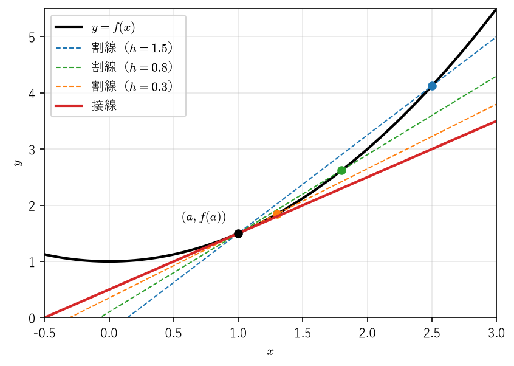
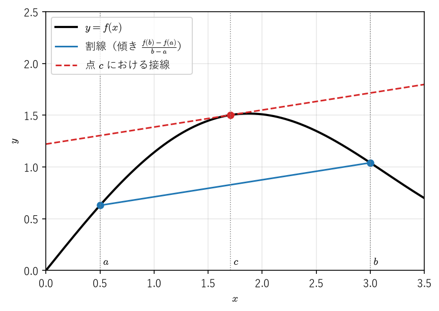
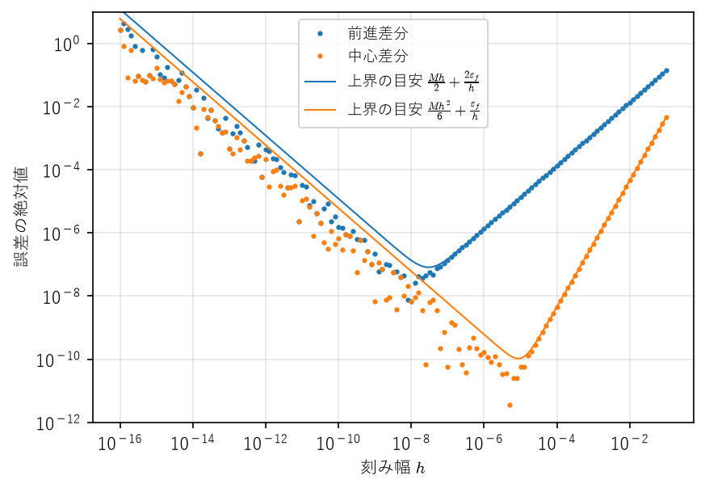

微分
====

微分は「関数を局所的に 1 次関数で近似する」操作である。高校数学では導関数の計算法を中心に学ぶが、本章では微分可能性を極限によって定義し直し、そこから平均値の定理を導く。平均値の定理は、関数の増減の判定、誤差の評価、数値微分の精度保証など、微分に関する定量的な議論のほとんどすべての出発点となる定理である。

工学の観点では、本章の最後で扱う数値微分が重要である。計算機で導関数を近似するとき、刻み幅を小さくすれば精度が上がるとは限らない。打ち切り誤差と丸め誤差の兼ね合いから最適な刻み幅が存在することを、平均値の定理を使って定量的に示す。

本章では、第 4 章「\ :doc:`continuity`\ 」の内容、特に\ :ref:`連続性の定義 <ch04-def-continuity>`\ と\ :ref:`最大値・最小値の定理 <ch04-thm-extreme>`\ を用いる。

微分係数と導関数
----------------

微分可能性の定義
^^^^^^^^^^^^^^^^

.. _ch05-def-diff:

.. admonition:: 定義 5.1（微分可能、微分係数）
   :class: definition

   関数 :math:`f` が点 :math:`a` を含む開区間で定義されているとする。極限

   .. math::

      f'(a) = \lim_{h \to 0} \frac{f(a + h) - f(a)}{h}

   が存在する（有限の値に収束する）とき、:math:`f` は :math:`a` で\ **微分可能**\ であるといい、この極限値 :math:`f'(a)` を :math:`a` における\ **微分係数**\ という。

.. admonition:: 定義 5.2（導関数、高階導関数）
   :class: definition

   関数 :math:`f` が開区間 :math:`I` のすべての点で微分可能であるとき、:math:`f` は :math:`I` で微分可能であるといい、各点 :math:`x \in I` に :math:`f'(x)` を対応させる関数 :math:`f'` を :math:`f` の\ **導関数**\ という。:math:`f'` がさらに :math:`I` で微分可能ならば、その導関数を :math:`f''` と書き、2 階導関数という。同様に :math:`n` 階導関数 :math:`f^{(n)}` を定める。:math:`f^{(n)}` が存在するとき、:math:`f` は :math:`I` で :math:`n` 回微分可能であるという。

閉区間 :math:`[a, b]` の端点では、片側極限 :math:`h \to +0` または :math:`h \to -0` による片側微分係数を考える。本章の定理では、端点を含む閉区間では連続性だけを、内部の開区間では微分可能性を仮定する形が多い。

1 次近似としての微分
^^^^^^^^^^^^^^^^^^^^

微分係数の定義は「差分商の極限」であるが、これは次のように「1 次関数による近似の誤差が :math:`h` より速く 0 に近づく」ことと言い換えられる。

.. _ch05-thm-linear:

.. admonition:: 定理 5.1（微分可能性の言い換え）
   :class: theorem

   関数 :math:`f` が点 :math:`a` を含む開区間 :math:`I` で定義されているとする。次の 3 条件は同値である。

   1. :math:`f` は :math:`a` で微分可能である。
   2. ある実数 :math:`A` が存在して、:math:`f(a + h) = f(a) + Ah + r(h)` とおいたとき :math:`\displaystyle \lim_{h \to 0} \frac{r(h)}{h} = 0` となる。
   3. :math:`I` 上の関数 :math:`\varphi` で、:math:`a` で連続であり、すべての :math:`x \in I` に対して :math:`f(x) - f(a) = \varphi(x)(x - a)` を満たすものが存在する。

   さらに、このとき :math:`A = \varphi(a) = f'(a)` である。

.. admonition:: 証明
   :class: proof

   (1 ⇒ 2) :math:`A = f'(a)` とおくと、:math:`h \neq 0` に対して :math:`\dfrac{r(h)}{h} = \dfrac{f(a + h) - f(a)}{h} - f'(a)` であり、これは :math:`h \to 0` で 0 に収束する。

   (2 ⇒ 3) :math:`x \neq a` のとき :math:`\varphi(x) = \dfrac{f(x) - f(a)}{x - a}`、:math:`\varphi(a) = A` と定める。:math:`x = a + h` とおくと :math:`\varphi(x) = A + \dfrac{r(h)}{h}` であるから、:math:`x \to a` のとき :math:`\varphi(x) \to A = \varphi(a)` となり、:math:`\varphi` は :math:`a` で連続である。等式 :math:`f(x) - f(a) = \varphi(x)(x - a)` は :math:`x = a` でも両辺が 0 となり成り立つ。

   (3 ⇒ 1) :math:`x \neq a` のとき :math:`\dfrac{f(x) - f(a)}{x - a} = \varphi(x)` であり、:math:`\varphi` が :math:`a` で連続であるから、:math:`x \to a` のときこれは :math:`\varphi(a)` に収束する。よって :math:`f` は :math:`a` で微分可能で、:math:`f'(a) = \varphi(a)` である。

条件 2 は、:math:`a` の近くで :math:`f(a + h) \approx f(a) + f'(a)h` と近似したときの誤差 :math:`r(h)` が、:math:`h` に比べて無視できるほど小さいことを表している。直線 :math:`y = f(a) + f'(a)(x - a)` が点 :math:`(a, f(a))` における\ **接線**\ である。:numref:`ch05-fig-tangent` のように、割線の傾き :math:`(f(a + h) - f(a))/h` は :math:`h \to 0` のとき接線の傾きに近づく。

   割線が接線に近づく様子（:math:`f(x) = x^2/2 + 1`、:math:`a = 1`）

条件 3 は一見回りくどいが、合成関数や逆関数の微分の証明で威力を発揮する。

.. _ch05-thm-diff-cont:

.. admonition:: 定理 5.2（微分可能ならば連続）
   :class: theorem

   関数 :math:`f` が点 :math:`a` で微分可能ならば、:math:`f` は :math:`a` で連続である。

.. admonition:: 証明
   :class: proof

   :ref:`定理 5.1 <ch05-thm-linear>` の条件 3 の :math:`\varphi` をとると、:math:`f(x) = f(a) + \varphi(x)(x - a)` である。:math:`x \to a` のとき :math:`\varphi(x) \to \varphi(a)`、:math:`x - a \to 0` であるから、:math:`f(x) \to f(a)` となる。

逆は成り立たない。

.. _ch05-ex-abs:

.. admonition:: 例 5.1（連続だが微分可能でない関数）
   :class: example

   :math:`f(x) = |x|` は :math:`x = 0` で連続であるが、:math:`h > 0` のとき :math:`\dfrac{f(h) - f(0)}{h} = 1`、:math:`h < 0` のとき :math:`\dfrac{f(h) - f(0)}{h} = -1` であるから、:math:`h \to 0` の極限は存在せず、:math:`0` で微分可能でない。

微分の基本公式
--------------

四則演算
^^^^^^^^

.. _ch05-thm-arith:

.. admonition:: 定理 5.3（微分の四則演算）
   :class: theorem

   関数 :math:`f`、:math:`g` が点 :math:`a` で微分可能であるとき、次が成り立つ。

   1. :math:`f + g` は :math:`a` で微分可能で、:math:`(f + g)'(a) = f'(a) + g'(a)`。定数 :math:`c` に対して :math:`(cf)'(a) = cf'(a)`。
   2. :math:`fg` は :math:`a` で微分可能で、:math:`(fg)'(a) = f'(a)g(a) + f(a)g'(a)`。
   3. :math:`g(a) \neq 0` ならば :math:`f/g` は :math:`a` で微分可能で、:math:`\left(\dfrac{f}{g}\right)'(a) = \dfrac{f'(a)g(a) - f(a)g'(a)}{g(a)^2}`。

.. admonition:: 証明
   :class: proof

   1 は極限の線形性から直ちに従う。

   2 について、:math:`h \neq 0` に対して

   .. math::

      \frac{f(a + h)g(a + h) - f(a)g(a)}{h} = f(a + h) \cdot \frac{g(a + h) - g(a)}{h} + g(a) \cdot \frac{f(a + h) - f(a)}{h}

   である。:ref:`定理 5.2 <ch05-thm-diff-cont>` より :math:`f(a + h) \to f(a)` であるから、右辺は :math:`h \to 0` のとき :math:`f(a)g'(a) + g(a)f'(a)` に収束する。

   3 について、まず :math:`1/g` を考える。:math:`g` は :math:`a` で連続で :math:`g(a) \neq 0` であるから、十分小さい :math:`|h|` に対して :math:`g(a + h) \neq 0` である。このとき

   .. math::

      \frac{1}{h}\left(\frac{1}{g(a + h)} - \frac{1}{g(a)}\right) = -\frac{g(a + h) - g(a)}{h} \cdot \frac{1}{g(a + h)g(a)}

   であり、右辺は :math:`h \to 0` のとき :math:`-g'(a)/g(a)^2` に収束する。:math:`f/g = f \cdot (1/g)` に 2 を適用すれば 3 を得る。

合成関数と逆関数
^^^^^^^^^^^^^^^^

.. _ch05-thm-chain:

.. admonition:: 定理 5.4（合成関数の微分）
   :class: theorem

   関数 :math:`f` が点 :math:`a` で微分可能、関数 :math:`g` が点 :math:`b = f(a)` で微分可能であり、合成関数 :math:`g \circ f` が :math:`a` を含む開区間で定義されているとする。このとき :math:`g \circ f` は :math:`a` で微分可能で、

   .. math::

      (g \circ f)'(a) = g'(f(a)) \, f'(a)

   が成り立つ。

.. admonition:: 証明
   :class: proof

   :ref:`定理 5.1 <ch05-thm-linear>` の条件 3 により、:math:`a` で連続な :math:`\varphi` と :math:`b` で連続な :math:`\psi` で

   .. math::

      f(x) - f(a) = \varphi(x)(x - a), \quad g(y) - g(b) = \psi(y)(y - b), \quad \varphi(a) = f'(a), \quad \psi(b) = g'(b)

   を満たすものがとれる。:math:`y = f(x)` を代入すると

   .. math::

      g(f(x)) - g(f(a)) = \psi(f(x))(f(x) - f(a)) = \psi(f(x)) \, \varphi(x) \, (x - a)

   となる。:math:`f` は :math:`a` で連続（:ref:`定理 5.2 <ch05-thm-diff-cont>`）、:math:`\psi` は :math:`f(a)` で連続であるから、:math:`x \mapsto \psi(f(x))\varphi(x)` は :math:`a` で連続である。再び定理 5.1 により :math:`g \circ f` は :math:`a` で微分可能で、微分係数は :math:`\psi(f(a))\varphi(a) = g'(f(a))f'(a)` である。

.. admonition:: 注意
   :class: note

   :math:`\dfrac{g(f(x)) - g(f(a))}{x - a} = \dfrac{g(f(x)) - g(f(a))}{f(x) - f(a)} \cdot \dfrac{f(x) - f(a)}{x - a}` と変形する「証明」をよく見かけるが、:math:`a` のいくらでも近くに :math:`f(x) = f(a)` となる :math:`x` が存在する場合（たとえば :math:`f` が定数関数の場合）には分母が 0 になり、この変形は使えない。条件 3 を使うとこの問題を回避できる。

逆関数の微分のためには、逆関数が連続であることを先に確かめておく。

.. _ch05-lem-inverse-cont:

.. admonition:: 補題 5.5（狭義単調な連続関数の逆関数の連続性）
   :class: theorem

   :math:`f` を区間 :math:`I` 上の狭義単調増加な連続関数とする。このとき :math:`J = f(I)` は区間であり、逆関数 :math:`f^{-1} \colon J \to I` は狭義単調増加かつ連続である。狭義単調減少の場合も同様である。

.. admonition:: 証明
   :class: proof

   :math:`J` が区間であることは\ :ref:`中間値の定理 <ch04-thm-ivt>`\ から従う（:math:`y_1 < y < y_2`、:math:`y_1, y_2 \in J` ならば :math:`y \in J`）。:math:`g = f^{-1}` とおく。:math:`y_1 < y_2` のとき :math:`g(y_1) \geq g(y_2)` とすると、:math:`f` が単調増加であることから :math:`y_1 = f(g(y_1)) \geq f(g(y_2)) = y_2` となり矛盾するので、:math:`g` は狭義単調増加である。

   連続性を示す。:math:`b \in J`、:math:`a = g(b)` とし、:math:`\varepsilon > 0` を任意にとる。:math:`a` が :math:`I` の内点である場合、:math:`\varepsilon` を小さくとり直して :math:`a \pm \varepsilon \in I` としてよい。:math:`\delta = \min\{f(a + \varepsilon) - b, \ b - f(a - \varepsilon)\}` とおくと、:math:`f` が狭義単調増加であることから :math:`\delta > 0` である。:math:`|y - b| < \delta`、:math:`y \in J` ならば :math:`f(a - \varepsilon) < y < f(a + \varepsilon)` であり、:math:`g` が単調増加であることから :math:`a - \varepsilon < g(y) < a + \varepsilon`、すなわち :math:`|g(y) - g(b)| < \varepsilon` となる。:math:`a` が :math:`I` の端点である場合も、片側だけについて同じ議論をすればよい。

.. _ch05-thm-inverse:

.. admonition:: 定理 5.6（逆関数の微分）
   :class: theorem

   :math:`f` を開区間 :math:`I` 上の狭義単調な連続関数とし、:math:`f` が :math:`a \in I` で微分可能で :math:`f'(a) \neq 0` であるとする。このとき逆関数 :math:`g = f^{-1}` は :math:`b = f(a)` で微分可能で、

   .. math::

      g'(b) = \frac{1}{f'(a)} = \frac{1}{f'(g(b))}

   が成り立つ。

.. admonition:: 証明
   :class: proof

   :ref:`定理 5.1 <ch05-thm-linear>` の条件 3 により、:math:`a` で連続で :math:`\varphi(a) = f'(a)` を満たす :math:`\varphi` で :math:`f(x) - f(a) = \varphi(x)(x - a)` となるものをとる。:math:`J = f(I)` とおく。:math:`a` は開区間 :math:`I` の内点であるから :math:`a` の両側に :math:`I` の点があり、:math:`f` が狭義単調であることから :math:`J` には :math:`b` より大きい点と小さい点がある。:math:`J` は区間であるから（:ref:`補題 5.5 <ch05-lem-inverse-cont>`）、:math:`b` は :math:`J` の内点であり、:math:`g` は :math:`b` を含む開区間で定義されている。:math:`y \in J` に対して :math:`x = g(y)` を代入すると

   .. math::

      y - b = \varphi(g(y)) \, (g(y) - a)

   を得る。:math:`y \neq b` ならば :math:`g` の単射性から :math:`g(y) \neq a` であり、左辺は 0 でないから :math:`\varphi(g(y)) \neq 0` である。また :math:`\varphi(g(b)) = f'(a) \neq 0` である。そこで :math:`\chi(y) = 1/\varphi(g(y))` とおくと、:math:`g(y) - g(b) = \chi(y)(y - b)` が成り立つ。:ref:`補題 5.5 <ch05-lem-inverse-cont>` より :math:`g` は :math:`b` で連続、:math:`\varphi` は :math:`a = g(b)` で連続であるから、:math:`\chi` は :math:`b` で連続である。定理 5.1 により :math:`g` は :math:`b` で微分可能で、:math:`g'(b) = \chi(b) = 1/f'(a)` である。

.. admonition:: 例 5.2（逆関数の微分の例）
   :class: example

   :math:`f(x) = e^x` は :math:`\mathbb{R}` 上で狭義単調増加で、:math:`f'(x) = e^x > 0` である。その逆関数 :math:`\log y`\ （:math:`y > 0`）について、:math:`(\log)'(y) = \dfrac{1}{e^{\log y}} = \dfrac{1}{y}` が得られる。同様に、:math:`\sin x` を :math:`(-\pi/2, \pi/2)` に制限した逆関数 :math:`\arcsin y` について、:math:`(\arcsin)'(y) = \dfrac{1}{\cos(\arcsin y)} = \dfrac{1}{\sqrt{1 - y^2}}`\ （:math:`-1 < y < 1`）となる。

平均値の定理
------------

ロルの定理
^^^^^^^^^^

.. _ch05-def-extremum:

.. admonition:: 定義 5.3（極大、極小）
   :class: definition

   関数 :math:`f` が点 :math:`c` を含む開区間で定義されているとする。ある :math:`\delta > 0` が存在して、:math:`|x - c| < \delta` を満たすすべての :math:`x` に対して :math:`f(x) \leq f(c)` となるとき、:math:`f` は :math:`c` で\ **極大**\ になるといい、:math:`f(c)` を\ **極大値**\ という。不等号を逆にしたものを\ **極小**\ 、\ **極小値**\ という。極大値と極小値をあわせて\ **極値**\ という。

.. _ch05-lem-fermat:

.. admonition:: 補題 5.7（極値をとる点では微分係数が 0）
   :class: theorem

   関数 :math:`f` が点 :math:`c` で極値をとり、:math:`c` で微分可能ならば、:math:`f'(c) = 0` である。

.. admonition:: 証明
   :class: proof

   極大の場合を示す（極小の場合は :math:`-f` を考えればよい）。:math:`0 < h < \delta` のとき :math:`\dfrac{f(c + h) - f(c)}{h} \leq 0` であるから、:math:`h \to +0` として :math:`f'(c) \leq 0` を得る。:math:`-\delta < h < 0` のとき :math:`\dfrac{f(c + h) - f(c)}{h} \geq 0` であるから、:math:`h \to -0` として :math:`f'(c) \geq 0` を得る。よって :math:`f'(c) = 0` である。

逆は成り立たない。:math:`f(x) = x^3` は :math:`f'(0) = 0` であるが、:math:`0` で極値をとらない。

.. _ch05-thm-rolle:

.. admonition:: 定理 5.8（ロルの定理）
   :class: theorem

   関数 :math:`f` が閉区間 :math:`[a, b]`\ （:math:`a < b`）で連続、開区間 :math:`(a, b)` で微分可能で、:math:`f(a) = f(b)` であるとする。このとき :math:`f'(c) = 0` を満たす :math:`c \in (a, b)` が存在する。

.. admonition:: 証明
   :class: proof

   :ref:`最大値・最小値の定理 <ch04-thm-extreme>`\ により、:math:`f` は :math:`[a, b]` で最大値 :math:`M` と最小値 :math:`m` をとる。:math:`M = m` ならば :math:`f` は定数関数であり、任意の :math:`c \in (a, b)` で :math:`f'(c) = 0` である。:math:`M > m` ならば、:math:`M` と :math:`m` の少なくとも一方は :math:`f(a) = f(b)` と異なるので、その値は内点 :math:`c \in (a, b)` でとられる。:math:`c` は極値をとる点であるから、:ref:`補題 5.7 <ch05-lem-fermat>` により :math:`f'(c) = 0` である。

証明の鍵は最大値・最小値の定理であり、その根拠は実数の連続性（:ref:`上限公理 <ch01-thm-sup>`）である。有理数の世界では、ロルの定理も、それに続く平均値の定理も成り立たない。

平均値の定理とその帰結
^^^^^^^^^^^^^^^^^^^^^^

.. _ch05-thm-mvt:

.. admonition:: 定理 5.9（平均値の定理）
   :class: theorem

   関数 :math:`f` が閉区間 :math:`[a, b]`\ （:math:`a < b`）で連続、開区間 :math:`(a, b)` で微分可能であるとする。このとき

   .. math::
      :label: ch05-eq-mvt

      \frac{f(b) - f(a)}{b - a} = f'(c)

   を満たす :math:`c \in (a, b)` が存在する。

.. admonition:: 証明
   :class: proof

   :math:`k = \dfrac{f(b) - f(a)}{b - a}` とおき、:math:`g(x) = f(x) - f(a) - k(x - a)` と定める。:math:`g` は :math:`[a, b]` で連続、:math:`(a, b)` で微分可能で、:math:`g(a) = g(b) = 0` である。:ref:`ロルの定理 <ch05-thm-rolle>`\ により :math:`g'(c) = f'(c) - k = 0` を満たす :math:`c \in (a, b)` が存在する。

式 :eq:`ch05-eq-mvt` は、:numref:`ch05-fig-mvt` のように、両端を結ぶ割線と平行な接線をもつ点 :math:`c` が区間の内部に存在することを意味する。:math:`c` の具体的な位置は分からないが、「どこかに存在する」ことだけで十分強い結論が得られる。

   平均値の定理（:math:`f(x) = \sin x + 0.3x`、:math:`[a, b] = [0.5, 3]`）

.. _ch05-cor-monotone:

.. admonition:: 系 5.10（導関数の符号と関数の増減）
   :class: theorem

   関数 :math:`f` が区間 :math:`I` で連続、:math:`I` の内部で微分可能であるとする。

   1. :math:`I` の内部で常に :math:`f'(x) = 0` ならば、:math:`f` は :math:`I` 上で定数である。
   2. :math:`I` の内部で常に :math:`f'(x) \geq 0` ならば、:math:`f` は :math:`I` 上で単調増加である。
   3. :math:`I` の内部で常に :math:`f'(x) > 0` ならば、:math:`f` は :math:`I` 上で狭義単調増加である。

.. admonition:: 証明
   :class: proof

   :math:`x_1, x_2 \in I`、:math:`x_1 < x_2` とする。平均値の定理により :math:`f(x_2) - f(x_1) = f'(c)(x_2 - x_1)` を満たす :math:`c \in (x_1, x_2)` が存在する。:math:`x_2 - x_1 > 0` であるから、:math:`f'(c)` が 0、0 以上、正のとき、それぞれ :math:`f(x_2) - f(x_1)` も 0、0 以上、正となる。

3 の逆は成り立たない。:math:`f(x) = x^3` は狭義単調増加であるが :math:`f'(0) = 0` である（問題 5.4）。

.. _ch05-cor-lipschitz:

.. admonition:: 系 5.11（導関数が有界ならばリプシッツ連続）
   :class: theorem

   関数 :math:`f` が区間 :math:`I` で連続、:math:`I` の内部で微分可能であり、ある定数 :math:`M \geq 0` に対して :math:`I` の内部で常に :math:`|f'(x)| \leq M` であるとする。このとき、すべての :math:`x, y \in I` に対して

   .. math::

      |f(x) - f(y)| \leq M |x - y|

   が成り立つ。すなわち :math:`f` はリプシッツ連続である。

.. admonition:: 証明
   :class: proof

   :math:`x \neq y` のとき、平均値の定理により :math:`f(x) - f(y) = f'(c)(x - y)` を満たす :math:`c` が :math:`x` と :math:`y` の間に存在する。両辺の絶対値をとり :math:`|f'(c)| \leq M` を使えばよい。

.. admonition:: 例 5.3（三角関数の差の評価）
   :class: example

   「\ :doc:`continuity`\ 」の例 4.7 では和積の公式を使って示したことを、平均値の定理で示し直す。:math:`|(\sin x)'| = |\cos x| \leq 1` であるから、すべての実数 :math:`x`、:math:`y` に対して :math:`|\sin x - \sin y| \leq |x - y|` が成り立つ。特に :math:`y = 0` とすれば :math:`|\sin x| \leq |x|` である。入力の誤差が :math:`|x - y|` 以下ならば、出力の誤差も同じ大きさ以下に収まることを保証する評価である。

導関数は連続とは限らない
^^^^^^^^^^^^^^^^^^^^^^^^

微分可能な関数の導関数は、連続であるとは限らない。

.. _ch05-ex-discont-deriv:

.. admonition:: 例 5.4（導関数が不連続な関数）
   :class: example

   :math:`f(x) = x^2 \sin(1/x)`\ （:math:`x \neq 0`）、:math:`f(0) = 0` と定める。:math:`x \neq 0` では :math:`f'(x) = 2x\sin(1/x) - \cos(1/x)` である。:math:`x = 0` では

   .. math::

      \left| \frac{f(h) - f(0)}{h} \right| = |h \sin(1/h)| \leq |h| \to 0 \quad (h \to 0)

   であるから :math:`f'(0) = 0` である。一方、:math:`x_n = \dfrac{1}{2n\pi}` とすると :math:`x_n \to 0` で :math:`f'(x_n) = -1`、:math:`y_n = \dfrac{1}{(2n + 1)\pi}` とすると :math:`y_n \to 0` で :math:`f'(y_n) = 1` となる。よって :math:`\lim_{x \to 0} f'(x)` は存在せず、:math:`f'` は :math:`0` で連続でない。

この例があるため、導関数の連続性が必要な場面では、それを仮定として明示する。導関数が連続である関数を :math:`C^1` 級という（「\ :doc:`taylor`\ 」で一般の :math:`C^n` 級を定義する）。

コーシーの平均値の定理とロピタルの定理
--------------------------------------

コーシーの平均値の定理
^^^^^^^^^^^^^^^^^^^^^^

平均値の定理を 2 つの関数の比に一般化したものが、次の定理である。

.. _ch05-thm-cauchy-mvt:

.. admonition:: 定理 5.12（コーシーの平均値の定理）
   :class: theorem

   関数 :math:`f`、:math:`g` が閉区間 :math:`[a, b]`\ （:math:`a < b`）で連続、開区間 :math:`(a, b)` で微分可能であり、:math:`(a, b)` で常に :math:`g'(x) \neq 0` であるとする。このとき :math:`g(b) \neq g(a)` であり、

   .. math::

      \frac{f(b) - f(a)}{g(b) - g(a)} = \frac{f'(c)}{g'(c)}

   を満たす :math:`c \in (a, b)` が存在する。

.. admonition:: 証明
   :class: proof

   :math:`g(b) = g(a)` とすると、:ref:`ロルの定理 <ch05-thm-rolle>`\ により :math:`g'(c) = 0` となる :math:`c \in (a, b)` が存在し、仮定に反する。よって :math:`g(b) \neq g(a)` である。

   :math:`h(x) = (f(b) - f(a))(g(x) - g(a)) - (g(b) - g(a))(f(x) - f(a))` と定めると、:math:`h` は :math:`[a, b]` で連続、:math:`(a, b)` で微分可能で、:math:`h(a) = h(b) = 0` である。ロルの定理により :math:`h'(c) = (f(b) - f(a))g'(c) - (g(b) - g(a))f'(c) = 0` を満たす :math:`c \in (a, b)` が存在する。:math:`g'(c) \neq 0`、:math:`g(b) - g(a) \neq 0` であるから、両辺を :math:`g'(c)(g(b) - g(a))` で割れば結論を得る。

:math:`g(x) = x` とすれば平均値の定理に戻る。:math:`f` と :math:`g` それぞれに平均値の定理を適用して割り算をしても、2 つの :math:`c` は一般に異なるため、この定理は得られないことに注意する。

ロピタルの定理
^^^^^^^^^^^^^^

.. _ch05-thm-lhopital:

.. admonition:: 定理 5.13（ロピタルの定理、0/0 型）
   :class: theorem

   関数 :math:`f`、:math:`g` が開区間 :math:`(a, b)` で微分可能で、:math:`(a, b)` で常に :math:`g'(x) \neq 0` であり、

   .. math::

      \lim_{x \to a + 0} f(x) = \lim_{x \to a + 0} g(x) = 0

   であるとする。極限 :math:`\displaystyle \lim_{x \to a + 0} \frac{f'(x)}{g'(x)} = L`\ （:math:`L` は実数）が存在するならば、

   .. math::

      \lim_{x \to a + 0} \frac{f(x)}{g(x)} = L

   が成り立つ。:math:`x \to b - 0` の場合、および両側からの極限 :math:`x \to a` の場合も同様である。

.. admonition:: 証明
   :class: proof

   :math:`f(a) = g(a) = 0` と定めると、:math:`f`、:math:`g` は :math:`[a, b)` で連続となる。:math:`a < x < b` を満たす :math:`x` に対し、:math:`[a, x]` で\ :ref:`コーシーの平均値の定理 <ch05-thm-cauchy-mvt>`\ を適用すると、:math:`g(x) = g(x) - g(a) \neq 0` であり、

   .. math::

      \frac{f(x)}{g(x)} = \frac{f(x) - f(a)}{g(x) - g(a)} = \frac{f'(c_x)}{g'(c_x)}

   を満たす :math:`c_x \in (a, x)` が存在する。任意の :math:`\varepsilon > 0` に対し、仮定からある :math:`\delta > 0` が存在して、:math:`a < t < a + \delta` ならば :math:`\left| \dfrac{f'(t)}{g'(t)} - L \right| < \varepsilon` となる。:math:`a < x < a + \delta` ならば :math:`a < c_x < x < a + \delta` であるから、:math:`\left| \dfrac{f(x)}{g(x)} - L \right| = \left| \dfrac{f'(c_x)}{g'(c_x)} - L \right| < \varepsilon` となる。:math:`x \to b - 0` の場合も同様であり、両側からの極限は左右の極限をそれぞれ考えればよい。

:math:`L = \pm\infty` の場合、:math:`x \to \pm\infty` の場合、:math:`\lim f = \lim g = \infty` の場合（:math:`\infty/\infty` 型）にも同様の結論が成り立つ。証明は [Sugiura1980]_ などを参照してほしい。

.. admonition:: 例 5.5（ロピタルの定理の適用）
   :class: example

   :math:`\displaystyle \lim_{x \to 0} \frac{e^x - 1 - x}{x^2}` を求める。分子・分母とも :math:`x \to 0` で 0 に収束し、導関数の比は :math:`\dfrac{e^x - 1}{2x}` である。これも 0/0 型であり、さらに導関数の比をとると :math:`\dfrac{e^x}{2} \to \dfrac{1}{2}` となる。ロピタルの定理を 2 回適用して、:math:`\dfrac{e^x - 1}{2x} \to \dfrac{1}{2}`、したがって :math:`\dfrac{e^x - 1 - x}{x^2} \to \dfrac{1}{2}` を得る。

ロピタルの定理は「導関数の比の極限が存在すれば」という条件付きの主張であり、その逆は成り立たない。

.. admonition:: 例 5.6（導関数の比の極限が存在しない例）
   :class: example

   :ref:`例 5.4 <ch05-ex-discont-deriv>` の :math:`f(x) = x^2 \sin(1/x)` と :math:`g(x) = x` を考える。:math:`\dfrac{f(x)}{g(x)} = x \sin(1/x) \to 0` であるが、:math:`\dfrac{f'(x)}{g'(x)} = 2x\sin(1/x) - \cos(1/x)` は :math:`x \to 0` で極限をもたない。導関数の比の極限が存在しなくても、元の比の極限は存在しうる。

関数の増減と凸性
----------------

導関数の符号が関数の増減を決めること（:ref:`系 5.10 <ch05-cor-monotone>`）はすでに見た。2 階導関数の符号は、グラフの曲がり方を決める。

.. _ch05-def-convex:

.. admonition:: 定義 5.4（凸関数）
   :class: definition

   区間 :math:`I` 上の関数 :math:`f` が、すべての :math:`x, y \in I` と :math:`0 \leq t \leq 1` に対して

   .. math::

      f((1 - t)x + ty) \leq (1 - t)f(x) + tf(y)

   を満たすとき、:math:`f` は :math:`I` 上の\ **凸関数**\ であるという。これは、グラフ上の 2 点を結ぶ線分がグラフより下に来ないことを意味する。

.. _ch05-thm-convex:

.. admonition:: 定理 5.14（2 階導関数による凸性の判定）
   :class: theorem

   関数 :math:`f` が開区間 :math:`I` で 2 回微分可能で、:math:`I` で常に :math:`f''(x) \geq 0` ならば、:math:`f` は :math:`I` 上の凸関数である。

.. admonition:: 証明
   :class: proof

   :math:`x < y` とし、:math:`0 < t < 1` に対して :math:`z = (1 - t)x + ty` とおく（:math:`t = 0, 1` のときは明らか）。:math:`x < z < y` であり、:math:`z - x = t(y - x)`、:math:`y - z = (1 - t)(y - x)` である。平均値の定理により

   .. math::

      \frac{f(z) - f(x)}{z - x} = f'(\xi_1), \quad \frac{f(y) - f(z)}{y - z} = f'(\xi_2)

   を満たす :math:`\xi_1 \in (x, z)`、:math:`\xi_2 \in (z, y)` が存在する。:math:`f'' \geq 0` であるから、:ref:`系 5.10 <ch05-cor-monotone>` により :math:`f'` は単調増加であり、:math:`\xi_1 < \xi_2` より :math:`f'(\xi_1) \leq f'(\xi_2)` である。したがって

   .. math::

      \frac{f(z) - f(x)}{t(y - x)} \leq \frac{f(y) - f(z)}{(1 - t)(y - x)}

   となる。両辺に :math:`t(1 - t)(y - x) > 0` を掛けて整理すると :math:`(1 - t)(f(z) - f(x)) \leq t(f(y) - f(z))`、すなわち :math:`f(z) \leq (1 - t)f(x) + tf(y)` を得る。

.. _ch05-cor-tangent:

.. admonition:: 系 5.15（凸関数のグラフは接線の上にある）
   :class: theorem

   関数 :math:`f` が開区間 :math:`I` で 2 回微分可能で、:math:`I` で常に :math:`f''(x) \geq 0` ならば、すべての :math:`a, x \in I` に対して

   .. math::

      f(x) \geq f(a) + f'(a)(x - a)

   が成り立つ。

.. admonition:: 証明
   :class: proof

   :math:`x \neq a` とする。平均値の定理により :math:`f(x) - f(a) = f'(\xi)(x - a)` を満たす :math:`\xi` が :math:`a` と :math:`x` の間に存在する。:math:`f'` は単調増加であるから、:math:`x > a` のときは :math:`f'(\xi) \geq f'(a)`、:math:`x < a` のときは :math:`f'(\xi) \leq f'(a)` である。いずれの場合も :math:`f'(\xi)(x - a) \geq f'(a)(x - a)` となる。

.. admonition:: 例 5.7（指数関数の不等式）
   :class: example

   :math:`f(x) = e^x` は :math:`f''(x) = e^x > 0` であるから凸関数である。:math:`a = 0` における接線は :math:`y = 1 + x` であるから、系 5.15 により、すべての実数 :math:`x` に対して :math:`e^x \geq 1 + x` が成り立つ。

凸関数は最適化において特別な役割を果たす。系 5.15 の仮定を満たす関数では、:math:`f'(a) = 0` となる点 :math:`a` で、系 5.15 により :math:`f(x) \geq f(a)` がすべての :math:`x` で成り立つ。つまり「傾きが 0 の点」が自動的に最小値を与える。多変数の凸関数と凸最適化は本書では扱わない。詳細は [BoydVandenberghe2004]_ を参照してほしい。

数値微分
--------

導関数の式が分からない関数（シミュレーションの出力や、実験で得たデータに基づく関数など）の微分係数を求めるには、差分商で近似する\ **数値微分**\ を使う。定義 5.1 によれば、:math:`h` を小さくするほど差分商は微分係数に近づくはずである。しかし計算機上では、:math:`h` を小さくしすぎると逆に精度が悪化する。この節では、その理由と最適な刻み幅の目安を導く。

前進差分と中心差分
^^^^^^^^^^^^^^^^^^

刻み幅 :math:`h > 0` に対して、次の 2 つの差分商を考える。

.. math::

   D_{+}f(a; h) = \frac{f(a + h) - f(a)}{h}, \qquad D_{0}f(a; h) = \frac{f(a + h) - f(a - h)}{2h}

:math:`D_{+}f` を\ **前進差分**、:math:`D_{0}f` を\ **中心差分**\ という。差分商と真の微分係数との差を\ **打ち切り誤差**\ という。極限操作を有限の :math:`h` で「打ち切った」ことによる誤差という意味である。

.. _ch05-thm-truncation:

.. admonition:: 定理 5.16（数値微分の打ち切り誤差）
   :class: theorem

   :math:`h > 0` とする。

   1. :math:`f` が :math:`[a, a + h]` を含む開区間で 2 回微分可能で、そこで :math:`|f''(x)| \leq M_2` ならば、

      .. math::
         :label: ch05-eq-forward-trunc

         |D_{+}f(a; h) - f'(a)| \leq \frac{M_2}{2} h

   2. :math:`f` が :math:`[a - h, a + h]` を含む開区間で 3 回微分可能で、そこで :math:`|f'''(x)| \leq M_3` ならば、

      .. math::
         :label: ch05-eq-central-trunc

         |D_{0}f(a; h) - f'(a)| \leq \frac{M_3}{6} h^2

.. admonition:: 証明
   :class: proof

   1 について、:math:`t \in [0, h]` に対して :math:`\varphi(t) = f(a + t) - f(a) - tf'(a)`、:math:`\psi(t) = t^2` とおく。:math:`\varphi(0) = \psi(0) = 0` であり、:math:`(0, h)` で :math:`\psi'(t) = 2t \neq 0` である。:ref:`コーシーの平均値の定理 <ch05-thm-cauchy-mvt>`\ により、ある :math:`c \in (0, h)` が存在して

   .. math::

      \frac{\varphi(h)}{h^2} = \frac{\varphi(h) - \varphi(0)}{\psi(h) - \psi(0)} = \frac{\varphi'(c)}{\psi'(c)} = \frac{f'(a + c) - f'(a)}{2c}

   となる。右辺に :math:`f'` についての平均値の定理を適用すると、ある :math:`\xi \in (a, a + c)` が存在して右辺は :math:`f''(\xi)/2` に等しい。:math:`D_{+}f(a; h) - f'(a) = \varphi(h)/h = f''(\xi)h/2` であるから、:math:`|f''(\xi)| \leq M_2` より :eq:`ch05-eq-forward-trunc` を得る。

   2 について、:math:`t \in [0, h]` に対して :math:`\varphi(t) = f(a + t) - f(a - t) - 2tf'(a)`、:math:`\psi(t) = t^3` とおく。:math:`\varphi(0) = \psi(0) = 0` であり、

   .. math::

      \varphi'(t) = f'(a + t) + f'(a - t) - 2f'(a), \quad \psi'(t) = 3t^2, \quad \varphi''(t) = f''(a + t) - f''(a - t), \quad \psi''(t) = 6t

   である。:math:`\varphi'(0) = \psi'(0) = 0` に注意して、コーシーの平均値の定理を :math:`[0, h]` と :math:`[0, c_1]` で 2 回適用すると、:math:`0 < c_2 < c_1 < h` を満たす :math:`c_1`、:math:`c_2` が存在して

   .. math::

      \frac{\varphi(h)}{h^3} = \frac{\varphi'(c_1)}{\psi'(c_1)} = \frac{\varphi''(c_2)}{\psi''(c_2)} = \frac{f''(a + c_2) - f''(a - c_2)}{6c_2}

   となる。:math:`f''` に平均値の定理を適用すると、ある :math:`\xi \in (a - c_2, a + c_2)` が存在して :math:`f''(a + c_2) - f''(a - c_2) = 2c_2 f'''(\xi)` であるから、:math:`\varphi(h)/h^3 = f'''(\xi)/3` である。:math:`D_{0}f(a; h) - f'(a) = \varphi(h)/(2h) = f'''(\xi)h^2/6` であるから、:eq:`ch05-eq-central-trunc` を得る。

打ち切り誤差は、前進差分では :math:`h` に比例し、中心差分では :math:`h^2` に比例する。それぞれ 1 次精度、2 次精度の近似であるという。:math:`h` を 1/10 にすると、前進差分の打ち切り誤差はおよそ 1/10 に、中心差分の打ち切り誤差はおよそ 1/100 になる。なお、この定理は「\ :doc:`taylor`\ 」で扱うテイラーの定理を使うと、より短く示せる。

丸め誤差との兼ね合い
^^^^^^^^^^^^^^^^^^^^

計算機では、関数値 :math:`f(x)` は浮動小数点数として近似的にしか計算できない（「\ :doc:`real_numbers`\ 」参照）。計算された値を :math:`\tilde{f}(x)` と書き、その誤差が

.. math::

   |\tilde{f}(x) - f(x)| \leq \varepsilon_f

で抑えられるとする。標準的な数学関数を倍精度で計算する場合、:math:`\varepsilon_f` は機械イプシロン :math:`\varepsilon_{\mathrm{mach}} = 2^{-52}`\ （:ref:`定義 1.5 <ch01-def-machine-eps>`）を用いて :math:`\varepsilon_f \approx \varepsilon_{\mathrm{mach}}|f(x)|` 程度と見積もれる。ここでは、:math:`a + h` の計算や除算で生じる誤差は小さいとして無視する。

前進差分を計算機で求めた値 :math:`\tilde{D}_{+} = (\tilde{f}(a + h) - \tilde{f}(a))/h` の誤差は、三角不等式と :eq:`ch05-eq-forward-trunc` により

.. math::
   :label: ch05-eq-forward-total

   |\tilde{D}_{+} - f'(a)| \leq |\tilde{D}_{+} - D_{+}f(a; h)| + |D_{+}f(a; h) - f'(a)| \leq \frac{2\varepsilon_f}{h} + \frac{M_2}{2} h = E_{+}(h)

と評価できる。第 1 項は関数値の丸め誤差が :math:`h` で割られて拡大したもので、:math:`h` を小さくすると大きくなる。分子の :math:`f(a + h) - f(a)` は近い値どうしの引き算であり、有効数字が失われる（桁落ち）。第 2 項の打ち切り誤差は :math:`h` を小さくすると小さくなる。両者は :math:`h` について逆向きに振る舞うので、上界 :math:`E_{+}(h)` を最小にする :math:`h` が存在する。:math:`E_{+}'(h) = -\dfrac{2\varepsilon_f}{h^2} + \dfrac{M_2}{2} = 0` を解いて

.. math::
   :label: ch05-eq-forward-opt

   h_{+}^{*} = 2\sqrt{\frac{\varepsilon_f}{M_2}}, \qquad E_{+}(h_{+}^{*}) = 2\sqrt{M_2 \varepsilon_f}

を得る（:math:`E_{+}''(h) = 4\varepsilon_f/h^3 > 0` より最小である）。同様に中心差分では

.. math::

   |\tilde{D}_{0} - f'(a)| \leq \frac{\varepsilon_f}{h} + \frac{M_3}{6} h^2 = E_{0}(h)

であり、:math:`E_{0}'(h) = -\dfrac{\varepsilon_f}{h^2} + \dfrac{M_3}{3} h = 0` を解いて

.. math::
   :label: ch05-eq-central-opt

   h_{0}^{*} = \left(\frac{3\varepsilon_f}{M_3}\right)^{1/3}, \qquad E_{0}(h_{0}^{*}) = \frac{3\varepsilon_f}{2h_{0}^{*}}

を得る。:math:`f`、:math:`f''`、:math:`f'''` の大きさが同程度で :math:`\varepsilon_f \approx \varepsilon_{\mathrm{mach}}|f|` の場合、最適な刻み幅の目安は次のようになる。

.. list-table:: 数値微分の最適な刻み幅の目安（倍精度）
   :header-rows: 1
   :widths: 20 30 25 25
   :name: ch05-tab-opt-h

   * - 差分
     - 最適な刻み幅
     - 刻み幅の目安
     - 達成できる誤差の目安
   * - 前進差分
     - :math:`h_{+}^{*} \approx 2\sqrt{\varepsilon_{\mathrm{mach}}}`
     - :math:`10^{-8}` 程度
     - :math:`\sqrt{\varepsilon_{\mathrm{mach}}} \approx 10^{-8}` 程度
   * - 中心差分
     - :math:`h_{0}^{*} \approx (3\varepsilon_{\mathrm{mach}})^{1/3}`
     - :math:`10^{-5}` 程度
     - :math:`\varepsilon_{\mathrm{mach}}^{2/3} \approx 10^{-11}` 程度

:math:`h` を :math:`10^{-15}` のように極端に小さくするのは誤りであり、前進差分では有効数字の半分程度、中心差分では 3 分の 2 程度しか得られないことが分かる。:math:`|a|` が大きい場合は、これらの目安に :math:`|a|` 程度の倍率を掛けた :math:`h` を使うのが一般的である。数値微分の誤差についての詳しい議論は [Higham2002]_ や [IriFujino1985]_ を参照してほしい。

数値実験
^^^^^^^^

:math:`f(x) = e^x` の :math:`a = 1` における微分係数 :math:`f'(1) = e` を、刻み幅 :math:`h = 10^{-1}, 10^{-2}, \ldots, 10^{-16}` の前進差分と中心差分で近似する。サンプルコードは :download:`ch05_numerical_diff.py <../examples/ch05_numerical_diff.py>` からダウンロードできる。

.. literalinclude:: ../examples/ch05_numerical_diff.py
   :language: python
   :linenos:
   :caption: ch05_numerical_diff.py
   :name: ch05-code-numdiff

実行結果は次のとおりである。

.. code-block:: text
   :linenos:

   f(x) = exp(x), x = 1.0, f'(x) = 2.7182818284590451
          h |  forward error |  central error
   ------------------------------------------
      1e-01 |      1.406e-01 |      4.533e-03
      1e-02 |      1.364e-02 |      4.530e-05
      1e-03 |      1.360e-03 |      4.530e-07
      1e-04 |      1.359e-04 |      4.531e-09
      1e-05 |      1.359e-05 |      5.859e-11
      1e-06 |      1.359e-06 |      1.635e-10
      1e-07 |      1.399e-07 |      5.859e-11
      1e-08 |      6.603e-09 |      6.603e-09
      1e-09 |      2.154e-07 |      6.603e-09
      1e-10 |      1.548e-06 |      6.727e-07
      1e-11 |      3.263e-05 |      1.043e-05
      1e-12 |      4.323e-04 |      2.103e-04
      1e-13 |      4.559e-04 |      4.559e-04
      1e-14 |      9.338e-03 |      9.338e-03
      1e-15 |      3.903e-01 |      1.683e-01
      1e-16 |      2.718e+00 |      2.718e+00

   machine epsilon           : 2.220e-16
   optimal h (forward, est.) : 2.980e-08
   optimal h (central, est.) : 8.733e-06

:math:`h` が大きい範囲では、:math:`h` を 1/10 にするたびに、前進差分の誤差はおよそ 1/10、中心差分の誤差はおよそ 1/100 になっており、定理 5.16 のとおりである。誤差が最小になるのは、前進差分では :math:`h = 10^{-8}` 付近、中心差分では :math:`h = 10^{-5}` 付近であり、式 :eq:`ch05-eq-forward-opt`、:eq:`ch05-eq-central-opt` の目安と一致する。それより :math:`h` を小さくすると、丸め誤差の影響で誤差は増大に転じる。:math:`h = 10^{-16}` では、前進差分では計算機上で :math:`1 + h = 1` となり、中心差分では :math:`e^{1 + h}` と :math:`e^{1 - h}` の計算値が一致する。いずれも差分商は 0 となり、誤差は :math:`e` そのものになる。

刻み幅をより細かく変えて誤差を両対数グラフに描いたものが\ :numref:`ch05-fig-numdiff` である。実線は上界 :math:`E_{+}(h)`、:math:`E_{0}(h)` の目安（:math:`M_2 = M_3 = e`、:math:`\varepsilon_f = \varepsilon_{\mathrm{mach}} e`）であり、:math:`h` が大きい側の傾き 1 と 2 の直線部分が打ち切り誤差、:math:`h` が小さい側の傾き :math:`-1` の部分が丸め誤差を表す。

   数値微分の誤差と刻み幅の関係（:math:`f(x) = e^x`、:math:`a = 1`）

まとめ
------

* 関数 :math:`f` が :math:`a` で微分可能であることは、:math:`f(a + h) = f(a) + f'(a)h + r(h)`、:math:`r(h)/h \to 0` と 1 次近似できることと同値である。微分可能ならば連続であるが、逆は成り立たない。
* 合成関数・逆関数の微分は、微分可能性の言い換え（定理 5.1 の条件 3）を使うと厳密に示せる。
* ロルの定理と平均値の定理は、最大値・最小値の定理、すなわち実数の連続性に基づく。
* 平均値の定理から、導関数の符号による増減の判定、導関数の有界性によるリプシッツ連続性、2 階導関数による凸性の判定が導かれる。
* コーシーの平均値の定理からロピタルの定理が導かれる。ロピタルの定理は、導関数の比の極限が存在する場合にだけ使える。
* 数値微分では、打ち切り誤差（前進差分は :math:`h` に比例、中心差分は :math:`h^2` に比例）と丸め誤差（:math:`h` に反比例）の兼ね合いで最適な刻み幅が決まる。倍精度では前進差分で :math:`h \approx 10^{-8}`、中心差分で :math:`h \approx 10^{-5}` が目安である。

演習問題
--------

.. admonition:: 問題 5.1
   :class: exercise

   :math:`f(x) = x|x|` は :math:`\mathbb{R}` 上で微分可能であることを示し、導関数を求めよ。また、:math:`f'` は :math:`x = 0` で微分可能でないことを示せ。

.. admonition:: 問題 5.2
   :class: exercise

   平均値の定理を用いて、:math:`x > 0` のとき :math:`\dfrac{x}{1 + x} < \log(1 + x) < x` が成り立つことを示せ。

.. admonition:: 問題 5.3
   :class: exercise

   ロピタルの定理を用いて :math:`\displaystyle \lim_{x \to 0} \frac{x - \sin x}{x^3}` を求めよ。

.. admonition:: 問題 5.4
   :class: exercise

   :math:`f(x) = x^3` は :math:`\mathbb{R}` 上で狭義単調増加であることを示せ。:math:`f'(0) = 0` であるから、系 5.10 の 3 の逆は成り立たない。

.. admonition:: 問題 5.5
   :class: exercise

   :math:`f(x) = x^2` について、前進差分の打ち切り誤差 :math:`D_{+}f(a; h) - f'(a)` と中心差分の打ち切り誤差 :math:`D_{0}f(a; h) - f'(a)` をそれぞれ求めよ。前者は定理 5.16 の評価 :eq:`ch05-eq-forward-trunc` で等号が成り立つ例であることを確かめよ。

.. admonition:: 問題 5.6
   :class: exercise

   :math:`\mathbb{R}` 上で微分可能な関数 :math:`f` が、すべての :math:`x` で :math:`f'(x) = f(x)` を満たすならば、ある定数 :math:`C` を用いて :math:`f(x) = Ce^x` と書けることを示せ。

略解
----

.. admonition:: 問題 5.1 の略解
   :class: solution

   :math:`x > 0` では :math:`f(x) = x^2` で :math:`f'(x) = 2x`、:math:`x < 0` では :math:`f(x) = -x^2` で :math:`f'(x) = -2x` である。:math:`x = 0` では :math:`\dfrac{f(h) - f(0)}{h} = |h| \to 0` より :math:`f'(0) = 0` である。まとめて :math:`f'(x) = 2|x|` となる。:math:`f'(x) = 2|x|` は\ :ref:`例 5.1 <ch05-ex-abs>` と同じ理由で :math:`0` で微分可能でない。

.. admonition:: 問題 5.2 の略解
   :class: solution

   :math:`g(t) = \log(1 + t)` に :math:`[0, x]` で平均値の定理を適用すると、:math:`\log(1 + x) = \dfrac{x}{1 + c}` を満たす :math:`c \in (0, x)` が存在する。:math:`1 < 1 + c < 1 + x` より :math:`\dfrac{x}{1 + x} < \dfrac{x}{1 + c} < x` である。

.. admonition:: 問題 5.3 の略解
   :class: solution

   0/0 型であり、導関数の比は :math:`\dfrac{1 - \cos x}{3x^2}` である。これも 0/0 型で、導関数の比は :math:`\dfrac{\sin x}{6x}`、さらに導関数の比は :math:`\dfrac{\cos x}{6} \to \dfrac{1}{6}` である。ロピタルの定理を 3 回適用して、求める極限は :math:`\dfrac{1}{6}` である。

.. admonition:: 問題 5.4 の略解
   :class: solution

   :math:`x_1 < x_2` とすると :math:`x_2^3 - x_1^3 = (x_2 - x_1)(x_1^2 + x_1x_2 + x_2^2)` である。:math:`x_1^2 + x_1x_2 + x_2^2 = \left(x_1 + \dfrac{x_2}{2}\right)^2 + \dfrac{3}{4}x_2^2 \geq 0` であり、等号は :math:`x_1 = x_2 = 0` のときに限るが、:math:`x_1 < x_2` よりこれは起こらない。よって :math:`x_2^3 - x_1^3 > 0` である。別解として、:math:`(-\infty, 0]` と :math:`[0, \infty)` のそれぞれで、内部で :math:`f'(x) = 3x^2 > 0` であることから系 5.10 の 3 を適用してもよい。

.. admonition:: 問題 5.5 の略解
   :class: solution

   :math:`D_{+}f(a; h) = \dfrac{(a + h)^2 - a^2}{h} = 2a + h` であるから、前進差分の打ち切り誤差は :math:`h` である。:math:`f'' = 2` より :math:`M_2 = 2` であり、評価 :eq:`ch05-eq-forward-trunc` の右辺も :math:`h` となって等号が成り立つ。:math:`D_{0}f(a; h) = \dfrac{(a + h)^2 - (a - h)^2}{2h} = 2a` であるから、中心差分の打ち切り誤差は 0 である（:math:`f''' = 0` より :math:`M_3 = 0` であり、:eq:`ch05-eq-central-trunc` と矛盾しない）。

.. admonition:: 問題 5.6 の略解
   :class: solution

   :math:`g(x) = f(x)e^{-x}` とおくと、:math:`g'(x) = f'(x)e^{-x} - f(x)e^{-x} = 0` である。:ref:`系 5.10 <ch05-cor-monotone>` の 1 により :math:`g` は定数 :math:`C` であり、:math:`f(x) = Ce^x` となる。
