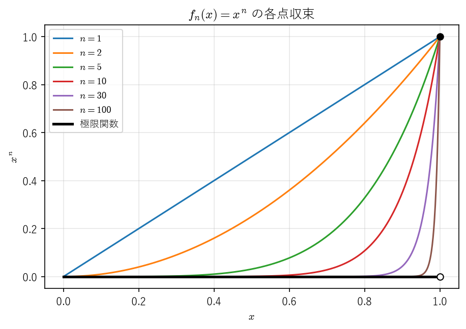
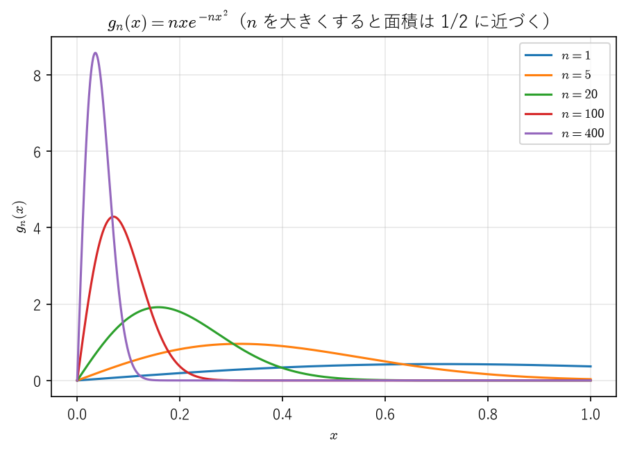
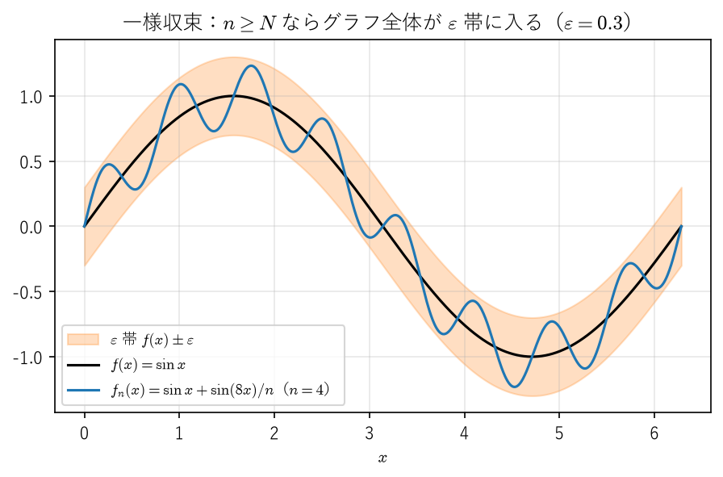
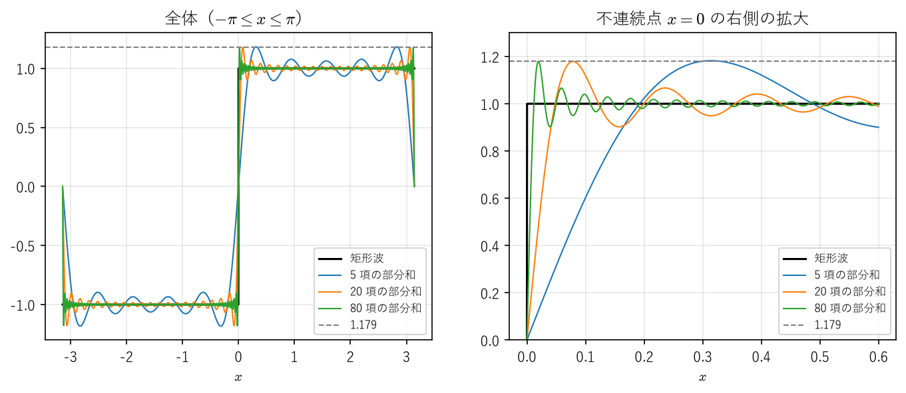

関数列と関数項級数
==================

工学では、複雑な関数を簡単な関数の列で近似することが多い。テイラー多項式、フーリエ級数の部分和、反復法で得られる近似解の列などはその例である。こうした近似の列 :math:`f_1, f_2, f_3, \ldots` がある関数 :math:`f` に近づくとき、極限の :math:`f` は :math:`f_n` の性質（連続性、積分の値、導関数）を受け継ぐだろうか。本章で見るように、答えは「収束の仕方による」である。

本章では、各点の値が近づくだけの\ **各点収束**\ と、区間全体で一斉に近づく\ **一様収束**\ を区別し、一様収束であれば極限と連続性・積分・微分との交換が保証されることを示す。後半では、この結果をべき級数に応用し、べき級数が収束半径の内側で項別に微分・積分できることを証明する。最後に、フーリエ級数とギブズ現象を紹介し、一様収束しない近似が実際にどのような振る舞いを示すかを見る。

各点収束
--------

以下、:math:`I` は区間とし、:math:`f_n \colon I \to \mathbb{R}`\ （:math:`n = 1, 2, \ldots`）を関数の列（**関数列**）とする。

.. _ch08-def-pointwise:

.. admonition:: 定義 8.1（各点収束）
   :class: definition

   各 :math:`x \in I` について数列 :math:`(f_n(x))` が :math:`f(x)` に収束するとき、関数列 :math:`(f_n)` は :math:`I` 上で :math:`f` に\ **各点収束する**\ という。ε-N 論法で書けば、

   任意の :math:`x \in I` と任意の :math:`\varepsilon > 0` に対して、ある :math:`N` が存在し、:math:`n \geq N` ならば :math:`|f_n(x) - f(x)| < \varepsilon` となる

   ことである。ここで :math:`N` は :math:`\varepsilon` だけでなく :math:`x` にも依存してよい。

各点収束は自然な定義に見えるが、極限の関数が :math:`f_n` の性質を受け継ぐとは限らない。代表的な 3 つの例を挙げる。

.. _ch08-ex-xn:

.. admonition:: 例 8.1（連続性が失われる例）
   :class: example

   :math:`I = [0, 1]` 上で :math:`f_n(x) = x^n` とする。:math:`0 \leq x < 1` なら :math:`x^n \to 0`、:math:`x = 1` なら :math:`x^n = 1` なので、:math:`(f_n)` は

   .. math::

      f(x) = \begin{cases} 0 & (0 \leq x < 1) \\ 1 & (x = 1) \end{cases}

   に各点収束する（:numref:`ch08-fig-xn`）。各 :math:`f_n` は連続だが、極限 :math:`f` は :math:`x = 1` で不連続である。これは、2 つの極限の順序を交換できないことを意味する。

   .. math::

      \lim_{x \to 1 - 0} \Bigl( \lim_{n \to \infty} x^n \Bigr) = 0, \qquad \lim_{n \to \infty} \Bigl( \lim_{x \to 1 - 0} x^n \Bigr) = 1

.. _ch08-fig-xn:

   :math:`f_n(x) = x^n` の各点収束。極限関数は :math:`x = 1` で不連続になる。

.. _ch08-ex-spike:

.. admonition:: 例 8.2（積分と極限を交換できない例）
   :class: example

   :math:`I = [0, 1]` 上で :math:`g_n(x) = n x e^{-n x^2}` とする。:math:`x = 0` なら :math:`g_n(0) = 0` であり、:math:`x > 0` なら指数関数の減少が :math:`n` の増加より速いので :math:`g_n(x) \to 0` である。よって :math:`(g_n)` は 0 に各点収束する。一方、

   .. math::

      \int_0^1 g_n(x)\,dx = \left[ -\frac{1}{2} e^{-n x^2} \right]_0^1 = \frac{1 - e^{-n}}{2} \to \frac{1}{2} \qquad (n \to \infty)

   なので、:math:`\lim_{n \to \infty} \int_0^1 g_n(x)\,dx = \frac{1}{2} \neq 0 = \int_0^1 \lim_{n \to \infty} g_n(x)\,dx` である。:math:`g_n` のグラフは、:math:`x = 1/\sqrt{2n}` で最大値 :math:`\sqrt{n/(2e)}` をとる鋭い山になり、山の面積がほぼ一定のまま原点に寄っていく（:numref:`ch08-fig-spike`）。

.. _ch08-fig-spike:

   :math:`g_n(x) = n x e^{-n x^2}`。各点では 0 に収束するが、積分の値は :math:`1/2` に近づく。

.. _ch08-ex-derivative:

.. admonition:: 例 8.3（微分と極限を交換できない例）
   :class: example

   :math:`I = \mathbb{R}` 上で :math:`h_n(x) = \frac{\sin(nx)}{\sqrt{n}}` とする。:math:`|h_n(x)| \leq \frac{1}{\sqrt{n}}` なので、:math:`h_n` は 0 に収束する。しかし :math:`h_n'(x) = \sqrt{n} \cos(nx)` であり、たとえば :math:`x = 0` で :math:`h_n'(0) = \sqrt{n} \to \infty` となって、極限関数 0 の導関数 0 には収束しない。

例 8.3 の :math:`h_n` は、後で述べる意味で一様に 0 に収束している。それでも導関数は収束しない。小さな振幅の速い振動は、関数の値には小さな影響しか与えないが、導関数には大きな影響を与える。測定データに含まれる小さな雑音が、数値微分で大きく増幅されるのと同じ現象である（:doc:`differentiation`）。

一様収束
--------

各点収束の定義では、:math:`N` が :math:`x` に依存してよかった。:math:`N` を :math:`x` によらず選べることを要求したものが一様収束である。

.. _ch08-def-uniform:

.. admonition:: 定義 8.2（一様収束）
   :class: definition

   任意の :math:`\varepsilon > 0` に対して、ある :math:`N` が存在し、:math:`n \geq N` ならば\ **すべての** :math:`x \in I` について :math:`|f_n(x) - f(x)| < \varepsilon` となるとき、関数列 :math:`(f_n)` は :math:`I` 上で :math:`f` に\ **一様収束する**\ という。

各点収束と一様収束の違いは、「任意の :math:`x`」と「ある :math:`N` が存在する」の順序だけである。量化子の順序が変わると主張の意味が変わることについては、:doc:`appendix_logic`\ も参照してほしい。一様収束ならば各点収束である。

一様収束を図で表すと、:math:`f` のグラフを上下に :math:`\varepsilon` だけ広げた帯（:math:`\varepsilon` 帯）を考えたとき、:math:`n \geq N` ならば :math:`f_n` のグラフ全体がこの帯の中に収まる、ということである（:numref:`ch08-fig-uniform-band`）。

.. _ch08-fig-uniform-band:

   一様収束のイメージ。:math:`f_n` のグラフ全体が :math:`f` の :math:`\varepsilon` 帯に入る。

区間 :math:`I` 上の関数 :math:`g` に対して

.. math::

   \|g\|_\infty = \sup_{x \in I} |g(x)|

とおき、:math:`g` の\ **一様ノルム**\ （sup ノルム）という（:math:`g` が有界でなければ :math:`+\infty` とする）。:math:`\|f_n - f\|_\infty` は、区間全体で見た近似の最悪の誤差である。

.. _ch08-thm-sup:

.. admonition:: 命題 8.1
   :class: theorem

   :math:`(f_n)` が :math:`I` 上で :math:`f` に一様収束するための必要十分条件は、:math:`\lim_{n \to \infty} \|f_n - f\|_\infty = 0` である。

.. admonition:: 証明
   :class: proof

   一様収束するとし、:math:`\varepsilon > 0` に対して定義 8.2 の :math:`N` をとる。:math:`n \geq N` ならばすべての :math:`x` で :math:`|f_n(x) - f(x)| < \varepsilon` なので、その上限について :math:`\|f_n - f\|_\infty \leq \varepsilon` となる。よって :math:`\|f_n - f\|_\infty \to 0` である。逆に :math:`\|f_n - f\|_\infty \to 0` ならば、:math:`\varepsilon > 0` に対して :math:`n \geq N` で :math:`\|f_n - f\|_\infty < \varepsilon` となる :math:`N` があり、このときすべての :math:`x` で :math:`|f_n(x) - f(x)| \leq \|f_n - f\|_\infty < \varepsilon` である。

工学的には、一様収束は「区間全体での誤差の保証」にあたる。たとえば、組込みシステムで関数を多項式で近似するとき、必要なのは特定の点での誤差ではなく、入力の範囲全体での最大誤差が許容値以下であることである。これは一様ノルムで誤差を測ることにほかならない。

.. _ch08-ex-xn-uniform:

.. admonition:: 例 8.4
   :class: example

   :math:`f_n(x) = x^n` を考える（:ref:`例 8.1 <ch08-ex-xn>`）。

   * :math:`0 < r < 1` とする。区間 :math:`[0, r]` 上では極限は 0 であり、:math:`\|f_n - 0\|_\infty = \sup_{0 \leq x \leq r} x^n = r^n \to 0` なので、一様収束する。
   * 区間 :math:`[0, 1)` 上でも極限は 0 だが、:math:`\sup_{0 \leq x < 1} x^n = 1` なので、一様収束しない。どの :math:`n` についても、1 に十分近い :math:`x` では :math:`x^n` は 1 に近い。

一様収束の判定には、極限の関数 :math:`f` を知らなくても使える次の条件が便利である。

.. _ch08-thm-cauchy:

.. admonition:: 定理 8.2（一様収束に関するコーシーの条件）
   :class: theorem

   関数列 :math:`(f_n)` が :math:`I` 上である関数に一様収束するための必要十分条件は、次が成り立つことである。

   任意の :math:`\varepsilon > 0` に対して、ある :math:`N` が存在し、:math:`m, n \geq N` ならばすべての :math:`x \in I` について :math:`|f_n(x) - f_m(x)| < \varepsilon` となる。

.. admonition:: 証明
   :class: proof

   （必要性）\ :math:`f` に一様収束するとし、:math:`n \geq N` ですべての :math:`x` について :math:`|f_n(x) - f(x)| < \varepsilon/2` となる :math:`N` をとる。:math:`m, n \geq N` ならば :math:`|f_n(x) - f_m(x)| \leq |f_n(x) - f(x)| + |f(x) - f_m(x)| < \varepsilon` である。

   （十分性）条件が成り立つとする。各 :math:`x \in I` について数列 :math:`(f_n(x))` はコーシー列なので、:ref:`コーシー列の収束 <ch02-thm-cauchy>`\ により収束する。その極限を :math:`f(x)` とおく。:math:`\varepsilon > 0` に対して条件の :math:`N` をとり、:math:`n \geq N` を固定する。すべての :math:`m \geq N` とすべての :math:`x` について :math:`|f_n(x) - f_m(x)| < \varepsilon` なので、:math:`m \to \infty` とすると :math:`|f_n(x) - f(x)| \leq \varepsilon` となる。この :math:`N` は :math:`x` によらないので、:math:`(f_n)` は :math:`f` に一様収束する。

一様収束と連続性・積分・微分
----------------------------

連続性
^^^^^^

.. _ch08-thm-continuity:

.. admonition:: 定理 8.3（一様収束と連続性）
   :class: theorem

   :math:`I` 上の連続関数の列 :math:`(f_n)` が :math:`I` 上で :math:`f` に一様収束するならば、:math:`f` は :math:`I` 上で連続である。

.. admonition:: 証明
   :class: proof

   :math:`x_0 \in I` と :math:`\varepsilon > 0` を任意にとる。一様収束性から、ある :math:`N` について、すべての :math:`x \in I` で :math:`|f_N(x) - f(x)| < \varepsilon/3` となる。:math:`f_N` は :math:`x_0` で連続なので、ある :math:`\delta > 0` が存在して、:math:`|x - x_0| < \delta`、:math:`x \in I` ならば :math:`|f_N(x) - f_N(x_0)| < \varepsilon/3` となる。このとき

   .. math::

      |f(x) - f(x_0)| \leq |f(x) - f_N(x)| + |f_N(x) - f_N(x_0)| + |f_N(x_0) - f(x_0)| < \frac{\varepsilon}{3} + \frac{\varepsilon}{3} + \frac{\varepsilon}{3} = \varepsilon

   である。よって :math:`f` は :math:`x_0` で連続である。

この証明で、:math:`N` が :math:`x` によらないことが本質的に使われている。各点収束では、:math:`x` を動かすと :math:`N` も変わってしまい、この議論は成り立たない。定理 8.3 の対偶をとると、連続関数の列の極限が不連続ならば、その収束は一様でない。

.. _ch08-thm-xn-not-uniform:

.. admonition:: 系 8.4
   :class: theorem

   :math:`f_n(x) = x^n` は :math:`[0, 1]` 上で一様収束しない。

.. admonition:: 証明
   :class: proof

   :ref:`例 8.1 <ch08-ex-xn>` より :math:`(f_n)` の各点収束の極限は :math:`x = 1` で不連続である。一様収束するならその極限は各点収束の極限と一致し、:ref:`定理 8.3 <ch08-thm-continuity>` より連続となるはずなので、矛盾する。

積分
^^^^

.. _ch08-thm-integral:

.. admonition:: 定理 8.5（一様収束と積分）
   :class: theorem

   :math:`[a, b]` 上の連続関数の列 :math:`(f_n)` が :math:`[a, b]` 上で :math:`f` に一様収束するならば、

   .. math::

      \lim_{n \to \infty} \int_a^b f_n(x)\,dx = \int_a^b f(x)\,dx

   が成り立つ。

.. admonition:: 証明
   :class: proof

   :ref:`定理 8.3 <ch08-thm-continuity>` より :math:`f` は連続なので積分可能である（:ref:`定理 7.5 <ch07-thm-continuous>`）。:ref:`定理 7.8 <ch07-thm-properties>` より

   .. math::

      \left| \int_a^b f_n(x)\,dx - \int_a^b f(x)\,dx \right| \leq \int_a^b |f_n(x) - f(x)|\,dx \leq (b - a) \|f_n - f\|_\infty

   であり、:ref:`命題 8.1 <ch08-thm-sup>` より右辺は 0 に収束する。

:ref:`例 8.2 <ch08-ex-spike>` の :math:`g_n` は :math:`\|g_n\|_\infty = \sqrt{n/(2e)} \to \infty` なので一様収束しておらず、定理 8.5 は適用できない。実際、積分と極限は交換できなかった。

微分
^^^^

:ref:`例 8.3 <ch08-ex-derivative>` が示すように、:math:`f_n` 自身が一様収束しても、導関数の極限については何もいえない。導関数の列のほうに一様収束を仮定する必要がある。

.. _ch08-thm-derivative:

.. admonition:: 定理 8.6（一様収束と微分）
   :class: theorem

   :math:`(f_n)` は :math:`[a, b]` 上の :math:`C^1` 級関数（\ :ref:`定義 6.2 <ch06-def-cn>`）の列で、次の 2 条件を満たすとする。

   1. 数列 :math:`(f_n(a))` は収束する。
   2. 導関数の列 :math:`(f_n')` は :math:`[a, b]` 上である関数 :math:`g` に一様収束する。

   このとき :math:`(f_n)` は :math:`[a, b]` 上である :math:`C^1` 級関数 :math:`f` に一様収束し、:math:`f' = g` が成り立つ。すなわち

   .. math::

      \frac{d}{dx} \lim_{n \to \infty} f_n(x) = \lim_{n \to \infty} f_n'(x)

   である。

.. admonition:: 証明
   :class: proof

   :math:`c = \lim_{n \to \infty} f_n(a)` とおく。:ref:`定理 8.3 <ch08-thm-continuity>` より :math:`g` は連続である。:math:`f(x) = c + \int_a^x g(t)\,dt` と定めると、:ref:`微分積分学の基本定理 <ch07-thm-ftc>`\ の 1 より :math:`f` は微分可能で :math:`f' = g` であり、:math:`g` が連続なので :math:`f` は :math:`C^1` 級である。一方、:math:`f_n'` は連続なので、:ref:`微分積分学の基本定理 <ch07-thm-ftc>`\ の 2 より :math:`f_n(x) = f_n(a) + \int_a^x f_n'(t)\,dt` である。よってすべての :math:`x \in [a, b]` について

   .. math::

      |f_n(x) - f(x)| \leq |f_n(a) - c| + \int_a^x |f_n'(t) - g(t)|\,dt \leq |f_n(a) - c| + (b - a) \|f_n' - g\|_\infty

   となる。右辺は :math:`x` によらず、:math:`n \to \infty` で 0 に収束するので、:math:`(f_n)` は :math:`f` に一様収束する。

関数項級数
----------

関数 :math:`u_1, u_2, \ldots` の無限和 :math:`\sum_{n=1}^\infty u_n(x)` を\ **関数項級数**\ という。べき級数やフーリエ級数はその代表例である。関数項級数の収束は、部分和の関数列の収束として定義する。

.. _ch08-def-series:

.. admonition:: 定義 8.3（関数項級数の収束）
   :class: definition

   部分和 :math:`s_N(x) = \sum_{n=1}^{N} u_n(x)` の関数列 :math:`(s_N)` が :math:`I` 上で :math:`s` に各点収束（一様収束）するとき、関数項級数 :math:`\sum_{n=1}^\infty u_n(x)` は :math:`I` 上で :math:`s` に\ **各点収束**\ （**一様収束**）するという。

一様収束の判定には、次の判定法が最もよく使われる。

.. _ch08-thm-mtest:

.. admonition:: 定理 8.7（ワイエルシュトラスの M 判定法）
   :class: theorem

   定数の列 :math:`(M_n)` があって、すべての :math:`n` とすべての :math:`x \in I` について :math:`|u_n(x)| \leq M_n` が成り立ち、かつ :math:`\sum_{n=1}^\infty M_n` が収束するとする。このとき :math:`\sum_{n=1}^\infty u_n(x)` は :math:`I` 上で一様収束し、各 :math:`x \in I` で絶対収束する。

.. admonition:: 証明
   :class: proof

   :math:`\sum M_n` は収束するので、その部分和の数列はコーシー列である。よって任意の :math:`\varepsilon > 0` に対して :math:`N` があり、:math:`m > n \geq N` ならば :math:`\sum_{k=n+1}^{m} M_k < \varepsilon` となる。このとき、すべての :math:`x \in I` について

   .. math::

      |s_m(x) - s_n(x)| = \left| \sum_{k=n+1}^{m} u_k(x) \right| \leq \sum_{k=n+1}^{m} |u_k(x)| \leq \sum_{k=n+1}^{m} M_k < \varepsilon

   である。:ref:`定理 8.2 <ch08-thm-cauchy>` より :math:`(s_N)` は一様収束する。絶対収束することは、:math:`\sum |u_n(x)|` に正項級数の比較判定法（:doc:`series`）を適用すれば分かる。

部分和は有限和なので、連続性・積分・微分と自由に交換できる。そこで\ :ref:`定理 8.3 <ch08-thm-continuity>`、:ref:`定理 8.5 <ch08-thm-integral>`、:ref:`定理 8.6 <ch08-thm-derivative>` を部分和の列に適用すると、次の系が得られる。

.. _ch08-thm-termwise:

.. admonition:: 系 8.8（項別積分・項別微分）
   :class: theorem

   1. 各 :math:`u_n` が :math:`I` 上で連続で、:math:`\sum u_n` が :math:`I` 上で一様収束するならば、和 :math:`s(x) = \sum_{n=1}^\infty u_n(x)` は :math:`I` 上で連続である。
   2. 各 :math:`u_n` が :math:`[a, b]` 上で連続で、:math:`\sum u_n` が :math:`[a, b]` 上で一様収束するならば、:math:`\int_a^b \sum_{n=1}^\infty u_n(x)\,dx = \sum_{n=1}^\infty \int_a^b u_n(x)\,dx` が成り立つ（**項別積分**）。
   3. 各 :math:`u_n` が :math:`[a, b]` 上で :math:`C^1` 級で、:math:`\sum u_n(a)` が収束し、:math:`\sum u_n'` が :math:`[a, b]` 上で一様収束するならば、:math:`\sum u_n` は :math:`[a, b]` 上で一様収束し、その和は :math:`C^1` 級で :math:`\frac{d}{dx} \sum_{n=1}^\infty u_n(x) = \sum_{n=1}^\infty u_n'(x)` が成り立つ（**項別微分**）。

.. _ch08-ex-cos-series:

.. admonition:: 例 8.5
   :class: example

   :math:`\sum_{n=1}^\infty \frac{\cos(nx)}{n^2}` を考える。すべての :math:`x \in \mathbb{R}` で :math:`\left| \frac{\cos(nx)}{n^2} \right| \leq \frac{1}{n^2}` であり、:math:`\sum \frac{1}{n^2}` は収束する（:doc:`series`）。M 判定法より、この級数は :math:`\mathbb{R}` 上で一様収束し、系 8.8 の 1 より和は連続関数である。一方、項別に微分した級数 :math:`-\sum \frac{\sin(nx)}{n}` については :math:`\sum \frac{1}{n}` が発散するので M 判定法は使えず、系 8.8 の 3 で項別微分を正当化することはできない。

.. admonition:: 注意
   :class: note

   M 判定法を使うと、:math:`\mathbb{R}` 上の至るところで連続であるが、どの点でも微分可能でない関数を構成できる（ワイエルシュトラス関数など。[Rudin1976]_ の第 7 章を参照）。「連続関数はほとんどの点で微分可能だろう」という直感は正しくない。

べき級数
--------

.. _ch08-def-power-series:

.. admonition:: 定義 8.4（べき級数）
   :class: definition

   実数の列 :math:`(a_n)_{n \geq 0}` と実数 :math:`c` に対して、:math:`\sum_{n=0}^\infty a_n (x - c)^n` の形の関数項級数を、:math:`c` を中心とする\ **べき級数**\ という。

:math:`x - c` を改めて :math:`x` とおけばよいので、以下では中心 :math:`c = 0` の場合 :math:`\sum_{n=0}^\infty a_n x^n` だけを考える。べき級数は、:math:`x` が 0 に近いところで収束し、遠いところで発散するという単純な構造をもつ。その出発点が次の補題である。

.. _ch08-thm-abel-lemma:

.. admonition:: 補題 8.9（アーベルの補題）
   :class: theorem

   べき級数 :math:`\sum a_n x^n` が :math:`x = x_1 \neq 0` で収束するならば、:math:`0 < r < |x_1|` を満たす任意の :math:`r` について、このべき級数は区間 :math:`[-r, r]` 上で一様収束し、各点で絶対収束する。

.. admonition:: 証明
   :class: proof

   :math:`\sum a_n x_1^n` が収束するので、項 :math:`a_n x_1^n` は 0 に収束し、特に有界である。:math:`|a_n x_1^n| \leq K` となる定数 :math:`K` をとる。:math:`|x| \leq r` ならば、:math:`q = r/|x_1| < 1` として

   .. math::

      |a_n x^n| = |a_n x_1^n| \left| \frac{x}{x_1} \right|^n \leq K q^n

   が成り立つ。:math:`\sum K q^n` は公比 :math:`q` の等比級数なので収束する。:ref:`M 判定法 <ch08-thm-mtest>`\ より主張が従う。

.. _ch08-thm-radius:

.. admonition:: 定理 8.10（収束半径）
   :class: theorem

   べき級数 :math:`\sum a_n x^n` に対して、次の性質をもつ :math:`R \in [0, \infty]` がただ 1 つ存在する。

   1. :math:`|x| < R` ならば、:math:`\sum a_n x^n` は絶対収束する。
   2. :math:`|x| > R` ならば、:math:`\sum a_n x^n` は発散する。
   3. :math:`0 < r < R` ならば、:math:`\sum a_n x^n` は :math:`[-r, r]` 上で一様収束する。

   この :math:`R` を、べき級数の\ **収束半径**\ という。和 :math:`f(x) = \sum a_n x^n` は区間 :math:`(-R, R)` 上で連続である。

.. admonition:: 証明
   :class: proof

   :math:`A = \{ |x| : \sum a_n x^n \text{ が収束する} \}` とおく。:math:`x = 0` で級数は収束するので :math:`A` は空でない。:math:`A` が上に有界なら :math:`R = \sup A`、そうでなければ :math:`R = \infty` と定める（:ref:`実数の連続性 <ch01-thm-sup>`）。

   1, 3：:math:`0 < r < R` とする。上限の定義から、:math:`r < |x_1|` を満たす :math:`|x_1| \in A` がある。:ref:`アーベルの補題 <ch08-thm-abel-lemma>`\ より、級数は :math:`[-r, r]` 上で一様収束し、各点で絶対収束する。:math:`|x| < R` を満たす任意の :math:`x` について :math:`|x| < r < R` となる :math:`r` をとれば、1 が従う。

   2：:math:`|x| > R` で級数が収束すれば :math:`|x| \in A` となり、:math:`|x| \leq R` に反する。

   1 と 2 を満たす :math:`R` が 2 つあれば、その間の :math:`|x|` で収束と発散が同時に起こるので、:math:`R` はただ 1 つである。最後に、:math:`x_0 \in (-R, R)` に対して :math:`|x_0| < r < R` となる :math:`r` をとると、3 と\ :ref:`定理 8.3 <ch08-thm-continuity>` より :math:`f` は :math:`[-r, r]` 上で連続であり、特に :math:`x_0` で連続である。

.. admonition:: 注意
   :class: note

   :math:`|x| = R` の点で収束するかどうかは、べき級数によって異なる（:ref:`例 8.6 <ch08-ex-radius>`）。また、一般に :math:`(-R, R)` 全体では一様収束しない。たとえば :math:`\sum x^n` は :math:`R = 1` だが、:math:`(-1, 1)` 上では一様収束しない（部分和と和 :math:`\frac{1}{1-x}` の差は :math:`\frac{x^{N+1}}{1-x}` で、:math:`x \to 1 - 0` で有界でない）。

収束半径は、係数の比から求められることが多い。

.. _ch08-thm-radius-ratio:

.. admonition:: 定理 8.11（係数の比による収束半径の公式）
   :class: theorem

   十分大きいすべての :math:`n` で :math:`a_n \neq 0` であり、極限 :math:`L = \lim_{n \to \infty} \left| \frac{a_{n+1}}{a_n} \right|` が :math:`[0, \infty]` の中に存在するならば、収束半径は :math:`R = 1/L` である（ただし :math:`1/0 = \infty`、:math:`1/\infty = 0` と約束する）。

.. admonition:: 証明
   :class: proof

   :math:`x \neq 0` とすると、:math:`\left| \frac{a_{n+1} x^{n+1}}{a_n x^n} \right| = \left| \frac{a_{n+1}}{a_n} \right| |x| \to L|x|` である。:math:`L|x| < 1` ならば、:ref:`ダランベールの判定法 <ch03-thm-ratio>`\ より :math:`\sum a_n x^n` は絶対収束する。:math:`L|x| > 1` ならば、十分大きいすべての :math:`n` で :math:`|a_{n+1} x^{n+1}| > |a_n x^n|` となり、項の絶対値が単調に増加するので 0 に収束せず、級数は発散する。よって :math:`|x| < 1/L` では収束し、:math:`|x| > 1/L` では発散するので、:ref:`定理 8.10 <ch08-thm-radius>` の一意性より :math:`R = 1/L` である。

.. admonition:: 注意
   :class: note

   比の極限が存在しない場合にも使える公式として、:math:`\frac{1}{R} = \limsup_{n \to \infty} |a_n|^{1/n}` がある（コーシー・アダマールの公式）。ここで :math:`\limsup_{n \to \infty} b_n = \lim_{n \to \infty} \sup_{k \geq n} b_k` は上極限である。証明は [Rudin1976]_ を参照してほしい。

.. _ch08-ex-radius:

.. admonition:: 例 8.6
   :class: example

   1. :math:`\sum_{n=0}^\infty \frac{x^n}{n!}`：:math:`\left| \frac{a_{n+1}}{a_n} \right| = \frac{1}{n+1} \to 0` なので :math:`R = \infty` である。
   2. :math:`\sum_{n=0}^\infty x^n`：:math:`R = 1` である。:math:`x = \pm 1` では項が 0 に収束しないので発散する。
   3. :math:`\sum_{n=1}^\infty \frac{x^n}{n}`：:math:`\frac{n}{n+1} \to 1` なので :math:`R = 1` である。:math:`x = 1` では調和級数となって発散し、:math:`x = -1` では交代級数となって収束する（:doc:`series`）。
   4. :math:`\sum_{n=0}^\infty n!\, x^n`：:math:`\frac{(n+1)!}{n!} = n + 1 \to \infty` なので :math:`R = 0` であり、:math:`x = 0` 以外では発散する。

べき級数の項別微分・項別積分
----------------------------

べき級数の最も重要な性質は、収束半径の内側では多項式と同じように項ごとに微分・積分できることである。

.. _ch08-thm-power-derivative:

.. admonition:: 定理 8.12（べき級数の項別微分）
   :class: theorem

   べき級数 :math:`f(x) = \sum_{n=0}^\infty a_n x^n` の収束半径を :math:`R > 0` とする。このとき、項別に微分したべき級数 :math:`\sum_{n=1}^\infty n a_n x^{n-1}` の収束半径も :math:`R` であり、:math:`f` は :math:`(-R, R)` 上で微分可能で

   .. math::

      f'(x) = \sum_{n=1}^\infty n a_n x^{n-1} \qquad (|x| < R)

   が成り立つ。

.. admonition:: 証明
   :class: proof

   項別に微分したべき級数の収束半径を :math:`R'` とする。

   :math:`R' \geq R` であること：:math:`|x| < R` とし、:math:`|x| < \rho < R` となる :math:`\rho` をとる。:math:`\sum a_n \rho^n` は収束するので、:math:`|a_n| \rho^n \leq K` となる定数 :math:`K` がある。:math:`q = |x|/\rho < 1` とおくと、

   .. math::

      |n a_n x^{n-1}| = \frac{n}{\rho} |a_n| \rho^n q^{n-1} \leq \frac{K}{\rho} n q^{n-1}

   である。:math:`\sum n q^{n-1}` は、:math:`\frac{(n+1) q^n}{n q^{n-1}} = \frac{n+1}{n} q \to q < 1` より\ :ref:`ダランベールの判定法 <ch03-thm-ratio>`\ で収束する。よって :math:`\sum n a_n x^{n-1}` は絶対収束する。:math:`|x| < R` は任意なので、:math:`R' \geq R` である。

   :math:`R' \leq R` であること：:math:`|x| < R'` ならば :math:`\sum n |a_n| |x|^{n-1}` は収束し、:math:`n \geq 1` で :math:`|a_n x^n| \leq |x| \cdot n |a_n| |x|^{n-1}` なので、比較判定法により :math:`\sum a_n x^n` も絶対収束する。よって :math:`R' \leq R` である。

   項別微分できること：:math:`|x_0| < R` とし、:math:`|x_0| < r < R` となる :math:`r` をとる。:ref:`定理 8.10 <ch08-thm-radius>` の 3 を項別に微分した級数（収束半径 :math:`R`）に適用すると、:math:`\sum n a_n x^{n-1}` は :math:`[-r, r]` 上で一様収束する。また :math:`\sum a_n (-r)^n` は収束する。:math:`u_n(x) = a_n x^n` は :math:`C^1` 級なので、:ref:`系 8.8 <ch08-thm-termwise>` の 3 を区間 :math:`[-r, r]` に適用すれば、:math:`[-r, r]` 上で :math:`f'(x) = \sum n a_n x^{n-1}` が成り立つ。特に :math:`x = x_0` で成り立つ。

定理 8.12 を繰り返し適用すると、次の系が得られる。

.. _ch08-thm-power-cinf:

.. admonition:: 系 8.13
   :class: theorem

   収束半径 :math:`R > 0` のべき級数 :math:`f(x) = \sum_{n=0}^\infty a_n x^n` は :math:`(-R, R)` 上で何回でも微分可能であり、

   .. math::

      a_n = \frac{f^{(n)}(0)}{n!} \qquad (n = 0, 1, 2, \ldots)

   が成り立つ。また、:math:`|x| < R` ならば :math:`\int_0^x f(t)\,dt = \sum_{n=0}^\infty \frac{a_n}{n+1} x^{n+1}` が成り立つ（項別積分）。

.. admonition:: 証明
   :class: proof

   :ref:`定理 8.12 <ch08-thm-power-derivative>` より :math:`f'` も収束半径 :math:`R` のべき級数なので、同じ定理を繰り返し適用でき、:math:`f^{(k)}(x) = \sum_{n=k}^\infty n(n-1)\cdots(n-k+1) a_n x^{n-k}` となる。:math:`x = 0` を代入すると :math:`n = k` の項だけが残り、:math:`f^{(k)}(0) = k!\, a_k` を得る。項別積分については、:math:`|x| < r < R` となる :math:`r` をとると、:ref:`定理 8.10 <ch08-thm-radius>` の 3 より級数は :math:`[-r, r]` 上で一様収束するので、:ref:`系 8.8 <ch08-thm-termwise>` の 2 を区間 :math:`[0, x]`\ （:math:`x < 0` なら :math:`[x, 0]`）に適用すればよい。

系 8.13 は、収束するべき級数がその和のテイラー級数（:ref:`テイラーの定理 <ch06-thm-taylor>`\ の多項式を無限に続けたもの）にほかならないことを示している。

.. _ch08-ex-log:

.. admonition:: 例 8.7（対数関数のべき級数展開）
   :class: example

   等比級数の和の公式より、:math:`|t| < 1` で :math:`\frac{1}{1 + t} = \sum_{n=0}^\infty (-1)^n t^n` であり、この級数の収束半径は 1 である。:math:`|x| < 1` のとき、:math:`0` から :math:`x` まで項別積分すると（系 8.13）、:math:`\int_0^x \frac{dt}{1 + t} = \log(1 + x)` より

   .. math::

      \log(1 + x) = \sum_{n=1}^\infty \frac{(-1)^{n-1}}{n} x^n = x - \frac{x^2}{2} + \frac{x^3}{3} - \cdots \qquad (|x| < 1)

   を得る。この級数は :math:`x = -1` では調和級数の符号を変えたものになって発散するが、:math:`x = 1` では収束し（交代調和級数）、その値は :math:`\log 2` に等しい。:math:`x = 1` は収束半径の境界上の点なので、系 8.13 からはこのことは得られないが、:math:`-1/2 \leq x \leq 1`\ （:math:`x = 1` を含む）での展開は、「\ :doc:`taylor`\ 」の\ :ref:`定理 6.5 <ch06-thm-log>`\ でテイラーの定理の剰余項を評価してすでに示した。したがって、本例で新たに得られたのは :math:`-1 < x < -1/2` での展開であり、定理 6.5 とあわせて、展開は :math:`-1 < x \leq 1` で成り立つ。

   より一般に、べき級数 :math:`\sum a_n x^n` が :math:`x = R`\ （:math:`0 < R < \infty`）で収束するならば、その和は :math:`[0, R]` 上で連続であり、:math:`\lim_{x \to R - 0} \sum a_n x^n = \sum a_n R^n` が成り立つ（アーベルの定理。証明は [Sugiura1980]_ を参照）。この定理を使えば、:math:`\log(1 + x)` が :math:`x = 1` で連続であることから、定理 6.5 によらずに :math:`x = 1` での展開が得られる。

フーリエ級数とギブズ現象
------------------------

本節では、一様収束しない関数項級数の重要な例として、フーリエ級数を紹介する。詳しい理論は [SteinShakarchi2003a]_ を参照してほしい。

.. _ch08-def-fourier:

.. admonition:: 定義 8.5（フーリエ級数）
   :class: definition

   周期 :math:`2\pi` の関数 :math:`f` が :math:`[-\pi, \pi]` 上で積分可能であるとき、

   .. math::

      a_k = \frac{1}{\pi} \int_{-\pi}^{\pi} f(x) \cos(kx)\,dx, \qquad b_k = \frac{1}{\pi} \int_{-\pi}^{\pi} f(x) \sin(kx)\,dx

   を :math:`f` の\ **フーリエ係数**\ といい、関数項級数 :math:`\frac{a_0}{2} + \sum_{k=1}^\infty \bigl( a_k \cos(kx) + b_k \sin(kx) \bigr)` を :math:`f` の\ **フーリエ級数**\ という。

フーリエ級数は、信号をさまざまな周波数の正弦波の重ね合わせとして表すもので、信号処理、振動解析、熱伝導の解析などで基本的な道具である。

.. _ch08-ex-square-wave:

.. admonition:: 例 8.8（矩形波）
   :class: example

   周期 :math:`2\pi` の関数 :math:`f` を、:math:`0 < x < \pi` で :math:`f(x) = 1`、:math:`-\pi < x < 0` で :math:`f(x) = -1`、:math:`x = 0, \pm\pi` で :math:`f(x) = 0` と定める（矩形波）。:math:`f` は奇関数なので :math:`a_k = 0` であり、

   .. math::

      b_k = \frac{2}{\pi} \int_0^\pi \sin(kx)\,dx = \frac{2}{k\pi} \bigl( 1 - \cos(k\pi) \bigr) = \begin{cases} \dfrac{4}{k\pi} & (k \text{ が奇数}) \\ 0 & (k \text{ が偶数}) \end{cases}

   となる。したがって、:math:`f` のフーリエ級数は

   .. math::
      :label: ch08-eq-square-wave

      \frac{4}{\pi} \sum_{m=1}^\infty \frac{\sin\bigl( (2m - 1)x \bigr)}{2m - 1} = \frac{4}{\pi} \left( \sin x + \frac{\sin 3x}{3} + \frac{\sin 5x}{5} + \cdots \right)

   である。

区分的に滑らかな関数のフーリエ級数は、各点 :math:`x` で左右の極限の平均 :math:`\frac{1}{2} \bigl( f(x + 0) + f(x - 0) \bigr)` に収束することが知られている（[SteinShakarchi2003a]_）。矩形波では、級数 :eq:`ch08-eq-square-wave` はすべての :math:`x` で :math:`f(x)` に各点収束する。しかし、部分和はすべて連続関数であり、極限 :math:`f` は :math:`x = 0` で不連続である。したがって\ :ref:`定理 8.3 <ch08-thm-continuity>` より、:math:`x = 0` を内部に含むどの区間上でも、この収束は一様でない。

収束が一様でないことは、目に見える形で現れる。:numref:`ch08-fig-gibbs` は、級数 :eq:`ch08-eq-square-wave` の最初の :math:`N` 項の和 :math:`S_N(x)` を描いたものである。不連続点の近くで、部分和は 1 を超えて振動する。項数を増やすと、振動する範囲は不連続点に向かって狭まるが、行き過ぎの高さは小さくならず、約 1.179 に近づく。この現象を\ **ギブズ現象**\ という。

.. _ch08-fig-gibbs:

   矩形波のフーリエ部分和（左：全体、右：不連続点 :math:`x = 0` の右側の拡大）。項数を増やしても行き過ぎの高さは約 1.179 のまま変わらない。

行き過ぎの高さは、本章の定理を使って求められる。三角関数の和の公式から

.. math::

   S_N'(x) = \frac{4}{\pi} \sum_{m=1}^{N} \cos\bigl( (2m - 1)x \bigr) = \frac{2}{\pi} \cdot \frac{\sin(2Nx)}{\sin x}

であり、:math:`x > 0` で最初に :math:`S_N' = 0` となるのは :math:`x = \frac{\pi}{2N}` である。:math:`S_N'` はその前後で正から負に変わるので、:math:`S_N` はここで極大となる（後の数値実験で確かめるように、これが :math:`0 < x < \pi` での最大値である）。:math:`S_N(0) = 0` なので、置換 :math:`u = 2Nt` を使うと

.. math::

   S_N\left( \frac{\pi}{2N} \right) = \frac{2}{\pi} \int_0^{\pi/(2N)} \frac{\sin(2Nt)}{\sin t}\,dt = \frac{2}{\pi} \int_0^{\pi} \frac{\sin u}{2N \sin\bigl( u/(2N) \bigr)}\,du

となる。:math:`v = u/(2N)` は :math:`[0, \pi/(2N)]` の範囲にあり、:math:`v \to 0` で :math:`\frac{v}{\sin v} \to 1` なので、被積分関数 :math:`\frac{\sin u}{u} \cdot \frac{v}{\sin v}` は :math:`N \to \infty` で :math:`[0, \pi]` 上 :math:`\frac{\sin u}{u}` に一様収束する（:math:`u = 0` での値はそれぞれの極限値で補う）。:ref:`定理 8.5 <ch08-thm-integral>` より極限と積分を交換して、

.. math::

   \lim_{N \to \infty} S_N\left( \frac{\pi}{2N} \right) = \frac{2}{\pi} \int_0^\pi \frac{\sin u}{u}\,du \approx 1.17898

を得る。跳びの大きさ 2（:math:`-1` から :math:`1`）に対して、行き過ぎは約 0.179、すなわち跳びの約 9 % である。

工学では、ギブズ現象は信号を有限個の周波数成分で打ち切ったときの「リンギング」として現れる。たとえば、理想的な低域通過フィルタで矩形状の信号を処理すると、立ち上がりの前後に振動が生じる。これを抑えるために、高い周波数の成分を急に打ち切るのではなく、窓関数などで滑らかに減衰させる手法が使われる。

数値実験
^^^^^^^^

本章の 3 つの現象を数値で確かめる。サンプルコード :download:`ch08_uniform_convergence.py <../examples/ch08_uniform_convergence.py>` は、次の 3 つの実験を行う。sup や最大値は、区間内に細かくとった格子点上の最大値で近似している。

1. :math:`x^n` の :math:`[0, 0.9]` 上と :math:`[0, 1)` 上での sup（:ref:`例 8.4 <ch08-ex-xn-uniform>`）
2. :math:`g_n(x) = n x e^{-n x^2}` の :math:`[0, 1]` 上の積分と最大値（:ref:`例 8.2 <ch08-ex-spike>`）
3. 矩形波のフーリエ部分和の最大値（ギブズ現象）

実験 1 と実験 3 の部分を示す。

.. literalinclude:: ../examples/ch08_uniform_convergence.py
   :language: python
   :pyobject: experiment_power
   :linenos:
   :lineno-match:

.. literalinclude:: ../examples/ch08_uniform_convergence.py
   :language: python
   :pyobject: square_wave_partial_sum
   :linenos:
   :lineno-match:

実行結果は次のとおりである。

.. code-block:: text
   :linenos:

   Experiment 1: sup|x^n|
        n  sup on [0, 0.9]    sup on [0, 1)
        1        9.000e-01        1.000e+00
       10        3.487e-01        9.999e-01
      100        2.656e-05        9.990e-01
     1000        1.748e-46        9.900e-01

   Experiment 2: g_n(x) = n x exp(-n x^2) on [0, 1]
        n     integral        exact        max
        1     0.316060     0.316060      0.429
       10     0.499977     0.499977      1.356
      100     0.500000     0.500000      4.289
     1000     0.500000     0.500000     13.562
    10000     0.500000     0.500000     42.888

   Experiment 3: maximum of Fourier partial sums of the square wave
    terms        max   argmax x
        5    1.18233    0.31416
       10    1.17981    0.15708
       50    1.17901    0.03142
      100    1.17899    0.01571
      500    1.17898    0.00314
   limit (theory): (2/pi) Si(pi) = 1.17898...

実験 1 では、:math:`[0, 0.9]` 上の sup は :math:`0.9^n` として急速に 0 に近づくが、:math:`[0, 1)` 上の sup は 1 に近いままである（格子点の最大値は :math:`1 - 10^{-5}` なので表示はわずかに 1 より小さいが、真の sup は常に 1 である）。実験 2 では、積分の値は :math:`1/2` に近づく一方、最大値は :math:`\sqrt{n/(2e)}` のように増え続ける。実験 3 では、部分和の最大値は 1 ではなく約 1.17898 に近づき、最大値をとる位置は :math:`\frac{\pi}{2N}`\ （:math:`N` は項数）のとおり不連続点に近づいていく。

まとめ
------

* 各点収束では、:math:`N` が :math:`x` に依存してよい。一様収束では、:math:`N` を :math:`x` によらずに選べる。一様収束は一様ノルム :math:`\|f_n - f\|_\infty \to 0` と同値である。
* 連続関数の列の一様収束の極限は連続である。有界閉区間上では、一様収束すれば極限と積分を交換できる。
* 微分との交換には、導関数の列の一様収束が必要である。
* 関数項級数の一様収束は、ワイエルシュトラスの M 判定法で判定できることが多い。
* べき級数には収束半径 :math:`R` があり、:math:`|x| < R` で絶対収束し、:math:`|x| > R` で発散する。収束半径の内側では、項別に微分・積分できる。
* 矩形波のフーリエ級数は各点収束するが一様収束せず、不連続点の近くで部分和が約 9 % 行き過ぎる（ギブズ現象）。

演習問題
--------

.. admonition:: 問題 8.1
   :class: exercise

   :math:`f_n(x) = \frac{x}{1 + n x^2}` は :math:`\mathbb{R}` 上で 0 に一様収束することを示せ。

.. admonition:: 問題 8.2
   :class: exercise

   :math:`f_n(x) = n x (1 - x)^n` は :math:`[0, 1]` 上で 0 に各点収束するが、一様収束しないことを示せ。

.. admonition:: 問題 8.3
   :class: exercise

   :math:`\sum_{n=1}^\infty \frac{x^n}{n^2}` は :math:`[-1, 1]` 上で一様収束し、その和は :math:`[-1, 1]` 上で連続であることを示せ。

.. admonition:: 問題 8.4
   :class: exercise

   次のべき級数の収束半径を求めよ。

   1. :math:`\sum_{n=1}^\infty n^2 x^n`
   2. :math:`\sum_{n=1}^\infty \frac{x^n}{2^n n}`
   3. :math:`\sum_{n=1}^\infty n^n x^n`

.. admonition:: 問題 8.5
   :class: exercise

   :math:`|x| < 1` で :math:`\sum_{n=0}^\infty x^n = \frac{1}{1 - x}` であることを使い、:math:`\sum_{n=1}^\infty n x^n = \frac{x}{(1 - x)^2}`\ （:math:`|x| < 1`）を示せ。また、:math:`\sum_{n=1}^\infty \frac{n}{2^n}` の値を求めよ。

.. admonition:: 問題 8.6
   :class: exercise

   :math:`|x| < 1` で :math:`\arctan x = \sum_{n=0}^\infty \frac{(-1)^n}{2n + 1} x^{2n+1}` が成り立つことを示せ。

略解
----

.. admonition:: 問題 8.1 の略解
   :class: solution

   :math:`x = 0` では :math:`f_n(0) = 0` である。:math:`x \neq 0` では、相加平均と相乗平均の関係より :math:`1 + n x^2 \geq 2 \sqrt{n} |x|` なので、:math:`|f_n(x)| \leq \frac{1}{2\sqrt{n}}` である。よって :math:`\|f_n\|_\infty \leq \frac{1}{2\sqrt{n}} \to 0` であり、:ref:`命題 8.1 <ch08-thm-sup>` より 0 に一様収束する。

.. admonition:: 問題 8.2 の略解
   :class: solution

   :math:`x = 0, 1` では :math:`f_n(x) = 0` である。:math:`0 < x < 1` では :math:`q = 1 - x \in (0, 1)` として :math:`n q^n \to 0` なので、0 に各点収束する。:math:`f_n'(x) = n (1 - x)^{n-1} \bigl( 1 - (n+1) x \bigr)` より、:math:`f_n` は :math:`x = \frac{1}{n+1}` で最大値 :math:`\left( \frac{n}{n+1} \right)^{n+1} = \left( 1 + \frac{1}{n} \right)^{-(n+1)}` をとる。これは :math:`n \to \infty` で :math:`e^{-1}` に収束するので、:math:`\|f_n\|_\infty` は 0 に収束せず、一様収束しない。

.. admonition:: 問題 8.3 の略解
   :class: solution

   :math:`|x| \leq 1` で :math:`\left| \frac{x^n}{n^2} \right| \leq \frac{1}{n^2}` であり、:math:`\sum \frac{1}{n^2}` は収束する。:ref:`M 判定法 <ch08-thm-mtest>`\ より :math:`[-1, 1]` 上で一様収束し、各項は連続なので、:ref:`系 8.8 <ch08-thm-termwise>` の 1 より和は連続である。

.. admonition:: 問題 8.4 の略解
   :class: solution

   :ref:`定理 8.11 <ch08-thm-radius-ratio>` を使う。

   1. :math:`\frac{(n+1)^2}{n^2} \to 1` より :math:`R = 1`。
   2. :math:`\frac{2^n n}{2^{n+1} (n+1)} = \frac{n}{2(n+1)} \to \frac{1}{2}` より :math:`R = 2`。
   3. :math:`\frac{(n+1)^{n+1}}{n^n} = (n+1) \left( 1 + \frac{1}{n} \right)^n \to \infty` より :math:`R = 0`。

.. admonition:: 問題 8.5 の略解
   :class: solution

   :math:`\sum x^n` の収束半径は 1 である。:ref:`定理 8.12 <ch08-thm-power-derivative>` より、:math:`|x| < 1` で :math:`\sum_{n=1}^\infty n x^{n-1} = \frac{d}{dx} \frac{1}{1 - x} = \frac{1}{(1 - x)^2}` となる。両辺に :math:`x` を掛ければよい。:math:`x = 1/2` を代入すると、:math:`\sum_{n=1}^\infty \frac{n}{2^n} = \frac{1/2}{(1/2)^2} = 2` である。

.. admonition:: 問題 8.6 の略解
   :class: solution

   :math:`|t| < 1` で :math:`\frac{1}{1 + t^2} = \sum_{n=0}^\infty (-1)^n t^{2n}` であり（公比 :math:`-t^2` の等比級数）、このべき級数の収束半径は 1 である。:math:`(\arctan x)' = \frac{1}{1 + x^2}`、:math:`\arctan 0 = 0` なので、:math:`|x| < 1` で\ :ref:`系 8.13 <ch08-thm-power-cinf>` の項別積分を使うと、:math:`\arctan x = \int_0^x \frac{dt}{1 + t^2} = \sum_{n=0}^\infty \frac{(-1)^n}{2n + 1} x^{2n+1}` を得る。なお、:math:`x = 1` でも右辺は収束し、アーベルの定理により :math:`\frac{\pi}{4} = 1 - \frac{1}{3} + \frac{1}{5} - \cdots` が成り立つ。
