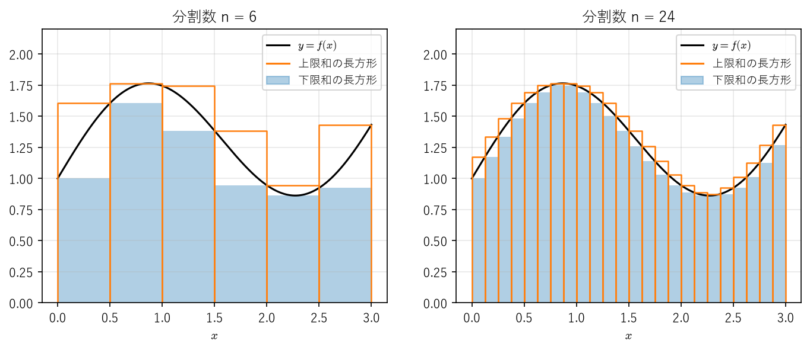
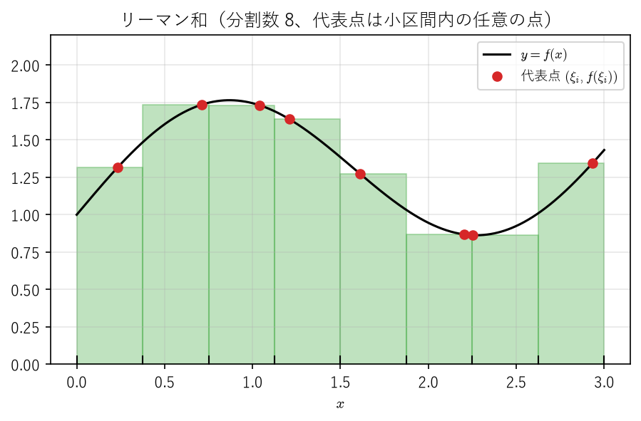
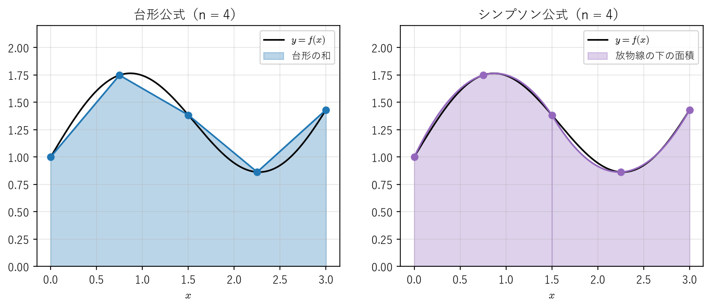
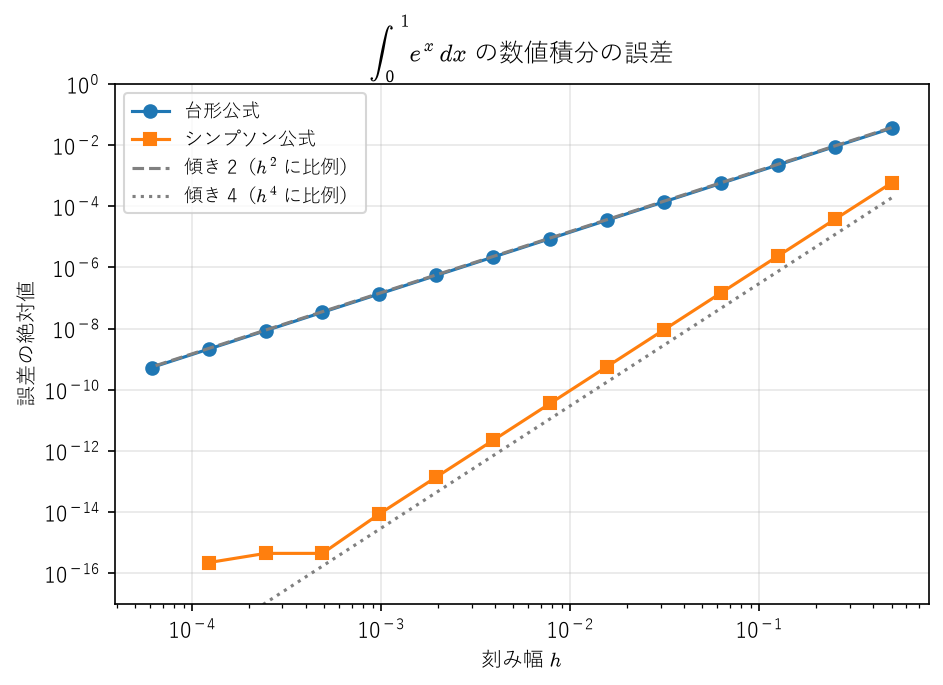

積分
====

本章では、関数のグラフと :math:`x` 軸で囲まれた部分の「面積」を厳密に定義し、その性質を調べる。高校では積分を「微分の逆演算」として導入することが多いが、本章ではまず面積を長方形の面積の和の極限として定義し（リーマン積分）、そのうえで微分との関係（微分積分学の基本定理）を定理として証明する。この順序をとると、どのような関数なら積分できるのか、置換積分や部分積分がなぜ正しいのか、といった問いに答えられるようになる。

工学では、積分の値を解析的に求められないことが多く、数値積分で近似値を計算する。数値積分の公式は、本章で定義するリーマン和そのものか、その改良である。章の後半では、台形公式とシンプソン公式の誤差が刻み幅の何乗に比例するかを証明し、Python による数値実験で確かめる。

面積をどう定義するか
--------------------

区間 :math:`[a, b]` 上の関数 :math:`f(x) \geq 0` のグラフの下の面積を求めるには、区間を細かく分け、各小区間で長方形を立てて面積を足し合わせ、分け方を細かくした極限をとればよい。これは高校で学ぶ区分求積法の考え方である。しかし、この考え方を定義として採用するには、次のような点をはっきりさせておく必要がある。

* 長方形の高さとして、小区間のどの点での関数値を使うのか。
* 分け方を細かくしたとき、長方形の面積の和は本当に一定の値に近づくのか。
* そもそも、どのような関数に対してなら面積が定まるのか。

たとえば、有理数で 1、無理数で 0 をとる関数（後の\ :ref:`例 7.2 <ch07-ex-dirichlet>`）では、高さとして有理数での値を使うか無理数での値を使うかで、長方形の面積の和がまったく異なる。本章では、長方形の高さとして小区間での関数の上限と下限を使う方法で、この問題を整理する。

上限和・下限和とリーマン積分
----------------------------

本節では、:math:`f` は有界閉区間 :math:`[a, b]` 上で定義された有界な関数とする。

.. _ch07-def-partition:

.. admonition:: 定義 7.1（分割）
   :class: definition

   有限個の点 :math:`x_0, x_1, \ldots, x_n` で :math:`a = x_0 < x_1 < \cdots < x_n = b` を満たすものの集合 :math:`P = \{x_0, x_1, \ldots, x_n\}` を、区間 :math:`[a, b]` の\ **分割**\ という。:math:`\Delta x_i = x_i - x_{i-1}` を小区間 :math:`[x_{i-1}, x_i]` の幅といい、その最大値 :math:`|P| = \max_{1 \leq i \leq n} \Delta x_i` を分割 :math:`P` の\ **幅**\ という。2 つの分割 :math:`P, Q` について :math:`P \subset Q` が成り立つとき、:math:`Q` は :math:`P` の\ **細分**\ であるという。

.. _ch07-def-darboux:

.. admonition:: 定義 7.2（上限和・下限和）
   :class: definition

   分割 :math:`P = \{x_0, \ldots, x_n\}` に対して、

   .. math::

      M_i = \sup_{x_{i-1} \leq x \leq x_i} f(x), \qquad m_i = \inf_{x_{i-1} \leq x \leq x_i} f(x) \qquad (i = 1, \ldots, n)

   とおき、

   .. math::

      U(f, P) = \sum_{i=1}^{n} M_i \, \Delta x_i, \qquad L(f, P) = \sum_{i=1}^{n} m_i \, \Delta x_i

   をそれぞれ :math:`P` に関する :math:`f` の\ **上限和**、**下限和**\ という。:math:`f` は有界なので、:math:`M_i` と :math:`m_i` は実数として定まる。

:math:`m_i \leq M_i` なので、どの分割 :math:`P` についても :math:`L(f, P) \leq U(f, P)` である。:math:`f \geq 0` のとき、:math:`U(f, P)` はグラフを上から覆う長方形の面積の和、:math:`L(f, P)` はグラフの下に収まる長方形の面積の和である（:numref:`ch07-fig-darboux`）。分割を細かくすると、上限和は減り、下限和は増えて、両者の差が縮まっていく様子が分かる。

.. _ch07-fig-darboux:

   上限和（枠）と下限和（塗り）。左は 6 等分、右は 24 等分。

.. admonition:: 注意
   :class: note

   上限和・下限和は、ダルブー和（上ダルブー和・下ダルブー和）と呼ばれることもある。

分割を細かくしたときの上限和・下限和の変化は、次の補題で正確に述べられる。

.. _ch07-thm-refine:

.. admonition:: 補題 7.1（細分による上限和・下限和の変化）
   :class: theorem

   分割 :math:`Q` が分割 :math:`P` の細分ならば、:math:`L(f, P) \leq L(f, Q) \leq U(f, Q) \leq U(f, P)` が成り立つ。

.. admonition:: 証明
   :class: proof

   まず、:math:`Q` が :math:`P = \{x_0, \ldots, x_n\}` に 1 点 :math:`y` を付け加えたものである場合を考える。:math:`y` は、ある :math:`k` について :math:`x_{k-1} < y < x_k` を満たす。:math:`[x_{k-1}, y]` と :math:`[y, x_k]` における :math:`f` の下限をそれぞれ :math:`m', m''` とすると、これらは :math:`[x_{k-1}, x_k]` の部分集合上の下限なので、:math:`m' \geq m_k`、:math:`m'' \geq m_k` である。:math:`k` 番目以外の小区間は変わらないから、

   .. math::

      L(f, Q) - L(f, P) = m' (y - x_{k-1}) + m'' (x_k - y) - m_k (x_k - x_{k-1}) \geq m_k (y - x_{k-1}) + m_k (x_k - y) - m_k (x_k - x_{k-1}) = 0

   となる。上限和についても同様に :math:`U(f, Q) \leq U(f, P)` が成り立つ。一般の細分 :math:`Q` は、:math:`P` に :math:`Q` の点を 1 つずつ付け加えて得られるので、この議論を繰り返せばよい。:math:`L(f, Q) \leq U(f, Q)` は定義から明らかである。

.. _ch07-thm-lu:

.. admonition:: 補題 7.2
   :class: theorem

   任意の 2 つの分割 :math:`P, Q` に対して、:math:`L(f, P) \leq U(f, Q)` が成り立つ。

.. admonition:: 証明
   :class: proof

   :math:`P \cup Q` は :math:`P` と :math:`Q` の両方の細分である。:ref:`補題 7.1 <ch07-thm-refine>` より、:math:`L(f, P) \leq L(f, P \cup Q) \leq U(f, P \cup Q) \leq U(f, Q)` となる。

:ref:`補題 7.2 <ch07-thm-lu>` より、下限和全体の集合は任意の上限和を上界にもつ。したがって、:ref:`実数の連続性 <ch01-thm-sup>`\ により下限和全体の上限が存在し、同様に上限和全体の下限も存在する。これを使って積分を定義する。

.. _ch07-def-riemann:

.. admonition:: 定義 7.3（リーマン積分）
   :class: definition

   :math:`[a, b]` のすべての分割 :math:`P` にわたる上限・下限をとって、

   .. math::

      \overline{\int_a^b} f(x)\,dx = \inf_{P} U(f, P), \qquad \underline{\int_a^b} f(x)\,dx = \sup_{P} L(f, P)

   とおき、それぞれ :math:`f` の\ **上積分**、**下積分**\ という。両者が一致するとき、:math:`f` は :math:`[a, b]` 上で\ **リーマン積分可能**\ （または単に積分可能）であるといい、その共通の値を :math:`\int_a^b f(x)\,dx` と書いて、:math:`f` の :math:`[a, b]` 上の\ **定積分**\ という。

   また、:math:`\int_a^a f(x)\,dx = 0`、:math:`a < b` のとき :math:`\int_b^a f(x)\,dx = -\int_a^b f(x)\,dx` と約束する。

:ref:`補題 7.2 <ch07-thm-lu>` で :math:`Q` を固定して :math:`P` について上限をとると :math:`\underline{\int_a^b} f(x)\,dx \leq U(f, Q)` となり、さらに :math:`Q` について下限をとると、常に

.. math::

   L(f, P) \leq \underline{\int_a^b} f(x)\,dx \leq \overline{\int_a^b} f(x)\,dx \leq U(f, P)

が成り立つ（:math:`P` は任意の分割）。積分の値の :math:`x` は積分変数と呼ばれ、ほかの文字に置き換えても値は変わらない。

.. _ch07-ex-linear:

.. admonition:: 例 7.1
   :class: example

   :math:`[0, 1]` 上の関数 :math:`f(x) = x` を考える。:math:`[0, 1]` を :math:`n` 等分する分割 :math:`P_n = \{0, 1/n, 2/n, \ldots, 1\}` をとると、:math:`f` は単調増加なので :math:`M_i = i/n`、:math:`m_i = (i-1)/n` であり、

   .. math::

      U(f, P_n) = \sum_{i=1}^{n} \frac{i}{n} \cdot \frac{1}{n} = \frac{n+1}{2n}, \qquad L(f, P_n) = \sum_{i=1}^{n} \frac{i-1}{n} \cdot \frac{1}{n} = \frac{n-1}{2n}

   となる。したがって、すべての :math:`n` について :math:`\frac{n-1}{2n} \leq \underline{\int_0^1} x\,dx \leq \overline{\int_0^1} x\,dx \leq \frac{n+1}{2n}` が成り立つ。:math:`n \to \infty` とすると、上積分と下積分はともに :math:`1/2` に等しい。よって :math:`f` は積分可能で、:math:`\int_0^1 x\,dx = 1/2` である。

.. _ch07-ex-dirichlet:

.. admonition:: 例 7.2（積分可能でない関数）
   :class: example

   :math:`[0, 1]` 上の関数 :math:`D(x)` を、:math:`x` が有理数のとき :math:`D(x) = 1`、無理数のとき :math:`D(x) = 0` と定める（ディリクレの関数）。どんなに短い区間にも有理数と無理数がともに含まれるので（:ref:`定理 1.8 <ch01-thm-dense>`\ と問題 1.5）、どの分割でもすべての小区間で :math:`M_i = 1`、:math:`m_i = 0` となる。したがって、常に :math:`U(D, P) = 1`、:math:`L(D, P) = 0` であり、上積分は 1、下積分は 0 となって一致しない。よって :math:`D` は積分可能でない。

積分可能かどうかを定義から直接調べるのは手間がかかる。次の判定条件が便利である。

.. _ch07-thm-criterion:

.. admonition:: 定理 7.3（リーマンの判定条件）
   :class: theorem

   有界な関数 :math:`f` が :math:`[a, b]` 上で積分可能であるための必要十分条件は、任意の :math:`\varepsilon > 0` に対して :math:`U(f, P) - L(f, P) < \varepsilon` を満たす分割 :math:`P` が存在することである。

.. admonition:: 証明
   :class: proof

   （十分性）任意の :math:`\varepsilon > 0` に対して条件を満たす分割 :math:`P` をとると、上積分と下積分はともに :math:`L(f, P)` 以上 :math:`U(f, P)` 以下なので、:math:`0 \leq \overline{\int_a^b} f(x)\,dx - \underline{\int_a^b} f(x)\,dx \leq U(f, P) - L(f, P) < \varepsilon` となる。:math:`\varepsilon` は任意なので、上積分と下積分は一致する。

   （必要性）\ :math:`f` が積分可能であるとし、:math:`I = \int_a^b f(x)\,dx` とおく。:math:`I` は下限和全体の上限なので、:math:`L(f, P_1) > I - \varepsilon/2` を満たす分割 :math:`P_1` がある。同様に、:math:`I` は上限和全体の下限なので、:math:`U(f, P_2) < I + \varepsilon/2` を満たす分割 :math:`P_2` がある。:math:`P = P_1 \cup P_2` とすると、:ref:`補題 7.1 <ch07-thm-refine>` より :math:`U(f, P) - L(f, P) \leq U(f, P_2) - L(f, P_1) < \varepsilon` となる。

リーマン和との関係
------------------

区分求積法のように、長方形の高さとして小区間内の 1 点での関数値を使う和も考えておく。数値積分の公式の多くはこの形をしている。

.. _ch07-def-riemann-sum:

.. admonition:: 定義 7.4（リーマン和）
   :class: definition

   分割 :math:`P = \{x_0, \ldots, x_n\}` と、各小区間から 1 点ずつ選んだ点 :math:`\xi_i \in [x_{i-1}, x_i]`\ （**代表点**\ という）の組 :math:`\xi = (\xi_1, \ldots, \xi_n)` に対して、

   .. math::

      S(f, P, \xi) = \sum_{i=1}^{n} f(\xi_i) \, \Delta x_i

   を\ **リーマン和**\ という。

.. _ch07-fig-riemann-sum:

   リーマン和。各小区間の代表点（赤い点）での関数値を長方形の高さとする。

:math:`m_i \leq f(\xi_i) \leq M_i` なので、次の命題はただちに分かる。

.. _ch07-thm-sum-bound:

.. admonition:: 命題 7.4
   :class: theorem

   任意の分割 :math:`P` と代表点の組 :math:`\xi` に対して、:math:`L(f, P) \leq S(f, P, \xi) \leq U(f, P)` が成り立つ。特に、:math:`f` が積分可能で :math:`U(f, P) - L(f, P) < \varepsilon` ならば、代表点の選び方によらず

   .. math::

      \left| S(f, P, \xi) - \int_a^b f(x)\,dx \right| < \varepsilon

   が成り立つ。

.. admonition:: 証明
   :class: proof

   前半は :math:`m_i \leq f(\xi_i) \leq M_i` の両辺に :math:`\Delta x_i > 0` を掛けて足し合わせればよい。後半は、:math:`S(f, P, \xi)` と :math:`\int_a^b f(x)\,dx` がともに区間 :math:`[L(f, P), U(f, P)]` に属し、この区間の幅が :math:`\varepsilon` 未満であることから従う。

つまり、上限和と下限和の差が小さい分割では、代表点をどのように選んでもリーマン和は積分の値のよい近似になる。分割の幅 :math:`|P|` を小さくすればリーマン和が積分の値に近づくことは、次節で連続関数について証明する。

連続関数の積分可能性
--------------------

工学で扱う関数の多くは連続関数か、それを有限個つなぎ合わせたものである。連続関数は積分可能であることを示そう。証明の鍵は、有界閉区間上の連続関数は一様連続であるという事実（:ref:`ハイネの定理 <ch04-thm-heine>`）である。

.. _ch07-thm-continuous:

.. admonition:: 定理 7.5（連続関数の積分可能性）
   :class: theorem

   :math:`f` が有界閉区間 :math:`[a, b]` 上で連続ならば、:math:`f` は :math:`[a, b]` 上で積分可能である。さらに、任意の :math:`\varepsilon > 0` に対してある :math:`\delta > 0` が存在し、:math:`|P| < \delta` を満たすすべての分割 :math:`P` について :math:`U(f, P) - L(f, P) < \varepsilon` が成り立つ。

.. admonition:: 証明
   :class: proof

   :ref:`最大値・最小値の定理 <ch04-thm-extreme>`\ より :math:`f` は :math:`[a, b]` 上で有界であり、上限和・下限和が定義できる。:math:`\varepsilon > 0` を任意にとる。:ref:`ハイネの定理 <ch04-thm-heine>`\ より :math:`f` は :math:`[a, b]` 上で一様連続なので、ある :math:`\delta > 0` が存在して、:math:`|x - y| < \delta` を満たす任意の :math:`x, y \in [a, b]` について :math:`|f(x) - f(y)| < \varepsilon / (b - a)` となる。

   :math:`|P| < \delta` を満たす分割 :math:`P = \{x_0, \ldots, x_n\}` をとる。各小区間 :math:`[x_{i-1}, x_i]` 上で、:math:`f` は連続なので最大値と最小値をとる（:ref:`最大値・最小値の定理 <ch04-thm-extreme>`）。それらをとる点を :math:`s_i, t_i` とすると :math:`|s_i - t_i| \leq \Delta x_i < \delta` なので、:math:`M_i - m_i = f(s_i) - f(t_i) < \varepsilon / (b - a)` である。よって

   .. math::

      U(f, P) - L(f, P) = \sum_{i=1}^{n} (M_i - m_i) \, \Delta x_i < \frac{\varepsilon}{b - a} \sum_{i=1}^{n} \Delta x_i = \varepsilon

   となる。:ref:`リーマンの判定条件 <ch07-thm-criterion>`\ より、:math:`f` は積分可能である。

:ref:`定理 7.5 <ch07-thm-continuous>` と\ :ref:`命題 7.4 <ch07-thm-sum-bound>` を組み合わせると、次の系が得られる。

.. _ch07-thm-mesh:

.. admonition:: 系 7.6（リーマン和の収束）
   :class: theorem

   :math:`f` が :math:`[a, b]` 上で連続ならば、任意の :math:`\varepsilon > 0` に対してある :math:`\delta > 0` が存在し、:math:`|P| < \delta` を満たす任意の分割 :math:`P` と任意の代表点の組 :math:`\xi` について

   .. math::

      \left| S(f, P, \xi) - \int_a^b f(x)\,dx \right| < \varepsilon

   が成り立つ。特に、:math:`[a, b]` を :math:`n` 等分して各小区間の右端を代表点とすると、

   .. math::

      \lim_{n \to \infty} \frac{b - a}{n} \sum_{i=1}^{n} f\left( a + \frac{i (b - a)}{n} \right) = \int_a^b f(x)\,dx

   である（区分求積法）。

.. admonition:: 証明
   :class: proof

   :ref:`定理 7.5 <ch07-thm-continuous>` の :math:`\delta` をとれば、:math:`|P| < \delta` のとき :math:`U(f, P) - L(f, P) < \varepsilon` なので、:ref:`命題 7.4 <ch07-thm-sum-bound>` から主張が従う。後半は、:math:`n` 等分する分割の幅 :math:`(b - a)/n` が :math:`n \to \infty` で 0 に近づくことから従う。

.. admonition:: 注意
   :class: note

   連続とは限らない積分可能な関数についても、:math:`|P| \to 0` のときリーマン和が積分の値に収束することが知られている（ダルブーの定理）。逆に、:math:`|P| \to 0` のときリーマン和が代表点の選び方によらず一定の値に収束するならば、:math:`f` は積分可能である。これらの証明は [Sugiura1980]_ を参照してほしい。

連続でなくても積分可能な関数は多い。次の定理はその代表例である。

.. _ch07-thm-monotone:

.. admonition:: 定理 7.7（単調関数の積分可能性）
   :class: theorem

   :math:`f` が :math:`[a, b]` 上で単調増加または単調減少ならば、:math:`f` は :math:`[a, b]` 上で積分可能である。

.. admonition:: 証明
   :class: proof

   単調増加の場合を示す（単調減少の場合は :math:`-f` を考えればよい）。:math:`f(a) \leq f(x) \leq f(b)` なので :math:`f` は有界である。:math:`[a, b]` を :math:`n` 等分する分割 :math:`P_n` をとると、小区間 :math:`[x_{i-1}, x_i]` 上で :math:`M_i \leq f(x_i)`、:math:`m_i \geq f(x_{i-1})` なので、

   .. math::

      U(f, P_n) - L(f, P_n) \leq \sum_{i=1}^{n} \bigl( f(x_i) - f(x_{i-1}) \bigr) \frac{b - a}{n} = \frac{\bigl( f(b) - f(a) \bigr)(b - a)}{n}

   となる。右辺は :math:`n` を大きくすればいくらでも小さくなるので、:ref:`リーマンの判定条件 <ch07-thm-criterion>`\ より :math:`f` は積分可能である。

積分の基本性質
--------------

以下の性質は計算でごく自然に使っているが、定義に基づいて証明しておく。証明では、区間 :math:`J` 上の有界な関数 :math:`f` について

.. math::

   \sup_{x \in J} f(x) - \inf_{x \in J} f(x) = \sup_{x, y \in J} |f(x) - f(y)|

が成り立つことを使う（左辺を :math:`J` 上の :math:`f` の振幅という）。これは、:math:`f(x) - f(y) \leq \sup f - \inf f` がすべての :math:`x, y` について成り立ち、かつ :math:`f(x)` を上限に、:math:`f(y)` を下限にいくらでも近くとれることから分かる。

.. _ch07-thm-properties:

.. admonition:: 定理 7.8（積分の基本性質）
   :class: theorem

   :math:`f, g` は :math:`[a, b]` 上で有界な関数であり、:math:`\lambda` は定数とする。1, 2, 4 では、:math:`f, g` は :math:`[a, b]` 上で積分可能であるとする。

   1. （線形性）\ :math:`f + g` と :math:`\lambda f` は積分可能であり、:math:`\int_a^b (f + g)\,dx = \int_a^b f\,dx + \int_a^b g\,dx`、:math:`\int_a^b \lambda f\,dx = \lambda \int_a^b f\,dx` が成り立つ。
   2. （単調性）\ :math:`[a, b]` 上で :math:`f \leq g` ならば :math:`\int_a^b f\,dx \leq \int_a^b g\,dx` である。
   3. （区間に関する加法性）\ :math:`a < c < b` とする。:math:`f` が :math:`[a, b]` 上で積分可能であることと、:math:`[a, c]` と :math:`[c, b]` の両方の上で積分可能であることは同値であり、このとき :math:`\int_a^b f\,dx = \int_a^c f\,dx + \int_c^b f\,dx` が成り立つ。
   4. :math:`|f|` は積分可能であり、:math:`\left| \int_a^b f\,dx \right| \leq \int_a^b |f|\,dx` が成り立つ。

   なお、3 の等式は、:ref:`定義 7.3 <ch07-def-riemann>` の約束のもとで :math:`a, b, c` の大小によらず成り立つ。

.. admonition:: 証明
   :class: proof

   1. 各小区間上で :math:`\sup (f + g) \leq \sup f + \sup g`、:math:`\inf (f + g) \geq \inf f + \inf g` なので、任意の分割 :math:`P` について :math:`L(f, P) + L(g, P) \leq L(f + g, P) \leq U(f + g, P) \leq U(f, P) + U(g, P)` が成り立つ。:math:`\varepsilon > 0` に対し、:ref:`リーマンの判定条件 <ch07-thm-criterion>`\ により :math:`U(f, P_1) - L(f, P_1) < \varepsilon/2`、:math:`U(g, P_2) - L(g, P_2) < \varepsilon/2` となる分割をとり、:math:`P = P_1 \cup P_2` とすると、:ref:`補題 7.1 <ch07-thm-refine>` より :math:`U(f + g, P) - L(f + g, P) < \varepsilon` となるので :math:`f + g` は積分可能である。さらに、:math:`\int_a^b (f + g)\,dx` と :math:`\int_a^b f\,dx + \int_a^b g\,dx` はともに区間 :math:`[L(f, P) + L(g, P), U(f, P) + U(g, P)]` に属し、この区間の幅は :math:`\varepsilon` 未満である。:math:`\varepsilon` は任意なので両者は等しい。:math:`\lambda f` については、:math:`\lambda \geq 0` なら :math:`U(\lambda f, P) = \lambda\,U(f, P)`、:math:`L(\lambda f, P) = \lambda\,L(f, P)` であり、:math:`\lambda < 0` なら :math:`U(\lambda f, P) = \lambda\,L(f, P)`、:math:`L(\lambda f, P) = \lambda\,U(f, P)` であることから同様に示せる。
   2. 1 より :math:`g - f` は積分可能である。:math:`g - f \geq 0` なので任意の分割で :math:`L(g - f, P) \geq 0` であり、:math:`\int_a^b (g - f)\,dx \geq 0` となる。1 の線形性から主張が従う。
   3. :math:`[a, c]` の分割 :math:`P_1` と :math:`[c, b]` の分割 :math:`P_2` を合わせた :math:`P = P_1 \cup P_2` は :math:`[a, b]` の分割であり、:math:`U(f, P) = U(f, P_1) + U(f, P_2)`、:math:`L(f, P) = L(f, P_1) + L(f, P_2)` が成り立つ。:math:`f` が :math:`[a, c]` と :math:`[c, b]` で積分可能なら、それぞれ上限和と下限和の差が :math:`\varepsilon/2` 未満の分割 :math:`P_1, P_2` をとれば :math:`U(f, P) - L(f, P) < \varepsilon` となり、:math:`f` は :math:`[a, b]` で積分可能である。このとき :math:`\int_a^b f\,dx` と :math:`\int_a^c f\,dx + \int_c^b f\,dx` はともに :math:`[L(f, P), U(f, P)]` に属するので、1 と同様に両者は等しい。逆に :math:`f` が :math:`[a, b]` で積分可能なら、上限和と下限和の差が :math:`\varepsilon` 未満の分割に点 :math:`c` を加えても差は :math:`\varepsilon` 未満のままである（:ref:`補題 7.1 <ch07-thm-refine>`）。これを :math:`c` で 2 つに分けた分割 :math:`P_1, P_2` について、:math:`\bigl( U(f, P_1) - L(f, P_1) \bigr) + \bigl( U(f, P_2) - L(f, P_2) \bigr) < \varepsilon` であり、各項は 0 以上なので、どちらも :math:`\varepsilon` 未満である。よって :math:`f` は :math:`[a, c]` と :math:`[c, b]` で積分可能である。
   4. :math:`\bigl| |f(x)| - |f(y)| \bigr| \leq |f(x) - f(y)|` なので、各小区間上で :math:`|f|` の振幅は :math:`f` の振幅以下である。よって :math:`U(|f|, P) - L(|f|, P) \leq U(f, P) - L(f, P)` となり、:ref:`リーマンの判定条件 <ch07-thm-criterion>`\ より :math:`|f|` は積分可能である。さらに :math:`-|f| \leq f \leq |f|` に 2 を適用すれば、不等式が得られる。

次の定理は、後の数値積分の誤差評価で使う。

.. _ch07-thm-mean-value:

.. admonition:: 定理 7.9（積分の平均値の定理）
   :class: theorem

   :math:`f, g` は :math:`[a, b]` 上で連続で、:math:`[a, b]` 上で :math:`g \geq 0` とする。このとき、ある :math:`\xi \in [a, b]` が存在して

   .. math::

      \int_a^b f(x) g(x)\,dx = f(\xi) \int_a^b g(x)\,dx

   が成り立つ。特に :math:`g = 1` とすると、:math:`\int_a^b f(x)\,dx = f(\xi)(b - a)` となる :math:`\xi \in [a, b]` が存在する。

.. admonition:: 証明
   :class: proof

   :math:`fg` は連続なので積分可能である（:ref:`定理 7.5 <ch07-thm-continuous>`）。:ref:`最大値・最小値の定理 <ch04-thm-extreme>`\ より、:math:`f` の :math:`[a, b]` 上の最大値 :math:`M` と最小値 :math:`m` が存在する。:math:`g \geq 0` なので :math:`m g(x) \leq f(x) g(x) \leq M g(x)` であり、:ref:`定理 7.8 <ch07-thm-properties>` より :math:`m G \leq \int_a^b f g\,dx \leq M G` となる。ただし :math:`G = \int_a^b g\,dx \geq 0` である。:math:`G = 0` なら :math:`\int_a^b f g\,dx = 0` となり、任意の :math:`\xi` で等式が成り立つ。:math:`G > 0` なら :math:`\frac{1}{G} \int_a^b f g\,dx` は :math:`m` 以上 :math:`M` 以下であり、:ref:`中間値の定理 <ch04-thm-ivt>`\ より :math:`f(\xi)` がこの値に等しくなる :math:`\xi \in [a, b]` が存在する。

微分積分学の基本定理
--------------------

ここまでの積分の定義には、微分はまったく現れていない。面積として定義した積分と、微分の逆演算とを結び付けるのが次の定理である。

.. _ch07-thm-ftc:

.. admonition:: 定理 7.10（微分積分学の基本定理）
   :class: theorem

   1. :math:`f` が :math:`[a, b]` 上で積分可能であるとし、:math:`F(x) = \int_a^x f(t)\,dt`\ （:math:`a \leq x \leq b`）とおく。このとき :math:`F` は :math:`[a, b]` 上で連続である。さらに、:math:`f` が点 :math:`x_0 \in [a, b]` で連続ならば、:math:`F` は :math:`x_0` で微分可能であり :math:`F'(x_0) = f(x_0)` が成り立つ（:math:`x_0` が端点の場合は片側微分係数とする）。
   2. :math:`G` は :math:`[a, b]` 上で連続、:math:`(a, b)` 上で微分可能であり、:math:`(a, b)` 上で :math:`G' = f` を満たすとする。:math:`f` が :math:`[a, b]` 上で積分可能ならば、

      .. math::
         :label: ch07-eq-ftc

         \int_a^b f(x)\,dx = G(b) - G(a)

      が成り立つ。

.. admonition:: 証明
   :class: proof

   1. :ref:`定理 7.8 <ch07-thm-properties>` の 3 より、:math:`f` は各 :math:`[a, x]` 上で積分可能であり、:math:`F` は定義できる。:math:`f` は有界なので :math:`|f| \leq K` となる定数 :math:`K` がある。:math:`x, y \in [a, b]` に対して、:ref:`定理 7.8 <ch07-thm-properties>` の 3, 4 より :math:`|F(y) - F(x)| = \left| \int_x^y f(t)\,dt \right| \leq K |y - x|` となるので、:math:`F` は連続である。次に、:math:`f` が :math:`x_0` で連続であるとする。:math:`\varepsilon > 0` に対して :math:`\delta > 0` を、:math:`|t - x_0| < \delta` ならば :math:`|f(t) - f(x_0)| < \varepsilon` となるようにとる。:math:`0 < |h| < \delta` かつ :math:`x_0 + h \in [a, b]` のとき、:math:`\int_{x_0}^{x_0 + h} f(x_0)\,dt = h f(x_0)` に注意すると、

      .. math::

         \left| \frac{F(x_0 + h) - F(x_0)}{h} - f(x_0) \right| = \frac{1}{|h|} \left| \int_{x_0}^{x_0 + h} \bigl( f(t) - f(x_0) \bigr)\,dt \right| \leq \frac{1}{|h|} \cdot \varepsilon |h| = \varepsilon

      となる。よって :math:`F'(x_0) = f(x_0)` である。
   2. :math:`[a, b]` の任意の分割 :math:`P = \{x_0, \ldots, x_n\}` をとる。各小区間 :math:`[x_{i-1}, x_i]` で :math:`G` に\ :ref:`平均値の定理 <ch05-thm-mvt>`\ を適用すると、:math:`G(x_i) - G(x_{i-1}) = f(\xi_i) \, \Delta x_i` を満たす :math:`\xi_i \in (x_{i-1}, x_i)` が存在する。これを :math:`i = 1, \ldots, n` について足し合わせると、

      .. math::

         G(b) - G(a) = \sum_{i=1}^{n} f(\xi_i) \, \Delta x_i = S(f, P, \xi)

      となる。:ref:`命題 7.4 <ch07-thm-sum-bound>` より、すべての分割 :math:`P` について :math:`L(f, P) \leq G(b) - G(a) \leq U(f, P)` が成り立つ。:math:`f` は積分可能なので、:math:`P` について下限和の上限と上限和の下限をとれば、:math:`G(b) - G(a) = \int_a^b f(x)\,dx` を得る。

:math:`G' = f` を満たす関数 :math:`G` を :math:`f` の\ **原始関数**\ といい、:math:`F(x) = \int_a^x f(t)\,dt` を :math:`f` の\ **不定積分**\ という。:ref:`定理 7.10 <ch07-thm-ftc>` の 1 より、連続関数の不定積分は原始関数である。また、2 つの原始関数の差は導関数が 0 なので、:ref:`平均値の定理 <ch05-thm-mvt>`\ より定数である。式 :eq:`ch07-eq-ftc` は、積分の値を求める問題を原始関数を見つける問題に帰着させる。高校で学んだ積分の計算は、この定理に支えられている。

.. _ch07-ex-abs:

.. admonition:: 例 7.3（連続性の仮定が必要な例）
   :class: example

   :math:`[-1, 1]` 上の関数 :math:`f` を、:math:`x < 0` で :math:`f(x) = -1`、:math:`x \geq 0` で :math:`f(x) = 1` と定める。:math:`f` は単調増加なので積分可能であり（:ref:`定理 7.7 <ch07-thm-monotone>`）、:math:`F(x) = \int_{-1}^x f(t)\,dt = |x| - 1` となる。:math:`F` は連続だが、:math:`f` が不連続な点 :math:`x = 0` では微分可能でない。このように、:ref:`定理 7.10 <ch07-thm-ftc>` の 1 で :math:`F'(x_0) = f(x_0)` を保証するには、:math:`x_0` での :math:`f` の連続性が必要である。

置換積分と部分積分
------------------

微分積分学の基本定理を使うと、置換積分と部分積分の公式を証明できる。以下、:math:`C^1` 級、:math:`C^2` 級は「\ :doc:`taylor`\ 」の\ :ref:`定義 6.2 <ch06-def-cn>`\ の意味で用いる（有界閉区間上では、端点の微分係数を片側極限で考える）。

.. _ch07-thm-parts:

.. admonition:: 定理 7.11（部分積分）
   :class: theorem

   :math:`f, g` が :math:`[a, b]` 上で :math:`C^1` 級ならば、

   .. math::

      \int_a^b f(x) g'(x)\,dx = \Bigl[ f(x) g(x) \Bigr]_a^b - \int_a^b f'(x) g(x)\,dx

   が成り立つ。ただし :math:`\bigl[ h(x) \bigr]_a^b = h(b) - h(a)` である。

.. admonition:: 証明
   :class: proof

   積の微分公式より :math:`(fg)' = f'g + fg'` であり、右辺は連続なので積分可能である。:ref:`微分積分学の基本定理 <ch07-thm-ftc>`\ の 2 より :math:`\int_a^b (f'g + fg')\,dx = f(b) g(b) - f(a) g(a)` となる。左辺を\ :ref:`線形性 <ch07-thm-properties>`\ で 2 つに分けて移項すればよい。

.. _ch07-thm-substitution:

.. admonition:: 定理 7.12（置換積分）
   :class: theorem

   :math:`\varphi` が :math:`[\alpha, \beta]` 上で :math:`C^1` 級であり、:math:`f` が :math:`\varphi([\alpha, \beta])` を含む区間上で連続ならば、

   .. math::

      \int_{\varphi(\alpha)}^{\varphi(\beta)} f(x)\,dx = \int_\alpha^\beta f\bigl( \varphi(t) \bigr) \varphi'(t)\,dt

   が成り立つ。

.. admonition:: 証明
   :class: proof

   :math:`c = \varphi(\alpha)` とし、:math:`F(x) = \int_c^x f(s)\,ds` とおく。:ref:`微分積分学の基本定理 <ch07-thm-ftc>`\ の 1 より :math:`F' = f` である。合成関数の微分公式（:doc:`differentiation`）より :math:`\frac{d}{dt} F\bigl( \varphi(t) \bigr) = f\bigl( \varphi(t) \bigr) \varphi'(t)` であり、右辺は :math:`t` について連続である。:ref:`微分積分学の基本定理 <ch07-thm-ftc>`\ の 2 より、右辺の積分は :math:`F\bigl( \varphi(\beta) \bigr) - F\bigl( \varphi(\alpha) \bigr) = \int_{\varphi(\alpha)}^{\varphi(\beta)} f(x)\,dx` に等しい。

この証明では :math:`\varphi` の単調性を使っていない。置換積分では、:math:`\varphi` が単調でなくても公式が成り立つ。

.. _ch07-ex-quarter-circle:

.. admonition:: 例 7.4
   :class: example

   :math:`\int_0^1 \sqrt{1 - x^2}\,dx` を求める。:math:`x = \varphi(t) = \sin t`\ （:math:`0 \leq t \leq \pi/2`）とおくと、:math:`\varphi(0) = 0`、:math:`\varphi(\pi/2) = 1`、:math:`\varphi'(t) = \cos t` であり、:math:`0 \leq t \leq \pi/2` で :math:`\sqrt{1 - \sin^2 t} = \cos t` なので、

   .. math::

      \int_0^1 \sqrt{1 - x^2}\,dx = \int_0^{\pi/2} \cos^2 t\,dt = \int_0^{\pi/2} \frac{1 + \cos 2t}{2}\,dt = \frac{\pi}{4}

   となる。これは半径 1 の円の面積の 4 分の 1 である。

広義積分
--------

ここまでの積分は、有界閉区間上の有界な関数を対象としていた。しかし工学では、:math:`\int_0^\infty e^{-st} f(t)\,dt`\ （ラプラス変換）のように無限区間上の積分や、:math:`\int_0^1 \frac{dx}{\sqrt{x}}` のように被積分関数が有界でない積分がしばしば現れる。これらは、有界閉区間上の積分の極限として定義する。

.. _ch07-def-improper:

.. admonition:: 定義 7.5（広義積分）
   :class: definition

   1. :math:`f` が任意の :math:`R > a` について :math:`[a, R]` 上で積分可能であるとする。極限 :math:`\lim_{R \to \infty} \int_a^R f(x)\,dx` が存在するとき、広義積分 :math:`\int_a^\infty f(x)\,dx` は\ **収束する**\ といい、この極限をその値とする。極限が存在しないとき、広義積分は\ **発散する**\ という。
   2. :math:`f` が :math:`(a, b]` 上で定義され、任意の :math:`c \in (a, b)` について :math:`[c, b]` 上で積分可能であるとする（:math:`a` の近くで :math:`f` は有界でなくてもよい）。右極限 :math:`\lim_{c \to a + 0} \int_c^b f(x)\,dx` が存在するとき、広義積分 :math:`\int_a^b f(x)\,dx` は収束するといい、この極限をその値とする。

   :math:`\int_{-\infty}^b f(x)\,dx` や、右端で有界でない場合も同様に定義する。両端に問題がある場合は、途中の点で区間を 2 つに分け、両方の広義積分が収束するときに収束するという。

.. _ch07-ex-power:

.. admonition:: 例 7.5
   :class: example

   :math:`p` を実数とする。

   * :math:`\int_1^\infty \frac{dx}{x^p}` は :math:`p > 1` のとき収束して値は :math:`\frac{1}{p - 1}` であり、:math:`p \leq 1` のとき発散する。実際、:math:`p \neq 1` なら :math:`\int_1^R x^{-p}\,dx = \frac{R^{1-p} - 1}{1 - p}` であり、:math:`R \to \infty` で :math:`p > 1` なら :math:`\frac{1}{p - 1}` に収束し、:math:`p < 1` なら発散する。:math:`p = 1` なら :math:`\int_1^R \frac{dx}{x} = \log R \to \infty` である。
   * :math:`\int_0^1 \frac{dx}{x^p}` は :math:`p < 1` のとき収束して値は :math:`\frac{1}{1 - p}` であり、:math:`p \geq 1` のとき発散する。実際、:math:`0 < c < 1`、:math:`p \neq 1` なら :math:`\int_c^1 x^{-p}\,dx = \frac{1 - c^{1-p}}{1 - p}` であり、:math:`c \to +0` での極限を調べればよい。:math:`p = 1` なら :math:`\int_c^1 \frac{dx}{x} = -\log c \to \infty` である。

被積分関数の原始関数が求められない場合には、収束するかどうかを比較によって判定する。

.. _ch07-thm-comparison:

.. admonition:: 定理 7.13（比較判定法）
   :class: theorem

   :math:`f, g` は任意の :math:`R > a` について :math:`[a, R]` 上で積分可能であり、:math:`x \geq a` で :math:`0 \leq f(x) \leq g(x)` を満たすとする。:math:`\int_a^\infty g(x)\,dx` が収束するならば、:math:`\int_a^\infty f(x)\,dx` も収束する。

.. admonition:: 証明
   :class: proof

   :math:`F(R) = \int_a^R f(x)\,dx` とおく。:math:`f \geq 0` なので、:math:`R < R'` ならば :math:`F(R') - F(R) = \int_R^{R'} f(x)\,dx \geq 0` であり、:math:`F` は単調増加である。また、:ref:`定理 7.8 <ch07-thm-properties>` の 2 より :math:`F(R) \leq \int_a^R g(x)\,dx \leq \int_a^\infty g(x)\,dx` なので、:math:`F` は上に有界である。:ref:`実数の連続性 <ch01-thm-sup>`\ より :math:`s = \sup_{R > a} F(R)` が存在する。:math:`\varepsilon > 0` に対し、上限の定義から :math:`F(R_0) > s - \varepsilon` を満たす :math:`R_0` があり、:math:`F` の単調性から :math:`R \geq R_0` ならば :math:`s - \varepsilon < F(R) \leq s` となる。よって :math:`\lim_{R \to \infty} F(R) = s` である。

この証明は、:ref:`単調収束定理 <ch02-thm-monotone>`\ の証明と同じ考え方である。:math:`(a, b]` 上の広義積分についても、同様の比較判定法が成り立つ。

.. _ch07-ex-gauss:

.. admonition:: 例 7.6
   :class: example

   :math:`\int_0^\infty e^{-x^2}\,dx` は収束する。実際、:math:`\int_0^1 e^{-x^2}\,dx` は連続関数の積分なので有限であり、:math:`x \geq 1` では :math:`x^2 \geq x` より :math:`0 < e^{-x^2} \leq e^{-x}` で、:math:`\int_1^\infty e^{-x}\,dx = e^{-1}` は収束する。:ref:`比較判定法 <ch07-thm-comparison>`\ より :math:`\int_1^\infty e^{-x^2}\,dx` も収束する。この積分の値が :math:`\sqrt{\pi}/2` であることは、:doc:`multivariable_integration`\ で重積分を使って示す。

級数の場合と同様に、広義積分にも絶対収束の概念がある（:doc:`series`）。

.. _ch07-def-absolute:

.. admonition:: 定義 7.6（広義積分の絶対収束）
   :class: definition

   :math:`\int_a^\infty |f(x)|\,dx` が収束するとき、広義積分 :math:`\int_a^\infty f(x)\,dx` は\ **絶対収束する**\ という。

.. _ch07-thm-abs:

.. admonition:: 定理 7.14
   :class: theorem

   :math:`f` が任意の :math:`R > a` について :math:`[a, R]` 上で積分可能であり、:math:`\int_a^\infty f(x)\,dx` が絶対収束するならば、:math:`\int_a^\infty f(x)\,dx` は収束する。

.. admonition:: 証明
   :class: proof

   :ref:`定理 7.8 <ch07-thm-properties>` より :math:`|f|` と :math:`f + |f|` は各 :math:`[a, R]` 上で積分可能である。:math:`0 \leq f + |f| \leq 2|f|` なので、:ref:`比較判定法 <ch07-thm-comparison>`\ より :math:`\int_a^\infty \bigl( f + |f| \bigr)\,dx` は収束する。:math:`\int_a^R f\,dx = \int_a^R \bigl( f + |f| \bigr)\,dx - \int_a^R |f|\,dx` の右辺の 2 項はともに :math:`R \to \infty` で収束するので、左辺も収束する。

.. _ch07-ex-sinc:

.. admonition:: 例 7.7（収束するが絶対収束しない広義積分）
   :class: example

   :math:`\int_1^\infty \frac{\sin x}{x}\,dx` は収束するが、絶対収束しない。

   収束すること：部分積分により

   .. math::

      \int_1^R \frac{\sin x}{x}\,dx = \left[ -\frac{\cos x}{x} \right]_1^R - \int_1^R \frac{\cos x}{x^2}\,dx = \cos 1 - \frac{\cos R}{R} - \int_1^R \frac{\cos x}{x^2}\,dx

   となる。:math:`R \to \infty` で :math:`\frac{\cos R}{R} \to 0` である。また :math:`\left| \frac{\cos x}{x^2} \right| \leq \frac{1}{x^2}` であり、:math:`\int_1^\infty \frac{dx}{x^2}` は収束するので（:ref:`例 7.5 <ch07-ex-power>`）、:math:`\int_1^\infty \frac{\cos x}{x^2}\,dx` は絶対収束し、したがって収束する。よって左辺は :math:`R \to \infty` で収束する。

   絶対収束しないこと：自然数 :math:`k` について、区間 :math:`[k\pi, (k+1)\pi]` では :math:`\frac{1}{x} \geq \frac{1}{(k+1)\pi}` であり、:math:`\int_{k\pi}^{(k+1)\pi} |\sin x|\,dx = 2` なので、

   .. math::

      \int_{\pi}^{(N+1)\pi} \frac{|\sin x|}{x}\,dx \geq \sum_{k=1}^{N} \frac{2}{(k+1)\pi}

   となる。右辺は :math:`\frac{2}{\pi} \sum_{j=2}^{N+1} \frac{1}{j}` に等しく、調和級数 :math:`\sum 1/j` は発散するので（:doc:`series`）、:math:`N \to \infty` で右辺は発散する。

   なお、:math:`\frac{\sin x}{x}` は :math:`x \to 0` で 1 に近づくので、:math:`\int_0^\infty \frac{\sin x}{x}\,dx` も収束し、その値は :math:`\pi/2` であることが知られている。

数値積分
--------

原始関数が初等関数で表せない場合や、被積分関数が測定データとして与えられる場合には、積分の値を数値的に近似する。本節では、代表的な 2 つの公式とその誤差を調べる。以下、:math:`[a, b]` を :math:`n` 等分し、刻み幅を :math:`h = (b - a)/n`、分点を :math:`x_i = a + ih`、:math:`f_i = f(x_i)` とする。

台形公式
^^^^^^^^

各小区間でグラフを線分で近似し、台形の面積の和をとったものが\ **複合台形公式**\ （単に\ **台形公式**\ ともいう）である（:numref:`ch07-fig-quadrature` の左）。

.. math::
   :label: ch07-eq-trap

   T_n = h \left( \frac{f_0}{2} + f_1 + f_2 + \cdots + f_{n-1} + \frac{f_n}{2} \right)

台形公式の誤差を評価するため、まず 1 つの小区間での誤差を求める。

.. _ch07-thm-trap-local:

.. admonition:: 補題 7.15
   :class: theorem

   :math:`f` が :math:`[\alpha, \alpha + h]` 上で :math:`C^2` 級ならば、ある :math:`\xi \in [\alpha, \alpha + h]` が存在して

   .. math::

      \int_\alpha^{\alpha + h} f(x)\,dx - \frac{h}{2} \bigl( f(\alpha) + f(\alpha + h) \bigr) = -\frac{h^3}{12} f''(\xi)

   が成り立つ。

.. admonition:: 証明
   :class: proof

   :math:`g(s) = f(\alpha + s)`\ （:math:`0 \leq s \leq h`）とおく。:ref:`部分積分 <ch07-thm-parts>`\ を 2 回使うと、

   .. math::

      \begin{aligned}
      \int_0^h s(h - s) g''(s)\,ds
        &= \Bigl[ s(h - s) g'(s) \Bigr]_0^h - \int_0^h (h - 2s) g'(s)\,ds \\
        &= -\Bigl[ (h - 2s) g(s) \Bigr]_0^h - 2 \int_0^h g(s)\,ds \\
        &= h \bigl( g(0) + g(h) \bigr) - 2 \int_0^h g(s)\,ds
      \end{aligned}

   となる。したがって

   .. math::

      \int_0^h g(s)\,ds - \frac{h}{2} \bigl( g(0) + g(h) \bigr) = -\frac{1}{2} \int_0^h s(h - s) g''(s)\,ds

   である。:math:`0 \leq s \leq h` で :math:`s(h - s) \geq 0` なので、:ref:`積分の平均値の定理 <ch07-thm-mean-value>`\ より、ある :math:`\sigma \in [0, h]` について右辺の積分は :math:`g''(\sigma) \int_0^h s(h - s)\,ds = g''(\sigma) \frac{h^3}{6}` に等しい。:math:`\xi = \alpha + \sigma` とおけば、左辺は置換積分により主張の左辺に等しく、右辺は :math:`-\frac{h^3}{12} f''(\xi)` となる。

.. _ch07-thm-trap:

.. admonition:: 定理 7.16（台形公式の誤差）
   :class: theorem

   :math:`f` が :math:`[a, b]` 上で :math:`C^2` 級ならば、ある :math:`\eta \in [a, b]` が存在して

   .. math::
      :label: ch07-eq-trap-error

      \int_a^b f(x)\,dx - T_n = -\frac{(b - a) h^2}{12} f''(\eta)

   が成り立つ。特に :math:`K_2 = \max_{a \leq x \leq b} |f''(x)|` とおくと、:math:`\left| \int_a^b f(x)\,dx - T_n \right| \leq \frac{(b - a) K_2}{12} h^2` である。

.. admonition:: 証明
   :class: proof

   各小区間 :math:`[x_{i-1}, x_i]` に\ :ref:`補題 7.15 <ch07-thm-trap-local>` を適用して足し合わせると、:ref:`区間に関する加法性 <ch07-thm-properties>`\ より

   .. math::

      \int_a^b f(x)\,dx - T_n = -\frac{h^3}{12} \sum_{i=1}^{n} f''(\xi_i) = -\frac{(b - a) h^2}{12} \cdot \frac{1}{n} \sum_{i=1}^{n} f''(\xi_i)

   となる（:math:`nh = b - a` を使った）。:math:`f''` は連続なので :math:`[a, b]` 上で最大値と最小値をとり、平均 :math:`\frac{1}{n} \sum f''(\xi_i)` はその間にある。:ref:`中間値の定理 <ch04-thm-ivt>`\ より、この平均は :math:`f''(\eta)` と表せる。

式 :eq:`ch07-eq-trap-error` から、台形公式の誤差は :math:`h^2` に比例する。分割数 :math:`n` を 2 倍にすると、誤差はおよそ 4 分の 1 になる。

シンプソン公式
^^^^^^^^^^^^^^

:math:`n` を偶数とし、隣り合う 2 つの小区間 :math:`[x_{2k}, x_{2k+2}]` ごとに、3 点 :math:`(x_{2k}, f_{2k})`、:math:`(x_{2k+1}, f_{2k+1})`、:math:`(x_{2k+2}, f_{2k+2})` を通る 2 次関数（放物線）でグラフを近似して積分したものが\ **複合シンプソン公式**\ （単に\ **シンプソン公式**\ ともいう）である（:numref:`ch07-fig-quadrature` の右）。

.. math::
   :label: ch07-eq-simpson

   S_n = \frac{h}{3} \bigl( f_0 + 4 f_1 + 2 f_2 + 4 f_3 + \cdots + 2 f_{n-2} + 4 f_{n-1} + f_n \bigr)

.. _ch07-fig-quadrature:

   台形公式（左）とシンプソン公式（右）による近似（:math:`n = 4`）。

.. _ch07-thm-simpson:

.. admonition:: 定理 7.17（シンプソン公式の誤差）
   :class: theorem

   :math:`n` を偶数とする。:math:`f` が :math:`[a, b]` 上で :math:`C^4` 級ならば、ある :math:`\eta \in [a, b]` が存在して

   .. math::

      \int_a^b f(x)\,dx - S_n = -\frac{(b - a) h^4}{180} f^{(4)}(\eta)

   が成り立つ。

完全な証明は [BurdenFaires2011]_ に譲り、ここでは概略を述べる。1 組の区間 :math:`[x_{2k}, x_{2k+2}]` 上のシンプソン公式 :math:`\frac{h}{3}(f_{2k} + 4 f_{2k+1} + f_{2k+2})` は、2 次以下の多項式に対して誤差 0 であるように作られている。さらに、区間の中点 :math:`x_{2k+1}` に関する対称性から、3 次の多項式に対しても誤差は 0 になる（:ref:`問題 7.6 <ch07-ex-simpson-exact>`）。このことを使うと、1 組の区間での誤差は :math:`-\frac{h^5}{90} f^{(4)}(\xi_k)` と表せる。これを :math:`n/2` 組について足し合わせ、台形公式の場合と同様に中間値の定理を使えば、:math:`\frac{n}{2} \cdot \frac{h^5}{90} = \frac{(b - a) h^4}{180}` より定理の式が得られる。

シンプソン公式の誤差は :math:`h^4` に比例するので、分割数 :math:`n` を 2 倍にすると、誤差はおよそ 16 分の 1 になる。台形公式と比べて、関数値を計算する回数がほぼ同じでありながら、はるかに精度がよい。

.. admonition:: 注意
   :class: note

   :ref:`定理 7.16 <ch07-thm-trap>` と\ :ref:`定理 7.17 <ch07-thm-simpson>` は、:math:`f` が十分滑らかであることを仮定している。:math:`f(x) = \sqrt{x}`\ （:math:`[0, 1]` 上）のように端点で導関数が有界でない関数では仮定が満たされず、誤差が減る速さは定理の次数より遅くなる。

数値実験
^^^^^^^^

:math:`\int_0^1 e^x\,dx = e - 1` を台形公式とシンプソン公式で計算し、分割数 :math:`n` を 2 倍ずつ増やしたときの誤差を調べる。サンプルコード :download:`ch07_numerical_integration.py <../examples/ch07_numerical_integration.py>` のうち、2 つの公式を実装した関数を示す。式 :eq:`ch07-eq-trap` と式 :eq:`ch07-eq-simpson` をそのままコードにしたものである。

.. literalinclude:: ../examples/ch07_numerical_integration.py
   :language: python
   :pyobject: trapezoid
   :linenos:
   :lineno-match:

.. literalinclude:: ../examples/ch07_numerical_integration.py
   :language: python
   :pyobject: simpson
   :linenos:
   :lineno-match:

実行結果は次のとおりである。``trap_err`` と ``simp_err`` はそれぞれ台形公式とシンプソン公式の誤差の絶対値、``ratio`` は 1 つ上の行の誤差をその行の誤差で割った値である。

.. code-block:: text
   :linenos:

        n          h     trap_err  ratio     simp_err  ratio
        2  5.000e-01    3.565e-02           5.793e-04
        4  2.500e-01    8.940e-03   3.99    3.701e-05  15.65
        8  1.250e-01    2.237e-03   4.00    2.326e-06  15.91
       16  6.250e-02    5.593e-04   4.00    1.456e-07  15.98
       32  3.125e-02    1.398e-04   4.00    9.103e-09  15.99
       64  1.562e-02    3.496e-05   4.00    5.690e-10  16.00
      128  7.812e-03    8.740e-06   4.00    3.556e-11  16.00
      256  3.906e-03    2.185e-06   4.00    2.223e-12  16.00
      512  1.953e-03    5.462e-07   4.00    1.392e-13  15.96
     1024  9.766e-04    1.366e-07   4.00    8.660e-15  16.08

誤差の比は、台形公式でほぼ 4、シンプソン公式でほぼ 16 であり、:ref:`定理 7.16 <ch07-thm-trap>` と\ :ref:`定理 7.17 <ch07-thm-simpson>` のとおり誤差がそれぞれ :math:`h^2` と :math:`h^4` に比例していることが分かる。たとえば :math:`n = 2` の台形公式の誤差 :math:`3.565 \times 10^{-2}` は、式 :eq:`ch07-eq-trap-error` から得られる範囲 :math:`\frac{h^2}{12} \min f'' = \frac{1}{48} \approx 2.08 \times 10^{-2}` から :math:`\frac{h^2}{12} \max f'' = \frac{e}{48} \approx 5.66 \times 10^{-2}` までの間に収まっている。

:numref:`ch07-fig-quadrature-error` は、同じ計算を :math:`n = 2^{14}` まで続けた結果を両対数グラフで示したものである。両対数グラフでは、:math:`h^p` に比例する誤差は傾き :math:`p` の直線になる。シンプソン公式では、:math:`h` が :math:`10^{-3}` を下回ると誤差が :math:`10^{-16}` 前後で頭打ちになる。これは、倍精度浮動小数点数の丸め誤差（:doc:`real_numbers`）が、公式の打ち切り誤差を上回るためである。数値微分（:doc:`differentiation`）と異なり、数値積分では刻み幅で割る演算がないため、:math:`h` を小さくしても丸め誤差が急激に増えることはない。

.. _ch07-fig-quadrature-error:

   :math:`\int_0^1 e^x\,dx` に対する台形公式とシンプソン公式の誤差

まとめ
------

* 有界閉区間上の有界な関数に対して、上限和と下限和を定義し、上積分と下積分が一致するときにリーマン積分可能と定義した。
* 積分可能であるための必要十分条件は、上限和と下限和の差をいくらでも小さくできることである（リーマンの判定条件）。
* 連続関数と単調関数は積分可能である。連続関数では、分割の幅を 0 に近づけると、代表点の選び方によらずリーマン和が積分の値に収束する。
* 微分積分学の基本定理により、連続関数の不定積分は原始関数であり、定積分は原始関数の差で計算できる。置換積分と部分積分は、この定理から導かれる。
* 無限区間や有界でない関数の積分は、広義積分として極限で定義する。収束の判定には比較判定法が使える。
* 台形公式の誤差は :math:`h^2` に、シンプソン公式の誤差は :math:`h^4` に比例する。刻み幅を小さくしすぎると、丸め誤差のため誤差は頭打ちになる。

演習問題
--------

.. admonition:: 問題 7.1
   :class: exercise

   :math:`[0, 1]` を :math:`n` 等分する分割 :math:`P_n` について、:math:`f(x) = x^2` の上限和 :math:`U(f, P_n)` と下限和 :math:`L(f, P_n)` を求め、:math:`\int_0^1 x^2\,dx = 1/3` を定義に基づいて示せ。

.. admonition:: 問題 7.2
   :class: exercise

   :math:`[0, 1]` 上の関数 :math:`f` を、:math:`x = 1/2` のとき :math:`f(x) = 1`、それ以外のとき :math:`f(x) = 0` と定める。:math:`f` は積分可能であり、:math:`\int_0^1 f(x)\,dx = 0` であることを示せ。

.. admonition:: 問題 7.3
   :class: exercise

   次の広義積分が収束することを示し、その値を求めよ。

   1. :math:`\displaystyle \int_1^\infty \frac{dx}{x^2 + x}`
   2. :math:`\displaystyle \int_0^1 \log x\,dx`

.. admonition:: 問題 7.4
   :class: exercise

   :math:`F(x) = \int_0^{x^2} \sin(t^2)\,dt` の導関数 :math:`F'(x)` を求めよ。

.. admonition:: 問題 7.5
   :class: exercise

   :math:`\int_0^1 x^2\,dx` を :math:`n = 2` の台形公式とシンプソン公式で計算し、誤差をそれぞれ\ :ref:`定理 7.16 <ch07-thm-trap>` と\ :ref:`定理 7.17 <ch07-thm-simpson>` の式と比べよ。

.. _ch07-ex-simpson-exact:

.. admonition:: 問題 7.6
   :class: exercise

   :math:`h > 0` とする。区間 :math:`[-h, h]` 上のシンプソン公式 :math:`\frac{h}{3} \bigl( f(-h) + 4 f(0) + f(h) \bigr)` が、:math:`f(x) = 1, x, x^2, x^3` のそれぞれに対して積分 :math:`\int_{-h}^{h} f(x)\,dx` と一致することを確かめよ。また、このことから 3 次以下の任意の多項式に対して誤差が 0 であることを説明せよ。

略解
----

.. admonition:: 問題 7.1 の略解
   :class: solution

   :math:`f` は :math:`[0, 1]` 上で単調増加なので、:math:`M_i = (i/n)^2`、:math:`m_i = ((i-1)/n)^2` である。:math:`\sum_{i=1}^{n} i^2 = \frac{n(n+1)(2n+1)}{6}` を使うと、

   .. math::

      U(f, P_n) = \frac{1}{n^3} \sum_{i=1}^{n} i^2 = \frac{(n+1)(2n+1)}{6n^2}, \qquad L(f, P_n) = \frac{1}{n^3} \sum_{i=1}^{n} (i-1)^2 = \frac{(n-1)(2n-1)}{6n^2}

   となる。下積分と上積分はこの 2 つの値の間にあり、:math:`n \to \infty` で両者はともに :math:`1/3` に収束するので、:math:`\int_0^1 x^2\,dx = 1/3` である。なお :math:`U(f, P_n) - L(f, P_n) = 1/n` である。

.. admonition:: 問題 7.2 の略解
   :class: solution

   :math:`f \geq 0` で、どの小区間にも :math:`f = 0` となる点が含まれるので、任意の分割で :math:`L(f, P) = 0` である。:math:`0 < \varepsilon < 1` に対し、点 :math:`1/2 \pm \varepsilon/4` を含む分割 :math:`P = \{0, 1/2 - \varepsilon/4, 1/2 + \varepsilon/4, 1\}` をとると、:math:`M_i = 1` となるのは :math:`1/2` を含む幅 :math:`\varepsilon/2` の小区間だけなので、:math:`U(f, P) = \varepsilon/2 < \varepsilon` となる。:ref:`リーマンの判定条件 <ch07-thm-criterion>`\ より :math:`f` は積分可能であり、積分の値は :math:`0 = L(f, P)` 以上 :math:`\varepsilon/2` 以下である。:math:`\varepsilon` は任意なので、値は 0 である。

.. admonition:: 問題 7.3 の略解
   :class: solution

   1. :math:`\frac{1}{x^2 + x} = \frac{1}{x} - \frac{1}{x + 1}` より、:math:`\int_1^R \frac{dx}{x^2 + x} = \left[ \log \frac{x}{x + 1} \right]_1^R = \log \frac{R}{R + 1} + \log 2` である。:math:`R \to \infty` で :math:`\log \frac{R}{R + 1} \to 0` なので、値は :math:`\log 2` である。
   2. :math:`(x \log x - x)' = \log x` より、:math:`0 < c < 1` で :math:`\int_c^1 \log x\,dx = -1 - c \log c + c` である。:math:`c \to +0` で :math:`c \log c \to 0`\ （:ref:`ロピタルの定理 <ch05-thm-lhopital>`\ で確かめられる）なので、値は :math:`-1` である。

.. admonition:: 問題 7.4 の略解
   :class: solution

   :math:`G(u) = \int_0^u \sin(t^2)\,dt` とおくと、:ref:`微分積分学の基本定理 <ch07-thm-ftc>`\ より :math:`G'(u) = \sin(u^2)` である。:math:`F(x) = G(x^2)` なので、合成関数の微分公式より :math:`F'(x) = G'(x^2) \cdot 2x = 2x \sin(x^4)` となる。

.. admonition:: 問題 7.5 の略解
   :class: solution

   :math:`h = 1/2` である。台形公式は :math:`T_2 = \frac{1}{2} \left( \frac{0}{2} + \frac{1}{4} + \frac{1}{2} \right) = \frac{3}{8}` で、誤差は :math:`\frac{1}{3} - \frac{3}{8} = -\frac{1}{24}` である。:math:`f'' = 2` なので、定理 7.16 の右辺は :math:`-\frac{1 \cdot (1/2)^2}{12} \cdot 2 = -\frac{1}{24}` となり一致する。シンプソン公式は :math:`S_2 = \frac{1}{6} \left( 0 + 4 \cdot \frac{1}{4} + 1 \right) = \frac{1}{3}` で誤差は 0 である。:math:`f^{(4)} = 0` なので、定理 7.17 の右辺も 0 であり一致する。

.. admonition:: 問題 7.6 の略解
   :class: solution

   :math:`f(x) = 1` のとき積分は :math:`2h`、公式は :math:`\frac{h}{3}(1 + 4 + 1) = 2h`。:math:`f(x) = x` のとき両者とも 0。:math:`f(x) = x^2` のとき積分は :math:`\frac{2h^3}{3}`、公式は :math:`\frac{h}{3}(h^2 + 0 + h^2) = \frac{2h^3}{3}`。:math:`f(x) = x^3` のとき、奇関数なので積分は 0、公式も :math:`\frac{h}{3}(-h^3 + 0 + h^3) = 0` である。積分もシンプソン公式も :math:`f` について線形なので、3 次以下の多項式 :math:`c_0 + c_1 x + c_2 x^2 + c_3 x^3` に対しても両者は一致する。一般の区間 :math:`[x_{2k}, x_{2k+2}]` の場合は、中点が原点に来るように平行移動すれば、3 次以下の多項式は 3 次以下の多項式に移るので、同じ結論が成り立つ。
