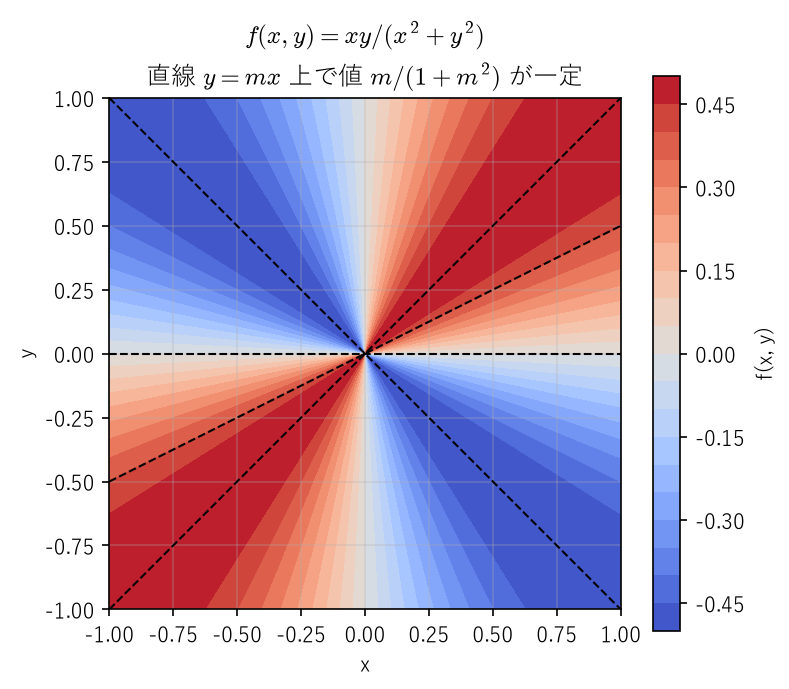
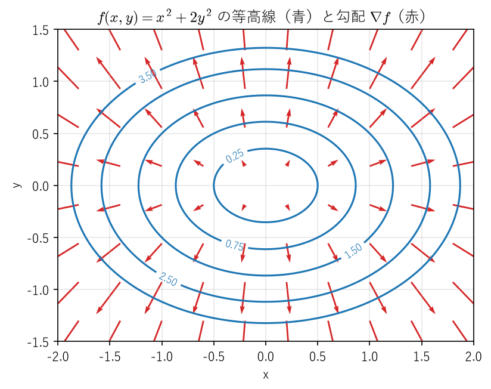
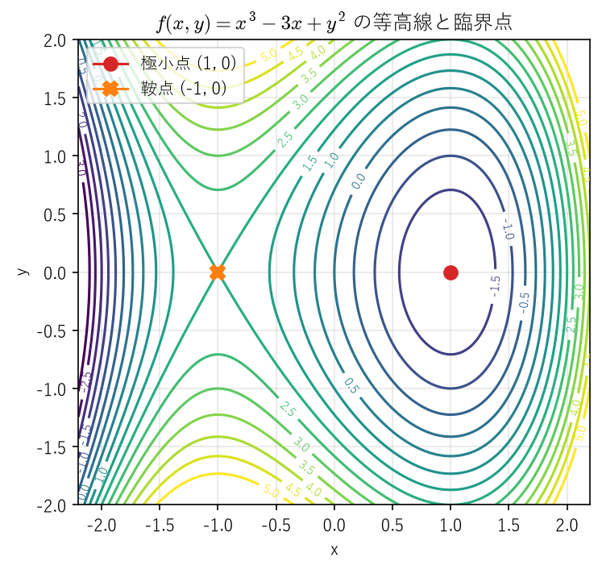
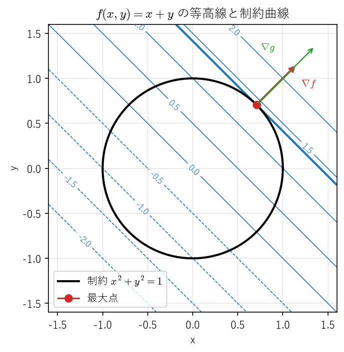
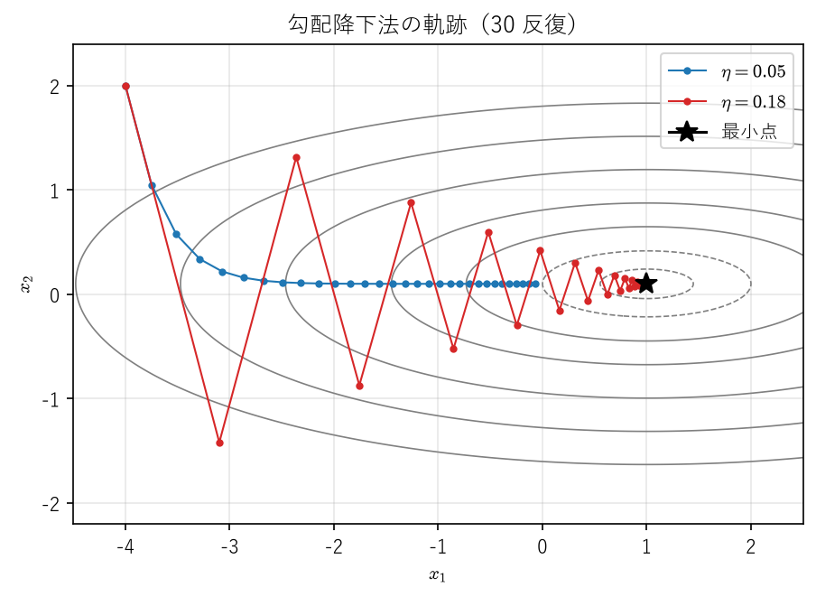

多変数関数の微分
================

工学で扱う量の多くは、複数の変数に依存する。構造物の応力は位置の 3 つの座標に依存し、機械学習の損失関数は数百万個のパラメータに依存する。本章では、これまで 1 変数関数について学んだ極限・連続性・微分の理論を、多変数関数に拡張する。1 変数の場合と同じように見える議論の多くはそのまま成り立つが、「偏微分可能なのに連続でない」「微分の順序を入れ替えると値が変わる」といった、多変数に特有の現象も現れる。後半では、テイラーの定理と極値判定、陰関数定理、ラグランジュの未定乗数法、勾配降下法という、最適化や設計の現場で直接使われる道具を扱う。

本章では、ベクトルと行列の基本的な演算（内積、行列の積、行列式、対称行列の固有値）は既知とする。必要に応じて [Saito1966]_ などの線形代数の教科書を参照してほしい。

ℝⁿ の距離と開集合・閉集合
--------------------------

1 変数の解析では、2 点 :math:`x, y` の近さを :math:`|x - y|` で測った。多変数では、これをユークリッドノルムに置き換える。:math:`\mathbb{R}^n` の点（ベクトル）を :math:`\boldsymbol{x} = (x_1, x_2, \ldots, x_n)` と書く。

.. _ch09-def-norm:

.. admonition:: 定義 9.1（内積・ノルム・距離）
   :class: definition

   :math:`\boldsymbol{x}, \boldsymbol{y} \in \mathbb{R}^n` に対して、内積 :math:`\langle \boldsymbol{x}, \boldsymbol{y} \rangle`、ノルム :math:`\|\boldsymbol{x}\|`、距離 :math:`d(\boldsymbol{x}, \boldsymbol{y})` を次で定める。

   .. math::

      \langle \boldsymbol{x}, \boldsymbol{y} \rangle = \sum_{i=1}^{n} x_i y_i, \qquad \|\boldsymbol{x}\| = \sqrt{\langle \boldsymbol{x}, \boldsymbol{x} \rangle} = \sqrt{x_1^2 + \cdots + x_n^2}, \qquad d(\boldsymbol{x}, \boldsymbol{y}) = \|\boldsymbol{x} - \boldsymbol{y}\|

ノルムについて、次の 2 つの不等式が基本となる。

.. _ch09-thm-cauchy-schwarz:

.. admonition:: 定理 9.1（コーシー・シュワルツの不等式と三角不等式）
   :class: theorem

   任意の :math:`\boldsymbol{x}, \boldsymbol{y} \in \mathbb{R}^n` に対して、次が成り立つ。

   .. math::

      |\langle \boldsymbol{x}, \boldsymbol{y} \rangle| \leq \|\boldsymbol{x}\| \, \|\boldsymbol{y}\|, \qquad \|\boldsymbol{x} + \boldsymbol{y}\| \leq \|\boldsymbol{x}\| + \|\boldsymbol{y}\|

.. admonition:: 証明
   :class: proof

   :math:`\boldsymbol{y} = \boldsymbol{0}` のときは、第 1 の不等式の両辺はともに 0 である。:math:`\boldsymbol{y} \neq \boldsymbol{0}` とする。任意の実数 :math:`t` に対して

   .. math::

      0 \leq \|\boldsymbol{x} - t\boldsymbol{y}\|^2 = \|\boldsymbol{y}\|^2 t^2 - 2 \langle \boldsymbol{x}, \boldsymbol{y} \rangle t + \|\boldsymbol{x}\|^2

   が成り立つ。右辺は :math:`t` の 2 次式で常に 0 以上だから、判別式は 0 以下であり、:math:`\langle \boldsymbol{x}, \boldsymbol{y} \rangle^2 - \|\boldsymbol{x}\|^2 \|\boldsymbol{y}\|^2 \leq 0` となる。これが第 1 の不等式である。第 2 の不等式は、第 1 の不等式から

   .. math::

      \|\boldsymbol{x} + \boldsymbol{y}\|^2 = \|\boldsymbol{x}\|^2 + 2 \langle \boldsymbol{x}, \boldsymbol{y} \rangle + \|\boldsymbol{y}\|^2 \leq \|\boldsymbol{x}\|^2 + 2 \|\boldsymbol{x}\| \, \|\boldsymbol{y}\| + \|\boldsymbol{y}\|^2 = (\|\boldsymbol{x}\| + \|\boldsymbol{y}\|)^2

   として得られる。

また、ノルムと各成分の大きさの間には

.. math::
   :label: ch09-eq-norm-component

   |x_i| \leq \|\boldsymbol{x}\| \leq |x_1| + |x_2| + \cdots + |x_n| \qquad (i = 1, \ldots, n)

が成り立つ。左の不等式は定義から明らかであり、右の不等式は :math:`\boldsymbol{x} = x_1 \boldsymbol{e}_1 + \cdots + x_n \boldsymbol{e}_n`\ （:math:`\boldsymbol{e}_i` は第 :math:`i` 成分だけが 1 の単位ベクトル）に三角不等式を繰り返し使えば得られる。

点列 :math:`(\boldsymbol{x}_k)` が点 :math:`\boldsymbol{a}` に収束するとは、:math:`\|\boldsymbol{x}_k - \boldsymbol{a}\| \to 0` となることとする。式 :eq:`ch09-eq-norm-component` から、点列が収束することと、各成分の数列がそれぞれ収束することは同値である。

.. _ch09-def-open:

.. admonition:: 定義 9.2（開球・開集合・閉集合・有界集合）
   :class: definition

   * 点 :math:`\boldsymbol{a}` を中心とする半径 :math:`r > 0` の開球を :math:`B(\boldsymbol{a}, r) = \{\boldsymbol{x} \in \mathbb{R}^n : \|\boldsymbol{x} - \boldsymbol{a}\| < r\}` と書く。
   * 集合 :math:`U \subset \mathbb{R}^n` が開集合であるとは、任意の :math:`\boldsymbol{a} \in U` に対してある :math:`r > 0` が存在し、:math:`B(\boldsymbol{a}, r) \subset U` となることである。
   * 集合 :math:`F \subset \mathbb{R}^n` が閉集合であるとは、補集合 :math:`\mathbb{R}^n \setminus F` が開集合であることである。
   * 集合 :math:`K \subset \mathbb{R}^n` が有界であるとは、ある :math:`R > 0` が存在し、:math:`K \subset B(\boldsymbol{0}, R)` となることである。

開区間 :math:`(a, b)` は :math:`\mathbb{R}` の開集合、閉区間 :math:`[a, b]` は閉集合である。:math:`\mathbb{R}^2` では、不等号 :math:`<` で定まる集合 :math:`\{(x, y) : x^2 + y^2 < 1\}` は開集合、等号を含む :math:`\{(x, y) : x^2 + y^2 \leq 1\}` は閉集合である。開集合では、どの点でも「少し動いても集合からはみ出さない」ので、偏微分のように各方向に少しずらした点を考える議論に都合がよい。

.. _ch09-thm-closed:

.. admonition:: 命題 9.2（閉集合と点列の極限）
   :class: theorem

   :math:`F` を閉集合とする。:math:`F` の点からなる点列 :math:`(\boldsymbol{x}_k)` が :math:`\boldsymbol{a}` に収束するならば、:math:`\boldsymbol{a} \in F` である。

.. admonition:: 証明
   :class: proof

   :math:`\boldsymbol{a} \notin F` と仮定する。補集合は開集合だから、ある :math:`r > 0` に対して :math:`B(\boldsymbol{a}, r)` は :math:`F` と交わらない。一方、:math:`\boldsymbol{x}_k \to \boldsymbol{a}` より、十分大きい :math:`k` で :math:`\boldsymbol{x}_k \in B(\boldsymbol{a}, r)` となる。これは :math:`\boldsymbol{x}_k \in F` に矛盾する。

1 変数の\ :ref:`ボルツァーノ・ワイエルシュトラスの定理 <ch02-thm-bw>`\ は、そのまま :math:`\mathbb{R}^n` に拡張できる。

.. _ch09-thm-bw:

.. admonition:: 定理 9.3（ℝⁿ のボルツァーノ・ワイエルシュトラスの定理）
   :class: theorem

   :math:`\mathbb{R}^n` の有界な点列は、収束する部分列をもつ。

.. admonition:: 証明
   :class: proof

   :math:`(\boldsymbol{x}_k)` を有界な点列とする。式 :eq:`ch09-eq-norm-component` より、各成分の数列も有界である。まず第 1 成分の数列に 1 変数の\ :ref:`ボルツァーノ・ワイエルシュトラスの定理 <ch02-thm-bw>`\ を適用し、第 1 成分が収束する部分列を選ぶ。次に、その部分列の第 2 成分に同じ定理を適用して、さらに部分列を選ぶ。収束する数列の部分列は同じ極限に収束するから、こうして得た部分列では第 1 成分と第 2 成分がともに収束する。これを第 :math:`n` 成分まで繰り返すと、すべての成分が収束する部分列が得られる。これは :math:`\mathbb{R}^n` で収束する部分列である。

有界かつ閉である集合を\ **有界閉集合**\ という。有界閉区間 :math:`[a, b]` や閉円板 :math:`\{(x, y) : x^2 + y^2 \leq 1\}` はその例である。有界閉集合は、次節以降で最大値・最小値の存在や一様連続性を保証する舞台となる。

多変数関数の極限と連続性
------------------------

.. _ch09-def-limit:

.. admonition:: 定義 9.3（多変数関数の極限と連続性）
   :class: definition

   :math:`D \subset \mathbb{R}^n`、:math:`f \colon D \to \mathbb{R}` とし、:math:`\boldsymbol{a}` を :math:`D` の点でいくらでも近づける点（すなわち、任意の :math:`r > 0` に対して :math:`B(\boldsymbol{a}, r)` が :math:`\boldsymbol{a}` 以外の :math:`D` の点を含む点）とする。

   * :math:`\displaystyle \lim_{\boldsymbol{x} \to \boldsymbol{a}} f(\boldsymbol{x}) = \alpha` であるとは、任意の :math:`\varepsilon > 0` に対してある :math:`\delta > 0` が存在し、:math:`\boldsymbol{x} \in D`、:math:`0 < \|\boldsymbol{x} - \boldsymbol{a}\| < \delta` ならば :math:`|f(\boldsymbol{x}) - \alpha| < \varepsilon` となることである。
   * :math:`\boldsymbol{a} \in D` で :math:`f` が連続であるとは、任意の :math:`\varepsilon > 0` に対してある :math:`\delta > 0` が存在し、:math:`\boldsymbol{x} \in D`、:math:`\|\boldsymbol{x} - \boldsymbol{a}\| < \delta` ならば :math:`|f(\boldsymbol{x}) - f(\boldsymbol{a})| < \varepsilon` となることである。:math:`D` のすべての点で連続なとき、:math:`f` は :math:`D` 上で連続であるという。

   値がベクトルである関数 :math:`\boldsymbol{f} \colon D \to \mathbb{R}^m` についても、絶対値をノルムに置き換えて同様に定める。式 :eq:`ch09-eq-norm-component` より、:math:`\boldsymbol{f}` が連続であることと、各成分の関数が連続であることは同値である。

定義の形は 1 変数の ε-δ 論法（:ref:`連続性の定義 <ch04-def-continuity>`）と同じである。違いは、:math:`\boldsymbol{x}` が :math:`\boldsymbol{a}` に近づく方向が無数にあることである。1 変数では左右の 2 方向しかなかったが、平面では直線に沿って近づくことも、放物線に沿って近づくことも、らせん状に近づくこともできる。極限が存在するためには、どのような近づき方でも同じ値に近づかなければならない。

.. _ch09-ex-path:

.. admonition:: 例 9.1（近づく方向によって極限が異なる関数）
   :class: example

   :math:`(x, y) \neq (0, 0)` で :math:`f(x, y) = \dfrac{xy}{x^2 + y^2}` と定める。原点を通る直線 :math:`y = mx` に沿って原点に近づくと、:math:`x \neq 0` で

   .. math::

      f(x, mx) = \frac{m x^2}{x^2 + m^2 x^2} = \frac{m}{1 + m^2}

   となり、値は傾き :math:`m` によって異なる一定値をとる（:numref:`ch09-fig-path-limit`）。:math:`m = 0` なら 0、:math:`m = 1` なら :math:`1/2` である。したがって、:math:`(x, y) \to (0, 0)` のときの極限は存在しない。

.. _ch09-fig-path-limit:

   :math:`f(x, y) = xy/(x^2 + y^2)` の値。原点を通る直線（破線）上では値が一定で、直線ごとに値が異なる。

.. _ch09-ex-parabola:

.. admonition:: 例 9.2（直線に沿った極限だけでは判定できない例）
   :class: example

   :math:`(x, y) \neq (0, 0)` で :math:`g(x, y) = \dfrac{x^2 y}{x^4 + y^2}` と定める。直線 :math:`y = mx` に沿うと、:math:`x \neq 0` で :math:`g(x, mx) = \dfrac{m x}{x^2 + m^2}` であり、:math:`x \to 0` で 0 に近づく（:math:`m = 0` でも値は 0）。:math:`y` 軸に沿っても値は 0 である。ところが、放物線 :math:`y = x^2` に沿うと :math:`g(x, x^2) = \dfrac{x^4}{2x^4} = \dfrac{1}{2}` である。したがって、:math:`(x, y) \to (0, 0)` のときの極限は存在しない。すべての直線に沿った極限が一致しても、極限が存在するとは限らない。

極限が存在することを示すには、例のような特定の経路ではなく、:math:`\|\boldsymbol{x} - \boldsymbol{a}\|` だけで :math:`|f(\boldsymbol{x}) - \alpha|` を上から押さえるのが基本である（問題 9.1）。

1 変数の\ :ref:`最大値・最小値の定理 <ch04-thm-extreme>`\ と、有界閉区間上の連続関数の\ :ref:`一様連続性 <ch04-thm-heine>`\ は、有界閉区間を有界閉集合に置き換えて成り立つ。どちらの証明でも、連続性の次の性質を使う。

  :math:`f` が :math:`\boldsymbol{a} \in D` で連続で、:math:`D` の点列 :math:`(\boldsymbol{x}_k)` が :math:`\boldsymbol{a}` に収束するならば、:math:`f(\boldsymbol{x}_k) \to f(\boldsymbol{a})` である。

実際、任意の :math:`\varepsilon > 0` に対して連続性の定義の :math:`\delta` をとると、十分大きい :math:`k` で :math:`\|\boldsymbol{x}_k - \boldsymbol{a}\| < \delta` となり、:math:`|f(\boldsymbol{x}_k) - f(\boldsymbol{a})| < \varepsilon` が成り立つ。

.. _ch09-thm-extreme:

.. admonition:: 定理 9.4（有界閉集合上の最大値・最小値の定理）
   :class: theorem

   :math:`K \subset \mathbb{R}^n` を空でない有界閉集合とし、:math:`f \colon K \to \mathbb{R}` を連続関数とする。このとき、:math:`f` は :math:`K` 上で最大値と最小値をとる。

.. admonition:: 証明
   :class: proof

   まず :math:`f` が上に有界であることを示す。上に有界でないとすると、各 :math:`k \in \mathbb{N}` に対して :math:`f(\boldsymbol{x}_k) > k` となる :math:`\boldsymbol{x}_k \in K` がとれる。:math:`K` は有界だから、:ref:`定理 9.3 <ch09-thm-bw>` より収束する部分列 :math:`\boldsymbol{x}_{k_j} \to \boldsymbol{a}` がとれ、:ref:`命題 9.2 <ch09-thm-closed>` より :math:`\boldsymbol{a} \in K` である。連続性より :math:`f(\boldsymbol{x}_{k_j}) \to f(\boldsymbol{a})` となるが、:math:`f(\boldsymbol{x}_{k_j}) > k_j \to \infty` だから矛盾である。

   次に :math:`M = \sup_{\boldsymbol{x} \in K} f(\boldsymbol{x})` とおく。上限の性質から、各 :math:`k` に対して :math:`f(\boldsymbol{x}_k) > M - 1/k` となる :math:`\boldsymbol{x}_k \in K` がとれる。上と同様に部分列 :math:`\boldsymbol{x}_{k_j} \to \boldsymbol{a} \in K` をとると、:math:`M - 1/k_j < f(\boldsymbol{x}_{k_j}) \leq M` で :math:`j \to \infty` として :math:`f(\boldsymbol{a}) = M` を得る。よって :math:`f` は :math:`\boldsymbol{a}` で最大値をとる。最小値については :math:`-f` に同じ議論を適用すればよい。

.. _ch09-thm-uniform:

.. admonition:: 定理 9.5（有界閉集合上の連続関数の一様連続性）
   :class: theorem

   :math:`K \subset \mathbb{R}^n` を有界閉集合とし、:math:`f \colon K \to \mathbb{R}` を連続関数とする。このとき :math:`f` は :math:`K` 上で一様連続である。すなわち、任意の :math:`\varepsilon > 0` に対してある :math:`\delta > 0` が存在し、:math:`\boldsymbol{x}, \boldsymbol{y} \in K`、:math:`\|\boldsymbol{x} - \boldsymbol{y}\| < \delta` ならば :math:`|f(\boldsymbol{x}) - f(\boldsymbol{y})| < \varepsilon` となる。

.. admonition:: 証明
   :class: proof

   一様連続でないと仮定すると、ある :math:`\varepsilon > 0` に対して、各 :math:`k \in \mathbb{N}` ごとに :math:`\|\boldsymbol{x}_k - \boldsymbol{y}_k\| < 1/k` かつ :math:`|f(\boldsymbol{x}_k) - f(\boldsymbol{y}_k)| \geq \varepsilon` を満たす :math:`\boldsymbol{x}_k, \boldsymbol{y}_k \in K` がとれる。:ref:`定理 9.3 <ch09-thm-bw>` と\ :ref:`命題 9.2 <ch09-thm-closed>` より、部分列 :math:`\boldsymbol{x}_{k_j} \to \boldsymbol{a} \in K` がとれる。このとき :math:`\|\boldsymbol{y}_{k_j} - \boldsymbol{a}\| \leq \|\boldsymbol{y}_{k_j} - \boldsymbol{x}_{k_j}\| + \|\boldsymbol{x}_{k_j} - \boldsymbol{a}\| \to 0` だから :math:`\boldsymbol{y}_{k_j} \to \boldsymbol{a}` でもある。連続性より :math:`f(\boldsymbol{x}_{k_j}) - f(\boldsymbol{y}_{k_j}) \to f(\boldsymbol{a}) - f(\boldsymbol{a}) = 0` となり、:math:`|f(\boldsymbol{x}_{k_j}) - f(\boldsymbol{y}_{k_j})| \geq \varepsilon` に矛盾する。

偏微分と全微分
--------------

以下、:math:`U \subset \mathbb{R}^n` は開集合とする。:math:`\boldsymbol{e}_i` は第 :math:`i` 成分だけが 1 の単位ベクトルである。

.. _ch09-def-partial:

.. admonition:: 定義 9.4（偏微分）
   :class: definition

   :math:`f \colon U \to \mathbb{R}`、:math:`\boldsymbol{a} \in U` とする。極限

   .. math::

      \frac{\partial f}{\partial x_i}(\boldsymbol{a}) = \lim_{t \to 0} \frac{f(\boldsymbol{a} + t \boldsymbol{e}_i) - f(\boldsymbol{a})}{t}

   が存在するとき、:math:`f` は :math:`\boldsymbol{a}` で :math:`x_i` について偏微分可能であるといい、この値を偏微分係数という。:math:`f_{x_i}(\boldsymbol{a})` とも書く。すべての :math:`i` について偏微分可能なとき、単に偏微分可能であるという。:math:`U` の各点で偏微分係数を対応させる関数を偏導関数という。

偏微分は、:math:`x_i` 以外の変数を定数とみなして 1 変数関数として微分したものである。たとえば :math:`f(x, y) = x^2 y + \sin y` なら :math:`f_x = 2xy`、:math:`f_y = x^2 + \cos y` である。

1 変数では、微分可能な関数は連続であった。しかし偏微分可能性は、連続性すら保証しない。

.. _ch09-ex-partial-discontinuous:

.. admonition:: 例 9.3（偏微分可能だが連続でない関数）
   :class: example

   :ref:`例 9.1 <ch09-ex-path>` の関数に :math:`f(0, 0) = 0` と定めて :math:`\mathbb{R}^2` 全体で定義する。:math:`x` 軸上で :math:`f(t, 0) = 0` だから :math:`f_x(0, 0) = 0`、同様に :math:`f_y(0, 0) = 0` であり、:math:`f` は原点で偏微分可能である。しかし、:ref:`例 9.1 <ch09-ex-path>` で見たように :math:`f` は原点で極限をもたず、連続でない。

偏微分は座標軸の方向の情報しか見ていないため、それ以外の方向の振る舞いを捉えられない。そこで、1 変数の微分の本質である「1 次式による近似」に立ち返って、多変数の微分を定義する。1 変数では、:math:`f` が :math:`a` で微分可能であることは

.. math::

   \lim_{h \to 0} \frac{f(a + h) - f(a) - c h}{h} = 0

となる定数 :math:`c`\ （:math:`= f'(a)`）が存在することと同値であった。これを多変数に拡張する。

.. _ch09-def-total:

.. admonition:: 定義 9.5（全微分可能）
   :class: definition

   :math:`f \colon U \to \mathbb{R}`、:math:`\boldsymbol{a} \in U` とする。あるベクトル :math:`\boldsymbol{c} \in \mathbb{R}^n` が存在して

   .. math::
      :label: ch09-eq-total

      \lim_{\boldsymbol{h} \to \boldsymbol{0}} \frac{f(\boldsymbol{a} + \boldsymbol{h}) - f(\boldsymbol{a}) - \langle \boldsymbol{c}, \boldsymbol{h} \rangle}{\|\boldsymbol{h}\|} = 0

   となるとき、:math:`f` は :math:`\boldsymbol{a}` で全微分可能であるという。値がベクトルである関数 :math:`\boldsymbol{f} \colon U \to \mathbb{R}^m` については、ある :math:`m \times n` 行列 :math:`A` が存在して

   .. math::

      \lim_{\boldsymbol{h} \to \boldsymbol{0}} \frac{\|\boldsymbol{f}(\boldsymbol{a} + \boldsymbol{h}) - \boldsymbol{f}(\boldsymbol{a}) - A \boldsymbol{h}\|}{\|\boldsymbol{h}\|} = 0

   となるとき、全微分可能であるという。

式 :eq:`ch09-eq-total` は、:math:`\boldsymbol{a}` の近くで :math:`f(\boldsymbol{a} + \boldsymbol{h}) \approx f(\boldsymbol{a}) + \langle \boldsymbol{c}, \boldsymbol{h} \rangle` と 1 次式で近似でき、その誤差が :math:`\|\boldsymbol{h}\|` よりも速く 0 に近づくことを表す。2 変数なら、これは曲面 :math:`z = f(x, y)` が点 :math:`(\boldsymbol{a}, f(\boldsymbol{a}))` で接平面をもつことにあたる。以下、本書で単に「微分可能」というときは全微分可能を意味する。

.. _ch09-thm-total-implies:

.. admonition:: 定理 9.6（全微分可能性から従うこと）
   :class: theorem

   :math:`f \colon U \to \mathbb{R}` が :math:`\boldsymbol{a} \in U` で全微分可能ならば、:math:`f` は :math:`\boldsymbol{a}` で連続かつ偏微分可能であり、式 :eq:`ch09-eq-total` のベクトル :math:`\boldsymbol{c}` は

   .. math::

      \boldsymbol{c} = \nabla f(\boldsymbol{a}) = \left( \frac{\partial f}{\partial x_1}(\boldsymbol{a}), \ldots, \frac{\partial f}{\partial x_n}(\boldsymbol{a}) \right)

   で与えられる。:math:`\nabla f(\boldsymbol{a})` を :math:`f` の :math:`\boldsymbol{a}` における勾配という。

.. admonition:: 証明
   :class: proof

   式 :eq:`ch09-eq-total` で :math:`\boldsymbol{h} = t \boldsymbol{e}_i`\ （:math:`t \neq 0`）とすると、:math:`\|\boldsymbol{h}\| = |t|`、:math:`\langle \boldsymbol{c}, \boldsymbol{h} \rangle = c_i t` だから

   .. math::

      \lim_{t \to 0} \left| \frac{f(\boldsymbol{a} + t \boldsymbol{e}_i) - f(\boldsymbol{a})}{t} - c_i \right| = 0

   となる。よって :math:`f` は :math:`x_i` について偏微分可能で、:math:`f_{x_i}(\boldsymbol{a}) = c_i` である。次に、:math:`\boldsymbol{h} \neq \boldsymbol{0}` に対して :math:`r(\boldsymbol{h}) = (f(\boldsymbol{a} + \boldsymbol{h}) - f(\boldsymbol{a}) - \langle \boldsymbol{c}, \boldsymbol{h} \rangle) / \|\boldsymbol{h}\|` とおくと、:ref:`コーシー・シュワルツの不等式 <ch09-thm-cauchy-schwarz>`\ より

   .. math::

      |f(\boldsymbol{a} + \boldsymbol{h}) - f(\boldsymbol{a})| \leq |\langle \boldsymbol{c}, \boldsymbol{h} \rangle| + \|\boldsymbol{h}\| \, |r(\boldsymbol{h})| \leq (\|\boldsymbol{c}\| + |r(\boldsymbol{h})|) \, \|\boldsymbol{h}\|

   である。:math:`\boldsymbol{h} \to \boldsymbol{0}` のとき :math:`r(\boldsymbol{h}) \to 0` だから右辺は 0 に近づき、:math:`f` は :math:`\boldsymbol{a}` で連続である。

全微分可能性を定義から直接確かめるのは手間がかかる。実用上は、次の十分条件を使うことが多い。

.. _ch09-def-ck:

.. admonition:: 定義 9.6（:math:`C^k` 級）
   :class: definition

   :math:`f \colon U \to \mathbb{R}` のすべての偏導関数が :math:`U` 上に存在して連続であるとき、:math:`f` は :math:`C^1` 級であるという。偏導関数をさらに偏微分したものを 2 階偏導関数といい、:math:`k` 階までのすべての偏導関数が存在して連続であるとき、:math:`f` は :math:`C^k` 級であるという。値がベクトルである関数は、各成分が :math:`C^k` 級であるとき :math:`C^k` 級であるという。

.. _ch09-thm-c1:

.. admonition:: 定理 9.7（:math:`C^1` 級関数は全微分可能）
   :class: theorem

   :math:`f \colon U \to \mathbb{R}` が :math:`C^1` 級ならば、:math:`f` は :math:`U` の各点で全微分可能である。

.. admonition:: 証明
   :class: proof

   記号を簡単にするため :math:`n = 2` の場合を示す（一般の :math:`n` でも、座標を 1 つずつ動かして同じ議論を繰り返せばよい）。点を :math:`(a, b) \in U` とし、:math:`B((a, b), r) \subset U` となる :math:`r > 0` をとる。:math:`\|(h, k)\| < r` とし、

   .. math::

      f(a + h, b + k) - f(a, b) = \{ f(a + h, b + k) - f(a, b + k) \} + \{ f(a, b + k) - f(a, b) \}

   と分解する。第 1 項は :math:`x \mapsto f(x, b + k)` の、第 2 項は :math:`y \mapsto f(a, y)` の差である。途中の点 :math:`(a + \theta h, b + k)`、:math:`(a, b + \theta k)`\ （:math:`0 \leq \theta \leq 1`）は中心からの距離が :math:`\|(h, k)\|` 以下なので :math:`U` に含まれる。それぞれに 1 変数の\ :ref:`平均値の定理 <ch05-thm-mvt>`\ を適用すると、ある :math:`\theta_1, \theta_2 \in (0, 1)` が存在して

   .. math::

      f(a + h, b + k) - f(a, b) = f_x(a + \theta_1 h, b + k) \, h + f_y(a, b + \theta_2 k) \, k

   となる（:math:`h = 0` や :math:`k = 0` のときは該当する項が 0 なので、:math:`\theta` は任意にとればよい）。したがって

   .. math::

      \frac{f(a + h, b + k) - f(a, b) - f_x(a, b) h - f_y(a, b) k}{\|(h, k)\|} = \{ f_x(a + \theta_1 h, b + k) - f_x(a, b) \} \frac{h}{\|(h, k)\|} + \{ f_y(a, b + \theta_2 k) - f_y(a, b) \} \frac{k}{\|(h, k)\|}

   である。:math:`|h|, |k| \leq \|(h, k)\|` だから分数の部分は絶対値が 1 以下であり、:math:`f_x, f_y` の連続性から中括弧の部分は :math:`(h, k) \to (0, 0)` で 0 に近づく。よって左辺は 0 に近づき、:math:`f` は :math:`(a, b)` で全微分可能である。

.. _ch09-ex-not-differentiable:

.. admonition:: 例 9.4（連続かつ偏微分可能だが全微分可能でない関数）
   :class: example

   :math:`f(x, y) = \sqrt{|xy|}` は :math:`\mathbb{R}^2` 上で連続である。:math:`f(t, 0) = f(0, t) = 0` だから :math:`f_x(0, 0) = f_y(0, 0) = 0` である。もし原点で全微分可能なら、:ref:`定理 9.6 <ch09-thm-total-implies>` より :math:`\boldsymbol{c} = \nabla f(0, 0) = \boldsymbol{0}` となり、:math:`f(h, k) / \|(h, k)\| \to 0` でなければならない。しかし :math:`h = k = t \neq 0` とすると

   .. math::

      \frac{f(t, t)}{\|(t, t)\|} = \frac{|t|}{\sqrt{2} \, |t|} = \frac{1}{\sqrt{2}}

   であり、0 に近づかない。よって :math:`f` は原点で全微分可能でない。

これまでの関係をまとめると、:numref:`ch09-fig-implications`\ のようになる。実線の矢印の逆はいずれも成り立たない。

.. graphviz::
   :caption: 多変数関数の微分可能性に関する概念の関係（実線は「ならば」、破線は逆が成り立たないことを示す例）
   :name: ch09-fig-implications

   digraph implications {
       rankdir=LR;
       node [shape=box, style="rounded,filled", fillcolor="#eef5fb"];
       c1 [label="C¹ 級"];
       total [label="全微分可能"];
       cont [label="連続"];
       partial [label="偏微分可能"];
       c1 -> total [label="定理 9.7"];
       total -> cont [label="定理 9.6"];
       total -> partial [label="定理 9.6"];
       partial -> cont [style=dashed, color="#c0392b", fontcolor="#c0392b", label="✕ 例 9.3"];
       cont -> total [style=dashed, color="#c0392b", fontcolor="#c0392b", label="✕ 例 9.4"];
   }

連鎖律・勾配・ヤコビ行列
------------------------

値がベクトルである関数 :math:`\boldsymbol{f} = (f_1, \ldots, f_m) \colon U \to \mathbb{R}^m` が全微分可能であることと、各成分 :math:`f_i` が全微分可能であることは同値である（式 :eq:`ch09-eq-norm-component` を誤差のベクトルに適用すればよい）。このとき、:ref:`定義 9.5 <ch09-def-total>` の行列 :math:`A` の第 :math:`i` 行は :math:`\nabla f_i(\boldsymbol{a})` である。

.. _ch09-def-jacobian:

.. admonition:: 定義 9.7（ヤコビ行列）
   :class: definition

   全微分可能な :math:`\boldsymbol{f} \colon U \to \mathbb{R}^m` に対して、:math:`m \times n` 行列

   .. math::

      J_{\boldsymbol{f}}(\boldsymbol{a}) = \begin{pmatrix} \dfrac{\partial f_1}{\partial x_1}(\boldsymbol{a}) & \cdots & \dfrac{\partial f_1}{\partial x_n}(\boldsymbol{a}) \\ \vdots & \ddots & \vdots \\ \dfrac{\partial f_m}{\partial x_1}(\boldsymbol{a}) & \cdots & \dfrac{\partial f_m}{\partial x_n}(\boldsymbol{a}) \end{pmatrix}

   を :math:`\boldsymbol{f}` の :math:`\boldsymbol{a}` におけるヤコビ行列という。:math:`m = n` のとき、その行列式 :math:`\det J_{\boldsymbol{f}}(\boldsymbol{a})` をヤコビアンという。

ヤコビ行列は、:math:`\boldsymbol{a}` の近くで :math:`\boldsymbol{f}(\boldsymbol{a} + \boldsymbol{h}) \approx \boldsymbol{f}(\boldsymbol{a}) + J_{\boldsymbol{f}}(\boldsymbol{a}) \boldsymbol{h}` と近似する線形写像を表す。この見方をすると、合成関数の微分は線形写像の合成、すなわち行列の積になる。

証明では、行列 :math:`M = (m_{ij})` に対する不等式

.. math::
   :label: ch09-eq-frobenius

   \|M \boldsymbol{v}\| \leq \|M\|_F \, \|\boldsymbol{v}\|, \qquad \|M\|_F = \sqrt{\sum_{i, j} m_{ij}^2}

を使う。これは :math:`M \boldsymbol{v}` の第 :math:`i` 成分（:math:`M` の第 :math:`i` 行と :math:`\boldsymbol{v}` の内積）に\ :ref:`コーシー・シュワルツの不等式 <ch09-thm-cauchy-schwarz>`\ を適用し、:math:`i` について和をとれば得られる。:math:`\|M\|_F` をフロベニウスノルムという。

.. _ch09-thm-chain:

.. admonition:: 定理 9.8（連鎖律）
   :class: theorem

   :math:`U \subset \mathbb{R}^n`、:math:`V \subset \mathbb{R}^m` を開集合とし、:math:`\boldsymbol{g} \colon U \to \mathbb{R}^m` は :math:`\boldsymbol{g}(U) \subset V` を満たし、:math:`\boldsymbol{f} \colon V \to \mathbb{R}^l` とする。:math:`\boldsymbol{g}` が :math:`\boldsymbol{a} \in U` で全微分可能、:math:`\boldsymbol{f}` が :math:`\boldsymbol{b} = \boldsymbol{g}(\boldsymbol{a})` で全微分可能ならば、合成関数 :math:`\boldsymbol{f} \circ \boldsymbol{g}` は :math:`\boldsymbol{a}` で全微分可能であり、

   .. math::

      J_{\boldsymbol{f} \circ \boldsymbol{g}}(\boldsymbol{a}) = J_{\boldsymbol{f}}(\boldsymbol{b}) \, J_{\boldsymbol{g}}(\boldsymbol{a})

   が成り立つ。

.. admonition:: 証明
   :class: proof

   :math:`A = J_{\boldsymbol{g}}(\boldsymbol{a})`、:math:`B = J_{\boldsymbol{f}}(\boldsymbol{b})` とおく。全微分可能性より、

   .. math::

      \boldsymbol{g}(\boldsymbol{a} + \boldsymbol{h}) = \boldsymbol{b} + A \boldsymbol{h} + \|\boldsymbol{h}\| \boldsymbol{\rho}(\boldsymbol{h}), \qquad \boldsymbol{f}(\boldsymbol{b} + \boldsymbol{k}) = \boldsymbol{f}(\boldsymbol{b}) + B \boldsymbol{k} + \|\boldsymbol{k}\| \boldsymbol{\sigma}(\boldsymbol{k})

   と書ける。ここで :math:`\boldsymbol{\rho}(\boldsymbol{h}) \to \boldsymbol{0}`\ （:math:`\boldsymbol{h} \to \boldsymbol{0}`）、:math:`\boldsymbol{\sigma}(\boldsymbol{k}) \to \boldsymbol{0}`\ （:math:`\boldsymbol{k} \to \boldsymbol{0}`）であり、:math:`\boldsymbol{\rho}(\boldsymbol{0}) = \boldsymbol{0}`、:math:`\boldsymbol{\sigma}(\boldsymbol{0}) = \boldsymbol{0}` と定めておく。:math:`\boldsymbol{k} = \boldsymbol{g}(\boldsymbol{a} + \boldsymbol{h}) - \boldsymbol{b} = A \boldsymbol{h} + \|\boldsymbol{h}\| \boldsymbol{\rho}(\boldsymbol{h})` とおくと、

   .. math::

      \boldsymbol{f}(\boldsymbol{g}(\boldsymbol{a} + \boldsymbol{h})) - \boldsymbol{f}(\boldsymbol{b}) - B A \boldsymbol{h} = \|\boldsymbol{h}\| B \boldsymbol{\rho}(\boldsymbol{h}) + \|\boldsymbol{k}\| \boldsymbol{\sigma}(\boldsymbol{k})

   である。両辺のノルムを :math:`\|\boldsymbol{h}\|` で割る。右辺第 1 項は式 :eq:`ch09-eq-frobenius` より :math:`\|B\|_F \|\boldsymbol{\rho}(\boldsymbol{h})\|` 以下で 0 に近づく。第 2 項については、:math:`\|\boldsymbol{k}\| / \|\boldsymbol{h}\| \leq \|A\|_F + \|\boldsymbol{\rho}(\boldsymbol{h})\|` は有界であり、:math:`\boldsymbol{h} \to \boldsymbol{0}` のとき :math:`\boldsymbol{k} \to \boldsymbol{0}` だから :math:`\boldsymbol{\sigma}(\boldsymbol{k}) \to \boldsymbol{0}` である。よって全体が 0 に近づき、:math:`\boldsymbol{f} \circ \boldsymbol{g}` は全微分可能でヤコビ行列は :math:`BA` である。

成分で書くと、:math:`z = f(y_1, \ldots, y_m)`、:math:`y_j = g_j(x_1, \ldots, x_n)` のとき

.. math::

   \frac{\partial z}{\partial x_i} = \sum_{j=1}^{m} \frac{\partial z}{\partial y_j} \frac{\partial y_j}{\partial x_i}

である。特に、曲線 :math:`t \mapsto (x(t), y(t))` に沿った 2 変数関数の値の変化率は

.. math::
   :label: ch09-eq-chain-curve

   \frac{d}{dt} f(x(t), y(t)) = f_x(x(t), y(t)) \, x'(t) + f_y(x(t), y(t)) \, y'(t)

となる。

勾配の幾何学的な意味は、連鎖律から次のように分かる。

.. _ch09-thm-directional:

.. admonition:: 系 9.9（方向微分と勾配）
   :class: theorem

   :math:`f \colon U \to \mathbb{R}` が :math:`\boldsymbol{a}` で全微分可能で、:math:`\boldsymbol{u}` を単位ベクトル（:math:`\|\boldsymbol{u}\| = 1`）とする。このとき、:math:`\boldsymbol{u}` 方向の方向微分

   .. math::

      D_{\boldsymbol{u}} f(\boldsymbol{a}) = \lim_{t \to 0} \frac{f(\boldsymbol{a} + t \boldsymbol{u}) - f(\boldsymbol{a})}{t}

   が存在して :math:`D_{\boldsymbol{u}} f(\boldsymbol{a}) = \langle \nabla f(\boldsymbol{a}), \boldsymbol{u} \rangle` となる。:math:`\nabla f(\boldsymbol{a}) \neq \boldsymbol{0}` のとき、:math:`D_{\boldsymbol{u}} f(\boldsymbol{a})` を最大にする方向は :math:`\boldsymbol{u} = \nabla f(\boldsymbol{a}) / \|\nabla f(\boldsymbol{a})\|`、最小にする方向はその逆向きである。

.. admonition:: 証明
   :class: proof

   :math:`\boldsymbol{g}(t) = \boldsymbol{a} + t \boldsymbol{u}` のヤコビ行列は :math:`\boldsymbol{u}`\ （:math:`n \times 1` 行列）だから、:ref:`連鎖律 <ch09-thm-chain>`\ より :math:`t \mapsto f(\boldsymbol{a} + t \boldsymbol{u})` は :math:`t = 0` で微分可能で、微分係数は :math:`\langle \nabla f(\boldsymbol{a}), \boldsymbol{u} \rangle` である。:ref:`コーシー・シュワルツの不等式 <ch09-thm-cauchy-schwarz>`\ より :math:`-\|\nabla f(\boldsymbol{a})\| \leq \langle \nabla f(\boldsymbol{a}), \boldsymbol{u} \rangle \leq \|\nabla f(\boldsymbol{a})\|` であり、上限は :math:`\boldsymbol{u} = \nabla f(\boldsymbol{a}) / \|\nabla f(\boldsymbol{a})\|`、下限はその逆向きのときに達成される。

すなわち、勾配 :math:`\nabla f` は関数が最も急に増加する方向を向き、その大きさが増加率である。また、等高線 :math:`f(x, y) = c` 上を動く曲線 :math:`(x(t), y(t))` に対しては :math:`f(x(t), y(t))` が一定だから、式 :eq:`ch09-eq-chain-curve` より :math:`\langle \nabla f, (x'(t), y'(t)) \rangle = 0` である。つまり、勾配は等高線と直交する（:numref:`ch09-fig-gradient`）。この性質は、後で扱うラグランジュの未定乗数法や勾配降下法の基礎になる。

.. _ch09-fig-gradient:

   :math:`f(x, y) = x^2 + 2y^2` の等高線と勾配ベクトル。勾配は等高線に直交し、値が増える向きを指す。

高階偏導関数とシュワルツの定理
------------------------------

偏導関数をさらに偏微分すると、2 階偏導関数が得られる。本書では、先に :math:`x` で、次に :math:`y` で偏微分したものを

.. math::

   \frac{\partial^2 f}{\partial y \, \partial x} = \frac{\partial}{\partial y} \left( \frac{\partial f}{\partial x} \right)

と書く（右から順に偏微分する）。2 変数関数には :math:`\dfrac{\partial^2 f}{\partial x^2}`、:math:`\dfrac{\partial^2 f}{\partial y \, \partial x}`、:math:`\dfrac{\partial^2 f}{\partial x \, \partial y}`、:math:`\dfrac{\partial^2 f}{\partial y^2}` の 4 つの 2 階偏導関数がある。微分の順序を入れ替えた 2 つは、通常の関数では一致するが、いつでも一致するわけではない。

.. _ch09-ex-schwarz-counter:

.. admonition:: 例 9.5（偏微分の順序を交換できない関数）
   :class: example

   :math:`(x, y) \neq (0, 0)` で :math:`f(x, y) = \dfrac{xy(x^2 - y^2)}{x^2 + y^2}`、:math:`f(0, 0) = 0` と定める。:math:`y` を固定して :math:`x = 0` における :math:`x` についての偏微分係数を求めると、:math:`f(0, y) = 0` だから

   .. math::

      f_x(0, y) = \lim_{h \to 0} \frac{f(h, y)}{h} = \lim_{h \to 0} \frac{y (h^2 - y^2)}{h^2 + y^2} = -y

   となる（:math:`y = 0` でも成り立つ）。したがって :math:`\dfrac{\partial^2 f}{\partial y \, \partial x}(0, 0) = -1` である。同様に :math:`f_y(x, 0) = \displaystyle \lim_{k \to 0} \frac{f(x, k)}{k} = x` だから、:math:`\dfrac{\partial^2 f}{\partial x \, \partial y}(0, 0) = 1` である。2 つは一致しない。

この関数の 2 階偏導関数は原点で連続でない。2 階偏導関数が連続ならば、順序の交換が許される。

.. _ch09-thm-schwarz:

.. admonition:: 定理 9.10（シュワルツの定理）
   :class: theorem

   :math:`U \subset \mathbb{R}^2` を開集合とし、:math:`f \colon U \to \mathbb{R}` を :math:`C^2` 級とする。このとき :math:`U` 上で

   .. math::

      \frac{\partial^2 f}{\partial y \, \partial x} = \frac{\partial^2 f}{\partial x \, \partial y}

   が成り立つ。

.. admonition:: 証明
   :class: proof

   :math:`(a, b) \in U` を固定し、:math:`(a, b)` を中心とする開球で :math:`U` に含まれるものをとる。:math:`h, k \neq 0` を十分小さくとり、4 点 :math:`(a, b)`、:math:`(a + h, b)`、:math:`(a, b + k)`、:math:`(a + h, b + k)` を頂点とする長方形がこの開球に含まれるようにする。

   .. math::

      \Delta = f(a + h, b + k) - f(a + h, b) - f(a, b + k) + f(a, b)

   を 2 通りに計算する。まず :math:`\varphi(x) = f(x, b + k) - f(x, b)` とおくと :math:`\Delta = \varphi(a + h) - \varphi(a)` である。:ref:`平均値の定理 <ch05-thm-mvt>`\ より、ある :math:`\theta_1 \in (0, 1)` が存在して

   .. math::

      \Delta = h \varphi'(a + \theta_1 h) = h \{ f_x(a + \theta_1 h, b + k) - f_x(a + \theta_1 h, b) \}

   となる。中括弧内は :math:`y \mapsto f_x(a + \theta_1 h, y)` の差だから、もう一度平均値の定理を使うと、ある :math:`\theta_2 \in (0, 1)` が存在して

   .. math::

      \Delta = h k \frac{\partial^2 f}{\partial y \, \partial x}(a + \theta_1 h, b + \theta_2 k)

   となる。同様に :math:`\psi(y) = f(a + h, y) - f(a, y)` とおいて :math:`\Delta = \psi(b + k) - \psi(b)` に平均値の定理を 2 回使うと、ある :math:`\theta_3, \theta_4 \in (0, 1)` が存在して

   .. math::

      \Delta = h k \frac{\partial^2 f}{\partial x \, \partial y}(a + \theta_4 h, b + \theta_3 k)

   となる。2 つの式を :math:`hk` で割って等置し、:math:`(h, k) \to (0, 0)` とすると、2 階偏導関数の連続性より :math:`\dfrac{\partial^2 f}{\partial y \, \partial x}(a, b) = \dfrac{\partial^2 f}{\partial x \, \partial y}(a, b)` を得る。

この定理を繰り返し使うと、:math:`n` 変数の :math:`C^k` 級関数の :math:`k` 階までの偏導関数は、偏微分する変数の順序によらないことが分かる。工学で扱う関数の多くは :math:`C^2` 級なので、普段は順序を気にせず計算してよい。

多変数のテイラーの定理と極値
----------------------------

:math:`C^2` 級関数 :math:`f \colon U \to \mathbb{R}` に対して、2 階偏導関数を並べた :math:`n \times n` 行列

.. math::

   H_f(\boldsymbol{x}) = \left( \frac{\partial^2 f}{\partial x_i \, \partial x_j}(\boldsymbol{x}) \right)_{i, j = 1, \ldots, n}

をヘッセ行列という。:ref:`シュワルツの定理 <ch09-thm-schwarz>`\ より、ヘッセ行列は対称行列である。

.. _ch09-thm-taylor:

.. admonition:: 定理 9.11（多変数のテイラーの定理）
   :class: theorem

   :math:`f \colon U \to \mathbb{R}` を :math:`C^2` 級とし、:math:`\boldsymbol{a} \in U` と :math:`\boldsymbol{h} \in \mathbb{R}^n` について、線分 :math:`\{\boldsymbol{a} + t \boldsymbol{h} : 0 \leq t \leq 1\}` が :math:`U` に含まれるとする。このとき、ある :math:`\theta \in (0, 1)` が存在して

   .. math::
      :label: ch09-eq-taylor

      f(\boldsymbol{a} + \boldsymbol{h}) = f(\boldsymbol{a}) + \langle \nabla f(\boldsymbol{a}), \boldsymbol{h} \rangle + \frac{1}{2} \boldsymbol{h}^{\mathsf{T}} H_f(\boldsymbol{a} + \theta \boldsymbol{h}) \, \boldsymbol{h}

   が成り立つ。

.. admonition:: 証明
   :class: proof

   :math:`U` は開集合だから、ある :math:`\eta > 0` に対して :math:`-\eta < t < 1 + \eta` で :math:`\boldsymbol{a} + t \boldsymbol{h} \in U` となる。この範囲で :math:`\varphi(t) = f(\boldsymbol{a} + t \boldsymbol{h})` とおく。:math:`f` は :math:`C^1` 級だから\ :ref:`定理 9.7 <ch09-thm-c1>` より全微分可能であり、:ref:`連鎖律 <ch09-thm-chain>`\ より

   .. math::

      \varphi'(t) = \sum_{i=1}^{n} \frac{\partial f}{\partial x_i}(\boldsymbol{a} + t \boldsymbol{h}) \, h_i

   である。各 :math:`\partial f / \partial x_i` も :math:`C^1` 級だから、もう一度連鎖律を使って

   .. math::

      \varphi''(t) = \sum_{i=1}^{n} \sum_{j=1}^{n} \frac{\partial^2 f}{\partial x_j \, \partial x_i}(\boldsymbol{a} + t \boldsymbol{h}) \, h_i h_j = \boldsymbol{h}^{\mathsf{T}} H_f(\boldsymbol{a} + t \boldsymbol{h}) \, \boldsymbol{h}

   を得る。:math:`\varphi''` は連続である。1 変数の\ :ref:`テイラーの定理 <ch06-thm-taylor>`\ を 2 次の剰余項の形で :math:`\varphi` に適用すると、ある :math:`\theta \in (0, 1)` が存在して :math:`\varphi(1) = \varphi(0) + \varphi'(0) + \frac{1}{2} \varphi''(\theta)` となる。これが式 :eq:`ch09-eq-taylor` である。

1 変数のときと同様に、極値の候補は導関数が 0 になる点である。

.. _ch09-def-extremum:

.. admonition:: 定義 9.8（極大・極小）
   :class: definition

   :math:`f \colon U \to \mathbb{R}`、:math:`\boldsymbol{a} \in U` とする。ある :math:`r > 0` が存在して、:math:`\boldsymbol{x} \in B(\boldsymbol{a}, r) \cap U` ならば :math:`f(\boldsymbol{x}) \geq f(\boldsymbol{a})` となるとき、:math:`f` は :math:`\boldsymbol{a}` で極小であるという。さらに :math:`\boldsymbol{x} \neq \boldsymbol{a}` で :math:`f(\boldsymbol{x}) > f(\boldsymbol{a})` となるとき、狭義の極小という。不等号を逆にして極大を定める。極大と極小をあわせて極値という。

.. _ch09-thm-critical:

.. admonition:: 定理 9.12（極値の必要条件）
   :class: theorem

   :math:`f \colon U \to \mathbb{R}` が :math:`\boldsymbol{a} \in U` で偏微分可能で、:math:`\boldsymbol{a}` で極値をとるならば、:math:`\nabla f(\boldsymbol{a}) = \boldsymbol{0}` である。

.. admonition:: 証明
   :class: proof

   各 :math:`i` について :math:`g(t) = f(\boldsymbol{a} + t \boldsymbol{e}_i)` とおくと、:math:`g` は :math:`t = 0` で極値をとり、:math:`t = 0` で微分可能で :math:`g'(0) = f_{x_i}(\boldsymbol{a})` である。1 変数の場合の結果（:ref:`補題 5.7 <ch05-lem-fermat>`）より :math:`g'(0) = 0`、すなわち :math:`f_{x_i}(\boldsymbol{a}) = 0` である。

:math:`\nabla f(\boldsymbol{a}) = \boldsymbol{0}` となる点を臨界点（停留点）という。臨界点が極値かどうかは、テイラーの定理の 2 次の項、すなわちヘッセ行列で判定する。対称行列 :math:`A` は、任意の :math:`\boldsymbol{h} \neq \boldsymbol{0}` に対して :math:`\boldsymbol{h}^{\mathsf{T}} A \boldsymbol{h} > 0` となるとき正定値、:math:`\boldsymbol{h}^{\mathsf{T}} A \boldsymbol{h} < 0` となるとき負定値という。また、:math:`\boldsymbol{h}^{\mathsf{T}} A \boldsymbol{h}` が正の値も負の値もとるとき不定という。線形代数で学ぶように、対称行列は直交行列で対角化でき、正定値であることとすべての固有値が正であることは同値である。さらに、最小の固有値を :math:`\lambda_{\min}` とすると、任意の :math:`\boldsymbol{h}` に対して :math:`\boldsymbol{h}^{\mathsf{T}} A \boldsymbol{h} \geq \lambda_{\min} \|\boldsymbol{h}\|^2` が成り立つ [Saito1966]_。

.. _ch09-thm-hessian:

.. admonition:: 定理 9.13（ヘッセ行列による極値の判定）
   :class: theorem

   :math:`f \colon U \to \mathbb{R}` を :math:`C^2` 級とし、:math:`\boldsymbol{a} \in U` で :math:`\nabla f(\boldsymbol{a}) = \boldsymbol{0}` とする。

   1. :math:`H_f(\boldsymbol{a})` が正定値ならば、:math:`f` は :math:`\boldsymbol{a}` で狭義の極小となる。
   2. :math:`H_f(\boldsymbol{a})` が負定値ならば、:math:`f` は :math:`\boldsymbol{a}` で狭義の極大となる。
   3. :math:`H_f(\boldsymbol{a})` が不定ならば、:math:`f` は :math:`\boldsymbol{a}` で極値をとらない。

.. admonition:: 証明
   :class: proof

   (1) :math:`H_f(\boldsymbol{a})` の最小の固有値を :math:`\lambda > 0` とすると、:math:`\boldsymbol{h}^{\mathsf{T}} H_f(\boldsymbol{a}) \boldsymbol{h} \geq \lambda \|\boldsymbol{h}\|^2` である。2 階偏導関数は連続だから、ある :math:`r > 0` が存在して、:math:`B(\boldsymbol{a}, r) \subset U` かつ :math:`\boldsymbol{x} \in B(\boldsymbol{a}, r)` ならば :math:`\|H_f(\boldsymbol{x}) - H_f(\boldsymbol{a})\|_F < \lambda / 2` となる。:math:`0 < \|\boldsymbol{h}\| < r` とする。開球は線分 :math:`\boldsymbol{a} + t\boldsymbol{h}`\ （:math:`0 \leq t \leq 1`）を含むから、:ref:`テイラーの定理 <ch09-thm-taylor>`\ と :math:`\nabla f(\boldsymbol{a}) = \boldsymbol{0}` より、ある :math:`\theta \in (0, 1)` に対して

   .. math::

      f(\boldsymbol{a} + \boldsymbol{h}) - f(\boldsymbol{a}) = \frac{1}{2} \boldsymbol{h}^{\mathsf{T}} H_f(\boldsymbol{a}) \boldsymbol{h} + \frac{1}{2} \boldsymbol{h}^{\mathsf{T}} \{ H_f(\boldsymbol{a} + \theta \boldsymbol{h}) - H_f(\boldsymbol{a}) \} \boldsymbol{h}

   となる。:ref:`コーシー・シュワルツの不等式 <ch09-thm-cauchy-schwarz>`\ と式 :eq:`ch09-eq-frobenius` より、行列 :math:`M` について :math:`|\boldsymbol{h}^{\mathsf{T}} M \boldsymbol{h}| \leq \|\boldsymbol{h}\| \, \|M \boldsymbol{h}\| \leq \|M\|_F \|\boldsymbol{h}\|^2` だから、

   .. math::

      f(\boldsymbol{a} + \boldsymbol{h}) - f(\boldsymbol{a}) \geq \frac{\lambda}{2} \|\boldsymbol{h}\|^2 - \frac{\lambda}{4} \|\boldsymbol{h}\|^2 = \frac{\lambda}{4} \|\boldsymbol{h}\|^2 > 0

   である。よって :math:`\boldsymbol{a}` は狭義の極小点である。

   (2) :math:`-f` に (1) を適用すればよい。

   (3) :math:`\boldsymbol{v}^{\mathsf{T}} H_f(\boldsymbol{a}) \boldsymbol{v} > 0`、:math:`\boldsymbol{w}^{\mathsf{T}} H_f(\boldsymbol{a}) \boldsymbol{w} < 0` となる :math:`\boldsymbol{v}, \boldsymbol{w}` をとる。テイラーの定理より、十分小さい :math:`t \neq 0` で、ある :math:`\theta \in (0, 1)` に対して

   .. math::

      f(\boldsymbol{a} + t \boldsymbol{v}) - f(\boldsymbol{a}) = \frac{t^2}{2} \boldsymbol{v}^{\mathsf{T}} H_f(\boldsymbol{a} + \theta t \boldsymbol{v}) \boldsymbol{v}

   であり、2 階偏導関数の連続性より、:math:`|t|` が十分小さければ右辺は正である。同様に :math:`f(\boldsymbol{a} + t \boldsymbol{w}) - f(\boldsymbol{a}) < 0` である。したがって、:math:`\boldsymbol{a}` のいくらでも近くに :math:`f(\boldsymbol{a})` より大きい値と小さい値をとる点があり、:math:`\boldsymbol{a}` は極値点でない。

(3) の点は、ある方向には谷、別の方向には山になっており、鞍点と呼ばれる。ヘッセ行列が正定値・負定値・不定のいずれでもない場合（固有値に 0 があり、残りの符号がそろっている場合）は、この定理では判定できない。たとえば :math:`x^4 + y^4` と :math:`x^4 - y^4` は、どちらも原点でヘッセ行列が零行列だが、前者は極小、後者は鞍点である。

2 変数の場合、:math:`H = \begin{pmatrix} p & q \\ q & r \end{pmatrix}` に対して :math:`Q(h, k) = ph^2 + 2qhk + rk^2` の符号を調べればよい。:math:`p \neq 0` なら

.. math::

   Q(h, k) = p \left( h + \frac{q}{p} k \right)^2 + \frac{pr - q^2}{p} k^2

と平方完成できる。これから、:math:`pr - q^2 > 0` かつ :math:`p > 0` なら正定値、:math:`pr - q^2 > 0` かつ :math:`p < 0` なら負定値である。:math:`pr - q^2 < 0` なら、:math:`k = 0` とした値の符号は :math:`p` と同じ、:math:`h = -qk/p` とした値の符号は :math:`p` と逆になるから不定である。:math:`p = 0` で :math:`pr - q^2 < 0` のときは :math:`q \neq 0` であり、:math:`k = 1` として :math:`h` を正負の大きな値にとれば :math:`Q = 2qh + r` は正負どちらの値もとるから不定である。:math:`\det H = pr - q^2` は 2 つの固有値の積である。

.. _ch09-ex-critical:

.. admonition:: 例 9.6（極小点と鞍点）
   :class: example

   :math:`f(x, y) = x^3 - 3x + y^2` とする。:math:`\nabla f = (3x^2 - 3, 2y)` だから、臨界点は :math:`(1, 0)` と :math:`(-1, 0)` である。ヘッセ行列は

   .. math::

      H_f(x, y) = \begin{pmatrix} 6x & 0 \\ 0 & 2 \end{pmatrix}

   である。:math:`(1, 0)` では固有値が :math:`6, 2` で正定値だから狭義の極小で、極小値は :math:`f(1, 0) = -2` である。:math:`(-1, 0)` では固有値が :math:`-6, 2` で不定だから鞍点である（:numref:`ch09-fig-critical`）。なお、:math:`f(x, 0) = x^3 - 3x \to -\infty`\ （:math:`x \to -\infty`）だから、極小値 :math:`-2` は最小値ではない。極値は局所的な概念である。

.. _ch09-fig-critical:

   :math:`f(x, y) = x^3 - 3x + y^2` の等高線。極小点 :math:`(1, 0)` の周りでは等高線が閉じた曲線になり、鞍点 :math:`(-1, 0)` では等高線が交差する。

陰関数定理と逆関数定理
----------------------

方程式 :math:`F(x, y) = 0` が与えられたとき、これを :math:`y` について解いて :math:`y = \varphi(x)` と表せるだろうか。たとえば円 :math:`x^2 + y^2 - 1 = 0` は、全体としては 1 つの関数のグラフではないが、点 :math:`(0, 1)` の近くでは :math:`y = \sqrt{1 - x^2}` と表せる。一方、点 :math:`(1, 0)` の近くでは、どれほど範囲を狭めても :math:`y` を :math:`x` の関数として表せない（1 つの :math:`x < 1` に対して :math:`y` が 2 つある）。この違いは、:math:`F_y = 2y` が 0 かどうかにある。

.. _ch09-thm-implicit:

.. admonition:: 定理 9.14（陰関数定理：2 変数の場合）
   :class: theorem

   :math:`U \subset \mathbb{R}^2` を開集合、:math:`F \colon U \to \mathbb{R}` を :math:`C^1` 級とし、:math:`(a, b) \in U` で :math:`F(a, b) = 0`、:math:`F_y(a, b) \neq 0` とする。このとき、:math:`a` を含む開区間 :math:`I` と :math:`b` を含む開区間 :math:`J` で :math:`I \times J \subset U` となるものと、:math:`C^1` 級関数 :math:`\varphi \colon I \to J` が存在して、次が成り立つ。

   * :math:`(x, y) \in I \times J` について、:math:`F(x, y) = 0` であることと :math:`y = \varphi(x)` であることは同値である。
   * :math:`x \in I` に対して

     .. math::
        :label: ch09-eq-implicit

        \varphi'(x) = -\frac{F_x(x, \varphi(x))}{F_y(x, \varphi(x))}

.. admonition:: 証明
   :class: proof

   :math:`F_y(a, b) > 0` の場合を示す（負の場合は :math:`-F` を考えればよい）。

   **関数の存在と一意性。**\ :math:`F_y` は連続だから、ある :math:`\delta_0, \varepsilon > 0` が存在して、閉長方形 :math:`R = [a - \delta_0, a + \delta_0] \times [b - \varepsilon, b + \varepsilon]` は :math:`U` に含まれ、:math:`R` 上で :math:`F_y > 0` となる。すると :math:`y \mapsto F(a, y)` は :math:`[b - \varepsilon, b + \varepsilon]` で狭義単調増加であり、:math:`F(a, b) = 0` だから :math:`F(a, b - \varepsilon) < 0 < F(a, b + \varepsilon)` である。:math:`F` は連続だから、ある :math:`\delta \in (0, \delta_0]` が存在して、:math:`|x - a| < \delta` ならば :math:`F(x, b - \varepsilon) < 0 < F(x, b + \varepsilon)` となる。:math:`I = (a - \delta, a + \delta)`、:math:`J = (b - \varepsilon, b + \varepsilon)` とおく。各 :math:`x \in I` について、:math:`y \mapsto F(x, y)` は :math:`[b - \varepsilon, b + \varepsilon]` で狭義単調増加かつ連続で、両端で符号が変わる。:ref:`中間値の定理 <ch04-thm-ivt>`\ より :math:`F(x, y) = 0` となる :math:`y \in J` が存在し、狭義単調増加だからそれはただ 1 つである。これを :math:`\varphi(x)` とおけば、1 つ目の主張が成り立つ。

   **連続性。**\ :math:`x_0 \in I` とし、:math:`y_0 = \varphi(x_0)` とする。任意の :math:`\varepsilon' > 0` に対して、:math:`[y_0 - \varepsilon', y_0 + \varepsilon'] \subset J` となるように :math:`\varepsilon'` を小さくとり直しておく。:math:`y \mapsto F(x_0, y)` は狭義単調増加だから :math:`F(x_0, y_0 - \varepsilon') < 0 < F(x_0, y_0 + \varepsilon')` であり、:math:`F` の連続性より、:math:`x_0` に十分近い :math:`x \in I` では :math:`F(x, y_0 - \varepsilon') < 0 < F(x, y_0 + \varepsilon')` となる。このような :math:`x` では、上と同じ議論により :math:`\varphi(x) \in (y_0 - \varepsilon', y_0 + \varepsilon')` である。よって :math:`\varphi` は :math:`x_0` で連続である。

   **微分可能性。**\ :math:`x, x + h \in I`、:math:`h \neq 0` とし、:math:`k = \varphi(x + h) - \varphi(x)` とおく。:math:`g(t) = F(x + th, \varphi(x) + tk)` は、線分が :math:`R` に含まれる（:math:`R` は長方形だから、2 点を結ぶ線分を含む）ので :math:`[0, 1]` 上で定義され、:math:`F` は :math:`C^1` 級だから\ :ref:`連鎖律 <ch09-thm-chain>`\ により微分可能である。:math:`g(0) = g(1) = 0` だから、:ref:`平均値の定理 <ch05-thm-mvt>`\ より、ある :math:`\tau \in (0, 1)` で

   .. math::

      0 = g'(\tau) = F_x(\xi, \eta) \, h + F_y(\xi, \eta) \, k, \qquad (\xi, \eta) = (x + \tau h, \varphi(x) + \tau k)

   となる。:math:`F_y(\xi, \eta) > 0` だから :math:`k / h = -F_x(\xi, \eta) / F_y(\xi, \eta)` である。:math:`h \to 0` のとき、:math:`\varphi` の連続性より :math:`k \to 0` だから :math:`(\xi, \eta) \to (x, \varphi(x))` であり、:math:`F_x, F_y` の連続性より式 :eq:`ch09-eq-implicit` を得る。右辺は :math:`x` の連続関数だから、:math:`\varphi` は :math:`C^1` 級である。

式 :eq:`ch09-eq-implicit` 自体は、:math:`F(x, \varphi(x)) = 0` の両辺を :math:`x` で微分して、連鎖律から :math:`F_x + F_y \varphi' = 0` としても得られる。定理の要点は、:math:`F_y \neq 0` という条件だけで、そのような :math:`\varphi` が局所的に存在することを保証する点にある。円の例では、:math:`b \neq 0` の点 :math:`(a, b)` の近くで :math:`\varphi'(x) = -x / y` となり、:math:`F_y = 0` となる :math:`(\pm 1, 0)` では接線が垂直になって、:math:`y` を :math:`x` の関数として表せない。

陰関数定理は、一般の次元に次のように拡張される。

.. _ch09-thm-implicit-general:

.. admonition:: 定理 9.15（陰関数定理：一般の場合）
   :class: theorem

   :math:`U \subset \mathbb{R}^n \times \mathbb{R}^m` を開集合、:math:`\boldsymbol{F} \colon U \to \mathbb{R}^m` を :math:`C^1` 級とし、:math:`(\boldsymbol{a}, \boldsymbol{b}) \in U` で :math:`\boldsymbol{F}(\boldsymbol{a}, \boldsymbol{b}) = \boldsymbol{0}` とする。:math:`\boldsymbol{y} = (y_1, \ldots, y_m)` に関するヤコビ行列 :math:`\left( \partial F_i / \partial y_j (\boldsymbol{a}, \boldsymbol{b}) \right)` が正則ならば、:math:`\boldsymbol{a}` の近くで定義された :math:`C^1` 級関数 :math:`\boldsymbol{\varphi}` で :math:`\boldsymbol{\varphi}(\boldsymbol{a}) = \boldsymbol{b}` を満たすものがただ 1 つ存在し、:math:`(\boldsymbol{a}, \boldsymbol{b})` の近くでは :math:`\boldsymbol{F}(\boldsymbol{x}, \boldsymbol{y}) = \boldsymbol{0}` と :math:`\boldsymbol{y} = \boldsymbol{\varphi}(\boldsymbol{x})` が同値になる。

.. _ch09-thm-inverse:

.. admonition:: 定理 9.16（逆関数定理）
   :class: theorem

   :math:`U \subset \mathbb{R}^n` を開集合、:math:`\boldsymbol{f} \colon U \to \mathbb{R}^n` を :math:`C^1` 級とし、:math:`\boldsymbol{a} \in U` で :math:`\det J_{\boldsymbol{f}}(\boldsymbol{a}) \neq 0` とする。このとき、:math:`\boldsymbol{a}` を含む開集合 :math:`V \subset U` と :math:`\boldsymbol{f}(\boldsymbol{a})` を含む開集合 :math:`W` が存在して、:math:`\boldsymbol{f}` は :math:`V` から :math:`W` への全単射となり、その逆写像 :math:`\boldsymbol{f}^{-1} \colon W \to V` は :math:`C^1` 級で、:math:`J_{\boldsymbol{f}^{-1}}(\boldsymbol{f}(\boldsymbol{x})) = J_{\boldsymbol{f}}(\boldsymbol{x})^{-1}`\ （:math:`\boldsymbol{x} \in V`）が成り立つ。

これら 2 つの定理は互いに他方から導くことができる。証明には、縮小写像の原理（:ref:`定理 4.10 <ch04-thm-contraction>`\ の多次元版。反復 :math:`\boldsymbol{x}_{k+1} = T(\boldsymbol{x}_k)` が収束することを保証する定理）を使う方法が標準的である。詳しい証明は [Sugiura1980]_ や [Spivak1965]_ を参照してほしい。

逆関数定理の意味は、「1 次近似（ヤコビ行列）が逆行列をもつならば、元の写像も局所的に逆写像をもつ」ということである。たとえば極座標 :math:`\boldsymbol{f}(r, \theta) = (r \cos \theta, r \sin \theta)` のヤコビ行列は

.. math::

   J_{\boldsymbol{f}}(r, \theta) = \begin{pmatrix} \cos \theta & -r \sin \theta \\ \sin \theta & r \cos \theta \end{pmatrix}, \qquad \det J_{\boldsymbol{f}}(r, \theta) = r

であり、:math:`r > 0` の各点の近くで逆写像が存在する。ただし :math:`\boldsymbol{f}(r, \theta + 2\pi) = \boldsymbol{f}(r, \theta)` だから、:math:`r > 0` 全体で単射になるわけではない。逆関数定理が保証するのは、あくまで局所的な逆写像である。工学の例では、ロボットアームの関節角から手先の位置を求める写像のヤコビアンが 0 になる姿勢（特異姿勢）の近くで、手先の位置から関節角を求める逆運動学の計算が不安定になる。これは、ヤコビ行列が逆行列をもたなくなることの現れである。

ラグランジュの未定乗数法
------------------------

設計や最適化では、制約条件の下で関数の最大・最小を求める問題がよく現れる。たとえば「周の長さが一定の長方形で面積を最大にする」「予算の制約の下で性能を最大にする」といった問題である。

.. _ch09-thm-lagrange:

.. admonition:: 定理 9.17（ラグランジュの未定乗数法：2 変数・制約 1 個の場合）
   :class: theorem

   :math:`U \subset \mathbb{R}^2` を開集合、:math:`f, g \colon U \to \mathbb{R}` を :math:`C^1` 級とし、:math:`S = \{(x, y) \in U : g(x, y) = 0\}` とする。:math:`f` を :math:`S` に制限した関数が点 :math:`(a, b) \in S` で極値をとり、:math:`\nabla g(a, b) \neq \boldsymbol{0}` ならば、ある実数 :math:`\lambda` が存在して

   .. math::
      :label: ch09-eq-lagrange

      \nabla f(a, b) = \lambda \nabla g(a, b)

   が成り立つ。

.. admonition:: 証明
   :class: proof

   :math:`\nabla g(a, b) \neq \boldsymbol{0}` だから、:math:`g_y(a, b) \neq 0` または :math:`g_x(a, b) \neq 0` である。:math:`g_y(a, b) \neq 0` の場合を示す（他方は :math:`x` と :math:`y` の役割を入れ替えればよい）。:ref:`陰関数定理 <ch09-thm-implicit>`\ より、開区間 :math:`I \ni a`、:math:`J \ni b` と :math:`C^1` 級関数 :math:`\varphi \colon I \to J` が存在して、:math:`S \cap (I \times J) = \{(x, \varphi(x)) : x \in I\}` であり、:math:`\varphi'(a) = -g_x(a, b) / g_y(a, b)` である。:math:`f` は :math:`S` 上で :math:`(a, b)` において極値をとるから、:math:`h(x) = f(x, \varphi(x))` は :math:`x = a` で極値をとる。:math:`h` は微分可能だから\ :ref:`補題 5.7 <ch05-lem-fermat>`\ より :math:`h'(a) = 0` であり、連鎖律より

   .. math::

      0 = h'(a) = f_x(a, b) + f_y(a, b) \varphi'(a) = f_x(a, b) - f_y(a, b) \frac{g_x(a, b)}{g_y(a, b)}

   となる。:math:`\lambda = f_y(a, b) / g_y(a, b)` とおくと、:math:`f_x(a, b) = \lambda g_x(a, b)`、:math:`f_y(a, b) = \lambda g_y(a, b)` であり、式 :eq:`ch09-eq-lagrange` が成り立つ。

式 :eq:`ch09-eq-lagrange` は、極値点では :math:`f` の勾配と :math:`g` の勾配が平行であることを意味する。勾配は等高線に直交するから、これは「極値点では :math:`f` の等高線と制約曲線 :math:`g = 0` が接する」ことと言い換えられる（:numref:`ch09-fig-lagrange`）。接していなければ、制約曲線に沿って動くことで :math:`f` の値をさらに増やしたり減らしたりできるからである。実際の計算では、:math:`L(x, y, \lambda) = f(x, y) - \lambda g(x, y)` とおいて、:math:`L_x = L_y = 0` と :math:`g = 0` の 3 つの方程式を連立して解く。:math:`\lambda` をラグランジュ乗数という。

一般に、:math:`n` 変数関数 :math:`f` を :math:`m` 個の制約 :math:`g_1 = \cdots = g_m = 0`\ （:math:`m < n`）の下で考えるとき、:math:`\nabla g_1, \ldots, \nabla g_m` が極値点で 1 次独立ならば、:math:`\nabla f = \lambda_1 \nabla g_1 + \cdots + \lambda_m \nabla g_m` となる :math:`\lambda_1, \ldots, \lambda_m` が存在する。証明は一般の\ :ref:`陰関数定理 <ch09-thm-implicit-general>`\ を使って同様に行える。

.. _ch09-ex-lagrange:

.. admonition:: 例 9.7（円周上の最大・最小）
   :class: example

   円周 :math:`x^2 + y^2 = 1` 上で :math:`f(x, y) = x + y` の最大値と最小値を求める。:math:`g(x, y) = x^2 + y^2 - 1` とおくと、円周上で :math:`\nabla g = (2x, 2y) \neq \boldsymbol{0}` である。:math:`\nabla f = \lambda \nabla g` より :math:`1 = 2\lambda x`、:math:`1 = 2\lambda y` だから :math:`\lambda \neq 0` かつ :math:`x = y` であり、:math:`g = 0` と合わせて :math:`(x, y) = \pm (1/\sqrt{2}, 1/\sqrt{2})` を得る。ここで注意すべきは、:ref:`定理 9.17 <ch09-thm-lagrange>` は極値点であるための必要条件しか与えないことである。円周は有界閉集合で :math:`f` は連続だから、:ref:`定理 9.4 <ch09-thm-extreme>` より最大値と最小値は存在し、それらは上の 2 点のいずれかでとられる。値を比べて、最大値は :math:`f(1/\sqrt{2}, 1/\sqrt{2}) = \sqrt{2}`、最小値は :math:`-\sqrt{2}` である。

.. _ch09-fig-lagrange:

   :math:`f(x, y) = x + y` の等高線（青）と制約曲線 :math:`x^2 + y^2 = 1`\ （黒）。最大点では等高線が制約曲線に接し、:math:`\nabla f` と :math:`\nabla g` が平行になる。

勾配降下法
----------

多くの工学的な最適化問題では、臨界点の方程式 :math:`\nabla f = \boldsymbol{0}` を手計算で解くことはできない。機械学習のモデルの学習、最小二乗法によるパラメータの推定、構造の形状最適化などでは、反復法によって最小点に近づいていく。その最も基本的な方法が勾配降下法である [BoydVandenberghe2004]_。:ref:`系 9.9 <ch09-thm-directional>` で見たように、:math:`-\nabla f` は :math:`f` が最も急に減少する方向だから、その方向に少しずつ進めばよい。

.. math::
   :label: ch09-eq-gd

   \boldsymbol{x}_{k+1} = \boldsymbol{x}_k - \eta \nabla f(\boldsymbol{x}_k) \qquad (k = 0, 1, 2, \ldots)

正の定数 :math:`\eta` をステップ幅（機械学習では学習率）という。:ref:`テイラーの定理 <ch09-thm-taylor>`\ より :math:`f(\boldsymbol{x} - \eta \nabla f(\boldsymbol{x})) = f(\boldsymbol{x}) - \eta \|\nabla f(\boldsymbol{x})\|^2 + O(\eta^2)` だから、:math:`\nabla f(\boldsymbol{x}) \neq \boldsymbol{0}` かつ :math:`\eta` が十分小さければ関数値は減少する。しかし :math:`\eta` が小さすぎると収束が遅く、大きすぎると発散する。この兼ね合いを、2 次関数の場合に正確に調べる。

.. _ch09-thm-gd:

.. admonition:: 定理 9.18（2 次関数に対する勾配降下法の収束）
   :class: theorem

   :math:`A` を :math:`n \times n` の対称正定値行列、:math:`\boldsymbol{b} \in \mathbb{R}^n` とし、:math:`f(\boldsymbol{x}) = \frac{1}{2} \boldsymbol{x}^{\mathsf{T}} A \boldsymbol{x} - \boldsymbol{b}^{\mathsf{T}} \boldsymbol{x}` とする。:math:`A` の最小固有値を :math:`\mu`、最大固有値を :math:`L` とする。このとき :math:`f` は :math:`\boldsymbol{x}^* = A^{-1} \boldsymbol{b}` で最小となり、:math:`0 < \eta < 2/L` ならば、式 :eq:`ch09-eq-gd` の点列は任意の初期点 :math:`\boldsymbol{x}_0` から

   .. math::

      \|\boldsymbol{x}_k - \boldsymbol{x}^*\| \leq \rho^k \|\boldsymbol{x}_0 - \boldsymbol{x}^*\|, \qquad \rho = \max\{ |1 - \eta \mu|, |1 - \eta L| \} < 1

   を満たし、:math:`\boldsymbol{x}^*` に収束する。

.. admonition:: 証明
   :class: proof

   :math:`A` は対称だから :math:`\nabla f(\boldsymbol{x}) = A \boldsymbol{x} - \boldsymbol{b}` である。:math:`A \boldsymbol{x}^* = \boldsymbol{b}` を使うと、直接の計算により

   .. math::

      f(\boldsymbol{x}) - f(\boldsymbol{x}^*) = \frac{1}{2} (\boldsymbol{x} - \boldsymbol{x}^*)^{\mathsf{T}} A (\boldsymbol{x} - \boldsymbol{x}^*)

   が確かめられる。:math:`A` は正定値だから右辺は :math:`\boldsymbol{x} \neq \boldsymbol{x}^*` で正であり、:math:`\boldsymbol{x}^*` は最小点である。次に、式 :eq:`ch09-eq-gd` から

   .. math::

      \boldsymbol{x}_{k+1} - \boldsymbol{x}^* = \boldsymbol{x}_k - \boldsymbol{x}^* - \eta (A \boldsymbol{x}_k - A \boldsymbol{x}^*) = (I - \eta A)(\boldsymbol{x}_k - \boldsymbol{x}^*)

   である。:math:`I - \eta A` は対称行列で、固有値は :math:`1 - \eta \lambda_i`\ （:math:`\lambda_i` は :math:`A` の固有値）である。正規直交な固有ベクトルの基底でベクトルを展開すると、対称行列 :math:`M` について :math:`\|M \boldsymbol{v}\| \leq (\max_i |M \text{ の固有値}|) \|\boldsymbol{v}\|` が成り立つ [Saito1966]_。:math:`\mu \leq \lambda_i \leq L` だから :math:`\max_i |1 - \eta \lambda_i| = \rho` であり、:math:`\|\boldsymbol{x}_{k+1} - \boldsymbol{x}^*\| \leq \rho \|\boldsymbol{x}_k - \boldsymbol{x}^*\|` を得る。これを繰り返せば主張の不等式となる。最後に、:math:`0 < \eta < 2/L` ならば :math:`0 < \eta\mu \leq \eta L < 2` だから :math:`|1 - \eta\mu| < 1` かつ :math:`|1 - \eta L| < 1` であり、:math:`\rho < 1` である。

:math:`\rho` は :math:`\eta = 2/(\mu + L)` のとき最小となり、そのとき :math:`\rho = (L - \mu)/(L + \mu) = (\kappa - 1)/(\kappa + 1)` である。ここで :math:`\kappa = L / \mu` を行列 :math:`A` の条件数という（「\ :doc:`taylor`\ 」で扱った関数の条件数とは別の量である）。:math:`\kappa` が大きい、つまり等高線が細長い楕円になる問題ほど、勾配降下法の収束は遅くなる。逆に :math:`\eta > 2/L` では :math:`|1 - \eta L| > 1` となり、最大固有値に対応する固有ベクトルの方向の誤差成分が反復ごとに拡大するので、初期誤差がその方向の成分をもてば発散する。なお、:math:`\nabla f(\boldsymbol{x}) - \nabla f(\boldsymbol{y}) = A(\boldsymbol{x} - \boldsymbol{y})` より :math:`\|\nabla f(\boldsymbol{x}) - \nabla f(\boldsymbol{y})\| \leq L \|\boldsymbol{x} - \boldsymbol{y}\|` が成り立つので、:math:`L` は勾配 :math:`\nabla f` のリプシッツ定数（:doc:`continuity`\ 参照）でもある。一般の関数に対する勾配降下法の解析でも、勾配のリプシッツ定数 :math:`L` に対して :math:`\eta < 2/L` という条件が現れる。

一般の :math:`C^2` 級関数でも、ヘッセ行列が正定値な極小点の近くでは、テイラーの定理により関数が 2 次関数で近似されるので、同様の振る舞いが見られる。

数値実験
^^^^^^^^

:math:`A = \begin{pmatrix} 1 & 0 \\ 0 & 10 \end{pmatrix}`\ （:math:`\mu = 1`、:math:`L = 10`、:math:`\kappa = 10`）、:math:`\boldsymbol{b} = (1, 1)` として、いくつかのステップ幅で勾配降下法を実行する。最小点は :math:`\boldsymbol{x}^* = (1, 0.1)` である。プログラムは :download:`ch09_gradient_descent.py <../examples/ch09_gradient_descent.py>` からダウンロードできる。

.. literalinclude:: ../examples/ch09_gradient_descent.py
   :language: python
   :linenos:
   :caption: ch09_gradient_descent.py

実行結果を次に示す。``rate`` は\ :ref:`定理 9.18 <ch09-thm-gd>` の :math:`\rho`、``k=…`` の列は :math:`k` 回反復後の誤差 :math:`\|\boldsymbol{x}_k - \boldsymbol{x}^*\|` である。

.. code-block:: text
   :linenos:

   最小点 x* = [1.  0.1], 固有値 mu = 1.0, L = 10.0
   収束する条件: 0 < eta < 2/L = 0.2
   最適なステップ幅: 2/(mu+L) = 0.1818

   eta      rate   k=0        k=10       k=20       k=30       k=40       k=50
   0.0500   0.950  5.35e+00   2.99e+00   1.79e+00   1.07e+00   6.43e-01   3.85e-01
   0.1500   0.850  5.35e+00   9.84e-01   1.94e-01   3.82e-02   7.51e-03   1.48e-03
   0.1818   0.818  5.35e+00   7.19e-01   9.67e-02   1.30e-02   1.75e-03   2.35e-04
   0.2100   1.100  5.35e+00   4.95e+00   1.28e+01   3.32e+01   8.60e+01   2.23e+02

:math:`\eta = 0.05` では :math:`\rho = 0.95` で、誤差は 50 回の反復でも 1 桁程度しか減らない。最適なステップ幅 :math:`\eta = 2/11 \approx 0.1818` では :math:`\rho = 9/11 \approx 0.818` で、10 回の反復ごとに誤差がおよそ :math:`0.818^{10} \approx 0.13` 倍になっている。:math:`\eta = 0.21 > 2/L` では誤差が増大し、発散している。

:numref:`ch09-fig-gd` は、:math:`\eta = 0.05` と :math:`\eta = 0.18` の軌跡である。:math:`\eta = 0.05` では、固有値 10 に対応する :math:`x_2` 方向の誤差はすぐに消えるが、固有値 1 に対応する :math:`x_1` 方向にはゆっくりとしか進まない。:math:`\eta = 0.18` では :math:`1 - 0.18 \times 10 = -0.8` が負なので、:math:`x_2` 方向の誤差が符号を変えながら減少し、軌跡はジグザグになるが、全体としては速く収束する。

.. _ch09-fig-gd:

   2 次関数に対する勾配降下法の軌跡（初期点 :math:`(-4, 2)`、30 反復）。

まとめ
------

* :math:`\mathbb{R}^n` の距離はユークリッドノルムで測る。有界閉集合上の連続関数は最大値・最小値をとり、一様連続である。
* 多変数関数の極限は、あらゆる近づき方で同じ値に近づく必要がある。すべての直線に沿った極限が一致しても、極限が存在するとは限らない。
* 偏微分可能性は連続性すら保証しない。多変数の微分の本質は全微分可能性（1 次近似の存在）であり、:math:`C^1` 級ならば全微分可能である。
* 合成関数のヤコビ行列は、ヤコビ行列の積になる（連鎖律）。勾配は関数が最も急に増加する方向を向き、等高線に直交する。
* :math:`C^2` 級関数では偏微分の順序を交換できる（シュワルツの定理）。臨界点が極値かどうかは、ヘッセ行列の定値性で判定できる。
* 陰関数定理と逆関数定理は、ヤコビ行列が正則ならば方程式が局所的に解けることを保証する。
* 制約付きの極値問題では、極値点で目的関数の勾配と制約関数の勾配が平行になる（ラグランジュの未定乗数法）。
* 勾配降下法の収束はステップ幅とヘッセ行列の固有値で決まり、条件数が大きいほど遅くなる。

演習問題
--------

.. admonition:: 問題 9.1
   :class: exercise

   :math:`(x, y) \neq (0, 0)` で :math:`f(x, y) = \dfrac{x^2 y^2}{x^2 + y^2}` とする。ε-δ 論法により :math:`\displaystyle \lim_{(x, y) \to (0, 0)} f(x, y) = 0` を示せ。

.. admonition:: 問題 9.2
   :class: exercise

   :math:`f(x, y) = x^2 y + e^{xy}` について、点 :math:`(1, 0)` における勾配と、単位ベクトル :math:`\boldsymbol{u} = (3/5, 4/5)` 方向の方向微分を求めよ。

.. admonition:: 問題 9.3
   :class: exercise

   :math:`f(x, y) = x^2 + xy + y^2 - 3x` の臨界点を求め、極値かどうかを判定せよ。

.. admonition:: 問題 9.4
   :class: exercise

   ラグランジュの未定乗数法を用いて、円周 :math:`x^2 + y^2 = 1` 上における :math:`f(x, y) = xy` の最大値と最小値を求めよ。

.. admonition:: 問題 9.5
   :class: exercise

   :math:`C^1` 級関数 :math:`f(x, y)` に極座標 :math:`x = r \cos \theta`、:math:`y = r \sin \theta` を代入した関数を :math:`F(r, \theta) = f(r \cos \theta, r \sin \theta)` とする。連鎖律を用いて :math:`F_r, F_\theta` を :math:`f_x, f_y` で表し、:math:`r > 0` で :math:`f_x^2 + f_y^2 = F_r^2 + \dfrac{1}{r^2} F_\theta^2` が成り立つことを示せ。

.. admonition:: 問題 9.6
   :class: exercise

   :math:`f(x, y) = \frac{1}{2}(x^2 + 10 y^2)` に勾配降下法を適用する。任意の初期点から収束するステップ幅 :math:`\eta` の範囲と、:ref:`定理 9.18 <ch09-thm-gd>` の :math:`\rho` を最小にする :math:`\eta` およびそのときの :math:`\rho` を求めよ。

略解
----

.. admonition:: 問題 9.1 の略解
   :class: solution

   :math:`y^2 \leq x^2 + y^2` だから :math:`|f(x, y)| \leq x^2 \leq x^2 + y^2 = \|(x, y)\|^2` である。任意の :math:`\varepsilon > 0` に対して :math:`\delta = \sqrt{\varepsilon}` とおけば、:math:`0 < \|(x, y)\| < \delta` のとき :math:`|f(x, y) - 0| < \delta^2 = \varepsilon` となる。

.. admonition:: 問題 9.2 の略解
   :class: solution

   :math:`f_x = 2xy + y e^{xy}`、:math:`f_y = x^2 + x e^{xy}` だから :math:`\nabla f(1, 0) = (0, 2)` である。:ref:`系 9.9 <ch09-thm-directional>` より、方向微分は :math:`\langle (0, 2), (3/5, 4/5) \rangle = 8/5` である。

.. admonition:: 問題 9.3 の略解
   :class: solution

   :math:`f_x = 2x + y - 3 = 0`、:math:`f_y = x + 2y = 0` を解いて、臨界点は :math:`(2, -1)` である。ヘッセ行列は :math:`\begin{pmatrix} 2 & 1 \\ 1 & 2 \end{pmatrix}` で、:math:`p = 2 > 0`、:math:`pr - q^2 = 3 > 0` だから正定値である。よって :math:`(2, -1)` で狭義の極小となり、極小値は :math:`f(2, -1) = -3` である。

.. admonition:: 問題 9.4 の略解
   :class: solution

   :math:`g = x^2 + y^2 - 1` とおくと、円周上で :math:`\nabla g \neq \boldsymbol{0}` である。:math:`\nabla f = (y, x) = \lambda (2x, 2y)` より :math:`y = 2\lambda x`、:math:`x = 2\lambda y` であり、:math:`x = 4\lambda^2 x` を得る。:math:`x = 0` なら :math:`y = 0` となり円周上にないから、:math:`\lambda = \pm 1/2`、すなわち :math:`y = \pm x` である。候補は :math:`(\pm 1/\sqrt{2}, \pm 1/\sqrt{2})`\ （複号任意）の 4 点で、:math:`f` の値は :math:`x, y` が同符号なら :math:`1/2`、異符号なら :math:`-1/2` である。円周は有界閉集合だから最大値・最小値が存在し、最大値は :math:`1/2`、最小値は :math:`-1/2` である。

.. admonition:: 問題 9.5 の略解
   :class: solution

   連鎖律より :math:`F_r = f_x \cos \theta + f_y \sin \theta`、:math:`F_\theta = -f_x r \sin \theta + f_y r \cos \theta` である。よって

   .. math::

      F_r^2 + \frac{1}{r^2} F_\theta^2 = (f_x \cos \theta + f_y \sin \theta)^2 + (-f_x \sin \theta + f_y \cos \theta)^2 = f_x^2 + f_y^2

   となる（交差項は打ち消し合い、:math:`\cos^2 \theta + \sin^2 \theta = 1` を使う）。

.. admonition:: 問題 9.6 の略解
   :class: solution

   :math:`A = \begin{pmatrix} 1 & 0 \\ 0 & 10 \end{pmatrix}`、:math:`\boldsymbol{b} = \boldsymbol{0}` の場合で、:math:`\mu = 1`、:math:`L = 10` である。誤差の各成分は反復ごとに :math:`1 - \eta` 倍、:math:`1 - 10\eta` 倍になるから、任意の初期点から収束する条件は :math:`|1 - \eta| < 1` かつ :math:`|1 - 10\eta| < 1`、すなわち :math:`0 < \eta < 1/5` である。:math:`\rho` を最小にするのは :math:`\eta = 2/(1 + 10) = 2/11` で、そのとき :math:`\rho = 9/11` である。
