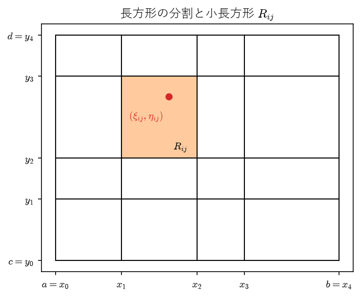
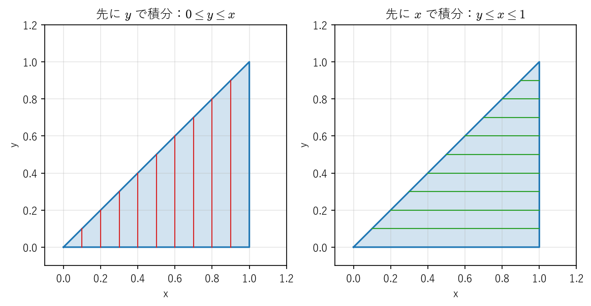
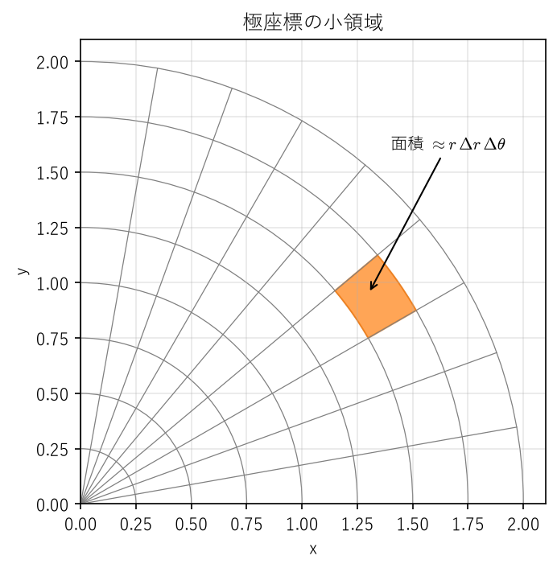
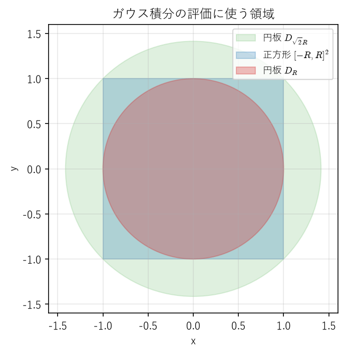
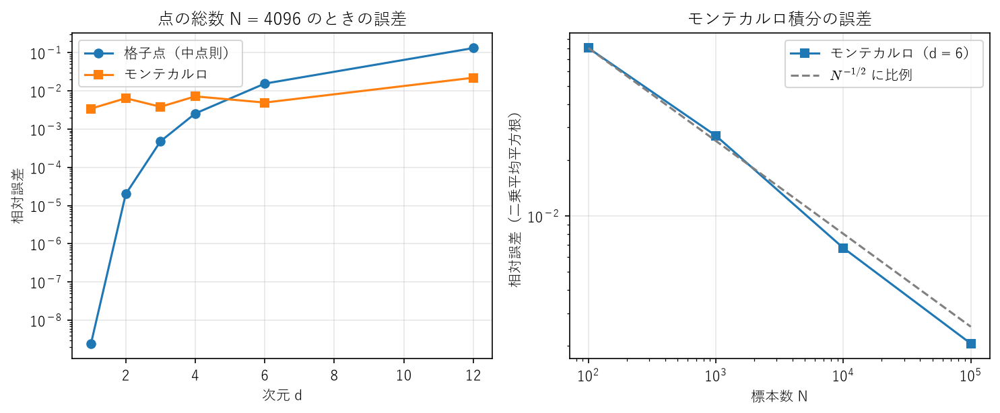

多変数関数の積分
================

平板の質量、断面の慣性モーメント、確率分布の正規化定数、流体が面を通過する流量など、工学で計算する量の多くは多変数関数の積分で表される。本章では、1 変数の\ :ref:`リーマン積分 <ch07-def-riemann>`\ と同じ考え方で、長方形上の重積分を定義する。そのうえで、重積分を 1 変数の積分の繰り返し（累次積分）で計算できることを保証するフビニの定理と、極座標などへの変数変換の公式を扱う。応用として、正規分布の基礎となるガウス積分を計算する。最後に、高次元の積分で格子点による数値積分が破綻する「次元の呪い」と、それを回避するモンテカルロ積分を紹介する。

本章では、主に 2 変数の場合を扱う。3 変数以上でも、定義と定理は同じ形で成り立つ。

長方形上の重積分
----------------

1 変数の定積分は、区間を小区間に分け、各小区間で「関数値 × 幅」を足し合わせた和の極限として定義した。2 変数では、長方形を小長方形に分け、「関数値 × 面積」を足し合わせる。:math:`f \geq 0` なら、これは曲面 :math:`z = f(x, y)` の下にある立体の体積を、細い角柱の体積の和で近似することにあたる。

.. _ch10-def-double:

.. admonition:: 定義 10.1（長方形上の重積分）
   :class: definition

   長方形 :math:`R = [a, b] \times [c, d]` 上の有界な関数 :math:`f \colon R \to \mathbb{R}` を考える。

   * :math:`a = x_0 < x_1 < \cdots < x_p = b`、:math:`c = y_0 < y_1 < \cdots < y_q = d` をとり、:math:`R` を小長方形 :math:`R_{ij} = [x_{i-1}, x_i] \times [y_{j-1}, y_j]` に分けたものを :math:`R` の分割 :math:`\Delta` という。:math:`R_{ij}` の面積を :math:`|R_{ij}| = (x_i - x_{i-1})(y_j - y_{j-1})`、小長方形の対角線の長さの最大値を :math:`|\Delta|` と書く。
   * :math:`M_{ij} = \sup_{R_{ij}} f`、:math:`m_{ij} = \inf_{R_{ij}} f` とおき、上限和と下限和を次で定める。

     .. math::

        U(f, \Delta) = \sum_{i=1}^{p} \sum_{j=1}^{q} M_{ij} |R_{ij}|, \qquad L(f, \Delta) = \sum_{i=1}^{p} \sum_{j=1}^{q} m_{ij} |R_{ij}|

   * 各 :math:`R_{ij}` から代表点 :math:`(\xi_{ij}, \eta_{ij})` を選んだときの和 :math:`S(f, \Delta) = \sum_{i, j} f(\xi_{ij}, \eta_{ij}) |R_{ij}|` をリーマン和という。
   * あらゆる分割にわたる下限和の上限と上限和の下限が一致するとき、すなわち :math:`\sup_{\Delta} L(f, \Delta) = \inf_{\Delta} U(f, \Delta)` のとき、:math:`f` は :math:`R` 上で積分可能であるといい、この共通の値を :math:`f` の :math:`R` 上の重積分と呼んで次のように書く。

     .. math::

        \iint_R f(x, y) \,dx\,dy

.. _ch10-fig-riemann:

   長方形 :math:`R` の分割。小長方形 :math:`R_{ij}` から代表点 :math:`(\xi_{ij}, \eta_{ij})` を選ぶ。

1 変数の場合と同様に、分割を細かくすると下限和は増え、上限和は減る。

.. _ch10-thm-refine:

.. admonition:: 補題 10.1（分割の細分と上限和・下限和）
   :class: theorem

   (1) 分割 :math:`\Delta` に分点を追加して得られる分割を :math:`\Delta'` とすると、:math:`L(f, \Delta) \leq L(f, \Delta') \leq U(f, \Delta') \leq U(f, \Delta)` である。

   (2) 任意の 2 つの分割 :math:`\Delta_1, \Delta_2` に対して :math:`L(f, \Delta_1) \leq U(f, \Delta_2)` である。特に :math:`\sup_{\Delta} L(f, \Delta) \leq \inf_{\Delta} U(f, \Delta)` が成り立つ。

.. admonition:: 証明
   :class: proof

   (1) :math:`x` 方向に分点を 1 つ追加すると、ある列の小長方形がそれぞれ 2 つに分かれる。小長方形 :math:`R_{ij}` が :math:`R'` と :math:`R''` に分かれたとすると、小さい集合の上での下限は大きい集合の上での下限以上だから :math:`m_{ij} |R_{ij}| = m_{ij} |R'| + m_{ij} |R''| \leq (\inf_{R'} f) |R'| + (\inf_{R''} f) |R''|` となる。よって下限和は減らない。上限和についても同様であり、:math:`y` 方向の分点についても同じである。分点を 1 つずつ追加すればよい。中央の不等式 :math:`L(f, \Delta') \leq U(f, \Delta')` は :math:`m_{ij} \leq M_{ij}` から明らかである。

   (2) :math:`\Delta_1` と :math:`\Delta_2` の分点をすべて合わせた分割を :math:`\Delta` とすると、(1) より :math:`L(f, \Delta_1) \leq L(f, \Delta) \leq U(f, \Delta) \leq U(f, \Delta_2)` である。

.. _ch10-thm-continuous:

.. admonition:: 定理 10.2（連続関数の積分可能性）
   :class: theorem

   :math:`f` が長方形 :math:`R` 上で連続ならば、:math:`f` は :math:`R` 上で積分可能である。さらに、任意の :math:`\varepsilon > 0` に対してある :math:`\delta > 0` が存在し、:math:`|\Delta| < \delta` を満たす任意の分割と任意の代表点の選び方に対して

   .. math::

      \left| S(f, \Delta) - \iint_R f(x, y) \,dx\,dy \right| < \varepsilon

   が成り立つ。すなわち、分割を細かくする極限でリーマン和は重積分に収束する。

.. admonition:: 証明
   :class: proof

   :math:`R` は有界閉集合だから、:ref:`定理 9.5 <ch09-thm-uniform>` より :math:`f` は一様連続である。:math:`\varepsilon > 0` に対して、:math:`\|\boldsymbol{p} - \boldsymbol{q}\| < \delta` ならば :math:`|f(\boldsymbol{p}) - f(\boldsymbol{q})| < \varepsilon / |R|` となる :math:`\delta > 0` をとる（:math:`|R| = (b - a)(d - c)`）。:math:`|\Delta| < \delta` とすると、各 :math:`R_{ij}` の 2 点の距離は :math:`\delta` 未満である。:ref:`定理 9.4 <ch09-thm-extreme>` より :math:`f` は :math:`R_{ij}` 上で最大値 :math:`M_{ij}` と最小値 :math:`m_{ij}` をとるから、:math:`M_{ij} - m_{ij} < \varepsilon / |R|` であり、

   .. math::

      U(f, \Delta) - L(f, \Delta) = \sum_{i, j} (M_{ij} - m_{ij}) |R_{ij}| < \frac{\varepsilon}{|R|} \sum_{i, j} |R_{ij}| = \varepsilon

   となる。:ref:`補題 10.1 <ch10-thm-refine>` より :math:`L(f, \Delta) \leq \sup L \leq \inf U \leq U(f, \Delta)` だから :math:`0 \leq \inf U - \sup L < \varepsilon` であり、:math:`\varepsilon` は任意だから :math:`\sup L = \inf U` となる。よって :math:`f` は積分可能である。また、リーマン和 :math:`S(f, \Delta)` と重積分の値はともに区間 :math:`[L(f, \Delta), U(f, \Delta)]` に含まれるから、その差は :math:`U(f, \Delta) - L(f, \Delta)` 以下であり、:math:`\varepsilon` 未満である。

1 変数の場合と同様に、重積分は線形性（:math:`\iint (\alpha f + \beta g) = \alpha \iint f + \beta \iint g`）と単調性（:math:`f \leq g` ならば :math:`\iint f \leq \iint g`）をもつ。いずれも上限和・下限和の性質から、1 変数の場合と同様に示せる。

一般の領域上の重積分
--------------------

円板や三角形のような、長方形でない領域上の積分は、関数を領域の外で 0 とおいて長方形上の積分に帰着させる。

.. _ch10-def-region:

.. admonition:: 定義 10.2（有界な領域上の重積分と面積）
   :class: definition

   :math:`D \subset \mathbb{R}^2` を有界な集合、:math:`f` を :math:`D` 上の有界な関数とし、:math:`D` を含む長方形 :math:`R` をとる。:math:`R` 上の関数 :math:`f_D` を、:math:`D` 上では :math:`f_D = f`、:math:`R \setminus D` 上では :math:`f_D = 0` と定める。:math:`f_D` が :math:`R` 上で積分可能なとき、:math:`f` は :math:`D` 上で積分可能であるといい、

   .. math::

      \iint_D f(x, y) \,dx\,dy = \iint_R f_D(x, y) \,dx\,dy

   と定める（この値は :math:`R` の選び方によらない）。特に定数関数 1 が :math:`D` 上で積分可能なとき、:math:`D` は面積確定であるといい、:math:`|D| = \iint_D 1 \,dx\,dy` を :math:`D` の面積という。

:math:`f` が連続でも、:math:`f_D` は :math:`D` の境界で不連続になりうる。したがって、:math:`D` 上で積分できるかどうかは境界の形による。工学で現れる領域の多くは、次の形をしている。

.. math::
   :label: ch10-eq-vertical

   D = \{(x, y) : a \leq x \leq b, \ \varphi_1(x) \leq y \leq \varphi_2(x)\}

ここで :math:`\varphi_1, \varphi_2` は :math:`[a, b]` 上の連続関数で :math:`\varphi_1 \leq \varphi_2` を満たす。このような集合を縦線集合という。:math:`x` と :math:`y` の役割を入れ替えた集合（横線集合）も同様に扱える。円板は、:math:`\varphi_1(x) = -\sqrt{r^2 - x^2}`、:math:`\varphi_2(x) = \sqrt{r^2 - x^2}` とした縦線集合である。

累次積分とフビニの定理
----------------------

重積分を定義どおりリーマン和の極限として計算するのは現実的でない。実際の計算では、まず :math:`y` について積分し、その結果を :math:`x` について積分する、というように 1 変数の積分を繰り返す。これを累次積分という。累次積分と重積分が一致することを保証するのがフビニの定理である。

.. _ch10-thm-fubini:

.. admonition:: 定理 10.3（フビニの定理：長方形上の連続関数）
   :class: theorem

   :math:`f` が長方形 :math:`R = [a, b] \times [c, d]` 上で連続ならば、

   .. math::
      :label: ch10-eq-fubini

      \iint_R f(x, y) \,dx\,dy = \int_a^b \left( \int_c^d f(x, y) \,dy \right) dx = \int_c^d \left( \int_a^b f(x, y) \,dx \right) dy

   が成り立つ。

.. admonition:: 証明
   :class: proof

   第 1 の等号を示す（第 2 の等号も同様である）。:math:`F(x) = \int_c^d f(x, y) \,dy` とおく。各 :math:`x` について :math:`y \mapsto f(x, y)` は連続だから、この積分は存在する。

   **F は連続である。**\ :ref:`定理 9.5 <ch09-thm-uniform>` より :math:`f` は :math:`R` 上で一様連続だから、任意の :math:`\varepsilon > 0` に対して、:math:`|x - x'| < \delta` ならばすべての :math:`y` で :math:`|f(x, y) - f(x', y)| < \varepsilon` となる :math:`\delta > 0` がとれる。このとき :math:`|F(x) - F(x')| \leq \int_c^d |f(x, y) - f(x', y)| \,dy \leq \varepsilon (d - c)` である。よって :math:`F` は連続であり、:math:`[a, b]` 上で積分可能である。

   **上限和・下限和で挟む。**\ 任意の分割 :math:`\Delta` をとり、記号は\ :ref:`定義 10.1 <ch10-def-double>` のとおりとする。:math:`x \in [x_{i-1}, x_i]` を固定すると、:math:`y \in [y_{j-1}, y_j]` で :math:`m_{ij} \leq f(x, y) \leq M_{ij}` だから

   .. math::

      m_{ij} (y_j - y_{j-1}) \leq \int_{y_{j-1}}^{y_j} f(x, y) \,dy \leq M_{ij} (y_j - y_{j-1})

   である。:math:`j` について和をとると :math:`\sum_j m_{ij} (y_j - y_{j-1}) \leq F(x) \leq \sum_j M_{ij} (y_j - y_{j-1})` となる。これを :math:`x` について :math:`[x_{i-1}, x_i]` 上で積分し、:math:`i` について和をとると

   .. math::

      L(f, \Delta) \leq \int_a^b F(x) \,dx \leq U(f, \Delta)

   を得る。これが任意の分割について成り立つから、:math:`\sup_{\Delta} L(f, \Delta) \leq \int_a^b F(x) \,dx \leq \inf_{\Delta} U(f, \Delta)` である。:ref:`定理 10.2 <ch10-thm-continuous>` より両端はともに :math:`\iint_R f \,dx\,dy` に等しいから、第 1 の等号が成り立つ。

縦線集合の上でも、同様の公式が成り立つ。

.. _ch10-thm-fubini-region:

.. admonition:: 定理 10.4（縦線集合上の累次積分）
   :class: theorem

   :math:`D` を式 :eq:`ch10-eq-vertical` の縦線集合とし、:math:`f` を :math:`D` 上の連続関数とする。このとき :math:`f` は :math:`D` 上で積分可能であり、

   .. math::

      \iint_D f(x, y) \,dx\,dy = \int_a^b \left( \int_{\varphi_1(x)}^{\varphi_2(x)} f(x, y) \,dy \right) dx

   が成り立つ。

証明の要点は、:math:`f_D` の不連続点が連続関数 :math:`\varphi_1, \varphi_2` のグラフ上にしかなく、:math:`\varphi_1, \varphi_2` の一様連続性から、それらのグラフを面積の合計がいくらでも小さい有限個の長方形で覆えることである。これにより、:ref:`定理 10.2 <ch10-thm-continuous>` と\ :ref:`定理 10.3 <ch10-thm-fubini>` の議論が境界の影響を受けずに成り立つ。詳しい証明は [Sugiura1985]_ を参照してほしい。

.. _ch10-ex-iterated:

.. admonition:: 例 10.1（累次積分の計算）
   :class: example

   :math:`D = \{(x, y) : 0 \leq x \leq 1, \ 0 \leq y \leq x\}`\ （:numref:`ch10-fig-region`\ の三角形）上で :math:`f(x, y) = x + y` を積分する。

   .. math::

      \iint_D (x + y) \,dx\,dy = \int_0^1 \left( \int_0^x (x + y) \,dy \right) dx = \int_0^1 \frac{3}{2} x^2 \,dx = \frac{1}{2}

.. _ch10-fig-region:

   三角形 :math:`\{0 \leq y \leq x \leq 1\}` は、縦線集合（左）としても横線集合（右）としても表せる。

同じ領域を縦線集合と横線集合の 2 通りに表せるとき、:ref:`定理 10.4 <ch10-thm-fubini-region>` とその横線集合版から、積分の順序を交換できる。これは、一方の順序では原始関数が初等関数で書けない積分を計算するのに役立つ。

.. _ch10-ex-exchange:

.. admonition:: 例 10.2（積分順序の交換）
   :class: example

   :math:`\displaystyle I = \int_0^1 \left( \int_x^1 e^{y^2} \,dy \right) dx` を考える。:math:`e^{y^2}` の原始関数は初等関数で表せないので、このままでは内側の積分を計算できない。積分領域 :math:`\{0 \leq x \leq 1, \ x \leq y \leq 1\}` は :math:`\{0 \leq y \leq 1, \ 0 \leq x \leq y\}` とも表せるから、順序を交換して

   .. math::

      I = \int_0^1 \left( \int_0^y e^{y^2} \,dx \right) dy = \int_0^1 y e^{y^2} \,dy = \left[ \frac{1}{2} e^{y^2} \right]_0^1 = \frac{e - 1}{2}

   を得る。

フビニの定理の仮定（ここでは連続性）を外すと、積分の順序によって値が変わることがある。

.. _ch10-ex-fubini-counter:

.. admonition:: 例 10.3（積分順序で値が変わる例）
   :class: example

   :math:`R = [0, 1] \times [0, 1]` の原点以外で :math:`f(x, y) = \dfrac{x^2 - y^2}{(x^2 + y^2)^2}` とする。:math:`\dfrac{\partial}{\partial y} \dfrac{y}{x^2 + y^2} = \dfrac{x^2 - y^2}{(x^2 + y^2)^2}` だから、:math:`x > 0` を固定すると

   .. math::

      \int_0^1 f(x, y) \,dy = \left[ \frac{y}{x^2 + y^2} \right]_{y=0}^{y=1} = \frac{1}{x^2 + 1}

   であり、:math:`\displaystyle \int_0^1 \left( \int_0^1 f(x, y) \,dy \right) dx = \int_0^1 \frac{dx}{1 + x^2} = \frac{\pi}{4}` となる。一方、:math:`f(y, x) = -f(x, y)` だから、逆の順序では :math:`-\pi/4` となる。この :math:`f` は原点の近くで有界でなく（:math:`f(x, 0) = 1/x^2`）、:math:`R` 上で積分可能でない。

変数変換
--------

1 変数の置換積分 :math:`\int f(x) \,dx = \int f(\varphi(t)) \varphi'(t) \,dt` は、:math:`x = \varphi(t)` によって小区間の長さが :math:`|\varphi'(t)|` 倍に伸び縮みすることを補正する公式であった。2 変数では、長さの代わりに面積の伸び縮みを補正する。その倍率がヤコビアンの絶対値である。

まず線形写像の場合を考える。:math:`(x, y) = (pu + qv, ru + sv)` は、:math:`uv` 平面の単位正方形を、ベクトル :math:`(p, r)` と :math:`(q, s)` が張る平行四辺形に写す。その面積は :math:`|ps - qr|`、すなわち行列 :math:`\begin{pmatrix} p & q \\ r & s \end{pmatrix}` の行列式の絶対値である [Saito1966]_。一般の :math:`C^1` 級写像 :math:`\boldsymbol{\Phi}(u, v) = (x(u, v), y(u, v))` は、各点の近くで\ :ref:`ヤコビ行列 <ch09-def-jacobian>`\ による線形写像で近似される。したがって、小さな長方形 :math:`[u, u + \Delta u] \times [v, v + \Delta v]` は、おおよそベクトル :math:`\boldsymbol{\Phi}_u \Delta u` と :math:`\boldsymbol{\Phi}_v \Delta v` が張る平行四辺形に写り、その面積はおよそ :math:`|\det J_{\boldsymbol{\Phi}}(u, v)| \, \Delta u \, \Delta v` である。リーマン和でこの近似を足し合わせ、分割を細かくした極限が次の公式である。

.. _ch10-thm-change-var:

.. admonition:: 定理 10.5（重積分の変数変換公式）
   :class: theorem

   :math:`U \subset \mathbb{R}^2` を開集合、:math:`\boldsymbol{\Phi} \colon U \to \mathbb{R}^2` を :math:`C^1` 級とし、:math:`E \subset U` を面積確定な有界閉集合とする。:math:`\boldsymbol{\Phi}` は :math:`E` の内部で単射かつ :math:`\det J_{\boldsymbol{\Phi}} \neq 0` であるとし、:math:`D = \boldsymbol{\Phi}(E)` とおく。このとき、:math:`D` 上の連続関数 :math:`f` に対して

   .. math::
      :label: ch10-eq-change-var

      \iint_D f(x, y) \,dx\,dy = \iint_E f(\boldsymbol{\Phi}(u, v)) \, |\det J_{\boldsymbol{\Phi}}(u, v)| \,du\,dv

   が成り立つ。

厳密な証明は、上の近似の誤差を全体で評価する必要があり、長くなるので省略する（[Sugiura1985]_ を参照）。定理では、単射性とヤコビアンが 0 でないことを :math:`E` の内部でのみ要求している。境界は面積が 0 なので、そこで条件が崩れても積分の値に影響しないからである。

最もよく使うのは極座標 :math:`x = r \cos \theta`、:math:`y = r \sin \theta` である。:doc:`multivariable_differentiation`\ の逆関数定理の後で見たようにヤコビアンは :math:`r` だから、

.. math::
   :label: ch10-eq-polar

   \iint_D f(x, y) \,dx\,dy = \iint_E f(r \cos \theta, r \sin \theta) \, r \,dr\,d\theta

となる。たとえば半径 :math:`a` の円板 :math:`D` は、:math:`E = [0, a] \times [0, 2\pi]` の像である。:math:`E` の内部 :math:`(0, a) \times (0, 2\pi)` では写像は単射でヤコビアン :math:`r` は正だから、定理の仮定が満たされる（:math:`r = 0` の辺や :math:`\theta = 0, 2\pi` の辺は境界である）。:numref:`ch10-fig-polar`\ のように、極座標の小領域の面積はおよそ :math:`r \, \Delta r \, \Delta \theta` であり、原点から離れるほど大きくなる。これが因子 :math:`r` の意味である。

.. _ch10-fig-polar:

   極座標の格子。:math:`r` 方向に :math:`\Delta r`、:math:`\theta` 方向に :math:`\Delta \theta` の小領域の面積はおよそ :math:`r \, \Delta r \, \Delta \theta` である。

.. _ch10-ex-polar-moment:

.. admonition:: 例 10.4（円形断面の断面二次極モーメント）
   :class: example

   丸棒のねじりの計算では、断面 :math:`D` について :math:`\iint_D (x^2 + y^2) \,dx\,dy` を断面二次極モーメントと呼んで用いる。半径 :math:`a` の円形断面では、式 :eq:`ch10-eq-polar` とフビニの定理より

   .. math::

      \iint_D (x^2 + y^2) \,dx\,dy = \int_0^{2\pi} \left( \int_0^a r^2 \cdot r \,dr \right) d\theta = 2\pi \cdot \frac{a^4}{4} = \frac{\pi a^4}{2}

   である。直交座標のまま計算すると、:math:`\sqrt{a^2 - x^2}` を含む面倒な積分になる。

ガウス積分
----------

確率・統計で中心的な役割を果たす正規分布の密度関数は :math:`e^{-x^2}` の形をしている。その積分の値は、1 変数の積分の範囲では簡単に求められないが、重積分と極座標を使うと鮮やかに計算できる。

.. _ch10-thm-gauss:

.. admonition:: 定理 10.6（ガウス積分）
   :class: theorem

   .. math::
      :label: ch10-eq-gauss

      \int_{-\infty}^{\infty} e^{-x^2} \,dx = \sqrt{\pi}

.. admonition:: 証明
   :class: proof

   :math:`I(R) = \int_{-R}^{R} e^{-x^2} \,dx`\ （:math:`R > 0`）とおく。:math:`I(R)` は :math:`R` について単調増加である。正方形 :math:`S_R = [-R, R]^2` 上で :math:`e^{-(x^2 + y^2)} = e^{-x^2} e^{-y^2}` を積分すると、フビニの定理より

   .. math::

      \iint_{S_R} e^{-(x^2 + y^2)} \,dx\,dy = \int_{-R}^{R} e^{-x^2} \left( \int_{-R}^{R} e^{-y^2} \,dy \right) dx = I(R)^2

   である。一方、半径 :math:`\rho` の円板 :math:`D_\rho` 上の積分は、極座標により

   .. math::

      \iint_{D_\rho} e^{-(x^2 + y^2)} \,dx\,dy = \int_0^{2\pi} \left( \int_0^{\rho} e^{-r^2} r \,dr \right) d\theta = 2\pi \left[ -\frac{1}{2} e^{-r^2} \right]_0^{\rho} = \pi (1 - e^{-\rho^2})

   と計算できる。:numref:`ch10-fig-gauss`\ のように :math:`D_R \subset S_R \subset D_{\sqrt{2} R}` であり、被積分関数は正だから、積分領域が大きいほど積分の値は大きい（領域の外で 0 とおいた関数どうしを比べて、重積分の単調性を使えばよい）。よって

   .. math::

      \pi (1 - e^{-R^2}) \leq I(R)^2 \leq \pi (1 - e^{-2R^2})

   である。:math:`R \to \infty` とすると、はさみうちにより :math:`I(R)^2 \to \pi` であり、:math:`I(R) > 0` だから :math:`I(R) \to \sqrt{\pi}` となる。最後に、被積分関数は正で偶関数だから、:math:`\int_0^{T} e^{-x^2} \,dx = I(T)/2` は :math:`T` について単調増加かつ上に有界であり、:math:`T \to \infty` で :math:`\sqrt{\pi}/2` に収束する。:math:`\int_{-T}^0` も同じだから、広義積分 :math:`\int_{-\infty}^{\infty} e^{-x^2} \,dx` は収束して :math:`\sqrt{\pi}` に等しい。

.. _ch10-fig-gauss:

   ガウス積分の評価に使う領域の包含関係 :math:`D_R \subset S_R \subset D_{\sqrt{2} R}`。

変数を置き換えると、平均 :math:`m`、標準偏差 :math:`\sigma` の正規分布の密度関数 :math:`\dfrac{1}{\sqrt{2\pi} \, \sigma} e^{-(x - m)^2 / (2\sigma^2)}` の積分が 1 になることが分かる（問題 10.5）。

3 重積分
--------

3 変数以上の関数でも、直方体の分割と小直方体の体積を使って、同じように重積分が定義される。フビニの定理と変数変換公式も同じ形で成り立つ。3 次元でよく使う変数変換は、円柱座標 :math:`(x, y, z) = (r \cos \theta, r \sin \theta, z)`\ （ヤコビアン :math:`r`）と、次の球座標である。

.. math::

   x = r \sin \phi \cos \theta, \quad y = r \sin \phi \sin \theta, \quad z = r \cos \phi \qquad (r \geq 0, \ 0 \leq \phi \leq \pi, \ 0 \leq \theta \leq 2\pi)

球座標のヤコビ行列の行列式を計算すると :math:`r^2 \sin \phi` となる。

.. _ch10-ex-ball:

.. admonition:: 例 10.5（球の体積）
   :class: example

   半径 :math:`a` の球 :math:`B` の体積は、球座標とフビニの定理により

   .. math::

      \iiint_B 1 \,dx\,dy\,dz = \int_0^{2\pi} \int_0^{\pi} \int_0^{a} r^2 \sin \phi \,dr\,d\phi\,d\theta = 2\pi \cdot 2 \cdot \frac{a^3}{3} = \frac{4}{3} \pi a^3

   である。

モンテカルロ積分と次元の呪い
----------------------------

原始関数が求められない積分は、数値的に計算するしかない。1 変数では台形公式やシンプソン公式（:doc:`integration`）が有効だった。ところが、同じ発想を高次元で使うと、計算量が爆発的に増える。

格子点による数値積分
^^^^^^^^^^^^^^^^^^^^

:math:`d` 次元の立方体 :math:`[0, 1]^d` 上の積分を、各軸を :math:`n` 等分した小立方体の中心での関数値の平均で近似する方法（中点則）を考える。1 変数の中点則の誤差は、:math:`f` が :math:`C^2` 級なら :math:`O(n^{-2})` である（台形公式の誤差（\ :ref:`定理 7.16 <ch07-thm-trap>`）と同様に、テイラーの定理を使って示せる）。:math:`d` 次元でも、各軸方向の誤差を合わせて誤差は :math:`O(n^{-2})` となる。しかし、必要な点の総数は :math:`N = n^d` である。点の総数 :math:`N` で誤差を表すと

.. math::

   \text{誤差} = O(n^{-2}) = O(N^{-2/d})

となり、次元 :math:`d` が大きいほど、同じ点数で得られる精度は急速に悪化する。たとえば :math:`d = 10` で各軸 10 点ずつとると、:math:`N = 10^{10}` 点が必要になる。このように、次元が増えると必要な計算量が指数関数的に増大する現象を、次元の呪いという。

高次元の幾何も直感に反する。:math:`d` 次元の単位球の体積は :math:`\pi^{d/2} / \Gamma(d/2 + 1)` で与えられる（:math:`\Gamma` はガンマ関数）。単位球を囲む立方体 :math:`[-1, 1]^d`\ （体積 :math:`2^d`）に対する比は、:math:`d = 2` で約 0.785、:math:`d = 3` で約 0.524 だが、:math:`d = 10` では約 0.0025 となる。高次元の立方体の体積のほとんどは「角」の部分にあり、格子点の大半は関数の重要な部分から離れた場所に置かれてしまう。

モンテカルロ積分
^^^^^^^^^^^^^^^^

モンテカルロ積分では、:math:`[0, 1]^d` 上に一様に分布する独立な乱数の点 :math:`\boldsymbol{X}_1, \ldots, \boldsymbol{X}_N` を生成し、

.. math::

   \hat{I}_N = \frac{1}{N} \sum_{k=1}^{N} f(\boldsymbol{X}_k)

で積分 :math:`I = \int_{[0, 1]^d} f \,d\boldsymbol{x}` を推定する。確率論の基本的な結果により、:math:`\hat{I}_N` の期待値は :math:`I` に等しく、分散は :math:`\sigma^2 / N`\ （:math:`\sigma^2 = \int_{[0, 1]^d} (f - I)^2 \,d\boldsymbol{x}`）である。したがって、典型的な誤差の大きさ（標準偏差）は

.. math::

   \frac{\sigma}{\sqrt{N}} = O(N^{-1/2})

であり、収束の速さを表す指数 :math:`-1/2` は次元 :math:`d` によらない。格子点の誤差 :math:`O(N^{-2/d})` と比べると、:math:`d > 4` では :math:`-2/d > -1/2` となり、点数を増やしたときの誤差の減り方はモンテカルロ積分のほうが速い。ただし、収束は遅い（1 桁精度を上げるのに 100 倍の点数が必要）うえに、誤差は確率的にしか保証されない。

数値実験
^^^^^^^^

:math:`f(\boldsymbol{x}) = e^{-\|\boldsymbol{x}\|^2}` を :math:`[0, 1]^d` 上で積分する。この関数は各変数の関数の積だから、厳密値は :math:`\left( \int_0^1 e^{-t^2} \,dt \right)^d` と 1 変数の積分で表せる。点の総数 :math:`N = 4096 = 2^{12}` を固定し、:math:`d = 1, 2, 3, 4, 6, 12`\ （いずれも :math:`n = N^{1/d}` が整数になる）で、格子点による中点則とモンテカルロ積分の相対誤差を比べる。また、:math:`d = 6` のモンテカルロ積分について、点数 :math:`N` と誤差の関係を調べる。プログラムは :download:`ch10_monte_carlo.py <../examples/ch10_monte_carlo.py>` からダウンロードできる。

.. literalinclude:: ../examples/ch10_monte_carlo.py
   :language: python
   :linenos:
   :caption: ch10_monte_carlo.py

実行結果を次に示す。

.. code-block:: text
   :linenos:

   [1] 点の総数 N = 4096 を固定したときの相対誤差
   d    n/軸   格子点（中点則）  モンテカルロ
   1    4096   2.45e-09          3.44e-03
   2    64     2.00e-05          6.44e-03
   3    16     4.81e-04          3.85e-03
   4    8      2.57e-03          7.20e-03
   6    4      1.55e-02          4.96e-03
   12   2      1.32e-01          2.22e-02

   [2] d = 6 のモンテカルロ積分（50 回の試行の二乗平均平方根）
   N          相対誤差   相対誤差 * sqrt(N)
   100        8.02e-02   0.802
   1000       2.71e-02   0.856
   10000      6.73e-03   0.673
   100000     2.06e-03   0.651

[1] では、:math:`d = 1, 2` の格子点の誤差はモンテカルロ積分よりはるかに小さいが、次元が上がるにつれて急速に悪化し、:math:`d = 6` で逆転している。:math:`d = 12` では各軸 2 点しかとれず、格子点の誤差は 13 % に達する。一方、モンテカルロ積分の誤差は次元が変わってもほぼ同じ桁にとどまる（:math:`d = 12` でやや大きいのは、次元とともに :math:`\sigma / I` が大きくなるためである）。[2] では、相対誤差に :math:`\sqrt{N}` を掛けた値がほぼ一定であり、誤差が :math:`N^{-1/2}` に比例して減ることが確認できる（:numref:`ch10-fig-monte-carlo`）。

.. _ch10-fig-monte-carlo:

   左：点の総数を固定したときの次元と相対誤差の関係。右：:math:`d = 6` のモンテカルロ積分の誤差と標本数の関係（破線は :math:`N^{-1/2}` に比例する直線）。

工学では、不確かさの伝播の評価、信頼性解析、放射線輸送や光の散乱のシミュレーション、ベイズ統計の計算など、高次元の積分が至るところに現れ、モンテカルロ法が標準的な道具となっている。乱数の代わりに規則的に散らばった点列を使う準モンテカルロ法など、収束を速める工夫も研究されている。

まとめ
------

* 長方形上の重積分は、上限和と下限和（またはリーマン和）を使って 1 変数と同様に定義される。連続関数は積分可能である。
* 一般の領域上の積分は、領域の外で 0 とおいて長方形上の積分に帰着させる。縦線集合の上の連続関数は積分可能である。
* 連続関数の重積分は累次積分で計算でき、積分の順序を交換できる（フビニの定理）。仮定を満たさない関数では、順序によって値が変わることがある。
* 変数変換では、面積の伸び縮みの倍率としてヤコビアンの絶対値が掛かる。極座標では :math:`dx\,dy = r \,dr\,d\theta` である。
* 重積分と極座標を使うと、ガウス積分 :math:`\int_{-\infty}^{\infty} e^{-x^2} \,dx = \sqrt{\pi}` が計算できる。
* 格子点による数値積分の誤差は点の総数 :math:`N` に対して :math:`O(N^{-2/d})` であり、高次元では急速に悪化する（次元の呪い）。モンテカルロ積分の誤差は次元によらず :math:`O(N^{-1/2})` である。

演習問題
--------

.. admonition:: 問題 10.1
   :class: exercise

   :math:`R = [0, 1] \times [0, 2]` とする。:math:`\displaystyle \iint_R (x + y^2) \,dx\,dy` を求めよ。

.. admonition:: 問題 10.2
   :class: exercise

   :math:`D = \{(x, y) : 0 \leq x \leq 1, \ 0 \leq y \leq x\}` とする。:math:`\displaystyle \iint_D xy \,dx\,dy` を求めよ。

.. admonition:: 問題 10.3
   :class: exercise

   積分の順序を交換して、:math:`\displaystyle \int_0^1 \left( \int_{\sqrt{x}}^{1} e^{y^3} \,dy \right) dx` を求めよ。

.. admonition:: 問題 10.4
   :class: exercise

   :math:`a > 0` とし、:math:`D = \{(x, y) : x^2 + y^2 \leq a^2\}` とする。極座標を用いて :math:`\displaystyle \iint_D \sqrt{a^2 - x^2 - y^2} \,dx\,dy` を求めよ。また、この値が何の体積を表すかを答えよ。

.. admonition:: 問題 10.5
   :class: exercise

   ガウス積分を用いて、:math:`\sigma > 0` と実数 :math:`m` に対し :math:`\displaystyle \int_{-\infty}^{\infty} \frac{1}{\sqrt{2\pi} \, \sigma} e^{-(x - m)^2 / (2\sigma^2)} \,dx = 1` を示せ。

.. admonition:: 問題 10.6
   :class: exercise

   (1) モンテカルロ積分で誤差（標準偏差）を 1/10 にするには、標本数を何倍にすればよいか。(2) :math:`d = 10` 次元の立方体上の積分を、各軸 10 点の格子点で計算するには何点で関数を評価する必要があるか。1 点の評価に 1 マイクロ秒かかるとして、計算時間を見積もれ。

略解
----

.. admonition:: 問題 10.1 の略解
   :class: solution

   フビニの定理より :math:`\displaystyle \int_0^1 \left( \int_0^2 (x + y^2) \,dy \right) dx = \int_0^1 \left( 2x + \frac{8}{3} \right) dx = 1 + \frac{8}{3} = \frac{11}{3}` である。

.. admonition:: 問題 10.2 の略解
   :class: solution

   :math:`\displaystyle \int_0^1 \left( \int_0^x xy \,dy \right) dx = \int_0^1 \frac{x^3}{2} \,dx = \frac{1}{8}` である。

.. admonition:: 問題 10.3 の略解
   :class: solution

   積分領域は :math:`\{0 \leq x \leq 1, \ \sqrt{x} \leq y \leq 1\} = \{0 \leq y \leq 1, \ 0 \leq x \leq y^2\}` である。よって

   .. math::

      \int_0^1 \left( \int_0^{y^2} e^{y^3} \,dx \right) dy = \int_0^1 y^2 e^{y^3} \,dy = \left[ \frac{1}{3} e^{y^3} \right]_0^1 = \frac{e - 1}{3}

   である。

.. admonition:: 問題 10.4 の略解
   :class: solution

   極座標により

   .. math::

      \int_0^{2\pi} \left( \int_0^a \sqrt{a^2 - r^2} \, r \,dr \right) d\theta = 2\pi \left[ -\frac{1}{3} (a^2 - r^2)^{3/2} \right]_0^a = \frac{2}{3} \pi a^3

   である。これは、曲面 :math:`z = \sqrt{a^2 - x^2 - y^2}` と :math:`xy` 平面の間の立体、すなわち半径 :math:`a` の半球の体積である（:ref:`例 10.5 <ch10-ex-ball>` の球の体積の半分に一致する）。

.. admonition:: 問題 10.5 の略解
   :class: solution

   有限区間 :math:`[m - \sqrt{2}\sigma T, m + \sqrt{2}\sigma T]` 上で :math:`x = m + \sqrt{2} \sigma t` と置換すると、:math:`dx = \sqrt{2} \sigma \,dt` だから

   .. math::

      \int_{m - \sqrt{2}\sigma T}^{m + \sqrt{2}\sigma T} \frac{1}{\sqrt{2\pi} \, \sigma} e^{-(x - m)^2 / (2\sigma^2)} \,dx = \frac{1}{\sqrt{\pi}} \int_{-T}^{T} e^{-t^2} \,dt

   となる。:math:`T \to \infty` とすると、:ref:`ガウス積分 <ch10-thm-gauss>`\ より右辺は 1 に収束する。被積分関数は正だから、左辺の広義積分も収束して 1 に等しい。

.. admonition:: 問題 10.6 の略解
   :class: solution

   (1) 誤差は :math:`N^{-1/2}` に比例するから、100 倍にすればよい。(2) :math:`10^{10}` 点である。1 点 :math:`10^{-6}` 秒なら :math:`10^4` 秒、すなわち約 2.8 時間かかる。各軸の点数を 20 に増やすと :math:`20^{10} \approx 10^{13}` 点となり、約 3000 時間（約 4 か月）かかる。
