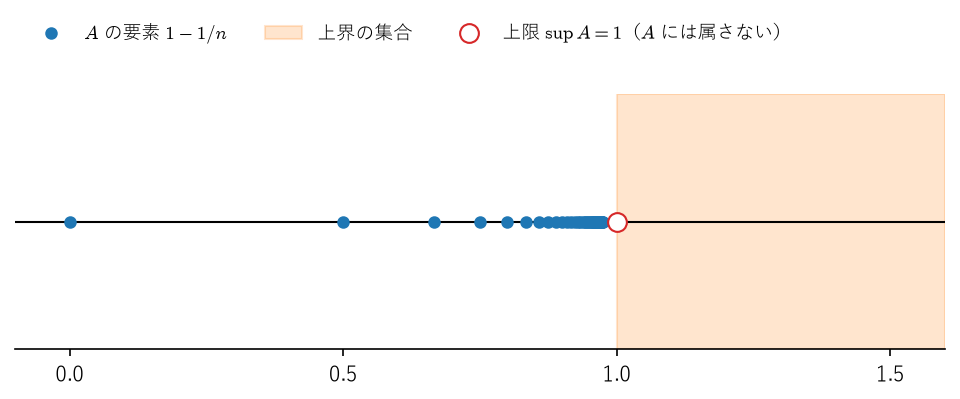
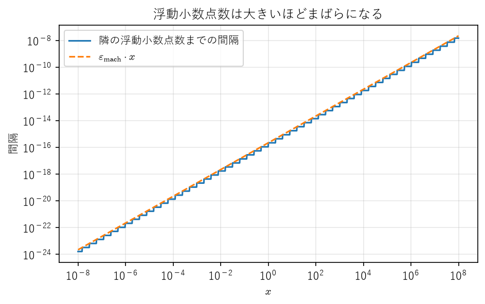

実数
====

解析学のすべての議論は実数の性質の上に組み立てられている。極限が「存在する」と言えるのは、実数に「すき間」がないからである。本章では、有理数だけではすき間が残ることを確かめたうえで、実数を特徴付ける公理、特に実数の連続性（上限公理）を導入する。最後に、計算機が扱う浮動小数点数が実数とどのように違うのかを確認する。エンジニアにとって、この違いを理解することは数値計算の結果を正しく読むための第一歩である。

.. graphviz::
   :caption: 数の体系と浮動小数点数
   :name: ch01-fig-number-system

   digraph numbers {
     rankdir=LR;
     node [shape=box, style="rounded,filled", fillcolor="#eef5fb"];
     N [label="自然数 ℕ"];
     Z [label="整数 ℤ"];
     Q [label="有理数 ℚ"];
     R [label="実数 ℝ"];
     F [label="浮動小数点数\n（有限集合）", fillcolor="#fdf3e7"];
     N -> Z [label="引き算"];
     Z -> Q [label="割り算"];
     Q -> R [label="すき間を埋める"];
     F -> Q [label="部分集合", style=dashed];
   }

:numref:`ch01-fig-number-system` のように、自然数から整数、有理数へと数の範囲は四則演算ができるように広げられてきた。有理数から実数への拡張は、四則演算ではなく「極限をとる」操作のために必要となる。一方、計算機で扱う浮動小数点数は有理数の有限な部分集合にすぎない。

有理数のすき間
--------------

正方形の対角線の長さのように、:math:`x^2 = 2` を満たす正の数 :math:`x` は幾何学的には自然に現れる。ところが、そのような数は有理数の中には存在しない。

.. _ch01-thm-sqrt2-irrational:

.. admonition:: 定理 1.1（√2 の無理性）
   :class: theorem

   :math:`x^2 = 2` を満たす有理数 :math:`x` は存在しない。

.. admonition:: 証明
   :class: proof

   :math:`x^2 = 2` を満たす有理数 :math:`x` が存在すると仮定する。:math:`-x` も同じ式を満たすので :math:`x > 0` としてよい。:math:`x = p/q`\ （:math:`p, q` は互いに素な自然数）と表すと、:math:`p^2 = 2q^2` となる。右辺は偶数なので :math:`p^2` は偶数であり、したがって :math:`p` も偶数である（奇数の 2 乗は奇数だからである）。:math:`p = 2k` とおくと :math:`4k^2 = 2q^2`、すなわち :math:`q^2 = 2k^2` となり、同じ議論により :math:`q` も偶数である。これは :math:`p` と :math:`q` が互いに素であることに矛盾する。

定理 1.1 は、有理数全体 :math:`\mathbb{Q}` の中で「2 乗すると 2 になる数」を探しても見つからないことを意味する。:math:`1, 1.4, 1.41, 1.414, \ldots` のように 2 乗が 2 に近づく有理数はいくらでも作れるのに、その行き着く先が :math:`\mathbb{Q}` の中にない。これが有理数の「すき間」である。解析学では「近づいていく先が存在する」ことを何度も使うので、このすき間を埋めた数の体系が必要になる。

実数の公理
----------

本書では、実数を一から構成することはせず、実数全体 :math:`\mathbb{R}` が満たす性質を公理として認めて出発する。実数の構成（デデキントの切断やコーシー列による方法）に興味がある読者は [Sugiura1980]_ や [Tao2016a]_ を参照するとよい。

実数の公理は、次の 3 つのグループに分けられる。

1. **体の公理**：加法と乗法について、結合法則、交換法則、分配法則が成り立ち、加法の単位元 :math:`0`、乗法の単位元 :math:`1`\ （:math:`1 \neq 0`）、加法の逆元 :math:`-x`、:math:`0` でない数の乗法の逆元 :math:`x^{-1}` が存在する。
2. **順序の公理**：任意の :math:`x, y` について :math:`x < y`、:math:`x = y`、:math:`x > y` のちょうど 1 つが成り立ち、:math:`x < y` かつ :math:`y < z` ならば :math:`x < z` である。さらに、:math:`x < y` ならば :math:`x + z < y + z` であり、:math:`0 < x` かつ :math:`0 < y` ならば :math:`0 < xy` である。
3. **連続性の公理**：後述の公理 1.1。

有理数全体 :math:`\mathbb{Q}` も 1 と 2 を満たす。実数と有理数を分けるのは 3 の連続性の公理だけである。

1 と 2 から、不等式に関するおなじみの規則（両辺に正の数を掛けても不等号の向きは変わらない、:math:`x^2 \geq 0` である、など）がすべて導かれる。以下ではこれらを断りなく使う。

.. _ch01-def-abs:

.. admonition:: 定義 1.1（絶対値）
   :class: definition

   実数 :math:`x` の絶対値 :math:`|x|` を、:math:`x \geq 0` のとき :math:`|x| = x`、:math:`x < 0` のとき :math:`|x| = -x` で定める。:math:`|x - y|` は数直線上の 2 点 :math:`x, y` の距離を表す。

.. _ch01-thm-triangle:

.. admonition:: 定理 1.2（三角不等式）
   :class: theorem

   任意の実数 :math:`x, y` に対して、次が成り立つ。

   .. math::

      |x + y| \leq |x| + |y|, \qquad \bigl| |x| - |y| \bigr| \leq |x - y|

.. admonition:: 証明
   :class: proof

   絶対値の定義から :math:`-|x| \leq x \leq |x|` および :math:`-|y| \leq y \leq |y|` である。辺々を加えると :math:`-(|x| + |y|) \leq x + y \leq |x| + |y|` となり、これは :math:`|x + y| \leq |x| + |y|` を意味する。次に、:math:`x = (x - y) + y` に前半の不等式を使うと :math:`|x| \leq |x - y| + |y|`、すなわち :math:`|x| - |y| \leq |x - y|` を得る。:math:`x` と :math:`y` を入れ替えれば :math:`|y| - |x| \leq |x - y|` も得られるので、後半の不等式が成り立つ。

三角不等式は、解析学で誤差を評価するときに最もよく使う道具である。「真の値との誤差」を「途中の値との誤差」の和で上から抑える、という使い方を本書では繰り返し行う。

上限と下限
----------

実数の連続性を述べるために、集合の上限という概念を導入する。

.. _ch01-def-bounded:

.. admonition:: 定義 1.2（上界・下界・有界）
   :class: definition

   :math:`A` を :math:`\mathbb{R}` の部分集合とする。

   * 実数 :math:`M` が、すべての :math:`a \in A` に対して :math:`a \leq M` を満たすとき、:math:`M` を :math:`A` の\ **上界**\ という。上界が存在するとき、:math:`A` は\ **上に有界**\ であるという。
   * 同様に、すべての :math:`a \in A` に対して :math:`m \leq a` を満たす :math:`m` を :math:`A` の\ **下界**\ といい、下界が存在するとき :math:`A` は\ **下に有界**\ であるという。
   * 上にも下にも有界であるとき、:math:`A` は\ **有界**\ であるという。

.. _ch01-def-sup:

.. admonition:: 定義 1.3（上限・下限）
   :class: definition

   :math:`A` の上界のうち最小のものを :math:`A` の\ **上限**\ といい、:math:`\sup A` で表す。すなわち、:math:`s = \sup A` とは次の 2 条件が成り立つことである。

   1. :math:`s` は :math:`A` の上界である。
   2. :math:`M` が :math:`A` の上界ならば :math:`s \leq M` である。

   同様に、:math:`A` の下界のうち最大のものを :math:`A` の\ **下限**\ といい、:math:`\inf A` で表す。

上限は存在すればただ 1 つである。実際、:math:`s, s'` がともに上限ならば、条件 2 から :math:`s \leq s'` かつ :math:`s' \leq s` となる。

:math:`A` に最大値 :math:`\max A` が存在すれば、それは上限に一致する。しかし、上限は最大値と違って :math:`A` に属するとは限らない。

.. _ch01-ex-open-interval:

.. admonition:: 例 1.1
   :class: example

   開区間 :math:`A = (0, 1)` を考える。:math:`1` は :math:`A` の上界である。:math:`M < 1` を満たす任意の :math:`M` については、:math:`\max\{M, 0\} < x < 1` を満たす :math:`x`\ （たとえば :math:`x = (\max\{M, 0\} + 1)/2`）が :math:`A` に属し :math:`x > M` となるので、:math:`M` は上界でない。したがって :math:`\sup A = 1` である。一方、:math:`1 \notin A` なので :math:`A` に最大値は存在しない。同様に :math:`\inf A = 0` であり、最小値は存在しない。

.. _ch01-ex-one-minus-inverse:

.. admonition:: 例 1.2
   :class: example

   :math:`A = \{1 - 1/n \mid n \in \mathbb{N}\}` とする。すべての :math:`n` で :math:`1 - 1/n < 1` なので :math:`1` は上界である。また、後述の系 1.7 により、任意の :math:`\varepsilon > 0` に対して :math:`1/n < \varepsilon` となる :math:`n` が存在するので、:math:`1 - \varepsilon` は上界でない。よって :math:`\sup A = 1` である（:numref:`ch01-fig-sup`）。最小値は :math:`n = 1` のときの :math:`0` であり、:math:`\inf A = \min A = 0` である。

   集合 :math:`\{1 - 1/n\}` の上界の集合と上限

例 1.1、例 1.2 のように具体的な集合では上限が見つかった。しかし、上に有界な集合がいつでも上限をもつかどうかは、これまでの公理（体の公理と順序の公理）からは導けない。実際、有理数の範囲では上限をもたない例がある（後述の注意を参照）。そこで、次の性質を実数の公理として認める。

.. _ch01-thm-sup:

.. admonition:: 公理 1.1（実数の連続性）
   :class: theorem

   :math:`\mathbb{R}` の空でない部分集合 :math:`A` が上に有界ならば、:math:`A` の上限 :math:`\sup A` が :math:`\mathbb{R}` の中に存在する。

公理 1.1 は\ **上限公理**\ とも呼ばれる。これが「実数にはすき間がない」ことの正確な表現である。第 2 章で示す単調収束定理、ボルツァーノ・ワイエルシュトラスの定理、コーシー列の収束はいずれも公理 1.1 から導かれ、本書の以降の議論はすべてこれらを土台にしている。

上限を扱うときには、定義 1.3 を次の形に言い換えたものが便利である。

.. _ch01-thm-sup-eps:

.. admonition:: 命題 1.3（上限の特徴付け）
   :class: theorem

   :math:`A \subset \mathbb{R}` を空でない集合とする。実数 :math:`s` について、:math:`s = \sup A` であるための必要十分条件は、次の 2 条件が成り立つことである。

   1. すべての :math:`a \in A` に対して :math:`a \leq s` である。
   2. 任意の :math:`\varepsilon > 0` に対して、:math:`a > s - \varepsilon` を満たす :math:`a \in A` が存在する。

.. admonition:: 証明
   :class: proof

   条件 1 は :math:`s` が上界であることそのものである。:math:`s = \sup A` と仮定し、:math:`\varepsilon > 0` とする。:math:`s - \varepsilon < s` であり、:math:`s` は最小の上界なので、:math:`s - \varepsilon` は上界でない。したがって :math:`a > s - \varepsilon` を満たす :math:`a \in A` が存在し、条件 2 が成り立つ。逆に条件 1、2 が成り立つと仮定する。:math:`M` を :math:`A` の上界とし、:math:`M < s` であったとする。:math:`\varepsilon = s - M > 0` に対して条件 2 から :math:`a > s - \varepsilon = M` を満たす :math:`a \in A` が存在するが、これは :math:`M` が上界であることに矛盾する。よって :math:`s \leq M` となり、:math:`s = \sup A` である。

条件 2 は「:math:`s` より少しでも小さい数は、もはや上界でない」と言っている。この形の議論は、第 2 章で単調収束定理を証明するときに直接使う。

下限の存在は、上限の存在から導かれる。

.. _ch01-cor-inf:

.. admonition:: 系 1.4（下限の存在）
   :class: theorem

   :math:`\mathbb{R}` の空でない部分集合 :math:`A` が下に有界ならば、:math:`\inf A` が存在し、:math:`\inf A = -\sup(-A)` が成り立つ。ここで :math:`-A = \{-a \mid a \in A\}` である。

.. admonition:: 証明
   :class: proof

   :math:`m` が :math:`A` の下界であることと、:math:`-m` が :math:`-A` の上界であることは同値である。:math:`A` は下に有界なので :math:`-A` は上に有界であり、公理 1.1 により :math:`s = \sup(-A)` が存在する。:math:`-A` の上界のうち最小のものが :math:`s` なので、:math:`A` の下界のうち最大のものは :math:`-s` である。

公理 1.1 を使うと、:math:`\sqrt{2}` が実数の中に存在することを示せる。この証明は、上限という道具の典型的な使い方の例にもなっている。

.. _ch01-thm-sqrt2-exists:

.. admonition:: 定理 1.5（√2 の存在）
   :class: theorem

   :math:`s^2 = 2` を満たす正の実数 :math:`s` が存在する。

.. admonition:: 証明
   :class: proof

   :math:`A = \{x \in \mathbb{R} \mid x > 0,\ x^2 < 2\}` とおく。:math:`1 \in A` なので :math:`A` は空でない。また :math:`x \geq 2` ならば :math:`x^2 \geq 4 > 2` なので、:math:`2` は :math:`A` の上界である。公理 1.1 により :math:`s = \sup A` が存在し、:math:`1 \leq s \leq 2` である。以下、:math:`s^2 < 2` と :math:`s^2 > 2` のいずれも起こらないことを示す。

   :math:`s^2 < 2` と仮定する。:math:`0 < h < 1` かつ :math:`h < (2 - s^2)/(2s + 1)` を満たす :math:`h` をとると、:math:`h^2 < h` より :math:`(s + h)^2 = s^2 + 2sh + h^2 < s^2 + (2s + 1)h < 2` となる。したがって :math:`s + h \in A` であり、これは :math:`s` が上界であることに矛盾する。

   :math:`s^2 > 2` と仮定する。:math:`0 < h < s` かつ :math:`h < (s^2 - 2)/(2s)` を満たす :math:`h` をとると、:math:`(s - h)^2 = s^2 - 2sh + h^2 > s^2 - 2sh > 2` となる。任意の :math:`x \in A` について :math:`x^2 < 2 < (s - h)^2` であり、:math:`x` と :math:`s - h` はともに正なので :math:`x < s - h` である。よって :math:`s - h` は :math:`A` の上界であるが、:math:`s - h < s` なので :math:`s` が最小の上界であることに矛盾する。

   以上より :math:`s^2 = 2` である。

.. admonition:: 注意
   :class: note

   定理 1.5 の証明で、集合を :math:`B = \{x \in \mathbb{Q} \mid x > 0,\ x^2 < 2\}` に、上限を「:math:`\mathbb{Q}` の中の最小の上界」に置き換えてみる。:math:`h` を十分小さい有理数（たとえば :math:`1/n`）にとれば、証明はそのまま通用し、:math:`B` の上限 :math:`r` が :math:`\mathbb{Q}` の中にあれば :math:`r^2 = 2` となる。これは定理 1.1 に反するので、:math:`B` は :math:`\mathbb{Q}` の中に上限をもたない。つまり、:math:`\mathbb{Q}` では公理 1.1 が成り立たない。

アルキメデスの原理
------------------

「どんなに小さい正の数 :math:`\varepsilon` に対しても、:math:`1/n < \varepsilon` となる自然数 :math:`n` がある」という事実は、極限の議論で毎回のように使う。これは当たり前のように見えるが、公理 1.1 を使って証明すべき定理である。

.. _ch01-thm-archimedes:

.. admonition:: 定理 1.6（アルキメデスの原理）
   :class: theorem

   任意の正の実数 :math:`a` と任意の実数 :math:`b` に対して、:math:`na > b` を満たす自然数 :math:`n` が存在する。

.. admonition:: 証明
   :class: proof

   結論を否定し、すべての :math:`n \in \mathbb{N}` に対して :math:`na \leq b` であると仮定する。このとき集合 :math:`S = \{na \mid n \in \mathbb{N}\}` は空でなく、:math:`b` を上界にもつ。公理 1.1 により :math:`s = \sup S` が存在する。:math:`a > 0` より :math:`s - a < s` なので、命題 1.3 により :math:`ma > s - a` を満たす :math:`m \in \mathbb{N}` が存在する。すると :math:`(m + 1)a > s` となるが、:math:`(m + 1)a \in S` なので、これは :math:`s` が :math:`S` の上界であることに矛盾する。

.. _ch01-cor-archimedes:

.. admonition:: 系 1.7
   :class: theorem

   任意の :math:`\varepsilon > 0` に対して、:math:`1/n < \varepsilon` を満たす自然数 :math:`n` が存在する。

.. admonition:: 証明
   :class: proof

   定理 1.6 を :math:`a = \varepsilon`、:math:`b = 1` に適用すると :math:`n\varepsilon > 1` となる :math:`n` が得られる。これは :math:`1/n < \varepsilon` と同値である。

アルキメデスの原理を使うと、有理数が実数の中に「びっしり詰まっている」ことも示せる。

.. _ch01-thm-dense:

.. admonition:: 定理 1.8（有理数の稠密性）
   :class: theorem

   :math:`a < b` を満たす任意の実数 :math:`a, b` に対して、:math:`a < r < b` を満たす有理数 :math:`r` が存在する。

.. admonition:: 証明
   :class: proof

   系 1.7 により :math:`1/n < b - a` を満たす :math:`n \in \mathbb{N}` をとる。定理 1.6（:math:`a = 1` の場合）を :math:`na` と :math:`-na` に適用すると、:math:`na` より大きい整数と :math:`na` より小さい整数がともに存在する。したがって、:math:`na` より大きい整数全体の集合は空でなく下に有界であり、最小元 :math:`m` をもつ。:math:`m` の最小性から :math:`m - 1 \leq na < m` である。よって :math:`na < m \leq na + 1 < na + n(b - a) = nb` となり、両辺を :math:`n` で割ると :math:`a < m/n < b` を得る。:math:`r = m/n` とすればよい。

定理 1.8 は、どんな実数もいくらでも精度よく有理数で近似できることを意味する。計算機が有限桁の小数（有理数）で実数を近似できる理論的な根拠はここにある。ただし、次節で見るように、計算機が扱える有理数は有限個しかないので、「いくらでも精度よく」というわけにはいかない。

計算機上の数
------------

本節では、計算機が実数の代わりに使う浮動小数点数について、解析学の立場から整理する。詳細は [Goldberg1991]_ や [Higham2002]_ を参照するとよい。

浮動小数点数
^^^^^^^^^^^^

現在ほとんどの計算機は、IEEE 754 という規格 [IEEE754]_ に従って実数を近似する。Python の ``float`` や NumPy の ``float64`` は、IEEE 754 の倍精度（binary64）形式である。

.. _ch01-def-float:

.. admonition:: 定義 1.4（倍精度浮動小数点数）
   :class: definition

   倍精度の正規化数とは、次の形で表される数である。

   .. math::

      x = \pm \left(1 + \frac{d_1}{2} + \frac{d_2}{2^2} + \cdots + \frac{d_{52}}{2^{52}}\right) \times 2^{e}

   ここで :math:`d_1, \ldots, d_{52}` は :math:`0` または :math:`1`、指数 :math:`e` は :math:`-1022 \leq e \leq 1023` を満たす整数である。このほかに :math:`0`、非正規化数、無限大、NaN（非数）が定められている。

定義 1.4 の数はすべて有理数であり、しかも有限個しかない。したがって、浮動小数点数の集合は体の公理を満たさない。たとえば 2 つの浮動小数点数の和は一般に浮動小数点数にならないので、計算機は和を最も近い浮動小数点数に\ **丸めて**\ 結果とする。この丸めによって生じる誤差を\ **丸め誤差**\ という。

指数 :math:`e` を固定すると、:math:`[2^e, 2^{e+1})` に含まれる浮動小数点数は間隔 :math:`2^{e-52}` で等間隔に並ぶ。したがって、浮動小数点数の間隔は数の大きさにほぼ比例して広がる（:numref:`ch01-fig-float-spacing`）。

   倍精度浮動小数点数の間隔（両対数）

機械イプシロンと丸め誤差の大きさ
^^^^^^^^^^^^^^^^^^^^^^^^^^^^^^^^

.. _ch01-def-machine-eps:

.. admonition:: 定義 1.5（機械イプシロン）
   :class: definition

   :math:`1` と、:math:`1` より大きい最小の浮動小数点数との差を\ **機械イプシロン**\ といい、:math:`\varepsilon_{\mathrm{mach}}` で表す。倍精度では :math:`\varepsilon_{\mathrm{mach}} = 2^{-52} \approx 2.22 \times 10^{-16}` である。

丸め誤差の大きさは、機械イプシロンを使って次のように評価できる。以下、実数 :math:`x` を最も近い浮動小数点数に丸めた値を :math:`\mathrm{fl}(x)` と書く。

.. _ch01-thm-rounding:

.. admonition:: 命題 1.9（丸めの相対誤差）
   :class: theorem

   :math:`x_{\max} = (2 - 2^{-52}) \times 2^{1023}` を最大の有限な浮動小数点数とする。:math:`x` が :math:`2^{-1022} \leq |x| \leq x_{\max}` を満たし、:math:`\mathrm{fl}(x)` が最も近い浮動小数点数への丸めならば、次が成り立つ。

   .. math::
      :label: ch01-eq-rounding

      \frac{|\mathrm{fl}(x) - x|}{|x|} \leq \frac{\varepsilon_{\mathrm{mach}}}{2} = 2^{-53}

.. admonition:: 証明
   :class: proof

   符号は誤差に影響しないので :math:`x > 0` とする。:math:`2^e \leq x < 2^{e+1}` となる整数 :math:`e` をとる。定義 1.4 から、区間 :math:`[2^e, 2^{e+1})` には :math:`2^e` から始まる間隔 :math:`2^{e-52}` の格子点がすべて浮動小数点数として並び、さらに :math:`e \leq 1022` ならば右端 :math:`2^{e+1}` も浮動小数点数である（:math:`e = 1023` のときは :math:`x \leq x_{\max}` であり、:math:`x_{\max}` がこの区間の最後の格子点である）。したがって :math:`x` は、間隔 :math:`2^{e-52}` で隣り合う 2 つの浮動小数点数の間にある。最も近い点に丸めるので、誤差は間隔の半分以下、すなわち :math:`|\mathrm{fl}(x) - x| \leq 2^{e-53}` である。:math:`x \geq 2^e` で両辺を割ると、:math:`|\mathrm{fl}(x) - x|/x \leq 2^{-53}` を得る。

式 :eq:`ch01-eq-rounding` は、1 回の丸めで失われる精度が相対的に約 :math:`1.1 \times 10^{-16}`、10 進数でおよそ 16 桁目であることを示している。1 回ごとの誤差は小さいが、計算を重ねると誤差は蓄積し、また次の例のように思わぬ形で拡大する。

.. _ch01-ex-tenth:

.. admonition:: 例 1.3（0.1 は正確に表せない）
   :class: example

   :math:`0.1 = 1/10` の分母は 2 のべきではないので、0.1 を 2 進数で表すと無限小数になり、浮動小数点数で正確には表せない。実際に格納されるのは :math:`3602879701896397/2^{55}` であり、0.1 よりわずかに大きい。そのため、0.1 を 10 回足しても 1.0 にはならない。Python での事情は [PythonFloat]_ に詳しい。

.. _ch01-ex-associativity:

.. admonition:: 例 1.4（結合法則の破れ）
   :class: example

   :math:`a = 10^{16}`、:math:`b = -10^{16}`、:math:`c = 1` とする。:math:`(a + b) + c` は :math:`0 + 1 = 1` となる。一方、:math:`b + c = -10^{16} + 1` は、:math:`10^{16}` 付近の浮動小数点数の間隔が :math:`2` であるため、隣り合う浮動小数点数 :math:`-10^{16}` と :math:`-10^{16} + 2` のちょうど中点にあり、偶数側への丸め（問題 1.5 を参照）によって :math:`-10^{16}` に丸められ、:math:`a + (b + c) = 0` となる。実数では成り立つ結合法則が、浮動小数点数では成り立たない。

数値実験
^^^^^^^^

以上の現象を Python で確かめる。次のスクリプトは、0.1 の和、機械イプシロン、結合法則の破れ、および\ **桁落ち**\ （近い数どうしの引き算で有効桁が失われる現象）を順に表示する。

:download:`ch01_float_error.py <../examples/ch01_float_error.py>` をダウンロード

.. literalinclude:: ../examples/ch01_float_error.py
   :language: python
   :linenos:
   :caption: 浮動小数点数の性質を確かめるスクリプト
   :name: ch01-code-float-error

実行結果は次のとおりである。

.. code-block:: text
   :linenos:

   [1] 0.1 を 10 回足す
       結果           : 0.9999999999999999
       1.0 と等しいか : False
       0.1 の実際の値 : 3602879701896397/36028797018963968

   [2] 機械イプシロン
       求めた値               : 2.220446049250313e-16
       sys.float_info.epsilon : 2.220446049250313e-16
       2 ** -52               : 2.220446049250313e-16

   [3] 結合法則
       (a + b) + c = 1.0
       a + (b + c) = 0.0

   [4] 桁落ち：(1 - cos x) / x^2（真の極限値は 0.5）
              x                直接計算      2 sin^2(x/2) / x^2
          1e-01       0.499583472197418       0.499583472197423
          1e-02       0.499995833347366       0.499995833347222
          1e-03       0.499999958325503       0.499999958333335
          1e-04       0.499999996961265       0.499999999583333
          1e-05       0.500000041370185       0.499999999995833
          1e-06       0.500044450291171       0.499999999999958
          1e-07       0.499600361081320       0.500000000000000
          1e-08       0.000000000000000       0.500000000000000
          1e-09       0.000000000000000       0.500000000000000

実験 4 の関数 :math:`(1 - \cos x)/x^2` は、:math:`x \to 0` で :math:`1/2` に収束する（第 6 章のテイラーの定理から分かる）。ところが直接計算すると、:math:`x` を小さくするにつれて精度が悪化し、:math:`x = 10^{-8}` では :math:`0` になってしまう。:math:`\cos x` が :math:`1` に非常に近い値になり、:math:`1 - \cos x` の計算で有効桁のほとんどが失われるためである。:math:`1 - \cos x = 2\sin^2(x/2)` と式変形して引き算を避けると、正しい値が得られる。

このように、「:math:`x \to 0` の極限」という解析学の操作を計算機上でそのまま真似ると、丸め誤差のために失敗することがある。第 5 章の数値微分でも同じ問題が現れる。解析学は実数 :math:`\mathbb{R}` の上の理論であり、計算機上の数値計算はその近似である。両者の違いを意識することが、数値計算の結果を正しく解釈するために欠かせない。

まとめ
------

* 有理数には :math:`\sqrt{2}` のような「すき間」があり、極限を扱うには不十分である。
* 実数は、体の公理・順序の公理に加えて、連続性の公理（上限公理）を満たす。上に有界な空でない集合は上限をもつ。
* 上限 :math:`s = \sup A` は「:math:`s` は上界であり、:math:`s` より少しでも小さい数は上界でない」と特徴付けられる。
* アルキメデスの原理と有理数の稠密性は上限公理から導かれる。
* 浮動小数点数は有限個の有理数であり、丸めの相対誤差は :math:`\varepsilon_{\mathrm{mach}}/2` 以下である。ただし結合法則の破れや桁落ちなど、実数とは異なる振る舞いをする。

演習問題
--------

.. admonition:: 問題 1.1
   :class: exercise

   :math:`A = \{(-1)^n + 1/n \mid n \in \mathbb{N}\}` の上限と下限を求めよ。また、最大値と最小値が存在するかどうかを答えよ。

.. admonition:: 問題 1.2
   :class: exercise

   :math:`x^2 = 3` を満たす有理数 :math:`x` が存在しないことを示せ。

.. admonition:: 問題 1.3
   :class: exercise

   :math:`A, B` を :math:`\mathbb{R}` の空でない上に有界な部分集合とし、:math:`A + B = \{a + b \mid a \in A,\ b \in B\}` とおく。:math:`\sup(A + B) = \sup A + \sup B` を示せ。

.. admonition:: 問題 1.4
   :class: exercise

   :math:`a < b` を満たす任意の実数 :math:`a, b` に対して、:math:`a < x < b` を満たす無理数 :math:`x` が存在することを示せ。

.. admonition:: 問題 1.5
   :class: exercise

   Python で ``1.0 + 2.0 ** -53 == 1.0`` を評価すると ``True`` になる。命題 1.9 の証明を参考に、その理由を説明せよ。ただし IEEE 754 の既定の丸め方式では、ちょうど中間にある値は仮数部の最後のビットが :math:`0` になる側（偶数側）に丸められる。

略解
----

.. admonition:: 問題 1.1 の略解
   :class: solution

   :math:`n` が偶数のとき要素は :math:`1 + 1/n` であり、:math:`n = 2` で最大値 :math:`3/2` をとる。:math:`n` が奇数のとき要素は :math:`-1 + 1/n` であり、:math:`-1` より大きく、:math:`n` を大きくすると :math:`-1` にいくらでも近づく。したがって :math:`\sup A = \max A = 3/2`、:math:`\inf A = -1` である。:math:`-1 \notin A` なので最小値は存在しない。:math:`\inf A = -1` であることは、:math:`-1` が下界であり、任意の :math:`\varepsilon > 0` に対して系 1.7 から :math:`1/n < \varepsilon` となる :math:`n` がとれ、:math:`n` が偶数なら :math:`n + 1` に取り替えれば奇数にできる（:math:`-1 + 1/n < -1 + \varepsilon`）ことから分かる。

.. admonition:: 問題 1.2 の略解
   :class: solution

   :math:`x = p/q`\ （:math:`p, q` は互いに素な自然数）として :math:`p^2 = 3q^2` を仮定する。整数は :math:`3k`、:math:`3k + 1`、:math:`3k + 2` のいずれかの形であり、後の 2 つの 2 乗は 3 で割り切れない。したがって :math:`p^2` が 3 の倍数ならば :math:`p` も 3 の倍数である。:math:`p = 3k` とおくと :math:`q^2 = 3k^2` となり、同様に :math:`q` も 3 の倍数となって、:math:`p, q` が互いに素であることに矛盾する。

.. admonition:: 問題 1.3 の略解
   :class: solution

   :math:`s = \sup A`、:math:`t = \sup B` とおく。任意の :math:`a \in A`、:math:`b \in B` に対して :math:`a + b \leq s + t` なので、:math:`s + t` は :math:`A + B` の上界である。任意の :math:`\varepsilon > 0` に対して、命題 1.3 から :math:`a > s - \varepsilon/2`、:math:`b > t - \varepsilon/2` を満たす :math:`a \in A`、:math:`b \in B` がとれ、:math:`a + b > s + t - \varepsilon` となる。再び命題 1.3 により :math:`\sup(A + B) = s + t` である。

.. admonition:: 問題 1.4 の略解
   :class: solution

   定理 1.8 を :math:`a/\sqrt{2} < b/\sqrt{2}` に適用して、:math:`a/\sqrt{2} < r < b/\sqrt{2}` を満たす有理数 :math:`r` をとる。:math:`r = 0` となった場合は、:math:`a < 0 < b` であるから、区間 :math:`(0, b/\sqrt{2})` に再び定理 1.8 を適用して :math:`r \neq 0` をとり直す。このとき :math:`x = r\sqrt{2}` は :math:`a < x < b` を満たし、:math:`x` が有理数ならば :math:`\sqrt{2} = x/r` も有理数となって定理 1.1 に反するので、:math:`x` は無理数である。

.. admonition:: 問題 1.5 の略解
   :class: solution

   :math:`[1, 2)` に含まれる浮動小数点数の間隔は :math:`2^{-52}` なので、:math:`1` の次の浮動小数点数は :math:`1 + 2^{-52}` である。実数としての和 :math:`1 + 2^{-53}` は、:math:`1` と :math:`1 + 2^{-52}` のちょうど中点にある。:math:`1` の仮数部の最後のビットは :math:`0`、:math:`1 + 2^{-52}` の仮数部の最後のビットは :math:`1` なので、偶数側への丸めにより結果は :math:`1` になる。したがって ``1.0 + 2.0 ** -53`` は ``1.0`` と等しい。これが、数値実験の ``machine_epsilon`` 関数（:math:`1 + \varepsilon > 1` を満たす最小の 2 のべき :math:`\varepsilon` を求める）が :math:`2^{-53}` ではなく :math:`2^{-52}` を返す理由でもある。
