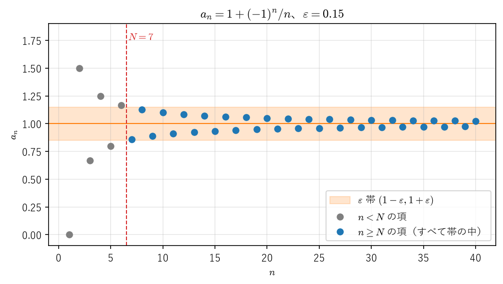
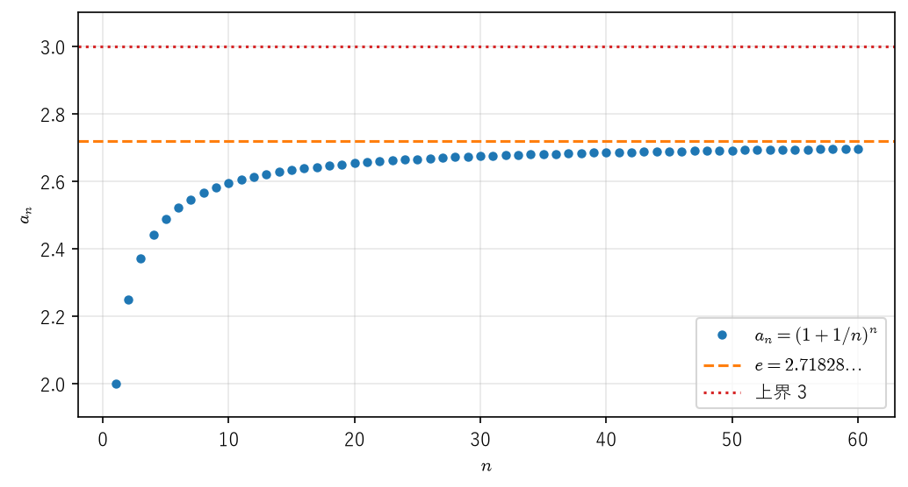
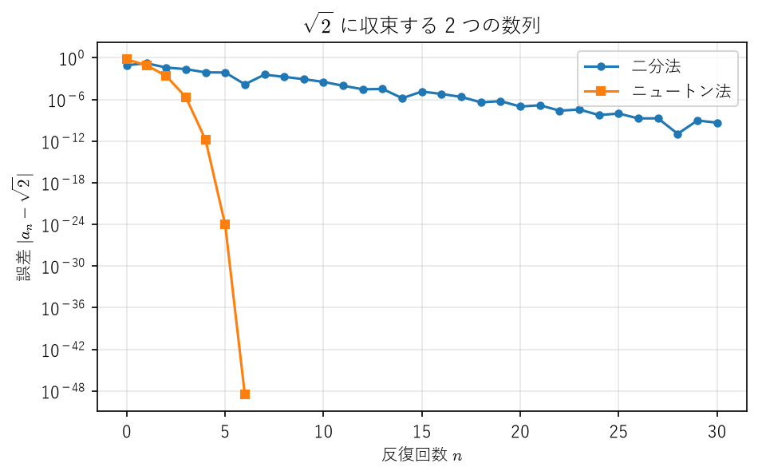

数列の極限
==========

反復法で方程式を解く、級数の部分和を順に計算する、時間刻みを細かくしてシミュレーションをやり直す。工学の数値計算の多くは、数列 :math:`a_1, a_2, a_3, \ldots` を作り、それが目的の値に「近づいていく」ことを期待する作業である。本章では「近づいていく」を ε-N 論法によって正確に定義し、極限の基本的な性質を証明する。さらに、第 1 章の実数の連続性から、極限値を知らなくても収束を判定できる強力な定理（単調収束定理、ボルツァーノ・ワイエルシュトラスの定理、コーシー列の収束）を導く。最後に、反復法の性能を測る「収束の速さ」を扱う。

数列の収束と ε-N 論法
---------------------

各自然数 :math:`n` に実数 :math:`a_n` を対応させたものを\ **数列**\ といい、:math:`(a_n)` または :math:`(a_n)_{n=1}^{\infty}` と書く。添字は :math:`0` から始めることもある。

「:math:`n` を大きくすると :math:`a_n` が :math:`\alpha` に近づく」という直感を、次のように定式化する。

.. _ch02-def-convergence:

.. admonition:: 定義 2.1（数列の収束）
   :class: definition

   数列 :math:`(a_n)` と実数 :math:`\alpha` について、次の条件が成り立つとき、:math:`(a_n)` は :math:`\alpha` に\ **収束する**\ といい、:math:`\alpha` を :math:`(a_n)` の\ **極限**\ または\ **極限値**\ という。

   任意の :math:`\varepsilon > 0` に対して、ある自然数 :math:`N` が存在し、:math:`n \geq N` を満たすすべての :math:`n` について :math:`|a_n - \alpha| < \varepsilon` が成り立つ。

   このとき :math:`\displaystyle \lim_{n \to \infty} a_n = \alpha` または :math:`a_n \to \alpha \ (n \to \infty)` と書く。

論理記号で書けば、定義 2.1 の条件は次のようになる。

.. math::
   :label: ch02-eq-convergence

   \forall \varepsilon > 0,\ \exists N \in \mathbb{N},\ \forall n \geq N,\ |a_n - \alpha| < \varepsilon

この形の定義を **ε-N 論法**\ という。エンジニアの言葉で言えば、:math:`\varepsilon` は「許容誤差」であり、:math:`N` は「その許容誤差を達成するのに必要な反復回数」である。収束するとは、**どんなに厳しい許容誤差を指定されても、十分な回数だけ反復すれば、それ以降はずっと許容誤差内に収まる**\ ということである。:math:`N` は :math:`\varepsilon` に応じて選んでよく、一般に :math:`\varepsilon` を小さくすれば :math:`N` は大きくなる。量化子（:math:`\forall`、:math:`\exists`）の順序が重要であり、その扱いに慣れていない読者は\ :doc:`appendix_logic`\ を先に読むとよい。

.. _ch02-ex-one-over-n:

.. admonition:: 例 2.1
   :class: example

   :math:`\displaystyle \lim_{n \to \infty} \frac{1}{n} = 0` である。実際、:math:`\varepsilon > 0` を任意にとると、:ref:`系 1.7 <ch01-cor-archimedes>` により :math:`1/N < \varepsilon` を満たす自然数 :math:`N` が存在する。:math:`n \geq N` ならば :math:`|1/n - 0| = 1/n \leq 1/N < \varepsilon` である。

.. _ch02-ex-alternating:

.. admonition:: 例 2.2
   :class: example

   :math:`a_n = 1 + (-1)^n/n` とすると、:math:`|a_n - 1| = 1/n` なので、例 2.1 と同じ議論で :math:`a_n \to 1` が分かる。具体的には、:math:`\varepsilon` に対して :math:`N` を :math:`1/\varepsilon` より大きい最小の自然数にとればよい。:numref:`ch02-fig-epsilon-band` は :math:`\varepsilon = 0.15` の場合で、:math:`N = 7` 以降の項はすべて幅 :math:`2\varepsilon` の帯の中に入っている。

   ε-N 論法の図解（:math:`\varepsilon = 0.15` に対して :math:`N = 7`）

収束しない数列は\ **発散する**\ という。発散する数列のうち、特に限りなく大きくなるものを次のように定義する。

.. _ch02-def-infinity:

.. admonition:: 定義 2.2（無限大への発散）
   :class: definition

   任意の実数 :math:`M` に対して、ある自然数 :math:`N` が存在し、:math:`n \geq N` ならば :math:`a_n > M` となるとき、:math:`(a_n)` は\ **正の無限大に発散する**\ といい、:math:`\displaystyle \lim_{n \to \infty} a_n = \infty` と書く。負の無限大への発散も同様に定める。

:math:`\lim a_n = \infty` と書いても、:math:`\infty` は実数ではなく、:math:`(a_n)` は収束していない（発散している）ことに注意する。

収束する数列の極限がただ 1 つであることは当然に思えるが、定義 2.1 から証明しておく。

.. _ch02-thm-unique:

.. admonition:: 定理 2.1（極限の一意性）
   :class: theorem

   数列 :math:`(a_n)` が :math:`\alpha` と :math:`\beta` の両方に収束するならば、:math:`\alpha = \beta` である。

.. admonition:: 証明
   :class: proof

   :math:`\alpha \neq \beta` と仮定し、:math:`\varepsilon = |\alpha - \beta|/2 > 0` とおく。収束の定義から、:math:`n \geq N_1` ならば :math:`|a_n - \alpha| < \varepsilon`、:math:`n \geq N_2` ならば :math:`|a_n - \beta| < \varepsilon` となる :math:`N_1, N_2` が存在する。:math:`n = \max\{N_1, N_2\}` とすると、三角不等式（:ref:`定理 1.2 <ch01-thm-triangle>`）により :math:`|\alpha - \beta| \leq |\alpha - a_n| + |a_n - \beta| < 2\varepsilon = |\alpha - \beta|` となり、矛盾する。

.. _ch02-thm-bounded:

.. admonition:: 定理 2.2（収束する数列は有界）
   :class: theorem

   収束する数列 :math:`(a_n)` は有界である。すなわち、すべての :math:`n` について :math:`|a_n| \leq M` となる定数 :math:`M` が存在する。

.. admonition:: 証明
   :class: proof

   :math:`a_n \to \alpha` とする。定義 2.1 で :math:`\varepsilon = 1` とすると、:math:`n \geq N` ならば :math:`|a_n - \alpha| < 1` となる :math:`N` が存在する。このとき三角不等式から :math:`|a_n| < |\alpha| + 1` である。:math:`M = \max\{|a_1|, \ldots, |a_{N-1}|, |\alpha| + 1\}` とおけば、すべての :math:`n` について :math:`|a_n| \leq M` となる。

.. _ch02-ex-minus-one-power:

.. admonition:: 例 2.3
   :class: example

   :math:`a_n = (-1)^n` は有界であるが収束しない。:math:`a_n \to \alpha` と仮定し、:math:`\varepsilon = 1` に対する :math:`N` をとると、:math:`n \geq N` で :math:`|a_n - \alpha| < 1` である。:math:`a_N` と :math:`a_{N+1}` は一方が :math:`1`、他方が :math:`-1` なので、:math:`2 = |a_N - a_{N+1}| \leq |a_N - \alpha| + |\alpha - a_{N+1}| < 2` となり、矛盾する。定理 2.2 の逆は成り立たない。

極限の性質
----------

極限の計算を定義 2.1 に戻って毎回行うのは大変である。次の定理により、既知の極限を組み合わせて新しい極限を求めることができる。

.. _ch02-thm-arithmetic:

.. admonition:: 定理 2.3（極限の四則演算）
   :class: theorem

   :math:`a_n \to \alpha`、:math:`b_n \to \beta` とする。このとき次が成り立つ。

   1. :math:`a_n + b_n \to \alpha + \beta`
   2. :math:`a_n b_n \to \alpha\beta`。特に、定数 :math:`c` に対して :math:`c a_n \to c\alpha`
   3. :math:`\beta \neq 0` ならば、十分大きい :math:`n` で :math:`b_n \neq 0` となり、:math:`a_n / b_n \to \alpha / \beta`

   1 と 2（:math:`c = -1`）から :math:`a_n - b_n \to \alpha - \beta` も成り立つ。

.. admonition:: 証明
   :class: proof

   1：:math:`\varepsilon > 0` に対して、:math:`n \geq N_1` で :math:`|a_n - \alpha| < \varepsilon/2`、:math:`n \geq N_2` で :math:`|b_n - \beta| < \varepsilon/2` となる :math:`N_1, N_2` をとる。:math:`N = \max\{N_1, N_2\}` とすれば、:math:`n \geq N` で :math:`|(a_n + b_n) - (\alpha + \beta)| \leq |a_n - \alpha| + |b_n - \beta| < \varepsilon` である。

   2：定理 2.2 により、すべての :math:`n` で :math:`|a_n| \leq M` となる :math:`M > 0` がとれる。次の変形が要点である。

   .. math::

      |a_n b_n - \alpha\beta| = |a_n(b_n - \beta) + \beta(a_n - \alpha)| \leq M|b_n - \beta| + |\beta||a_n - \alpha|

   :math:`\varepsilon > 0` に対して、:math:`n \geq N_1` で :math:`|b_n - \beta| < \varepsilon/(2M)`、:math:`n \geq N_2` で :math:`|a_n - \alpha| < \varepsilon/(2|\beta| + 1)` となる :math:`N_1, N_2` をとる。:math:`n \geq \max\{N_1, N_2\}` ならば右辺は :math:`\varepsilon/2 + \varepsilon/2 = \varepsilon` より小さい。定数 :math:`c` は、すべての項が :math:`c` の数列（これは :math:`c` に収束する）とみなせばよい。

   3：2 により、:math:`1/b_n \to 1/\beta` を示せば十分である。:math:`|\beta|/2 > 0` に対して、:math:`n \geq N_1` で :math:`|b_n - \beta| < |\beta|/2` となる :math:`N_1` をとると、:math:`n \geq N_1` で :math:`|b_n| \geq |\beta| - |b_n - \beta| > |\beta|/2 > 0` である（定理 1.2）。したがって :math:`n \geq N_1` で次が成り立つ。

   .. math::

      \left| \frac{1}{b_n} - \frac{1}{\beta} \right| = \frac{|\beta - b_n|}{|b_n||\beta|} < \frac{2}{|\beta|^2} |b_n - \beta|

   :math:`\varepsilon > 0` に対して、:math:`n \geq N_2` で :math:`|b_n - \beta| < |\beta|^2 \varepsilon / 2` となる :math:`N_2` をとれば、:math:`n \geq \max\{N_1, N_2\}` で右辺は :math:`\varepsilon` より小さい。

.. _ch02-thm-order:

.. admonition:: 定理 2.4（極限と大小関係）
   :class: theorem

   :math:`a_n \to \alpha`、:math:`b_n \to \beta` であり、すべての :math:`n` について :math:`a_n \leq b_n` ならば、:math:`\alpha \leq \beta` である。

.. admonition:: 証明
   :class: proof

   :math:`\alpha > \beta` と仮定し、:math:`\varepsilon = (\alpha - \beta)/2` とおく。十分大きい :math:`n` で :math:`|a_n - \alpha| < \varepsilon` かつ :math:`|b_n - \beta| < \varepsilon` となるので、:math:`a_n > \alpha - \varepsilon = \beta + \varepsilon > b_n` となり、:math:`a_n \leq b_n` に矛盾する。

定理 2.4 で、仮定を :math:`a_n < b_n` にしても結論は :math:`\alpha < \beta` にはならない。たとえば :math:`0 < 1/n` であるが、極限はどちらも :math:`0` である。極限をとると、等号を含まない不等号は等号を含む不等号に変わりうる。

.. _ch02-thm-squeeze:

.. admonition:: 定理 2.5（はさみうちの原理）
   :class: theorem

   すべての :math:`n` について :math:`a_n \leq c_n \leq b_n` であり、:math:`a_n \to \alpha`、:math:`b_n \to \alpha` ならば、:math:`c_n \to \alpha` である。

.. admonition:: 証明
   :class: proof

   :math:`\varepsilon > 0` に対して、十分大きい :math:`n` で :math:`|a_n - \alpha| < \varepsilon` かつ :math:`|b_n - \alpha| < \varepsilon` となる。このとき :math:`\alpha - \varepsilon < a_n \leq c_n \leq b_n < \alpha + \varepsilon` なので、:math:`|c_n - \alpha| < \varepsilon` である。

はさみうちの原理は、複雑な数列を扱いやすい数列で上下から挟んで極限を求めるときに使う。その準備として、次の不等式を用意する。

.. _ch02-lem-bernoulli:

.. admonition:: 補題 2.6（ベルヌーイの不等式）
   :class: theorem

   :math:`h > -1` と自然数 :math:`n` に対して、:math:`(1 + h)^n \geq 1 + nh` が成り立つ。

.. admonition:: 証明
   :class: proof

   :math:`n` に関する数学的帰納法で示す。:math:`n = 1` では等号が成り立つ。:math:`n` で成り立つと仮定すると、:math:`1 + h > 0` より :math:`(1 + h)^{n+1} = (1 + h)^n (1 + h) \geq (1 + nh)(1 + h) = 1 + (n + 1)h + nh^2 \geq 1 + (n + 1)h` となり、:math:`n + 1` でも成り立つ。

.. _ch02-ex-geometric:

.. admonition:: 例 2.4（等比数列）
   :class: example

   :math:`|r| < 1` ならば :math:`r^n \to 0` である。:math:`r = 0` のときは明らかなので、:math:`0 < |r| < 1` とする。:math:`1/|r| = 1 + h` とおくと :math:`h > 0` であり、補題 2.6 から :math:`(1 + h)^n \geq 1 + nh > nh` である。したがって :math:`0 \leq |r^n| = 1/(1 + h)^n < 1/(nh)` となる。:math:`1/(nh) \to 0` なので、はさみうちの原理から :math:`|r^n| \to 0`、すなわち :math:`r^n \to 0` である。

単調収束定理
------------

ここまでの議論では、極限値 :math:`\alpha` があらかじめ分かっていることを前提にしていた。しかし実際の問題では、極限値そのものが未知であることが多い。極限値を知らなくても収束を保証する定理が必要であり、ここで第 1 章の実数の連続性が効いてくる。

.. _ch02-def-monotone:

.. admonition:: 定義 2.3（単調な数列）
   :class: definition

   すべての :math:`n` について :math:`a_n \leq a_{n+1}` が成り立つとき、:math:`(a_n)` は\ **単調増加**\ であるという。:math:`a_n < a_{n+1}` が成り立つときは\ **狭義単調増加**\ であるという。単調減少、狭義単調減少も同様に定める。また、集合 :math:`\{a_n \mid n \in \mathbb{N}\}` が上に有界（下に有界、有界）であるとき、数列 :math:`(a_n)` は上に有界（下に有界、有界）であるという。

.. _ch02-thm-monotone:

.. admonition:: 定理 2.7（単調収束定理）
   :class: theorem

   単調増加で上に有界な数列は収束し、その極限は :math:`\sup\{a_n \mid n \in \mathbb{N}\}` である。同様に、単調減少で下に有界な数列は収束し、その極限は :math:`\inf\{a_n \mid n \in \mathbb{N}\}` である。

.. admonition:: 証明
   :class: proof

   :math:`(a_n)` を単調増加で上に有界な数列とする。集合 :math:`A = \{a_n \mid n \in \mathbb{N}\}` は空でなく上に有界なので、:ref:`公理 1.1 <ch01-thm-sup>` により :math:`s = \sup A` が存在する。:math:`\varepsilon > 0` を任意にとる。:ref:`命題 1.3 <ch01-thm-sup-eps>` により :math:`a_N > s - \varepsilon` を満たす :math:`N` が存在する。:math:`n \geq N` ならば、単調増加性と :math:`s` が上界であることから :math:`s - \varepsilon < a_N \leq a_n \leq s` となり、:math:`|a_n - s| < \varepsilon` が成り立つ。よって :math:`a_n \to s` である。単調減少の場合は、:math:`(-a_n)` に前半を適用すればよい。

単調収束定理を使って、解析学で最も重要な定数の 1 つであるネイピア数を定義する。

.. _ch02-ex-napier:

.. admonition:: 例 2.5（ネイピア数）
   :class: example

   :math:`a_n = (1 + 1/n)^n` は狭義単調増加で上に有界である。二項定理により、次のように書ける。

   .. math::
      :label: ch02-eq-napier-binomial

      a_n = \sum_{k=0}^{n} \binom{n}{k} \frac{1}{n^k} = \sum_{k=0}^{n} \frac{1}{k!} \left(1 - \frac{1}{n}\right)\left(1 - \frac{2}{n}\right) \cdots \left(1 - \frac{k - 1}{n}\right)

   ただし :math:`k = 0, 1` の項の積の部分は :math:`1` と解釈する。:math:`n` を :math:`n + 1` に置き換えると、各項の因子 :math:`1 - j/n` は :math:`1 - j/(n + 1)` に増え、さらに正の項 :math:`k = n + 1` が加わる。したがって :math:`a_n < a_{n+1}` である。また、式 :eq:`ch02-eq-napier-binomial` の積の部分は :math:`1` 以下であり、:math:`k \geq 1` で :math:`k! \geq 2^{k-1}` であるから、次が成り立つ。

   .. math::

      a_n \leq \sum_{k=0}^{n} \frac{1}{k!} \leq 1 + \sum_{k=1}^{n} \frac{1}{2^{k-1}} = 1 + 2\left(1 - \frac{1}{2^n}\right) < 3

   単調収束定理により :math:`(a_n)` は収束する。その極限を :math:`e` と書き、**ネイピア数**\ という（:math:`e = 2.71828\ldots`）。:numref:`ch02-fig-monotone` に様子を示す。

   単調増加で上に有界な数列 :math:`(1 + 1/n)^n`

単調収束定理は、反復法の収束を示すときにもよく使われる。次の例は、2.6 節の数値実験で扱うニュートン法の数列である。

.. _ch02-ex-newton:

.. admonition:: 例 2.6（√2 を求めるニュートン法）
   :class: example

   :math:`a_0 = 2`、:math:`a_{n+1} = \dfrac{1}{2}\left(a_n + \dfrac{2}{a_n}\right)` で定まる数列は :math:`\sqrt{2}` に収束する。

   帰納法により、すべての :math:`a_n` は正である。次の 2 つの恒等式が要点である。

   .. math::

      a_{n+1}^2 - 2 = \frac{1}{4}\left(a_n - \frac{2}{a_n}\right)^2 \geq 0, \qquad a_n - a_{n+1} = \frac{a_n^2 - 2}{2a_n}

   1 つ目から :math:`n \geq 1` で :math:`a_n^2 \geq 2` であり、:math:`a_0^2 = 4 \geq 2` と合わせて、すべての :math:`n` で :math:`a_n^2 \geq 2` となる。これと 2 つ目の式から :math:`a_n \geq a_{n+1}` が分かる。よって :math:`(a_n)` は単調減少で下に有界（:math:`a_n > 0`）であり、単調収束定理によりある :math:`L` に収束する。定理 2.3 と定理 2.4 から :math:`L \geq 0` かつ :math:`L^2 = \lim a_n^2 \geq 2` なので、:math:`L > 0` である。漸化式の両辺で :math:`n \to \infty` とすると、左辺は :math:`L` に、右辺は定理 2.3 により :math:`(L + 2/L)/2` に収束するので、定理 2.1 から :math:`L = (L + 2/L)/2`、すなわち :math:`L^2 = 2` となる。:math:`L` は 2 乗すると 2 になる正の数、すなわち :math:`\sqrt{2}` である。

例 2.6 の議論は、極限値 :math:`\sqrt{2}` の存在（:ref:`定理 1.5 <ch01-thm-sqrt2-exists>`）を使わずに、:math:`(a_n)` がある実数に収束することを先に示している点に注目してほしい。

部分列とボルツァーノ・ワイエルシュトラスの定理
----------------------------------------------

単調でない数列についても、うまく項を選び出せば収束する列が得られる。

.. _ch02-def-subsequence:

.. admonition:: 定義 2.4（部分列）
   :class: definition

   数列 :math:`(a_n)` と、狭義単調増加な自然数の列 :math:`n_1 < n_2 < n_3 < \cdots` に対して、数列 :math:`(a_{n_k})_{k=1}^{\infty}` を :math:`(a_n)` の\ **部分列**\ という。

.. _ch02-thm-subsequence:

.. admonition:: 定理 2.8
   :class: theorem

   :math:`a_n \to \alpha` ならば、:math:`(a_n)` の任意の部分列 :math:`(a_{n_k})` も :math:`\alpha` に収束する。

.. admonition:: 証明
   :class: proof

   帰納法により :math:`n_k \geq k` である。:math:`\varepsilon > 0` に対して、:math:`n \geq N` で :math:`|a_n - \alpha| < \varepsilon` となる :math:`N` をとる。:math:`k \geq N` ならば :math:`n_k \geq k \geq N` なので、:math:`|a_{n_k} - \alpha| < \varepsilon` である。

定理 2.8 の対偶をとると、異なる値に収束する 2 つの部分列をもつ数列は収束しないことが分かる。たとえば :math:`(-1)^n` の偶数番目の項は :math:`1` に、奇数番目の項は :math:`-1` に収束するので、例 2.3 とは別の方法で発散が示せる。

.. _ch02-lem-monotone-subsequence:

.. admonition:: 補題 2.9（単調な部分列の存在）
   :class: theorem

   任意の数列は単調な部分列をもつ。

.. admonition:: 証明
   :class: proof

   番号 :math:`m` が「:math:`n > m` を満たすすべての :math:`n` について :math:`a_m \geq a_n`」を満たすとき、:math:`m` を\ **山頂**\ と呼ぶことにする。山頂が無限個あるときは、それらを小さい順に :math:`m_1 < m_2 < \cdots` と並べると、山頂の定義から :math:`a_{m_1} \geq a_{m_2} \geq \cdots` となり、単調減少な部分列が得られる。山頂が有限個しかないときは、最後の山頂より大きい番号 :math:`n_1` をとる（山頂が 1 つもなければ :math:`n_1 = 1` とする）。:math:`n_1` は山頂でないので、:math:`n_2 > n_1` かつ :math:`a_{n_2} > a_{n_1}` となる :math:`n_2` が存在する。:math:`n_2` も山頂でないので同様に :math:`n_3 > n_2` かつ :math:`a_{n_3} > a_{n_2}` となる :math:`n_3` が存在する。これを繰り返すと、狭義単調増加な部分列 :math:`(a_{n_k})` が得られる。

.. _ch02-thm-bw:

.. admonition:: 定理 2.10（ボルツァーノ・ワイエルシュトラスの定理）
   :class: theorem

   有界な数列は収束する部分列をもつ。

.. admonition:: 証明
   :class: proof

   補題 2.9 により、有界な数列 :math:`(a_n)` は単調な部分列をもつ。その部分列も有界なので、単調収束定理（定理 2.7）により収束する。

ボルツァーノ・ワイエルシュトラスの定理は、第 4 章で最大値・最小値の定理（:ref:`定理 4.7 <ch04-thm-extreme>`）を証明するときの鍵となる。

コーシー列と完備性
------------------

収束の定義 2.1 には極限値 :math:`\alpha` が現れる。極限値を使わずに「収束しそうである」ことを表すのが、次のコーシー列の概念である。

.. _ch02-def-cauchy:

.. admonition:: 定義 2.5（コーシー列）
   :class: definition

   数列 :math:`(a_n)` が次の条件を満たすとき、**コーシー列**\ であるという。

   任意の :math:`\varepsilon > 0` に対して、ある自然数 :math:`N` が存在し、:math:`m, n \geq N` を満たすすべての :math:`m, n` について :math:`|a_m - a_n| < \varepsilon` が成り立つ。

コーシー列とは、番号が十分大きいところでは、項どうしが互いにいくらでも近いような数列である。

.. _ch02-thm-cauchy:

.. admonition:: 定理 2.11（コーシー列の収束）
   :class: theorem

   実数列 :math:`(a_n)` が収束するための必要十分条件は、:math:`(a_n)` がコーシー列であることである。

.. admonition:: 証明
   :class: proof

   必要性：:math:`a_n \to \alpha` とする。:math:`\varepsilon > 0` に対して、:math:`n \geq N` で :math:`|a_n - \alpha| < \varepsilon/2` となる :math:`N` をとる。:math:`m, n \geq N` ならば :math:`|a_m - a_n| \leq |a_m - \alpha| + |\alpha - a_n| < \varepsilon` である。

   十分性：:math:`(a_n)` をコーシー列とする。まず :math:`(a_n)` が有界であることを示す。:math:`\varepsilon = 1` に対する :math:`N` をとると、:math:`n \geq N` で :math:`|a_n - a_N| < 1`、したがって :math:`|a_n| < |a_N| + 1` である。:math:`M = \max\{|a_1|, \ldots, |a_{N-1}|, |a_N| + 1\}` とおけば :math:`|a_n| \leq M` となる。ボルツァーノ・ワイエルシュトラスの定理（定理 2.10）により、収束する部分列 :math:`a_{n_k} \to \alpha` が存在する。この :math:`\alpha` に :math:`(a_n)` 全体が収束することを示す。:math:`\varepsilon > 0` に対して、:math:`m, n \geq N` で :math:`|a_m - a_n| < \varepsilon/2` となる :math:`N` をとる。次に :math:`n_k \geq N` かつ :math:`|a_{n_k} - \alpha| < \varepsilon/2` となる :math:`k` をとる。すると :math:`n \geq N` ならば :math:`|a_n - \alpha| \leq |a_n - a_{n_k}| + |a_{n_k} - \alpha| < \varepsilon` である。

定理 2.11 の性質を、実数の\ **完備性**\ という。有理数は完備でない。たとえば :math:`\sqrt{2}` の小数展開を途中で打ち切った有理数の列 :math:`1, 1.4, 1.41, 1.414, \ldots` は、:math:`m, n \geq N` で :math:`|a_m - a_n| < 10^{-N+1}` を満たすコーシー列であるが、その極限 :math:`\sqrt{2}` は有理数でない（定理 1.1）。

ここまでで、公理 1.1 から単調収束定理、ボルツァーノ・ワイエルシュトラスの定理、コーシー列の収束を順に導いた。逆に、アルキメデスの原理を仮定すれば、これらのどれを公理として採用しても公理 1.1 を導くことができ、すべて同値になる。詳しくは [Sugiura1980]_ を参照するとよい。

.. admonition:: 注意（反復法の停止条件）
   :class: note

   数値計算の反復法では、「:math:`|a_{n+1} - a_n|` が許容誤差より小さくなったら停止する」という停止条件がよく使われる。これはコーシー列の条件に似ているが、同じではない。コーシー列の条件は :math:`m, n \geq N` を満たす\ **すべての組**\ について差が小さいことを要求しており、隣り合う項の差だけでは足りない。たとえば :math:`a_n = \sqrt{n}` は :math:`a_{n+1} - a_n = 1/(\sqrt{n + 1} + \sqrt{n}) \to 0` を満たすが、正の無限大に発散する。第 3 章で扱う調和級数の部分和 :math:`1 + 1/2 + \cdots + 1/n` も同様である。停止条件が満たされたことは収束の証明にはならず、収束することは別の理由（単調収束定理や、次節の収束の速さの評価など）で保証する必要がある。

収束の速さ
----------

工学では、数列が収束するかどうかだけでなく、**どれくらい速く**\ 収束するかが重要である。必要な精度に達するまでの反復回数が、計算時間を直接決めるからである。

.. _ch02-def-order:

.. admonition:: 定義 2.6（収束の次数）
   :class: definition

   :math:`a_n \to \alpha` とし、誤差を :math:`e_n = |a_n - \alpha|` とおく。

   * 定数 :math:`0 < C < 1` と自然数 :math:`N` が存在して、:math:`n \geq N` で :math:`e_{n+1} \leq C e_n` が成り立つとき、:math:`(a_n)` は **1 次収束**\ するという。
   * :math:`p > 1` とする。定数 :math:`C > 0` と自然数 :math:`N` が存在して、:math:`n \geq N` で :math:`e_{n+1} \leq C e_n^{\,p}` が成り立つとき、:math:`(a_n)` は :math:`p` **次収束**\ するという。:math:`p = 2` の場合を **2 次収束**\ という。

1 次収束では :math:`e_n \leq C^{n-N} e_N` となり、誤差は等比数列的に減る（例 2.4 により :math:`C^{n} \to 0` である）。10 進数の正しい桁数で言えば、反復 1 回あたりほぼ一定の桁数（:math:`-\log_{10} C` 桁）ずつ増える。一方、2 次収束では、:math:`d_n = -\log_{10}(C e_n)` とおくと :math:`e_{n+1} \leq C e_n^2` は :math:`d_{n+1} \geq 2 d_n` と同値であり、正しい桁数が反復ごとにほぼ **2 倍**\ になる。

.. _ch02-ex-bisection:

.. admonition:: 例 2.7（二分法）
   :class: example

   :math:`\sqrt{2}` を含む区間 :math:`[1, 2]` から始め、中点 :math:`m` について :math:`m^2 < 2` ならば右半分、そうでなければ左半分を残す操作を繰り返す（二分法の詳細は第 4 章で扱う）。:math:`n` 回目の区間の幅は :math:`2^{-n}` であり、その中点を :math:`m_n` とすると :math:`|m_n - \sqrt{2}| \leq 2^{-(n+1)}` となる。誤差の\ **上界** :math:`2^{-(n+1)}` は比 :math:`C = 1/2` で 1 次収束する。ただし、誤差 :math:`|m_n - \sqrt{2}|` そのものは単調に減るとは限らない（後の実行結果を参照）。

.. _ch02-ex-newton-rate:

.. admonition:: 例 2.8（ニュートン法の収束の速さ）
   :class: example

   例 2.6 の数列の誤差を実際に計算すると、:math:`n = 3, 4, 5` で誤差は約 :math:`10^{-6}, 10^{-12}, 10^{-24}` となり、正しい桁数がほぼ 2 倍ずつ増えていく。すなわち 2 次収束が\ **観察**\ される。本章ではこれを数値的に確認するにとどめ、ニュートン法が一般に 2 次収束することの証明は、テイラーの定理を用いて第 6 章（:doc:`taylor`）で行う。

数値実験
^^^^^^^^

二分法とニュートン法で :math:`\sqrt{2}` を近似し、誤差を比較する。浮動小数点数で計算すると誤差が :math:`10^{-16}` 程度で頭打ちになるため（第 1 章）、ここでは Python の ``fractions.Fraction`` で有理数のまま正確に計算し、誤差の評価には 60 桁の ``decimal.Decimal`` で計算した :math:`\sqrt{2}` を使う。

:download:`ch02_newton_sqrt2.py <../examples/ch02_newton_sqrt2.py>` をダウンロード

.. literalinclude:: ../examples/ch02_newton_sqrt2.py
   :language: python
   :linenos:
   :caption: 二分法とニュートン法の誤差を比較するスクリプト
   :name: ch02-code-newton

実行結果は次のとおりである。

.. code-block:: text
   :linenos:

    n   二分法の誤差   ニュートン法の誤差
    0      8.579e-02            5.858e-01
    1      1.642e-01            8.579e-02
    2      3.921e-02            2.453e-03
    3      2.329e-02            2.124e-06
    4      7.964e-03            1.595e-12
    5      7.661e-03            8.993e-25
    6      1.511e-04            2.859e-49

二分法の誤差は増減を繰り返しながら、平均して 1 回あたり半分程度に減っていく。ニュートン法の誤差は指数部がほぼ 2 倍ずつ増えており、6 回の反復で約 49 桁の精度に達している。二分法の反復回数を 30 回まで延ばした比較を\ :numref:`ch02-fig-newton-bisection` に示す。片対数グラフで、1 次収束は直線的に、2 次収束は急激に下に折れ曲がる曲線として現れる。

   二分法（1 次収束）とニュートン法（2 次収束）の誤差

まとめ
------

* 数列の収束は ε-N 論法で定義される。:math:`\varepsilon` は許容誤差、:math:`N` は必要な反復回数と解釈できる。
* 極限は一意であり、四則演算、大小関係、はさみうちの原理によって既知の極限から計算できる。
* 実数の連続性から、単調収束定理、ボルツァーノ・ワイエルシュトラスの定理、コーシー列の収束（完備性）が導かれる。これらは極限値を知らなくても収束を保証する。
* 隣り合う項の差が :math:`0` に近づくだけでは収束は保証されない。
* 収束の速さは収束の次数で測る。1 次収束では正しい桁数が一定数ずつ、2 次収束ではほぼ 2 倍ずつ増える。

演習問題
--------

.. admonition:: 問題 2.1
   :class: exercise

   ε-N 論法を用いて :math:`\displaystyle \lim_{n \to \infty} \frac{2n + 1}{n + 3} = 2` を示せ。

.. admonition:: 問題 2.2
   :class: exercise

   :math:`\displaystyle \lim_{n \to \infty} n^{1/n} = 1` を示せ。（ヒント：:math:`n^{1/n} = 1 + h_n` とおき、二項定理を用いる。）

.. admonition:: 問題 2.3
   :class: exercise

   :math:`a_n \to \alpha` ならば :math:`|a_n| \to |\alpha|` であることを示せ。また、逆が成り立たない例を挙げよ。

.. admonition:: 問題 2.4
   :class: exercise

   :math:`a_1 = 1`、:math:`a_{n+1} = \sqrt{2 + a_n}` で定まる数列は収束することを示し、その極限を求めよ。

.. admonition:: 問題 2.5
   :class: exercise

   :math:`a_n \to \alpha` ならば :math:`\dfrac{a_1 + a_2 + \cdots + a_n}{n} \to \alpha` であることを示せ。

.. admonition:: 問題 2.6
   :class: exercise

   「数列 :math:`(a_n)` はコーシー列でない」ことを論理記号を用いて書け。また、:math:`a_n = \sqrt{n}` がコーシー列でないことを示せ。

略解
----

.. admonition:: 問題 2.1 の略解
   :class: solution

   :math:`\left| \dfrac{2n + 1}{n + 3} - 2 \right| = \dfrac{5}{n + 3} < \dfrac{5}{n}` である。:math:`\varepsilon > 0` に対して、系 1.7 により :math:`1/N < \varepsilon/5` となる :math:`N` をとれば、:math:`n \geq N` で :math:`5/n \leq 5/N < \varepsilon` となる。

.. admonition:: 問題 2.2 の略解
   :class: solution

   :math:`n \geq 2` で :math:`n^{1/n} > 1` なので :math:`h_n > 0` である。二項定理から :math:`n = (1 + h_n)^n \geq \binom{n}{2} h_n^2 = \dfrac{n(n - 1)}{2} h_n^2` となり、:math:`0 < h_n \leq \sqrt{2/(n - 1)}` を得る。右辺は :math:`0` に収束するので、はさみうちの原理から :math:`h_n \to 0`、すなわち :math:`n^{1/n} \to 1` である。

.. admonition:: 問題 2.3 の略解
   :class: solution

   定理 1.2 の後半の不等式から :math:`\bigl| |a_n| - |\alpha| \bigr| \leq |a_n - \alpha|` なので、:math:`|a_n - \alpha| < \varepsilon` ならば :math:`\bigl| |a_n| - |\alpha| \bigr| < \varepsilon` である。逆の反例は :math:`a_n = (-1)^n` であり、:math:`|a_n| = 1 \to 1` であるが、:math:`(a_n)` は収束しない（例 2.3）。

.. admonition:: 問題 2.4 の略解
   :class: solution

   帰納法で :math:`0 < a_n < 2` を示す。:math:`a_1 = 1` で成り立ち、:math:`0 < a_n < 2` ならば :math:`0 < a_{n+1} = \sqrt{2 + a_n} < \sqrt{4} = 2` である。また :math:`a_{n+1}^2 - a_n^2 = 2 + a_n - a_n^2 = (2 - a_n)(1 + a_n) > 0` より :math:`a_{n+1} > a_n` である。単調収束定理により :math:`(a_n)` はある :math:`L` に収束し、:math:`1 \leq L \leq 2` である。:math:`a_{n+1}^2 = 2 + a_n` で :math:`n \to \infty` とすると :math:`L^2 = 2 + L`、すなわち :math:`(L - 2)(L + 1) = 0` となり、:math:`L > 0` より :math:`L = 2` である。

.. admonition:: 問題 2.5 の略解
   :class: solution

   :math:`b_n = a_n - \alpha` とおけば :math:`\alpha = 0` の場合に帰着する。:math:`\varepsilon > 0` に対して、:math:`n \geq N` で :math:`|b_n| < \varepsilon/2` となる :math:`N` をとる。:math:`K = |b_1| + \cdots + |b_{N-1}|` とおくと、:math:`n \geq N` で次が成り立つ。

   .. math::

      \left| \frac{b_1 + \cdots + b_n}{n} \right| \leq \frac{K}{n} + \frac{(n - N + 1)\varepsilon/2}{n} \leq \frac{K}{n} + \frac{\varepsilon}{2}

   :math:`K/n < \varepsilon/2` となるように :math:`n` を十分大きくとれば、左辺は :math:`\varepsilon` より小さくなる。

.. admonition:: 問題 2.6 の略解
   :class: solution

   定義 2.5 の否定は :math:`\exists \varepsilon > 0,\ \forall N \in \mathbb{N},\ \exists m, n \geq N,\ |a_m - a_n| \geq \varepsilon` である（:doc:`appendix_logic`\ を参照）。:math:`a_n = \sqrt{n}` について、:math:`\varepsilon = 1` とし、任意の :math:`N` に対して :math:`n = N`、:math:`m = 4N` をとると、:math:`|a_m - a_n| = 2\sqrt{N} - \sqrt{N} = \sqrt{N} \geq 1` となる。よって :math:`(\sqrt{n})` はコーシー列でない。
