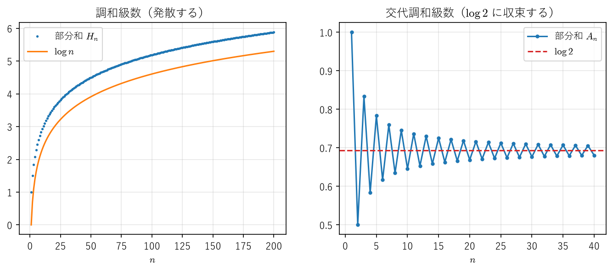
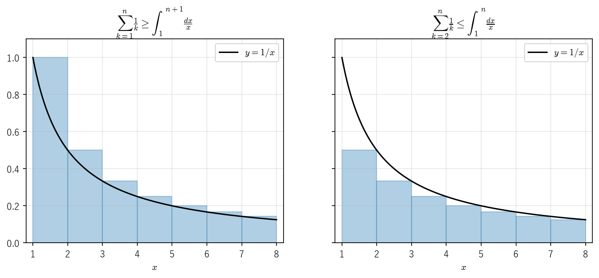
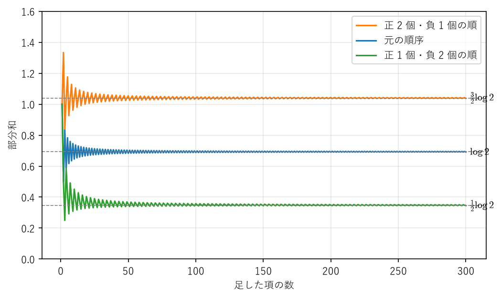

級数
====

数列の項を順に足し合わせたものを級数という。:math:`e^x` や :math:`\sin x` の計算、信号のフーリエ級数展開、確率分布の母関数など、工学で使う多くの量は無限個の項の和として表される。計算機で無限個の項を足すことはできないので、実際には有限個で打ち切る。そのとき「そもそも和は存在するのか」「何項で打ち切れば誤差がどれだけになるのか」を答えるのが本章の内容である。

本章ではまず級数の収束を数列の収束に帰着させて定義し、正項級数の収束判定法を整える。次に、絶対収束と条件収束の違いを調べ、条件収束する級数は項を並べ替えるだけで和が変わってしまうという、直感に反する事実（リーマンの再配列定理）を示す。最後に、級数を打ち切ったときの誤差を見積もる方法を述べる。

級数の収束と発散
----------------

.. _ch03-def-series:

.. admonition:: 定義 3.1（級数の収束）
   :class: definition

   数列 :math:`(a_n)_{n \geq 1}` に対して、:math:`S_n = a_1 + a_2 + \cdots + a_n` を第 :math:`n` 部分和という。部分和の数列 :math:`(S_n)` が実数 :math:`S` に収束するとき、級数 :math:`\sum_{n=1}^{\infty} a_n` は :math:`S` に収束するといい、:math:`S` を級数の和と呼んで

   .. math::

      \sum_{n=1}^{\infty} a_n = S

   と書く。:math:`(S_n)` が収束しないとき、級数は発散するという。特に :math:`S_n \to \infty` のときは :math:`\sum_{n=1}^{\infty} a_n = \infty` と書く。

つまり、級数の収束とは部分和という数列の収束のことであり、第 2 章（:doc:`sequences`）の結果がそのまま使える。番号を :math:`n = 0` から始める級数や、有限個の項を取り除いた級数についても同様に定める。有限個の項を変えても収束・発散は変わらない（和の値は変わる）。

.. _ch03-ex-geometric:

.. admonition:: 例 3.1（等比級数）
   :class: example

   実数 :math:`r` に対して、:math:`\sum_{n=0}^{\infty} r^n` を考える。:math:`r \neq 1` のとき部分和は

   .. math::

      S_n = 1 + r + \cdots + r^{n-1} = \frac{1 - r^n}{1 - r}

   である。:math:`|r| < 1` ならば :math:`r^n \to 0` なので、級数は :math:`1/(1 - r)` に収束する。:math:`|r| \geq 1` ならば、次の定理 3.1 により級数は発散する（項 :math:`r^n` が 0 に収束しないため）。

.. _ch03-thm-term-test:

.. admonition:: 定理 3.1（収束の必要条件）
   :class: theorem

   級数 :math:`\sum_{n=1}^{\infty} a_n` が収束するならば、:math:`\lim_{n \to \infty} a_n = 0` である。

.. admonition:: 証明
   :class: proof

   和を :math:`S` とすると、:math:`a_n = S_n - S_{n-1} \to S - S = 0` である。

定理 3.1 の逆は成り立たない。その代表例が調和級数である。

.. _ch03-ex-harmonic:

.. admonition:: 例 3.2（調和級数）
   :class: example

   級数 :math:`\sum_{n=1}^{\infty} \frac{1}{n}` を調和級数という。項は 0 に収束するが、級数は発散する。実際、項を 2 のべきごとにまとめると

   .. math::

      \begin{aligned}
      S_{2^m} &= 1 + \frac{1}{2} + \left(\frac{1}{3} + \frac{1}{4}\right) + \left(\frac{1}{5} + \cdots + \frac{1}{8}\right) + \cdots + \left(\frac{1}{2^{m-1} + 1} + \cdots + \frac{1}{2^m}\right) \\
      &\geq 1 + \frac{1}{2} + 2 \cdot \frac{1}{4} + 4 \cdot \frac{1}{8} + \cdots + 2^{m-1} \cdot \frac{1}{2^m} = 1 + \frac{m}{2}
      \end{aligned}

   となる。:math:`(S_n)` は単調増加なので、:math:`S_n \to \infty` である。

部分和の増え方は非常に遅く、:math:`S_n` はおよそ :math:`\log n` 程度にしか増えない（命題 3.9）。:numref:`ch03-fig-partial-sums` の左図は調和級数の部分和、右図は後で扱う交代調和級数の部分和である。

.. _ch03-fig-partial-sums:

   調和級数の部分和（左）と交代調和級数の部分和（右）

級数の和の線形性は、数列の極限の性質からただちに従う。すなわち、:math:`\sum a_n = S`、:math:`\sum b_n = T` がともに収束するならば、実数 :math:`\alpha, \beta` に対して :math:`\sum (\alpha a_n + \beta b_n) = \alpha S + \beta T` である。

部分和の極限値が分からなくても収束を判定できるようにするには、第 2 章のコーシー列の考え方を使う。

.. _ch03-thm-cauchy:

.. admonition:: 定理 3.2（級数に対するコーシーの判定条件）
   :class: theorem

   級数 :math:`\sum_{n=1}^{\infty} a_n` が収束するための必要十分条件は、任意の :math:`\varepsilon > 0` に対してある :math:`N \in \mathbb{N}` が存在し、:math:`n > m \geq N` ならば

   .. math::

      |a_{m+1} + a_{m+2} + \cdots + a_n| < \varepsilon

   が成り立つことである。

.. admonition:: 証明
   :class: proof

   :math:`a_{m+1} + \cdots + a_n = S_n - S_m` であるから、条件は部分和 :math:`(S_n)` がコーシー列であることにほかならない。実数の数列が収束することとコーシー列であることは同値である（:ref:`コーシー列の収束 <ch02-thm-cauchy>`）。

正項級数
--------

すべての項が :math:`a_n \geq 0` である級数を正項級数という。正項級数の部分和は単調増加なので、収束の判定は簡単になる。

.. _ch03-thm-positive:

.. admonition:: 定理 3.3（正項級数の収束）
   :class: theorem

   正項級数 :math:`\sum_{n=1}^{\infty} a_n` が収束するための必要十分条件は、部分和の数列 :math:`(S_n)` が上に有界であることである。上に有界でないときは :math:`\sum_{n=1}^{\infty} a_n = \infty` となる。

.. admonition:: 証明
   :class: proof

   :math:`S_{n+1} - S_n = a_{n+1} \geq 0` なので :math:`(S_n)` は単調増加である。上に有界ならば\ :ref:`単調収束定理 <ch02-thm-monotone>`\ により収束する。逆に収束する数列は有界である。上に有界でなければ、任意の :math:`M` に対して :math:`S_N > M` となる :math:`N` があり、単調性から :math:`n \geq N` で :math:`S_n > M` となるので :math:`S_n \to \infty` である。

比較判定法
^^^^^^^^^^

.. _ch03-thm-comparison:

.. admonition:: 定理 3.4（比較判定法）
   :class: theorem

   すべての :math:`n` で :math:`0 \leq a_n \leq b_n` とする。

   1. :math:`\sum b_n` が収束するならば :math:`\sum a_n` も収束する。
   2. :math:`\sum a_n` が発散するならば :math:`\sum b_n` も発散する。

.. admonition:: 証明
   :class: proof

   :math:`a_1 + \cdots + a_n \leq b_1 + \cdots + b_n \leq \sum_{k=1}^{\infty} b_k` なので、1 は定理 3.3 から従う。2 は 1 の対偶である。

この定理は「有限個の :math:`n` を除いて :math:`a_n \leq b_n`」としても成り立ち、さらに正の定数 :math:`C` に対して :math:`a_n \leq C b_n` としても成り立つ。

.. _ch03-ex-basel:

.. admonition:: 例 3.3（:math:`\sum 1/n^2` の収束）
   :class: example

   :math:`n \geq 2` のとき :math:`\frac{1}{n^2} \leq \frac{1}{n(n-1)} = \frac{1}{n-1} - \frac{1}{n}` である。右辺の和は

   .. math::

      \sum_{k=2}^{n} \left(\frac{1}{k-1} - \frac{1}{k}\right) = 1 - \frac{1}{n} \leq 1

   と途中の項が打ち消し合うので有界である。よって比較判定法により :math:`\sum_{n=1}^{\infty} 1/n^2` は収束し、和は 2 以下である。実際の和は :math:`\pi^2/6` であることが知られている（フーリエ級数を用いた証明は [SteinShakarchi2003a]_ を参照）。

ダランベールの判定法とコーシーの判定法
^^^^^^^^^^^^^^^^^^^^^^^^^^^^^^^^^^^^^^

等比級数と比較することで、実用的な判定法が得られる。

.. _ch03-thm-ratio:

.. admonition:: 定理 3.5（ダランベールの判定法）
   :class: theorem

   すべての :math:`n` で :math:`a_n > 0` とし、極限 :math:`r = \lim_{n \to \infty} \frac{a_{n+1}}{a_n}` が存在する（:math:`r = \infty` も許す）とする。

   1. :math:`r < 1` ならば :math:`\sum a_n` は収束する。
   2. :math:`r > 1` ならば :math:`\sum a_n` は発散する。

.. admonition:: 証明
   :class: proof

   1. :math:`r < s < 1` となる :math:`s` をとる。極限の定義から、ある :math:`N` があって :math:`n \geq N` ならば :math:`a_{n+1}/a_n < s`、すなわち :math:`a_{n+1} < s \, a_n` となる。これを繰り返し用いると、:math:`n \geq N` で :math:`a_n \leq a_N s^{n-N}` を得る。右辺を項とする級数は公比 :math:`s` の等比級数の定数倍なので収束し、比較判定法により :math:`\sum a_n` も収束する。

   2. ある :math:`N` があって :math:`n \geq N` ならば :math:`a_{n+1}/a_n > 1` となる。このとき :math:`n \geq N` で :math:`a_n \geq a_N > 0` なので :math:`a_n` は 0 に収束せず、定理 3.1 により級数は発散する。

.. _ch03-thm-root:

.. admonition:: 定理 3.6（コーシーの判定法）
   :class: theorem

   すべての :math:`n` で :math:`a_n \geq 0` とし、極限 :math:`r = \lim_{n \to \infty} \sqrt[n]{a_n}` が存在する（:math:`r = \infty` も許す）とする。:math:`r < 1` ならば :math:`\sum a_n` は収束し、:math:`r > 1` ならば発散する。

.. admonition:: 証明
   :class: proof

   :math:`r < 1` のとき、:math:`r < s < 1` となる :math:`s` をとると、ある :math:`N` があって :math:`n \geq N` ならば :math:`\sqrt[n]{a_n} < s`、すなわち :math:`a_n < s^n` となる。等比級数との比較により収束する。:math:`r > 1` のときは、十分大きい :math:`n` で :math:`\sqrt[n]{a_n} > 1`、すなわち :math:`a_n > 1` となるので、:math:`a_n` は 0 に収束せず発散する。

.. _ch03-ex-ratio:

.. admonition:: 例 3.4
   :class: example

   :math:`\sum_{n=1}^{\infty} \frac{n}{2^n}` では :math:`\frac{a_{n+1}}{a_n} = \frac{n+1}{2n} \to \frac{1}{2} < 1` なので、級数は収束する。

.. admonition:: 注意
   :class: note

   :math:`r = 1` のときは、どちらの判定法でも収束・発散を判定できない。たとえば :math:`\sum 1/n` と :math:`\sum 1/n^2` はどちらも :math:`r = 1` であるが、前者は発散し後者は収束する。このような級数には、次の積分判定法が有効である。

積分判定法
^^^^^^^^^^

ここでは第 7 章（:doc:`integration`）の内容を先取りして、次の積分の性質を使う。

* 有界閉区間上の単調関数は積分可能である。
* :math:`[a, b]` で :math:`g(x) \leq h(x)` ならば :math:`\int_a^b g(x) \,dx \leq \int_a^b h(x) \,dx` である（積分の単調性）。
* :math:`\int_a^b g(x) \,dx + \int_b^c g(x) \,dx = \int_a^c g(x) \,dx` である（積分区間に関する加法性）。

.. _ch03-thm-integral-test:

.. admonition:: 定理 3.7（積分判定法）
   :class: theorem

   関数 :math:`f \colon [1, \infty) \to \mathbb{R}` は :math:`f(x) \geq 0` を満たし、単調減少であるとする。このとき、すべての :math:`n \geq 2` に対して

   .. math::
      :label: ch03-eq-integral-test

      \sum_{k=2}^{n} f(k) \leq \int_1^n f(x) \,dx \leq \sum_{k=1}^{n-1} f(k)

   が成り立つ。したがって、級数 :math:`\sum_{n=1}^{\infty} f(n)` が収束するための必要十分条件は、数列 :math:`I_n = \int_1^n f(x) \,dx` が上に有界であることである。

.. admonition:: 証明
   :class: proof

   :math:`k \leq x \leq k + 1` のとき、:math:`f` は単調減少なので :math:`f(k+1) \leq f(x) \leq f(k)` である。これを :math:`[k, k+1]` で積分すると、積分の単調性から

   .. math::

      f(k+1) \leq \int_k^{k+1} f(x) \,dx \leq f(k)

   となる。:math:`k = 1, 2, \ldots, n-1` について辺々を加え、積分区間に関する加法性を用いると :eq:`ch03-eq-integral-test` を得る。左側の不等式から、:math:`(I_n)` が上に有界ならば正項級数 :math:`\sum f(n)` の部分和も上に有界であり、定理 3.3 により収束する。右側の不等式から、級数が収束すれば :math:`I_n` はその和で上から押さえられる。

:numref:`ch03-fig-integral-test` は、:math:`f(x) = 1/x` の場合に :eq:`ch03-eq-integral-test` の意味を図示したものである。各長方形の面積が :math:`f(k)` に等しく、左図では長方形が曲線の上に、右図では曲線の下にある。

.. _ch03-fig-integral-test:

   積分判定法の考え方（:math:`f(x) = 1/x` の場合）

.. _ch03-cor-p-series:

.. admonition:: 系 3.8（:math:`p` 級数）
   :class: theorem

   実数 :math:`p` に対して、級数 :math:`\sum_{n=1}^{\infty} \frac{1}{n^p}` は :math:`p > 1` ならば収束し、:math:`p \leq 1` ならば発散する。

.. admonition:: 証明
   :class: proof

   :math:`p \leq 0` のときは項が 0 に収束しないので発散する。:math:`p > 0` のとき :math:`f(x) = x^{-p}` は正で単調減少であり、

   .. math::

      \int_1^n x^{-p} \,dx =
      \begin{cases}
      \dfrac{1 - n^{1-p}}{p - 1} & (p \neq 1) \\
      \log n & (p = 1)
      \end{cases}

   である。これは :math:`p > 1` ならば :math:`1/(p - 1)` 以下で有界であり、:math:`0 < p \leq 1` ならば :math:`n \to \infty` で発散する。定理 3.7 から結論を得る。

積分判定法の不等式からは、調和級数の部分和 :math:`H_n = 1 + \frac{1}{2} + \cdots + \frac{1}{n}` が :math:`\log n` とどれだけ違うかも分かる。

.. _ch03-prop-euler:

.. admonition:: 命題 3.9（オイラーの定数）
   :class: theorem

   数列 :math:`c_n = H_n - \log n` は単調減少かつ下に有界であり、ある実数 :math:`\gamma` に収束する。すなわち

   .. math::

      H_n = \log n + \gamma + o(1) \quad (n \to \infty)

   である。ここで :math:`o(1)` は :math:`n \to \infty` で 0 に収束する量を表す。:math:`\gamma = 0.5772\ldots` をオイラーの定数という。

.. admonition:: 証明
   :class: proof

   :math:`\log x = \int_1^x \frac{dt}{t}` である。:math:`n \leq t \leq n+1` で :math:`\frac{1}{t} \geq \frac{1}{n+1}` なので

   .. math::

      c_n - c_{n+1} = \int_n^{n+1} \frac{dt}{t} - \frac{1}{n+1} = \int_n^{n+1} \left(\frac{1}{t} - \frac{1}{n+1}\right) dt \geq 0

   となり、:math:`(c_n)` は単調減少である。また、:eq:`ch03-eq-integral-test` の右側の不等式を :math:`n+1` に対して用いると :math:`\log(n+1) \leq H_n` なので、:math:`c_n \geq \log(n+1) - \log n > 0` である。:ref:`単調収束定理 <ch02-thm-monotone>`\ により :math:`(c_n)` は収束する。

判定法のまとめ
^^^^^^^^^^^^^^

正項級数の判定法を次の表にまとめる。

.. list-table:: 正項級数の収束判定法
   :header-rows: 1
   :widths: 25 40 35

   * - 判定法
     - 主張の要点
     - 向いている級数
   * - 比較判定法（定理 3.4）
     - 収束が分かっている級数で上から押さえる
     - 有理式など、既知の級数と形が近いもの
   * - ダランベールの判定法（定理 3.5）
     - 隣り合う項の比の極限が 1 より小さければ収束
     - 階乗や指数関数を含むもの
   * - コーシーの判定法（定理 3.6）
     - 第 :math:`n` 項の :math:`n` 乗根の極限が 1 より小さければ収束
     - :math:`n` 乗の形をした項
   * - 積分判定法（定理 3.7）
     - 単調減少関数の積分と比べる
     - 比の極限が 1 になる、べき関数や対数を含むもの

絶対収束と条件収束
------------------

項の符号が変わる級数では、収束の仕方に 2 種類の違いがある。

.. _ch03-def-absolute:

.. admonition:: 定義 3.2（絶対収束・条件収束）
   :class: definition

   級数 :math:`\sum a_n` について、:math:`\sum |a_n|` が収束するとき、:math:`\sum a_n` は絶対収束するという。:math:`\sum a_n` は収束するが絶対収束しないとき、条件収束するという。

.. _ch03-thm-abs-conv:

.. admonition:: 定理 3.10（絶対収束する級数は収束する）
   :class: theorem

   :math:`\sum a_n` が絶対収束するならば、:math:`\sum a_n` は収束し、:math:`\left| \sum_{n=1}^{\infty} a_n \right| \leq \sum_{n=1}^{\infty} |a_n|` が成り立つ。

.. admonition:: 証明
   :class: proof

   三角不等式より、:math:`n > m` に対して

   .. math::

      |a_{m+1} + \cdots + a_n| \leq |a_{m+1}| + \cdots + |a_n|

   である。:math:`\sum |a_n|` は収束するので、定理 3.2 により右辺は :math:`m` を十分大きくとればいくらでも小さくなる。したがって左辺も同じであり、再び定理 3.2 により :math:`\sum a_n` は収束する。不等式は :math:`|S_n| \leq \sum_{k=1}^{n} |a_k|` で :math:`n \to \infty` とすれば得られる。

符号が交互に変わる級数については、次の判定法がよく使われる。

.. _ch03-thm-leibniz:

.. admonition:: 定理 3.11（ライプニッツの判定法）
   :class: theorem

   数列 :math:`(a_n)` が :math:`a_n \geq 0`、単調減少、:math:`\lim_{n \to \infty} a_n = 0` を満たすとする。このとき交代級数

   .. math::

      \sum_{n=1}^{\infty} (-1)^{n+1} a_n = a_1 - a_2 + a_3 - a_4 + \cdots

   は収束する。さらに、和を :math:`S`、第 :math:`n` 部分和を :math:`S_n` とすると、すべての :math:`n` に対して

   .. math::
      :label: ch03-eq-leibniz-error

      |S - S_n| \leq a_{n+1}

   が成り立つ。

.. admonition:: 証明
   :class: proof

   偶数番目の部分和について :math:`S_{2m+2} - S_{2m} = a_{2m+1} - a_{2m+2} \geq 0`、奇数番目の部分和について :math:`S_{2m+3} - S_{2m+1} = -a_{2m+2} + a_{2m+3} \leq 0` である。また :math:`S_{2m+1} - S_{2m} = a_{2m+1} \geq 0` なので

   .. math::

      S_2 \leq S_4 \leq \cdots \leq S_{2m} \leq S_{2m+1} \leq \cdots \leq S_3 \leq S_1

   となる。:math:`(S_{2m})` は単調増加で :math:`S_1` で上に有界、:math:`(S_{2m+1})` は単調減少で :math:`S_2` で下に有界なので、:ref:`単調収束定理 <ch02-thm-monotone>`\ によりそれぞれ極限 :math:`S'`、:math:`S''` をもつ。:math:`S_{2m+1} - S_{2m} = a_{2m+1} \to 0` なので :math:`S' = S''` であり、これを :math:`S` とおく。

   :math:`(S_n)` 全体が :math:`S` に収束することを示す。:math:`\varepsilon > 0` に対して、:math:`m \geq M_1` で :math:`|S_{2m} - S| < \varepsilon`、:math:`m \geq M_2` で :math:`|S_{2m+1} - S| < \varepsilon` となる :math:`M_1, M_2` をとる。:math:`N = 2\max(M_1, M_2) + 1` とおけば、:math:`n \geq N` で :math:`|S_n - S| < \varepsilon` である。

   最後に、上の不等式の列から、:math:`S` はすべての :math:`m` について :math:`S_{2m} \leq S \leq S_{2m+1}` を満たし、:math:`S_{2m+2} \leq S \leq S_{2m+1}` も満たす。したがって :math:`n` が偶数でも奇数でも、:math:`S` は :math:`S_n` と :math:`S_{n+1}` の間にある。よって :math:`|S - S_n| \leq |S_{n+1} - S_n| = a_{n+1}` である。

.. _ch03-ex-alternating:

.. admonition:: 例 3.5（交代調和級数）
   :class: example

   交代調和級数 :math:`\sum_{n=1}^{\infty} \frac{(-1)^{n+1}}{n} = 1 - \frac{1}{2} + \frac{1}{3} - \cdots` は、ライプニッツの判定法により収束する。一方、各項の絶対値をとると調和級数になり発散するので、この級数は条件収束する。

   その和は :math:`\log 2` である。実際、第 :math:`2n` 部分和を :math:`A_{2n}` とすると、

   .. math::

      A_{2n} = \left(1 + \frac{1}{2} + \cdots + \frac{1}{2n}\right) - 2\left(\frac{1}{2} + \frac{1}{4} + \cdots + \frac{1}{2n}\right) = H_{2n} - H_n

   である。命題 3.9 より :math:`H_{2n} - H_n = (\log 2n + \gamma + o(1)) - (\log n + \gamma + o(1)) = \log 2 + o(1)` なので、:math:`A_{2n} \to \log 2` となる。級数が収束することは分かっているので、和は :math:`\log 2` である。

絶対収束する級数は、項の順序をどのように並べ替えても同じ和に収束する。並べ替えとは、全単射 :math:`\sigma \colon \mathbb{N} \to \mathbb{N}` を用いて、級数 :math:`\sum a_n` から級数 :math:`\sum a_{\sigma(n)}` を作ることである。各項はちょうど 1 回ずつ使われる。

.. _ch03-thm-abs-rearrangement:

.. admonition:: 定理 3.12（絶対収束する級数の並べ替え）
   :class: theorem

   :math:`\sum a_n` が絶対収束し、その和を :math:`S` とする。任意の全単射 :math:`\sigma \colon \mathbb{N} \to \mathbb{N}` に対して、級数 :math:`\sum a_{\sigma(n)}` も絶対収束し、その和は :math:`S` である。

.. admonition:: 証明
   :class: proof

   :math:`T_m = a_{\sigma(1)} + \cdots + a_{\sigma(m)}` とおく。:math:`\varepsilon > 0` を任意にとる。:math:`\sum |a_n|` は収束するので、ある :math:`N` があって :math:`\sum_{k=N+1}^{\infty} |a_k| < \varepsilon/2` となる。このとき :math:`|S - S_N| \leq \sum_{k=N+1}^{\infty} |a_k| < \varepsilon/2` である。

   :math:`\sigma` は全単射なので、:math:`\{1, 2, \ldots, N\} \subset \{\sigma(1), \ldots, \sigma(M)\}` となる :math:`M` がある。:math:`m \geq M` ならば、:math:`T_m - S_N` は :math:`a_1, \ldots, a_N` が打ち消されて、番号が :math:`N` より大きい項 :math:`a_k` の有限個の和になる。よって :math:`|T_m - S_N| \leq \sum_{k=N+1}^{\infty} |a_k| < \varepsilon/2` であり、

   .. math::

      |T_m - S| \leq |T_m - S_N| + |S_N - S| < \varepsilon

   となる。したがって :math:`T_m \to S` である。また :math:`|a_{\sigma(1)}| + \cdots + |a_{\sigma(m)}| \leq \sum_{k=1}^{\infty} |a_k|` なので、定理 3.3 により :math:`\sum |a_{\sigma(n)}|` も収束する。

リーマンの再配列定理
--------------------

条件収束する級数では、定理 3.12 はまったく成り立たない。まず具体例を見る。

.. _ch03-ex-rearrangement:

.. admonition:: 例 3.6（並べ替えで和が変わる例）
   :class: example

   交代調和級数の項を「正の項 2 個、負の項 1 個」の順に並べ替えた級数

   .. math::

      1 + \frac{1}{3} - \frac{1}{2} + \frac{1}{5} + \frac{1}{7} - \frac{1}{4} + \frac{1}{9} + \frac{1}{11} - \frac{1}{6} + \cdots

   を考える。第 :math:`3n` 部分和 :math:`T_{3n}` は、正の項 :math:`1, \frac{1}{3}, \ldots, \frac{1}{4n-1}` の和から負の項 :math:`\frac{1}{2}, \frac{1}{4}, \ldots, \frac{1}{2n}` の和を引いたものである。

   .. math::

      \begin{aligned}
      1 + \frac{1}{3} + \cdots + \frac{1}{4n-1} &= H_{4n} - \frac{1}{2} H_{2n}, \\
      \frac{1}{2} + \frac{1}{4} + \cdots + \frac{1}{2n} &= \frac{1}{2} H_n
      \end{aligned}

   なので、命題 3.9 を用いると

   .. math::

      \begin{aligned}
      T_{3n} &= H_{4n} - \frac{1}{2} H_{2n} - \frac{1}{2} H_n \\
      &= \log 4n - \frac{1}{2} \log 2n - \frac{1}{2} \log n + \left(1 - \frac{1}{2} - \frac{1}{2}\right) \gamma + o(1) \\
      &= \frac{3}{2} \log 2 + o(1)
      \end{aligned}

   となる。:math:`T_{3n+1}`、:math:`T_{3n+2}` と :math:`T_{3n}` との差は 0 に収束する項なので、並べ替えた級数は :math:`\frac{3}{2} \log 2` に収束する。元の和 :math:`\log 2` の 1.5 倍である。

:numref:`ch03-fig-rearrangement` は、元の順序、正 2 個・負 1 個の順、正 1 個・負 2 個の順の 3 通りについて部分和を描いたものである。同じ項を同じ回数だけ使っているにもかかわらず、極限は異なる。

.. _ch03-fig-rearrangement:

   交代調和級数の並べ替えと部分和

実は、条件収束する級数は並べ替えによって任意の値に収束させることができる。

.. _ch03-thm-rearrangement:

.. admonition:: 定理 3.13（リーマンの再配列定理）
   :class: theorem

   :math:`\sum a_n` が条件収束するとき、任意の実数 :math:`c` に対して、全単射 :math:`\sigma \colon \mathbb{N} \to \mathbb{N}` を適当に選ぶと :math:`\sum a_{\sigma(n)} = c` とできる。

.. admonition:: 証明
   :class: proof

   :math:`(a_n)` のうち :math:`a_n \geq 0` である項を元の順に :math:`P_1, P_2, \ldots` とし、:math:`a_n < 0` である項の絶対値を元の順に :math:`Q_1, Q_2, \ldots` とする。:math:`\sum a_n` は収束するので :math:`a_n \to 0` であり、したがって :math:`P_k \to 0`、:math:`Q_k \to 0` である。

   まず :math:`\sum P_k = \infty` かつ :math:`\sum Q_k = \infty` を示す。:math:`p_n = \max(a_n, 0)`、:math:`q_n = \max(-a_n, 0)` とおくと、:math:`a_n = p_n - q_n`、:math:`|a_n| = p_n + q_n` であり、:math:`\sum p_n` と :math:`\sum P_k`、:math:`\sum q_n` と :math:`\sum Q_k` は 0 の項を除けば同じ級数である。もし :math:`\sum p_n` が収束すれば、:math:`q_n = p_n - a_n` より :math:`\sum q_n` も収束し、:math:`\sum |a_n| = \sum (p_n + q_n)` が収束してしまう。これは条件収束の仮定に反する。:math:`\sum q_n` が収束する場合も同様である。

   次の手順で項を並べる。部分和が :math:`c` を超えるまで :math:`P_1, P_2, \ldots` を順に足し、超えたら部分和が :math:`c` 以下になるまで :math:`Q_1, Q_2, \ldots` を順に引く。これを繰り返す。:math:`\sum P_k` と :math:`\sum Q_k` は有限個の項を除いても発散するので、各段階は有限回で終わる。最初の段階（:math:`c < 0` なら 0 項で終わる）を除けば各段階は少なくとも 1 つの項を使い、足す段階と引く段階は交互に限りなく続くので、すべての項がちょうど 1 回ずつ使われる。つまり、この手順は並べ替えを定める。

   部分和が初めて :math:`c` を超えた後の部分和 :math:`T_m` と :math:`c` との差を評価する。足す段階を終わらせた項（それを足したことで部分和が初めて :math:`c` を超えた項）を :math:`P_i` とする。この項を足す直前の部分和は :math:`c` 以下なので、その後の引く段階の間は :math:`c < T_m \leq c + P_i` である。同様に、引く段階を終わらせた項を :math:`Q_j` とすると、その後の足す段階の間は :math:`c - Q_j < T_m \leq c` である。したがって :math:`|T_m - c|` は、直前の段階を終わらせた項以下である。段階が進むにつれて、段階を終わらせる項の番号 :math:`i, j` は限りなく大きくなるので、:math:`P_k \to 0`、:math:`Q_k \to 0` より :math:`T_m \to c` となる。

同様の手順で、部分和を :math:`\infty` や :math:`-\infty` に発散させる並べ替えも作れる。

.. admonition:: 注意
   :class: note

   計算機で級数を数値的に足すときも、足す順序は結果に影響する。ただしその原因は再配列定理とは別であり、浮動小数点数の加算が結合法則を満たさないことによる（浮動小数点数については\ :doc:`real_numbers`\ を参照）。たとえば大きさの大きく異なる数を足すと、小さい方の数の下位の桁が丸め誤差で失われる。並列計算で和の順序が実行ごとに変わると、結果が微妙に変わることがあるのはこのためである。本章のサンプルコードでは、丸め誤差を抑えて和を計算する標準ライブラリの関数 ``math.fsum`` を使っている。

級数の打ち切り誤差
------------------

計算機で級数の和を求めるときは、第 :math:`n` 部分和 :math:`S_n` で打ち切る。このときの打ち切り誤差 :math:`S - S_n = \sum_{k=n+1}^{\infty} a_k` を事前に見積もる方法を 3 つ挙げる。

1. 交代級数：ライプニッツの判定法の仮定を満たせば、:eq:`ch03-eq-leibniz-error` より誤差は最初に捨てた項 :math:`a_{n+1}` 以下である。
2. 単調減少する正項級数：:math:`a_k = f(k)` で :math:`f` が定理 3.7 の仮定を満たすとき、積分判定法の証明と同様にして、:math:`\sum_{k=n+1}^{\infty} f(k) \leq \int_n^{\infty} f(x) \,dx` が成り立つ。ここで右辺は :math:`\lim_{R \to \infty} \int_n^R f(x) \,dx` を表す（広義積分。第 7 章で扱う）。たとえば :math:`\sum 1/k^2` では誤差は :math:`\int_n^{\infty} x^{-2} \,dx = 1/n` 以下である。
3. 比が 1 より小さい正項級数：:math:`k \geq n+1` で :math:`a_{k+1}/a_k \leq s < 1` ならば、:math:`\sum_{k=n+1}^{\infty} a_k \leq a_{n+1}(1 + s + s^2 + \cdots) = \frac{a_{n+1}}{1 - s}` である。

.. _ch03-ex-e:

.. admonition:: 例 3.7（ネイピア数の計算）
   :class: example

   第 6 章（:doc:`taylor`）で示すように :math:`e = \sum_{k=0}^{\infty} \frac{1}{k!}` である。第 :math:`n` 項 :math:`\frac{1}{n!}` までで打ち切ったときの誤差は、:math:`k \geq n + 1` で :math:`\frac{a_{k+1}}{a_k} = \frac{1}{k+1} \leq \frac{1}{n+2}` なので

   .. math::

      e - \sum_{k=0}^{n} \frac{1}{k!} \leq \frac{1}{(n+1)!} \cdot \frac{1}{1 - \frac{1}{n+2}} = \frac{n+2}{(n+1)! \, (n+1)}

   以下である。:math:`n = 10` で約 :math:`2.7 \times 10^{-8}` となる。この級数は速く収束するが、:math:`\sum 1/k^2` は誤差を :math:`10^{-8}` にするのに約 :math:`10^8` 項も必要になる。級数ごとに収束の速さが大きく異なることに注意する。

数値実験
^^^^^^^^

ここまでの内容を Python で確かめる。サンプルコード :download:`ch03_series.py <../examples/ch03_series.py>` は、調和級数と交代調和級数の部分和、交代調和級数の並べ替え、:math:`\sum 1/k^2` の打ち切り誤差を計算する。次は並べ替えを行う関数の部分である。

.. literalinclude:: ../examples/ch03_series.py
   :language: python
   :linenos:
   :pyobject: rearranged_partial_sum

リーマンの再配列定理の証明と同じ手順で、目標値 ``target`` に向けて並べ替える関数は次のとおりである。

.. literalinclude:: ../examples/ch03_series.py
   :language: python
   :linenos:
   :pyobject: riemann_rearrangement

実行結果は次のとおりである。

.. code-block:: text
   :linenos:

   1. 調和級数と交代調和級数の部分和
   H_n: 調和級数の部分和、A_n: 交代調和級数の部分和
          n          H_n        log n            A_n
         10     2.928968     2.302585     0.64563492
        100     5.187378     4.605170     0.68817218
       1000     7.485471     6.907755     0.69264743
      10000     9.787606     9.210340     0.69309718
     100000    12.090146    11.512925     0.69314218
   log 2 = 0.69314718

   2. 交代調和級数の並べ替え（100000 項までの部分和）
     0.693142  元の順序（log 2 = 0.693147）
     1.039721  正 2 個・負 1 個の順（3/2 log 2 = 1.039721）
     0.346585  正 1 個・負 2 個の順（1/2 log 2 = 0.346574）
    -0.000003  目標 0.000000 に向けた並べ替え
     1.000002  目標 1.000000 に向けた並べ替え
     3.141553  目標 3.141593 に向けた並べ替え

   3. 1/k^2 の打ち切り誤差と上界 1/n
          n          error            1/n
         10   9.516634e-02   1.000000e-01
        100   9.950167e-03   1.000000e-02
       1000   9.995002e-04   1.000000e-03
      10000   9.999500e-05   1.000000e-04

1 では、:math:`H_n - \log n` が 0.58 前後に近づいていく様子が分かる（命題 3.9 のオイラーの定数）。また、交代調和級数の第 :math:`n` 部分和と :math:`\log 2` との差は、:eq:`ch03-eq-leibniz-error` の上界 :math:`1/(n+1)` 以下になっている。2 では、同じ項を並べ替えるだけで部分和が 0、1、:math:`\pi` などの目標値に近づく。3 では、誤差が上界 :math:`1/n` 以下であり、しかも上界がほぼ正確であることが分かる。

まとめ
------

* 級数の収束は部分和の数列の収束として定義される。項が 0 に収束することは収束の必要条件であるが、十分条件ではない（調和級数）。
* 正項級数は部分和が上に有界なら収束する。比較判定法、ダランベールの判定法、コーシーの判定法、積分判定法を使い分ける。
* 絶対収束する級数は収束し、項を並べ替えても和は変わらない。
* 条件収束する級数は、項を並べ替えると任意の値に収束させられる（リーマンの再配列定理）。
* 級数を打ち切るときは、交代級数なら最初に捨てた項、単調減少する正項級数なら積分、比が 1 より小さい級数なら等比級数で誤差を見積もれる。

演習問題
--------

.. admonition:: 問題 3.1
   :class: exercise

   級数 :math:`\sum_{n=1}^{\infty} \frac{1}{n(n+1)}` の和を求めよ。

.. admonition:: 問題 3.2
   :class: exercise

   級数 :math:`\sum_{n=1}^{\infty} \frac{n^2}{2^n}` が収束することを示せ。

.. admonition:: 問題 3.3
   :class: exercise

   級数 :math:`\sum_{n=2}^{\infty} \frac{1}{n \log n}` が発散することを示せ。

.. admonition:: 問題 3.4
   :class: exercise

   級数 :math:`\sum_{n=1}^{\infty} \frac{(-1)^{n+1}}{\sqrt{n}}` が条件収束することを示せ。

.. admonition:: 問題 3.5
   :class: exercise

   級数 :math:`\sum_{k=1}^{\infty} \frac{(-1)^{k+1}}{k^2}` の和を、誤差 :math:`10^{-4}` 以下で求めたい。ライプニッツの判定法の誤差評価を用いると、何項まで足せば十分か。

.. admonition:: 問題 3.6
   :class: exercise

   級数 :math:`\sum_{n=1}^{\infty} \frac{n}{n+1}` が発散することを示せ。

略解
----

.. admonition:: 問題 3.1 の略解
   :class: solution

   :math:`\frac{1}{n(n+1)} = \frac{1}{n} - \frac{1}{n+1}` なので、第 :math:`n` 部分和は :math:`1 - \frac{1}{n+1}` となり、和は 1 である。

.. admonition:: 問題 3.2 の略解
   :class: solution

   :math:`\frac{a_{n+1}}{a_n} = \frac{(n+1)^2}{2n^2} \to \frac{1}{2} < 1` なので、ダランベールの判定法により収束する。

.. admonition:: 問題 3.3 の略解
   :class: solution

   :math:`f(x) = \frac{1}{x \log x}` は :math:`[2, \infty)` で正かつ単調減少である。積分判定法は始点を 2 にしても同様に成り立つ。:math:`(\log \log x)' = \frac{1}{x \log x}` なので :math:`\int_2^n f(x) \,dx = \log \log n - \log \log 2 \to \infty` となり、級数は発散する。

.. admonition:: 問題 3.4 の略解
   :class: solution

   :math:`a_n = 1/\sqrt{n}` は正で単調減少し 0 に収束するので、ライプニッツの判定法により級数は収束する。一方、:math:`\sum 1/\sqrt{n}` は :math:`p = 1/2 \leq 1` の :math:`p` 級数なので発散する（系 3.8）。よって条件収束する。

.. admonition:: 問題 3.5 の略解
   :class: solution

   :math:`n` 項まで足したときの誤差は :math:`\frac{1}{(n+1)^2}` 以下である。:math:`\frac{1}{(n+1)^2} \leq 10^{-4}` となるのは :math:`n + 1 \geq 100`、すなわち :math:`n \geq 99` のときなので、99 項まで足せば十分である。

.. admonition:: 問題 3.6 の略解
   :class: solution

   :math:`\frac{n}{n+1} \to 1 \neq 0` なので、定理 3.1 により発散する。
