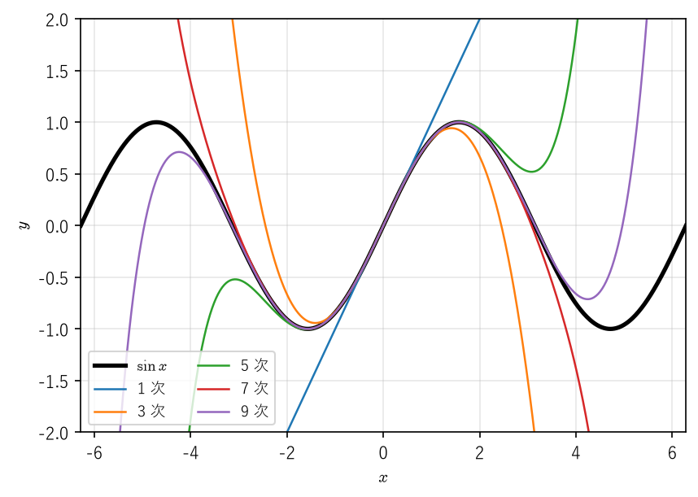
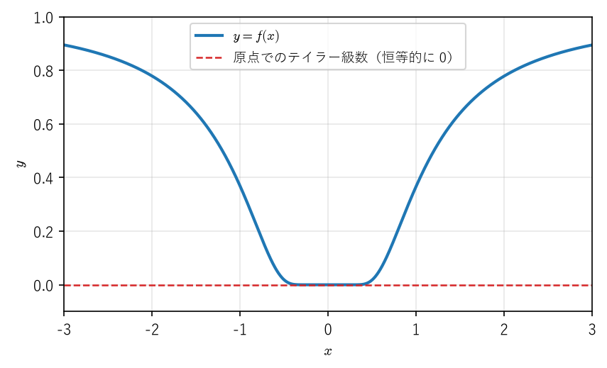
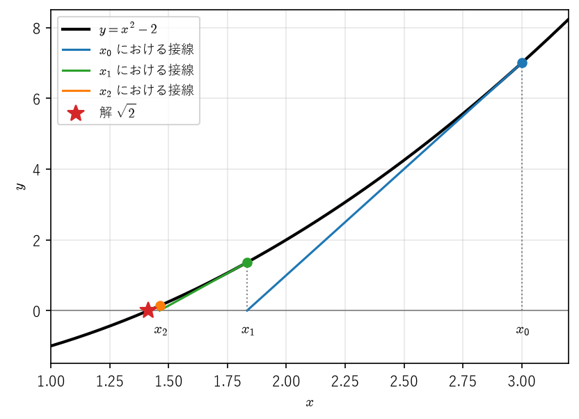

テイラーの定理と近似
====================

:doc:`differentiation`\ では、微分可能な関数が 1 次関数で近似できることを見た。本章では、これを高次の多項式による近似に拡張する\ **テイラーの定理**\ を扱う。テイラーの定理は、近似の誤差（剰余項）を導関数の大きさで具体的に評価できる点に価値がある。

工学では、非線形な現象を扱いやすい形にするために、関数を多項式で近似する場面が非常に多い。振り子の運動方程式の線形化、測定誤差が計算結果に与える影響の見積もり（誤差伝播）、方程式を解くニュートン法の収束の速さの解析などは、いずれもテイラーの定理の応用である。本章ではこれらを順に扱う。

ランダウの記号
--------------

近似の誤差の「大きさの程度」を簡潔に書くために、ランダウの記号を導入する。

.. _ch06-def-landau:

.. admonition:: 定義 6.1（ランダウの記号）
   :class: definition

   関数 :math:`f`、:math:`g` が点 :math:`a` の近く（:math:`a` を除いてもよい）で定義されているとする。

   1. ある定数 :math:`C > 0` と :math:`\delta > 0` が存在して、:math:`0 < |x - a| < \delta` ならば :math:`|f(x)| \leq C|g(x)|` となるとき、:math:`f(x) = O(g(x))`\ （:math:`x \to a`）と書く。
   2. 任意の :math:`\varepsilon > 0` に対してある :math:`\delta > 0` が存在して、:math:`0 < |x - a| < \delta` ならば :math:`|f(x)| \leq \varepsilon|g(x)|` となるとき、:math:`f(x) = o(g(x))`\ （:math:`x \to a`）と書く。

   :math:`a` の近くで :math:`g(x) \neq 0` ならば、:math:`f(x) = o(g(x))` は :math:`\displaystyle \lim_{x \to a} \frac{f(x)}{g(x)} = 0` と同値である。:math:`x \to \infty` の場合も、「:math:`0 < |x - a| < \delta`」を「:math:`x > R`」に置き換えて同様に定める。

:math:`O(g)` は「:math:`g` の定数倍で抑えられる量」、:math:`o(g)` は「:math:`g` に比べて無視できる量」を表す。この記法を使うと、:ref:`定理 5.1 <ch05-thm-linear>` の条件 2 は :math:`f(a + h) = f(a) + f'(a)h + o(h)`\ （:math:`h \to 0`）と書ける。また\ :ref:`定理 5.16 <ch05-thm-truncation>` は、前進差分の打ち切り誤差が :math:`O(h)`、中心差分の打ち切り誤差が :math:`O(h^2)` であることを意味する。

ランダウの記号を含む等式は、左辺を右辺の性質をもつ量の 1 つとして読む約束であり、左右を入れ替えてはならない。たとえば :math:`x^2 = o(x)` と :math:`x^3 = o(x)` から :math:`x^2 = x^3` は導けない。:math:`x \to 0` のとき、次の性質がよく使われる（いずれも定義から直ちに確かめられる）。

.. list-table:: ランダウの記号の計算規則（:math:`x \to 0`、:math:`m`、:math:`k` は 0 以上の整数）
   :header-rows: 1
   :widths: 50 50
   :name: ch06-tab-landau

   * - 規則
     - 意味
   * - :math:`o(x^m) + o(x^m) = o(x^m)`
     - 無視できる量の和は無視できる
   * - :math:`x^k \, o(x^m) = o(x^{m + k})`
     - 掛ける量の次数だけ次数が上がる
   * - :math:`o(x^m) \, o(x^k) = o(x^{m + k})`
     - 無視できる量どうしの積
   * - :math:`O(x^{m + 1}) = o(x^m)`
     - 高次の項は低次の項に比べて無視できる
   * - :math:`c \, o(x^m) = o(x^m)`\ （:math:`c` は定数）
     - 定数倍しても変わらない

テイラーの定理
--------------

テイラー多項式
^^^^^^^^^^^^^^

.. _ch06-def-cn:

.. admonition:: 定義 6.2（:math:`C^n` 級）
   :class: definition

   開区間 :math:`I` 上の関数 :math:`f` が :math:`I` で :math:`n` 回微分可能で、:math:`f^{(n)}` が :math:`I` で連続であるとき、:math:`f` は :math:`I` で :math:`C^n` 級であるという。すべての :math:`n` について :math:`C^n` 級であるとき、:math:`C^\infty` 級（無限回微分可能）であるという。

   有界閉区間 :math:`[a, b]` 上の関数については、端点 :math:`a`、:math:`b` での微分係数を片側極限（右側微分係数、左側微分係数）で定め、同様に :math:`[a, b]` で :math:`C^n` 級であるという。

.. _ch06-def-taylor-poly:

.. admonition:: 定義 6.3（テイラー多項式）
   :class: definition

   関数 :math:`f` が点 :math:`a` で :math:`n` 回微分可能であるとき、

   .. math::

      T_n(x) = \sum_{k=0}^{n} \frac{f^{(k)}(a)}{k!}(x - a)^k = f(a) + f'(a)(x - a) + \frac{f''(a)}{2!}(x - a)^2 + \cdots + \frac{f^{(n)}(a)}{n!}(x - a)^n

   を、:math:`f` の :math:`a` における :math:`n` 次の\ **テイラー多項式**\ という。:math:`a = 0` の場合を特に\ **マクローリン多項式**\ という。ここで :math:`f^{(0)} = f`、:math:`0! = 1` とする。

:math:`T_n` は、:math:`a` における :math:`0` 階から :math:`n` 階までの微分係数が :math:`f` と一致する唯一の :math:`n` 次以下の多項式である。実際、:math:`T_n^{(k)}(a) = f^{(k)}(a)`\ （:math:`0 \leq k \leq n`）が直接の計算で確かめられる。

ラグランジュ形の剰余項
^^^^^^^^^^^^^^^^^^^^^^

.. _ch06-thm-taylor:

.. admonition:: 定理 6.1（テイラーの定理）
   :class: theorem

   関数 :math:`f` が開区間 :math:`I` で :math:`n` 回微分可能（:math:`n \geq 1`）であり、:math:`a, x \in I`、:math:`x \neq a` とする。このとき、:math:`a` と :math:`x` の間にある（両端を含まない）ある :math:`c` が存在して

   .. math::
      :label: ch06-eq-taylor

      f(x) = \sum_{k=0}^{n-1} \frac{f^{(k)}(a)}{k!}(x - a)^k + \frac{f^{(n)}(c)}{n!}(x - a)^n

   が成り立つ。最後の項 :math:`R_n(x) = \dfrac{f^{(n)}(c)}{n!}(x - a)^n` を\ **ラグランジュ形の剰余項**\ という。

.. admonition:: 証明
   :class: proof

   :math:`x` を固定する。:math:`(x - a)^n \neq 0` であるから、定数 :math:`K` を

   .. math::

      f(x) = \sum_{k=0}^{n-1} \frac{f^{(k)}(a)}{k!}(x - a)^k + K(x - a)^n

   が成り立つように定めることができる。:math:`K = f^{(n)}(c)/n!` を満たす :math:`c` が存在することを示せばよい。:math:`t \in I` の関数

   .. math::

      F(t) = f(x) - \sum_{k=0}^{n-1} \frac{f^{(k)}(t)}{k!}(x - t)^k - K(x - t)^n

   を考える。:math:`K` の定め方から :math:`F(a) = 0` であり、:math:`t = x` とすると和は :math:`k = 0` の項 :math:`f(x)` だけが残るので :math:`F(x) = 0` である。:math:`f` は :math:`n` 回微分可能であるから :math:`f^{(k)}`\ （:math:`0 \leq k \leq n - 1`）は微分可能であり、:math:`F` は :math:`I` で微分可能である。積の微分により

   .. math::

      \frac{d}{dt}\left(\frac{f^{(k)}(t)}{k!}(x - t)^k\right) = \frac{f^{(k+1)}(t)}{k!}(x - t)^k - \frac{f^{(k)}(t)}{(k - 1)!}(x - t)^{k - 1} \quad (k \geq 1)

   であり、:math:`k = 0` のときは :math:`f'(t)` である。これらを :math:`k = 0` から :math:`n - 1` まで足し合わせると、隣り合う項が打ち消し合って :math:`\dfrac{f^{(n)}(t)}{(n - 1)!}(x - t)^{n - 1}` だけが残る。したがって

   .. math::

      F'(t) = -\frac{f^{(n)}(t)}{(n - 1)!}(x - t)^{n - 1} + nK(x - t)^{n - 1}

   となる。:math:`F` は :math:`a` と :math:`x` を両端とする閉区間で連続、その内部で微分可能であり、両端で 0 となるから、:ref:`ロルの定理 <ch05-thm-rolle>`\ により、:math:`a` と :math:`x` の間に :math:`F'(c) = 0` となる :math:`c` が存在する。:math:`(x - c)^{n - 1} \neq 0` であるから :math:`K = \dfrac{f^{(n)}(c)}{n!}` を得る。

:math:`n = 1` の場合、式 :eq:`ch06-eq-taylor` は :math:`f(x) = f(a) + f'(c)(x - a)` となり、:ref:`平均値の定理 <ch05-thm-mvt>`\ そのものである。テイラーの定理は平均値の定理の高次への一般化である。

:math:`c` の位置は分からないが、:math:`f^{(n)}` の大きさの上界が分かれば、誤差を具体的に評価できる。

.. _ch06-cor-taylor:

.. admonition:: 系 6.2（剰余項の評価）
   :class: theorem

   1. 定理 6.1 の仮定のもとで、:math:`a` と :math:`x` の間で常に :math:`|f^{(n)}(t)| \leq M` ならば

      .. math::
         :label: ch06-eq-remainder-bound

         \left| f(x) - \sum_{k=0}^{n-1} \frac{f^{(k)}(a)}{k!}(x - a)^k \right| \leq \frac{M}{n!}|x - a|^n

   2. :math:`f` が :math:`a` を含む開区間 :math:`I` で :math:`C^n` 級ならば、

      .. math::
         :label: ch06-eq-peano

         f(x) = \sum_{k=0}^{n} \frac{f^{(k)}(a)}{k!}(x - a)^k + o((x - a)^n) \quad (x \to a)

.. admonition:: 証明
   :class: proof

   1 は式 :eq:`ch06-eq-taylor` から直ちに従う。2 について、:math:`x \neq a` に対して定理 6.1 の :math:`c = c_x` をとると、

   .. math::

      f(x) - \sum_{k=0}^{n} \frac{f^{(k)}(a)}{k!}(x - a)^k = \frac{f^{(n)}(c_x) - f^{(n)}(a)}{n!}(x - a)^n

   である。:math:`x \to a` のとき :math:`c_x \to a` であり、:math:`f^{(n)}` は :math:`a` で連続であるから :math:`f^{(n)}(c_x) - f^{(n)}(a) \to 0` となる。よって右辺は :math:`o((x - a)^n)` である。

.. admonition:: 注意
   :class: note

   :ref:`定理 5.16 <ch05-thm-truncation>` はテイラーの定理から直ちに得られる。たとえば前進差分では、:math:`n = 2` として :math:`f(a + h) = f(a) + f'(a)h + \dfrac{f''(\xi)}{2}h^2` となる :math:`\xi` が存在するから、:math:`D_{+}f(a; h) - f'(a) = \dfrac{f''(\xi)}{2}h` である。中心差分では、:math:`n = 3` として :math:`f(a + h)` と :math:`f(a - h)` を展開し、差をとればよい。

.. admonition:: 例 6.1（ランダウの記号を使った極限の計算）
   :class: example

   :math:`\sin x` は :math:`C^\infty` 級で、:math:`\sin 0 = 0`、:math:`(\sin)'(0) = 1`、:math:`(\sin)''(0) = 0`、:math:`(\sin)'''(0) = -1` であるから、系 6.2 の 2 より :math:`\sin x = x - \dfrac{x^3}{6} + o(x^3)`\ （:math:`x \to 0`）である。したがって

   .. math::

      \frac{x - \sin x}{x^3} = \frac{1}{x^3}\left(\frac{x^3}{6} + o(x^3)\right) = \frac{1}{6} + o(1) \to \frac{1}{6} \quad (x \to 0)

   となる。問題 5.3 でロピタルの定理を 3 回使って求めた極限が、1 行で得られる。

テイラー展開
------------

テイラー級数と解析的な関数
^^^^^^^^^^^^^^^^^^^^^^^^^^

:math:`n` を大きくしていくと、テイラー多項式は :math:`f` に近づくだろうか。これは剰余項 :math:`R_n(x)` が 0 に収束するかどうかの問題である。

.. _ch06-def-taylor-series:

.. admonition:: 定義 6.4（テイラー級数、解析的）
   :class: definition

   :math:`f` が点 :math:`a` を含む開区間で :math:`C^\infty` 級であるとき、級数

   .. math::

      \sum_{k=0}^{\infty} \frac{f^{(k)}(a)}{k!}(x - a)^k

   を :math:`f` の :math:`a` における\ **テイラー級数**\ という（:math:`a = 0` のときはマクローリン級数という）。:math:`a` のある近傍の各点 :math:`x` でテイラー級数が :math:`f(x)` に収束するとき、:math:`f` は :math:`a` で\ **解析的**\ であるという。:math:`f` がテイラー級数で表されることを、:math:`f` を\ **テイラー展開**\ する（:math:`a = 0` のときはマクローリン展開する）という。

級数の収束については「\ :doc:`series`\ 」を、べき級数の収束の範囲については\ :ref:`収束半径 <ch08-thm-radius>`\ を参照してほしい。定義から、テイラー級数が :math:`f(x)` に収束することは、剰余項について :math:`\lim_{n \to \infty} R_n(x) = 0` が成り立つことと同値である。

指数関数と三角関数
^^^^^^^^^^^^^^^^^^

.. _ch06-lem-factorial:

.. admonition:: 補題 6.3
   :class: theorem

   任意の実数 :math:`x` に対して :math:`\displaystyle \lim_{n \to \infty} \frac{|x|^n}{n!} = 0` である。

.. admonition:: 証明
   :class: proof

   :math:`m \geq 2|x|` を満たす自然数 :math:`m` をとる（:ref:`アルキメデスの原理 <ch01-thm-archimedes>`）。:math:`n > m` のとき、:math:`k > m` ならば :math:`|x|/k < 1/2` であるから

   .. math::

      0 \leq \frac{|x|^n}{n!} = \frac{|x|^m}{m!} \prod_{k=m+1}^{n} \frac{|x|}{k} \leq \frac{|x|^m}{m!} \left(\frac{1}{2}\right)^{n - m}

   となる。右辺は :math:`n \to \infty` で 0 に収束するので、はさみうちにより結論を得る。

.. _ch06-thm-exp-sin-cos:

.. admonition:: 定理 6.4（指数関数・三角関数のマクローリン展開）
   :class: theorem

   すべての実数 :math:`x` に対して、次が成り立つ。

   .. math::

      \begin{aligned}
      e^x &= \sum_{k=0}^{\infty} \frac{x^k}{k!} = 1 + x + \frac{x^2}{2!} + \frac{x^3}{3!} + \cdots \\
      \sin x &= \sum_{k=0}^{\infty} \frac{(-1)^k x^{2k+1}}{(2k+1)!} = x - \frac{x^3}{3!} + \frac{x^5}{5!} - \cdots \\
      \cos x &= \sum_{k=0}^{\infty} \frac{(-1)^k x^{2k}}{(2k)!} = 1 - \frac{x^2}{2!} + \frac{x^4}{4!} - \cdots
      \end{aligned}

.. admonition:: 証明
   :class: proof

   本書では、指数関数 :math:`e^x` の微分公式 :math:`(e^x)' = e^x` と、その底 :math:`e` が「\ :doc:`sequences`\ 」の\ :ref:`例 2.5 <ch02-ex-napier>`\ で定めたネイピア数に一致することは既知とする（指数関数の厳密な構成は [Sugiura1980]_ を参照）。:math:`f(x) = e^x` では、すべての :math:`k` で :math:`f^{(k)}(x) = e^x`、:math:`f^{(k)}(0) = 1` である。:math:`x \neq 0` を固定すると、定理 6.1 の :math:`c` は :math:`0` と :math:`x` の間にあるから :math:`e^c \leq e^{|x|}` であり、

   .. math::

      |R_n(x)| = \frac{e^c}{n!}|x|^n \leq e^{|x|} \frac{|x|^n}{n!}

   となる。:ref:`補題 6.3 <ch06-lem-factorial>` により右辺は :math:`n \to \infty` で 0 に収束する。:math:`\sin x`、:math:`\cos x` では、導関数は :math:`\pm\sin x`、:math:`\pm\cos x` のいずれかであるから :math:`|f^{(n)}(c)| \leq 1` であり、:math:`|R_n(x)| \leq |x|^n/n! \to 0` となる。:math:`0` における微分係数を計算すると、上の級数が得られる。

収束が保証されることと、少ない項数で精度よく近似できることは別問題である。ラグランジュ形の剰余項を使うと、必要な次数を事前に見積もれる。:math:`e = e^1` を :math:`n` 次のマクローリン多項式で近似する数値実験を行う。サンプルコードは :download:`ch06_taylor.py <../examples/ch06_taylor.py>` からダウンロードできる。

.. literalinclude:: ../examples/ch06_taylor.py
   :language: python
   :linenos:
   :lines: 1-40
   :caption: ch06_taylor.py（前半：テイラー多項式による近似）
   :name: ch06-code-taylor

関数 ``exp_remainder_bound`` は、系 6.2 の評価 :eq:`ch06-eq-remainder-bound` で :math:`n` を :math:`n + 1` に置き換え、:math:`M = e^{\max(x, 0)}` としたものである。実行結果の前半は次のとおりである（:math:`x = 1`）。

.. code-block:: text
   :linenos:

   exp(1.0) = 2.7182818284590451
     n |        approximation |      error |      bound
   ------------------------------------------------------
     0 |   1.0000000000000000 |  1.718e+00 |  2.718e+00
     1 |   2.0000000000000000 |  7.183e-01 |  1.359e+00
     2 |   2.5000000000000000 |  2.183e-01 |  4.530e-01
     3 |   2.6666666666666665 |  5.162e-02 |  1.133e-01
     4 |   2.7083333333333330 |  9.948e-03 |  2.265e-02
     5 |   2.7166666666666663 |  1.615e-03 |  3.775e-03
     6 |   2.7180555555555554 |  2.263e-04 |  5.393e-04
     7 |   2.7182539682539684 |  2.786e-05 |  6.742e-05
     8 |   2.7182787698412700 |  3.059e-06 |  7.491e-06
     9 |   2.7182815255731922 |  3.029e-07 |  7.491e-07
    10 |   2.7182818011463845 |  2.731e-08 |  6.810e-08
    11 |   2.7182818261984929 |  2.261e-09 |  5.675e-09
    12 |   2.7182818282861687 |  1.729e-10 |  4.365e-10
    13 |   2.7182818284467594 |  1.229e-11 |  3.118e-11
    14 |   2.7182818284582302 |  8.149e-13 |  2.079e-12
    15 |   2.7182818284589949 |  5.018e-14 |  1.299e-13

すべての次数で、実際の誤差（error）は剰余項による上界（bound）以下に収まっている。上界は実際の誤差の 3 倍以内であり、事前の見積もりとして十分実用的である。

:numref:`ch06-fig-taylor-sin` は、:math:`\sin x` とそのマクローリン多項式を比較したものである。次数を上げるほど、:math:`\sin x` とよく一致する範囲が原点から外側へ広がっていく。一方、どの次数でも :math:`|x|` が十分大きいところでは多項式は :math:`\sin x` から大きく離れる。テイラー多項式は、展開の中心の近くで精度がよい「局所的な」近似である。

   :math:`\sin x` とマクローリン多項式

.. admonition:: 注意
   :class: note

   数値計算ライブラリで :math:`e^x` や :math:`\sin x` を計算するとき、マクローリン多項式をそのまま使うことはない。:math:`e^x = 2^m e^r`\ （:math:`|r|` は小さい）のように引数を小さな範囲に帰着させてから、その範囲で誤差が最小になるよう係数を調整した多項式や有理関数で近似するのが一般的である。テイラーの定理は、こうした近似の誤差を評価する理論的な基礎となる。

対数関数
^^^^^^^^

.. _ch06-thm-log:

.. admonition:: 定理 6.5（対数関数のマクローリン展開）
   :class: theorem

   :math:`-\dfrac{1}{2} \leq x \leq 1` ならば

   .. math::
      :label: ch06-eq-log

      \log(1 + x) = \sum_{k=1}^{\infty} \frac{(-1)^{k-1}}{k} x^k = x - \frac{x^2}{2} + \frac{x^3}{3} - \cdots

   が成り立つ。特に :math:`x = 1` として :math:`\log 2 = 1 - \dfrac{1}{2} + \dfrac{1}{3} - \dfrac{1}{4} + \cdots` を得る。

.. admonition:: 証明
   :class: proof

   :math:`f(x) = \log(1 + x)`\ （:math:`x > -1`）について、帰納法により :math:`f^{(k)}(x) = \dfrac{(-1)^{k-1}(k - 1)!}{(1 + x)^k}`\ （:math:`k \geq 1`）であり、:math:`f^{(k)}(0)/k! = (-1)^{k-1}/k` である。:math:`x \neq 0` に対し、剰余項は

   .. math::

      |R_n(x)| = \frac{|f^{(n)}(c)|}{n!}|x|^n = \frac{1}{n}\left(\frac{|x|}{1 + c}\right)^n

   である（:math:`c` は :math:`0` と :math:`x` の間）。:math:`0 < x \leq 1` のとき :math:`1 + c > 1` であるから :math:`|R_n(x)| \leq \dfrac{1}{n} \to 0` となる。:math:`-\dfrac{1}{2} \leq x < 0` のとき :math:`1 + c > 1 + x \geq \dfrac{1}{2}` かつ :math:`|x| \leq \dfrac{1}{2}` であるから :math:`\dfrac{|x|}{1 + c} < 1` となり、やはり :math:`|R_n(x)| \leq \dfrac{1}{n} \to 0` である。

式 :eq:`ch06-eq-log` は実際には :math:`-1 < x \leq 1` で成り立つ。:math:`-1 < x < -1/2` の場合はラグランジュ形の剰余項の評価では不十分であり、等比級数 :math:`\dfrac{1}{1 + t} = \sum_{k=0}^{\infty} (-t)^k` を項別に積分する方法で示せる（「\ :doc:`function_sequences`\ 」を参照）。また、:math:`x = 1` での級数は収束が非常に遅く（:math:`n` 項で打ち切ったときの誤差は :math:`1/n` 程度）、:math:`\log 2` の計算には実用的でない。

テイラー展開できない関数
^^^^^^^^^^^^^^^^^^^^^^^^

:math:`C^\infty` 級の関数はすべて解析的だろうか。答えは否である。

.. _ch06-lem-exp-decay:

.. admonition:: 補題 6.6
   :class: theorem

   任意の整数 :math:`m \geq 0` に対して :math:`\displaystyle \lim_{x \to 0} \frac{e^{-1/x^2}}{|x|^m} = 0` である。

.. admonition:: 証明
   :class: proof

   :ref:`定理 6.4 <ch06-thm-exp-sin-cos>` の :math:`e^t` の展開はすべての項が正であるから、:math:`t > 0` と任意の自然数 :math:`k` に対して :math:`e^t \geq \dfrac{t^k}{k!}` である。:math:`2k > m` となる :math:`k` をとり、:math:`t = 1/x^2` とすると :math:`e^{-1/x^2} \leq k! \, x^{2k}` であるから、:math:`0 < \dfrac{e^{-1/x^2}}{|x|^m} \leq k! \, |x|^{2k - m} \to 0`\ （:math:`x \to 0`）となる。

.. _ch06-prop-flat:

.. admonition:: 命題 6.7（解析的でない :math:`C^\infty` 級関数）
   :class: theorem

   関数 :math:`f` を

   .. math::

      f(x) = \begin{cases} e^{-1/x^2} & (x \neq 0) \\ 0 & (x = 0) \end{cases}

   で定める。:math:`f` は :math:`\mathbb{R}` 上で :math:`C^\infty` 級であり、すべての :math:`n \geq 0` に対して :math:`f^{(n)}(0) = 0` である。したがって :math:`f` の原点におけるテイラー級数は恒等的に 0 であり、:math:`x \neq 0` での値 :math:`f(x) > 0` に収束しない。:math:`f` は :math:`0` で解析的でない。

.. admonition:: 証明
   :class: proof

   まず、:math:`x \neq 0` では、各 :math:`n` に対してある多項式 :math:`P_n` が存在して :math:`f^{(n)}(x) = P_n(1/x) \, e^{-1/x^2}` と書けることを :math:`n` についての帰納法で示す。:math:`n = 0` では :math:`P_0 = 1` である。:math:`n` で成り立つとすると、合成関数の微分により

   .. math::

      f^{(n+1)}(x) = \left(-\frac{1}{x^2}P_n'(1/x) + \frac{2}{x^3}P_n(1/x)\right)e^{-1/x^2}

   であるから、:math:`P_{n+1}(u) = -u^2P_n'(u) + 2u^3P_n(u)` とおけばよい。

   次に、:math:`f^{(n)}(0) = 0` を帰納法で示す。:math:`n = 0` では定義そのものである。:math:`f^{(n)}(0) = 0` とすると

   .. math::

      \frac{f^{(n)}(x) - f^{(n)}(0)}{x} = \frac{1}{x}P_n(1/x) \, e^{-1/x^2}

   である。右辺は :math:`x^{-j}e^{-1/x^2}`\ （:math:`j \geq 1`）の形の項の定数倍の有限和であり、:ref:`補題 6.6 <ch06-lem-exp-decay>` により各項は :math:`x \to 0` で 0 に収束する。よって :math:`f^{(n+1)}(0) = 0` である。

   以上から :math:`f` はすべての点で何回でも微分可能であり、:math:`C^\infty` 級である（:math:`f^{(n)}` が微分可能であるから連続でもある）。

:numref:`ch06-fig-flat` に示すように、この関数は原点の近くで極めて平坦であり、どの次数の多項式よりも速く 0 に近づく。原点における微分係数の情報だけからは、原点から離れた点での値を復元できない。

   :math:`f(x) = e^{-1/x^2}` のグラフと原点でのテイラー級数

この性質は工学で積極的に利用される。たとえば :math:`f` を組み合わせると、ある区間では恒等的に 0、別の区間では恒等的に 1 で、その間を :math:`C^\infty` 級につなぐ関数を作れる。こうした関数は、制御の目標値やロボットの軌道を滑らかに切り替える場面で使われる。

テイラーの定理の工学への応用
----------------------------

線形化
^^^^^^

非線形な関数を、ある点の近くで 1 次のテイラー多項式で置き換えることを\ **線形化**\ という。:ref:`系 6.2 <ch06-cor-taylor>` の 1 を :math:`n = 2` で使うと、線形化の誤差は

.. math::

   |f(x) - (f(a) + f'(a)(x - a))| \leq \frac{M_2}{2}|x - a|^2

で評価できる（:math:`M_2` は :math:`|f''|` の上界）。

.. admonition:: 例 6.2（振り子の線形化）
   :class: example

   長さ :math:`L` の振り子の振れ角 :math:`\theta(t)` は、重力加速度を :math:`g` として運動方程式 :math:`\theta'' + \dfrac{g}{L}\sin\theta = 0` に従う。これは非線形の微分方程式であり、一般の解を初等関数で表すことはできない。:math:`\sin\theta \approx \theta` と線形化すると :math:`\theta'' + \dfrac{g}{L}\theta = 0` となり、解は周期 :math:`2\pi\sqrt{L/g}` の単振動である。

   線形化の誤差を評価する。:math:`\sin` の :math:`0` における 2 次のテイラー多項式は :math:`\theta`\ （2 次の項の係数は 0）であるから、:math:`n = 3` の剰余項を使って

   .. math::

      |\sin\theta - \theta| = \frac{|\cos c|}{3!}|\theta|^3 \leq \frac{|\theta|^3}{6}

   を得る。:math:`\theta = 0.1` rad（約 5.7°）では誤差は :math:`1.7 \times 10^{-4}` 以下であり、:math:`\theta` に対する比は 0.17 % 以下である。一方 :math:`\theta = 1` rad（約 57°）では誤差の上界は :math:`\theta` の約 17 % となり、線形化は適切でない。「振れ角が小さい」という仮定の意味が、誤差の上界として定量化される。

誤差伝播
^^^^^^^^

測定値 :math:`x` から量 :math:`y = f(x)` を計算するとき、:math:`x` に誤差 :math:`\Delta x` があると :math:`y` にはどれだけの誤差が生じるだろうか。テイラーの定理（:math:`n = 2`）により

.. math::

   \Delta y = f(x + \Delta x) - f(x) = f'(x)\Delta x + \frac{f''(\xi)}{2}(\Delta x)^2

であるから、:math:`\Delta x` が小さければ :math:`\Delta y \approx f'(x)\Delta x` であり、この近似の誤差は :math:`\dfrac{M_2}{2}(\Delta x)^2` 以下である。相対誤差で書くと、:math:`x \neq 0`、:math:`f(x) \neq 0` のとき

.. math::
   :label: ch06-eq-condition

   \frac{\Delta y}{y} \approx \frac{x f'(x)}{f(x)} \cdot \frac{\Delta x}{x}, \qquad \kappa(x) = \left| \frac{x f'(x)}{f(x)} \right|

となる。:math:`\kappa(x)` を :math:`f` の :math:`x` における（相対）\ **条件数**\ という。条件数は、入力の相対誤差が出力で何倍に拡大されるかを表す。

.. list-table:: 代表的な関数の条件数
   :header-rows: 1
   :widths: 30 35 35
   :name: ch06-tab-condition

   * - 関数 :math:`f(x)`
     - 条件数 :math:`\kappa(x)`
     - 備考
   * - :math:`x^p`
     - :math:`|p|`
     - 相対誤差は :math:`|p|` 倍になる
   * - :math:`\sqrt{x}`
     - :math:`1/2`
     - 相対誤差は半分になる
   * - :math:`e^x`
     - :math:`|x|`
     - :math:`|x|` が大きいと拡大される
   * - :math:`\log x`
     - :math:`1/|\log x|`
     - :math:`x \approx 1` で非常に大きい
   * - :math:`x - 1`
     - :math:`|x/(x - 1)|`
     - :math:`x \approx 1` で非常に大きい（桁落ち）

.. admonition:: 例 6.3（円の面積の誤差）
   :class: example

   円の半径を :math:`r = 10.0` mm、誤差 :math:`\pm 0.1` mm（相対誤差 1 %）で測定したとする。面積 :math:`A = \pi r^2` の条件数は 2 であるから、面積の相対誤差はおよそ 2 % である。実際、:math:`\Delta A \approx 2\pi r \Delta r = 2\pi \times 10.0 \times 0.1 \approx 6.3` mm² であり、:math:`A \approx 314` mm² に対して約 2 % となる。

入力が複数ある場合の誤差伝播は、多変数のテイラーの定理（「\ :doc:`multivariable_differentiation`\ 」）を用いて同様に扱える。

ニュートン法の 2 次収束
^^^^^^^^^^^^^^^^^^^^^^^

方程式 :math:`f(x) = 0` の解を求める\ **ニュートン法**\ は、現在の近似値 :math:`x_n` における接線と :math:`x` 軸の交点を次の近似値とする反復法である（:numref:`ch06-fig-newton`）。接線 :math:`y = f(x_n) + f'(x_n)(x - x_n)` が :math:`y = 0` となる点を求めると、反復式

.. math::
   :label: ch06-eq-newton

   x_{n+1} = x_n - \frac{f(x_n)}{f'(x_n)}

を得る。これは、:math:`f` をその点で線形化した方程式を解くことにほかならない。

   ニュートン法の幾何学的な意味（:math:`f(x) = x^2 - 2`、:math:`x_0 = 3`）

:doc:`sequences`\ では、:math:`f(x) = x^2 - 2` に対するニュートン法の数列が :math:`\sqrt{2}` に非常に速く収束することを数値的に観察した。その理由がテイラーの定理によって説明できる。

.. _ch06-thm-newton:

.. admonition:: 定理 6.8（ニュートン法の 2 次収束）
   :class: theorem

   関数 :math:`f` が開区間 :math:`I` で :math:`C^2` 級であり、:math:`\alpha \in I` で :math:`f(\alpha) = 0`、:math:`f'(\alpha) \neq 0` であるとする。このとき、ある :math:`\delta > 0` と定数 :math:`C \geq 0` が存在して、初期値 :math:`x_0 \in [\alpha - \delta, \alpha + \delta]` から式 :eq:`ch06-eq-newton` で定めた数列 :math:`(x_n)` について次が成り立つ。

   1. すべての :math:`n` で :math:`x_n \in [\alpha - \delta, \alpha + \delta]` であり、:math:`\lim_{n \to \infty} x_n = \alpha` である。
   2. すべての :math:`n` で :math:`|x_{n+1} - \alpha| \leq C|x_n - \alpha|^2` である。
   3. すべての :math:`n` で :math:`x_n \neq \alpha` ならば、:math:`\displaystyle \lim_{n \to \infty} \frac{x_{n+1} - \alpha}{(x_n - \alpha)^2} = \frac{f''(\alpha)}{2f'(\alpha)}` である。

.. admonition:: 証明
   :class: proof

   :math:`f'` は連続で :math:`f'(\alpha) \neq 0` であるから、ある :math:`\delta_0 > 0` が存在して :math:`J_0 = [\alpha - \delta_0, \alpha + \delta_0] \subset I` かつ :math:`J_0` 上で :math:`|f'(x)| \geq m = |f'(\alpha)|/2 > 0` となる。:math:`f''` は有界閉区間 :math:`J_0` で連続であるから、:ref:`最大値・最小値の定理 <ch04-thm-extreme>`\ により :math:`M = \max_{x \in J_0}|f''(x)|` が存在する。:math:`C = M/(2m)` とおき、:math:`C > 0` ならば :math:`\delta = \min\{\delta_0, 1/(2C)\}`、:math:`C = 0` ならば :math:`\delta = \delta_0` と定め、:math:`J = [\alpha - \delta, \alpha + \delta]` とする。

   :math:`x_n \in J` と仮定する。:math:`f'(x_n) \neq 0` であるから :math:`x_{n+1}` は定義される。:math:`x_n \neq \alpha` のとき、:ref:`テイラーの定理 <ch06-thm-taylor>`\ を、中心を :math:`x_n`、:math:`x = \alpha`、剰余項の次数を 2（定理 6.1 の :math:`n` を 2）として適用すると、:math:`x_n` と :math:`\alpha` の間のある :math:`\xi_n` に対して

   .. math::

      0 = f(\alpha) = f(x_n) + f'(x_n)(\alpha - x_n) + \frac{f''(\xi_n)}{2}(\alpha - x_n)^2

   となる。両辺を :math:`f'(x_n)` で割り、式 :eq:`ch06-eq-newton` を使って整理すると

   .. math::
      :label: ch06-eq-newton-error

      x_{n+1} - \alpha = \frac{f''(\xi_n)}{2f'(x_n)}(x_n - \alpha)^2

   を得る。:math:`\xi_n, x_n \in J` であるから :math:`|x_{n+1} - \alpha| \leq C|x_n - \alpha|^2` が成り立つ（:math:`x_n = \alpha` のときは :math:`x_{n+1} = \alpha` であり、これも成り立つ）。さらに :math:`C|x_n - \alpha| \leq C\delta \leq 1/2` であるから

   .. math::

      |x_{n+1} - \alpha| \leq C|x_n - \alpha| \cdot |x_n - \alpha| \leq \frac{1}{2}|x_n - \alpha| \leq \frac{\delta}{2}

   となり、:math:`x_{n+1} \in J` である。帰納法により、すべての :math:`n` で :math:`x_n \in J` かつ 2 が成り立ち、:math:`|x_n - \alpha| \leq 2^{-n}|x_0 - \alpha| \to 0` となる。これで 1 が示された。

   3 について、:math:`x_n \to \alpha` であり、:math:`\xi_n` は :math:`x_n` と :math:`\alpha` の間にあるから :math:`\xi_n \to \alpha` である。式 :eq:`ch06-eq-newton-error` と :math:`f''`、:math:`f'` の連続性から結論を得る。

2 の性質は、「\ :doc:`sequences`\ 」の\ :ref:`定義 2.6 <ch02-def-order>`\ の 2 次収束にほかならない。:math:`e_n = |x_n - \alpha|` とおくと :math:`Ce_{n+1} \leq (Ce_n)^2` であるから、帰納法により :math:`Ce_n \leq (Ce_0)^{2^n}` となる。:math:`Ce_0 \leq 1/2` ならば :math:`e_n \leq 2^{-2^n}/C` であり、反復のたびに正しい桁数がおよそ 2 倍になる。

.. admonition:: 例 6.4（:math:`\sqrt{2}` の計算）
   :class: example

   :math:`f(x) = x^2 - 2`、:math:`\alpha = \sqrt{2}` のとき、反復式は :math:`x_{n+1} = x_n - \dfrac{x_n^2 - 2}{2x_n}` であり、定理 6.8 の 3 の極限値は :math:`\dfrac{f''(\alpha)}{2f'(\alpha)} = \dfrac{2}{2 \cdot 2\sqrt{2}} = \dfrac{1}{2\sqrt{2}} \approx 0.3536` である。:ref:`ch06_taylor.py <ch06-code-taylor>` の後半では、丸め誤差の影響を除くため反復を有理数で厳密に計算し、誤差 :math:`e_n = x_n - \sqrt{2}` と比 :math:`e_n/e_{n-1}^2` を表示する。誤差 :math:`e_n` の列は「\ :doc:`sequences`\ 」の数値実験（\ :ref:`ch02_newton_sqrt2.py <ch02-code-newton>`\ の実行結果）と同じものであり、ここで確かめたいのは比 :math:`e_n/e_{n-1}^2` が定理 6.8 の 3 の極限値に近づくことである。

   .. literalinclude:: ../examples/ch06_taylor.py
      :language: python
      :linenos:
      :lines: 43-61
      :lineno-match:

   実行結果の後半は次のとおりである。

   .. code-block:: text
      :linenos:

      Newton: x_(n+1) = x_n - (x_n^2 - 2) / (2 x_n), x_0 = 2
        n |                  x_n |        e_n | e_n / e_(n-1)^2
      -----------------------------------------------------------
        0 |   2.0000000000000000 |  5.858e-01 |
        1 |   1.5000000000000000 |  8.579e-02 |        0.250000
        2 |   1.4166666666666667 |  2.453e-03 |        0.333333
        3 |   1.4142156862745099 |  2.124e-06 |        0.352941
        4 |   1.4142135623746899 |  1.595e-12 |        0.353553
        5 |   1.4142135623730951 |  8.993e-25 |        0.353553
      limit f''(a) / (2 f'(a)) = 1 / (2 sqrt(2)) = 0.353553

   比 :math:`e_n/e_{n-1}^2` は理論値 :math:`0.353553` に収束しており、第 2 章で観察した「正しい桁数がほぼ 2 倍ずつ増える」現象が、定理 6.8 の 3 のとおり :math:`e_n \approx 0.3536\, e_{n-1}^2` という関係によるものであることが確かめられる。

2 次収束する反復法では :math:`e_{n+1}` が :math:`e_n` に比べてはるかに小さいので、三角不等式から :math:`e_n - e_{n+1} \leq |x_{n+1} - x_n| \leq e_n + e_{n+1}` であり、:math:`|x_{n+1} - x_n| \approx e_n` となる。このため、実用上は :math:`|x_{n+1} - x_n|` が許容誤差以下になった時点で反復を停止すれば、:math:`x_n` の誤差もほぼ許容誤差以下になっている（:math:`x_{n+1}` の誤差はさらに小さい）。ただし定理 6.8 は「初期値が解に十分近ければ」という局所的な主張であり、初期値が解から遠い場合には収束が保証されない。また :math:`f'(\alpha) = 0`\ （重解）の場合には 2 次収束しない（問題 6.4）。

まとめ
------

* ランダウの記号 :math:`O`、:math:`o` は、近似の誤差の程度を簡潔に表す。
* テイラーの定理は平均値の定理の一般化であり、:math:`f` を :math:`n - 1` 次のテイラー多項式で近似したときの誤差を、ラグランジュ形の剰余項 :math:`\dfrac{f^{(n)}(c)}{n!}(x - a)^n` で表す。:math:`|f^{(n)}| \leq M` ならば誤差は :math:`\dfrac{M}{n!}|x - a|^n` 以下である。
* :math:`e^x`、:math:`\sin x`、:math:`\cos x` はすべての実数でマクローリン展開できる。:math:`\log(1 + x)` は :math:`-1 < x \leq 1` で展開できる。
* :math:`C^\infty` 級であっても解析的とは限らない。:math:`e^{-1/x^2}` は原点のすべての微分係数が 0 であるが、恒等的に 0 ではない。
* 線形化の誤差、誤差伝播（条件数）、ニュートン法の 2 次収束は、いずれもテイラーの定理によって定量的に評価できる。

演習問題
--------

.. admonition:: 問題 6.1
   :class: exercise

   :math:`e^x\cos x` を :math:`x = 0` のまわりで :math:`x^4` の項まで展開し、:math:`e^x\cos x = c_0 + c_1x + c_2x^2 + c_3x^3 + c_4x^4 + o(x^4)` の係数 :math:`c_0, \ldots, c_4` を求めよ。

.. admonition:: 問題 6.2
   :class: exercise

   :math:`e` を :math:`\displaystyle \sum_{k=0}^{10} \frac{1}{k!}` で近似したときの誤差の上界を、ラグランジュ形の剰余項を用いて求めよ。ただし :math:`e < 3` を用いてよい。

.. admonition:: 問題 6.3
   :class: exercise

   ランダウの記号を用いて :math:`\displaystyle \lim_{x \to 0} \frac{e^x - 1 - x - x^2/2}{x^3}` を求めよ。

.. admonition:: 問題 6.4
   :class: exercise

   :math:`f(x) = x^2` の解 :math:`\alpha = 0` に対してニュートン法を適用すると、:math:`x_{n+1} = x_n/2` となることを示せ。このとき :math:`|x_{n+1} - \alpha| \leq C|x_n - \alpha|^2` を満たす定数 :math:`C` は存在しないことを示し、定理 6.8 のどの仮定が満たされていないかを答えよ。

.. admonition:: 問題 6.5
   :class: exercise

   球の半径を相対誤差 0.5 % で測定した。体積 :math:`V = \dfrac{4}{3}\pi r^3` の相対誤差はおよそ何 % か。条件数を用いて答えよ。

略解
----

.. admonition:: 問題 6.1 の略解
   :class: solution

   :math:`e^x = 1 + x + \dfrac{x^2}{2} + \dfrac{x^3}{6} + \dfrac{x^4}{24} + o(x^4)`、:math:`\cos x = 1 - \dfrac{x^2}{2} + \dfrac{x^4}{24} + o(x^4)` を掛け合わせ、:math:`x^4` より高次の項を :math:`o(x^4)` にまとめる。:math:`c_0 = 1`、:math:`c_1 = 1`、:math:`c_2 = \dfrac{1}{2} - \dfrac{1}{2} = 0`、:math:`c_3 = \dfrac{1}{6} - \dfrac{1}{2} = -\dfrac{1}{3}`、:math:`c_4 = \dfrac{1}{24} - \dfrac{1}{4} + \dfrac{1}{24} = -\dfrac{1}{6}` である。

.. admonition:: 問題 6.2 の略解
   :class: solution

   定理 6.1 を :math:`f(x) = e^x`、:math:`a = 0`、:math:`x = 1`、:math:`n = 11` で適用すると、誤差は :math:`\dfrac{e^c}{11!}`\ （:math:`0 < c < 1`）である。:math:`e^c < e < 3` より、誤差は :math:`\dfrac{3}{11!} = \dfrac{3}{39916800} \approx 7.5 \times 10^{-8}` 未満である。本文の数値実験（:math:`n = 10` の行）では実際の誤差は :math:`2.7 \times 10^{-8}` であり、この上界に収まっている。

.. admonition:: 問題 6.3 の略解
   :class: solution

   :math:`e^x = 1 + x + \dfrac{x^2}{2} + \dfrac{x^3}{6} + o(x^3)` より、分子は :math:`\dfrac{x^3}{6} + o(x^3)` である。よって与式は :math:`\dfrac{1}{6} + o(1) \to \dfrac{1}{6}` である。

.. admonition:: 問題 6.4 の略解
   :class: solution

   :math:`x_{n+1} = x_n - \dfrac{x_n^2}{2x_n} = \dfrac{x_n}{2}`\ （:math:`x_n \neq 0`）である。:math:`x_0 \neq 0` ならば :math:`x_n = x_0/2^n \neq 0` であり、:math:`\dfrac{|x_{n+1}|}{|x_n|^2} = \dfrac{1}{2|x_n|} \to \infty` となるので、そのような :math:`C` は存在しない。誤差は反復のたびに半分になるだけであり、1 次収束である。満たされていない仮定は :math:`f'(\alpha) \neq 0` である（:math:`f'(0) = 0`）。

.. admonition:: 問題 6.5 の略解
   :class: solution

   :math:`f(r) = \dfrac{4}{3}\pi r^3` の条件数は :math:`\left|\dfrac{r f'(r)}{f(r)}\right| = \dfrac{r \cdot 4\pi r^2}{(4/3)\pi r^3} = 3` である。よって体積の相対誤差はおよそ :math:`3 \times 0.5 = 1.5` % である。
