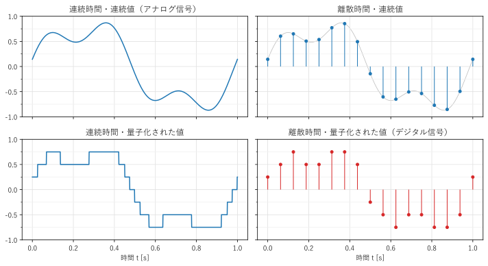
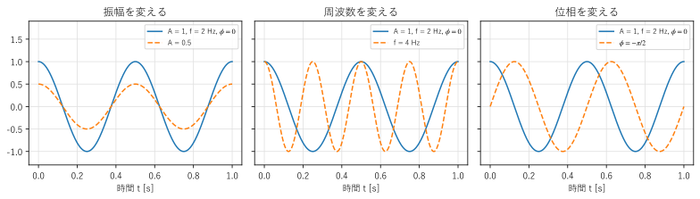
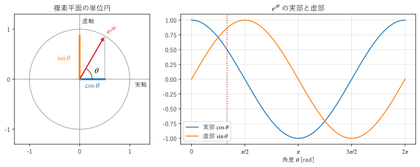

第 1 章 信号と数学的準備
==================================================

この章では、本書で扱う「信号」とは何かを説明し、フーリエ解析の主役である正弦波と、それを扱うための道具である複素数、オイラーの公式、内積と直交性を準備する。

信号とは
--------

時間とともに変化する量を、\ :term:`信号`\ という。マイクロフォンが出力する電圧、加速度センサーで測った振動、心電図、株価の推移などは、いずれも信号である。画像のように、位置によって変化する量も信号として扱える。

信号は、時間の扱い方と値の扱い方によって、次のように分類できる（:numref:`fig-ch01-signal-types`）。

* 時間が連続な信号を\ :term:`連続時間信号`\ 、とびとびの時刻だけで値をもつ信号を\ :term:`離散時間信号`\ という。
* 値が連続的な信号に対して、値を有限個の段階に丸めることを\ :term:`量子化`\ という。

時間も値も連続な信号をアナログ信号、時間が離散で値も量子化された信号を\ :term:`デジタル信号`\ という。計算機が直接扱えるのはデジタル信号だけである。

.. _fig-ch01-signal-types:

   信号の 4 つの分類

現実の多くの信号はアナログ信号である。これを計算機で処理するには、一定の時間間隔で値を取り出し（\ :term:`標本化`\ ）、値を量子化して、デジタル信号に変換する。この変換を A/D 変換（analog-to-digital conversion）といい、逆にデジタル信号からアナログ信号を作る変換を D/A 変換という。デジタル信号処理の典型的な流れは、:numref:`fig-ch01-dsp-chain` のとおりである。標本化と量子化は第 4 章で詳しく説明する。

.. _fig-ch01-dsp-chain:

.. graphviz::
   :caption: デジタル信号処理の典型的な流れ
   :alt: アナログ入力、アンチエイリアシングフィルタ、A/D 変換、デジタル信号処理、D/A 変換、再構成フィルタ、アナログ出力の順に並んだブロック図

   digraph dsp_chain {
       rankdir=LR;
       node [shape=box, style="rounded,filled", fillcolor="#eef4fb", fontsize=11];
       edge [fontsize=10];
       in  [label="アナログ\n入力", shape=plaintext, style=""];
       aaf [label="アンチ\nエイリアシング\nフィルタ"];
       adc [label="A/D 変換\n（標本化・量子化）"];
       dsp [label="デジタル\n信号処理", fillcolor="#fdf0e0"];
       dac [label="D/A 変換"];
       rec [label="再構成\nフィルタ"];
       out [label="アナログ\n出力", shape=plaintext, style=""];
       in -> aaf -> adc -> dsp -> dac -> rec -> out;
   }

信号をデジタルで処理する利点は、次のとおりである。

* 同じ入力に対して、いつでも同じ結果が得られる（部品のばらつきや温度による変化がない）。
* 処理の内容をプログラムの変更だけで切り替えられる。
* アナログ回路では実現が難しい処理（例えば、位相のずれがまったくないフィルタや、長い時間のデータを蓄えてから行う処理）ができる。

一方で、標本化と量子化によって情報が失われる可能性がある。どのような条件なら失われないのかを明らかにすることも、本書の大きなテーマの 1 つである。

正弦波
------

フーリエ解析の主役は\ :term:`正弦波`\ である。本書では、:math:`\sin` と :math:`\cos` の波形をまとめて正弦波と呼び、次の形で表す。

.. math::

   x(t) = A \cos(2\pi f t + \phi)

各記号の意味は次のとおりである（:numref:`fig-ch01-sinusoid`）。

.. list-table::
   :header-rows: 1
   :widths: 25 20 55

   * - 名前
     - 記号
     - 意味
   * - :term:`振幅`
     - :math:`A`
     - 波の大きさ（:math:`A \ge 0`）
   * - :term:`周波数`
     - :math:`f`
     - 1 秒あたりの振動の回数。単位は Hz
   * - 周期
     - :math:`T = 1/f`
     - 1 回の振動にかかる時間。単位は s
   * - :term:`角周波数`
     - :math:`\omega = 2\pi f`
     - 1 秒あたりに進む角度。単位は rad/s
   * - :term:`位相`
     - :math:`\phi`
     - 時刻 :math:`t = 0` における角度。波形の時間方向のずれを表す

.. _fig-ch01-sinusoid:

   正弦波の振幅、周波数、位相を変えた波形（青の実線が元の波形）

:math:`\sin` は :math:`\cos` の位相を :math:`\pi/2` ずらしたもの（:math:`\sin\theta = \cos(\theta - \pi/2)`）なので、上の形ですべての正弦波を表せる。また、加法定理を使うと

.. math::

   A \cos(2\pi f t + \phi) = a \cos(2\pi f t) + b \sin(2\pi f t), \qquad a = A\cos\phi, \quad b = -A\sin\phi

と書き直せる。つまり、同じ周波数の正弦波は、:math:`\cos` と :math:`\sin` の 2 つの成分の和で表せる。この事実は、第 2 章のフーリエ級数で使う。

正弦波が特別に重要なのは、次の 2 つの理由による。

* ばねと質量の振動、LC 回路の電気振動、音叉の音など、自然界の多くの振動は正弦波になる。
* 第 5 章で説明する線形時不変システム（フィルタ、回路、伝送路など）に正弦波を入力すると、出力は振幅と位相が変わるだけで、周波数が同じ正弦波になる。そのため、信号を正弦波に分解できれば、システムの出力は「各周波数の成分の振幅と位相がどう変わるか」だけで計算できる。

後者がフーリエ解析を信号処理で使う最大の理由である。

複素数とオイラーの公式
----------------------

正弦波の計算は、複素数を使うと見通しがよくなる。ここで、必要な範囲を復習する。

複素数 :math:`z` は、実数 :math:`a, b` と虚数単位 :math:`j`\ （:math:`j^2 = -1`）を使って :math:`z = a + jb` と表す。:math:`a` を実部（:math:`\mathrm{Re}\,z`）、:math:`b` を虚部（:math:`\mathrm{Im}\,z`）という。複素数は、横軸を実部、縦軸を虚部とする平面（複素平面）の上の点として表せる。原点からの距離 :math:`|z| = \sqrt{a^2 + b^2}` を絶対値、実軸の正の向きからの角度 :math:`\arg z` を偏角という。:math:`z = a + jb` に対して :math:`z^* = a - jb` を共役複素数という。:math:`zz^* = |z|^2` が成り立つ。

指数関数と三角関数を結び付けるのが、次の\ :term:`オイラーの公式`\ である。

.. math::
   :label: eq-euler

   e^{j\theta} = \cos\theta + j\sin\theta

:math:`e^{j\theta}` は、複素平面の単位円の上で、角度 :math:`\theta` の位置にある点を表す（:numref:`fig-ch01-euler`）。その実部が :math:`\cos\theta`、虚部が :math:`\sin\theta` である。

.. _fig-ch01-euler:

   単位円の上の点 :math:`e^{j\theta}`\ （左）と、その実部と虚部（右）

オイラーの公式を使うと、絶対値が :math:`r`、偏角が :math:`\theta` の複素数は :math:`z = re^{j\theta}` と表せる。これを極形式という。極形式の積は

.. math::

   r_1 e^{j\theta_1} \cdot r_2 e^{j\theta_2} = r_1 r_2 e^{j(\theta_1 + \theta_2)}

となり、「絶対値は掛け算、偏角は足し算」になる。特に、:math:`e^{j\theta}` を掛けることは、複素平面で角度 :math:`\theta` だけ回転することを意味する。

また、式 :eq:`eq-euler` と、:math:`\theta` を :math:`-\theta` に置き換えた式 :math:`e^{-j\theta} = \cos\theta - j\sin\theta` を足したり引いたりすると、

.. math::
   :label: eq-cos-sin

   \cos\theta = \frac{e^{j\theta} + e^{-j\theta}}{2}, \qquad \sin\theta = \frac{e^{j\theta} - e^{-j\theta}}{2j}

が得られる。三角関数を指数関数で表せるので、三角関数の積や微分・積分の計算が、指数法則だけで済むようになる。例えば、:math:`\frac{d}{d\theta} e^{j\theta} = je^{j\theta}` であり、微分は「:math:`j` を掛けること」、つまり :math:`\pi/2` の回転になる。

Python では、複素数を ``1 + 2j`` のように書く。NumPy の関数は複素数の配列も扱える。

.. code-block:: python
   :linenos:
   :caption: Python と NumPy での複素数の扱い

   import numpy as np

   theta = np.pi / 3
   z = np.exp(1j * theta)          # e^{j theta}
   print(z)                        # (0.5000000000000001+0.8660254037844386j)
   print(z.real, z.imag)           # 実部と虚部
   print(np.abs(z), np.angle(z))   # 絶対値 1.0 と偏角 1.047...（= pi/3）
   print(np.conj(z))               # 共役複素数

複素正弦波
----------

オイラーの公式で :math:`\theta = 2\pi f t` とした

.. math::

   e^{j2\pi f t} = \cos(2\pi f t) + j\sin(2\pi f t)

を\ :term:`複素正弦波`\ という。複素正弦波は、複素平面の単位円の上を、1 秒あたり :math:`f` 回の速さで反時計回りに回る点を表す。:math:`f` が負のときは時計回りに回る。

式 :eq:`eq-cos-sin` を使うと、実数の正弦波は、反対向きに回る 2 つの複素正弦波の和で表せる。

.. math::
   :label: eq-real-sinusoid

   A\cos(2\pi f t + \phi) = \frac{A}{2} e^{j\phi} e^{j2\pi f t} + \frac{A}{2} e^{-j\phi} e^{-j2\pi f t}

右辺の第 2 項は、周波数が :math:`-f` の複素正弦波である。フーリエ解析では、このように実数の正弦波を「周波数 :math:`f` と :math:`-f` の成分の組」として扱う。負の周波数は、物理的な振動の速さが負という意味ではなく、回転の向きを表す数学的な表現である。実数の信号では、:math:`f` の成分と :math:`-f` の成分が互いに共役複素数（:math:`\frac{A}{2}e^{j\phi}` と :math:`\frac{A}{2}e^{-j\phi}`）になる。

式 :eq:`eq-real-sinusoid` の係数 :math:`\frac{A}{2}e^{j\phi}` は、1 つの複素数で振幅と位相の両方を表している。このように振幅と位相をまとめた複素数をフェーザ（phasor）といい、交流回路の計算でも使われる。

内積と直交性
------------

フーリエ解析の考え方は、ベクトルの分解と同じ構造をもつ。この節では、その構造を説明する。

2 次元の平面で、互いに直交する単位ベクトル :math:`\boldsymbol{e}_1, \boldsymbol{e}_2` を使うと、任意のベクトル :math:`\boldsymbol{v}` は

.. math::

   \boldsymbol{v} = c_1 \boldsymbol{e}_1 + c_2 \boldsymbol{e}_2, \qquad c_i = \langle \boldsymbol{v}, \boldsymbol{e}_i \rangle

と分解できる。係数 :math:`c_i` は、:math:`\boldsymbol{v}` と :math:`\boldsymbol{e}_i` の内積で求められる。両辺と :math:`\boldsymbol{e}_1` の内積を取ると、:math:`\langle \boldsymbol{e}_2, \boldsymbol{e}_1 \rangle = 0` なので :math:`c_2` の項が消え、:math:`c_1` だけが残るからである。:math:`N` 次元でも同じで、互いに\ :term:`直交`\ する :math:`N` 本のベクトルがあれば、任意のベクトルの成分は、内積を 1 回ずつ計算するだけで求められる。

成分が複素数のベクトル :math:`\boldsymbol{u} = (u_0, \ldots, u_{N-1})`、:math:`\boldsymbol{v} = (v_0, \ldots, v_{N-1})` の内積は、次のように定義する。

.. math::

   \langle \boldsymbol{u}, \boldsymbol{v} \rangle = \sum_{n=0}^{N-1} u_n v_n^*

:math:`\boldsymbol{v}` の側の成分を共役複素数にするのは、:math:`\langle \boldsymbol{v}, \boldsymbol{v} \rangle = \sum |v_n|^2` が実数になり、ベクトルの長さの 2 乗を表すようにするためである。

この考え方は関数にも拡張できる。区間 :math:`[0, T]` で定義された 2 つの関数 :math:`x(t), y(t)` の内積を

.. math::

   \langle x, y \rangle = \int_0^T x(t)\, y^*(t)\, dt

と定義する。ベクトルの成分の和 :math:`\sum_n` が、積分 :math:`\int dt` に置き換わっただけである。この内積が 0 のとき、2 つの関数は直交するという。

第 2 章で示すように、周波数が基本周波数の整数倍の正弦波は互いに直交する。したがって、周期的な信号を正弦波の和に分解するときの各成分の大きさは、信号と各正弦波の内積で求められる。これがフーリエ級数の基本的な考え方である。フーリエ解析とは、「正弦波という直交する基底で信号を表し直すこと」だといえる。

まとめ
------

* 信号は、時間が連続か離散か、値が連続か量子化されているかで分類できる。計算機が扱うのはデジタル信号である。
* 正弦波 :math:`A\cos(2\pi f t + \phi)` は、振幅、周波数、位相の 3 つで決まる。
* オイラーの公式 :math:`e^{j\theta} = \cos\theta + j\sin\theta` により、正弦波を複素指数関数で表せる。実数の正弦波は、周波数 :math:`f` と :math:`-f` の複素正弦波の和である。
* 直交する基底を使うと、各成分の大きさは内積で求められる。フーリエ解析は、信号を正弦波という直交基底で表し直すことである。
