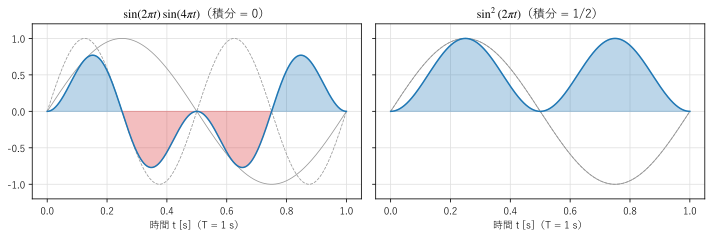
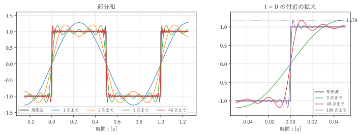
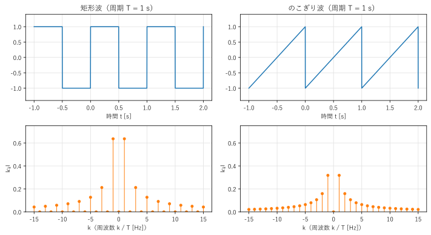

第 2 章 フーリエ級数
==================================================

一定の時間ごとに同じ波形を繰り返す信号は、周波数が整数倍の関係にある正弦波の和で表せる。これを\ :term:`フーリエ級数`\ という。この章では、フーリエ級数の係数の求め方と、そこから得られる「スペクトル」という見方を説明する。

周期信号
--------

ある正の数 :math:`T` について、すべての :math:`t` で

.. math::

   x(t + T) = x(t)

が成り立つ信号を、周期 :math:`T` の周期信号という。このような :math:`T` のうち最小のものを基本周期、その逆数 :math:`f_0 = 1/T` を\ :term:`基本周波数`\ という。

周期 :math:`T` の信号を作る最も簡単な材料は、周期 :math:`T` の正弦波である。さらに、周波数が :math:`f_0` の整数倍 :math:`k f_0`\ （:math:`k = 1, 2, 3, \ldots`）の正弦波も、:math:`T` の間にちょうど :math:`k` 回振動するので、周期 :math:`T` をもつ。周波数 :math:`k f_0` の成分を第 :math:`k` \ :term:`高調波`\ という（:math:`k = 1` は基本波と呼ぶ）。楽器の音色の違いは、主に高調波の含まれ方の違いである。

フーリエ級数は、周期 :math:`T` の信号を、基本波と高調波と定数（直流成分）の和で表すものである。

.. math::
   :label: eq-fourier-series-real

   x(t) = \frac{a_0}{2} + \sum_{k=1}^{\infty} \bigl( a_k \cos(2\pi k f_0 t) + b_k \sin(2\pi k f_0 t) \bigr)

:math:`a_k, b_k` を\ :term:`フーリエ係数`\ という。:math:`a_0` を 2 で割っておく理由は、次の節で係数の式を見ると分かる。

三角関数の直交性
----------------

フーリエ係数を求める鍵は、第 1 章で述べた直交性である。:math:`k, m` を 0 以上の整数とすると、1 周期にわたる積分について次の関係が成り立つ。

.. math::
   :label: eq-orthogonality

   \int_0^T \cos(2\pi k f_0 t) \cos(2\pi m f_0 t)\, dt &= \begin{cases} T & (k = m = 0) \\ T/2 & (k = m \ne 0) \\ 0 & (k \ne m) \end{cases} \\
   \int_0^T \sin(2\pi k f_0 t) \sin(2\pi m f_0 t)\, dt &= \begin{cases} T/2 & (k = m \ne 0) \\ 0 & (\text{それ以外}) \end{cases} \\
   \int_0^T \cos(2\pi k f_0 t) \sin(2\pi m f_0 t)\, dt &= 0

これらは、積を和に直す公式（例えば :math:`\cos\alpha\cos\beta = \frac{1}{2}\{\cos(\alpha - \beta) + \cos(\alpha + \beta)\}`）を使うと確かめられる。周波数が 0 でない正弦波を 1 周期（またはその整数倍）にわたって積分すると 0 になるので、積分が 0 でなくなるのは :math:`\alpha - \beta = 0`、つまり :math:`k = m` のときだけである。

:numref:`fig-ch02-orthogonality` は、この関係を図で示したものである。周波数の異なる正弦波の積は、正の部分と負の部分の面積が打ち消し合い、積分が 0 になる。同じ周波数の正弦波の積（2 乗）は、常に 0 以上なので、積分は正の値になる。

.. _fig-ch02-orthogonality:

   正弦波の積の積分（青は正の面積、赤は負の面積）

フーリエ係数の求め方
--------------------

式 :eq:`eq-fourier-series-real` の両辺に :math:`\cos(2\pi m f_0 t)`\ （:math:`m \ge 1`）を掛けて 1 周期で積分する。右辺の各項のうち、直交性 :eq:`eq-orthogonality` によって 0 にならないのは :math:`a_m` の項だけであり、その積分は :math:`a_m T/2` になる。したがって :math:`a_m = \frac{2}{T}\int_0^T x(t)\cos(2\pi m f_0 t)\, dt` である。:math:`\sin` を掛けた場合も同様である。まとめると、フーリエ係数は次の式で求められる。

.. math::
   :label: eq-fourier-coefficients

   a_k = \frac{2}{T} \int_0^T x(t) \cos(2\pi k f_0 t)\, dt \quad (k \ge 0), \qquad
   b_k = \frac{2}{T} \int_0^T x(t) \sin(2\pi k f_0 t)\, dt \quad (k \ge 1)

:math:`k = 0` のとき :math:`a_0 = \frac{2}{T}\int_0^T x(t)\,dt` なので、:math:`a_0/2` は信号の 1 周期の平均値（直流成分）になる。式 :eq:`eq-fourier-series-real` で :math:`a_0` を 2 で割っておいたのは、:math:`a_0` も :math:`a_k` と同じ式で求められるようにするためである。

積分の区間は、長さが 1 周期であればどこでもよい。:math:`-T/2` から :math:`T/2` までとすることも多い。

例：矩形波
----------

振幅 1、周期 :math:`T` の矩形波

.. math::

   x(t) = \begin{cases} 1 & (0 < t < T/2) \\ -1 & (T/2 < t < T) \end{cases}

のフーリエ係数を求める。この波形は、:math:`t = 0` を中心に考えると奇関数（:math:`x(-t) = -x(t)`）である。奇関数と偶関数 :math:`\cos` の積は奇関数で、その 1 周期の積分は 0 になるので、:math:`a_k = 0` である。:math:`b_k` は

.. math::

   b_k = \frac{2}{T}\left( \int_0^{T/2} \sin(2\pi k f_0 t)\, dt - \int_{T/2}^{T} \sin(2\pi k f_0 t)\, dt \right)
   = \frac{2}{\pi k}\bigl(1 - \cos(\pi k)\bigr)
   = \begin{cases} \dfrac{4}{\pi k} & (k \text{ が奇数}) \\ 0 & (k \text{ が偶数}) \end{cases}

となる。したがって、矩形波は奇数次の高調波だけを含み、

.. math::
   :label: eq-square-wave

   x(t) = \frac{4}{\pi} \left( \sin(2\pi f_0 t) + \frac{1}{3}\sin(2\pi \cdot 3 f_0 t) + \frac{1}{5}\sin(2\pi \cdot 5 f_0 t) + \cdots \right)

と表せる。

サンプルの ``fourier_series.py`` は、フーリエ係数を数値積分で求めて理論値と比べ、さらに部分和（有限個の項までの和）を計算する。:numref:`list-ch02-fourier-series` の ``sine_coefficients()`` は、1 周期を細かく分けた長方形の面積の和で、式 :eq:`eq-fourier-coefficients` の積分を近似している。

.. literalinclude:: ../examples/fourier_series.py
   :pyobject: sine_coefficients
   :lineno-match:
   :caption: fourier_series.py の sine_coefficients()
   :name: list-ch02-fourier-series

.. literalinclude:: ../build/outputs/fourier_series.txt
   :language: text
   :caption: fourier_series.py の実行結果

数値積分の結果は、理論値 :math:`4/(\pi k)` と小数第 5 位まで一致している。実行結果の後半は部分和の最大値であり、次の節で説明する。:numref:`fig-ch02-fourier-series` は、部分和に含める項を増やしていくと、矩形波に近づいていく様子を示している。

.. _fig-ch02-fourier-series:

   矩形波のフーリエ級数の部分和（左）と、:math:`t = 0` の付近の拡大（右）

サンプルの全体：:download:`fourier_series.py <../examples/fourier_series.py>`

ギブス現象
----------

:numref:`fig-ch02-fourier-series` の右の図を見ると、項を増やすと部分和は不連続点（:math:`t = 0`）の両側で急に立ち上がるようになるが、立ち上がった直後に 1 を超える「行き過ぎ」がある。実行結果に示したとおり、最高次数を 5、21、101、1001 と増やしても、部分和の最大値は約 1.179 からほとんど小さくならない。行き過ぎの幅は狭くなるが、高さは変わらない。

この現象を\ :term:`ギブス現象`\ という。不連続点では、部分和は不連続な跳びの大きさ（この例では 2）の約 9 % だけ行き過ぎる（:math:`1 + 2 \times 0.0895 \approx 1.179`）。項の数を無限にすれば、不連続点以外の各点で部分和は :math:`x(t)` に収束するが、行き過ぎの山は不連続点に近づきながら残り続ける。

ギブス現象は、理論上の話にとどまらない。信号の高い周波数の成分を急峻に切り捨てると、波形の急な変化の付近に波打ち（リンギング）が現れる。第 9 章のフィルタ設計で、この問題に再び出会う。

複素フーリエ級数
----------------

式 :eq:`eq-fourier-series-real` の :math:`\cos` と :math:`\sin` を、第 1 章の式 :eq:`eq-cos-sin` で複素指数関数に書き換えると、フーリエ級数はより簡潔な形になる。

.. math::
   :label: eq-fourier-series-complex

   x(t) = \sum_{k=-\infty}^{\infty} c_k e^{j2\pi k f_0 t}, \qquad
   c_k = \frac{1}{T} \int_0^T x(t) e^{-j2\pi k f_0 t}\, dt

これを\ :term:`複素フーリエ級数`\ という。:math:`k` は負の整数も含む。:math:`c_k` を求める式は、信号 :math:`x(t)` と複素正弦波 :math:`e^{j2\pi k f_0 t}` の内積（を :math:`T` で割ったもの）であり、第 1 章で述べた直交基底による分解そのものである。実際、

.. math::

   \frac{1}{T}\int_0^T e^{j2\pi k f_0 t} \left(e^{j2\pi m f_0 t}\right)^* dt = \frac{1}{T}\int_0^T e^{j2\pi (k - m) f_0 t}\, dt = \begin{cases} 1 & (k = m) \\ 0 & (k \ne m) \end{cases}

であり、複素正弦波は互いに直交する。三角関数の 3 種類の直交関係 :eq:`eq-orthogonality` が、この 1 つの式にまとまっている。

実数形式の係数との関係は、:math:`k \ge 1` について次のとおりである。

.. math::

   c_0 = \frac{a_0}{2}, \qquad c_k = \frac{a_k - j b_k}{2}, \qquad c_{-k} = \frac{a_k + j b_k}{2} = c_k^*

:math:`x(t)` が実数の信号であれば :math:`c_{-k} = c_k^*` が成り立つ。これは第 1 章の式 :eq:`eq-real-sinusoid` で見た「実数の正弦波は、互いに共役な係数をもつ :math:`f` と :math:`-f` の成分の組である」という事実の一般化である。第 :math:`k` 高調波の振幅は :math:`2|c_k| = \sqrt{a_k^2 + b_k^2}`、位相は :math:`\arg c_k` で表される。

本書では、以降、主に複素形式を使う。複素形式は式が短く、フーリエ変換や DFT にそのまま拡張できるからである。

スペクトル
----------

フーリエ係数 :math:`c_k` を周波数 :math:`k f_0` の関数として並べたものを、信号の\ :term:`スペクトル`\ という。周期信号のスペクトルは、とびとびの周波数にだけ値をもつので、\ :term:`線スペクトル`\ と呼ばれる。:math:`|c_k|` を振幅スペクトル、:math:`\arg c_k` を位相スペクトルという。

:numref:`fig-ch02-line-spectrum` は、矩形波と、のこぎり波（:math:`0 \le t < T` で :math:`x(t) = 2t/T - 1` を繰り返す波形）の振幅スペクトルである。矩形波では :math:`|c_k| = 2/(\pi |k|)`\ （:math:`k` が奇数）、のこぎり波では :math:`|c_k| = 1/(\pi |k|)`\ （:math:`k \ne 0`）となる。

.. _fig-ch02-line-spectrum:

   矩形波とのこぎり波の波形（上）と振幅スペクトル（下）

時間の関数として波形を見ることを\ **時間領域**\ で見る、スペクトルを見ることを\ **周波数領域**\ で見るという。2 つの見方は同じ信号を別の角度から表したもので、どちらも信号の情報をすべて含んでいる（:math:`c_k` がすべて分かれば、式 :eq:`eq-fourier-series-complex` で波形に戻せる）。

スペクトルの減衰の速さは、波形の滑らかさと関係している。

* 矩形波やのこぎり波のように、波形に不連続な跳びがあると、:math:`|c_k|` は :math:`1/|k|` に比例して減衰する。
* 三角波のように、波形は連続だが傾きが不連続な点（角）があると、:math:`|c_k|` は :math:`1/k^2` に比例して減衰する。
* 波形が滑らかであるほど、:math:`|c_k|` は速く減衰する。

急な変化を表すには、高い周波数の成分が多く必要になるということである。これは、デジタル信号処理で必要な帯域幅を見積もるときの基本的な考え方になる。

パーセバルの等式
----------------

信号の 1 周期あたりの平均電力（2 乗の平均）は、フーリエ係数の 2 乗の和に等しい。

.. math::
   :label: eq-parseval-series

   \frac{1}{T}\int_0^T |x(t)|^2\, dt = \sum_{k=-\infty}^{\infty} |c_k|^2

これを\ :term:`パーセバルの等式`\ という。電力が、各周波数の成分の電力の和に分けられることを意味する。式 :eq:`eq-fourier-series-complex` を :math:`|x(t)|^2 = x(t)x^*(t)` に代入すると、直交性によって異なる :math:`k` の項の積が消えることから導ける。

矩形波で確かめてみる。左辺は :math:`|x(t)|^2 = 1` なので 1 である。右辺は、:math:`k` が正と負の奇数について :math:`|c_k|^2 = 4/(\pi^2 k^2)` を足して

.. math::

   2 \sum_{k = 1, 3, 5, \ldots} \frac{4}{\pi^2 k^2} = \frac{8}{\pi^2}\left(1 + \frac{1}{9} + \frac{1}{25} + \cdots\right) = \frac{8}{\pi^2} \cdot \frac{\pi^2}{8} = 1

となり、一致する。

まとめ
------

* 周期 :math:`T` の信号は、基本周波数 :math:`f_0 = 1/T` の整数倍の周波数をもつ正弦波の和（フーリエ級数）で表せる。
* フーリエ係数は、三角関数（複素正弦波）の直交性を使い、信号と各正弦波の内積で求められる。
* 複素フーリエ級数 :math:`x(t) = \sum c_k e^{j2\pi k f_0 t}` では、実数の信号に対して :math:`c_{-k} = c_k^*` が成り立つ。
* :math:`c_k` を周波数の関数として見たものがスペクトルである。急な変化を含む信号ほど、高い周波数の成分を多く含む。
* 不連続点の付近では、部分和に約 9 % の行き過ぎ（ギブス現象）が残る。
* 平均電力は、各周波数の成分の電力の和に等しい（パーセバルの等式）。
