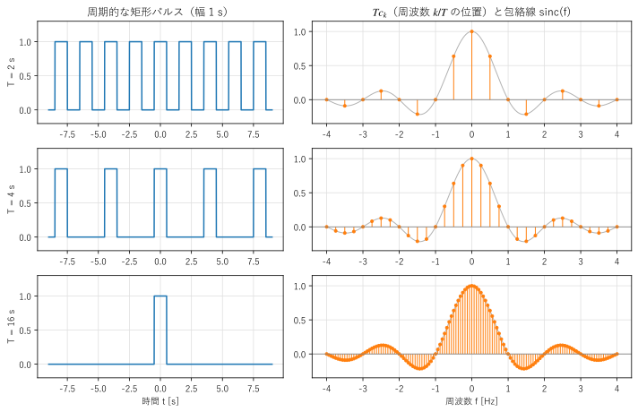
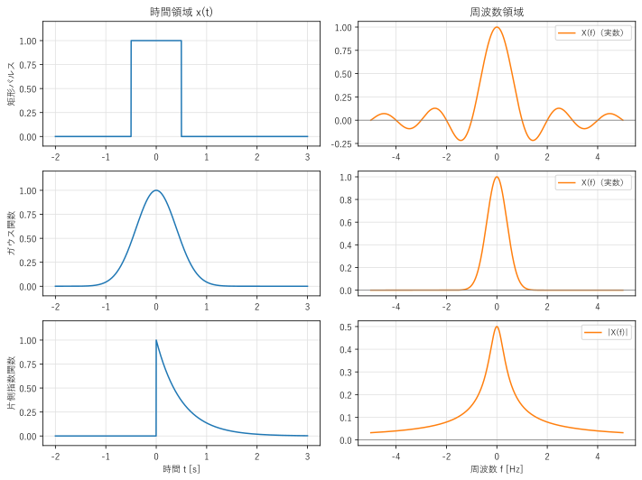
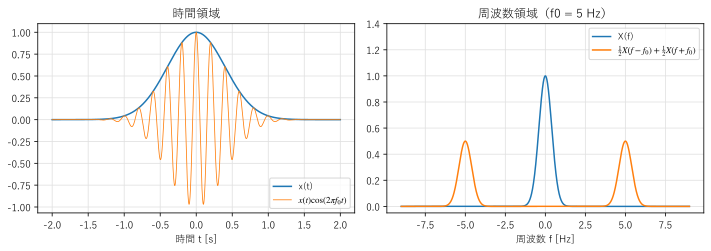
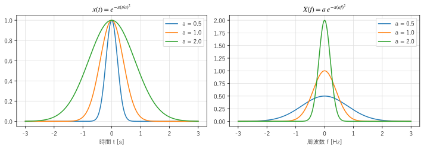

第 3 章 フーリエ変換
==================================================

フーリエ級数は周期信号だけを対象としていた。しかし、1 回だけ鳴る音、パルス、過渡的な応答など、現実の多くの信号は周期をもたない。この章では、周期を無限に長くする考え方でフーリエ級数を拡張し、周期をもたない信号のスペクトルを求める\ :term:`フーリエ変換`\ を導く。

フーリエ級数からフーリエ変換へ
------------------------------

幅 1 s の矩形パルスを、周期 :math:`T` で繰り返した信号を考える。第 2 章の式 :eq:`eq-fourier-series-complex` で係数を計算すると、

.. math::

   c_k = \frac{1}{T}\int_{-1/2}^{1/2} e^{-j2\pi k t/T}\, dt = \frac{1}{T} \cdot \frac{\sin(\pi k/T)}{\pi k/T} = \frac{1}{T}\,\mathrm{sinc}\!\left(\frac{k}{T}\right)

となる。:math:`T c_k` を、それぞれの周波数 :math:`f_k = k/T` の位置に描いたものが :numref:`fig-ch03-series-to-transform` である。周期 :math:`T` を長くしていくと、線の間隔 :math:`1/T` は狭くなるが、線の高さは常に :math:`\mathrm{sinc}(f)` という同じ曲線の上に乗っている。:math:`T \to \infty` の極限では、信号は 1 個のパルスになり、線スペクトルは連続な曲線 :math:`\mathrm{sinc}(f)` になる。

.. _fig-ch03-series-to-transform:

   周期的な矩形パルス（左）と、周期 :math:`T` を掛けたフーリエ係数（右）

一般の信号でも同じである。:math:`T c_k = \int_{-T/2}^{T/2} x(t) e^{-j2\pi f_k t}\, dt` の積分範囲を :math:`T \to \infty` で全区間に広げ、離散的な周波数 :math:`f_k` を連続な :math:`f` に置き換えたものを、:math:`x(t)` のフーリエ変換という。

.. math::
   :label: eq-fourier-transform

   X(f) = \int_{-\infty}^{\infty} x(t)\, e^{-j2\pi f t}\, dt

逆に、フーリエ級数の和 :math:`x(t) = \sum_k (T c_k) e^{j2\pi f_k t} \cdot \frac{1}{T}` で、:math:`1/T` を周波数の刻み :math:`df` とみなすと、和は積分になり、

.. math::
   :label: eq-inverse-fourier-transform

   x(t) = \int_{-\infty}^{\infty} X(f)\, e^{j2\pi f t}\, df

が得られる。これを\ :term:`逆フーリエ変換`\ という。式 :eq:`eq-fourier-transform` と式 :eq:`eq-inverse-fourier-transform` は、指数の符号が違うだけで、ほぼ対称な形をしている。本書では、:math:`x(t)` と :math:`X(f)` がフーリエ変換の対であることを :math:`x(t) \leftrightarrow X(f)` と書く。

:math:`X(f)` は一般に複素数であり、:math:`|X(f)|` を振幅スペクトル、:math:`\arg X(f)` を位相スペクトルという。フーリエ級数の :math:`c_k` と比べると、:math:`X(f)` は「周波数あたりの量」（スペクトルの密度）を表す。:math:`x(t)` の単位が V なら、:math:`X(f)` の単位は V/Hz（= V·s）になる。

.. note::

   フーリエ変換の定義には流儀がある。本書の式 :eq:`eq-fourier-transform` は周波数 :math:`f` [Hz] を使う形で、逆変換に係数が付かない。角周波数 :math:`\omega = 2\pi f` を使う流儀では

   .. math::

      X(\omega) = \int_{-\infty}^{\infty} x(t) e^{-j\omega t}\, dt, \qquad x(t) = \frac{1}{2\pi}\int_{-\infty}^{\infty} X(\omega) e^{j\omega t}\, d\omega

   と書き、逆変換に :math:`1/(2\pi)` が付く。数学の分野では、:math:`e^{-j}` と :math:`e^{+j}` の符号を逆にする流儀もある。教科書や論文を読むときは、どの定義を使っているかを最初に確かめるとよい。

フーリエ変換が存在するための十分条件として、:math:`x(t)` が絶対可積分（:math:`\int |x(t)|\, dt < \infty`）であることが知られている。正弦波や定数のように絶対可積分でない信号も、後で説明するデルタ関数を使えば、フーリエ変換を考えられる。

代表的なフーリエ変換の対
------------------------

よく使うフーリエ変換の対を :numref:`table-ch03-pairs` にまとめる。:math:`u(t)` は単位ステップ関数（:math:`t \ge 0` で 1、:math:`t < 0` で 0）、:math:`\mathrm{rect}(t)` は幅 1 の矩形パルス（:math:`|t| < 1/2` で 1、それ以外で 0）、:math:`\delta(t)` は後で説明するデルタ関数である。

.. _table-ch03-pairs:

.. list-table:: 代表的なフーリエ変換の対
   :header-rows: 1
   :widths: 40 40 20

   * - :math:`x(t)`
     - :math:`X(f)`
     - 備考
   * - :math:`\mathrm{rect}(t)`
     - :math:`\mathrm{sinc}(f) = \dfrac{\sin(\pi f)}{\pi f}`
     - 矩形パルス
   * - :math:`e^{-\pi t^2}`
     - :math:`e^{-\pi f^2}`
     - ガウス関数
   * - :math:`e^{-at} u(t)`\ （:math:`a > 0`）
     - :math:`\dfrac{1}{a + j2\pi f}`
     - 片側指数関数
   * - :math:`\delta(t)`
     - :math:`1`
     - インパルス
   * - :math:`1`
     - :math:`\delta(f)`
     - 直流
   * - :math:`e^{j2\pi f_0 t}`
     - :math:`\delta(f - f_0)`
     - 複素正弦波
   * - :math:`\cos(2\pi f_0 t)`
     - :math:`\frac{1}{2}\delta(f - f_0) + \frac{1}{2}\delta(f + f_0)`
     - 正弦波

矩形パルスのフーリエ変換は、前の節で極限として得た :math:`\mathrm{sinc}(f)` である。直接計算しても、:math:`\int_{-1/2}^{1/2} e^{-j2\pi f t}\, dt = \sin(\pi f)/(\pi f)` となる。この :math:`\mathrm{sinc}` 関数（ :term:`sinc 関数`\ ）は、信号処理で何度も登場する。

ガウス関数 :math:`e^{-\pi t^2}` は、フーリエ変換しても同じ形になるという特別な性質をもつ。片側指数関数は、RC 回路のインパルス応答などに現れる。

サンプルの ``fourier_transform_pairs.py`` は、式 :eq:`eq-fourier-transform` の積分を細かい刻みの長方形の和で近似し、上の表の最初の 3 つの対を確かめる。

.. literalinclude:: ../examples/fourier_transform_pairs.py
   :pyobject: fourier_transform
   :lineno-match:
   :caption: fourier_transform_pairs.py の fourier_transform()
   :name: list-ch03-ft

.. literalinclude:: ../build/outputs/fourier_transform_pairs.txt
   :language: text
   :caption: fourier_transform_pairs.py の実行結果

いずれも数値積分と理論式がよく一致している。矩形パルスと片側指数関数の誤差がガウス関数より大きいのは、不連続点をもつ関数を長方形の和で近似した誤差である。:numref:`fig-ch03-ft-pairs` に、3 つの信号の波形とスペクトルを示す。

.. _fig-ch03-ft-pairs:

   代表的な信号（左）とそのフーリエ変換（右）

矩形パルスと片側指数関数のように、時間領域で急な変化（不連続点）をもつ信号は、周波数領域でゆっくり減衰する（:math:`1/|f|` に比例する）。滑らかなガウス関数のスペクトルは非常に速く減衰する。第 2 章で述べた「滑らかさと減衰の速さ」の関係は、フーリエ変換でも成り立つ。

サンプルの全体：:download:`fourier_transform_pairs.py <../examples/fourier_transform_pairs.py>`

フーリエ変換の性質
------------------

フーリエ変換には、計算を楽にする多くの性質がある。:math:`x(t) \leftrightarrow X(f)`、:math:`y(t) \leftrightarrow Y(f)` とし、:math:`a, b` を定数とする。

.. _table-ch03-properties:

.. list-table:: フーリエ変換の主な性質
   :header-rows: 1
   :widths: 25 35 40

   * - 性質
     - 時間領域
     - 周波数領域
   * - 線形性
     - :math:`a x(t) + b y(t)`
     - :math:`a X(f) + b Y(f)`
   * - 時間シフト
     - :math:`x(t - t_0)`
     - :math:`e^{-j2\pi f t_0} X(f)`
   * - 周波数シフト（変調）
     - :math:`e^{j2\pi f_0 t} x(t)`
     - :math:`X(f - f_0)`
   * - スケーリング
     - :math:`x(at)`\ （:math:`a \ne 0`）
     - :math:`\dfrac{1}{|a|} X\!\left(\dfrac{f}{a}\right)`
   * - 共役対称性
     - :math:`x(t)` が実数
     - :math:`X(-f) = X^*(f)`
   * - 微分
     - :math:`\dfrac{dx}{dt}`
     - :math:`j2\pi f\, X(f)`
   * - 畳み込み
     - :math:`(x * y)(t)`
     - :math:`X(f)\,Y(f)`
   * - 積
     - :math:`x(t)\,y(t)`
     - :math:`(X * Y)(f)`
   * - パーセバルの定理
     - :math:`\displaystyle\int |x(t)|^2 dt`
     - :math:`\displaystyle\int |X(f)|^2 df`

いくつかの性質について、意味を説明する。

**時間シフト**：信号を :math:`t_0` だけ遅らせても、振幅スペクトル :math:`|X(f)|` は変わらず、位相だけが周波数に比例して :math:`-2\pi f t_0` 変化する。逆にいうと、位相が周波数に比例して変化することは、時間の遅れを意味する。この関係は、第 9 章の線形位相フィルタで重要になる。

**周波数シフト（変調）**：信号に複素正弦波 :math:`e^{j2\pi f_0 t}` を掛けると、スペクトルが :math:`f_0` だけ移動する。実数の余弦波を掛けた場合は、式 :eq:`eq-cos-sin` から

.. math::

   x(t)\cos(2\pi f_0 t) \leftrightarrow \frac{1}{2}X(f - f_0) + \frac{1}{2}X(f + f_0)

となり、スペクトルが :math:`\pm f_0` の 2 か所に半分ずつ移る（:numref:`fig-ch03-modulation`）。これは、AM ラジオなどの\ :term:`変調`\ の原理である。低い周波数の音声信号を、電波で送れる高い周波数の帯域に移している。

.. _fig-ch03-modulation:

   変調：ガウス関数に 5 Hz の余弦波を掛けた信号（左）と、そのスペクトル（右）

**共役対称性**：実数の信号では :math:`X(-f) = X^*(f)` なので、:math:`|X(f)|` は偶関数、:math:`\arg X(f)` は奇関数になる。負の周波数の成分は正の周波数の成分から決まるので、実数の信号のスペクトルは :math:`f \ge 0` の範囲だけを見れば十分である。

**微分**：微分は周波数領域では :math:`j2\pi f` を掛けることになる。微分方程式がフーリエ変換で代数方程式に変わるのは、この性質による。また、高い周波数ほど強く強調されるので、微分は雑音を増幅しやすい。

**パーセバルの定理**：信号のエネルギーは、時間領域で計算しても周波数領域で計算しても同じである。:math:`|X(f)|^2` は、エネルギーが周波数ごとにどう分布しているかを表し、エネルギースペクトル密度と呼ばれる。

畳み込みと畳み込み定理
----------------------

2 つの信号 :math:`x(t)` と :math:`h(t)` の\ :term:`畳み込み`\ を、次の式で定義する。

.. math::
   :label: eq-convolution

   (x * h)(t) = \int_{-\infty}^{\infty} x(\tau)\, h(t - \tau)\, d\tau

:math:`h` を時間反転して :math:`t` だけずらし、:math:`x` と掛けて積分した値である。第 5 章で示すように、線形時不変システムの出力は、入力とインパルス応答の畳み込みで表される。畳み込みは信号処理で最も重要な演算の 1 つである。

畳み込みをフーリエ変換すると、次の\ :term:`畳み込み定理`\ が得られる。

.. math::
   :label: eq-convolution-theorem

   (x * h)(t) \leftrightarrow X(f)\, H(f)

式 :eq:`eq-convolution` を式 :eq:`eq-fourier-transform` に代入し、積分の順序を入れ替えて :math:`s = t - \tau` と置くと、

.. math::

   \int\!\!\int x(\tau) h(t - \tau) e^{-j2\pi f t}\, d\tau\, dt
   = \int x(\tau) e^{-j2\pi f \tau} d\tau \int h(s) e^{-j2\pi f s} ds = X(f) H(f)

となることから導ける。時間領域の畳み込みは、周波数領域では単なる掛け算になる。逆に、時間領域の積は、周波数領域の畳み込みになる（:numref:`table-ch03-properties` の「積」の行）。

畳み込み定理は、次の 2 つの意味で重要である。

* システムの働きを、周波数ごとの「倍率」 :math:`H(f)` として理解できる。:math:`H(f)` が 0 に近い周波数の成分は、システムを通ると消える。これがフィルタの原理である。
* 畳み込みの計算を、フーリエ変換、掛け算、逆フーリエ変換で行える。第 7 章の FFT と組み合わせると、長い畳み込みを高速に計算できる（第 10 章）。

デルタ関数
----------

:term:`デルタ関数` :math:`\delta(t)` は、:math:`t = 0` の一点にだけ集中した、面積 1 の「無限に細く高いパルス」を表す。厳密には通常の関数ではなく、次の性質で定義される（超関数と呼ばれる）。

.. math::
   :label: eq-sifting

   \int_{-\infty}^{\infty} x(t)\, \delta(t - t_0)\, dt = x(t_0)

任意の連続な関数 :math:`x(t)` と掛けて積分すると、:math:`t = t_0` の値を取り出す。この性質を、ふるい分け性という。直観的には、幅 :math:`\varepsilon`、高さ :math:`1/\varepsilon` の矩形パルスやガウス関数で、:math:`\varepsilon \to 0` とした極限と考えてよい。

式 :eq:`eq-sifting` から、:math:`\delta(t)` のフーリエ変換は :math:`\int \delta(t) e^{-j2\pi f t} dt = 1` であり、すべての周波数を同じ大きさで含む。逆に、定数 1 のフーリエ変換は :math:`\delta(f)` である（周波数 0 の成分だけをもつ）。さらに周波数シフトの性質から、複素正弦波 :math:`e^{j2\pi f_0 t}` のフーリエ変換は :math:`\delta(f - f_0)` となり、正弦波のスペクトルは :math:`\pm f_0` の 2 本の線になる。デルタ関数を使うと、フーリエ級数の線スペクトルも、フーリエ変換の特別な場合として扱える。

デルタ関数を間隔 :math:`T_s` で無限に並べた関数

.. math::

   \mathrm{comb}_{T_s}(t) = \sum_{n=-\infty}^{\infty} \delta(t - nT_s)

をくし形関数という。くし形関数のフーリエ変換は、間隔 :math:`1/T_s` で並んだくし形関数になる。

.. math::
   :label: eq-comb

   \sum_{n=-\infty}^{\infty} \delta(t - nT_s) \leftrightarrow \frac{1}{T_s}\sum_{m=-\infty}^{\infty} \delta\!\left(f - \frac{m}{T_s}\right)

くし形関数は周期 :math:`T_s` の周期関数なので、フーリエ級数で展開すると、すべての係数が :math:`c_k = 1/T_s` になる（1 周期にデルタ関数が 1 個だけあるので、式 :eq:`eq-fourier-series-complex` の積分は :math:`1/T_s` になる）。各項 :math:`\frac{1}{T_s}e^{j2\pi k t/T_s}` のフーリエ変換は :math:`\frac{1}{T_s}\delta(f - k/T_s)` なので、式 :eq:`eq-comb` が得られる。この関係は、第 4 章で標本化を解析するときに使う。

時間幅と帯域幅の関係
--------------------

スケーリングの性質 :math:`x(at) \leftrightarrow \frac{1}{|a|}X(f/a)` は、「信号を時間方向に縮めると、スペクトルは周波数方向に広がる」ことを表す。:numref:`fig-ch03-uncertainty` は、ガウス関数 :math:`e^{-\pi (t/a)^2}` の幅 :math:`a` を変えたときの様子である。時間領域で幅が狭いパルスほど、周波数領域では広い範囲に広がる。

.. _fig-ch03-uncertainty:

   ガウス関数の時間幅（左）とスペクトルの幅（右）

信号の時間的な広がりを :math:`\Delta t`、周波数の広がり（\ :term:`帯域幅`\ ）を :math:`\Delta f` とすると、両者の積には下限がある。広がりを標準偏差で測る場合、

.. math::

   \Delta t \cdot \Delta f \ge \frac{1}{4\pi}

が成り立ち、等号はガウス関数のときに成り立つ。これを不確定性関係（不確定性原理）という。「時間的に短く、かつ周波数の範囲も狭い信号」は作れないということである。この関係は、第 8 章で、短時間フーリエ変換の時間分解能と周波数分解能のトレードオフとして再び現れる。

まとめ
------

* フーリエ変換 :math:`X(f) = \int x(t) e^{-j2\pi f t} dt` は、周期をもたない信号のスペクトルを表す。フーリエ級数で周期を無限に長くした極限として得られる。
* 矩形パルスのフーリエ変換は sinc 関数、ガウス関数のフーリエ変換はガウス関数、正弦波のフーリエ変換はデルタ関数の対である。
* 時間シフトは位相の変化に、変調はスペクトルの移動に、微分は :math:`j2\pi f` の掛け算に対応する。
* 時間領域の畳み込みは、周波数領域の掛け算になる（畳み込み定理）。
* 時間幅と帯域幅は反比例の関係にあり、両方を同時に小さくすることはできない。
