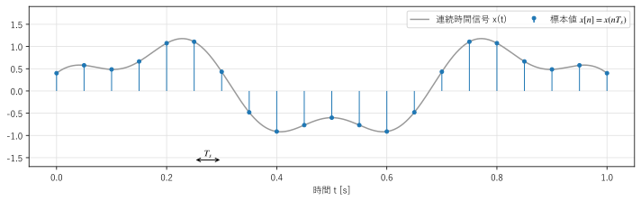
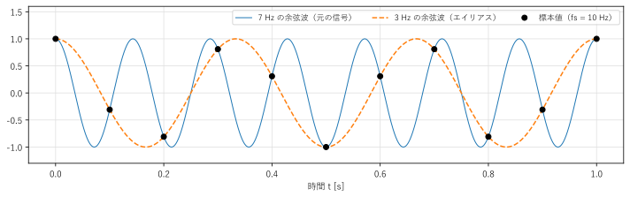
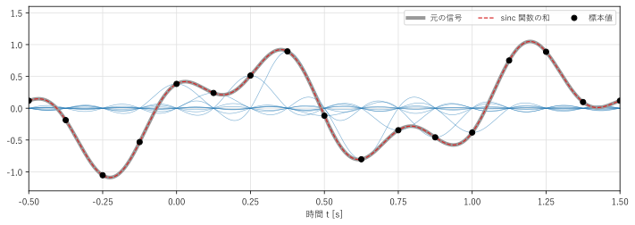
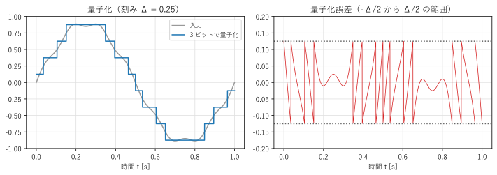

第 4 章 標本化と量子化
==================================================

計算機で信号を扱うには、連続時間のアナログ信号を、とびとびの時刻の数値の列に変換する必要がある。この章では、時間を離散化する標本化と、値を離散化する量子化を説明する。特に、どのような条件なら標本化で情報が失われないかを示す標本化定理が、この章の中心である。

標本化
------

連続時間信号 :math:`x(t)` から、一定の時間間隔 :math:`T_s` ごとに値を取り出して、数値の列

.. math::

   x[n] = x(nT_s) \qquad (n = \ldots, -1, 0, 1, 2, \ldots)

を作ることを\ :term:`標本化`\ （サンプリング）という。:math:`x[n]` を標本値（サンプル）、:math:`T_s` を標本化周期、その逆数 :math:`f_s = 1/T_s` を\ :term:`標本化周波数`\ という。:math:`f_s` は 1 秒あたりに取り出す標本の数であり、単位は Hz である。例えば、音楽 CD の標本化周波数は 44.1 kHz で、1 秒間に 44100 個の標本を取り出す。

.. _fig-ch04-sampling:

   連続時間信号と、標本化周波数 20 Hz で取り出した標本値

:numref:`fig-ch04-sampling` では、標本値をつなぐと元の波形がおおよそ分かる。しかし、標本と標本の間で信号がどう変化しているかの情報は、標本値だけからは分からないように見える。それでも、ある条件を満たせば、標本値だけから元の信号を完全に復元できる。その条件を、以下で順に導く。

エイリアシング
--------------

まず、標本化で何が起こりうるかを例で見る。標本化周波数 :math:`f_s = 10` Hz で、3 Hz と 7 Hz の余弦波を標本化する。

.. math::

   \cos\!\left(2\pi \cdot 7 \cdot \frac{n}{10}\right) = \cos\!\left(2\pi n - 2\pi \cdot 3 \cdot \frac{n}{10}\right) = \cos\!\left(2\pi \cdot 3 \cdot \frac{n}{10}\right)

:math:`n` が整数なので :math:`2\pi n` の項は消え、:math:`\cos` が偶関数であることから、2 つの標本値はすべての :math:`n` で一致する。:numref:`fig-ch04-aliasing` に示すように、7 Hz の余弦波の標本値は、3 Hz の余弦波の上にもぴったり乗る。標本値だけを見ると、元の信号が 3 Hz だったのか 7 Hz だったのかを区別できない。

.. _fig-ch04-aliasing:

   7 Hz の余弦波の標本値（黒丸）は、3 Hz の余弦波とも一致する

一般に、周波数 :math:`f` の正弦波と、周波数 :math:`f + m f_s`\ （:math:`m` は整数）の正弦波は、標本化すると区別できない。:math:`e^{j2\pi (f + m f_s) n T_s} = e^{j2\pi f n T_s} e^{j2\pi m n} = e^{j2\pi f n T_s}` だからである。さらに実数の正弦波では :math:`f` と :math:`-f` の成分が組になるので、周波数 :math:`f` の正弦波は、:math:`f` を :math:`f_s` の整数倍だけずらし、負なら符号を反転して得られる 0 から :math:`f_s/2` の範囲の周波数の正弦波と区別できない。このように、高い周波数の成分が低い周波数の成分になりすますことを\ :term:`エイリアシング`\ （折り返し）といい、なりすました成分をエイリアスという。

サンプルの ``aliasing.py`` は、見かけの周波数を求める関数を実装し、いくつかの周波数で確かめる。

.. literalinclude:: ../examples/aliasing.py
   :pyobject: apparent_frequency
   :lineno-match:
   :caption: aliasing.py の apparent_frequency()
   :name: list-ch04-aliasing

.. literalinclude:: ../build/outputs/aliasing.txt
   :language: text
   :caption: aliasing.py の実行結果

0 から 5 Hz の範囲の周波数はそのまま見えるが、5 Hz を超えると、5 Hz を境に折り返したように見かけの周波数が下がっていく（6 Hz は 4 Hz に、9 Hz は 1 Hz に見える）。10 Hz の正弦波は、毎回同じ位相で標本化されるので、直流（0 Hz）に見える。この折り返しの境目 :math:`f_s/2` を\ :term:`ナイキスト周波数`\ という。

サンプルの全体：:download:`aliasing.py <../examples/aliasing.py>`

エイリアシングは、日常でも見られる。映画やビデオで、回転する車輪が止まって見えたり、逆回転して見えたりするのは、毎秒 24 枚や 30 枚の撮影（標本化）による時間方向のエイリアシングである。

標本化した信号のスペクトル
--------------------------

エイリアシングを、周波数領域で見直す。標本化を数式で扱うために、:math:`x(t)` に第 3 章のくし形関数を掛けた信号

.. math::

   x_s(t) = x(t) \sum_{n=-\infty}^{\infty} \delta(t - nT_s) = \sum_{n=-\infty}^{\infty} x(nT_s)\, \delta(t - nT_s)

を考える。:math:`x_s(t)` は、標本値 :math:`x[n]` を重みとするデルタ関数の列であり、標本値の情報だけをもつ。

時間領域の積は周波数領域の畳み込みになる。くし形関数のフーリエ変換は、第 3 章の式 :eq:`eq-comb` から間隔 :math:`f_s` のくし形関数 :math:`f_s \sum_m \delta(f - m f_s)` である。デルタ関数との畳み込みは、関数をその位置に移動させるだけなので、

.. math::
   :label: eq-sampled-spectrum

   X_s(f) = f_s \sum_{m=-\infty}^{\infty} X(f - m f_s)

が得られる。標本化した信号のスペクトルは、元のスペクトル :math:`X(f)` を :math:`f_s` ごとにずらして無限に並べたもの（を :math:`f_s` 倍したもの）になる。

:numref:`fig-ch04-spectrum-replica` は、:math:`|f| < B` の範囲にだけ成分をもつ信号（帯域幅 :math:`B` の信号）について、この様子を描いたものである。:math:`f_s > 2B` のとき（上）は、ずらしたスペクトルの複製どうしが重ならない。:math:`f_s < 2B` のとき（下）は、複製どうしが重なり、:math:`-f_s/2` から :math:`f_s/2` の範囲（灰色の範囲）に、隣の複製の裾が入り込む。これが周波数領域から見たエイリアシングである。いったん重なって足し合わされた成分は、後から分離できない。

.. _fig-ch04-spectrum-replica:

.. figure:: images/fig_ch04_spectrum_replica.svg
   :alt: 帯域幅 B の信号を標本化したときのスペクトルの複製が、fs が 2B より大きいときは重ならず、小さいときは重なる様子

   標本化した信号のスペクトル（青が元のスペクトル、橙が複製、黒の線がその和）

標本化定理
----------

前の節の結果から、次の\ :term:`標本化定理`\ が得られる。

.. important::

   信号が :math:`|f| < B` の範囲の周波数成分だけを含む（帯域制限されている）とき、標本化周波数を

   .. math::

      f_s > 2B

   に選べば、標本値 :math:`x[n]` から元の信号 :math:`x(t)` を完全に復元できる。

この定理は、シャノン（C. E. Shannon）やナイキスト（H. Nyquist）、日本の染谷勲らの仕事にちなみ、シャノンの標本化定理、ナイキストの定理などとも呼ばれる。:math:`2B` をナイキストレートという。言い換えると、ナイキスト周波数 :math:`f_s/2` より高い周波数の成分を含まなければ、エイリアシングは起こらない。

:math:`f_s = 2B` ちょうどでは不十分な場合がある。例えば、周波数 :math:`f_s/2` の正弦波 :math:`\sin(\pi f_s t)` を標本化すると、:math:`\sin(\pi n) = 0` なので、すべての標本値が 0 になってしまう。そのため、条件は等号を含まない不等式で書く。

標本化周波数の選び方の例を :numref:`table-ch04-fs` に示す。

.. _table-ch04-fs:

.. list-table:: 標本化周波数の例
   :header-rows: 1
   :widths: 30 25 45

   * - 用途
     - 標本化周波数
     - 考え方
   * - 固定電話の音声
     - 8 kHz
     - 音声の主要な帯域 300 Hz から 3.4 kHz を伝える
   * - 音楽 CD
     - 44.1 kHz
     - 人の可聴域の上限（約 20 kHz）の 2 倍に、フィルタのための余裕を加える
   * - 業務用の音声・動画
     - 48 kHz
     - 同上（放送や映像の分野の標準）
   * - 高い分解能の音声
     - 96 kHz、192 kHz
     - 可聴域を超える帯域も記録する、フィルタの設計を楽にする

信号の再構成
------------

標本化定理の条件を満たしていれば、元の信号を次の手順で復元できる。:numref:`fig-ch04-spectrum-replica` の上の図で、:math:`-f_s/2` から :math:`f_s/2` の範囲だけを通し、それ以外を遮断する理想的なローパスフィルタを :math:`X_s(f)` に掛ければ、元のスペクトル :math:`X(f)`\ （の :math:`f_s` 倍）だけが残る。

このフィルタの周波数特性は、高さ :math:`1/f_s`、幅 :math:`f_s` の矩形 :math:`\frac{1}{f_s}\mathrm{rect}(f/f_s)` であり、その逆フーリエ変換は :math:`\mathrm{sinc}(f_s t) = \mathrm{sinc}(t/T_s)` である（第 3 章のスケーリングの性質）。周波数領域での掛け算は時間領域では畳み込みなので、:math:`x_s(t)` と :math:`\mathrm{sinc}(t/T_s)` を畳み込むと、

.. math::
   :label: eq-sinc-interpolation

   x(t) = \sum_{n=-\infty}^{\infty} x[n]\, \mathrm{sinc}\!\left(\frac{t - nT_s}{T_s}\right)

が得られる。各標本値の位置に、その値を高さとする sinc 関数を置いて足し合わせると、元の信号に戻るということである（:numref:`fig-ch04-reconstruction`）。:math:`\mathrm{sinc}` 関数は、中心で 1、ほかの標本の位置（:math:`T_s` の整数倍だけ離れた位置）では 0 になるので、標本の位置では標本値そのものが得られ、標本の間は滑らかに補間される。この式を sinc 補間という。

.. _fig-ch04-reconstruction:

   sinc 補間による信号の再構成（細い青の線が個々の sinc 関数）

式 :eq:`eq-sinc-interpolation` は無限個の標本を必要とし、sinc 関数は過去と未来の両方に無限に広がるので、そのままでは実現できない。実際の D/A 変換器は、標本値を次の標本まで保持する階段状の波形（0 次ホールド）を出力し、その後のアナログのローパスフィルタ（再構成フィルタ）で、階段の角に含まれる高い周波数の成分を取り除く。

アンチエイリアシングフィルタ
----------------------------

現実の信号は、厳密には帯域制限されていない。雑音は高い周波数まで広がっているし、急な変化を含む信号は高い周波数の成分を多く含む（第 2 章）。ナイキスト周波数を超える成分は、標本化するとエイリアスとして低い周波数に現れ、後から取り除くことができない。

そのため、A/D 変換の前に、ナイキスト周波数より高い周波数の成分を十分に減衰させるアナログのローパスフィルタを置く（第 1 章の :numref:`fig-ch01-dsp-chain`）。これを\ :term:`アンチエイリアシングフィルタ`\ という。理想的なフィルタは作れないので、必要な帯域 :math:`B` と :math:`f_s/2` の間に、フィルタの減衰が十分に大きくなるための余裕をもたせる。音楽 CD の 44.1 kHz は、20 kHz までの可聴域に対して、20 kHz から 22.05 kHz までの範囲をこの余裕に使っている。

最近の A/D 変換器の多くは、必要な周波数よりはるかに高い標本化周波数でいったん標本化し（オーバーサンプリング）、デジタルのフィルタで帯域を制限してから標本化周波数を下げる。こうすると、アナログのフィルタに求められる性能を緩められる。標本化周波数を下げる処理（ダウンサンプリング）は、第 10 章で扱う。

量子化
------

標本値は、そのままでは実数（無限の精度をもつ値）である。計算機で扱うには、有限のビット数の数値で表す必要がある。値を一定の刻み :math:`\Delta` の整数倍などの有限個の値に丸めることを、量子化という。:numref:`fig-ch04-quantization` は、:math:`-1` から :math:`1` の範囲を 3 ビット（:math:`2^3 = 8` 段階）で量子化した例である。

.. _fig-ch04-quantization:

   3 ビットの量子化（左）と量子化誤差（右）

量子化した値と元の値の差を量子化誤差という。値を最も近い段に丸める場合、量子化誤差は :math:`-\Delta/2` から :math:`\Delta/2` の範囲に収まる。信号が十分に複雑に変化していれば、量子化誤差はこの範囲に一様に分布する雑音とみなせる。これを\ :term:`量子化雑音`\ という。その電力（2 乗の平均）は、一様分布の分散として

.. math::

   \frac{1}{\Delta}\int_{-\Delta/2}^{\Delta/2} e^2\, de = \frac{\Delta^2}{12}

となる。

信号の電力と雑音の電力の比を :term:`SNR`\ （signal-to-noise ratio、信号対雑音比）といい、ふつうは\ :term:`デシベル`\ （dB）で表す。電力の比 :math:`P_1/P_2` のデシベル値は :math:`10\log_{10}(P_1/P_2)` であり、振幅の比 :math:`A_1/A_2` で表すと :math:`20\log_{10}(A_1/A_2)` になる。

:math:`B` ビットの量子化器で、量子化できる範囲いっぱいの振幅の正弦波を量子化した場合の SNR を求める。範囲を :math:`-A` から :math:`A` とすると、刻みは :math:`\Delta = 2A/2^B` であり、正弦波の電力は :math:`A^2/2` なので、

.. math::

   \mathrm{SNR} = 10\log_{10}\frac{A^2/2}{\Delta^2/12} = 10\log_{10}\left(\frac{3}{2}\cdot 2^{2B}\right) \approx 6.02B + 1.76 \text{ [dB]}

となる。ビット数を 1 増やすごとに、SNR は約 6 dB 改善する。音楽 CD の 16 ビットでは約 98 dB、24 ビットでは約 146 dB である。ただし、実際の信号の振幅は範囲いっぱいではないことが多く、その分だけ SNR は下がる。

量子化には、もう 1 つ注意点がある。範囲を超える値は、最大値または最小値に張り付いてしまう（クリッピング）。クリッピングは波形を大きくひずませ、多くの高調波を生む。入力の振幅は、範囲に収まるように調整する必要がある。

本書の以降の章では、計算機の浮動小数点数で計算する。倍精度の浮動小数点数（Python の ``float``、NumPy の ``float64``）は有効数字が約 16 桁あり、量子化雑音は通常は無視できる。ただし、組み込み機器などで固定小数点数を使う場合は、フィルタの計算の途中でも量子化誤差が生じるので、設計の段階から考慮する必要がある。

まとめ
------

* 標本化は、連続時間信号から間隔 :math:`T_s` で値を取り出すことである。標本化周波数は :math:`f_s = 1/T_s` である。
* 周波数 :math:`f` と :math:`f + m f_s` の正弦波は、標本化すると区別できない。ナイキスト周波数 :math:`f_s/2` を超える成分は、低い周波数に折り返す（エイリアシング）。
* 標本化した信号のスペクトルは、元のスペクトルを :math:`f_s` ごとに繰り返したものになる。
* 帯域幅 :math:`B` の信号は、:math:`f_s > 2B` で標本化すれば、sinc 補間で完全に復元できる（標本化定理）。
* A/D 変換の前には、アンチエイリアシングフィルタで帯域を制限する。
* :math:`B` ビットの量子化の SNR は、範囲いっぱいの正弦波で約 :math:`6.02B + 1.76` dB である。
