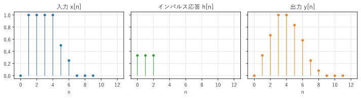
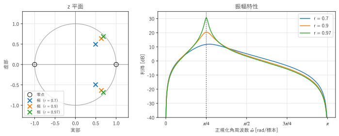

第 5 章 離散時間信号と LTI システム
==================================================

信号を加工する仕組みを「システム」という。フィルタ、イコライザ、残響の付加、伝送路のひずみなど、信号処理の多くの対象は、線形時不変（LTI）システムとしてモデル化できる。この章では、離散時間の LTI システムが、インパルス応答または周波数応答という 1 つの関数で完全に特徴付けられることを示す。

基本的な離散時間信号
--------------------

この章からは、標本化された信号 :math:`x[n]` を主に扱う。:math:`n` は整数の時刻（標本の番号）である。よく使う信号を次に示す。

.. list-table::
   :header-rows: 1
   :widths: 25 40 35

   * - 名前
     - 定義
     - 備考
   * - 単位インパルス
     - :math:`\delta[n] = \begin{cases} 1 & (n = 0) \\ 0 & (n \ne 0) \end{cases}`
     - デルタ関数の離散時間版。通常の関数として定義できる
   * - 単位ステップ
     - :math:`u[n] = \begin{cases} 1 & (n \ge 0) \\ 0 & (n < 0) \end{cases}`
     - 連続時間の単位ステップ関数の離散時間版
   * - 正弦波
     - :math:`A\cos(\hat{\omega} n + \phi)`
     - :math:`\hat{\omega}` は正規化角周波数
   * - 複素正弦波
     - :math:`e^{j\hat{\omega} n}`
     - 実部と虚部がそれぞれ正弦波になる

連続時間の正弦波 :math:`A\cos(2\pi f t + \phi)` を標本化周波数 :math:`f_s` で標本化すると、:math:`t = n/f_s` を代入して

.. math::

   x[n] = A\cos\!\left(2\pi \frac{f}{f_s} n + \phi\right) = A\cos(\hat{\omega} n + \phi), \qquad \hat{\omega} = 2\pi \frac{f}{f_s}

となる。:math:`\hat{\omega}` を\ :term:`正規化角周波数`\ といい、単位は rad/標本（1 標本あたりに進む角度）である。離散時間信号は標本化周波数の情報をもたないので、周波数は標本化周波数を基準にした相対的な値で表すことになる。ナイキスト周波数 :math:`f = f_s/2` は :math:`\hat{\omega} = \pi` に対応する。

:math:`e^{j(\hat{\omega} + 2\pi)n} = e^{j\hat{\omega} n}` なので、:math:`\hat{\omega}` と :math:`\hat{\omega} + 2\pi` は同じ信号を表す。正規化角周波数は :math:`-\pi < \hat{\omega} \le \pi`\ （または :math:`0 \le \hat{\omega} < 2\pi`）の範囲だけを考えれば十分である。これは、第 4 章のエイリアシングを離散時間の側から見たものである。

システムと LTI システム
-----------------------

入力信号 :math:`x[n]` を出力信号 :math:`y[n]` に変換するものをシステムといい、:math:`y = \mathcal{T}\{x\}` と書く。システムの中でも、次の 2 つの性質をもつものが特に重要である。

* **線形性**：入力を定数倍したり足したりすると、出力も同じように定数倍したり足したりしたものになる。:math:`\mathcal{T}\{a x_1 + b x_2\} = a\mathcal{T}\{x_1\} + b\mathcal{T}\{x_2\}`
* **時不変性**：入力を :math:`k` 標本だけ遅らせると、出力も :math:`k` 標本だけ遅れるだけで、形は変わらない。:math:`y[n] = \mathcal{T}\{x\}[n]` なら :math:`\mathcal{T}\{x[\cdot - k]\}[n] = y[n - k]`

この 2 つの性質をもつシステムを :term:`LTI システム`\ （linear time-invariant system、線形時不変システム）という。例えば、

* 3 点の移動平均 :math:`y[n] = \frac{1}{3}(x[n] + x[n-1] + x[n-2])` は LTI システムである。
* 2 乗 :math:`y[n] = x[n]^2` は線形でない（入力を 2 倍すると出力は 4 倍になる）。
* :math:`y[n] = n\,x[n]` は時不変でない（係数 :math:`n` が時刻によって変わる）。

LTI システムは、:numref:`fig-ch05-lti` のようなブロック図で表す。

.. _fig-ch05-lti:

.. graphviz::
   :caption: LTI システムのブロック図
   :alt: 入力 x[n] がインパルス応答 h[n] のシステムを通って出力 y[n] になるブロック図

   digraph lti {
       rankdir=LR;
       node [fontsize=12];
       x [label="x[n]", shape=plaintext];
       h [label="LTI システム\nh[n]、H(z)", shape=box, style="filled", fillcolor="#eef4fb"];
       y [label="y[n] = (x * h)[n]", shape=plaintext];
       x -> h -> y;
   }

インパルス応答と畳み込み和
--------------------------

LTI システムに単位インパルス :math:`\delta[n]` を入力したときの出力 :math:`h[n]` を、そのシステムの\ :term:`インパルス応答`\ という。LTI システムでは、インパルス応答が分かれば、任意の入力に対する出力が計算できる。その理由を示す。

任意の信号は、時刻をずらした単位インパルスの重み付きの和で表せる。

.. math::

   x[n] = \sum_{k=-\infty}^{\infty} x[k]\, \delta[n - k]

右辺の各項は、時刻 :math:`k` にある高さ :math:`x[k]` のインパルスである。時不変性から、:math:`\delta[n - k]` に対する出力は :math:`h[n - k]` であり、線形性から、重み付きの和に対する出力は出力の重み付きの和になる。したがって、

.. math::
   :label: eq-convolution-sum

   y[n] = \sum_{k=-\infty}^{\infty} x[k]\, h[n - k] = \sum_{k=-\infty}^{\infty} h[k]\, x[n - k]

が得られる。これを畳み込み和といい、:math:`y = x * h` と書く。第 3 章の畳み込みの積分を、和に置き換えたものである。2 番目の等号は、:math:`k` を :math:`n - k` に置き換えると得られ、:math:`x * h = h * x` を表す。

2 番目の形 :math:`y[n] = \sum_k h[k]\,x[n-k]` は、「現在と過去の入力に、インパルス応答の値を重みとして掛けて足す」と読める。3 点の移動平均なら :math:`h[0] = h[1] = h[2] = 1/3` で、それ以外は 0 である。

サンプルの ``convolution.py`` は、畳み込み和を定義どおりの二重ループで計算し、NumPy の ``np.convolve()`` と比べる。長さ :math:`N` の入力と長さ :math:`M` のインパルス応答の畳み込みは、長さ :math:`N + M - 1` になる。

.. literalinclude:: ../examples/convolution.py
   :pyobject: convolve
   :lineno-match:
   :caption: convolution.py の convolve()
   :name: list-ch05-convolve

.. literalinclude:: ../build/outputs/convolution.txt
   :language: text
   :caption: convolution.py の実行結果

.. _fig-ch05-convolution:

   入力（左）、インパルス応答（中）、出力（右）

:numref:`fig-ch05-convolution` を見ると、移動平均によって、入力の急な立ち上がりと立ち下がりが、なだらかになっていることが分かる。出力は入力より 2 標本だけ長い。

サンプルの全体：:download:`convolution.py <../examples/convolution.py>`

畳み込みは、交換法則 :math:`x * h = h * x`、結合法則 :math:`(x * h_1) * h_2 = x * (h_1 * h_2)`、分配法則 :math:`x * (h_1 + h_2) = x * h_1 + x * h_2` を満たす。結合法則は、2 つの LTI システムを直列につないだシステムのインパルス応答が :math:`h_1 * h_2` であることを意味する。

因果性と安定性
--------------

実際に作れるシステムには、次の 2 つの性質が求められる。

**因果性**：出力が、現在と過去の入力だけで決まり、未来の入力に依存しないこと。LTI システムでは、:math:`n < 0` で :math:`h[n] = 0` であることと同じである。リアルタイムの処理では、\ :term:`因果性`\ のあるシステムしか実現できない。ただし、記録済みのデータを処理する場合は、「未来」の標本も使えるので、因果的でない処理も実現できる（第 9 章のゼロ位相フィルタリング）。

**安定性**：有界な入力（すべての :math:`n` で :math:`|x[n]| \le M` となる入力）に対して、出力も有界になること。これを BIBO 安定（bounded-input bounded-output）という。LTI システムが\ :term:`安定性`\ をもつための必要十分条件は、インパルス応答が絶対総和可能であること、つまり

.. math::

   \sum_{n=-\infty}^{\infty} |h[n]| < \infty

である。インパルス応答の長さが有限なら、このシステムは必ず安定である。

差分方程式
----------

多くの LTI システムは、入力と出力の現在と過去の値の関係を表す\ :term:`差分方程式`\ で記述できる。

.. math::
   :label: eq-difference-equation

   y[n] = \sum_{k=0}^{M} b_k\, x[n - k] - \sum_{k=1}^{N} a_k\, y[n - k]

右辺の第 1 項は入力の現在と過去の値の重み付きの和、第 2 項は過去の出力の重み付きの和である。

* :math:`a_k` がすべて 0 なら、出力は入力だけで決まり、インパルス応答は :math:`h[n] = b_n`\ （長さ :math:`M + 1`）になる。インパルス応答の長さが有限なので、FIR（finite impulse response）システムという。
* 過去の出力を使う（:math:`a_k` に 0 でないものがある）場合は、出力が入力に戻って影響し続けるので、インパルス応答は一般に無限に続く。これを IIR（infinite impulse response）システムという。

例として、最も簡単な IIR システム

.. math::

   y[n] = x[n] + a\, y[n - 1]

を考える。:math:`x[n] = \delta[n]` を入力し、:math:`y[-1] = 0` から順に計算すると、:math:`y[0] = 1`、:math:`y[1] = a`、:math:`y[2] = a^2`、... となり、インパルス応答は :math:`h[n] = a^n u[n]` である。:math:`|a| < 1` なら :math:`\sum |h[n]| = 1/(1 - |a|)` が有限なので安定、:math:`|a| \ge 1` なら不安定である。過去の出力を使うと、少ない計算量で長いインパルス応答を作れるが、係数によっては不安定になりうる。

差分方程式は、遅延（:math:`z^{-1}` の箱で表す）、係数の掛け算、足し算の 3 つの要素でブロック図に描ける。:numref:`fig-ch05-first-order` は、上の 1 次の IIR システムのブロック図である。

.. _fig-ch05-first-order:

.. graphviz::
   :caption: 1 次の IIR システム :math:`y[n] = x[n] + a\,y[n-1]` のブロック図
   :alt: 入力が加算器に入り、加算器の出力が出力になるとともに、1 標本の遅延と係数 a の乗算を経て加算器に戻るブロック図

   digraph first_order {
       rankdir=LR;
       node [fontsize=12];
       x   [label="x[n]", shape=plaintext];
       add [label="+", shape=circle, width=0.4, fixedsize=true];
       y   [label="y[n]", shape=plaintext];
       d   [label="z⁻¹", shape=box];
       m   [label="a", shape=triangle, orientation=90, width=0.6, height=0.5, fixedsize=true];
       x -> add;
       add -> y;
       add -> d [label=" y[n]", tailport=s, headport=e];
       d -> m [label="y[n-1]"];
       m -> add [headport=s];
       {rank=same; add; d;}
   }

周波数応答
----------

LTI システムに、複素正弦波 :math:`x[n] = e^{j\hat{\omega} n}` を入力する。畳み込み和 :eq:`eq-convolution-sum` に代入すると、

.. math::

   y[n] = \sum_{k} h[k]\, e^{j\hat{\omega}(n - k)} = \left( \sum_{k} h[k]\, e^{-j\hat{\omega} k} \right) e^{j\hat{\omega} n} = H(e^{j\hat{\omega}})\, e^{j\hat{\omega} n}

となる。出力は、入力と同じ複素正弦波に、複素数 :math:`H(e^{j\hat{\omega}})` を掛けたものである。この

.. math::
   :label: eq-frequency-response

   H(e^{j\hat{\omega}}) = \sum_{n=-\infty}^{\infty} h[n]\, e^{-j\hat{\omega} n}

を、システムの\ :term:`周波数応答`\ という。LTI システムは、複素正弦波の周波数を変えず、各周波数ごとに決まった複素数を掛けるだけである。:math:`|H(e^{j\hat{\omega}})|` を\ :term:`振幅特性`\ （利得）、:math:`\arg H(e^{j\hat{\omega}})` を\ :term:`位相特性`\ という。:math:`H(e^{j\hat{\omega}})` という書き方は、次の節の z 変換で :math:`z = e^{j\hat{\omega}}` とした値であることを表している。

実数の係数をもつシステムに実数の正弦波 :math:`A\cos(\hat{\omega} n + \phi)` を入力すると、出力は

.. math::

   y[n] = |H(e^{j\hat{\omega}})|\, A \cos\!\left(\hat{\omega} n + \phi + \arg H(e^{j\hat{\omega}})\right)

となる。振幅が :math:`|H|` 倍になり、位相が :math:`\arg H` だけずれる。第 1 章で述べた「正弦波を入力すると、振幅と位相だけが変わる」という性質が、ここで示された。入力を正弦波に分解すれば（フーリエ解析）、各成分の振幅と位相の変化を計算して足し合わせることで、出力が求められる。

例として、3 点の移動平均の周波数応答を求める。

.. math::

   H(e^{j\hat{\omega}}) = \frac{1}{3}\left(1 + e^{-j\hat{\omega}} + e^{-j2\hat{\omega}}\right) = \frac{1}{3} e^{-j\hat{\omega}}\left(e^{j\hat{\omega}} + 1 + e^{-j\hat{\omega}}\right) = \frac{1 + 2\cos\hat{\omega}}{3}\, e^{-j\hat{\omega}}

振幅特性は :math:`|1 + 2\cos\hat{\omega}|/3` で、:math:`\hat{\omega} = 0`\ （直流）で 1、:math:`\hat{\omega} = 2\pi/3`\ （:math:`f = f_s/3`）で 0 になる。低い周波数を通し、高い周波数を弱めるローパスフィルタである。位相特性は（:math:`1 + 2\cos\hat{\omega} > 0` の範囲で） :math:`-\hat{\omega}` であり、第 3 章の時間シフトの性質から、1 標本の遅れを表す。移動平均の出力は 3 点の中央の時刻の値に相当するので、1 標本遅れるのは自然である。

周波数応答の式 :eq:`eq-frequency-response` は、インパルス応答 :math:`h[n]` の離散時間フーリエ変換（第 6 章）である。つまり、インパルス応答と周波数応答はフーリエ変換の対であり、どちらもシステムを完全に表す。

z 変換と伝達関数
----------------

周波数応答を一般化した道具に、 :term:`z 変換`\ がある。信号 :math:`x[n]` の z 変換は、複素数 :math:`z` の関数として次のように定義する。

.. math::

   X(z) = \sum_{n=-\infty}^{\infty} x[n]\, z^{-n}

:math:`z = e^{j\hat{\omega}}`\ （複素平面の単位円の上）とすると、z 変換は周波数応答の式と一致する。z 変換の最も重要な性質は、「1 標本の遅延 :math:`x[n-1]` の z 変換が :math:`z^{-1}X(z)`」になることである。そのため、:math:`z^{-1}` は 1 標本の遅延を表す記号として使われる。

差分方程式 :eq:`eq-difference-equation` の両辺を z 変換すると、:math:`Y(z) = \sum_k b_k z^{-k} X(z) - \sum_k a_k z^{-k} Y(z)` となり、

.. math::
   :label: eq-transfer-function

   H(z) = \frac{Y(z)}{X(z)} = \frac{b_0 + b_1 z^{-1} + \cdots + b_M z^{-M}}{1 + a_1 z^{-1} + \cdots + a_N z^{-N}}

が得られる。:math:`H(z)` を\ :term:`伝達関数`\ という。伝達関数はインパルス応答の z 変換であり、:math:`z = e^{j\hat{\omega}}` を代入すると周波数応答になる。

伝達関数の分子を 0 にする :math:`z` を\ :term:`零点`\ 、分母を 0 にする :math:`z` を\ :term:`極`\ という。極と零点の配置から、システムの性質が読み取れる。

* 因果的なシステムが安定であるための必要十分条件は、すべての極が単位円の内側（:math:`|z| < 1`）にあることである。例えば、1 次の IIR システム :math:`H(z) = 1/(1 - a z^{-1})` の極は :math:`z = a` であり、:math:`|a| < 1` で安定という前の節の結果と一致する。
* 周波数応答は、単位円の上の点 :math:`e^{j\hat{\omega}}` での :math:`H(z)` の値である。単位円の上の点が極に近づくと利得が大きくなり、零点に近づくと利得が小さくなる（零点が単位円の上にあれば、その周波数の利得は 0 になる）。

:numref:`fig-ch05-pole-zero` は、極を :math:`re^{\pm j\pi/4}`、零点を :math:`z = \pm 1` に置いた 2 次のシステムの例である。極が単位円に近いほど（:math:`r` が 1 に近いほど）、極の角度 :math:`\hat{\omega} = \pi/4` の付近で利得が鋭く大きくなる。零点のある :math:`\hat{\omega} = 0` と :math:`\hat{\omega} = \pi` では利得が 0（:math:`-\infty` dB）になる。このように、特定の周波数の付近だけを通すシステムを共振器という。

.. _fig-ch05-pole-zero:

   2 次の共振器の極と零点（左）と振幅特性（右）

SciPy では、``scipy.signal.freqz()`` で伝達関数の係数から周波数応答を、``scipy.signal.tf2zpk()`` で極と零点を計算できる。

.. code-block:: python
   :linenos:
   :caption: 伝達関数の周波数応答と極・零点の計算

   import numpy as np
   from scipy import signal

   r, theta = 0.9, np.pi / 4
   b = [1.0, 0.0, -1.0]                           # 分子 1 - z^-2
   a = [1.0, -2 * r * np.cos(theta), r**2]        # 分母 1 - 2r cos(theta) z^-1 + r^2 z^-2
   w, h = signal.freqz(b, a, worN=1024)           # w: 0 から pi の正規化角周波数
   zeros, poles, gain = signal.tf2zpk(b, a)
   print(np.abs(poles))                           # [0.9 0.9]：すべて 1 未満なので安定
   print(w[np.argmax(np.abs(h))])                 # 利得が最大になる正規化角周波数（約 0.79）

まとめ
------

* 正規化角周波数 :math:`\hat{\omega} = 2\pi f/f_s` は 1 標本あたりの角度であり、ナイキスト周波数は :math:`\hat{\omega} = \pi` に対応する。
* LTI システムは、インパルス応答 :math:`h[n]` で完全に決まり、出力は入力とインパルス応答の畳み込み和 :math:`y = x * h` で計算できる。
* 因果的なシステムでは :math:`n < 0` で :math:`h[n] = 0`、安定なシステムでは :math:`\sum |h[n]| < \infty` である。
* 差分方程式で表されるシステムには、過去の出力を使わない FIR と、使う IIR がある。
* 複素正弦波を入力すると、出力は周波数応答 :math:`H(e^{j\hat{\omega}})` を掛けた同じ周波数の複素正弦波になる。
* 伝達関数 :math:`H(z)` の極と零点の配置から、安定性と周波数特性を読み取れる。
