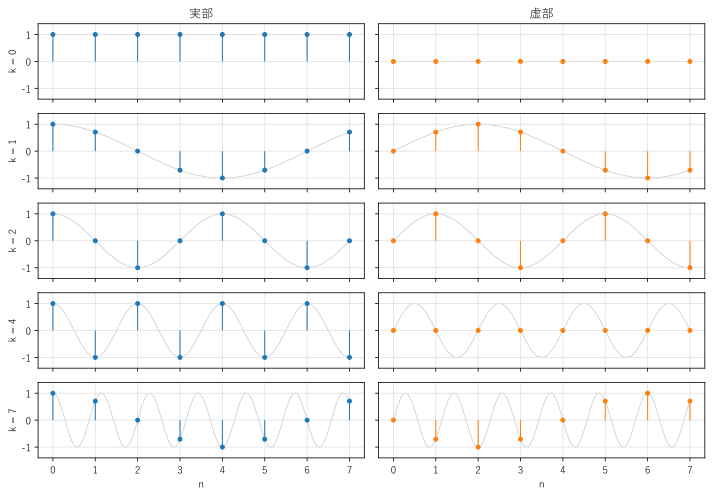
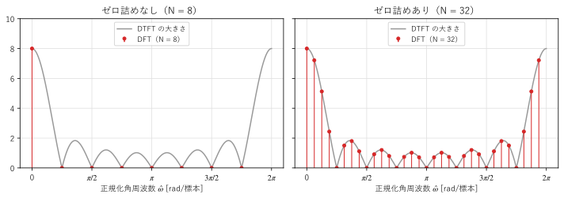
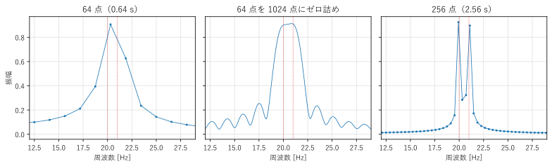

第 6 章 離散時間フーリエ変換と離散フーリエ変換
==================================================

第 3 章のフーリエ変換は、連続時間の信号を対象としていた。この章では、離散時間の信号のスペクトルを表す離散時間フーリエ変換（DTFT）と、計算機で実際に計算できる離散フーリエ変換（DFT）を説明する。DFT は、本書の後半のすべての処理の土台になる。

離散時間フーリエ変換
--------------------

離散時間信号 :math:`x[n]` の :term:`DTFT`\ （discrete-time Fourier transform、離散時間フーリエ変換）を、次の式で定義する。

.. math::
   :label: eq-dtft

   X(e^{j\hat{\omega}}) = \sum_{n=-\infty}^{\infty} x[n]\, e^{-j\hat{\omega} n}

第 5 章の周波数応答の式 :eq:`eq-frequency-response` は、インパルス応答の DTFT だったことになる。DTFT は、フーリエ変換の積分 :math:`\int dt` を和 :math:`\sum_n` に置き換えた形をしている。

DTFT には、次の特徴がある。

* :math:`\hat{\omega}` は連続な変数であり、:math:`X(e^{j\hat{\omega}})` は :math:`\hat{\omega}` の連続な関数である。
* :math:`e^{-j(\hat{\omega} + 2\pi)n} = e^{-j\hat{\omega} n}` なので、:math:`X(e^{j\hat{\omega}})` は周期 :math:`2\pi` の周期関数である。:math:`-\pi < \hat{\omega} \le \pi` の 1 周期だけを考えればよい。

逆変換は、1 周期にわたる積分で表される。

.. math::

   x[n] = \frac{1}{2\pi}\int_{-\pi}^{\pi} X(e^{j\hat{\omega}})\, e^{j\hat{\omega} n}\, d\hat{\omega}

この式は、周期 :math:`2\pi` の関数 :math:`X(e^{j\hat{\omega}})` のフーリエ級数展開とみなせる。DTFT の式 :eq:`eq-dtft` が展開した級数、:math:`x[n]` がそのフーリエ係数である。第 2 章では「周期的な信号 → 離散的なスペクトル」だったが、ここでは「離散的な信号 → 周期的なスペクトル」という逆の関係になっている。

DTFT と、元の連続時間信号のフーリエ変換は、第 4 章の式 :eq:`eq-sampled-spectrum` で結び付けられる。:math:`x[n] = x_c(nT_s)` のとき、:math:`\hat{\omega} = 2\pi f/f_s` と置けば

.. math::

   X(e^{j\hat{\omega}}) = f_s \sum_{m=-\infty}^{\infty} X_c\!\left(f - m f_s\right)

である（:math:`X_c` は :math:`x_c(t)` のフーリエ変換）。DTFT の周期性は、標本化によってスペクトルが :math:`f_s` ごとに繰り返されることの表れである。

例として、長さ :math:`L` の矩形の信号（:math:`0 \le n \le L - 1` で :math:`x[n] = 1`、それ以外で 0）の DTFT を求める。等比数列の和の公式から、

.. math::
   :label: eq-dirichlet

   X(e^{j\hat{\omega}}) = \sum_{n=0}^{L-1} e^{-j\hat{\omega} n} = \frac{1 - e^{-j\hat{\omega} L}}{1 - e^{-j\hat{\omega}}} = e^{-j\hat{\omega}(L-1)/2}\, \frac{\sin(L\hat{\omega}/2)}{\sin(\hat{\omega}/2)}

となる。大きさ :math:`|\sin(L\hat{\omega}/2)/\sin(\hat{\omega}/2)|` は、:math:`\hat{\omega} = 0` で最大値 :math:`L` をとり、:math:`\hat{\omega} = 2\pi k/L`\ （:math:`k = 1, 2, \ldots, L-1`）で 0 になる。これは、連続時間の矩形パルスの sinc 関数を周期化したような形であり、ディリクレ核と呼ばれる。この関数は第 8 章のスペクトル漏れで重要な役割を果たす。

離散フーリエ変換
----------------

DTFT は周波数 :math:`\hat{\omega}` が連続な変数であり、無限に長い信号も対象とするので、そのままでは計算機で計算できない。計算機で扱うには、信号の長さも周波数の点の数も有限にする必要がある。

長さ :math:`N` の信号 :math:`x[0], x[1], \ldots, x[N-1]` の :term:`DFT`\ （discrete Fourier transform、離散フーリエ変換）を、次の式で定義する。

.. math::
   :label: eq-dft

   X[k] = \sum_{n=0}^{N-1} x[n]\, e^{-j2\pi k n/N} \qquad (k = 0, 1, \ldots, N-1)

逆変換（逆 DFT）は次の式である。

.. math::
   :label: eq-idft

   x[n] = \frac{1}{N}\sum_{k=0}^{N-1} X[k]\, e^{j2\pi k n/N} \qquad (n = 0, 1, \ldots, N-1)

式 :eq:`eq-dft` を DTFT の式 :eq:`eq-dtft` と比べると、DFT は、長さ :math:`N` の信号の DTFT を、:math:`0 \le \hat{\omega} < 2\pi` の範囲で等間隔に :math:`N` 点だけ取り出したもの

.. math::

   X[k] = X(e^{j\hat{\omega}})\Big|_{\hat{\omega} = 2\pi k/N}

であることが分かる。

:math:`X[k]` は、周波数 :math:`\hat{\omega}_k = 2\pi k/N` の複素正弦波 :math:`e^{j2\pi k n/N}` の成分の大きさと位相を表す。これを、標本化周波数 :math:`f_s` を使って実際の周波数に直すと

.. math::

   f_k = k \frac{f_s}{N}

となる。DFT の各 :math:`k` を周波数ビン（または単にビン）といい、ビンの間隔 :math:`f_s/N` を DFT の\ :term:`周波数分解能`\ という。

:math:`e^{j2\pi k n/N}` は :math:`k` について周期 :math:`N` なので、:math:`k` と :math:`k - N` は同じ周波数を表す。そのため、:math:`k > N/2` のビンは負の周波数 :math:`(k - N) f_s/N` に対応する。例えば :math:`N = 8` のとき、:math:`k = 7` のビンは :math:`k = -1`\ （周波数 :math:`-f_s/8`）の成分である。:numref:`fig-ch06-dft-basis` は、:math:`N = 8` の DFT の基底 :math:`e^{j2\pi k n/N}` の実部と虚部を描いたものである。:math:`k = 7` は :math:`k = 1` と実部が同じで、虚部の符号が逆になっている（回転の向きが逆）。:math:`k = 4 = N/2` はナイキスト周波数に対応し、:math:`+1` と :math:`-1` を交互にとる。

.. _fig-ch06-dft-basis:

   :math:`N = 8` の DFT の基底の実部（左）と虚部（右）

行列による表現
--------------

DFT は、長さ :math:`N` のベクトル :math:`\boldsymbol{x} = (x[0], \ldots, x[N-1])^\top` に、:math:`N \times N` の行列を掛ける線形変換である。:math:`W_N = e^{-j2\pi/N}` と置くと、

.. math::

   \begin{pmatrix} X[0] \\ X[1] \\ X[2] \\ \vdots \\ X[N-1] \end{pmatrix}
   =
   \begin{pmatrix}
   1 & 1 & 1 & \cdots & 1 \\
   1 & W_N & W_N^2 & \cdots & W_N^{N-1} \\
   1 & W_N^2 & W_N^4 & \cdots & W_N^{2(N-1)} \\
   \vdots & \vdots & \vdots & \ddots & \vdots \\
   1 & W_N^{N-1} & W_N^{2(N-1)} & \cdots & W_N^{(N-1)^2}
   \end{pmatrix}
   \begin{pmatrix} x[0] \\ x[1] \\ x[2] \\ \vdots \\ x[N-1] \end{pmatrix}

と書ける。この行列を :math:`W` とすると、:math:`W` の各行は互いに直交し、:math:`W^{\mathsf{H}} W = N I` が成り立つ（:math:`W^{\mathsf{H}}` は共役転置）。これは第 1 章の内積の言葉でいえば、:math:`N` 本の複素正弦波のベクトルが互いに直交し、長さの 2 乗がそれぞれ :math:`N` であることを意味する。したがって逆行列は :math:`W^{-1} = \frac{1}{N}W^{\mathsf{H}}` であり、これが逆 DFT の式 :eq:`eq-idft` である。DFT は、:math:`N` 次元のベクトルを、複素正弦波という直交基底で表し直す変換である。

サンプルの ``dft_naive.py`` は、DFT を定義どおりの二重ループと行列の積で計算し、NumPy の ``np.fft.fft()`` と比べる。

.. literalinclude:: ../examples/dft_naive.py
   :pyobject: dft_loop
   :lineno-match:
   :caption: dft_naive.py の dft_loop()
   :name: list-ch06-dft-loop

.. literalinclude:: ../build/outputs/dft_naive.txt
   :language: text
   :caption: dft_naive.py の実行結果

入力は、直流 0.5、:math:`k = 1` の余弦波（振幅 1）、:math:`k = 2` の正弦波（振幅 0.5）の和である。DFT の結果を読み解くと、次のようになる。

* :math:`X[0] = 4`：直流成分の :math:`N` 倍（:math:`0.5 \times 8`）。
* :math:`X[1] = X[7] = 4`：振幅 1 の余弦波は、:math:`k = 1` と :math:`k = -1`\ （:math:`= 7`）に、振幅の半分の :math:`N` 倍（:math:`0.5 \times 8`）ずつ分かれる（第 1 章の式 :eq:`eq-real-sinusoid`）。
* :math:`X[2] = -2j`、:math:`X[6] = 2j`：振幅 0.5 の正弦波は、:math:`\sin\theta = (e^{j\theta} - e^{-j\theta})/(2j)` なので、:math:`k = 2` に :math:`0.5 \times 8/(2j) = -2j`、:math:`k = -2`\ （:math:`= 6`）にその共役 :math:`2j` が現れる。

周波数がちょうどビンに一致する正弦波は、振幅 :math:`A` に対して、正と負の周波数のビンに大きさ :math:`AN/2` ずつ現れる。振幅を求めるには、:math:`|X[k]|` を :math:`N/2` で割ればよい（直流の場合は :math:`N` で割る）。

サンプルの全体：:download:`dft_naive.py <../examples/dft_naive.py>`

DFT の性質
----------

DFT は、フーリエ変換とほぼ同じ性質をもつ。ただし、DFT は長さ :math:`N` の有限の信号を扱うので、「ずらす」操作が循環的（巡回的）になる点が異なる。主な性質を :numref:`table-ch06-dft-properties` にまとめる。添字の :math:`(\cdot)_N` は、:math:`N` で割った余りを表す。

.. _table-ch06-dft-properties:

.. list-table:: DFT の主な性質
   :header-rows: 1
   :widths: 25 35 40

   * - 性質
     - 時間領域
     - 周波数領域
   * - 線形性
     - :math:`a x[n] + b y[n]`
     - :math:`a X[k] + b Y[k]`
   * - 循環シフト
     - :math:`x[(n - m)_N]`
     - :math:`e^{-j2\pi k m/N} X[k]`
   * - 周波数シフト
     - :math:`e^{j2\pi l n/N} x[n]`
     - :math:`X[(k - l)_N]`
   * - 共役対称性
     - :math:`x[n]` が実数
     - :math:`X[N - k] = X^*[k]`
   * - 循環畳み込み
     - :math:`(x \circledast y)[n]`
     - :math:`X[k]\,Y[k]`
   * - パーセバルの定理
     - :math:`\displaystyle\sum_{n=0}^{N-1} |x[n]|^2`
     - :math:`\displaystyle\frac{1}{N}\sum_{k=0}^{N-1} |X[k]|^2`

前の節の実行結果では、パーセバルの定理（両辺とも 7）と、共役対称性（:math:`X[7] = X^*[1]`、:math:`X[6] = X^*[2]`）が確かめられている。実数の信号では、:math:`k = 0` から :math:`N/2` までのビンだけで、スペクトルのすべての情報が分かる。

**DFT は信号を周期的とみなす**：逆 DFT の式 :eq:`eq-idft` は、:math:`n` を 0 から :math:`N - 1` の範囲の外に広げると、周期 :math:`N` の周期関数になる。つまり DFT は、長さ :math:`N` の信号を「周期 :math:`N` で無限に繰り返す信号の 1 周期」として扱っている。この見方は、第 2 章のフーリエ級数そのものである。循環シフトで、右端からはみ出した標本が左端に戻ってくるのは、このためである。信号の始まりと終わりの値がつながらない場合、繰り返したときにその境目で不連続な跳びが生じる。これが第 8 章で説明するスペクトル漏れの原因になる。

循環畳み込みと線形畳み込み
--------------------------

長さ :math:`N` の 2 つの信号の\ :term:`循環畳み込み`\ を、次の式で定義する。

.. math::

   (x \circledast y)[n] = \sum_{m=0}^{N-1} x[m]\, y[(n - m)_N]

第 5 章の畳み込み和（線形畳み込み）との違いは、:math:`y` をずらしたときにはみ出した部分が、反対側から戻ってくることである。DFT の積 :math:`X[k]Y[k]` を逆 DFT すると、線形畳み込みではなく、循環畳み込みが得られる。

DFT で線形畳み込みを計算するには、ゼロ詰めを使う。長さ :math:`L` の信号と長さ :math:`M` の信号の線形畳み込みは長さ :math:`L + M - 1` なので、両方の末尾に 0 を足して長さ :math:`N \ge L + M - 1` にしてから DFT すれば、はみ出した部分が 0 と重なるだけになり、循環畳み込みと線形畳み込みが一致する。この方法は、第 10 章の高速な畳み込みで使う。

.. code-block:: python
   :linenos:
   :caption: DFT による畳み込み：ゼロ詰めの有無による違い

   import numpy as np

   x = np.array([1.0, 2.0, 3.0, 4.0])
   h = np.array([1.0, 1.0, 1.0])
   print(np.convolve(x, h))                     # 線形畳み込み: [1. 3. 6. 9. 7. 4.]
   n = len(x)                                   # ゼロ詰めなし（N = 4）
   print(np.fft.ifft(np.fft.fft(x, n) * np.fft.fft(h, n)).real)
   # 循環畳み込み: [8. 7. 6. 9.]（はみ出した 7 と 4 が先頭に足される）
   n = len(x) + len(h) - 1                      # ゼロ詰めあり（N = 6）
   print(np.fft.ifft(np.fft.fft(x, n) * np.fft.fft(h, n)).real)
   # [1. 3. 6. 9. 7. 4.]（線形畳み込みと一致する）

``np.fft.fft(x, n)`` の第 2 引数 ``n`` に信号より長い値を指定すると、末尾に 0 を足してから DFT を計算する。

周波数分解能とゼロ詰め
----------------------

DFT のビンの間隔 :math:`f_s/N` は、観測時間 :math:`T = N/f_s` の逆数 :math:`1/T` に等しい。では、信号の末尾に 0 を足して :math:`N` を大きくすれば、周波数分解能は上がるだろうか。

:numref:`fig-ch06-dtft-dft` は、長さ 8 の矩形の信号について、DTFT の大きさ（式 :eq:`eq-dirichlet`）と DFT の値を重ねたものである。:math:`N = 8` の DFT（左）は、DTFT のちょうど 0 になる点ばかりを取り出しているので、:math:`k = 0` 以外はすべて 0 になる。この信号を DFT で見ると、直流成分だけをもつ信号に見える（実際、周期 8 で繰り返すと定数になる）。ゼロ詰めして :math:`N = 32` にすると（右）、同じ DTFT の曲線を 4 倍細かく取り出すことになり、曲線の形がよく分かるようになる。

.. _fig-ch06-dtft-dft:

   DTFT（灰色の曲線）と DFT（赤の点）の関係

このように、\ :term:`ゼロ詰め`\ は DTFT の曲線を細かく標本化する（補間する）効果をもつ。しかし、DTFT の曲線そのものは変わらない。曲線の形を決めるのは、0 でない部分の長さ、つまり観測時間である。

:numref:`fig-ch06-zero-padding` は、20 Hz と 21 Hz の正弦波の和を、標本化周波数 100 Hz で観測した例である。64 点（0.64 s）の観測では、ビンの間隔は 1.5625 Hz で、2 つの正弦波を分離できない（左）。これを 1024 点にゼロ詰めすると、ビンの間隔は 0.098 Hz になり曲線は滑らかになるが、やはり 1 つの山にしか見えない（中）。観測時間を 256 点（2.56 s）に延ばすと、はじめて 2 つの山に分かれる（右）。

.. _fig-ch06-zero-padding:

   ゼロ詰めと観測時間の延長の違い

2 つの周波数を分離する能力（本来の意味の周波数分解能）は、おおよそ観測時間の逆数 :math:`1/T` で決まる。ゼロ詰めは見た目を滑らかにし、ピークの位置を正確に読み取るのには役立つが、分解能そのものは上げない。分解能を上げるには、より長い時間、信号を観測する必要がある。これは第 3 章の時間幅と帯域幅の関係の、DFT での表れである。

まとめ
------

* DTFT :math:`X(e^{j\hat{\omega}}) = \sum x[n] e^{-j\hat{\omega} n}` は、離散時間信号の連続で周期 :math:`2\pi` のスペクトルである。
* DFT :math:`X[k] = \sum_{n=0}^{N-1} x[n] e^{-j2\pi kn/N}` は、長さ :math:`N` の信号の DTFT を :math:`N` 点で等間隔に取り出したものである。ビン :math:`k` は周波数 :math:`k f_s/N` に対応し、:math:`k > N/2` は負の周波数を表す。
* DFT は、複素正弦波という直交基底による座標変換であり、:math:`N \times N` の行列で表せる。
* DFT は信号を周期 :math:`N` で繰り返すとみなす。DFT の積は循環畳み込みになるので、線形畳み込みにはゼロ詰めが必要である。
* ゼロ詰めは DTFT を細かく補間するだけで、周波数分解能は観測時間で決まる。
