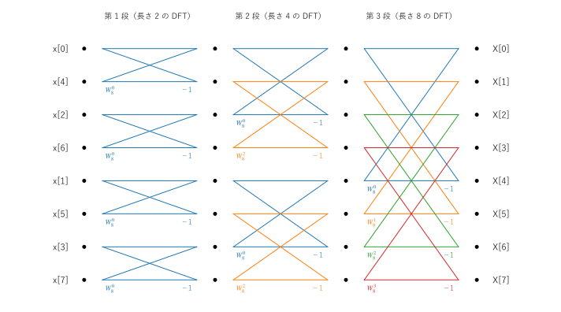
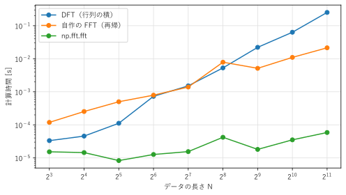

第 7 章 高速フーリエ変換
==================================================

DFT を定義どおりに計算すると、データの長さ :math:`N` の 2 乗に比例する計算量が必要になる。 :term:`FFT`\ （fast Fourier transform、高速フーリエ変換）は、DFT と同じ結果を、:math:`N \log_2 N` に比例する計算量で求めるアルゴリズムである。FFT の発見により、DFT は実用的な道具になった。この章では、最も基本的な FFT である基数 2 の Cooley-Tukey 法を説明し、NumPy の FFT 関数の使い方をまとめる。

DFT の計算量
------------

DFT の式 :eq:`eq-dft` では、1 つの :math:`X[k]` を求めるのに :math:`N` 回の複素数の掛け算が必要であり、:math:`N` 個の :math:`X[k]` をすべて求めるには :math:`N^2` 回の掛け算が必要である。:math:`N = 2^{20} \approx 10^6`\ （標本化周波数 44.1 kHz の音声で約 24 秒）なら、約 :math:`10^{12}` 回になる。1 秒間に :math:`10^9` 回の掛け算ができる計算機でも、約 17 分かかる。

FFT を使うと、この計算が約 :math:`10^7` 回の掛け算で済み、1 秒もかからない。FFT のアイデアはガウスにまでさかのぼるが、1965 年にクーリー（J. W. Cooley）とテューキー（J. W. Tukey）が計算機向けのアルゴリズムとして発表し、広く使われるようになった。

Cooley-Tukey 法の原理
---------------------

:math:`N` を 2 のべき乗とする。DFT の和を、:math:`n` が偶数の項と奇数の項に分ける。:math:`W_N = e^{-j2\pi/N}` と書くと、

.. math::

   X[k] = \sum_{m=0}^{N/2-1} x[2m]\, W_N^{2mk} + \sum_{m=0}^{N/2-1} x[2m+1]\, W_N^{(2m+1)k}

である。:math:`W_N^2 = e^{-j2\pi/(N/2)} = W_{N/2}` なので、

.. math::

   X[k] = \underbrace{\sum_{m=0}^{N/2-1} x[2m]\, W_{N/2}^{mk}}_{E[k]} + W_N^k \underbrace{\sum_{m=0}^{N/2-1} x[2m+1]\, W_{N/2}^{mk}}_{O[k]}

と書ける。:math:`E[k]` は偶数番目の標本 :math:`x[0], x[2], \ldots` の長さ :math:`N/2` の DFT、:math:`O[k]` は奇数番目の標本 :math:`x[1], x[3], \ldots` の長さ :math:`N/2` の DFT である。つまり、長さ :math:`N` の DFT は、長さ :math:`N/2` の 2 つの DFT から組み立てられる。

さらに、:math:`E[k]` と :math:`O[k]` は :math:`k` について周期 :math:`N/2` であり、:math:`W_N^{k + N/2} = W_N^k e^{-j\pi} = -W_N^k` なので、:math:`k = 0, 1, \ldots, N/2 - 1` について

.. math::
   :label: eq-butterfly

   X[k] = E[k] + W_N^k\, O[k], \qquad X[k + N/2] = E[k] - W_N^k\, O[k]

が成り立つ。1 回の掛け算 :math:`W_N^k O[k]` の結果を、足し算と引き算の 2 か所で使い回せる。この計算を\ :term:`バタフライ演算`\ といい、:math:`W_N^k` を\ :term:`回転因子`\ という。:numref:`fig-ch07-butterfly` は、バタフライ演算を図で表したものである。交差する線の形が蝶に似ていることから、この名前がある。

.. _fig-ch07-butterfly:

.. graphviz::
   :caption: バタフライ演算
   :alt: E[k] と O[k] を入力とし、O[k] に回転因子を掛けたものを E[k] に足した結果と引いた結果を出力する図

   digraph butterfly {
       rankdir=LR;
       node [fontsize=12];
       e   [label="E[k]", shape=plaintext];
       o   [label="O[k]", shape=plaintext];
       w   [label=<× WNk>, shape=box];
       p   [label="+", shape=circle, width=0.4, fixedsize=true];
       m   [label="−", shape=circle, width=0.4, fixedsize=true];
       x1  [label=<X[k] = E[k] + WNk O[k]>, shape=plaintext];
       x2  [label=<X[k + N/2] = E[k] − WNk O[k]>, shape=plaintext];
       e -> p;
       e -> m;
       o -> w;
       w -> p;
       w -> m;
       p -> x1;
       m -> x2;
   }

この分割を、長さ :math:`N/2` の DFT にも同じように適用し、長さが 1 になるまで繰り返す（長さ 1 の DFT は、その値自身である）。分割の段数は :math:`\log_2 N` であり、各段で :math:`N/2` 回のバタフライ演算（掛け算 :math:`N/2` 回）を行うので、全体の掛け算の回数は

.. math::

   \frac{N}{2}\log_2 N

になる。:numref:`fig-ch07-butterfly8` は、:math:`N = 8` の場合の計算の流れ（信号流れ図）である。入力をあらかじめ偶数番目と奇数番目に分け続けた順（ビット反転の順：:math:`x[0], x[4], x[2], x[6], x[1], x[5], x[3], x[7]`）に並べると、長さ 2、4、8 の DFT を順に組み立てる 3 段のバタフライ演算で、出力が :math:`X[0]` から :math:`X[7]` の順に得られる。入力の番号を 3 ビットの 2 進数で表すと、例えば :math:`x[1]`\ （001）は、ビットの並びを逆にした 100、つまり 4 番目の位置に来る。

.. _fig-ch07-butterfly8:

   :math:`N = 8` の基数 2・時間間引き FFT の信号流れ図（各バタフライの下側の入力に回転因子を掛け、下側の出力では引き算をする）

このように、入力の時間方向の標本を偶数と奇数に分けていく方法を、時間間引き（decimation in time）という。出力の周波数方向で分ける周波数間引き（decimation in frequency）という方法もあり、計算量は同じである。

FFT の実装
----------

式 :eq:`eq-butterfly` をそのまま再帰で書くと、FFT は数行で実装できる。

.. literalinclude:: ../examples/fft_radix2.py
   :pyobject: fft_radix2
   :lineno-match:
   :caption: fft_radix2.py の fft_radix2()
   :name: list-ch07-fft

偶数番目と奇数番目の標本の取り出しには、NumPy のスライス ``x[0::2]`` と ``x[1::2]`` を使っている。回転因子 ``twiddle`` は、:math:`k = 0, \ldots, N/2 - 1` の :math:`W_N^k` をまとめて計算した配列である。最後の ``np.concatenate`` で、式 :eq:`eq-butterfly` の前半 :math:`X[k]` と後半 :math:`X[k + N/2]` をつなげている。

.. literalinclude:: ../build/outputs/fft_radix2.txt
   :language: text
   :caption: fft_radix2.py の実行結果

自作の FFT は ``np.fft.fft()`` と一致している。掛け算の回数の比 :math:`N^2 / ((N/2)\log_2 N) = 2N/\log_2 N` は :math:`N` とともに急速に大きくなり、:math:`N = 2^{20}` では 10 万倍を超える。

:numref:`fig-ch07-timing` は、DFT（行列の積）、自作の FFT、``np.fft.fft()`` の計算時間を比べたものである（計算時間は、実行する計算機によって変わる）。DFT の計算時間は :math:`N` が 2 倍になるごとに約 4 倍に増えるが、FFT は約 2 倍の増加にとどまる。:math:`N` が小さいうちは、Python の再帰呼び出しの手間が大きく、自作の FFT が行列の積より遅いこともあるが、:math:`N` が大きくなると逆転する。C 言語などで最適化された ``np.fft.fft()`` は、自作の FFT よりさらに数百倍速い。実用では、自分で FFT を実装せず、ライブラリの関数を使うべきである。

.. _fig-ch07-timing:

   DFT と FFT の計算時間の比較

サンプルの全体：:download:`fft_radix2.py <../examples/fft_radix2.py>`

NumPy の FFT 関数
-----------------

NumPy の ``numpy.fft`` モジュールの主な関数を、:numref:`table-ch07-numpy-fft` にまとめる。SciPy にも同じ名前の関数をもつ ``scipy.fft`` モジュールがあり、並列計算などの追加の機能をもつ。

.. _table-ch07-numpy-fft:

.. list-table:: numpy.fft の主な関数
   :header-rows: 1
   :widths: 35 65

   * - 関数
     - 機能
   * - ``fft(x, n=None)``
     - DFT を計算する。``n`` を指定すると、``x`` の末尾を切り捨てるかゼロ詰めして長さ ``n`` にする
   * - ``ifft(X, n=None)``
     - 逆 DFT を計算する（:math:`1/N` を掛ける）
   * - ``rfft(x, n=None)``
     - 実数の信号の DFT のうち、:math:`k = 0` から :math:`\lfloor N/2 \rfloor` までの部分だけを計算する
   * - ``irfft(X, n=None)``
     - ``rfft()`` の逆変換。元の長さ ``n`` を指定するのが安全である
   * - ``fftfreq(n, d)``
     - ``fft()`` の各ビンの周波数を返す。``d`` は標本化周期 :math:`T_s = 1/f_s`
   * - ``rfftfreq(n, d)``
     - ``rfft()`` の各ビンの周波数を返す
   * - ``fftshift(X)``
     - 周波数 0 のビンが中央に来るように、配列の前半と後半を入れ替える
   * - ``fft2(x)``、``ifft2(X)``
     - 2 次元の DFT と逆 DFT（第 10 章）

次の例は、直流 0.2、振幅 1.5 の 50 Hz の正弦波、振幅 0.5 の 120 Hz の余弦波を足した信号の振幅スペクトルを求めるものである。

.. code-block:: python
   :linenos:
   :caption: rfft による振幅スペクトルの計算

   import numpy as np

   fs = 1000.0                                  # 標本化周波数 [Hz]
   t = np.arange(1000) / fs                     # 1 秒分の時刻
   x = 0.2 + 1.5 * np.sin(2 * np.pi * 50 * t) + 0.5 * np.cos(2 * np.pi * 120 * t)

   X = np.fft.rfft(x)                           # 長さ N/2 + 1 = 501
   f = np.fft.rfftfreq(len(x), d=1 / fs)        # 0, 1, 2, ..., 500 Hz
   amp = np.abs(X) / len(x) * 2                 # 片側の振幅に換算する
   amp[0] /= 2                                  # 直流成分は 2 倍しない

   peaks = amp > 0.1
   print(f[peaks])                              # [  0.  50. 120.]
   print(amp[peaks])                            # [0.2 1.5 0.5]
   print(np.degrees(np.angle(X[peaks])))        # 位相: 約 [0, -90, 0] 度

4 行目から 5 行目で、1 秒分（1000 点）の信号を作る。周波数分解能は :math:`f_s/N = 1` Hz であり、50 Hz と 120 Hz はちょうどビンに一致する。7 行目の ``rfft()`` は、実数の信号の DFT の前半（:math:`k = 0` から 500 まで）だけを返す。共役対称性から後半は不要なので、計算量とメモリが約半分で済む。9 行目と 10 行目では、第 6 章で述べたように、正と負の周波数に分かれた成分をまとめるために 2 倍し、:math:`N` で割って振幅に換算している。直流成分（と、:math:`N` が偶数のときのナイキスト周波数の成分）は負の周波数の相手をもたないので、2 倍しない。位相は、余弦波を基準にした角度であり、:math:`\sin` は :math:`\cos` から :math:`-90` 度ずれていることが分かる。

``fft()`` の出力の並びは、:math:`k = 0, 1, \ldots, N/2 - 1` の正の周波数の後に、:math:`k = N/2, \ldots, N - 1` の負の周波数が続く（第 6 章）。例えば :math:`N = 8`、:math:`f_s = 8` Hz のとき、``np.fft.fftfreq(8, d=1/8)`` は ``[0, 1, 2, 3, -4, -3, -2, -1]`` を返す。スペクトルを周波数の順に並べて描くには、``np.fft.fftshift()`` で ``[-4, -3, -2, -1, 0, 1, 2, 3]`` の順に並べ替える。

FFT を使うときの注意点を挙げる。

* **データの長さ**：NumPy の FFT は、2 のべき乗に限らず任意の長さを扱える。ただし、長さが大きな素数を因数にもつと、計算が遅くなることがある。``scipy.fft.next_fast_len(n)`` は、``n`` 以上で FFT を高速に計算できる長さを返す。
* **正規化**：NumPy の既定では、``fft()`` は係数を掛けず、``ifft()`` が :math:`1/N` を掛ける（本書の式 :eq:`eq-dft` と式 :eq:`eq-idft` と同じ）。引数 ``norm="ortho"`` を指定すると、両方に :math:`1/\sqrt{N}` を掛ける。ライブラリによって既定の正規化が異なるので、結果の大きさを比べるときは注意する。
* **周波数軸**：FFT の関数は標本化周波数を知らず、ビンの番号 :math:`k` ごとの値を返すだけである。ビンと実際の周波数を対応付けるには、``fftfreq()`` に正しい ``d``\ （:math:`1/f_s`）を与える必要がある。

まとめ
------

* DFT を定義どおりに計算すると :math:`N^2` 回の掛け算が必要だが、FFT は :math:`(N/2)\log_2 N` 回で済む。
* 基数 2 の Cooley-Tukey 法は、DFT を偶数番目と奇数番目の標本の DFT に分け、バタフライ演算 :math:`X[k] = E[k] \pm W_N^k O[k]` で組み立てることを再帰的に繰り返す。
* NumPy の ``np.fft.fft()``、``rfft()``、``fftfreq()``、``fftshift()`` を使えば、スペクトルを簡単に計算できる。片側の振幅に換算するには、:math:`N` で割って 2 倍する（直流成分は 2 倍しない）。
