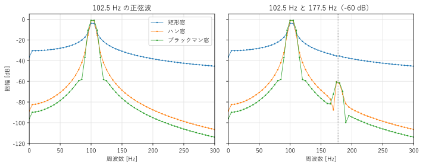
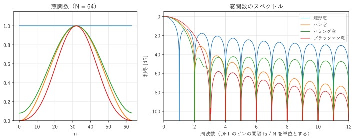
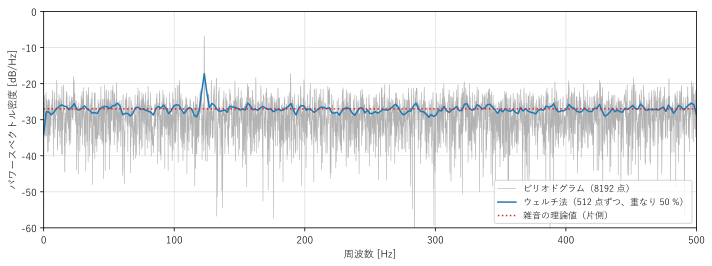
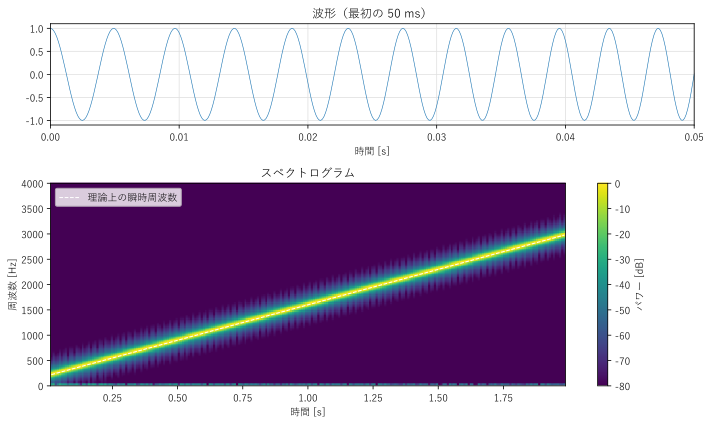
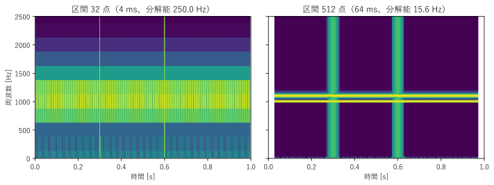

第 8 章 スペクトル解析
==================================================

測定した信号に、どの周波数の成分がどれだけ含まれているかを調べることを、スペクトル解析という。FFT を使えばスペクトルはすぐに計算できるが、結果を正しく解釈するには、有限の長さの信号を扱うことによる影響を理解しておく必要がある。この章では、スペクトル漏れと窓関数、雑音を含む信号のパワースペクトル密度、時間とともに変化する信号のスペクトログラムを説明する。

スペクトル漏れ
--------------

第 7 章の例では、正弦波の周波数がちょうど DFT のビンに一致していたので、各成分は 1 つのビンにだけ現れた。しかし、現実の信号の周波数がビンに一致するとは限らない。

:numref:`fig-ch08-spectrum-analysis` の左の青い線は、標本化周波数 1000 Hz で 200 点（0.2 s）を観測した 102.5 Hz の正弦波の振幅スペクトルである。周波数分解能は 5 Hz なので、102.5 Hz は 100 Hz と 105 Hz のビンのちょうど中間にある。スペクトルは 1 本の線にならず、周囲のすべてのビンに裾を引いて広がっている。このように、1 つの周波数の成分が周囲の周波数に漏れ出す現象を\ :term:`スペクトル漏れ`\ という。

.. _fig-ch08-spectrum-analysis:

   窓関数によるスペクトルの違い：1 つの正弦波（左）と、大小 2 つの正弦波（右）

スペクトル漏れの原因は 2 通りに説明できる。

* **時間領域から見ると**：DFT は信号を周期 :math:`N` で繰り返すとみなす（第 6 章）。102.5 Hz の正弦波は 0.2 s の間に 20.5 周期しかないので、繰り返したときに境目で波形が不連続になる。不連続な跳びは、多くの周波数の成分を含む（第 2 章）。
* **周波数領域から見ると**：長さ :math:`N` の観測は、無限に続く信号に、長さ :math:`N` の矩形の窓を掛けることに相当する。時間領域の積は周波数領域の畳み込みなので、観測した信号の DTFT は、正弦波の線スペクトルと矩形の窓の DTFT（第 6 章の式 :eq:`eq-dirichlet` のディリクレ核）の畳み込み、つまりディリクレ核を正弦波の周波数に移動したものになる。DFT は、それを :math:`f_s/N` の間隔で取り出したものである。正弦波の周波数がビンに一致すると、ほかのビンはちょうどディリクレ核の 0 の点に当たるので漏れが見えないが、一致しないと、ディリクレ核の裾（サイドローブ）がそのまま見える。

スペクトル漏れには、次の 2 つの悪影響がある。

* ピークの高さが下がり、振幅を正しく読み取れない（最大で約 3.9 dB、振幅で約 36 % 小さく見える）。
* 大きな成分の裾が広い範囲に広がり、その近くにある小さな成分を覆い隠す。

窓関数
------

スペクトル漏れを減らすには、観測した信号の両端が滑らかに 0 に近づくように、重みを掛けてから DFT を計算する。この重みを\ :term:`窓関数`\ という。両端が 0 に近ければ、繰り返したときの境目の不連続が小さくなる。何も掛けないことは、すべての重みが 1 の矩形窓を掛けることに相当する。

代表的な窓関数を次に示す（:math:`n = 0, 1, \ldots, N - 1`）。

.. list-table::
   :header-rows: 1
   :widths: 25 75

   * - 窓関数
     - 定義
   * - 矩形窓
     - :math:`w[n] = 1`
   * - ハン窓
     - :math:`w[n] = 0.5 - 0.5\cos\dfrac{2\pi n}{N}`
   * - ハミング窓
     - :math:`w[n] = 0.54 - 0.46\cos\dfrac{2\pi n}{N}`
   * - ブラックマン窓
     - :math:`w[n] = 0.42 - 0.5\cos\dfrac{2\pi n}{N} + 0.08\cos\dfrac{4\pi n}{N}`

ハン窓は、ハニング窓（Hanning window）とも呼ばれる。上の定義は、スペクトル解析で使う「周期的な」窓関数である。分母を :math:`N - 1` にすると両端の値が等しい「対称な」窓関数になり、第 9 章のフィルタ設計ではこちらを使う。SciPy の ``scipy.signal.get_window()`` は、既定で周期的な窓関数を返し、引数 ``fftbins=False`` を指定すると対称な窓関数を返す。

:numref:`fig-ch08-windows` は、窓関数の形と、その DTFT の大きさ（窓関数のスペクトル）である。窓関数のスペクトルは、中央のメインローブと、その両側のサイドローブからなる。窓関数を掛けた信号の正弦波のスペクトルは、このスペクトルを正弦波の周波数に移動したものになる。

.. _fig-ch08-windows:

   窓関数の形（左）と、そのスペクトル（右、横軸はビンの間隔を単位とする）

窓関数の特性を、:numref:`table-ch08-windows` にまとめる。

.. _table-ch08-windows:

.. list-table:: 窓関数の特性（:math:`N` が大きい場合）
   :header-rows: 1
   :widths: 20 20 20 20 20

   * - 窓関数
     - メインローブの幅（ビン）
     - 最大のサイドローブ
     - サイドローブの減衰
     - 最大の振幅の誤差
   * - 矩形窓
     - 2
     - :math:`-13` dB
     - :math:`-6` dB/oct
     - 3.92 dB
   * - ハン窓
     - 4
     - :math:`-31` dB
     - :math:`-18` dB/oct
     - 1.42 dB
   * - ハミング窓
     - 4
     - :math:`-43` dB
     - :math:`-6` dB/oct
     - 1.78 dB
   * - ブラックマン窓
     - 6
     - :math:`-58` dB
     - :math:`-18` dB/oct
     - 1.10 dB

メインローブの幅は、ゼロ点からゼロ点までの幅である。「サイドローブの減衰」は、周波数が 2 倍（1 オクターブ）離れるごとにサイドローブが下がる割合である。「最大の振幅の誤差」は、周波数がビンの中間にあるときにピークが下がる量である。

表から、次のトレードオフが読み取れる。

* 矩形窓はメインローブが最も狭く、近い 2 つの周波数を分離する能力が高い。しかし、サイドローブが高く、裾が遠くまで広がる。
* ハン窓やブラックマン窓はサイドローブが低く、大きな成分の近くにある小さな成分を見つけやすい。その代わり、メインローブが広く、近い周波数の分離が難しくなる。
* ハミング窓は、最も近いサイドローブを低くするように係数を選んだ窓関数である。サイドローブの減衰は遅い。

迷ったときは、まずハン窓を使うのがよい。サイドローブがある程度低く、遠くでは速く減衰し、メインローブもそれほど広くないからである。振幅を正確に測りたい場合は、メインローブが平らになるように設計したフラットトップ窓（``"flattop"``）を使う。

サンプルの ``spectrum_analysis.py`` は、3 つの窓関数で振幅スペクトルを求め、振幅の推定値と、小さな成分の見え方を比べる。

.. literalinclude:: ../examples/spectrum_analysis.py
   :pyobject: amplitude_spectrum
   :lineno-match:
   :caption: spectrum_analysis.py の amplitude_spectrum()
   :name: list-ch08-amplitude-spectrum

窓関数を掛けると、信号の値が全体として小さくなる。そのため、振幅に換算するときは、:math:`N` の代わりに窓関数の和 :math:`\sum_n w[n]` で割る（矩形窓なら :math:`N` に一致する）。ハン窓の和は約 :math:`N/2` である。

.. literalinclude:: ../build/outputs/spectrum_analysis.txt
   :language: text
   :caption: spectrum_analysis.py の実行結果

実行結果の前半から、次のことが分かる。

* 周波数がビンに一致する 100 Hz では、どの窓関数でも振幅 1.000 が正しく求められる。
* ビンの中間の 102.5 Hz では、矩形窓のピークは 0.643（:math:`-3.83` dB）まで下がる。ハン窓では 0.849（:math:`-1.42` dB）、ブラックマン窓では 0.881（:math:`-1.10` dB）であり、:numref:`table-ch08-windows` の値とおおむね一致する。

実行結果の後半と :numref:`fig-ch08-spectrum-analysis` の右の図は、102.5 Hz（振幅 1）の近くに 177.5 Hz（振幅 0.001、:math:`-60` dB）の小さな成分がある場合である。矩形窓では、102.5 Hz の成分の裾が 177.5 Hz の付近でも :math:`-35.5` dB あり、小さな成分は完全に埋もれてしまう。ハン窓とブラックマン窓では裾が十分に下がり、:math:`-60` dB の成分がはっきり見える。

サンプルの全体：:download:`spectrum_analysis.py <../examples/spectrum_analysis.py>`

パワースペクトル密度
--------------------

正弦波のような決まった周波数をもつ信号に対しては、振幅スペクトルで「各周波数の成分の振幅」を求めればよい。一方、雑音のように多くの周波数に連続的に広がった不規則な信号には、「周波数あたりの電力」で表す\ :term:`パワースペクトル密度`\ （power spectral density、PSD）を使う。単位は、信号の単位が V なら V\ :sup:`2`/Hz である。

DFT から PSD を推定する最も基本的な方法を\ :term:`ピリオドグラム`\ という。窓関数 :math:`w[n]` を掛けた信号の DFT を :math:`X_w[k]` とすると、

.. math::

   P[k] = \frac{|X_w[k]|^2}{f_s \sum_{n} w[n]^2}

で、両側（正と負の周波数）の PSD が推定できる。実数の信号では、:math:`k = 1` から :math:`N/2 - 1` の値を 2 倍して、片側の PSD にすることが多い。分母の :math:`\sum w[n]^2` は、窓関数による電力の減少を補正する項である。

ピリオドグラムには大きな欠点がある。:numref:`fig-ch08-welch` の灰色の線は、白色雑音（すべての周波数で PSD が一定の雑音）に 123 Hz の正弦波を加えた信号のピリオドグラムである。白色雑音の PSD は本来一定（赤の点線）なのに、ピリオドグラムは上下に激しく揺らいでいる。データを長くしても、ビンの数が増えるだけで、各ビンの揺らぎ（推定値の分散）は小さくならない。

.. _fig-ch08-welch:

   ピリオドグラム（灰色）とウェルチ法（青）によるパワースペクトル密度の推定

揺らぎを減らすには、複数の推定値を平均する。\ :term:`ウェルチ法`\ は、信号を一部が重なる短い区間に分け、各区間で窓関数を掛けてピリオドグラムを求め、それらを平均する方法である。:math:`K` 個の独立な推定値を平均すれば、分散はおよそ :math:`1/K` になる。:numref:`fig-ch08-welch` の青い線は、8192 点の信号を 512 点ずつの区間（隣と 50 % 重なる）に分けて、31 個のピリオドグラムを平均したものである。揺らぎが大幅に小さくなり、雑音のレベルと 123 Hz の正弦波がはっきり読み取れる。その代わり、区間が短くなった分だけ周波数分解能は下がる（8192 点で 0.12 Hz、512 点で 1.95 Hz）。分散と周波数分解能のトレードオフを考えて、区間の長さを選ぶ。

SciPy では、``scipy.signal.periodogram()`` と ``scipy.signal.welch()`` で PSD を計算できる。

.. code-block:: python
   :linenos:
   :caption: SciPy によるパワースペクトル密度の推定

   import numpy as np
   from scipy import signal

   fs = 1000.0
   rng = np.random.default_rng(4)
   t = np.arange(8192) / fs
   x = 0.3 * np.sin(2 * np.pi * 123 * t) + rng.standard_normal(len(t))

   f1, p1 = signal.periodogram(x, fs=fs, window="hann")           # ピリオドグラム
   f2, p2 = signal.welch(x, fs=fs, window="hann", nperseg=512)    # ウェルチ法（既定で 50 % 重ねる）
   f3, p3 = signal.welch(x, fs=fs, nperseg=512, scaling="spectrum")  # PSD ではなくパワースペクトル

既定（``scaling="density"``）では PSD を返す。``scaling="spectrum"`` を指定すると、各ビンの電力（正弦波なら振幅の 2 乗の半分）を返す。正弦波の大きさを読みたいときは ``"spectrum"``、雑音のレベルを比べたいときは ``"density"`` を使う。PSD は周波数分解能（ビンの幅）に依存しない量なので、異なる条件で測った雑音のレベルを比べられる。

短時間フーリエ変換とスペクトログラム
------------------------------------

音声や音楽、機械の始動時の振動など、多くの信号は、含まれる周波数が時間とともに変化する。信号全体を一度に DFT すると、どの時刻にどの周波数があったかが分からなくなる。

そこで、信号を短い区間に分け、区間ごとに窓関数を掛けて DFT を計算する。これを :term:`STFT`\ （short-time Fourier transform、短時間フーリエ変換）という。区間の長さを :math:`N`、区間をずらす間隔（ホップ長）を :math:`H` とすると、:math:`m` 番目の区間の DFT は

.. math::

   X[m, k] = \sum_{n=0}^{N-1} x[n + mH]\, w[n]\, e^{-j2\pi k n/N}

である。:math:`|X[m, k]|^2` を、横軸を時間（:math:`m`）、縦軸を周波数（:math:`k`）、色を強さとして描いた図を\ :term:`スペクトログラム`\ という。

サンプルの ``spectrogram.py`` は、周波数が 2 秒間で 200 Hz から 3000 Hz まで直線的に上がる信号（線形チャープ）のスペクトログラムを、``scipy.signal.spectrogram()`` で求める。

.. literalinclude:: ../examples/spectrogram.py
   :pyobject: compute_spectrogram
   :lineno-match:
   :caption: spectrogram.py の compute_spectrogram()
   :name: list-ch08-spectrogram

.. literalinclude:: ../build/outputs/spectrogram.txt
   :language: text
   :caption: spectrogram.py の実行結果

.. _fig-ch08-spectrogram:

   線形チャープ信号の波形（上）とスペクトログラム（下）

区間の長さは 256 点（32 ms）、隣り合う区間の重なりは 192 点で、ホップ長は 64 点（8 ms）である。:numref:`fig-ch08-spectrogram` では、周波数が直線的に上がる様子がはっきり見える。実行結果のとおり、各時刻でパワーが最大になる周波数は、理論上の瞬時周波数と、周波数分解能（31.25 Hz）の程度の誤差で一致している。

サンプルの全体：:download:`spectrogram.py <../examples/spectrogram.py>`

時間分解能と周波数分解能
------------------------

STFT の区間の長さ :math:`N` は、時間分解能と周波数分解能の両方を決める。

* 周波数分解能は、ビンの間隔 :math:`f_s/N` である。区間を長くするほど、近い周波数を分離できる。
* 時間分解能は、おおよそ区間の長さ :math:`N/f_s` である。区間を短くするほど、短時間の変化をとらえられる。

両者の積は :math:`(f_s/N) \cdot (N/f_s) = 1` で一定であり、両方を同時に細かくすることはできない。これは第 3 章で述べた時間幅と帯域幅の関係そのものである。

:numref:`fig-ch08-stft-tradeoff` は、1000 Hz と 1100 Hz の正弦波の和に、0.3 s と 0.6 s の 2 か所で短いクリック音を加えた信号のスペクトログラムである。区間が 32 点（4 ms）の場合（左）は、クリック音の時刻は鋭くとらえられるが、周波数分解能が 250 Hz しかないので 2 つの正弦波を分離できない。2 つの正弦波は 1 つの帯として現れ、その強さが 100 Hz の差の周波数で周期的に変化する（うなり）縞模様として見える。区間が 512 点（64 ms）の場合（右）は、2 つの正弦波は 2 本の線に分かれるが、クリック音は 64 ms ほどの幅に広がってしまう。

.. _fig-ch08-stft-tradeoff:

   区間の長さによるスペクトログラムの違い：32 点（左）と 512 点（右）

区間の長さは、解析の目的に合わせて選ぶ。例えば音声の解析では、20 ms から 40 ms 程度の区間がよく使われる。この範囲では声の高さ（基本周波数）や母音の特徴が安定していると考えられるからである。時間と周波数の分解能のトレードオフを、周波数ごとに変えたい場合は、第 11 章で紹介するウェーブレット変換が使える。

まとめ
------

* 有限の長さの観測は、矩形の窓を掛けることに相当し、周波数がビンに一致しない成分は周囲のビンに漏れる（スペクトル漏れ）。
* 窓関数を掛けると、サイドローブが下がって漏れが減るが、メインローブが広がる。迷ったらハン窓を使う。窓関数を掛けたときの振幅は、窓関数の和で割って補正する。
* 雑音のような信号にはパワースペクトル密度を使う。ウェルチ法で区間ごとのピリオドグラムを平均すると、推定値の揺らぎを減らせる。
* STFT とスペクトログラムで、周波数の時間変化を見られる。区間の長さによって、時間分解能と周波数分解能がトレードオフの関係になる。
