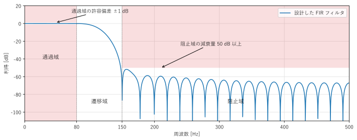
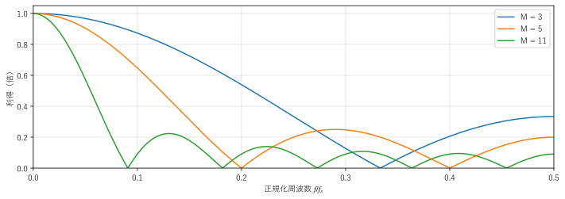
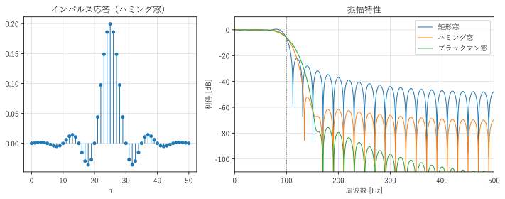
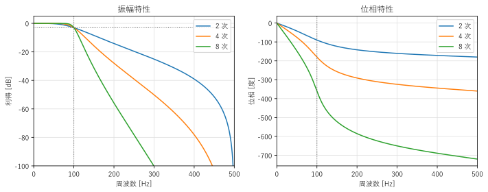
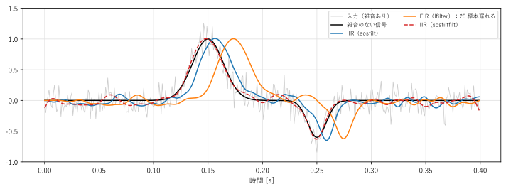

第 9 章 デジタルフィルタ
==================================================

特定の周波数の成分を通し、ほかの成分を弱める処理をフィルタという。雑音の除去、帯域の制限、信号の分離など、フィルタはデジタル信号処理で最もよく使われる処理である。この章では、第 5 章の LTI システムの知識を使って、FIR フィルタと IIR フィルタの設計方法と、適用するときの注意点を説明する。

フィルタの種類と仕様
--------------------

:term:`デジタルフィルタ`\ は、通過させる周波数の範囲によって、:numref:`table-ch09-filter-types` のように分類される。

.. _table-ch09-filter-types:

.. list-table:: フィルタの種類
   :header-rows: 1
   :widths: 35 65

   * - 種類
     - 働き
   * - ローパスフィルタ（LPF）
     - ある周波数より低い成分を通し、高い成分を弱める
   * - ハイパスフィルタ（HPF）
     - ある周波数より高い成分を通し、低い成分を弱める
   * - バンドパスフィルタ（BPF）
     - ある範囲の周波数の成分だけを通す
   * - バンドストップフィルタ（BSF）
     - ある範囲の周波数の成分だけを弱める。範囲が狭いものはノッチフィルタという

理想的なフィルタは、通す周波数の利得が正確に 1、弱める周波数の利得が正確に 0 で、その境目で利得が急に切り替わる。しかし、そのようなフィルタは実現できない（後で示すように、インパルス応答が無限に長く、因果的でもないからである）。そこで、実際の設計では、:numref:`fig-ch09-filter-spec` のように許容範囲を決める。

.. _fig-ch09-filter-spec:

   ローパスフィルタの仕様の例（赤の範囲に振幅特性が入ってはいけない）

* **通過域**：信号を通す周波数の範囲。0 から通過域端（この例では 80 Hz）まで。利得の許容偏差（リプル）を決める。
* **阻止域**：信号を弱める周波数の範囲。阻止域端（この例では 150 Hz）より上。必要な減衰量を決める。
* **遷移域**：通過域と阻止域の間。利得が 1 から 0 に向かって変化する範囲で、利得の値は問わない。

遷移域が狭く、阻止域の減衰量が大きいほど、フィルタの次数（係数の数）が増え、計算量と遅延が大きくなる。必要以上に厳しい仕様にしないことが大切である。

カットオフ周波数は、通過域と阻止域の境目の目安となる周波数である。後で説明するバタワースフィルタのように、利得が :math:`1/\sqrt{2}`\ （約 :math:`-3` dB）になる周波数で定義することが多い。

.. note::

   SciPy のフィルタ設計関数で周波数を指定する方法は 2 通りある。引数 ``fs`` に標本化周波数を与えると、周波数を Hz で指定できる。``fs`` を省略すると、ナイキスト周波数を 1 とした正規化周波数（:math:`f/(f_s/2)`、第 5 章の :math:`\hat{\omega}/\pi`）で指定する。本書では、間違いを防ぐために、常に ``fs`` を指定する。

FIR フィルタ
------------

:term:`FIR フィルタ`\ は、現在と過去の有限個の入力の重み付きの和で出力を計算するフィルタである。

.. math::

   y[n] = \sum_{k=0}^{M} b_k\, x[n - k]

係数 :math:`b_k` がそのままインパルス応答 :math:`h[k]` になる。係数の個数 :math:`M + 1` をタップ数、:math:`M` を次数という。:numref:`fig-ch09-fir` は、FIR フィルタのブロック図（直接形）である。入力を 1 標本ずつ遅らせながら、係数を掛けて足し合わせる。

.. _fig-ch09-fir:

.. graphviz::
   :caption: 3 次の FIR フィルタのブロック図（直接形）
   :alt: 入力が 3 段の遅延素子を順に通り、各段の値に係数 b0 から b3 を掛けて足し合わせて出力を得るブロック図

   digraph fir {
       rankdir=LR;
       node [fontsize=12];
       x  [label="x[n]", shape=plaintext];
       d1 [label="z⁻¹", shape=box];
       d2 [label="z⁻¹", shape=box];
       d3 [label="z⁻¹", shape=box];
       b0 [label=<b0>, shape=invtriangle, width=0.5, height=0.45, fixedsize=true];
       b1 [label=<b1>, shape=invtriangle, width=0.5, height=0.45, fixedsize=true];
       b2 [label=<b2>, shape=invtriangle, width=0.5, height=0.45, fixedsize=true];
       b3 [label=<b3>, shape=invtriangle, width=0.5, height=0.45, fixedsize=true];
       s1 [label="+", shape=circle, width=0.4, fixedsize=true];
       s2 [label="+", shape=circle, width=0.4, fixedsize=true];
       s3 [label="+", shape=circle, width=0.4, fixedsize=true];
       y  [label="y[n]", shape=plaintext];
       x -> d1 -> d2 -> d3;
       x -> b0; d1 -> b1; d2 -> b2; d3 -> b3;
       b0 -> s1; b1 -> s1;
       s1 -> s2; b2 -> s2;
       s2 -> s3; b3 -> s3;
       s3 -> y;
       {rank=same; x; d1; d2; d3;}
       {rank=same; b0; b1; b2; b3;}
       {rank=same; s1; s2; s3; y;}
   }

FIR フィルタには、次の長所がある。

* インパルス応答の長さが有限なので、常に安定である（第 5 章）。
* 係数を対称（:math:`b_k = b_{M-k}`）にすると、\ :term:`線形位相`\ のフィルタになる。

線形位相とは、位相特性が周波数に比例すること（:math:`\arg H(e^{j\hat{\omega}}) = -\hat{\omega}M/2`）である。係数が対称なら、周波数応答は

.. math::

   H(e^{j\hat{\omega}}) = e^{-j\hat{\omega} M/2} A(\hat{\omega})

（:math:`A(\hat{\omega})` は実数の関数）の形に書ける。第 3 章の時間シフトの性質から、これは「すべての周波数の成分が同じ :math:`M/2` 標本だけ遅れる」ことを意味する。位相の傾きから求めた遅れ :math:`\tau(\hat{\omega}) = -\frac{d}{d\hat{\omega}}\arg H(e^{j\hat{\omega}})` を\ :term:`群遅延`\ という。線形位相のフィルタは群遅延が一定なので、波形の形を崩さずに、全体を遅らせるだけで済む。パルスの形や波形のタイミングが重要な用途（例えば、心電図や通信の信号）では、この性質が重要である。

最も簡単な FIR フィルタは、第 5 章で見た移動平均（:math:`b_k = 1/(M+1)`）である。:numref:`fig-ch09-moving-average` は、平均する点数 :math:`M + 1` を変えたときの振幅特性である。点数を増やすと通過域は狭くなるが、阻止域の利得（サイドローブ）は 0.2 から 0.3 程度（約 :math:`-13` dB から :math:`-10` dB）までしか下がらない。移動平均の周波数応答は、矩形の窓のスペクトル（第 6 章のディリクレ核）そのものだからである。移動平均は計算が簡単で、時間領域の雑音を減らす効果はあるが、周波数を選び分けるフィルタとしての性能は低い。

.. _fig-ch09-moving-average:

   移動平均フィルタの振幅特性

窓関数法による FIR フィルタの設計
--------------------------------------------------

理想的なローパスフィルタ（カットオフの正規化角周波数 :math:`\hat{\omega}_c` 以下で利得 1、それより上で 0）のインパルス応答は、逆 DTFT で求められる。

.. math::

   h_d[n] = \frac{1}{2\pi}\int_{-\hat{\omega}_c}^{\hat{\omega}_c} e^{j\hat{\omega} n}\, d\hat{\omega} = \frac{\sin(\hat{\omega}_c n)}{\pi n} = 2 f_c\, \mathrm{sinc}(2 f_c n)

ここで :math:`f_c = \hat{\omega}_c/(2\pi)` は、カットオフ周波数を標本化周波数で割った値である。:math:`h_d[n]` は sinc 関数であり、:math:`n` の正と負の両方に無限に続く。これが、理想的なフィルタが実現できない理由である。

そこで、:math:`h_d[n]` を :math:`M/2` 標本だけ右にずらして因果的に近づけ、長さ :math:`M + 1` で打ち切る。ただし、そのまま打ち切る（矩形の窓を掛ける）と、周波数領域では理想的な特性と矩形の窓のスペクトルの畳み込みになり、遷移域の付近に大きな波打ちが生じる。これは、第 2 章のギブス現象そのものである。そこで、第 8 章の窓関数を掛けて、滑らかに打ち切る。この設計方法を\ :term:`窓関数法`\ という。手順をまとめると次のようになる。

1. 理想的なインパルス応答 :math:`h_d[n - M/2] = 2 f_c\, \mathrm{sinc}(2 f_c (n - M/2))` を、:math:`n = 0, \ldots, M` について計算する。
2. 対称な窓関数 :math:`w[n]` を掛ける。
3. 直流の利得（係数の和）が 1 になるように正規化する。

サンプルの ``fir_filter_design.py`` は、この手順を実装し、SciPy の ``scipy.signal.firwin()`` の結果と比べる。標本化周波数は 1000 Hz、カットオフ周波数は 100 Hz、タップ数は 51 である。

.. literalinclude:: ../examples/fir_filter_design.py
   :pyobject: design_lowpass
   :lineno-match:
   :caption: fir_filter_design.py の design_lowpass()
   :name: list-ch09-fir

.. literalinclude:: ../build/outputs/fir_filter_design.txt
   :language: text
   :caption: fir_filter_design.py の実行結果

.. _fig-ch09-fir-design:

   窓関数法で設計した FIR フィルタのインパルス応答（左）と振幅特性（右）

自作の関数は、3 つの窓関数のいずれでも ``firwin()`` と一致している（``firwin()`` も同じ窓関数法で設計しているからである）。実行結果と :numref:`fig-ch09-fir-design` から、窓関数による違いが読み取れる。

* 矩形窓は、通過域の偏差が 0.69 dB と大きく、阻止域の利得も 150 Hz 以上で約 :math:`-32` dB、200 Hz 以上でも約 :math:`-37` dB までしか下がらない。
* ハミング窓は、通過域の偏差が 0.04 dB で、150 Hz 以上の阻止域で約 :math:`-62` dB の減衰が得られる。
* ブラックマン窓は、最終的な減衰は最も大きい（200 Hz 以上で約 :math:`-80` dB）が、遷移域が広いため、150 Hz ではまだ十分に減衰していない。

第 8 章の窓関数のトレードオフ（メインローブの幅とサイドローブの高さ）が、ここではフィルタの遷移域の幅と阻止域の減衰量のトレードオフとして現れている。同じ窓関数では、タップ数を増やすと遷移域が狭くなるが、阻止域の減衰量はほぼ変わらない。

このフィルタは係数が対称なので線形位相であり、群遅延は :math:`M/2 = 25` 標本（25 ms）で一定である。

窓関数法のほかに、通過域と阻止域の誤差の最大値を最小にする Parks-McClellan 法（``scipy.signal.remez()``）や、誤差の 2 乗和を最小にする最小 2 乗法（``scipy.signal.firls()``）などの設計方法がある。必要なタップ数の見積もりには、``scipy.signal.kaiserord()`` が使える。

サンプルの全体：:download:`fir_filter_design.py <../examples/fir_filter_design.py>`

IIR フィルタ
------------

:term:`IIR フィルタ`\ は、第 5 章の差分方程式 :eq:`eq-difference-equation` のように、過去の出力も使って出力を計算するフィルタである。インパルス応答は無限に続く。FIR フィルタと比べて、少ない次数で急峻な特性が得られることが最大の長所である。一方で、線形位相にはできず、係数によっては不安定になる。

IIR フィルタは、長い歴史をもつアナログフィルタの設計手法を利用して設計することが多い。代表的なアナログフィルタを :numref:`table-ch09-iir-types` に示す。

.. _table-ch09-iir-types:

.. list-table:: 代表的なアナログフィルタの特徴
   :header-rows: 1
   :widths: 25 50 25

   * - 種類
     - 特徴
     - SciPy の関数
   * - バタワース
     - 通過域が最も平坦（リプルがない）
     - ``butter()``
   * - チェビシェフ I 型
     - 通過域にリプルを許し、遷移域を急峻にする
     - ``cheby1()``
   * - チェビシェフ II 型
     - 阻止域にリプルを許し、遷移域を急峻にする
     - ``cheby2()``
   * - 楕円（カウエル）
     - 両方にリプルを許し、同じ次数で最も急峻
     - ``ellip()``
   * - ベッセル
     - 群遅延が平坦に近く、波形のひずみが小さい
     - ``bessel()``

ここでは、最も基本的な\ :term:`バタワースフィルタ`\ を説明する。:math:`N` 次のアナログのバタワース LPF の振幅特性は、カットオフ角周波数を :math:`\Omega_c` として

.. math::

   |H_a(j\Omega)| = \frac{1}{\sqrt{1 + (\Omega/\Omega_c)^{2N}}}

である（アナログの角周波数を :math:`\Omega` で表す）。:math:`\Omega = 0` での傾きが 0 で、通過域が最も平坦になる。カットオフ周波数での利得は次数によらず :math:`1/\sqrt{2}`\ （:math:`-3.01` dB）であり、阻止域では周波数が 10 倍になるごとに :math:`20N` dB ずつ下がる。

アナログフィルタの伝達関数 :math:`H_a(s)` を、デジタルフィルタの伝達関数 :math:`H(z)` に変換するには、\ :term:`双一次変換`\ を使う。

.. math::

   s = 2 f_s \frac{1 - z^{-1}}{1 + z^{-1}}

この変換は、アナログの周波数軸（:math:`s = j\Omega`）全体を、デジタルの単位円（:math:`z = e^{j\hat{\omega}}`）の 1 周にちょうど対応させる。そのため、エイリアシングが起こらず、安定なアナログフィルタは安定なデジタルフィルタに変換される。ただし、周波数の対応は直線的でなく、

.. math::

   \Omega = 2 f_s \tan\frac{\hat{\omega}}{2}

のようにゆがむ（:math:`\hat{\omega} \to \pi` で :math:`\Omega \to \infty`）。そこで、デジタルのカットオフ周波数 :math:`f_c` を正確に合わせるために、アナログのカットオフ角周波数をあらかじめ :math:`\Omega_c = 2 f_s \tan(\pi f_c/f_s)` に設定しておく。これを\ :term:`プリワーピング`\ という。

1 次のバタワース LPF :math:`H_a(s) = \Omega_c/(s + \Omega_c)` で、双一次変換を手計算してみる。:math:`s` を代入して整理すると、

.. math::

   H(z) = \frac{\Omega_c (1 + z^{-1})}{(2 f_s + \Omega_c) + (\Omega_c - 2 f_s) z^{-1}}

となる。サンプルの ``iir_filter_design.py`` は、この式で係数を求めて ``scipy.signal.butter()`` と比べ、さらに次数 2、4、8 のフィルタの利得を確かめる。

.. literalinclude:: ../examples/iir_filter_design.py
   :pyobject: first_order_lowpass
   :lineno-match:
   :caption: iir_filter_design.py の first_order_lowpass()
   :name: list-ch09-iir

.. literalinclude:: ../build/outputs/iir_filter_design.txt
   :language: text
   :caption: iir_filter_design.py の実行結果

.. _fig-ch09-iir-design:

   バタワース LPF の振幅特性（左）と位相特性（右）

手計算の係数は ``butter()`` と一致している。どの次数でも 100 Hz の利得は :math:`-3.01` dB であり、200 Hz の利得は、プリワーピングした周波数で計算した理論値と一致している。次数が 2 倍になると、200 Hz の減衰量（dB）もほぼ 2 倍になる。8 次のバタワースフィルタは、9 個ずつの分子と分母の係数（合計 18 個）で、51 タップの FIR フィルタより急峻な特性を実現している。

一方、:numref:`fig-ch09-iir-design` の右の図のように、位相特性は直線ではなく、カットオフ周波数の付近で急に変化する。周波数によって遅れが異なるので、波形の形が崩れる。

サンプルの全体：:download:`iir_filter_design.py <../examples/iir_filter_design.py>`

フィルタを適用するときの注意
----------------------------

SciPy でフィルタを信号に適用する主な関数を、:numref:`table-ch09-apply` にまとめる。

.. _table-ch09-apply:

.. list-table:: フィルタを適用する関数
   :header-rows: 1
   :widths: 35 65

   * - 関数
     - 機能
   * - ``lfilter(b, a, x)``
     - 差分方程式 :eq:`eq-difference-equation` をそのまま計算する。FIR フィルタでは ``a = [1.0]`` とする
   * - ``sosfilt(sos, x)``
     - 2 次セクション（second-order sections）の縦続接続の形で IIR フィルタを計算する
   * - ``filtfilt(b, a, x)``、``sosfiltfilt(sos, x)``
     - フィルタを順方向と逆方向に 1 回ずつ掛け、位相のずれをなくす

**2 次セクションの形を使う**：高い次数の IIR フィルタを、分子と分母の多項式の係数（``b``、``a``）で表すと、係数の丸め誤差に非常に敏感になり、不安定になることがある。設計関数で ``output="sos"`` を指定して、2 次のフィルタを直列につないだ形（:math:`H(z) = \prod_i H_i(z)`）で表し、``sosfilt()`` で適用するのが安全である。

**フィルタの遅れ**：因果的なフィルタは、必ず出力が遅れる。線形位相の FIR フィルタでは、遅れは :math:`M/2` 標本で一定である。IIR フィルタでは、遅れが周波数によって異なり、波形がひずむ。

**ゼロ位相フィルタリング**：記録済みのデータを処理する場合は、フィルタを順方向に掛けた後、結果を時間反転して同じフィルタを再び掛け、最後に時間反転して元に戻す方法が使える。順方向の位相のずれと、逆方向の位相のずれが打ち消し合い、位相特性が 0 になる。これを\ :term:`ゼロ位相フィルタリング`\ といい、SciPy の ``filtfilt()`` と ``sosfiltfilt()`` で行える。振幅特性は元のフィルタの 2 乗になる（dB で 2 倍）。未来の標本を使う、因果的でない処理なので、リアルタイムの処理には使えない。

:numref:`fig-ch09-phase-delay` は、雑音を加えたパルス状の信号に、4 次のバタワース LPF（カットオフ周波数 50 Hz）と、51 タップの FIR LPF を掛けた結果である。IIR フィルタを ``sosfilt()`` で掛けた出力（青）は、遅れているうえに、パルスの後に振動が付き、形が少し崩れている。FIR フィルタの出力（橙）は、25 標本（25 ms）遅れているが、形は保たれている。``sosfiltfilt()`` の出力（赤の破線）は、遅れがなく、元の信号に重なっている。

.. _fig-ch09-phase-delay:

   フィルタによる遅れと波形の変化

**初期値の過渡応答**：フィルタは、信号の始まりの前の入力を 0 とみなして計算するので、信号の先頭で過渡的な応答が生じる。信号の先頭の付近の出力は信頼できないことに注意する。``filtfilt()`` は、両端の信号を折り返して延長することで、この影響を減らしている。

FIR フィルタと IIR フィルタの比較
---------------------------------

最後に、FIR フィルタと IIR フィルタの特徴を :numref:`table-ch09-fir-iir` にまとめる。

.. _table-ch09-fir-iir:

.. list-table:: FIR フィルタと IIR フィルタの比較
   :header-rows: 1
   :widths: 30 35 35

   * - 項目
     - FIR フィルタ
     - IIR フィルタ
   * - 安定性
     - 常に安定
     - 極の配置によっては不安定
   * - 位相特性
     - 線形位相にできる
     - 線形位相にはできない
   * - 同じ急峻さに必要な次数
     - 多い（数十から数百）
     - 少ない（数次から十数次）
   * - 遅れ
     - 線形位相なら次数の半分で一定（大きい）
     - 小さいが、周波数によって異なる
   * - 設計方法
     - 窓関数法、Parks-McClellan 法など
     - アナログフィルタの双一次変換など
   * - 主な用途
     - 波形の形を保ちたい処理、オフラインの処理
     - 計算量や遅れを小さくしたいリアルタイムの処理

どちらを選ぶかは、用途によって決まる。波形の形を保つことが重要なら FIR フィルタ、計算資源が限られていて遅れも小さくしたいなら IIR フィルタが向いている。記録済みのデータを処理するなら、IIR フィルタを ``sosfiltfilt()`` で適用する方法も手軽でよい。

まとめ
------

* フィルタの仕様は、通過域、遷移域、阻止域と、許容偏差、減衰量で表す。
* FIR フィルタは常に安定で、係数を対称にすると線形位相（群遅延が一定）になる。窓関数法では、sinc 関数を窓関数で打ち切って設計する。
* IIR フィルタは、少ない次数で急峻な特性が得られる。アナログのバタワースフィルタなどを、プリワーピングと双一次変換でデジタルに変換して設計する。
* 高い次数の IIR フィルタは 2 次セクションの形で扱う。記録済みのデータなら、``sosfiltfilt()`` でゼロ位相フィルタリングができる。
