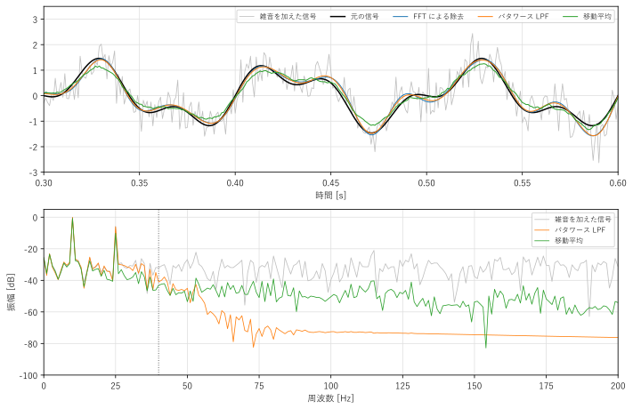
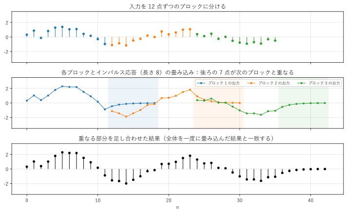
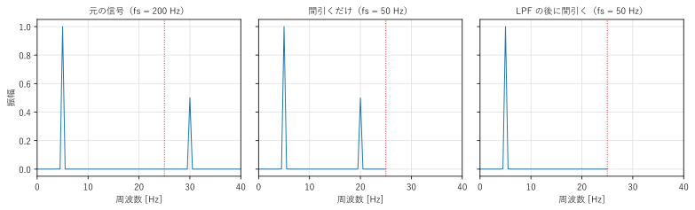
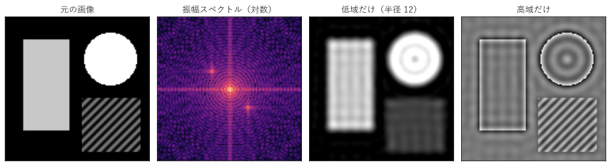
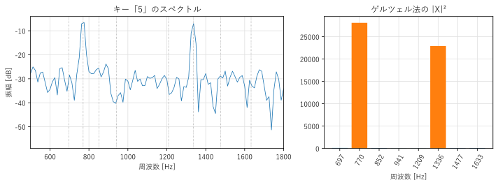

第 10 章 応用
==================================================

この章では、これまでに学んだスペクトル解析とフィルタの知識を組み合わせて、いくつかの典型的な問題を解く。雑音の除去、FFT による高速な畳み込み、標本化周波数の変換、画像の 2 次元 DFT、電話のプッシュ音（DTMF 信号）の検出を取り上げる。

雑音の除去
----------

最もよく使われる信号処理の 1 つが、雑音の除去である。サンプルの ``noise_reduction.py`` では、10 Hz と 25 Hz の正弦波の和（標本化周波数 1000 Hz、長さ 1 s）に、標準偏差 0.5 の白色雑音を加え、次の 3 つの方法で雑音を減らす。

1. **FFT による除去**：信号全体を FFT し、40 Hz を超える周波数の成分を 0 にしてから逆 FFT する。
2. **バタワース LPF**：カットオフ周波数 40 Hz の 4 次のバタワース LPF を、``sosfiltfilt()`` でゼロ位相で掛ける。
3. **移動平均**：21 点の移動平均を掛ける。

.. literalinclude:: ../examples/noise_reduction.py
   :pyobject: fft_mask
   :lineno-match:
   :caption: noise_reduction.py の fft_mask()
   :name: list-ch10-fft-mask

除去の効果は、元の信号（雑音を加える前の信号）との差を雑音とみなした SNR で評価する。信号の両端は、フィルタの過渡応答の影響を受けるので、評価から除いている。

.. literalinclude:: ../build/outputs/noise_reduction.txt
   :language: text
   :caption: noise_reduction.py の実行結果

.. _fig-ch10-noise-reduction:

   雑音の除去の結果：波形の一部（上）と振幅スペクトル（下）

FFT による除去とバタワース LPF は、SNR を約 11 dB 改善している。この値は、次のように理論的に見積もれる。白色雑音の電力は 0 から 500 Hz（ナイキスト周波数）まで一様に分布しているので、0 から 40 Hz の範囲だけを残すと、雑音の電力は :math:`40/500` になる。これは :math:`10\log_{10}(500/40) \approx 11` dB の改善に相当する。通過域（0 から 40 Hz）に入っている雑音は、信号と区別できないので、周波数で選び分ける方法では取り除けない。

移動平均の改善量は約 9 dB で、ほかの 2 つより小さい。:numref:`fig-ch10-noise-reduction` の上の図を見ると、移動平均の出力（緑）は、元の信号より振幅が小さくなっている。21 点の移動平均の利得は、10 Hz で約 0.93、25 Hz で約 0.61 であり、信号の成分まで弱めてしまうからである（第 9 章の :numref:`fig-ch09-moving-average`）。下の図のように、阻止域の減衰も小さい。

FFT による除去は、手軽で、この例ではよく機能している。しかし、次の点に注意が必要である。

* 信号全体を一度に FFT するので、すべてのデータがそろってからでないと処理できない。リアルタイムの処理には向かない。
* 周波数領域で急に 0 にすることは、理想的なフィルタ（sinc 関数のインパルス応答）を循環畳み込みで掛けることに相当する。信号の両端の不連続や、急な変化の付近に、ギブス現象による波打ちが生じることがある。
* DFT のビンに一致しない成分は複数のビンに漏れるので、0 にする範囲の境目の付近の成分は正しく処理されない。

一般的には、目的に合わせて設計したフィルタを使うほうが、結果を予測しやすく安全である。

サンプルの全体：:download:`noise_reduction.py <../examples/noise_reduction.py>`

FFT による高速な畳み込み
------------------------

長さ :math:`N` の信号と、長さ :math:`M` のインパルス応答の畳み込みを定義どおりに計算すると、約 :math:`NM` 回の掛け算が必要である。:math:`M` が大きい場合（例えば、部屋の残響のインパルス応答は数万点にもなる）、計算量は膨大になる。

第 6 章で述べたように、ゼロ詰めして DFT の積を計算すれば、線形畳み込みが求められる。FFT を使えば、この計算量は :math:`(N + M)\log(N + M)` に比例する程度に減る。ただし、信号が非常に長い場合や、リアルタイムで次々に入力が来る場合は、信号全体を一度に FFT するのは現実的でない。

そこで、入力を長さ :math:`L` のブロックに分けて、ブロックごとに FFT で畳み込み、結果をつなぎ合わせる。各ブロックとインパルス応答の畳み込みは長さ :math:`L + M - 1` になり、後ろの :math:`M - 1` 点が次のブロックの結果と重なる。畳み込みは線形なので、重なる部分を足し合わせれば、全体の畳み込みと一致する（:numref:`fig-ch10-overlap-add`）。この方法を\ :term:`オーバーラップ加算法`\ （overlap-add 法）という。

.. _fig-ch10-overlap-add:

   オーバーラップ加算法の考え方

サンプルの ``fast_convolution.py`` は、オーバーラップ加算法を実装し、``np.convolve()``\ （定義どおりの計算）と SciPy の ``scipy.signal.oaconvolve()`` と比べる。

.. literalinclude:: ../examples/fast_convolution.py
   :pyobject: overlap_add
   :lineno-match:
   :caption: fast_convolution.py の overlap_add()
   :name: list-ch10-overlap-add

FFT の長さ ``n_fft`` は、:math:`L + M - 1` 以上の 2 のべき乗に選んでいる。インパルス応答の FFT（``h_spectrum``）は、最初に 1 回だけ計算して使い回す。

.. literalinclude:: ../build/outputs/fast_convolution.txt
   :language: text
   :caption: fast_convolution.py の実行結果（計算時間は計算機によって変わる）

自作の関数の結果は、``np.convolve()`` と一致している。計算時間は、実行する計算機によって変わるが、インパルス応答が 1000 点程度の長さになると、FFT を使う方法が定義どおりの計算より速くなることが多い。インパルス応答が短い（数十点以下の）場合は、定義どおりの計算のほうが速い。SciPy の ``scipy.signal.convolve()`` は、``method="auto"`` を指定すると（既定）、データの長さから速いほうの方法を自動的に選ぶ。

ブロックを重ねて入力し、結果の正しい部分だけを取り出すオーバーラップ保存法（overlap-save 法）もある。どちらも、音響機器の残響の付加やイコライザなど、長いフィルタをリアルタイムで掛ける処理に使われている。

サンプルの全体：:download:`fast_convolution.py <../examples/fast_convolution.py>`

リサンプリング
--------------

標本化周波数を変換することを、リサンプリングという。例えば、48 kHz の音声を 16 kHz の音声認識の入力に変換したり、44.1 kHz と 48 kHz の機器の間でデータをやり取りしたりするときに必要になる。

**ダウンサンプリング**：標本化周波数を :math:`1/D` にするには、:math:`D` 個に 1 個の標本を残せばよい。これを\ :term:`ダウンサンプリング`\ （間引き）という。ただし、新しいナイキスト周波数 :math:`f_s/(2D)` を超える成分があると、エイリアシングが起こる。:numref:`fig-ch10-resampling` は、標本化周波数 200 Hz の信号（5 Hz と 30 Hz の正弦波の和）を 1/4 に間引いて 50 Hz にした例である。新しいナイキスト周波数は 25 Hz なので、間引くだけでは 30 Hz の成分が 20 Hz に折り返す（中央）。間引く前に、ナイキスト周波数より低いカットオフ周波数の LPF を掛けておけば、30 Hz の成分は取り除かれ、エイリアシングは起こらない（右）。第 4 章のアンチエイリアシングフィルタと同じ考え方を、デジタルで行うのである。

.. _fig-ch10-resampling:

   ダウンサンプリング：元の信号（左）、間引くだけ（中）、LPF の後に間引く（右）

**アップサンプリング**：標本化周波数を :math:`U` 倍にするには、各標本の間に :math:`U - 1` 個の 0 を挿入し、その後に LPF を掛ける。0 を挿入しただけの信号のスペクトルには、元のスペクトルの複製（イメージ）が現れるので、LPF でそれを取り除き、標本の間を補間する。この処理を\ :term:`アップサンプリング`\ （補間）という。理想的な LPF を使えば、第 4 章の sinc 補間と同じ結果になる。

標本化周波数を :math:`U/D` 倍にするには、:math:`U` 倍のアップサンプリングと :math:`1/D` のダウンサンプリングを組み合わせる。2 つの LPF は 1 つにまとめられる。SciPy では、次の関数が使える。

.. code-block:: python
   :linenos:
   :caption: SciPy によるリサンプリング

   import numpy as np
   from scipy import signal

   fs = 48000
   x = np.random.default_rng(0).standard_normal(fs)   # 1 秒分の信号
   y = signal.resample_poly(x, up=1, down=3)           # 48 kHz -> 16 kHz
   z = signal.resample_poly(x, up=147, down=160)       # 48 kHz -> 44.1 kHz
   w = signal.decimate(x, 3)                           # 48 kHz -> 16 kHz（IIR の LPF を使う）
   print(len(y), len(z), len(w))                       # 16000 44100 16000

``resample_poly()`` は、アップサンプリング、FIR の LPF、ダウンサンプリングを、無駄な計算（挿入した 0 との掛け算や、捨てる標本の計算）を省いて効率よく行う。:math:`48000 \times 147/160 = 44100` である。

画像の 2 次元 DFT
-----------------

フーリエ解析は、時間の信号だけでなく、画像のような 2 次元の信号にも使える。:math:`M \times N` 画素の画像 :math:`x[m, n]` の 2 次元 DFT は、次の式で定義される。

.. math::

   X[k, l] = \sum_{m=0}^{M-1}\sum_{n=0}^{N-1} x[m, n]\, e^{-j2\pi (km/M + ln/N)}

指数関数を :math:`e^{-j2\pi km/M} e^{-j2\pi ln/N}` に分けられるので、2 次元 DFT は、各行を 1 次元 DFT した後、各列を 1 次元 DFT すれば計算できる。NumPy では ``np.fft.fft2()`` で計算する。

:math:`X[k, l]` は、縦方向に :math:`k`、横方向に :math:`l` 回振動する縞模様の成分を表す。画像における「周波数」は、明るさが空間的に変化する細かさ（空間周波数）である。

:numref:`fig-ch10-image-dft` は、Pillow で描いた長方形と円に、斜めの縞模様を加えたテスト画像の 2 次元 DFT の例である。振幅スペクトルは、``np.fft.fftshift()`` で周波数 0 が中央に来るように並べ替え、対数で表示している。

.. _fig-ch10-image-dft:

   画像の 2 次元 DFT：元の画像、振幅スペクトル、低域だけ、高域だけ（左から）

* 振幅スペクトルは中央（低い空間周波数）が最も明るい。多くの画像のエネルギーは、ゆっくりした明るさの変化に集中している。
* 長方形の縦と横の縁は、横軸と縦軸の上の明るい線になる。縁と直交する方向に、急な変化（高い周波数の成分）があるからである。
* 斜めの縞模様は、中央から斜め方向に離れた位置の 1 組の明るい点として現れる。周期的な模様は、線スペクトルになる。
* 低い周波数だけを残すと、画像はぼやける。縁の付近には、ギブス現象による波打ちが見える。
* 高い周波数だけを残すと、縁と縞模様だけが残る。

JPEG などの画像圧縮では、2 次元 DFT の仲間である離散コサイン変換（DCT）で画像を周波数成分に分け、人の目で気付きにくい高い周波数の成分を粗く量子化して、データ量を減らしている。

DTMF 信号の検出
---------------

電話のプッシュボタンを押したときに鳴る音は、 :term:`DTMF`\ （dual-tone multi-frequency）信号と呼ばれる。各ボタンは、低群の 4 つの周波数から 1 つ、高群の 4 つの周波数から 1 つを選んだ、2 つの正弦波の和で表される（:numref:`table-ch10-dtmf`）。

.. _table-ch10-dtmf:

.. list-table:: DTMF の周波数の割り当て
   :header-rows: 1
   :stub-columns: 1
   :widths: 20 20 20 20 20

   * - 低群 / 高群
     - 1209 Hz
     - 1336 Hz
     - 1477 Hz
     - 1633 Hz
   * - 697 Hz
     - 1
     - 2
     - 3
     - A
   * - 770 Hz
     - 4
     - 5
     - 6
     - B
   * - 852 Hz
     - 7
     - 8
     - 9
     - C
   * - 941 Hz
     - \*
     - 0
     - #
     - D

受信側では、8 つの周波数のうちどれが含まれているかを調べればよい。FFT ですべての周波数を計算することもできるが、必要なのは 8 つの周波数の値だけである。特定の周波数の DFT の値だけを効率よく求める方法に、\ :term:`ゲルツェル法`\ がある。

ゲルツェル法は、長さ :math:`N` のブロックについて、正規化角周波数 :math:`\hat{\omega}_0` の成分を、次の 2 次の IIR フィルタで計算する。

.. math::

   s[n] = x[n] + 2\cos\hat{\omega}_0 \cdot s[n-1] - s[n-2] \qquad (n = 0, 1, \ldots, N - 1)

最後の 2 つの値 :math:`s_1 = s[N-1]`、:math:`s_2 = s[N-2]` から、その周波数の DTFT の大きさの 2 乗が

.. math::

   |X(e^{j\hat{\omega}_0})|^2 = s_1^2 + s_2^2 - 2\cos\hat{\omega}_0 \cdot s_1 s_2

で求められる。1 つの周波数あたり、1 標本につき実数の掛け算 1 回で済むので、調べる周波数が少ないときは FFT より効率がよい。また、:math:`\hat{\omega}_0` は DFT のビンに一致していなくてもよい。

.. literalinclude:: ../examples/dtmf_detection.py
   :pyobject: goertzel_power
   :lineno-match:
   :caption: dtmf_detection.py の goertzel_power()
   :name: list-ch10-goertzel

サンプルの ``dtmf_detection.py`` は、12 個のキーの DTMF 信号（1 つのキーあたり 80 ms、間に 40 ms の無音）を作って白色雑音を加え、ゲルツェル法で検出する。各ブロックで、低群と高群のそれぞれで値が最大の周波数を選び、キーを判定している。

.. literalinclude:: ../build/outputs/dtmf_detection.txt
   :language: text
   :caption: dtmf_detection.py の実行結果

雑音があっても、すべてのキーを正しく検出できている。実行結果の最後の行は、ゲルツェル法の値が、同じ周波数の FFT の値 :math:`|X[k]|^2` と一致することを確かめたものである。:numref:`fig-ch10-dtmf` は、キー「5」（770 Hz と 1336 Hz）の信号のスペクトルと、ゲルツェル法で求めた 8 つの周波数の値である。

.. _fig-ch10-dtmf:

   キー「5」の DTMF 信号のスペクトル（左）とゲルツェル法の値（右）

この例では、キーの音と無音の長さが分かっているものとして信号を区切った。実際の受信機では、信号の強さや、低群と高群の強さの比などから、音の始まりと終わりを判定する必要がある。DTMF の規格（ITU-T Q.23 など）では、周波数の許容誤差や、音の最短の長さが定められている。

サンプルの全体：:download:`dtmf_detection.py <../examples/dtmf_detection.py>`

まとめ
------

* 周波数で雑音を除去できるのは、信号と雑音の周波数の範囲が異なる場合だけである。通過域に入った雑音は取り除けない。
* FFT による除去は手軽だが、リアルタイムの処理には向かず、波打ちが生じることがある。目的に合わせて設計したフィルタのほうが安全である。
* 長いインパルス応答との畳み込みは、オーバーラップ加算法などで FFT を使うと高速に計算できる。
* ダウンサンプリングの前には LPF でエイリアシングを防ぎ、アップサンプリングの後には LPF でイメージを取り除く。
* 2 次元 DFT で画像の空間周波数を解析できる。
* 少数の周波数だけを調べるには、ゲルツェル法が効率的である。
