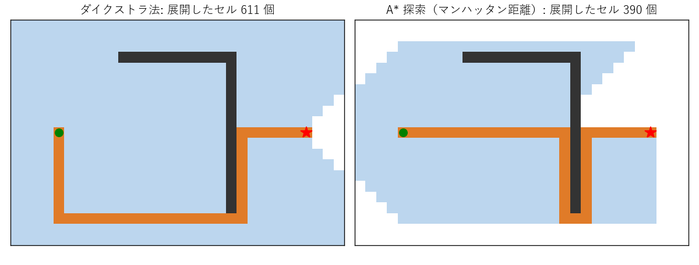

第 12 章 最短経路問題
=====================

カーナビや乗換案内は、道路や路線のネットワーク上で最も短い（速い、安い）経路を求めている。インターネットのルーターも、パケットを届ける経路をグラフの最短経路として計算している。本章では、重み付きグラフの最短経路を求める代表的なアルゴリズムを学ぶ。

問題の定義
----------

重み付き有向グラフで、道 :math:`P = (v_0, v_1, \ldots, v_k)` の\ **長さ**\ （重み）を、通る辺の重みの和 :math:`w(P) = \sum_{i=1}^{k} w(v_{i-1}, v_i)` と定める。:math:`u` から :math:`v` への道の長さの最小値を :math:`u` から :math:`v` への\ **最短距離**\ といい、それを実現する道を\ **最短経路**\ という。無向グラフは、各辺を両方向の有向辺に置き換えれば有向グラフとして扱える。

最短経路問題には、求めるものによって次の種類がある。

* **単一始点最短経路問題**\ ：1 つの始点から他のすべての頂点への最短経路を求める。
* **2 点間最短経路問題**\ ：特定の始点から特定の終点への最短経路を求める。
* **全点対最短経路問題**\ ：すべての頂点の組について最短経路を求める。

2 点間の問題を解く一般的な方法で、単一始点の問題より漸近的に速いものは知られていない。そのため、まず単一始点の問題を考える。辺の重みがすべて 1 なら、第 11 章の幅優先探索で :math:`O(n + m)` 時間で解ける。

負の重みと負閉路
~~~~~~~~~~~~~~~~

辺の重みは負でもよい。たとえば重みを「コスト」とし、ある区間を通ると報酬がもらえるなら、その辺の重みは負になる。ただし、長さが負の有向閉路（\ **負閉路**\ ）に到達できる場合は、閉路を何周もすることで長さをいくらでも小さくできるので、最短距離は定義できない。本章のアルゴリズムは、負閉路がないことを前提とするか、負閉路を検出して報告する。

最短経路の基本的な性質
~~~~~~~~~~~~~~~~~~~~~~

すべてのアルゴリズムの基礎になるのは、次の 2 つの性質である。

* **部分構造の最適性**\ ：最短経路の一部分もまた最短経路である。:math:`s` から :math:`v` への最短経路が :math:`u` を通るなら、その :math:`s` から :math:`u` までの部分は :math:`s` から :math:`u` への最短経路である（そうでなければ、その部分を短い経路に置き換えて全体を短くできる）。
* **三角不等式**\ ：:math:`s` からの最短距離を :math:`d(\cdot)` とすると、任意の辺 :math:`(u, v)` について :math:`d(v) \le d(u) + w(u, v)` が成り立つ。

アルゴリズムは、各頂点について距離の暫定値 :math:`\mathrm{dist}[v]`\ （初期値は始点で 0、それ以外で :math:`\infty`）を持ち、次の\ **緩和**\ と呼ばれる操作を繰り返して真の距離に近づける。

.. math::

   \text{if } \mathrm{dist}[u] + w(u, v) < \mathrm{dist}[v] \text{ then } \mathrm{dist}[v] \leftarrow \mathrm{dist}[u] + w(u, v)

緩和で値を更新するとき、:math:`v` の直前の頂点（親）として :math:`u` を記録しておけば、終了後に親をたどって最短経路を復元できる。親を結んだ辺は始点を根とする木になり、これを\ **最短経路木**\ という。各アルゴリズムの違いは、緩和をどの順序で行うかにある。

本章では :numref:`fig-ch12-graph` の重み付き有向グラフを例とする。

.. _fig-ch12-graph:

.. graphviz::
   :caption: 最短経路の例に用いる重み付き有向グラフ。太線は s からの最短経路木である。
   :align: center

   digraph g {
       layout=neato;
       node [shape=circle, width=0.4, fixedsize=true, fontsize=13, style=filled, fillcolor="#dbe8f5"];
       edge [fontsize=12, color="#999999"];
       s [pos="0,1!"]; a [pos="1.8,2!"]; b [pos="1.8,0!"]; c [pos="3.6,1!"]; t [pos="5.4,1!"];
       s -> a [label="4"];
       s -> b [label="1", penwidth=3, color="#e07b28"];
       b -> a [label="2", penwidth=3, color="#e07b28"];
       b -> c [label="5"];
       a -> c [label="1", penwidth=3, color="#e07b28"];
       c -> t [label="3", penwidth=3, color="#e07b28"];
   }

ダイクストラ法
--------------

辺の重みがすべて非負のとき、単一始点最短経路問題は\ **ダイクストラ法**\ （Dijkstra's algorithm）で効率よく解ける。

1. 始点の暫定距離を 0、それ以外を :math:`\infty` とする。すべての頂点を「未確定」とする。
2. 未確定の頂点のうち暫定距離が最小の頂点 :math:`u` を選び、「確定」とする。
3. :math:`u` から出るすべての辺 :math:`(u, v)` について緩和を行う。
4. すべての頂点が確定するまで 2, 3 を繰り返す。

手順 2 で選んだ頂点の暫定距離が真の距離に等しいことが、正しさの要点である。始点からの真の距離を :math:`d(\cdot)` とし、:math:`u` への最短経路上で最初に現れる未確定の頂点を :math:`x` とする。:math:`x` の直前の頂点は確定済みで、確定したときに緩和を行っているので、:math:`\mathrm{dist}[x] = d(x)` である。重みが非負なので :math:`d(x) \le d(u)` であり、:math:`u` の選び方から :math:`\mathrm{dist}[u] \le \mathrm{dist}[x]` である。以上より :math:`\mathrm{dist}[u] \le d(x) \le d(u)` となり、暫定距離は真の距離以上なので :math:`\mathrm{dist}[u] = d(u)` が成り立つ。

:numref:`fig-ch12-graph` では、s（距離 0）、b（距離 1）、a（距離 3）、c（距離 4）、t（距離 7）の順に確定する。a の暫定距離は最初 s からの直通の 4 であるが、b を確定したときに s → b → a の 3 に更新される。

暫定距離が最小の頂点を選ぶために、優先度付きキュー（Python の ``heapq``）を使う（サンプルコード ``shortest_path.py``）。

.. literalinclude:: ../examples/shortest_path.py
   :language: python
   :linenos:
   :pyobject: dijkstra
   :caption: ダイクストラ法

``heapq`` には要素の優先度を下げる操作がないので、距離を更新するたびに新しい組 ``(距離, 頂点)`` を追加し、取り出したときに古いものを読み飛ばしている。ヒープの要素数は :math:`O(m)` で、各操作は :math:`O(\log m) = O(\log n)` 時間なので、全体の計算量は :math:`O((n + m) \log n)` である。密グラフでは、ヒープを使わずに毎回 :math:`O(n)` 時間で最小の頂点を探す :math:`O(n^2)` の実装の方が速い場合もある。

.. code-block:: text
   :linenos:

   ダイクストラ法: {'s': 0.0, 'a': 3.0, 'b': 1.0, 'c': 4.0, 't': 7.0} 経路: ['s', 'b', 'a', 'c', 't']

負の重みがあるとダイクストラ法は正しく動作しない。たとえば辺 s → a（重み 2）、s → b（重み 3）、b → a（重み :math:`-2`）のグラフでは、a が先に距離 2 で確定してしまうが、実際の最短距離は s → b → a の 1 である。上の正しさの議論で使った :math:`d(x) \le d(u)` が、負の重みがあると成り立たないからである。

ベルマン・フォード法
--------------------

負の重みを含む場合は\ **ベルマン・フォード法**\ （Bellman–Ford algorithm）を使う。考え方は単純で、すべての辺の緩和を :math:`n - 1` 回繰り返す。

負閉路がなければ、最短経路は道（頂点の重複がない）として取れるので、辺は高々 :math:`n - 1` 本である。すべての辺の緩和を 1 回行うごとに、最短経路の先頭から 1 本ずつ辺が「確定」していくので、:math:`n - 1` 回で全頂点の距離が求まる。:math:`n - 1` 回の後でもまだ緩和で値が変わる辺があれば、始点から到達できる負閉路が存在する。

.. literalinclude:: ../examples/shortest_path.py
   :language: python
   :linenos:
   :pyobject: bellman_ford
   :caption: ベルマン・フォード法

計算量は :math:`O(nm)` であり、ダイクストラ法より遅い。途中で 1 回も更新がなければ、その時点で打ち切ってよい。次の実行例の 2 行目は、頂点 a と b の間に長さ :math:`-2 + 1 = -1` の負閉路があるグラフに適用した結果である。

.. code-block:: text
   :linenos:

   ベルマン・フォード法: {'s': 0.0, 'a': 3.0, 'b': 1.0, 'c': 4.0, 't': 7.0}
   負閉路を含むグラフ: None

ベルマン・フォード法は、各頂点が隣接頂点と距離の情報を交換するだけで計算を進められるので、分散環境に向いている。初期のインターネットの経路制御プロトコル RIP（距離ベクトル型）は、この考え方に基づいている。また、為替レートの対数の符号を反転したものを重みとすると、負閉路は「通貨を一周交換すると得をする」裁定機会に対応する。

ワーシャル・フロイド法
----------------------

全点対最短経路問題は、各頂点を始点としてダイクストラ法を :math:`n` 回行えば解ける。より簡潔な方法が\ **ワーシャル・フロイド法**\ （Floyd–Warshall algorithm）である。頂点を :math:`v_1, \ldots, v_n` とし、「経由してよい頂点を :math:`v_1, \ldots, v_k` に限ったときの :math:`v_i` から :math:`v_j` への最短距離」を :math:`d_k(i, j)` とすると、次の漸化式が成り立つ。

.. math::

   d_k(i, j) = \min\bigl(d_{k-1}(i, j),\ d_{k-1}(i, k) + d_{k-1}(k, j)\bigr)

:math:`v_k` を経由しない最短経路と、:math:`v_k` を 1 回経由する最短経路の短い方をとる、という意味である。:math:`d_0(i, j)` は辺の重み（辺がなければ :math:`\infty`）であり、:math:`d_n(i, j)` が求める最短距離になる。このように、小さな部分問題の解を表に記録しながら大きな問題を解く方法を\ **動的計画法**\ という。

.. literalinclude:: ../examples/shortest_path.py
   :language: python
   :linenos:
   :pyobject: floyd_warshall
   :caption: ワーシャル・フロイド法

表を上書きしながら計算してよいので、実装は 3 重ループだけで済む。計算量は :math:`O(n^3)`、メモリは :math:`O(n^2)` である。負の重みがあっても負閉路がなければ正しく動作し、終了後に :math:`d(i, i) < 0` となる頂点があれば負閉路が存在する。

.. code-block:: text
   :linenos:

   ワーシャル・フロイド法 (a からの距離): {'s': inf, 'a': 0.0, 'b': inf, 'c': 1.0, 't': 4.0}

a からは s と b に到達できないので、距離は :math:`\infty` になっている。

A* 探索
-------

2 点間の最短経路だけが必要な場合、ダイクストラ法は終点と関係のない方向にも探索を広げてしまう。\ **A* 探索**\ （A-star）は、各頂点から終点までの距離の見積もり :math:`h(v)`\ （\ **ヒューリスティック関数**\ ）を使い、:math:`\mathrm{dist}[v] + h(v)` が最小の頂点から確定していく。ダイクストラ法は :math:`h(v) = 0` とした特別な場合である。

:math:`h(v)` が実際の残り距離を超えない（\ **許容的**\ である）とき、A* 探索は最短経路を求められる。さらに、任意の辺 :math:`(u, v)` について :math:`h(u) \le w(u, v) + h(v)` を満たす（\ **無矛盾**\ である）とき、ダイクストラ法と同様に、一度確定した頂点を再び調べる必要がない。地図上の経路探索では、直線距離が無矛盾なヒューリスティックになる。上下左右に移動する格子では、マンハッタン距離 :math:`|x_1 - x_2| + |y_1 - y_2|` が使える。

.. literalinclude:: ../examples/shortest_path.py
   :language: python
   :linenos:
   :pyobject: astar_grid
   :caption: 格子上の A* 探索

:numref:`fig-ch12-astar` は、壁のある格子で、ダイクストラ法と A* 探索が確定した（展開した）セルを比較したものである。ダイクストラ法は始点から全方向に均等に探索を広げるのに対し、A* 探索は終点の方向に探索を絞り込んでいる。どちらも同じ長さの最短経路を見つけるが、A* 探索の方が展開するセルが少ない。

.. _fig-ch12-astar:

   ダイクストラ法（左）と A* 探索（右）が展開したセル（水色）と最短経路（橙色）。緑の丸が始点、赤の星が終点、黒は壁である。

サンプルコードの小さな格子でも、次のように展開するセルの数が減っている。

.. code-block:: text
   :linenos:

   A* 探索 (距離, 展開数): (16, 24)
   ダイクストラ法 (距離, 展開数): (16, 35)

ヒューリスティックが実際の距離に近いほど、探索は効率的になる。実際のカーナビでは、A* 探索に加えて、道路網を前処理して高速化する手法（階層的な縮約など）が使われている。

アルゴリズムの比較
------------------

.. list-table:: 最短経路アルゴリズムの比較
   :header-rows: 1
   :widths: 22 22 18 38

   * - アルゴリズム
     - 問題
     - 計算量
     - 条件・特徴
   * - 幅優先探索
     - 単一始点
     - :math:`O(n + m)`
     - 重みなし（すべて 1）
   * - ダイクストラ法
     - 単一始点
     - :math:`O((n + m) \log n)`
     - 重みが非負
   * - ベルマン・フォード法
     - 単一始点
     - :math:`O(nm)`
     - 負の重みも可、負閉路を検出できる
   * - ワーシャル・フロイド法
     - 全点対
     - :math:`O(n^3)`
     - 負の重みも可、実装が簡潔
   * - A* 探索
     - 2 点間
     - 最悪はダイクストラ法と同じ
     - 良いヒューリスティックがあれば高速

なお、DAG では、トポロジカル順序（第 11 章）に従って各頂点から出る辺を緩和すれば、負の重みがあっても :math:`O(n + m)` 時間で最短経路が求まる。重みの符号を反転すれば最長経路も求まり、これはプロジェクト管理でクリティカルパス（全体の所要時間を決める作業の列）を求める方法になる。

まとめ
------

* 最短経路は部分構造の最適性を持ち、アルゴリズムは緩和の操作を繰り返して距離を求める。
* 重みが非負ならダイクストラ法、負の重みがあればベルマン・フォード法を使う。負閉路があると最短距離は定義できない。
* 全点対の最短距離はワーシャル・フロイド法で :math:`O(n^3)` 時間で求められる。
* 2 点間の探索では、A* 探索が終点までの距離の見積もりを利用して探索範囲を絞り込む。
