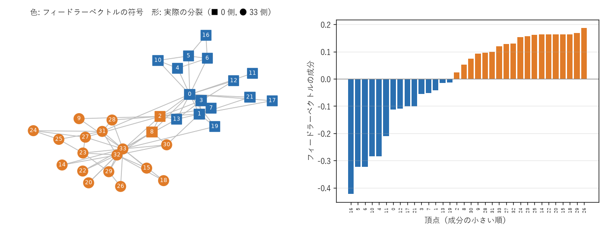

第 14 章 代数的グラフ理論
=========================

第 3 章で、グラフは隣接行列で表せることを学んだ。グラフを行列として見ると、行列のべき乗や固有値といった線形代数の道具を使ってグラフの性質を調べられる。このアプローチを\ **代数的グラフ理論**\ （特に固有値を扱う部分を\ **スペクトルグラフ理論**\ ）という。本章では、隣接行列とラプラシアン行列の基本的な性質と、全域木の数え上げ、グラフの分割、Web ページの重要度の評価への応用を学ぶ。本章は、行列の積、行列式、固有値と固有ベクトルの基礎知識を前提とする。

本章では、:math:`n` 頂点のグラフの頂点を :math:`1, \ldots, n` で表し、隣接行列を :math:`A`、次数を対角に並べた次数行列を :math:`D` とする。

隣接行列のべき乗と歩道
----------------------

.. admonition:: 定理 14.1

   隣接行列 :math:`A` の :math:`k` 乗の :math:`(i, j)` 成分 :math:`(A^k)_{ij}` は、頂点 :math:`i` から頂点 :math:`j` への長さ :math:`k` の歩道の個数に等しい。

**証明**\ ：:math:`k` に関する帰納法で示す。:math:`k = 1` のときは隣接行列の定義そのものである。:math:`k - 1` で成り立つとすると、

.. math::

   (A^k)_{ij} = \sum_{l=1}^{n} (A^{k-1})_{il} \, a_{lj}

である。右辺の各項は「:math:`i` から :math:`l` への長さ :math:`k - 1` の歩道の個数」に、:math:`l` と :math:`j` が隣接していれば 1、そうでなければ 0 を掛けたものである。長さ :math:`k` の歩道は最後から 2 番目の頂点 :math:`l` で分類できるので、その和は :math:`i` から :math:`j` への長さ :math:`k` の歩道の個数に等しい。□

対角成分 :math:`(A^k)_{ii}` は、頂点 :math:`i` から出て :math:`i` に戻る長さ :math:`k` の閉歩道の個数である。三角形は、3 つの頂点のそれぞれを始点として 2 つの向きにたどれるので、長さ 3 の閉歩道として 6 回数えられる。したがって、グラフに含まれる三角形の個数は :math:`\operatorname{tr}(A^3) / 6` である。また、:math:`(A^2)_{ii} = \deg(i)` であり、:math:`\operatorname{tr}(A^2) = 2m` となる。

.. code-block:: text
   :linenos:

   K4 の A^3:
   [[6 7 7 7]
    [7 6 7 7]
    [7 7 6 7]
    [7 7 7 6]]
   三角形の個数 = trace(A^3) / 6 = 4

:math:`K_4` には 4 個の三角形があり、各頂点を通る三角形は 3 個なので、各頂点から戻る長さ 3 の閉歩道は :math:`3 \times 2 = 6` 個である。

隣接行列の固有値
----------------

無向グラフの隣接行列は実対称行列なので、固有値はすべて実数であり、互いに直交する固有ベクトルからなる基底を持つ。隣接行列の固有値を、重複を含めてグラフの\ **スペクトル**\ という。頂点の番号の付け方を変えても、隣接行列は置換行列 :math:`P` を使って :math:`P^{\mathsf{T}} A P` に変わるだけなので、スペクトルはグラフ不変量である。

隣接行列の固有値について、次の性質が知られている。最大固有値を :math:`\lambda_1` とする。

* 平均次数を :math:`\bar{d}` とすると、:math:`\bar{d} \le \lambda_1 \le \Delta(G)` が成り立つ。:math:`k`-正則グラフでは :math:`\lambda_1 = k` であり、固有ベクトルはすべての成分が 1 のベクトル :math:`\mathbf{1}` である。
* 連結グラフでは、:math:`\lambda_1` に対応する固有ベクトルとして、すべての成分が正のものがとれる（ペロン・フロベニウスの定理）。この固有ベクトルの成分は、頂点の重要度の指標（\ **固有ベクトル中心性**\ 、第 15 章）として使われる。
* グラフが二部グラフであることと、スペクトルが原点に関して対称（:math:`\lambda` が固有値なら :math:`-\lambda` も同じ重複度の固有値）であることは同値である。

ただし、スペクトルが一致しても同型とは限らない。スペクトルが等しく同型でないグラフの組（\ **共スペクトル**\ なグラフ）が存在する。

ラプラシアン行列
----------------

.. admonition:: 定義 14.1（ラプラシアン行列）

   グラフ :math:`G` に対し、:math:`L = D - A` を :math:`G` の\ **ラプラシアン行列**\ という。

ラプラシアン行列の対角成分は各頂点の次数、非対角成分は隣接していれば :math:`-1`、そうでなければ 0 である。各行の和は 0 になる。名前は、関数の 2 階微分にあたる微分作用素ラプラシアンの離散版であることに由来する。第 3 章で述べたように、向き付きの接続行列 :math:`B` を使うと :math:`L = B B^{\mathsf{T}}` と書ける。

ラプラシアン行列の最も重要な性質は、次の二次形式の表示である。ベクトル :math:`x = (x_1, \ldots, x_n)^{\mathsf{T}}` を、各頂点に実数を割り当てたものとみなす。

.. math::

   x^{\mathsf{T}} L x = \sum_{ij \in E} (x_i - x_j)^2

右辺は辺ごとの両端の値の差の 2 乗和であり、隣接する頂点の値がどれだけ「ばらついているか」を表す。この式から、ラプラシアン行列の固有値について次のことが分かる。

* 右辺は常に 0 以上なので、:math:`L` は半正定値であり、固有値はすべて 0 以上である。固有値を :math:`0 = \mu_1 \le \mu_2 \le \cdots \le \mu_n` と書く。
* :math:`L \mathbf{1} = \mathbf{0}`\ （各行の和が 0）なので、最小固有値は :math:`\mu_1 = 0` である。

.. admonition:: 定理 14.2

   ラプラシアン行列の固有値 0 の重複度は、グラフの連結成分の個数に等しい。

**証明**\ ：:math:`Lx = 0` なら :math:`x^{\mathsf{T}} L x = 0` であり、二次形式の表示から、すべての辺 :math:`ij` について :math:`x_i = x_j` となる。したがって :math:`x` は各連結成分の上で定数である。逆に、各連結成分の上で定数のベクトルは :math:`Lx = 0` を満たす。連結成分が :math:`c` 個なら、このようなベクトル全体は :math:`c` 次元の空間をなすので、固有値 0 の重複度は :math:`c` である。□

3 頂点の道グラフ :math:`P_3` と閉路グラフ :math:`C_4` を並べたグラフ（連結成分 2 個）では、固有値 0 がちょうど 2 個現れる（サンプルコード ``spectral.py``）。

.. code-block:: text
   :linenos:

   P3 と C4 の非交和のラプラシアン固有値: [0. 0. 1. 2. 2. 3. 4.]

代数的連結度
~~~~~~~~~~~~

定理 14.2 より、グラフが連結であることと :math:`\mu_2 > 0` であることは同値である。フィードラーは :math:`\mu_2` を\ **代数的連結度**\ と名付けた。:math:`\mu_2` はグラフが連結であるかどうかだけでなく、「どれだけ切り離しにくいか」を連続的な量として表す。たとえば、完全グラフでないグラフでは :math:`\mu_2 \le \kappa(G)`\ （点連結度）が成り立ち、細い部分でつながったグラフでは :math:`\mu_2` が小さくなる。一方、完全グラフ :math:`K_n` では :math:`\mu_2 = n` であり、これは :math:`n` 頂点の単純グラフで最大の値である。

行列木定理
----------

第 6 章で、:math:`K_n` の全域木の個数が :math:`n^{n-2}` であることを見た。一般のグラフの全域木の個数は、ラプラシアン行列から計算できる。

.. admonition:: 定理 14.3（行列木定理）

   連結グラフ :math:`G` の全域木の個数は、ラプラシアン行列 :math:`L` から任意の第 :math:`i` 行と第 :math:`i` 列を取り除いた :math:`(n-1) \times (n-1)` 行列の行列式に等しい。また、これは :math:`\frac{1}{n} \mu_2 \mu_3 \cdots \mu_n` にも等しい。

この定理はキルヒホッフが電気回路の研究の中で発見したもので、キルヒホッフの定理とも呼ばれる。証明は :math:`L = B B^{\mathsf{T}}` とコーシー・ビネの公式（行列の積の小行列式の展開）を使うもので、ここでは省略する。

:math:`K_n` に適用してみる。:math:`K_n` のラプラシアン行列は :math:`L = nI - J`\ （:math:`J` は全成分が 1 の行列）であり、固有値は 0 が 1 個と :math:`n` が :math:`n - 1` 個である。よって全域木の個数は :math:`\frac{1}{n} n^{n-1} = n^{n-2}` となり、ケイリーの公式が再び得られる。

.. literalinclude:: ../examples/spectral.py
   :language: python
   :linenos:
   :pyobject: count_spanning_trees
   :caption: 行列木定理による全域木の数え上げ

.. code-block:: text
   :linenos:

   K2 の全域木の個数: 1 (n^(n-2) = 1)
   K3 の全域木の個数: 3 (n^(n-2) = 3)
   K4 の全域木の個数: 16 (n^(n-2) = 16)
   K5 の全域木の個数: 125 (n^(n-2) = 125)
   K6 の全域木の個数: 1296 (n^(n-2) = 1296)
   ピーターセングラフの全域木の個数: 2000 NetworkX: 2000

浮動小数点で行列式を計算するため、結果を ``round`` で整数に丸めている。大きなグラフでは丸め誤差に注意が必要である。

スペクトルによるグラフ分割
--------------------------

グラフの頂点を、間の辺がなるべく少なくなるように 2 つのグループに分ける問題を考える。コミュニティの検出、並列計算での仕事の分配、回路の分割などに現れる問題である。

各頂点に :math:`+1` または :math:`-1` を割り当てて 2 つのグループを表すと、:math:`x^{\mathsf{T}} L x = \sum_{ij \in E} (x_i - x_j)^2` は、グループをまたぐ辺 1 本につき 4 になり、それ以外の辺では 0 になる。つまり :math:`x^{\mathsf{T}} L x / 4` はグループ間の辺の本数である。この値を最小化したいが、すべての頂点を同じグループにする自明な解を避けるため、グループの大きさをそろえる条件 :math:`\sum_i x_i = 0` を課す。

:math:`x_i \in \{+1, -1\}` という条件のままでは組合せ最適化問題であり、効率よく解くのは難しい。そこで、:math:`x_i` を任意の実数に緩め、:math:`\|x\|^2 = n` と :math:`x \perp \mathbf{1}` の条件の下で :math:`x^{\mathsf{T}} L x` を最小化する。線形代数の結果（レイリー商の性質）から、この最小値は :math:`n \mu_2` であり、最小値を与える :math:`x` は :math:`\mu_2` の固有ベクトルである。この固有ベクトルを\ **フィードラーベクトル**\ という。フィードラーベクトルの成分の符号で頂点を 2 つに分けるのが、\ **スペクトル分割**\ である。

.. literalinclude:: ../examples/spectral.py
   :language: python
   :linenos:
   :pyobject: fiedler_partition
   :caption: フィードラーベクトルによる 2 分割

2 つの :math:`K_5` を 1 本の辺でつないだバーベルグラフに適用すると、2 つの :math:`K_5` にきれいに分かれる。

.. code-block:: text
   :linenos:

   代数的連結度 = 0.2984, 分割: [0, 1, 2, 3, 4] / [5, 6, 7, 8, 9]

より現実的な例として、ザッカリーの空手クラブのネットワークを考える。これは 1970 年代に米国の大学の空手クラブ 34 人の交友関係を調べたもので、調査中に指導者（頂点 0）と管理者（頂点 33）の対立からクラブが 2 つに分裂した。:numref:`fig-ch14-fiedler` は、フィードラーベクトルの符号による分割と実際の分裂を比較したものである。34 人中、頂点 2 と 8 を除く 32 人について、スペクトル分割は実際の分裂と一致している。

.. _fig-ch14-fiedler:

   空手クラブのネットワークのスペクトル分割。左図の色はフィードラーベクトルの符号、形は実際の分裂後の所属を表す。右図はフィードラーベクトルの各成分である。

このように、固有ベクトルを使ってデータをグループに分ける手法を一般に\ **スペクトルクラスタリング**\ という。データ点を頂点とし、点同士の類似度を辺の重みとするグラフを作れば、グラフ以外のデータにも適用できる。3 つ以上のグループに分けるには、小さい方から複数の固有ベクトルを使う。

PageRank
--------

Web ページの重要度を、リンク構造だけから評価する方法を考える。Google の創業者らが考案した **PageRank** は、「重要なページからリンクされているページは重要である」という再帰的な考え方に基づく。

ランダムサーファーモデル
~~~~~~~~~~~~~~~~~~~~~~~~

次のように Web を移動する仮想的な閲覧者（ランダムサーファー）を考える。

* 確率 :math:`\alpha` で、現在のページのリンクから 1 つを等確率で選んで移動する。リンクを持たないページでは、全ページから等確率で選んで移動する。
* 確率 :math:`1 - \alpha` で、リンクとは無関係に、全ページから等確率で選んだページへ移動する。

:math:`\alpha` を\ **減衰率**\ といい、0.85 がよく使われる。この移動を長く続けたとき、各ページに滞在している確率がそのページの PageRank である。

ページ :math:`i` からページ :math:`j` へリンクをたどって移る確率を :math:`P_{ji}` とする行列 :math:`P` を作る（:math:`i` が :math:`k` 個のリンクを持てば、リンク先 :math:`j` について :math:`P_{ji} = 1/k`）。各ページの滞在確率を並べたベクトルを :math:`x` とすると、1 ステップ後の確率は次の式で表される。

.. math::

   x' = \alpha P x + \frac{1 - \alpha}{n} \mathbf{1}

PageRank はこの式で変わらないベクトル、すなわち :math:`x = \alpha P x + \frac{1 - \alpha}{n} \mathbf{1}` を満たす確率ベクトルである。:math:`\sum_i x_i = 1` を使って書き直すと、:math:`x` は行列 :math:`\alpha P + \frac{1 - \alpha}{n} J` の固有値 1 に対応する固有ベクトルであることが分かる。この行列はすべての成分が正なので、ペロン・フロベニウスの定理により、そのような確率ベクトルは一意に存在する。

べき乗法
~~~~~~~~

PageRank は、適当な初期値から上の式を繰り返し適用する\ **べき乗法**\ で求められる。:math:`1 - \alpha` の項のおかげで、繰り返しは速く収束する（誤差は 1 回ごとに :math:`\alpha` 倍以下に縮む）。Web 全体のような巨大な行列でも、行列とベクトルの積を繰り返すだけで計算できる点が重要である。

.. literalinclude:: ../examples/spectral.py
   :language: python
   :linenos:
   :pyobject: pagerank
   :caption: べき乗法による PageRank の計算

.. _fig-ch14-pagerank:

.. graphviz::
   :caption: PageRank の例に用いるリンク構造（数値は PageRank）
   :align: center

   digraph g {
       layout=neato;
       node [shape=box, style="rounded,filled", fillcolor="#dbe8f5", fontsize=11, width=0.9, height=0.55, fixedsize=true];
       0 [label="0\n0.3725", pos="0,1.4!"]; 1 [label="1\n0.1958", pos="2.2,1.4!"];
       2 [label="2\n0.3941", pos="1.1,0!"]; 3 [label="3\n0.0375", pos="3.3,0!"];
       0 -> 1; 0 -> 2; 1 -> 2; 2 -> 0; 3 -> 2;
   }

.. code-block:: text
   :linenos:

   PageRank: [0.3725 0.1958 0.3941 0.0375]
   NetworkX: [0.3725, 0.1958, 0.3941, 0.0375]

ページ 2 は 3 つのページからリンクされているので最も高い。ページ 0 はリンク元が 2 だけだが、重要なページ 2 の唯一のリンク先なので 2 番目に高い。ページ 3 はどこからもリンクされていないので、ランダムな移動で訪れる確率 :math:`(1 - \alpha)/n = 0.0375` だけになる。PageRank は、単にリンクの数を数えるのではなく、リンク元の重要度を加味している点に特徴がある。

まとめ
------

* 隣接行列の :math:`k` 乗の成分は長さ :math:`k` の歩道の個数を表し、:math:`\operatorname{tr}(A^3) / 6` は三角形の個数である。
* ラプラシアン行列 :math:`L = D - A` は半正定値であり、固有値 0 の重複度は連結成分の個数に等しい。2 番目に小さい固有値（代数的連結度）はグラフの切り離しにくさを表す。
* 行列木定理により、全域木の個数はラプラシアン行列の小行列式として計算できる。
* フィードラーベクトルの符号によってグラフを 2 つに分割できる（スペクトル分割）。
* PageRank はランダムサーファーの滞在確率であり、べき乗法で計算できる。
