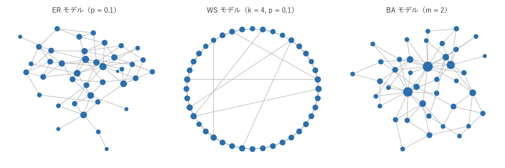
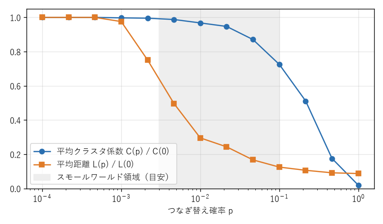
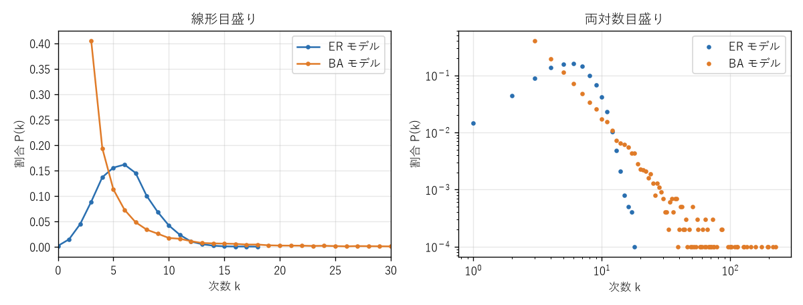

第 15 章 ネットワーク科学への入口
=================================

インターネット、SNS、論文の引用関係、タンパク質の相互作用、送電網など、現実のネットワークは数百万から数十億の頂点を持つ。このような巨大なグラフでは、個々の頂点や辺よりも、次数の分布や頂点間の平均的な距離といった統計的な性質が重要になる。現実のネットワークに共通する性質を調べ、それを生み出す仕組みをモデル化する分野を\ **ネットワーク科学**\ という。本章では、ネットワークを特徴付ける基本的な指標と、代表的なネットワークモデルを紹介する。

ネットワークの基本的な指標
--------------------------

次数分布
~~~~~~~~

次数が :math:`k` の頂点の割合を :math:`P(k)` と書き、:math:`k` の関数として見たものを\ **次数分布**\ という。次数分布は、ネットワークの「つながりの偏り」を表す。

多くの現実のネットワークでは、大多数の頂点の次数は小さいが、ごく一部に非常に次数の大きい頂点（\ **ハブ**\ ）が存在する。このようなネットワークの次数分布は、次数の大きい側に長く裾を引き、しばしば次のべき乗則で近似される。

.. math::

   P(k) \propto k^{-\gamma}

指数 :math:`\gamma` は多くの場合 2 から 3 の間にある。べき乗則に従う次数分布を持つネットワークを\ **スケールフリーネットワーク**\ という。べき乗則は、両辺の対数をとると :math:`\log P(k) = -\gamma \log k + \text{定数}` となるので、両対数グラフで直線に見える。ただし、現実のデータが厳密にべき乗則に従うかどうかについては議論がある。

クラスタ係数
~~~~~~~~~~~~

「友人の友人は友人である」ことが多いという性質を測るのがクラスタ係数である。

.. admonition:: 定義 15.1（クラスタ係数）

   次数 :math:`k_v \ge 2` の頂点 :math:`v` について、:math:`v` の隣接頂点の組 :math:`\binom{k_v}{2}` 個のうち、互いに隣接している組の割合を、:math:`v` の\ **局所クラスタ係数** :math:`C_v` という。

   .. math::

      C_v = \frac{(v \text{ の隣接頂点の間の辺の本数})}{k_v (k_v - 1) / 2}

   全頂点の :math:`C_v` の平均を\ **平均クラスタ係数**\ という（次数 1 以下の頂点では :math:`C_v = 0` とする）。

:math:`C_v` は、:math:`v` を含む三角形の数を、:math:`v` を含みうる三角形の最大数で割ったものでもある。完全グラフではすべての頂点で :math:`C_v = 1`、木ではすべての頂点で :math:`C_v = 0` である（サンプルコード ``network_analysis.py``）。

.. literalinclude:: ../examples/network_analysis.py
   :language: python
   :linenos:
   :pyobject: clustering_coefficient
   :caption: 局所クラスタ係数

平均距離
~~~~~~~~

全頂点対の距離の平均を\ **平均距離**\ （平均経路長）という。1960 年代に社会心理学者ミルグラムが行った実験では、米国内の見知らぬ人に知人を介して手紙を届けると、平均して 6 人程度で届くことが報告された。これは「六次の隔たり」として知られる。現実のネットワークの多くは、頂点数が非常に大きくても平均距離が小さい。この性質を\ **スモールワールド性**\ という。

中心性
------

ネットワークの中で「重要な」頂点を見つけるための指標を\ **中心性**\ という。何をもって重要とするかによって、さまざまな中心性が定義されている。:numref:`table-ch15-centrality` に代表的なものをまとめる。

.. _table-ch15-centrality:

.. list-table:: 代表的な中心性
   :header-rows: 1
   :widths: 22 40 38

   * - 中心性
     - 定義
     - 意味
   * - 次数中心性
     - :math:`\deg(v) / (n - 1)`
     - 直接のつながりが多い
   * - 近接中心性
     - :math:`(n - 1) / \sum_{u \ne v} d(u, v)`
     - 他の頂点に平均的に近い
   * - 媒介中心性
     - :math:`\sum_{s \ne v \ne t} \sigma_{st}(v) / \sigma_{st}`
     - 他の頂点間の最短経路の多くが通る
   * - 固有ベクトル中心性
     - 隣接行列の最大固有値の固有ベクトルの成分
     - 重要な頂点とつながっている

媒介中心性の :math:`\sigma_{st}` は :math:`s` から :math:`t` への最短経路の本数、:math:`\sigma_{st}(v)` はそのうち :math:`v` を通るものの本数である。NetworkX の既定では、媒介中心性を :math:`(n-1)(n-2)/2` で割って 0 から 1 の値に正規化する。固有ベクトル中心性も、ベクトルの長さが 1 になるよう正規化される。NetworkX の既定では、媒介中心性を :math:`(n-1)(n-2)/2` で割って 0 から 1 の値に正規化する。固有ベクトル中心性も、ベクトルの長さが 1 になるよう正規化される。媒介中心性の高い頂点は、情報や物の流れの「関所」にあたり、取り除くとネットワークが分断されやすい。ブランデスのアルゴリズムを使うと、全頂点の媒介中心性を :math:`O(nm)` 時間で計算できる。固有ベクトル中心性は第 14 章で扱った隣接行列の固有ベクトルに基づく指標であり、PageRank はこれを有向グラフ向けに改良したものと見ることができる。

第 14 章で用いた空手クラブのネットワーク（34 頂点、78 辺）について、各中心性の上位 3 頂点を計算すると次のようになる。

.. code-block:: text
   :linenos:

   空手クラブ: 頂点数 = 34 辺数 = 78
   頂点 0 のクラスタ係数: 0.15 NetworkX: 0.15
   次数中心性 上位: [(33, 0.515), (0, 0.485), (32, 0.364)]
   近接中心性 上位: [(0, 0.569), (2, 0.559), (33, 0.55)]
   媒介中心性 上位: [(0, 0.438), (33, 0.304), (32, 0.145)]
   固有ベクトル中心性 上位: [(33, 0.373), (0, 0.355), (2, 0.317)]

どの指標でも、対立した 2 人である頂点 0（指導者）と頂点 33（管理者）が上位に入っている。一方、近接中心性では 2 つのグループの境界にいる頂点 2 が 2 位に入るなど、指標によって順位は異なる。目的に合った指標を選ぶことが大切である。

頂点 0 は次数 16 でクラスタ係数は 0.15 である。頂点 0 の友人同士は、120 組のうち 18 組しか互いに友人でない。頂点 0 は、互いにあまりつながっていない多くの人をまとめる立場にあることが分かる。

ネットワークモデル
------------------

現実のネットワークの性質がどのような仕組みで生まれるかを理解するため、ランダムにグラフを生成するモデルが研究されてきた。ここでは代表的な 3 つのモデルを紹介する。:numref:`fig-ch15-models` は、それぞれのモデルで生成した 40 頂点のグラフである（頂点の大きさは次数を表す）。

.. _fig-ch15-models:

   ER モデル（左）、WS モデル（中央）、BA モデル（右）で生成したグラフ

ER モデル（ランダムグラフ）
~~~~~~~~~~~~~~~~~~~~~~~~~~~

**ER モデル**\ （エルデシュ・レーニィモデル）\ :math:`G(n, p)` は、:math:`n` 頂点のすべての頂点対について、独立に確率 :math:`p` で辺を張るモデルである。最も単純なランダムグラフであり、ランダムグラフ理論の出発点になった。

* 各頂点の次数は二項分布 :math:`B(n - 1, p)` に従う。:math:`n` が大きく平均次数 :math:`\bar{k} = p(n - 1)` が一定なら、ポアソン分布で近似できる。次数は平均の周りに集中し、ハブは現れない。
* 平均距離は :math:`\log n / \log \bar{k}` 程度であり、小さい。
* ある頂点の 2 つの隣接頂点同士が隣接している確率も :math:`p` なので、クラスタ係数は :math:`p` 程度であり、:math:`n` が大きいと非常に小さい。

ER モデルには、\ **相転移**\ と呼ばれる興味深い現象がある。平均次数 :math:`\bar{k}` が 1 より小さいと、どの連結成分も小さい（頂点数の :math:`O(\log n)` 程度）。ところが :math:`\bar{k}` が 1 を超えると、頂点数の一定割合を含む巨大な連結成分（\ **巨大連結成分**\ ）が突然現れる。さらに :math:`p` が :math:`\log n / n` を超えると、グラフはほぼ確実に連結になる。

ER モデルは平均距離が小さい点で現実のネットワークに似ているが、クラスタ係数が小さすぎることと、ハブが現れないことが現実と異なる。

WS モデル（スモールワールド）
~~~~~~~~~~~~~~~~~~~~~~~~~~~~~

**WS モデル**\ （ワッツ・ストロガッツモデル）は、規則的な格子とランダムグラフの中間を表すモデルである。

1. :math:`n` 個の頂点を環状に並べ、各頂点を左右それぞれ :math:`k/2` 個ずつ、計 :math:`k` 個の近い頂点と結ぶ（環状格子）。
2. 各辺について、確率 :math:`p` で一方の端点を他のランダムな頂点に付け替える。

:math:`p = 0` の環状格子はクラスタ係数が大きいが、平均距離も :math:`n` に比例して大きい。:math:`p = 1` ではほぼランダムグラフになり、平均距離もクラスタ係数も小さい。ワッツとストロガッツは、:math:`p` が小さい範囲で、少数の「近道」の辺によって平均距離が急激に小さくなる一方、クラスタ係数はほとんど下がらないことを示した（:numref:`fig-ch15-small-world`）。クラスタ係数が大きく平均距離が小さいネットワークを\ **スモールワールドネットワーク**\ という。

.. _fig-ch15-small-world:

   WS モデル（n = 500、k = 6）で、つなぎ替え確率 p を変えたときの平均クラスタ係数と平均距離（p = 0 のときの値との比）

BA モデル（スケールフリー）
~~~~~~~~~~~~~~~~~~~~~~~~~~~

**BA モデル**\ （バラバシ・アルバートモデル）は、ネットワークが成長していく過程をモデル化したものである。

1. 少数の頂点からなるグラフから始める。
2. 新しい頂点を 1 つ追加し、既存の頂点 :math:`m` 個と辺で結ぶ。このとき、既存の頂点 :math:`v` を選ぶ確率を、その次数 :math:`\deg(v)` に比例させる。
3. 2 を繰り返す。

手順 2 の「次数の大きい頂点ほど新しい辺を獲得しやすい」という仕組みを\ **優先的選択**\ という。人気のある Web ページほど新たにリンクされやすい、多く引用される論文ほどさらに引用されやすい、といった「富める者はますます富む」現象を表している。BA モデルの次数分布は、:math:`n` が大きいとき指数 :math:`\gamma = 3` のべき乗則に従う。

:numref:`fig-ch15-degree` は、頂点数 10000、平均次数約 6 の ER モデルと BA モデルの次数分布を比較したものである。ER モデルの次数は平均の周りに集中しているのに対し、BA モデルの次数分布は長く裾を引き、両対数グラフでほぼ直線になる。

.. _fig-ch15-degree:

   ER モデルと BA モデルの次数分布（左は線形目盛り、右は両対数目盛り）

モデルの比較
~~~~~~~~~~~~

頂点数 1000、平均次数約 6 にそろえて 3 つのモデルのグラフを生成し、指標を比較した結果を次に示す。

.. code-block:: text
   :linenos:

   ER  (p = 0.006): 平均次数 = 6.05, 最大次数 = 19, 平均クラスタ係数 = 0.006, 平均距離 = 4.04
   WS  (k = 6, p = 0.1): 平均次数 = 6.00, 最大次数 = 9, 平均クラスタ係数 = 0.449, 平均距離 = 6.08
   BA  (m = 3): 平均次数 = 5.98, 最大次数 = 91, 平均クラスタ係数 = 0.030, 平均距離 = 3.54

WS モデルはクラスタ係数が際立って大きい。平均距離は ER モデルより大きいが、同じ頂点数の環状格子（約 84）と比べれば非常に小さい。BA モデルは最大次数が 91 と極端に大きなハブを持ち、平均距離が最も小さい。ハブが多くの頂点を短い距離で結びつけているからである。

.. list-table:: 3 つのモデルの特徴
   :header-rows: 1
   :widths: 22 26 26 26

   * - 性質
     - ER モデル
     - WS モデル
     - BA モデル
   * - 次数分布
     - ポアソン分布（ハブなし）
     - 平均の周りに集中
     - べき乗則（ハブあり）
   * - クラスタ係数
     - 小さい
     - 大きい
     - 小さい
   * - 平均距離
     - 小さい
     - 小さい
     - とても小さい

どのモデルも現実のネットワークのすべての性質を再現するわけではない。それぞれ、ある性質がどのような仕組みから生まれうるかを説明するための単純化されたモデルである。

頑健性
~~~~~~

スケールフリーネットワークは、ランダムな頂点の故障には強い。大多数の頂点は次数が小さく、それらを取り除いても全体の連結性はほとんど損なわれないからである。一方で、ハブを狙って取り除く攻撃には弱く、少数のハブを失うだけで急速に分断される。この性質は、インターネットの障害対策や感染症の対策（多くの人と接触する人を優先してワクチンを接種する）を考える上で重要である。

その他の話題
------------

ネットワーク科学では、ほかにも次のような問題が研究されている。

* **コミュニティ検出**\ ：内部の辺が密で、外部との辺が疎な頂点の集まり（コミュニティ）を見つける。モジュラリティと呼ばれる指標を最大化するルーヴァン法などがあり、NetworkX では ``nx.community`` モジュールで利用できる。第 14 章のスペクトル分割もその一手法である。
* **ネットワーク上の拡散**\ ：感染症、うわさ、停電の連鎖などがネットワーク上でどのように広がるかを、確率モデルで解析する。
* **リンク予測**\ ：現在のネットワーク構造から、将来つながる可能性の高い頂点の組を予測する。推薦システムなどに応用される。

まとめ
------

* 次数分布、クラスタ係数、平均距離は、大規模ネットワークの基本的な指標である。
* 中心性は頂点の重要度を表す指標であり、次数・近接・媒介・固有ベクトルなどの種類がある。
* ER モデルは単純なランダムグラフであり、平均次数 1 を境に巨大連結成分が現れる相転移を示す。
* WS モデルは、少数の近道によってクラスタ係数が大きく平均距離が小さいスモールワールドネットワークを生み出す。
* BA モデルは、優先的選択によってべき乗則の次数分布を持つスケールフリーネットワークを生み出す。スケールフリーネットワークはランダムな故障に強く、ハブへの攻撃に弱い。
