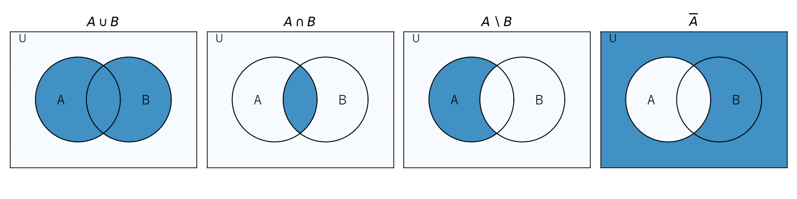

第 2 章 集合と論理
==================

確率論では「事象」を集合として扱い、「事象 :math:`A` または事象 :math:`B` が起こる」を和集合 :math:`A \cup B` で表す。また、数学の主張を正確に述べ、それを証明するには論理の言葉が欠かせない。本章では、以降のすべての章の土台となる集合と論理の基本を学ぶ。

集合
----

集合の定義と表記
~~~~~~~~~~~~~~~~

範囲がはっきりと定まったものの集まりを\ **集合**\ という。集合を構成する個々のものを\ **要素**\ または\ **元**\ といい、:math:`a` が集合 :math:`A` の要素であることを :math:`a \in A`、要素でないことを :math:`a \notin A` と書く。

集合の表し方には、要素を並べる\ **外延的記法**\ と、要素の満たす条件を書く\ **内包的記法**\ がある。

.. math::

   A = \{2, 4, 6, 8, 10\}, \qquad A = \{x \in \mathbb{N} \mid x \le 10 \text{ かつ } x \text{ は偶数}\}

要素を 1 つも持たない集合を\ **空集合**\ といい、:math:`\emptyset` で表す。有限集合 :math:`A` の要素の個数を :math:`|A|` と書く。

集合 :math:`A` のすべての要素が集合 :math:`B` の要素でもあるとき、:math:`A` は :math:`B` の\ **部分集合**\ であるといい、:math:`A \subseteq B` と書く。:math:`A \subseteq B` かつ :math:`B \subseteq A` のとき :math:`A = B` である。2 つの集合が等しいことを示すには、この 2 つの包含関係を示せばよい。

集合演算
~~~~~~~~

議論の対象となるすべての要素を含む集合を\ **全体集合**\ といい、:math:`U` で表す。全体集合の部分集合 :math:`A, B` に対して、次の演算を定める。

.. list-table:: 基本的な集合演算
   :header-rows: 1
   :widths: 20 30 50

   * - 名称
     - 記号
     - 定義
   * - 和集合
     - :math:`A \cup B`
     - :math:`\{x \mid x \in A \text{ または } x \in B\}`
   * - 共通部分
     - :math:`A \cap B`
     - :math:`\{x \mid x \in A \text{ かつ } x \in B\}`
   * - 差集合
     - :math:`A \setminus B`
     - :math:`\{x \mid x \in A \text{ かつ } x \notin B\}`
   * - 補集合
     - :math:`\overline{A}`
     - :math:`\{x \in U \mid x \notin A\}`
   * - 対称差
     - :math:`A \mathbin{\triangle} B`
     - :math:`(A \setminus B) \cup (B \setminus A)`

これらの演算を図示したものを\ **ベン図**\ という（:numref:`fig-ch02-venn`）。

.. _fig-ch02-venn:

   ベン図による集合演算の表現（色を付けた部分が演算結果）

:math:`A \cap B = \emptyset` のとき、:math:`A` と :math:`B` は\ **互いに素**\ であるという。互いに素な集合の和集合の要素数は、それぞれの要素数の和 :math:`|A \cup B| = |A| + |B|` になる。この事実は第 4 章の「和の法則」の基礎になる。

集合演算については、次の法則が成り立つ。

.. list-table:: 集合演算の主な法則
   :header-rows: 1
   :widths: 25 75

   * - 法則
     - 内容
   * - 交換法則
     - :math:`A \cup B = B \cup A`、:math:`A \cap B = B \cap A`
   * - 結合法則
     - :math:`(A \cup B) \cup C = A \cup (B \cup C)`、:math:`(A \cap B) \cap C = A \cap (B \cap C)`
   * - 分配法則
     - :math:`A \cap (B \cup C) = (A \cap B) \cup (A \cap C)`、:math:`A \cup (B \cap C) = (A \cup B) \cap (A \cup C)`
   * - ド・モルガンの法則
     - :math:`\overline{A \cup B} = \overline{A} \cap \overline{B}`、:math:`\overline{A \cap B} = \overline{A} \cup \overline{B}`

ド・モルガンの法則は、確率の計算で「少なくとも 1 つ起こる」事象の補集合が「どれも起こらない」事象になることを使う際に重要である（第 6 章の誕生日問題を参照）。

直積とべき集合
~~~~~~~~~~~~~~

集合 :math:`A, B` の要素の順序対全体の集合を\ **直積**\ といい、:math:`A \times B = \{(a, b) \mid a \in A, b \in B\}` と書く。:math:`|A \times B| = |A| \cdot |B|` である。たとえば、2 個のサイコロの目の組全体は :math:`\{1, \ldots, 6\} \times \{1, \ldots, 6\}` であり、要素数は 36 である。同じ集合の :math:`n` 個の直積を :math:`A^n` と書く。

集合 :math:`A` の部分集合全体の集合を\ **べき集合**\ といい、:math:`2^A` または :math:`\mathcal{P}(A)` で表す。:math:`|A| = n` のとき、各要素について「含める」「含めない」の 2 通りを選ぶので :math:`|2^A| = 2^n` である。

命題論理
--------

命題と論理演算
~~~~~~~~~~~~~~

真か偽かが明確に定まる文を\ :term:`命題`\ という。「6 は偶数である」は真の命題、「7 は偶数である」は偽の命題である。一方、「6 は大きい数である」は真偽が定まらないので命題ではない。

命題 :math:`p, q` から、次の論理演算で新しい命題を作れる。

.. list-table:: 主な論理演算
   :header-rows: 1
   :widths: 20 20 60

   * - 名称
     - 記号
     - 意味
   * - 否定
     - :math:`\neg p`
     - :math:`p` でない
   * - 論理積
     - :math:`p \land q`
     - :math:`p` かつ :math:`q`
   * - 論理和
     - :math:`p \lor q`
     - :math:`p` または :math:`q` （両方が真の場合も含む）
   * - 含意
     - :math:`p \to q`
     - :math:`p` ならば :math:`q`

論理演算の結果は、構成要素の真理値のすべての組合せについて結果を並べた\ **真理値表**\ で定義される。含意 :math:`p \to q` の真理値表は次のとおりである。

.. list-table:: 含意 :math:`p \to q` の真理値表
   :header-rows: 1
   :widths: 33 33 34

   * - :math:`p`
     - :math:`q`
     - :math:`p \to q`
   * - 真
     - 真
     - 真
   * - 真
     - 偽
     - 偽
   * - 偽
     - 真
     - 真
   * - 偽
     - 偽
     - 真

:math:`p` が偽のときに :math:`p \to q` が真になる点は直感に反するかもしれない。「:math:`p \to q`」は「:math:`p` が真なのに :math:`q` が偽、ということは起こらない」という主張だと考えると理解しやすい。実際、:math:`p \to q` は :math:`\neg p \lor q` と同じ真理値表を持つ。

論理的同値
~~~~~~~~~~

2 つの論理式が、構成要素のどの真理値の組に対しても同じ真理値をとるとき、両者は\ **論理的に同値**\ であるといい、:math:`\equiv` で表す。集合のド・モルガンの法則に対応して、論理にもド・モルガンの法則 :math:`\neg (p \lor q) \equiv \neg p \land \neg q`、:math:`\neg (p \land q) \equiv \neg p \lor \neg q` が成り立つ。

命題 :math:`p \to q` に対して、:math:`q \to p` を\ **逆**、:math:`\neg p \to \neg q` を\ **裏**、:math:`\neg q \to \neg p` を\ **対偶**\ という。元の命題と対偶は論理的に同値であるが、逆とは同値でない。たとえば「:math:`n` が 4 の倍数ならば :math:`n` は偶数である」は真であるが、その逆「:math:`n` が偶数ならば :math:`n` は 4 の倍数である」は偽である（:math:`n = 2` が反例）。

述語と量化子
~~~~~~~~~~~~

「:math:`x` は偶数である」のように、変数を含み、変数の値を決めると命題になる文を\ **述語**\ という。述語 :math:`P(x)` に対して、次の 2 つの\ **量化子**\ を用いて命題を作る。

* **全称量化子** :math:`\forall x \, P(x)`：すべての :math:`x` について :math:`P(x)` が成り立つ
* **存在量化子** :math:`\exists x \, P(x)`：:math:`P(x)` が成り立つ :math:`x` が少なくとも 1 つ存在する

量化子を含む命題の否定は、:math:`\neg \forall x \, P(x) \equiv \exists x \, \neg P(x)`、:math:`\neg \exists x \, P(x) \equiv \forall x \, \neg P(x)` となる。「すべての :math:`x` で成り立つ」ことを否定するには、成り立たない例（反例）を 1 つ示せばよい。

証明の技法
----------

本書で使う主な証明の技法を、例とともに紹介する。

直接証明
~~~~~~~~

仮定から出発して、定義や既知の事実を順に適用して結論を導く方法である。

**例**：「:math:`n` が奇数ならば :math:`n^2` は奇数である」。:math:`n` が奇数なので、ある整数 :math:`k` を用いて :math:`n = 2k + 1` と書ける。このとき :math:`n^2 = 4k^2 + 4k + 1 = 2(2k^2 + 2k) + 1` であり、:math:`n^2` は奇数である。

対偶による証明
~~~~~~~~~~~~~~

:math:`p \to q` を示す代わりに、同値な対偶 :math:`\neg q \to \neg p` を示す方法である。

**例**：「:math:`n^2` が偶数ならば :math:`n` は偶数である」。対偶「:math:`n` が奇数ならば :math:`n^2` は奇数である」は直接証明の例で示したとおり真であるから、元の命題も真である。

背理法
~~~~~~

結論が成り立たないと仮定して矛盾を導き、結論が正しいと結論する方法である。

**例**：「素数は無限に存在する」。素数が有限個 :math:`p_1, \ldots, p_k` しかないと仮定する。:math:`N = p_1 p_2 \cdots p_k + 1` は 2 以上の整数なので、少なくとも 1 つの素因数 :math:`p` を持つ。:math:`p` は :math:`p_1, \ldots, p_k` のいずれかであるが、:math:`N` をどの :math:`p_i` で割っても余りは 1 なので、:math:`p` は :math:`N` を割り切れない。これは矛盾であるから、素数は無限に存在する。

数学的帰納法
~~~~~~~~~~~~

自然数 :math:`n` に関する命題 :math:`P(n)` がすべての :math:`n \ge 1` で成り立つことを示すには、次の 2 つを示せばよい。

#. **基底段階**：:math:`P(1)` が成り立つ。
#. **帰納段階**：任意の :math:`k \ge 1` について、:math:`P(k)` が成り立つならば :math:`P(k + 1)` も成り立つ。

**例**：「:math:`1 + 2 + \cdots + n = \dfrac{n(n + 1)}{2}`」。:math:`n = 1` のとき両辺は 1 で等しい。:math:`n = k` で成り立つと仮定すると、

.. math::

   1 + 2 + \cdots + k + (k + 1) = \frac{k(k + 1)}{2} + (k + 1) = \frac{(k + 1)(k + 2)}{2}

となり、:math:`n = k + 1` でも成り立つ。よって、すべての :math:`n \ge 1` で成り立つ。

数学的帰納法は、第 4 章で扱う漸化式や、再帰的なアルゴリズムの正しさを示す際によく使われる。

Python で確かめる
-----------------

サンプルコード：:download:`ch02_sets_logic.py <../examples/ch02_sets_logic.py>`

Python の ``set`` 型は数学の集合に対応しており、``|``、``&``、``-``、``^`` 演算子がそれぞれ和集合・共通部分・差集合・対称差に対応する。補集合は全体集合 ``universe`` との差集合で表す。次の関数は、ド・モルガンの法則が成り立つかどうかを調べる。

.. literalinclude:: ../examples/ch02_sets_logic.py
   :language: python
   :linenos:
   :pyobject: check_de_morgan

べき集合は、:math:`n` ビットの整数と部分集合の 1 対 1 対応を利用すると簡単に列挙できる。整数 ``mask`` の :math:`i` ビット目が 1 であることを、:math:`i` 番目の要素を部分集合に含めることに対応させる。

.. literalinclude:: ../examples/ch02_sets_logic.py
   :language: python
   :linenos:
   :pyobject: power_set

論理式は「真理値を受け取り真理値を返す関数」として表せる。すべての真理値の組について 2 つの関数の値が一致すれば、論理的に同値である。

.. literalinclude:: ../examples/ch02_sets_logic.py
   :language: python
   :linenos:
   :pyobject: is_equivalent

全体集合を :math:`U = \{1, \ldots, 10\}`、:math:`A` を偶数の集合、:math:`B` を 3 の倍数の集合として実行した結果は次のとおりである。

.. code-block:: text

   --- 集合演算 ---
   A       = [2, 4, 6, 8, 10]
   B       = [3, 6, 9]
   A | B   = [2, 3, 4, 6, 8, 9, 10]
   A & B   = [6]
   A - B   = [2, 4, 8, 10]
   U - A   = [1, 3, 5, 7, 9]
   A ^ B   = [2, 3, 4, 8, 9, 10]
   ド・モルガンの法則: True
   --- べき集合 ---
   [[], [1], [2], [1, 2], [3], [1, 3], [2, 3], [1, 2, 3]]
   要素数: 8
   --- 含意の真理値表 ---
   p     q     p -> q
   True  True  True
   True  False False
   False True  True
   False False True
   --- 同値性の判定 ---
   p -> q と 対偶 (not q) -> (not p): True
   p -> q と 逆 q -> p: False

べき集合の要素数が :math:`2^3 = 8` であること、含意とその対偶は同値だが逆とは同値でないことが確かめられる。

まとめ
------

* 集合は要素の集まりであり、和集合・共通部分・差集合・補集合などの演算を持つ。
* ド・モルガンの法則により、和集合の補集合は補集合の共通部分になる。
* 直積 :math:`A \times B` の要素数は :math:`|A| \cdot |B|`、べき集合 :math:`2^A` の要素数は :math:`2^{|A|}` である。
* 含意 :math:`p \to q` はその対偶 :math:`\neg q \to \neg p` と同値であるが、逆 :math:`q \to p` とは同値でない。
* 証明の技法として、直接証明・対偶による証明・背理法・数学的帰納法がある。

集合と論理、証明の技法については [Rosen2019]_ に詳しい。
