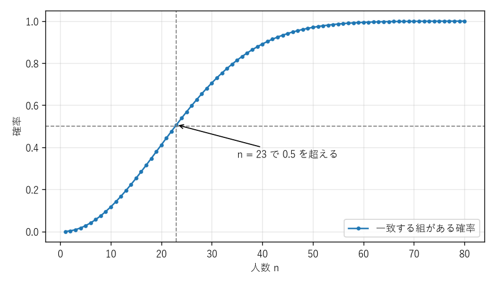

第 6 章 確率の基礎
==================

本章から第 II 部に入り、確率を扱う。確率は「起こりやすさ」を 0 以上 1 以下の数で表したものであるが、直感だけに頼ると誤った結論を導きやすい。本章では、第 2 章の集合と第 4 章の数え上げを使って確率を正確に定義し、条件付き確率・独立性・ベイズの定理を学ぶ。

標本空間と事象
--------------

結果が偶然に左右される実験や観測を\ **試行**\ という。試行の結果として起こりうるもの全体の集合を\ :term:`標本空間`\ といい、:math:`\Omega` で表す。:math:`\Omega` の要素 :math:`\omega` を\ :term:`根元事象`、:math:`\Omega` の部分集合を\ :term:`事象`\ という。

**例**：サイコロを 1 回投げる試行では :math:`\Omega = \{1, 2, 3, 4, 5, 6\}` であり、「偶数の目が出る」という事象は :math:`A = \{2, 4, 6\}` である。サイコロを 2 回投げる試行では :math:`\Omega = \{1, \ldots, 6\}^2` であり、:math:`|\Omega| = 36` である。

事象は集合なので、第 2 章の集合演算がそのまま使える。

.. list-table:: 事象の用語と集合演算の対応
   :header-rows: 1
   :widths: 25 25 50

   * - 用語
     - 記号
     - 意味
   * - 全事象
     - :math:`\Omega`
     - 必ず起こる事象
   * - 空事象
     - :math:`\emptyset`
     - 決して起こらない事象
   * - 和事象
     - :math:`A \cup B`
     - :math:`A` または :math:`B` が起こる
   * - 積事象
     - :math:`A \cap B`
     - :math:`A` と :math:`B` がともに起こる
   * - 余事象
     - :math:`\overline{A}`
     - :math:`A` が起こらない
   * - 排反
     - :math:`A \cap B = \emptyset`
     - :math:`A` と :math:`B` は同時には起こらない

確率の定義
----------

確率の公理
~~~~~~~~~~

本書では、標本空間 :math:`\Omega` が有限集合または可算集合（自然数と 1 対 1 に対応する無限集合）の場合を扱う。このとき、各根元事象 :math:`\omega` に

.. math::

   p(\omega) \ge 0, \qquad \sum_{\omega \in \Omega} p(\omega) = 1

を満たす数 :math:`p(\omega)` を割り当て、事象 :math:`A` の\ **確率**\ を

.. math::

   P(A) = \sum_{\omega \in A} p(\omega)

と定める。組 :math:`(\Omega, P)` を\ **離散確率空間**\ という。このように定めた :math:`P` は、次の 3 つの性質（コルモゴロフの公理）を満たす。

#. 任意の事象 :math:`A` について :math:`P(A) \ge 0`
#. :math:`P(\Omega) = 1`
#. 互いに排反な事象 :math:`A_1, A_2, \ldots` について :math:`P\left(\bigcup_{i} A_i\right) = \sum_{i} P(A_i)`

一般の確率論では、この 3 つの性質を公理として出発する。標本空間が実数の区間のような非可算集合の場合は、どの部分集合を事象と見なすかという技術的な問題が生じるが、本書の範囲では考えなくてよい。

公理から導かれる性質
~~~~~~~~~~~~~~~~~~~~

公理から、次の性質が導かれる。

* **余事象の確率**：:math:`P(\overline{A}) = 1 - P(A)`。特に :math:`P(\emptyset) = 0` である。
* **単調性**：:math:`A \subseteq B` ならば :math:`P(A) \le P(B)`。
* **加法定理**：:math:`P(A \cup B) = P(A) + P(B) - P(A \cap B)`。これは包除原理の確率版である。
* **和集合の上界**：:math:`P\left(\bigcup_{i=1}^{n} A_i\right) \le \sum_{i=1}^{n} P(A_i)`。

最後の不等式は\ **ユニオンバウンド**\ とも呼ばれ、「いずれかの悪い事象が起こる確率」を簡単に上から評価する際によく使われる。

古典的確率
~~~~~~~~~~

:math:`\Omega` が有限集合で、すべての根元事象が等しい確率 :math:`p(\omega) = 1/|\Omega|` を持つとき、根元事象は\ **同様に確からしい**\ という。このとき

.. math::

   P(A) = \frac{|A|}{|\Omega|}

となり、確率の計算は数え上げに帰着する。

**例**：2 個のサイコロを投げて、目の和が 7 になる確率を求める。和が 7 になる目の組は :math:`(1, 6), (2, 5), (3, 4), (4, 3), (5, 2), (6, 1)` の 6 通りなので、確率は :math:`6/36 = 1/6` である。

ここで、2 個のサイコロを区別しない標本空間（和が 7 になるのは :math:`\{1, 6\}, \{2, 5\}, \{3, 4\}` の 3 通り、全体は 21 通り）を考えて :math:`3/21` とするのは誤りである。:math:`\{1, 6\}` は 2 通りの出方 :math:`(1, 6), (6, 1)` に対応するが、:math:`\{3, 3\}` は 1 通りの出方にしか対応しないので、区別しない標本空間の根元事象は同様に確からしくない。古典的確率を使う際は、標本空間の根元事象が本当に同様に確からしいかを確認する必要がある。

条件付き確率
------------

定義と乗法定理
~~~~~~~~~~~~~~

事象 :math:`B` が起こったという情報のもとで事象 :math:`A` が起こる確率を、:math:`B` のもとでの :math:`A` の\ :term:`条件付き確率`\ といい、:math:`P(B) > 0` のとき次で定める。

.. math::

   P(A \mid B) = \frac{P(A \cap B)}{P(B)}

これは、標本空間を :math:`B` に制限し、確率を :math:`P(B)` で割って合計が 1 になるように正規化したものと解釈できる。

**例**：2 個のサイコロを投げて、1 個目の目が 3 であることが分かったとき、目の和が 8 である条件付き確率は、:math:`P(\text{和が } 8 \text{ かつ 1 個目が } 3) = 1/36`、:math:`P(\text{1 個目が } 3) = 6/36` より :math:`1/6` である。条件がない場合の :math:`P(\text{和が } 8) = 5/36` とは異なる値になる。

定義を変形すると、次の\ **乗法定理**\ が得られる。

.. math::

   P(A \cap B) = P(B) \, P(A \mid B) = P(A) \, P(B \mid A)

事象の独立
~~~~~~~~~~

:math:`P(A \cap B) = P(A) \, P(B)` が成り立つとき、事象 :math:`A` と :math:`B` は\ :term:`独立`\ であるという。:math:`P(B) > 0` のとき、これは :math:`P(A \mid B) = P(A)`、すなわち「:math:`B` が起こったという情報が :math:`A` の起こりやすさを変えない」ことと同じである。

**例**：2 個のサイコロを投げるとき、「1 個目が偶数」と「2 個目が 3 以上」は独立である。一方、前項の例のとおり、「1 個目が 3」と「和が 8」は独立でない。

3 つ以上の事象 :math:`A_1, \ldots, A_n` が独立であるとは、その中から選んだ任意の 2 個以上の事象 :math:`A_{i_1}, \ldots, A_{i_k}` について :math:`P(A_{i_1} \cap \cdots \cap A_{i_k}) = P(A_{i_1}) \cdots P(A_{i_k})` が成り立つことをいう。どの 2 つも独立であっても、全体として独立であるとは限らない。たとえば硬貨を 2 回投げて、:math:`A` を「1 回目が表」、:math:`B` を「2 回目が表」、:math:`C` を「2 回の結果が一致」とすると、どの 2 つも独立であるが、:math:`P(A \cap B \cap C) = 1/4 \ne 1/8 = P(A) P(B) P(C)` となる。

なお、「排反」と「独立」は異なる概念である。:math:`P(A) > 0`、:math:`P(B) > 0` で :math:`A` と :math:`B` が排反ならば、:math:`P(A \cap B) = 0 \ne P(A) P(B)` なので独立ではない。一方が起これば他方は起こらないと分かるので、むしろ強く依存している。

全確率の公式とベイズの定理
--------------------------

全確率の公式
~~~~~~~~~~~~

事象 :math:`B_1, \ldots, B_n` が互いに排反で、:math:`B_1 \cup \cdots \cup B_n = \Omega` を満たすとき（このような事象の組を :math:`\Omega` の\ **分割**\ という）、任意の事象 :math:`A` について次の\ **全確率の公式**\ が成り立つ。

.. math::

   P(A) = \sum_{i=1}^{n} P(A \cap B_i) = \sum_{i=1}^{n} P(B_i) \, P(A \mid B_i)

場合分けをして、それぞれの場合の確率を足し合わせる計算を式にしたものである。

ベイズの定理
~~~~~~~~~~~~

乗法定理 :math:`P(B_i) P(A \mid B_i) = P(A) P(B_i \mid A)` と全確率の公式から、次の\ **ベイズの定理**\ が得られる。

.. math::

   P(B_i \mid A) = \frac{P(B_i) \, P(A \mid B_i)}{\sum_{j=1}^{n} P(B_j) \, P(A \mid B_j)}

:math:`P(B_i)` を\ **事前確率**、:math:`P(B_i \mid A)` を\ **事後確率**\ という。ベイズの定理は、「原因 :math:`B_i` のもとで結果 :math:`A` が起こる確率」から、「結果 :math:`A` を観測したときの原因 :math:`B_i` の確率」を求める式である。

**例（検査の陽性的中率）**：ある病気の有病率が 1% であるとする。この病気の検査は、罹患者の 99% を陽性と判定し（感度 99%）、罹患していない人の 95% を陰性と判定する（特異度 95%）。検査で陽性と判定された人が実際に罹患している確率を求める。

:math:`D` を「罹患している」、:math:`+` を「陽性と判定される」とする。:numref:`fig-ch06-tree` の確率の木から、

.. math::

   P(D \mid +) = \frac{P(D) P(+ \mid D)}{P(D) P(+ \mid D) + P(\overline{D}) P(+ \mid \overline{D})} = \frac{0.01 \times 0.99}{0.01 \times 0.99 + 0.99 \times 0.05} = \frac{0.0099}{0.0594} = \frac{1}{6} \approx 0.167

である。精度の高そうな検査で陽性と判定されても、実際に罹患している確率は約 17% にすぎない。罹患していない人が圧倒的に多いため、その 5% にあたる偽陽性の人数が、罹患者の真陽性の人数を大きく上回るからである。この例のように事前確率を無視して判断する誤りを\ **基準率の誤謬**\ という。

.. _fig-ch06-tree:

.. graphviz::
   :caption: 検査の例の確率の木（右端の数値はその経路の確率）
   :align: center

   digraph tree {
       rankdir=LR;
       node [shape=box, style=rounded, fontsize=11];
       edge [fontsize=10];
       root [label="全体", shape=circle];
       D [label="罹患 D"];
       ND [label="非罹患"];
       DP [label="陽性: 0.0099"];
       DN [label="陰性: 0.0001"];
       NP [label="陽性: 0.0495"];
       NN [label="陰性: 0.9405"];
       root -> D [label="0.01"];
       root -> ND [label="0.99"];
       D -> DP [label="0.99"];
       D -> DN [label="0.01"];
       ND -> NP [label="0.05"];
       ND -> NN [label="0.95"];
   }

典型的な問題
------------

誕生日問題
~~~~~~~~~~

:math:`n` 人の中に誕生日が同じ人の組が少なくとも 1 組ある確率を求める。1 年を 365 日とし、各人の誕生日は独立に 365 日のいずれかに等しい確率で決まると仮定する。

「少なくとも 1 組一致する」事象の余事象は「全員の誕生日が異なる」事象である。全員の誕生日が異なる確率は、2 人目が 1 人目と異なる確率 :math:`364/365`、3 人目が前の 2 人と異なる確率 :math:`363/365`、……を掛け合わせて求められる。

.. math::

   P(\text{少なくとも 1 組一致}) = 1 - \prod_{i=0}^{n-1} \frac{365 - i}{365}

この確率は :math:`n = 23` で 0.5 を超え、:math:`n = 50` では約 0.97 になる（:numref:`fig-ch06-birthday`）。365 に比べてかなり少ない人数で一致が起こりやすくなるのは、一致を調べる「組」の数が :math:`\binom{n}{2}` であり、人数の 2 乗に比例して増えるからである。:math:`n = 23` のとき組の数は 253 である。この問題は、第 12 章でハッシュ値の衝突確率として再び扱う。

.. _fig-ch06-birthday:

   人数 :math:`n` と誕生日が一致する組がある確率

モンティ・ホール問題
~~~~~~~~~~~~~~~~~~~~

3 つの扉のうち 1 つの後ろに車（当たり）があり、残り 2 つは外れである。挑戦者が扉を 1 つ選ぶと、正解を知っている司会者が、残りの 2 つの扉のうち外れの扉を 1 つ開けて見せる（外れが 2 つあれば等しい確率でどちらかを開ける）。その後、挑戦者は最初の選択を残りの扉に変更してもよい。変更すべきだろうか。

「残りの扉は 2 つなので、どちらも当たりの確率は 1/2」と考えがちであるが、これは誤りである。最初に選んだ扉が当たりである確率は 1/3 であり、司会者が外れの扉を開けても、この確率は変わらない（司会者は挑戦者の扉が当たりかどうかにかかわらず、必ず外れの扉を開けられるからである）。したがって、選択を変えた場合に当たる確率は :math:`1 - 1/3 = 2/3` である。

ベイズの定理で確かめる。挑戦者が扉 1 を選び、司会者が扉 3 を開けたとする。:math:`C_i` を「車が扉 :math:`i` にある」、:math:`H_3` を「司会者が扉 3 を開ける」とすると、:math:`P(H_3 \mid C_1) = 1/2`、:math:`P(H_3 \mid C_2) = 1`、:math:`P(H_3 \mid C_3) = 0` なので

.. math::

   P(C_2 \mid H_3) = \frac{\frac{1}{3} \times 1}{\frac{1}{3} \times \frac{1}{2} + \frac{1}{3} \times 1 + \frac{1}{3} \times 0} = \frac{2}{3}

となる。司会者の行動が「正解を知った上で外れを開ける」というルールに従うため、開けられた扉の位置が情報を持つのである。

Python で確かめる
-----------------

サンプルコード：:download:`ch06_probability.py <../examples/ch06_probability.py>`

標本空間が小さければ、すべての根元事象を列挙して数えることで厳密な確率を求められる。``fractions.Fraction`` を使うと、確率を誤差のない分数で表せる。

.. literalinclude:: ../examples/ch06_probability.py
   :language: python
   :linenos:
   :pyobject: two_dice_probabilities

標本空間が大きい場合や、確率を式で表すのが難しい場合は、試行を乱数で何度も再現して、事象が起こった割合で確率を推定する。このような方法を\ **モンテカルロ・シミュレーション**\ という。``random.Random`` に種（シード）を与えると、毎回同じ乱数列が得られるので、結果を再現できる。

.. literalinclude:: ../examples/ch06_probability.py
   :language: python
   :linenos:
   :pyobject: monty_hall

実行結果は次のとおりである。

.. code-block:: text

   --- 2 個のサイコロ ---
   |Ω| = 36
   P(和が 7) = 1/6
   P(和が 8) = 5/36
   P(和が 8 | 1 個目が 3) = 1/6
   --- 誕生日問題 ---
   n=10: 厳密値=0.1169  シミュレーション=0.1167
   n=23: 厳密値=0.5073  シミュレーション=0.5087
   n=30: 厳密値=0.7063  シミュレーション=0.7108
   n=50: 厳密値=0.9704  シミュレーション=0.9731
   --- モンティ・ホール問題 ---
   選択を変えない: 0.3349
   選択を変える  : 0.6680
   --- ベイズの定理 ---
   P(罹患 | 陽性) = 0.1667

シミュレーションの結果は厳密値に近いが、一致はしない。シミュレーションによる推定には必ず誤差があり、試行回数を増やすほど誤差は小さくなる。誤差の大きさと試行回数の関係は、第 10 章の大数の法則と中心極限定理で扱う。

まとめ
------

* 事象は標本空間の部分集合であり、確率は根元事象の確率の和として定まる。
* 根元事象が同様に確からしいとき、確率は数え上げで求められる。ただし、標本空間の取り方に注意が必要である。
* 条件付き確率 :math:`P(A \mid B) = P(A \cap B) / P(B)` は、情報 :math:`B` を得た後の確率である。
* 事象が独立であるとは :math:`P(A \cap B) = P(A) P(B)` が成り立つことであり、排反とは異なる概念である。
* 全確率の公式とベイズの定理を使うと、観測結果から原因の確率を逆算できる。その際、事前確率を無視してはならない。

確率の基礎については [Ross2019]_ や [Feller1968]_ に、豊富な例題とともに詳しい説明がある。
