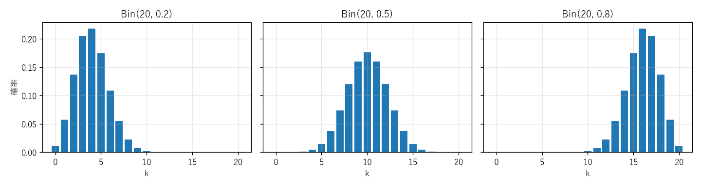
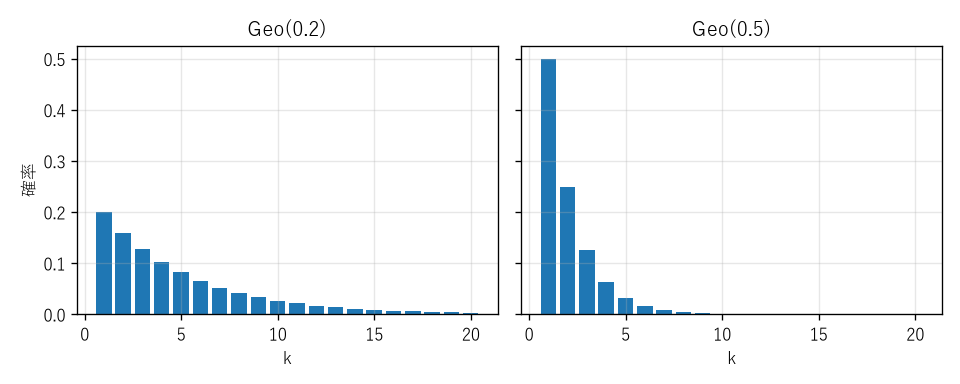
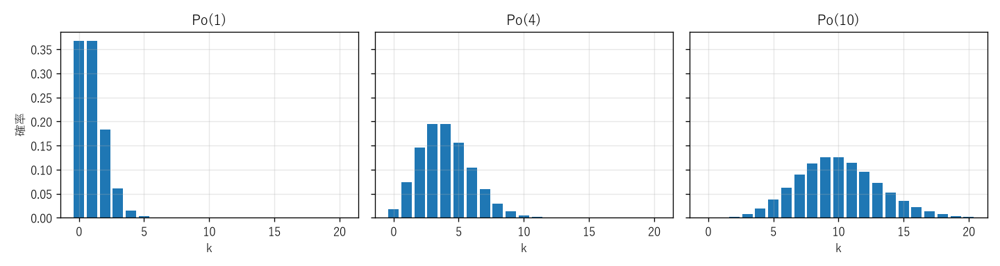
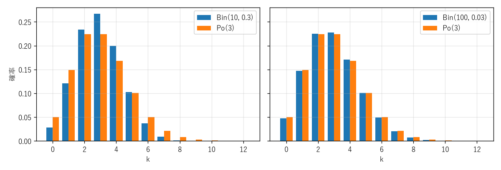

第 8 章 代表的な離散分布
========================

確率変数の分布は試行ごとに異なるが、実際の問題に現れる分布の多くは、いくつかの典型的な分布のどれかに当てはまる。たとえば「:math:`n` 回の独立な試行での成功回数」は二項分布に、「初めて成功するまでの試行回数」は幾何分布に従う。本章では代表的な離散分布を紹介し、それぞれの確率質量関数・期待値・分散と、どのような場面で現れるかを学ぶ。

以下では、確率変数 :math:`X` が分布 :math:`D` に従うことを :math:`X \sim D` と書く。また、:math:`0 < p < 1` とし、:math:`q = 1 - p` とおく。

離散一様分布
------------

:math:`X` が :math:`1, 2, \ldots, n` の値を等しい確率でとるとき、:math:`X` は\ **離散一様分布**\ に従うという。

.. math::

   P(X = k) = \frac{1}{n} \quad (k = 1, \ldots, n), \qquad E[X] = \frac{n + 1}{2}, \qquad V[X] = \frac{n^2 - 1}{12}

サイコロ 1 個の目は :math:`n = 6` の離散一様分布に従い、:math:`V[X] = 35/12` は第 7 章で求めた値と一致する。

ベルヌーイ分布
--------------

成功か失敗かの 2 通りの結果しかない試行を\ **ベルヌーイ試行**\ という。成功の確率が :math:`p` のベルヌーイ試行で、成功なら 1、失敗なら 0 をとる確率変数 :math:`X` は\ **ベルヌーイ分布** :math:`\mathrm{Ber}(p)` に従う。

.. math::

   P(X = 1) = p, \quad P(X = 0) = q, \qquad E[X] = p, \qquad V[X] = p - p^2 = pq

ベルヌーイ分布に従う確率変数は、成功という事象の指示確率変数にほかならない。

二項分布
--------

定義
~~~~

成功の確率が :math:`p` のベルヌーイ試行を独立に :math:`n` 回繰り返したときの成功回数 :math:`X` は、**二項分布** :math:`\mathrm{Bin}(n, p)` に従う。

.. math::

   P(X = k) = \binom{n}{k} p^k q^{n-k} \quad (k = 0, 1, \ldots, n)

:math:`n` 回のうちどの :math:`k` 回で成功するかの選び方が :math:`\binom{n}{k}` 通りあり、そのそれぞれの起こる確率が独立性により :math:`p^k q^{n-k}` であることから、この式が得られる。二項定理により :math:`\sum_{k=0}^{n} \binom{n}{k} p^k q^{n-k} = (p + q)^n = 1` となり、確率の総和は確かに 1 である。

期待値と分散
~~~~~~~~~~~~

:math:`i` 回目の試行の成功の指示確率変数を :math:`X_i \sim \mathrm{Ber}(p)` とすると、:math:`X = X_1 + \cdots + X_n` である。期待値の線形性により

.. math::

   E[X] = np

である。また、:math:`X_1, \ldots, X_n` は独立なので、第 9 章で示す「独立な確率変数の和の分散は分散の和」という性質により

.. math::

   V[X] = npq

である。:numref:`fig-ch08-binomial` に :math:`n = 20` の二項分布を示す。:math:`p = 0.5` のとき分布は :math:`np = 10` を中心に左右対称になり、:math:`p` が 0.5 から離れると分布は偏る。

.. _fig-ch08-binomial:

   二項分布 :math:`\mathrm{Bin}(20, p)` の確率質量関数

**例**：不良品率 2% の製品を 100 個検査したとき、不良品が 3 個以下である確率は :math:`\sum_{k=0}^{3} \binom{100}{k} 0.02^k \, 0.98^{100-k} \approx 0.859` である。

幾何分布
--------

定義と期待値
~~~~~~~~~~~~

成功の確率が :math:`p` のベルヌーイ試行を独立に繰り返したとき、初めて成功するまでの試行回数（成功した回を含む） :math:`X` は、**幾何分布** :math:`\mathrm{Geo}(p)` に従う。:math:`X = k` となるのは、最初の :math:`k - 1` 回が失敗で :math:`k` 回目に成功する場合なので

.. math::

   P(X = k) = q^{k-1} p \quad (k = 1, 2, \ldots)

である。確率は公比 :math:`q` の等比数列になっている（名前の由来である）。

期待値は次のように求められる。:math:`X > k` は「最初の :math:`k` 回がすべて失敗」と同じなので :math:`P(X > k) = q^k` である。正の整数値をとる確率変数について成り立つ公式 :math:`E[X] = \sum_{k=0}^{\infty} P(X > k)` を使うと

.. math::

   E[X] = \sum_{k=0}^{\infty} q^k = \frac{1}{1 - q} = \frac{1}{p}

となる。公式 :math:`E[X] = \sum_{k \ge 0} P(X > k)` は、:math:`X = \sum_{k \ge 0} I_{\{X > k\}}` （:math:`X = m` のとき右辺は :math:`k = 0, \ldots, m - 1` の :math:`m` 個の項が 1 になる）に期待値の線形性を適用すれば得られる。分散は :math:`V[X] = q/p^2` である。

**例**：サイコロを投げて 6 が出るまでの回数の期待値は :math:`1/(1/6) = 6` 回である。成功確率 1% のガチャを当たるまで引く回数の期待値は 100 回であるが、:math:`P(X > 100) = 0.99^{100} \approx 0.366` なので、100 回引いても当たらない確率は 3 分の 1 以上ある。

無記憶性
~~~~~~~~

幾何分布は、次の\ **無記憶性**\ を持つ。

.. math::

   P(X > m + n \mid X > m) = \frac{q^{m+n}}{q^m} = q^n = P(X > n)

すでに :math:`m` 回失敗しているという情報は、その後に必要な試行回数の分布に影響しない。「これだけ外れが続いたのだから、そろそろ当たるはずだ」という考えは、独立な試行については誤りである（**ギャンブラーの誤謬**\ と呼ばれる）。正の整数値をとる分布のうち、無記憶性を持つのは幾何分布だけであることが知られている。

.. _fig-ch08-geometric:

   幾何分布 :math:`\mathrm{Geo}(p)` の確率質量関数

.. note::

   幾何分布には、「初めて成功するまでの\ **失敗**\ の回数」 :math:`Y = X - 1` （値は :math:`0, 1, 2, \ldots`）で定義する流儀もある。このとき :math:`E[Y] = q/p` となる。文献やライブラリを使う際は、どちらの定義かを確認する必要がある。SciPy の ``scipy.stats.geom`` は本書と同じく試行回数で定義している。

負の二項分布
------------

成功の確率が :math:`p` のベルヌーイ試行を独立に繰り返したとき、:math:`r` 回目の成功までの試行回数 :math:`X` は、**負の二項分布** :math:`\mathrm{NB}(r, p)` に従う。:math:`X = k` となるのは、最初の :math:`k - 1` 回でちょうど :math:`r - 1` 回成功し、:math:`k` 回目に成功する場合なので

.. math::

   P(X = k) = \binom{k - 1}{r - 1} p^r q^{k - r} \quad (k = r, r + 1, \ldots)

である。:math:`X` は、1 回目の成功までの回数、1 回目から 2 回目の成功までの回数、……という独立な :math:`r` 個の :math:`\mathrm{Geo}(p)` の和で表せるので

.. math::

   E[X] = \frac{r}{p}, \qquad V[X] = \frac{rq}{p^2}

である。:math:`r = 1` のとき幾何分布に一致する。SciPy の ``scipy.stats.nbinom`` は「:math:`r` 回目の成功までの失敗の回数」 :math:`X - r` の分布として定義されている。

超幾何分布
----------

当たり :math:`K` 個を含む :math:`N` 個のくじから、:math:`n` 個を\ **非復元抽出**\ （取り出したものを戻さずに次を取り出す）するとき、取り出した中の当たりの個数 :math:`X` は\ **超幾何分布**\ に従う。

.. math::

   P(X = k) = \frac{\binom{K}{k} \binom{N - K}{n - k}}{\binom{N}{n}}

:math:`N` 個から :math:`n` 個を選ぶ :math:`\binom{N}{n}` 通りが同様に確からしく、そのうち当たり :math:`K` 個から :math:`k` 個、外れ :math:`N - K` 個から :math:`n - k` 個を選ぶ方法が :math:`\binom{K}{k} \binom{N - K}{n - k}` 通りあることから得られる。

:math:`p = K/N` とおくと、期待値と分散は次のとおりである。

.. math::

   E[X] = np, \qquad V[X] = np(1 - p) \cdot \frac{N - n}{N - 1}

期待値は、取り出したものを戻す\ **復元抽出**\ の場合（二項分布 :math:`\mathrm{Bin}(n, p)`）と同じである。:math:`i` 番目に取り出したものが当たりである確率は、非復元抽出でも :math:`K/N` だからである。一方、分散は係数 :math:`(N - n)/(N - 1)` だけ小さくなる。:math:`N` が :math:`n` に比べて十分大きければ、この係数は 1 に近く、超幾何分布は二項分布で近似できる。品質検査の抜き取り検査や、トランプの手札の確率の計算に現れる。

ポアソン分布
------------

定義
~~~~

:math:`\lambda > 0` に対して、次の確率質量関数を持つ分布を\ **ポアソン分布** :math:`\mathrm{Po}(\lambda)` という。

.. math::

   P(X = k) = e^{-\lambda} \frac{\lambda^k}{k!} \quad (k = 0, 1, 2, \ldots)

:math:`e^{\lambda} = \sum_{k=0}^{\infty} \lambda^k / k!` より確率の総和は 1 である。期待値と分散はともに :math:`\lambda` に等しい。

.. math::

   E[X] = V[X] = \lambda

ポアソン分布は、「一定時間内に Web サーバーに届くリクエストの数」「1 ページあたりの誤植の数」のように、多数の機会のそれぞれで低い確率で起こる事象の回数のモデルとして使われる（:numref:`fig-ch08-poisson`）。

.. _fig-ch08-poisson:

   ポアソン分布 :math:`\mathrm{Po}(\lambda)` の確率質量関数

二項分布のポアソン近似
~~~~~~~~~~~~~~~~~~~~~~

ポアソン分布が「稀な事象の回数」のモデルになる理由は、次の極限定理にある。:math:`\lambda = np` を一定に保ったまま :math:`n \to \infty` とすると、各 :math:`k` について

.. math::

   \binom{n}{k} p^k (1 - p)^{n-k} = \frac{n (n - 1) \cdots (n - k + 1)}{n^k} \cdot \frac{\lambda^k}{k!} \cdot \left(1 - \frac{\lambda}{n}\right)^{n} \left(1 - \frac{\lambda}{n}\right)^{-k} \to 1 \cdot \frac{\lambda^k}{k!} \cdot e^{-\lambda} \cdot 1

となる。ここで :math:`(1 - \lambda/n)^n \to e^{-\lambda}` を用いた。つまり、試行回数 :math:`n` が大きく成功確率 :math:`p` が小さいとき、:math:`\mathrm{Bin}(n, p)` は :math:`\mathrm{Po}(np)` で近似できる（:numref:`fig-ch08-poisson-approx`）。近似の誤差を全変動距離 :math:`\frac{1}{2} \sum_k |P(X = k) - P(Y = k)|` で測ると、:math:`np^2` 以下であることが知られている（ル・カムの不等式）。

.. _fig-ch08-poisson-approx:

   二項分布とポアソン分布 :math:`\mathrm{Po}(3)` の比較（左：:math:`n = 10`、右：:math:`n = 100`）

分布のまとめ
------------

.. list-table:: 代表的な離散分布
   :header-rows: 1
   :widths: 22 33 25 10 10

   * - 分布
     - 確率質量関数
     - 値の範囲
     - 期待値
     - 分散
   * - 一様分布
     - :math:`1/n`
     - :math:`1, \ldots, n`
     - :math:`\frac{n+1}{2}`
     - :math:`\frac{n^2 - 1}{12}`
   * - :math:`\mathrm{Ber}(p)`
     - :math:`p^k q^{1-k}`
     - :math:`0, 1`
     - :math:`p`
     - :math:`pq`
   * - :math:`\mathrm{Bin}(n, p)`
     - :math:`\binom{n}{k} p^k q^{n-k}`
     - :math:`0, \ldots, n`
     - :math:`np`
     - :math:`npq`
   * - :math:`\mathrm{Geo}(p)`
     - :math:`q^{k-1} p`
     - :math:`1, 2, \ldots`
     - :math:`\frac{1}{p}`
     - :math:`\frac{q}{p^2}`
   * - :math:`\mathrm{NB}(r, p)`
     - :math:`\binom{k-1}{r-1} p^r q^{k-r}`
     - :math:`r, r + 1, \ldots`
     - :math:`\frac{r}{p}`
     - :math:`\frac{rq}{p^2}`
   * - 超幾何分布
     - :math:`\binom{K}{k} \binom{N-K}{n-k} / \binom{N}{n}`
     - :math:`\max(0, n - N + K), \ldots, \min(n, K)`
     - :math:`\frac{nK}{N}`
     - 本文参照
   * - :math:`\mathrm{Po}(\lambda)`
     - :math:`e^{-\lambda} \lambda^k / k!`
     - :math:`0, 1, 2, \ldots`
     - :math:`\lambda`
     - :math:`\lambda`

Python で確かめる
-----------------

サンプルコード：:download:`ch08_distributions.py <../examples/ch08_distributions.py>`

SciPy の ``scipy.stats`` モジュールには、主要な確率分布が実装されている。離散分布では、``pmf`` （確率質量関数）、``cdf`` （累積分布関数）、``sf`` （:math:`1 - F(x)`、すなわち :math:`P(X > x)`）、``mean``、``var``、``rvs`` （乱数の生成）などのメソッドが使える。

.. list-table:: scipy.stats の離散分布と本書の記号の対応
   :header-rows: 1
   :widths: 40 60

   * - scipy.stats
     - 本書の記号
   * - ``binom.pmf(k, n, p)``
     - :math:`\mathrm{Bin}(n, p)` の :math:`P(X = k)`
   * - ``geom.pmf(k, p)``
     - :math:`\mathrm{Geo}(p)` の :math:`P(X = k)`
   * - ``nbinom.pmf(k - r, r, p)``
     - :math:`\mathrm{NB}(r, p)` の :math:`P(X = k)`
   * - ``hypergeom.pmf(k, N, K, n)``
     - 超幾何分布の :math:`P(X = k)`
   * - ``poisson.pmf(k, lam)``
     - :math:`\mathrm{Po}(\lambda)` の :math:`P(X = k)`

サンプルコードでは、各分布の確率質量関数を定義どおりに実装し、``scipy.stats`` の値と照合する。

.. literalinclude:: ../examples/ch08_distributions.py
   :language: python
   :linenos:
   :lines: 11-41

ポアソン分布の確率質量関数は、:math:`k` が大きいと :math:`\lambda^k` や :math:`k!` が浮動小数点数で表せる範囲を超えてしまう。そこで、対数をとって :math:`\log P(X = k) = k \log \lambda - \lambda - \log k!` を計算してから指数関数に戻している。``math.lgamma(k + 1)`` は :math:`\log k!` を返す。

ポアソン近似の精度は、:math:`np = 3` を保ったまま :math:`n` を大きくしたときの全変動距離で調べる。

.. literalinclude:: ../examples/ch08_distributions.py
   :language: python
   :linenos:
   :pyobject: poisson_approximation

実行結果は次のとおりである。

.. code-block:: text

   --- scipy.stats との照合 ---
   二項分布     最大誤差 = 2.50e-16
   幾何分布     最大誤差 = 0.00e+00
   負の二項分布   最大誤差 = 1.11e-16
   超幾何分布    最大誤差 = 5.55e-17
   ポアソン分布   最大誤差 = 1.67e-16
   --- 期待値と分散 ---
   Bin(20, 0.3)  E: scipy=6.0000 理論=6.0000  V: scipy=4.2000 理論=4.2000
   Geo(0.3)      E: scipy=3.3333 理論=3.3333  V: scipy=7.7778 理論=7.7778
   Po(4)         E: scipy=4.0000 理論=4.0000  V: scipy=4.0000 理論=4.0000
   NB(3, 0.3)    E: scipy=10.0000 理論=10.0000  V: scipy=23.3333 理論=23.3333
   --- 幾何分布の無記憶性 ---
   P(X > 6 | X > 4) = 0.490000, P(X > 2) = 0.490000
   --- ポアソン近似 ---
   n=  10, p=0.3000: 全変動距離 = 0.08641
   n=  30, p=0.1000: 全変動距離 = 0.02618
   n= 100, p=0.0300: 全変動距離 = 0.00761
   n=1000, p=0.0030: 全変動距離 = 0.00075

自作の確率質量関数と SciPy の値の差は浮動小数点数の丸め誤差の程度（:math:`10^{-16}` 程度）であり、両者は一致している。全変動距離は :math:`n` にほぼ反比例して小さくなり、いずれも上界 :math:`np^2 = 9/n` を下回っている。

まとめ
------

* ベルヌーイ試行の成功回数は二項分布、初めて成功するまでの回数は幾何分布、:math:`r` 回目の成功までの回数は負の二項分布に従う。
* 非復元抽出での当たりの個数は超幾何分布に従い、母集団が大きければ二項分布で近似できる。
* 稀な事象の回数はポアソン分布でモデル化される。:math:`n` が大きく :math:`p` が小さいとき、:math:`\mathrm{Bin}(n, p)` は :math:`\mathrm{Po}(np)` で近似できる。
* 幾何分布は無記憶性を持つ。独立な試行では、過去の失敗は将来の成功しやすさに影響しない。
* 分布の定義には流儀の違いがあるので、ライブラリを使う際はパラメータの意味を確認する。

代表的な離散分布の性質については [Ross2019]_ や [Feller1968]_ に詳しい。
