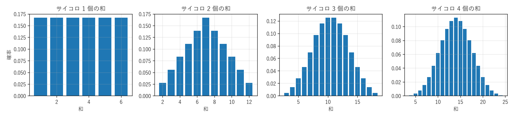

第 9 章 同時分布と確率変数の和
==============================

第 7 章では 1 つの確率変数を扱った。しかし実際には、身長と体重、サーバーの負荷と応答時間のように、複数の確率変数の関係が問題になることが多い。本章では、複数の確率変数をまとめて扱う同時分布と、確率変数の間の関係の強さを表す共分散・相関係数を学ぶ。また、独立な確率変数の和の分布を求める方法として畳み込みを扱う。

同時分布と周辺分布
------------------

同時分布
~~~~~~~~

同じ確率空間上の 2 つの離散確率変数 :math:`X, Y` について、値の組 :math:`(x, y)` に確率

.. math::

   p_{X,Y}(x, y) = P(X = x, Y = y)

を対応させる関数を :math:`X` と :math:`Y` の\ **同時確率質量関数**\ といい、これによって定まる分布を\ **同時分布**\ という。ここで :math:`P(X = x, Y = y)` は事象 :math:`\{X = x\} \cap \{Y = y\}` の確率を表す。

**例**：2 個のサイコロを投げ、:math:`X` を 1 個目の目、:math:`S` を 2 個の目の和とする。:math:`P(X = 3, S = 8) = P(\text{1 個目が 3、2 個目が 5}) = 1/36` であり、:math:`P(X = 1, S = 8) = 0` （1 個目が 1 なら和は 7 以下）である。

周辺分布と条件付き分布
~~~~~~~~~~~~~~~~~~~~~~

同時分布から、一方の確率変数だけの分布を求められる。:math:`\{X = x\}` は、:math:`Y` のとる値で互いに排反な事象 :math:`\{X = x, Y = y\}` に分割されるので

.. math::

   P(X = x) = \sum_{y} P(X = x, Y = y)

である。このようにして得られる :math:`X` の分布を\ **周辺分布**\ という。同時分布を表にまとめたとき、行または列ごとの和を表の周辺（端）に書くことに由来する名前である。

また、:math:`P(Y = y) > 0` のとき、:math:`Y = y` という条件のもとでの :math:`X` の分布

.. math::

   P(X = x \mid Y = y) = \frac{P(X = x, Y = y)}{P(Y = y)}

を\ **条件付き分布**\ という。

確率変数の独立
~~~~~~~~~~~~~~

すべての :math:`x, y` について

.. math::

   P(X = x, Y = y) = P(X = x) \, P(Y = y)

が成り立つとき、確率変数 :math:`X` と :math:`Y` は\ :term:`独立`\ であるという。すなわち、:math:`X` に関する事象と :math:`Y` に関する事象が常に独立であることをいう。独立なとき、同時分布は周辺分布の積で決まる。3 個以上の確率変数の独立性も、同時確率質量関数が周辺確率質量関数の積に分解できることとして同様に定める。

2 個のサイコロの目 :math:`X_1, X_2` は独立であるが、1 個目の目 :math:`X` と目の和 :math:`S` は独立でない（:math:`P(X = 1, S = 8) = 0 \ne P(X = 1) P(S = 8)`）。

:math:`X` と :math:`Y` が独立ならば、関数 :math:`f, g` について :math:`f(X)` と :math:`g(Y)` も独立であり、次の重要な性質が成り立つ。

.. math::

   E[XY] = E[X] \, E[Y]

これは、:math:`E[XY] = \sum_{x, y} xy \, P(X = x) P(Y = y) = \left(\sum_x x P(X = x)\right) \left(\sum_y y P(Y = y)\right)` から分かる。期待値の線形性と異なり、積の期待値が期待値の積になるのは、一般には独立な場合に限られる。

共分散と相関係数
----------------

共分散
~~~~~~

:math:`\mu_X = E[X]`、:math:`\mu_Y = E[Y]` とするとき、

.. math::

   \mathrm{Cov}[X, Y] = E[(X - \mu_X)(Y - \mu_Y)] = E[XY] - E[X] \, E[Y]

を :math:`X` と :math:`Y` の\ :term:`共分散`\ という。:math:`X` が平均より大きいときに :math:`Y` も平均より大きくなる傾向があれば共分散は正に、逆の傾向があれば負になる。定義から :math:`\mathrm{Cov}[X, X] = V[X]` である。

前節の性質から、:math:`X` と :math:`Y` が独立ならば :math:`\mathrm{Cov}[X, Y] = 0` である。

和の分散
~~~~~~~~

共分散を使うと、和の分散は次のように表せる。

.. math::

   V[X + Y] = E[((X - \mu_X) + (Y - \mu_Y))^2] = V[X] + V[Y] + 2 \, \mathrm{Cov}[X, Y]

一般に、:math:`n` 個の確率変数について

.. math::

   V\left[\sum_{i=1}^{n} X_i\right] = \sum_{i=1}^{n} V[X_i] + 2 \sum_{i < j} \mathrm{Cov}[X_i, X_j]

が成り立つ。特に、:math:`X_1, \ldots, X_n` が独立（どの 2 つも共分散が 0 であれば十分）ならば

.. math::

   V[X_1 + \cdots + X_n] = V[X_1] + \cdots + V[X_n]

である。これにより、第 8 章の二項分布の分散 :math:`V[X] = npq` が得られる（:math:`n` 個の独立な :math:`\mathrm{Ber}(p)` の和で、それぞれの分散は :math:`pq`）。2 個のサイコロの目の和の分散が :math:`2 \times 35/12 = 35/6` になるのも同じ理由である。

**例（順列の不動点の分散）**：第 7 章で扱った順列の不動点の個数 :math:`X = \sum_{i} I_{A_i}` の分散を求める。:math:`V[I_{A_i}] = \frac{1}{n}\left(1 - \frac{1}{n}\right)` である。:math:`i \ne j` のとき、:math:`P(A_i \cap A_j) = (n - 2)!/n! = \frac{1}{n(n - 1)}` なので

.. math::

   \mathrm{Cov}[I_{A_i}, I_{A_j}] = \frac{1}{n(n - 1)} - \frac{1}{n^2} = \frac{1}{n^2 (n - 1)}

である。:math:`n \ge 2` のとき、:math:`i < j` の組は :math:`n(n - 1)/2` 個あるので

.. math::

   V[X] = n \cdot \frac{1}{n}\left(1 - \frac{1}{n}\right) + 2 \cdot \frac{n(n - 1)}{2} \cdot \frac{1}{n^2 (n - 1)} = 1 - \frac{1}{n} + \frac{1}{n} = 1

となり、第 7 章のサンプルコードの結果と一致する。指示確率変数が独立でなくても、共分散を計算すれば分散を求められる。

相関係数
~~~~~~~~

共分散は確率変数の単位に依存する（たとえば長さの単位を m から cm に変えると 100 倍になる）。単位によらない関係の強さの指標として、:math:`V[X] > 0`、:math:`V[Y] > 0` のとき

.. math::

   \rho[X, Y] = \frac{\mathrm{Cov}[X, Y]}{\sqrt{V[X] \, V[Y]}}

を\ **相関係数**\ という。相関係数は常に :math:`-1 \le \rho \le 1` を満たし、:math:`|\rho| = 1` となるのは :math:`Y = aX + b` （:math:`a \ne 0`）と表せる場合に限られる。相関係数は「直線的な関係」の強さを表す指標である。

**例**：1 個目の目 :math:`X` と目の和 :math:`S = X + X_2` について、:math:`\mathrm{Cov}[X, S] = \mathrm{Cov}[X, X] + \mathrm{Cov}[X, X_2] = V[X] = 35/12` である。:math:`V[S] = 35/6` なので

.. math::

   \rho[X, S] = \frac{35/12}{\sqrt{(35/12)(35/6)}} = \frac{1}{\sqrt{2}} \approx 0.707

である。

無相関と独立
~~~~~~~~~~~~

:math:`\mathrm{Cov}[X, Y] = 0` のとき、:math:`X` と :math:`Y` は\ **無相関**\ であるという。独立ならば無相関であるが、逆は成り立たない。

**例**：:math:`X` が :math:`-1, 0, 1` を等確率でとり、:math:`Y = X^2` とする。:math:`E[X] = 0`、:math:`E[XY] = E[X^3] = 0` より :math:`\mathrm{Cov}[X, Y] = 0` で無相関であるが、:math:`Y` は :math:`X` で完全に決まるので独立ではない（:math:`P(X = 0, Y = 1) = 0 \ne P(X = 0) P(Y = 1) = 2/9`）。相関係数は直線的な関係しか捉えないので、相関係数が 0 であっても関係がないとは限らない。

独立な確率変数の和の分布
------------------------

畳み込み
~~~~~~~~

:math:`X` と :math:`Y` が独立で、ともに整数値をとるとき、和 :math:`X + Y` の分布は次で求められる。

.. math::

   P(X + Y = s) = \sum_{k} P(X = k, Y = s - k) = \sum_{k} P(X = k) \, P(Y = s - k)

この演算を、:math:`X` の分布と :math:`Y` の分布の\ **畳み込み**\ という。これは第 4 章で見た「母関数の積の係数」と同じ計算である。

サイコロ :math:`n` 個の目の和の分布は、サイコロ 1 個の分布を :math:`n` 回畳み込んで求められる（:numref:`fig-ch09-dice`）。:math:`n` が増えるにつれて分布は山型になり、なめらかな釣鐘型に近づいていく。この現象は第 10 章の中心極限定理で説明される。

.. _fig-ch09-dice:

   サイコロ :math:`n` 個の目の和の分布（:math:`n = 1, 2, 3, 4`）

再生性
~~~~~~

独立な確率変数の和が同じ種類の分布に従う性質を\ **再生性**\ という。

* :math:`X \sim \mathrm{Bin}(m, p)` と :math:`Y \sim \mathrm{Bin}(n, p)` が独立ならば、:math:`X + Y \sim \mathrm{Bin}(m + n, p)` である。成功確率が同じベルヌーイ試行を :math:`m` 回、:math:`n` 回行うことは、合わせて :math:`m + n` 回行うことと同じだからである。
* :math:`X \sim \mathrm{Po}(\lambda)` と :math:`Y \sim \mathrm{Po}(\mu)` が独立ならば、:math:`X + Y \sim \mathrm{Po}(\lambda + \mu)` である。

ポアソン分布の再生性は、畳み込みと二項定理で次のように示せる。

.. math::

   P(X + Y = s) = \sum_{k=0}^{s} e^{-\lambda} \frac{\lambda^k}{k!} \, e^{-\mu} \frac{\mu^{s-k}}{(s - k)!} = \frac{e^{-(\lambda + \mu)}}{s!} \sum_{k=0}^{s} \binom{s}{k} \lambda^k \mu^{s-k} = e^{-(\lambda + \mu)} \frac{(\lambda + \mu)^s}{s!}

たとえば、2 台のサーバーに届くリクエストの数がそれぞれ独立に :math:`\mathrm{Po}(3)` と :math:`\mathrm{Po}(5)` に従うなら、合計は :math:`\mathrm{Po}(8)` に従う。

Python で確かめる
-----------------

サンプルコード：:download:`ch09_joint_distributions.py <../examples/ch09_joint_distributions.py>`

サンプルコードでは、同時分布を「:math:`(x, y)` → 確率」の辞書で表す。周辺分布は一方の値ごとに確率を足し合わせて求め、独立性はすべての :math:`(x, y)` について同時確率と周辺確率の積を比較して判定する。共分散は :math:`E[XY] - E[X] E[Y]` で計算する。

.. literalinclude:: ../examples/ch09_joint_distributions.py
   :language: python
   :linenos:
   :lines: 28-47

独立な確率変数の和の分布は、``numpy.convolve`` で畳み込みを計算して求める。``numpy.convolve(a, b)`` は、配列 ``a``、``b`` に対して ``c[s] = sum(a[k] * b[s - k])`` となる配列 ``c`` を返す。配列の添字 :math:`k` を値 :math:`k` の確率に対応させれば、これはまさに畳み込みの式である。

.. literalinclude:: ../examples/ch09_joint_distributions.py
   :language: python
   :linenos:
   :pyobject: sum_distribution

実行結果は次のとおりである。

.. code-block:: text

   --- X = 1 個目の目, S = 2 個の和 ---
   Cov[X, S] = 35/12, ρ = 0.7071, 1/√2 = 0.7071
   独立か: False
   --- X = 1 個目の目, Y = 2 個目の目 ---
   Cov[X, Y] = 0, 独立か: True
   --- 無相関だが独立でない例 ---
   Cov[X, Y] = 0, 独立か: False
   --- サイコロ n 個の和の分布（畳み込み） ---
   n=1: 値の範囲 1..6, 最頻値 1, 期待値 3.5000, 総和 1.0000
   n=2: 値の範囲 2..12, 最頻値 7, 期待値 7.0000, 総和 1.0000
   n=3: 値の範囲 3..18, 最頻値 10, 期待値 10.5000, 総和 1.0000
   2 個の和の確率 x 36: [1, 2, 3, 4, 5, 6, 5, 4, 3, 2, 1]

:math:`n = 1` の最頻値が 1 と表示されているのは、6 つの値の確率がすべて等しく、``numpy.argmax`` が最大値をとる最初の添字を返すためである。:math:`n = 3` では 10 と 11 の確率がともに :math:`27/216` で等しく、最頻値として小さい方の 10 が表示されている。2 個の和の確率は第 4 章の母関数 :math:`D(x)^2` の係数と一致する。

まとめ
------

* 複数の確率変数の分布は同時分布で表され、周辺分布は同時分布を一方の変数について足し合わせて得られる。
* 確率変数が独立であるとは、同時分布が周辺分布の積に分解できることであり、このとき :math:`E[XY] = E[X] E[Y]` が成り立つ。
* 共分散 :math:`\mathrm{Cov}[X, Y] = E[XY] - E[X] E[Y]` を使うと、和の分散は :math:`V[X + Y] = V[X] + V[Y] + 2 \mathrm{Cov}[X, Y]` と表せる。独立ならば分散は加法的である。
* 相関係数は直線的な関係の強さを表す。独立ならば無相関であるが、逆は成り立たない。
* 独立な整数値確率変数の和の分布は畳み込みで求められる。二項分布とポアソン分布は再生性を持つ。

同時分布と共分散については [Ross2019]_ に詳しい。
