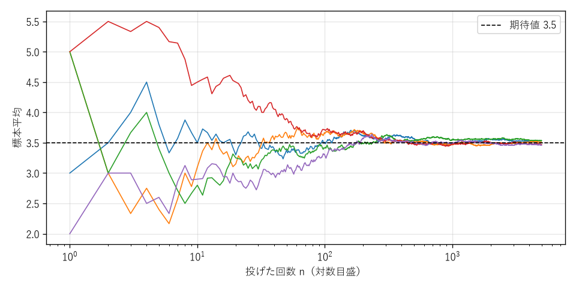
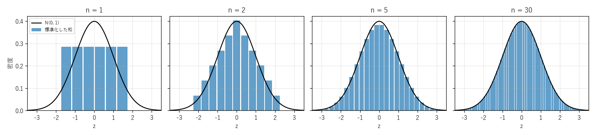

第 10 章 確率の不等式と極限定理
================================

確率変数の分布が完全には分からなくても、期待値や分散が分かれば「値が期待値から大きく外れる確率」を上から評価できる。本章では、そのための不等式を学び、それを使って、試行回数を増やすと標本平均が期待値に近づくという大数の法則を示す。さらに、独立な確率変数の和の分布が正規分布に近づくという中心極限定理を紹介する。これらは、シミュレーションの誤差を見積もったり、乱択アルゴリズムの性能を保証したりする際の基礎となる。

確率の不等式
------------

マルコフの不等式
~~~~~~~~~~~~~~~~

**定理（マルコフの不等式）**：非負の値をとる確率変数 :math:`X` と :math:`a > 0` について

.. math::

   P(X \ge a) \le \frac{E[X]}{a}

が成り立つ。

**証明**：事象 :math:`\{X \ge a\}` の指示確率変数を :math:`I` とする。:math:`X \ge a` のとき :math:`a I = a \le X`、:math:`X < a` のとき :math:`a I = 0 \le X` なので、常に :math:`a I \le X` である。両辺の期待値をとると :math:`a P(X \ge a) \le E[X]` となる。

マルコフの不等式は期待値しか使わないので適用範囲が広いが、得られる上界は粗い。たとえば「平均年収の 3 倍以上の年収を得ている人は、全体の 3 分の 1 以下である」ことは分かるが、実際の割合はずっと小さいのが普通である。

チェビシェフの不等式
~~~~~~~~~~~~~~~~~~~~

**定理（チェビシェフの不等式）**：期待値 :math:`\mu`、分散 :math:`\sigma^2` の確率変数 :math:`X` と :math:`a > 0` について

.. math::

   P(|X - \mu| \ge a) \le \frac{\sigma^2}{a^2}

が成り立つ。

**証明**：非負の確率変数 :math:`(X - \mu)^2` にマルコフの不等式を適用すると、:math:`P(|X - \mu| \ge a) = P((X - \mu)^2 \ge a^2) \le E[(X - \mu)^2]/a^2 = \sigma^2/a^2` となる。

:math:`a = k\sigma` とおくと :math:`P(|X - \mu| \ge k\sigma) \le 1/k^2` となる。どのような分布であっても、期待値から標準偏差の 2 倍以上離れた値をとる確率は 1/4 以下、3 倍以上離れた値をとる確率は 1/9 以下である。

チェルノフ限界
~~~~~~~~~~~~~~

確率変数が独立な確率変数の和である場合は、はるかに強い上界が得られる。ここでは証明を省略して結果だけを紹介する。

**定理（チェルノフ限界）**：:math:`X_1, \ldots, X_n` を独立な確率変数とし、それぞれ 0 か 1 の値をとる（:math:`P(X_i = 1) = p_i`）とする。:math:`X = X_1 + \cdots + X_n`、:math:`\mu = E[X]` とすると、:math:`0 < \delta \le 1` について

.. math::

   P(X \ge (1 + \delta)\mu) \le e^{-\delta^2 \mu / 3}, \qquad P(X \le (1 - \delta)\mu) \le e^{-\delta^2 \mu / 2}

が成り立つ。

証明の考え方は、:math:`t > 0` について :math:`P(X \ge a) = P(e^{tX} \ge e^{ta}) \le E[e^{tX}]/e^{ta}` とマルコフの不等式を適用し、独立性から :math:`E[e^{tX}] = \prod_i E[e^{tX_i}]` と積に分解して、最も良い :math:`t` を選ぶというものである。チェビシェフの不等式の上界が :math:`1/a^2` のように多項式的にしか小さくならないのに対し、チェルノフ限界は :math:`\mu` に対して指数的に小さくなる。乱択アルゴリズムが「高い確率で」うまく動作することを示す際に広く使われる。

上界の比較
~~~~~~~~~~

:math:`X \sim \mathrm{Bin}(100, 0.5)` （:math:`\mu = 50`、:math:`\sigma^2 = 25`）について、:math:`P(X \ge 75)` の各不等式による上界と真の値を比べる。

.. list-table:: :math:`P(X \ge 75)` の上界の比較（:math:`X \sim \mathrm{Bin}(100, 0.5)`）
   :header-rows: 1
   :widths: 30 40 30

   * - 方法
     - 式
     - 値
   * - マルコフの不等式
     - :math:`50/75`
     - :math:`6.7 \times 10^{-1}`
   * - チェビシェフの不等式
     - :math:`25/25^2` （:math:`P(|X - 50| \ge 25)` の上界）
     - :math:`4.0 \times 10^{-2}`
   * - チェルノフ限界
     - :math:`e^{-0.5^2 \times 50/3}`
     - :math:`1.6 \times 10^{-2}`
   * - 真の値
     - :math:`\sum_{k=75}^{100} \binom{100}{k} 2^{-100}`
     - :math:`2.8 \times 10^{-7}`

使う情報が多いほど上界は改善するが、いずれも真の値よりかなり大きい。これらの不等式は、真の値を近似するものではなく、「少なくともこれより小さい」ことを保証するものである。

大数の法則
----------

独立で同じ分布に従う（i.i.d.：independent and identically distributed と略す）確率変数 :math:`X_1, X_2, \ldots` があり、:math:`E[X_i] = \mu`、:math:`V[X_i] = \sigma^2` とする。最初の :math:`n` 個の平均

.. math::

   \overline{X}_n = \frac{X_1 + \cdots + X_n}{n}

を\ **標本平均**\ という。期待値の線形性と、独立な確率変数の分散の加法性から

.. math::

   E[\overline{X}_n] = \mu, \qquad V[\overline{X}_n] = \frac{1}{n^2} \cdot n \sigma^2 = \frac{\sigma^2}{n}

である。標本平均の期待値は :math:`\mu` のままで、分散は :math:`n` に反比例して小さくなる。

**定理（大数の弱法則）**：任意の :math:`\varepsilon > 0` について

.. math::

   P(|\overline{X}_n - \mu| \ge \varepsilon) \le \frac{\sigma^2}{n \varepsilon^2} \to 0 \quad (n \to \infty)

**証明**：:math:`\overline{X}_n` にチェビシェフの不等式を適用すればよい。

大数の法則は、「試行を何度も繰り返したときの平均は期待値に近づく」という、期待値の直感的な意味を数学的に保証するものである（:numref:`fig-ch10-lln`）。この定理を\ :term:`大数の法則`\ と呼ぶ。シミュレーションで確率や期待値を推定できるのは、この法則があるからである。たとえば事象 :math:`A` の指示確率変数の標本平均は、:math:`n` 回の試行で :math:`A` が起こった割合であり、これは :math:`P(A)` に近づく。

.. _fig-ch10-lln:

   サイコロの目の標本平均の推移（5 系列）

なお、大数の法則は「これまでに偏りがあったら、今後は逆向きに偏って帳尻が合う」という意味ではない。過去の偏りは修正されるのではなく、その後の大量の試行によって\ **薄められる**\ のである。

正規分布
--------

中心極限定理を述べる準備として、連続的な値をとる分布である正規分布を導入する。本書では連続確率変数を詳しくは扱わないので、必要な事実だけを述べる。

連続確率変数 :math:`Z` の分布は、**確率密度関数** :math:`f(x)` で表される。:math:`Z` が区間 :math:`[a, b]` に入る確率は、確率密度関数のグラフの下の面積

.. math::

   P(a \le Z \le b) = \int_a^b f(x) \, dx

で与えられる。離散確率変数の確率質量関数の和が、積分に置き換わったものと考えればよい。

確率密度関数

.. math::

   \varphi(x) = \frac{1}{\sqrt{2\pi}} e^{-x^2/2}

を持つ分布を\ **標準正規分布** :math:`N(0, 1)` という。期待値は 0、分散は 1 である。その累積分布関数を :math:`\Phi(z) = P(Z \le z)` と書く。:math:`\Phi(z)` は初等関数では表せないので、数表や ``scipy.stats.norm.cdf`` で値を求める。標準正規分布に従う :math:`Z` について、次の値はよく使われる。

.. list-table:: 標準正規分布の主な確率
   :header-rows: 1
   :widths: 50 50

   * - 事象
     - 確率
   * - :math:`|Z| \le 1`
     - 約 0.683
   * - :math:`|Z| \le 1.96`
     - 約 0.950
   * - :math:`|Z| \le 2`
     - 約 0.954
   * - :math:`|Z| \le 3`
     - 約 0.997

また、:math:`X = \mu + \sigma Z` の分布を、期待値 :math:`\mu`、分散 :math:`\sigma^2` の\ **正規分布** :math:`N(\mu, \sigma^2)` という。

中心極限定理
------------

定理
~~~~

大数の法則は、標本平均が期待値に近づくことを述べている。中心極限定理は、そのずれがどのような分布に従うかを述べる。

**定理（中心極限定理）**：i.i.d. の確率変数 :math:`X_1, X_2, \ldots` があり、:math:`E[X_i] = \mu`、:math:`V[X_i] = \sigma^2 > 0` とする。:math:`S_n = X_1 + \cdots + X_n` を標準化した

.. math::

   Z_n = \frac{S_n - n\mu}{\sigma \sqrt{n}}

について、任意の実数 :math:`z` で

.. math::

   P(Z_n \le z) \to \Phi(z) \quad (n \to \infty)

が成り立つ。

:math:`Z_n` は期待値 0、分散 1 になるように :math:`S_n` を平行移動・拡大縮小したものである。:math:`X_i` の分布が何であっても（期待値と分散が存在しさえすれば）、和を標準化したものの分布は標準正規分布に近づく。証明には本書の範囲を超える道具が必要なので省略する。

:numref:`fig-ch10-clt` は、サイコロ :math:`n` 個の目の和を標準化した分布と、標準正規分布の確率密度関数を比べたものである。値の間隔が :math:`1/(\sigma \sqrt{n})` になるので、確率を :math:`\sigma \sqrt{n}` 倍して密度に換算して描いている。:math:`n = 5` 程度でも、すでに標準正規分布にかなり近い。

.. _fig-ch10-clt:

   サイコロ :math:`n` 個の目の和を標準化した分布と標準正規分布

二項分布の正規近似
~~~~~~~~~~~~~~~~~~

:math:`X \sim \mathrm{Bin}(n, p)` は :math:`n` 個の独立な :math:`\mathrm{Ber}(p)` の和なので、:math:`n` が大きければ :math:`(X - np)/\sqrt{npq}` の分布は :math:`N(0, 1)` で近似できる。整数値の分布を連続分布で近似するので、境界を 0.5 ずらす\ **連続性補正**\ を行うと精度が上がる。

**例**：:math:`X \sim \mathrm{Bin}(100, 0.5)` で :math:`P(X \ge 60)` を求める。:math:`np = 50`、:math:`\sqrt{npq} = 5` なので、連続性補正をすると

.. math::

   P(X \ge 60) = P(X \ge 59.5) \approx P\left(Z \ge \frac{59.5 - 50}{5}\right) = 1 - \Phi(1.9) \approx 0.0287

となる。真の値は約 0.0284 であり、よく近似できている。

シミュレーションの誤差
~~~~~~~~~~~~~~~~~~~~~~

中心極限定理を使うと、モンテカルロ・シミュレーションの誤差を見積もれる。確率 :math:`p` の事象が :math:`n` 回の独立な試行で起こった割合を :math:`\hat{p}` とすると、:math:`\hat{p}` の標準偏差は :math:`\sqrt{p(1 - p)/n}` であり、:math:`\hat{p}` の分布は近似的に正規分布になる。したがって、約 95% の確率で

.. math::

   |\hat{p} - p| \le 1.96 \sqrt{\frac{p(1 - p)}{n}}

が成り立つ。たとえば第 6 章の誕生日問題のシミュレーション（:math:`n = 10000`、:math:`p \approx 0.5`）では、誤差は約 95% の確率で :math:`1.96 \times \sqrt{0.25/10000} \approx 0.0098` 以内に収まる。誤差は :math:`1/\sqrt{n}` に比例するので、誤差を 1/10 にするには試行回数を 100 倍にする必要がある。

Python で確かめる
-----------------

サンプルコード：:download:`ch10_limit_theorems.py <../examples/ch10_limit_theorems.py>`

次の関数は、二項分布の裾の確率 :math:`P(X \ge a)` について、真の値と各不等式による上界を比較する。``scipy.stats.binom.sf(a - 1, n, p)`` は :math:`P(X > a - 1) = P(X \ge a)` を返す。

.. literalinclude:: ../examples/ch10_limit_theorems.py
   :language: python
   :linenos:
   :pyobject: compare_tail_bounds

中心極限定理の確認では、NumPy の乱数生成器 ``numpy.random.default_rng`` でサイコロ :math:`n` 個の目を 100000 組生成し、和を標準化した値について :math:`P(Z \le 1)` と :math:`P(|Z| \le 2)` を推定する。

.. literalinclude:: ../examples/ch10_limit_theorems.py
   :language: python
   :linenos:
   :pyobject: central_limit_theorem

実行結果は次のとおりである。

.. code-block:: text

   --- 裾確率の上界 (X ~ Bin(100, 0.5)) ---
   P(X >= 60) の真の値 = 2.844e-02
     マルコフの不等式     <= 8.333e-01
     チェビシェフの不等式 <= 2.500e-01
     チェルノフ限界       <= 5.134e-01
   P(X >= 75) の真の値 = 2.818e-07
     マルコフの不等式     <= 6.667e-01
     チェビシェフの不等式 <= 4.000e-02
     チェルノフ限界       <= 1.550e-02
   --- 大数の法則 ---
   n=    10: 標本平均の例 3.7000, |標本平均 - 3.5| < 0.1 となる割合 0.075
   n=   100: 標本平均の例 3.6900, |標本平均 - 3.5| < 0.1 となる割合 0.465
   n=  1000: 標本平均の例 3.4700, |標本平均 - 3.5| < 0.1 となる割合 0.925
   n= 10000: 標本平均の例 3.4903, |標本平均 - 3.5| < 0.1 となる割合 1.000
   n=100000: 標本平均の例 3.5109, |標本平均 - 3.5| < 0.1 となる割合 1.000
   --- 中心極限定理 ---
   n= 1: P(Z <= 1) の推定値 0.8337, P(|Z| <= 2) の推定値 1.0000
   n= 2: P(Z <= 1) の推定値 0.8325, P(|Z| <= 2) の推定値 0.9440
   n= 5: P(Z <= 1) の推定値 0.8491, P(|Z| <= 2) の推定値 0.9670
   n=30: P(Z <= 1) の推定値 0.8441, P(|Z| <= 2) の推定値 0.9536
   標準正規分布: P(Z <= 1) = 0.8413, P(|Z| <= 2) = 0.9545

:math:`P(X \ge 60)` のように期待値からのずれが小さい場合は、チェルノフ限界よりチェビシェフの不等式の方が良い上界を与えることもある。チェルノフ限界が威力を発揮するのは、ずれが大きく確率が非常に小さい場合である。

大数の法則の結果では、:math:`n` が大きくなるにつれて、標本平均が 3.5 から 0.1 未満しかずれない系列の割合が 1 に近づいている。中心極限定理の結果では、:math:`n = 1` （1 個の目そのもの）では :math:`|Z|` の最大値が約 1.46 なので :math:`P(|Z| \le 2) = 1` になっているが、:math:`n = 30` では標準正規分布の値にかなり近い。ただし :math:`Z_n` は離散的な値しかとらないので、:math:`P(Z_n \le 1)` は :math:`n` が小さいうちは、:math:`z = 1` の付近にどの値があるかによって増減する。

まとめ
------

* マルコフの不等式 :math:`P(X \ge a) \le E[X]/a` は期待値だけから、チェビシェフの不等式 :math:`P(|X - \mu| \ge a) \le \sigma^2/a^2` は分散から、裾の確率の上界を与える。
* 独立な 0/1 確率変数の和については、チェルノフ限界により指数的に小さい上界が得られる。
* 大数の法則により、i.i.d. の確率変数の標本平均は期待値に近づく。標本平均の分散は :math:`\sigma^2/n` である。
* 中心極限定理により、i.i.d. の確率変数の和を標準化したものは、元の分布によらず標準正規分布に近づく。
* シミュレーションによる確率の推定誤差はおよそ :math:`1/\sqrt{n}` に比例する。

大数の法則と中心極限定理については [Ross2019]_ に、チェルノフ限界の証明と応用については [Mitzenmacher2017]_ に詳しい。
