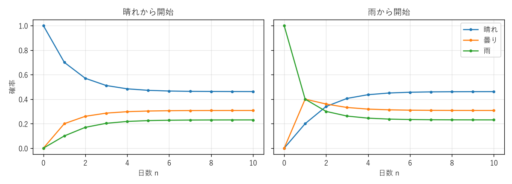

第 11 章 マルコフ連鎖入門
=========================

これまでの章では、主に独立な試行を扱ってきた。しかし、明日の天気は今日の天気に影響され、Web ページの閲覧者が次に見るページは今見ているページのリンクに左右される。このように、次の状態が現在の状態に依存して確率的に決まる過程の最も基本的なモデルが\ :term:`マルコフ連鎖`\ である。本章では、第 5 章のグラフと第 7 章以降の確率の道具を組み合わせて、マルコフ連鎖の基礎を学ぶ。

マルコフ連鎖の定義
------------------

マルコフ性
~~~~~~~~~~

有限集合 :math:`S = \{1, 2, \ldots, k\}` を\ **状態空間**\ とし、:math:`S` の値をとる確率変数の列 :math:`X_0, X_1, X_2, \ldots` を考える。:math:`X_n` は時刻 :math:`n` における状態を表す。すべての時刻 :math:`n` と状態 :math:`i_0, \ldots, i_{n-1}, i, j` について

.. math::

   P(X_{n+1} = j \mid X_n = i, X_{n-1} = i_{n-1}, \ldots, X_0 = i_0) = P(X_{n+1} = j \mid X_n = i)

が成り立つとき（条件付き確率が定義される場合に限る）、この列を\ **マルコフ連鎖**\ という。この性質を\ **マルコフ性**\ という。次の状態の分布は現在の状態だけで決まり、そこに至るまでの経緯には依存しない。

さらに、右辺が時刻 :math:`n` によらない場合を\ **時間的に一様**\ なマルコフ連鎖という。本書では時間的に一様なマルコフ連鎖のみを扱い、

.. math::

   p_{ij} = P(X_{n+1} = j \mid X_n = i)

を状態 :math:`i` から状態 :math:`j` への\ **遷移確率**\ という。

遷移行列と状態遷移図
~~~~~~~~~~~~~~~~~~~~

遷移確率を並べた :math:`k \times k` 行列 :math:`P = (p_{ij})` を\ :term:`遷移行列`\ という。遷移行列の成分は非負で、各行の和は 1 である（状態 :math:`i` から、いずれかの状態に必ず遷移するため）。

**例（天気のモデル）**：天気を「晴れ」「曇り」「雨」の 3 状態で表し、翌日の天気が今日の天気だけで次のように決まるとする。

.. math::

   P = \begin{pmatrix} 0.7 & 0.2 & 0.1 \\ 0.3 & 0.4 & 0.3 \\ 0.2 & 0.4 & 0.4 \end{pmatrix}

1 行目は、今日が晴れのとき、明日が晴れ・曇り・雨である確率がそれぞれ 0.7、0.2、0.1 であることを表す。マルコフ連鎖は、状態を頂点、遷移確率を辺の重みとする重み付き有向グラフで表せる。これを\ **状態遷移図**\ という（:numref:`fig-ch11-weather`）。

.. _fig-ch11-weather:

.. graphviz::
   :caption: 天気のマルコフ連鎖の状態遷移図
   :align: center

   digraph weather {
       rankdir=LR;
       node [shape=circle, width=0.8, fixedsize=true, fontsize=12];
       edge [fontsize=10, arrowsize=0.7];
       S [label="晴れ"]; C [label="曇り"]; R [label="雨"];
       S -> S [label="0.7"]; S -> C [label="0.2"]; S -> R [label="0.1"];
       C -> S [label="0.3"]; C -> C [label="0.4"]; C -> R [label="0.3"];
       R -> S [label="0.2"]; R -> C [label="0.4"]; R -> R [label="0.4"];
   }

n ステップ後の分布
------------------

時刻 :math:`n` の状態の分布を行ベクトル :math:`\pi^{(n)} = (P(X_n = 1), \ldots, P(X_n = k))` で表す。全確率の公式により

.. math::

   P(X_{n+1} = j) = \sum_{i} P(X_n = i) \, P(X_{n+1} = j \mid X_n = i) = \sum_{i} \pi^{(n)}_i p_{ij}

なので、行列の積を使って :math:`\pi^{(n+1)} = \pi^{(n)} P` と書ける。これを繰り返すと

.. math::

   \pi^{(n)} = \pi^{(0)} P^n

である。特に、遷移行列のべき乗 :math:`P^n` の :math:`(i, j)` 成分は、状態 :math:`i` から出発して :math:`n` ステップ後に状態 :math:`j` にいる確率 :math:`P(X_n = j \mid X_0 = i)` に等しい。これは、第 5 章で述べた「隣接行列のべき乗の成分は歩道の個数」という性質の確率版である。:math:`P^n` の成分は、長さ :math:`n` の歩道すべてについて、通る辺の遷移確率の積を足し合わせたものになっている。

**例**：今日が晴れのとき、明後日の分布は :math:`(1, 0, 0) P^2` で求められる。:math:`P^2` の 1 行目を計算すると

.. math::

   \begin{aligned}
   \text{晴れ} &: \; 0.7 \times 0.7 + 0.2 \times 0.3 + 0.1 \times 0.2 = 0.57 \\
   \text{曇り} &: \; 0.7 \times 0.2 + 0.2 \times 0.4 + 0.1 \times 0.4 = 0.26 \\
   \text{雨} &: \; 0.7 \times 0.1 + 0.2 \times 0.3 + 0.1 \times 0.4 = 0.17
   \end{aligned}

となり、明後日の分布は :math:`(0.57, 0.26, 0.17)` である。

定常分布
--------

定常分布の定義
~~~~~~~~~~~~~~

状態の分布 :math:`\pi` が

.. math::

   \pi P = \pi, \qquad \sum_{i} \pi_i = 1, \qquad \pi_i \ge 0

を満たすとき、:math:`\pi` を\ :term:`定常分布`\ という。ある時刻で分布が :math:`\pi` であれば、その後もずっと分布は :math:`\pi` のまま変わらない。

天気の例で :math:`\pi = (x, y, z)` とおいて :math:`\pi P = \pi` と :math:`x + y + z = 1` を解くと、:math:`\pi = (6/13, 4/13, 3/13) \approx (0.462, 0.308, 0.231)` が得られる。:numref:`fig-ch11-convergence` は、晴れから始めた場合と雨から始めた場合の分布の推移である。どちらから始めても、10 日ほどで分布は定常分布にほぼ一致する。

.. _fig-ch11-convergence:

   天気のマルコフ連鎖の分布の推移

定常分布への収束
~~~~~~~~~~~~~~~~

どのような初期分布から始めても定常分布に収束するとは限らない。収束を保証するには、次の 2 つの条件が必要である。

* **既約性**：どの状態からどの状態へも、何ステップかで正の確率で到達できる。状態遷移図でいえば、任意の 2 頂点の間に有向の道がある（強連結である）。
* **非周期性**：状態 :math:`i` から :math:`i` に戻ってこられるステップ数の最大公約数が、すべての状態について 1 である。

**定理**：有限状態の既約なマルコフ連鎖は、ただ 1 つの定常分布 :math:`\pi` を持ち、すべての :math:`i` について :math:`\pi_i > 0` である。さらに非周期的であれば、任意の初期分布 :math:`\pi^{(0)}` について :math:`\pi^{(0)} P^n \to \pi` （:math:`n \to \infty`）が成り立つ。

また、既約であれば（非周期的でなくても）、長い期間のうち状態 :math:`i` に滞在する時間の割合は :math:`\pi_i` に近づく。これは大数の法則のマルコフ連鎖版である。

周期的な例として、2 つの状態を必ず交互に行き来する連鎖 :math:`P = \begin{pmatrix} 0 & 1 \\ 1 & 0 \end{pmatrix}` を考える。定常分布は :math:`(1/2, 1/2)` であるが、状態 1 から始めると分布は :math:`(1, 0), (0, 1), (1, 0), \ldots` と振動し続け、収束しない。天気の例では、どの状態も 1 ステップで自分自身に戻れる（自己ループがある）ので周期は 1 である。

グラフ上のランダムウォーク
--------------------------

連結な無向グラフ :math:`G = (V, E)` の上で、現在の頂点 :math:`v` から、隣接する頂点の 1 つを等しい確率 :math:`1/\deg(v)` で選んで移動することを繰り返す過程を、グラフ上の\ **ランダムウォーク**\ という。これは頂点を状態とするマルコフ連鎖である。

このランダムウォークの定常分布は

.. math::

   \pi_v = \frac{\deg(v)}{2|E|}

である。実際、:math:`\sum_{u} \pi_u p_{uv} = \sum_{u \text{ は } v \text{ に隣接}} \frac{\deg(u)}{2|E|} \cdot \frac{1}{\deg(u)} = \frac{\deg(v)}{2|E|}` が成り立ち、第 5 章の握手補題により :math:`\sum_v \pi_v = 1` となる。次数の大きい頂点ほど、長い目で見て頻繁に訪問される。なお、グラフが二部グラフの場合はランダムウォークが周期 2 になり、分布は定常分布に収束しない。

Web ページを頂点、リンクを有向辺とするグラフ上のランダムウォーク（に、一定の確率でランダムなページへ移動する操作を加えたもの）の定常分布で、ページの重要度を測る手法が、検索エンジンで用いられた PageRank である。

ギャンブラーの破産問題
----------------------

所持金 :math:`i` 円のギャンブラーが、1 回ごとに確率 :math:`p` で 1 円勝ち、確率 :math:`q = 1 - p` で 1 円負ける賭けを繰り返す。所持金が 0 円になる（破産する）か、目標の :math:`N` 円に達したら終了する。目標に達する確率 :math:`h_i` を求める。

所持金の推移は、状態 :math:`0, 1, \ldots, N` のマルコフ連鎖である（:numref:`fig-ch11-ruin`）。状態 0 と :math:`N` は、一度入ると出られない\ **吸収状態**\ である。

.. _fig-ch11-ruin:

.. graphviz::
   :caption: ギャンブラーの破産問題の状態遷移図（:math:`N = 4` の場合）
   :align: center

   digraph ruin {
       rankdir=LR;
       node [shape=circle, width=0.5, fixedsize=true, fontsize=12];
       edge [fontsize=10, arrowsize=0.7];
       s0 [label="0", shape=doublecircle]; s1 [label="1"]; s2 [label="2"]; s3 [label="3"]; s4 [label="4", shape=doublecircle];
       s1 -> s2 [label="p"]; s2 -> s3 [label="p"]; s3 -> s4 [label="p"];
       s1 -> s0 [label="q"]; s2 -> s1 [label="q"]; s3 -> s2 [label="q"];
       s0 -> s0 [label="1"]; s4 -> s4 [label="1"];
   }

最初の 1 回の勝ち負けで場合分けする（**第一ステップ解析**\ という）と、全確率の公式とマルコフ性から

.. math::

   h_i = p \, h_{i+1} + q \, h_{i-1} \quad (1 \le i \le N - 1), \qquad h_0 = 0, \quad h_N = 1

が成り立つ。これは第 4 章で扱った漸化式の一種である。:math:`h_i = (p + q) h_i` を使って変形すると :math:`h_{i+1} - h_i = (q/p)(h_i - h_{i-1})` となるので、:math:`r = q/p` とおくと :math:`h_{i+1} - h_i = r^i h_1` である。:math:`i = 0, \ldots, N - 1` について足し合わせると :math:`h_N = 1` から :math:`h_1` が決まり、

.. math::

   h_i = \begin{cases} \dfrac{i}{N} & (p = 1/2) \\[2ex] \dfrac{1 - r^i}{1 - r^N} & (p \ne 1/2) \end{cases}

が得られる。

公平な賭け（:math:`p = 1/2`）では、目標に達する確率は所持金の目標に対する割合に等しい。一方、わずかでも不利な賭けでは状況が大きく変わる。:math:`i = 10`、:math:`N = 20` のとき、:math:`p = 0.49` で :math:`h_{10} \approx 0.401`、:math:`p = 0.45` で :math:`h_{10} \approx 0.119` となる。1 回あたりの不利はわずかでも、多数回繰り返すと破産する確率は大きくなる。

Python で確かめる
-----------------

サンプルコード：:download:`ch11_markov_chains.py <../examples/ch11_markov_chains.py>`

:math:`n` ステップ後の分布は、``numpy.linalg.matrix_power`` で遷移行列のべき乗を計算して求める。NumPy の ``@`` 演算子は行列の積を表す。

.. literalinclude:: ../examples/ch11_markov_chains.py
   :language: python
   :linenos:
   :pyobject: distribution_after

定常分布の条件 :math:`\pi P = \pi` は、転置をとると :math:`(P^\top - I) \pi^\top = 0` という連立一次方程式になる。この :math:`k` 本の式は 1 次従属（すべて足すと :math:`0 = 0` になる）なので、1 本を :math:`\sum_i \pi_i = 1` に置き換えて解く。

.. literalinclude:: ../examples/ch11_markov_chains.py
   :language: python
   :linenos:
   :pyobject: stationary_distribution

ギャンブラーの破産問題のシミュレーションは次のとおりである。

.. literalinclude:: ../examples/ch11_markov_chains.py
   :language: python
   :linenos:
   :pyobject: ruin_simulation

実行結果は次のとおりである。

.. code-block:: text

   --- 晴れから始めたときの n 日後の分布 ---
   n= 1: [0.7 0.2 0.1]
   n= 2: [0.57 0.26 0.17]
   n= 5: [0.4718 0.3032 0.225 ]
   n=10: [0.4617 0.3076 0.2307]
   n=20: [0.4615 0.3077 0.2308]
   --- 雨から始めたときの n 日後の分布 ---
   n= 1: [0.2 0.4 0.4]
   n= 2: [0.34 0.36 0.3 ]
   n= 5: [0.45   0.3128 0.2373]
   n=10: [0.4613 0.3078 0.2309]
   n=20: [0.4615 0.3077 0.2308]
   --- 定常分布 ---
   π = [0.4615 0.3077 0.2308], π P = [0.4615 0.3077 0.2308]
   100000 日のシミュレーションでの滞在割合: [0.4669 0.3038 0.2294]
   --- ギャンブラーの破産問題 (所持金 10, 目標 20) ---
   p=0.50: 目標到達確率 理論値=0.5000  シミュレーション=0.5106
   p=0.49: 目標到達確率 理論値=0.4013  シミュレーション=0.3902
   p=0.45: 目標到達確率 理論値=0.1185  シミュレーション=0.1180

どちらの初期状態から始めても、20 日後の分布は定常分布 :math:`(6/13, 4/13, 3/13)` とほぼ一致している。また、長期間のシミュレーションでの各状態の滞在割合も定常分布に近い。ギャンブラーの破産問題のシミュレーション（5000 回）の結果は、第 10 章で見た誤差の目安 :math:`1.96 \sqrt{0.25/5000} \approx 0.014` の範囲で理論値と一致している。

まとめ
------

* マルコフ連鎖は、次の状態の分布が現在の状態だけで決まる確率過程であり、遷移行列または状態遷移図で表される。
* :math:`n` ステップ後の分布は :math:`\pi^{(0)} P^n` で求められる。
* :math:`\pi P = \pi` を満たす分布を定常分布という。有限状態で既約かつ非周期的なマルコフ連鎖は、初期分布によらず定常分布に収束する。
* 連結な無向グラフ上のランダムウォークの定常分布は、次数に比例する。
* 吸収状態に達する確率は、第一ステップ解析により漸化式を立てて求められる。

マルコフ連鎖については [Levin2017]_ に、ランダムウォークとギャンブラーの破産問題については [Feller1968]_ に詳しい。
