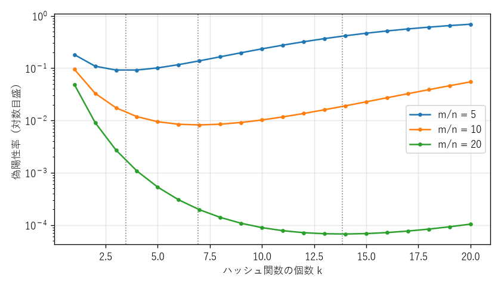
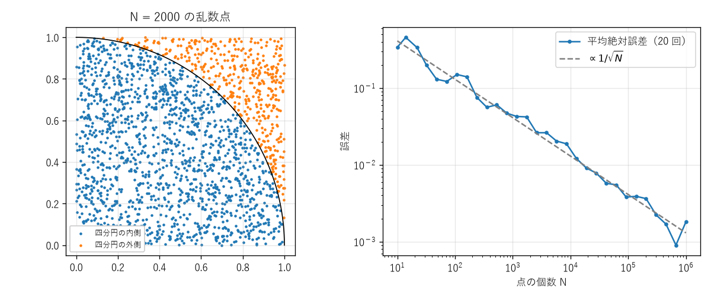

第 12 章 アルゴリズムと確率
===========================

本章では、これまでに学んだ数え上げ・期待値・不等式を使って、乱数を利用するアルゴリズムやデータ構造の性能を解析する。乱数を使うアルゴリズムを\ **乱択アルゴリズム**\ という。乱択アルゴリズムは、大きく次の 2 種類に分けられる。

* **ラスベガス法**：結果は常に正しいが、実行時間が乱数によって変わる。例：乱択クイックソート。
* **モンテカルロ法**：実行時間はおおむね一定だが、結果が一定の確率で誤っている（または誤差を含む）。例：ブルームフィルタ、モンテカルロ積分。

どちらの場合も、性能や正しさは確率的にしか保証されない。その保証を与えるのが確率論である。

ハッシュ衝突
------------

ハッシュ表やデータの重複検出では、キーをハッシュ関数で :math:`m` 通りの値（バケット）のいずれかに対応させる。異なるキーが同じ値に対応することを\ **衝突**\ という。ここでは、各キーのハッシュ値が独立に :math:`m` 通りの値を等しい確率でとると仮定する（**一様ハッシュの仮定**）。

衝突の確率
~~~~~~~~~~

:math:`n` 個のキーで衝突が起こらない確率は、第 6 章の誕生日問題と同じく

.. math::

   P(\text{衝突なし}) = \prod_{i=0}^{n-1} \left(1 - \frac{i}{m}\right)

である。:math:`1 - x \le e^{-x}` を使うと

.. math::

   P(\text{衝突なし}) \le \prod_{i=0}^{n-1} e^{-i/m} = \exp\left(-\frac{n(n - 1)}{2m}\right)

となり、:math:`n` が :math:`m` より十分小さければ右辺はよい近似にもなる。この近似式から、衝突の確率が 1/2 になるキーの個数はおよそ

.. math::

   n \approx \sqrt{2m \log 2} \approx 1.18 \sqrt{m}

である。:math:`m = 365` のとき :math:`n \approx 22.5` となり、誕生日問題の答え 23 とほぼ一致する。

指示確率変数を使うと、衝突するキーの組の個数の期待値も簡単に求められる。:math:`\binom{n}{2}` 個のキーの組のそれぞれが衝突する確率は :math:`1/m` なので、期待値の線形性により

.. math::

   E[\text{衝突する組の個数}] = \binom{n}{2} \frac{1}{m}

である。

ハッシュ値の長さ
~~~~~~~~~~~~~~~~

32 ビットのハッシュ値（:math:`m = 2^{32} \approx 4.3 \times 10^9`）では、:math:`n \approx 1.18 \times 2^{16} \approx 77000` 個のキーで衝突の確率が 1/2 に達する。値域の大きさに比べてごくわずかな個数である。一般に :math:`b` ビットのハッシュ値は、:math:`2^{b/2}` 個程度のキーで衝突しやすくなる。暗号学的ハッシュ関数で、衝突を見つける攻撃（**誕生日攻撃**）への耐性として :math:`2^{b/2}` 程度の計算量しか期待できないのはこのためである。重複検出などで衝突を事実上無視したい場合は、扱うデータの個数の 2 乗よりも十分大きな値域を持つハッシュ値を使う必要がある。

クーポンコレクター問題
----------------------

:math:`n` 種類のクーポンがあり、1 回引くごとに各種類が等しい確率 :math:`1/n` で（独立に）手に入るとする。全種類をそろえるまでに引く回数 :math:`T` の期待値を求める。この問題は\ **クーポンコレクター問題**\ と呼ばれ、「すべてのサーバーに少なくとも 1 回リクエストが届くまでの回数」「ランダムなテスト入力ですべての分岐を網羅するまでの回数」などのモデルになる。

期待値
~~~~~~

:math:`i - 1` 種類を持っている状態から :math:`i` 種類目を手に入れるまでに引く回数を :math:`T_i` とする。このとき、1 回引いて新しい種類が出る確率は :math:`p_i = (n - i + 1)/n` なので、:math:`T_i \sim \mathrm{Geo}(p_i)` であり、:math:`E[T_i] = n/(n - i + 1)` である。:math:`T = T_1 + \cdots + T_n` なので、期待値の線形性により

.. math::

   E[T] = \sum_{i=1}^{n} \frac{n}{n - i + 1} = n \left(1 + \frac{1}{2} + \cdots + \frac{1}{n}\right) = n H_n

となる。ここで :math:`H_n = \sum_{k=1}^{n} 1/k` は\ **調和数**\ であり、:math:`H_n \approx \log n + 0.5772` （0.5772... はオイラーの定数）と近似できる。したがって :math:`E[T] \approx n \log n` である。:math:`n = 50` のとき :math:`E[T] = 50 H_{50} \approx 225` であり、種類数の 4 倍以上の回数が必要である。最後の数種類をそろえるのに多くの回数がかかる（最後の 1 種類だけで平均 :math:`n` 回）ことが原因である。

裾の確率
~~~~~~~~

:math:`t` 回引いた後に特定の種類 :math:`j` をまだ持っていない確率は :math:`(1 - 1/n)^t \le e^{-t/n}` である。ユニオンバウンドにより、いずれかの種類が欠けている確率は :math:`n e^{-t/n}` 以下である。:math:`t = n \log n + cn` とおくと

.. math::

   P(T > n \log n + cn) \le n e^{-(\log n + c)} = e^{-c}

となる。たとえば :math:`c = 5` とすれば、:math:`n \log n + 5n` 回以内にそろわない確率は :math:`e^{-5} \approx 0.007` 以下である。

乱択クイックソート
------------------

アルゴリズム
~~~~~~~~~~~~

**クイックソート**\ は、配列から 1 つの要素（**ピボット**）を選び、ピボットより小さい要素と大きい要素に分けて、それぞれを再帰的に整列するアルゴリズムである。ピボットを常に先頭の要素とすると、すでに整列済みの配列に対して比較回数が :math:`n(n - 1)/2` となり、最悪の性能になる。ピボットを一様ランダムに選ぶ\ **乱択クイックソート**\ では、入力がどのような配列であっても、比較回数の期待値が :math:`O(n \log n)` になる。

比較回数の期待値
~~~~~~~~~~~~~~~~

要素は相異なるとし、整列後の順に :math:`z_1 < z_2 < \cdots < z_n` と名前を付ける。要素同士の比較は、一方がピボットのときにしか行われないので、各組 :math:`z_i, z_j` （:math:`i < j`）は高々 1 回しか比較されない。:math:`X_{ij}` を「:math:`z_i` と :math:`z_j` が比較される」事象の指示確率変数とすると、比較回数は :math:`X = \sum_{i < j} X_{ij}` である。

:math:`z_i` と :math:`z_j` が比較されるのはいつかを考える。集合 :math:`Z_{ij} = \{z_i, z_{i+1}, \ldots, z_j\}` の要素がピボットに選ばれるまで、:math:`Z_{ij}` の要素はすべて同じ部分配列に属している。:math:`Z_{ij}` から最初に選ばれるピボットが :math:`z_i` または :math:`z_j` ならば両者は比較され、間にある要素ならば :math:`z_i` と :math:`z_j` は別の部分配列に分かれて、以後比較されない。:math:`Z_{ij}` の :math:`j - i + 1` 個の要素はどれも等しい確率で最初のピボットになるので

.. math::

   P(X_{ij} = 1) = \frac{2}{j - i + 1}

である。期待値の線形性により、:math:`d = j - i` として

.. math::

   E[X] = \sum_{i < j} \frac{2}{j - i + 1} = \sum_{d=1}^{n-1} (n - d) \frac{2}{d + 1} = 2(n + 1) H_n - 4n

となる（最後の等式は :math:`n - d = (n + 1) - (d + 1)` と分けて計算すれば得られる）。:math:`H_n \approx \log n` より、:math:`n` が大きいとき :math:`E[X] \approx 2n \log n \approx 1.39 \, n \log_2 n` である。比較による整列アルゴリズムは最悪の場合に少なくとも :math:`\log_2 n! \approx n \log_2 n` 回の比較を必要とすることが知られており、乱択クイックソートの平均的な比較回数はその約 1.39 倍にとどまる。

ブルームフィルタ
----------------

仕組み
~~~~~~

**ブルームフィルタ**\ は、「ある要素が集合に含まれるか」を少ないメモリで判定するデータ構造である [Bloom1970]_。:math:`m` ビットの配列（初期値はすべて 0）と、:math:`k` 個のハッシュ関数 :math:`h_1, \ldots, h_k` （値は :math:`0, \ldots, m - 1`）を使う。

* **登録**：要素 :math:`x` について、:math:`h_1(x), \ldots, h_k(x)` 番目のビットをすべて 1 にする。
* **判定**：要素 :math:`y` について、:math:`h_1(y), \ldots, h_k(y)` 番目のビットがすべて 1 なら「含まれる（かもしれない）」、1 つでも 0 なら「含まれない」と答える。

登録した要素に対しては必ず「含まれる」と答えるので、**偽陰性**\ （含まれるのに含まれないと答えること）は起こらない。一方、登録していない要素でも、たまたま :math:`k` 個のビットがすべて他の要素によって 1 になっていれば「含まれる」と答えてしまう。これを\ **偽陽性**\ という。ブルームフィルタは、ディスクやネットワークへの高価な問い合わせの前に、確実に存在しないものを安価に除外する用途で使われる。

偽陽性率
~~~~~~~~

:math:`n` 個の要素を登録した後、特定のビットが 0 のままである確率は、:math:`kn` 回のハッシュ値がどれもそのビットに当たらない確率なので

.. math::

   \left(1 - \frac{1}{m}\right)^{kn} \approx e^{-kn/m}

である。登録していない要素の :math:`k` 個のビットがすべて 1 である確率、すなわち偽陽性率は、各ビットが独立であると近似すると

.. math::

   f(k) = \left(1 - e^{-kn/m}\right)^k

となる（実際にはビット同士はわずかに依存しているので、これは近似である）。

:math:`k` を大きくすると、確認するビットが増えるので偽陽性は起こりにくくなるが、配列の 1 の割合も増える。この 2 つの効果のつり合いで、最適な :math:`k` が決まる。:math:`f(k)` を最小にする :math:`k` は :math:`k = (m/n) \log 2` であり、このとき :math:`f \approx (1/2)^k \approx 0.6185^{m/n}` となる。たとえば 1 要素あたり 10 ビット（:math:`m/n = 10`）を使うと、:math:`k = 7` で偽陽性率は約 0.82% になる（:numref:`fig-ch12-bloom`）。

.. _fig-ch12-bloom:

   ハッシュ関数の個数 :math:`k` とブルームフィルタの偽陽性率（点線は最適な :math:`k`）

モンテカルロ法による数値計算
----------------------------

面積や積分の値を、乱数を使って近似的に求める方法も\ **モンテカルロ法**\ と呼ばれる。たとえば、単位正方形 :math:`[0, 1]^2` に一様乱数で :math:`N` 個の点を打つと、各点が四分円 :math:`x^2 + y^2 \le 1` に入る確率は面積比 :math:`\pi/4` に等しい。四分円に入った点の割合を :math:`\hat{p}` とすると、:math:`4\hat{p}` は円周率 :math:`\pi` の推定値になる（:numref:`fig-ch12-pi`）。

:math:`\hat{p}` は :math:`N` 個の独立な :math:`\mathrm{Ber}(\pi/4)` の標本平均なので、大数の法則により :math:`4\hat{p} \to \pi` である。推定値の標準偏差は

.. math::

   4 \sqrt{\frac{(\pi/4)(1 - \pi/4)}{N}} \approx \frac{1.64}{\sqrt{N}}

であり、誤差は :math:`1/\sqrt{N}` に比例して小さくなる。精度を 1 桁上げるには点の個数を 100 倍にする必要があるので、低次元の積分ではモンテカルロ法は効率がよくない。しかし、誤差の大きさが次元に直接は依存しないので、高次元の積分や、複雑なシステムのシミュレーションでは有力な方法となる。

.. _fig-ch12-pi:

   モンテカルロ法による円周率の推定（左：乱数点、右：点の個数と誤差）

Python で確かめる
-----------------

サンプルコード：:download:`ch12_randomized_algorithms.py <../examples/ch12_randomized_algorithms.py>`

ハッシュ衝突の確率の厳密値は、多数の 1 に近い数の積になる。そのまま掛け合わせる代わりに対数の和を計算し、``math.log1p(x)`` （:math:`\log(1 + x)` を :math:`x` が小さいときにも精度よく計算する関数）を使う。

.. literalinclude:: ../examples/ch12_randomized_algorithms.py
   :language: python
   :linenos:
   :pyobject: collision_probability

乱択クイックソートは、比較回数を数えるように実装する。各段階で、ピボット以外の要素はピボットとちょうど 1 回ずつ比較される。

.. literalinclude:: ../examples/ch12_randomized_algorithms.py
   :language: python
   :linenos:
   :pyobject: quicksort_comparisons

ブルームフィルタでは、:math:`k` 個の独立なハッシュ関数を用意する代わりに、1 つのハッシュ値（SHA-256）から 2 つの値 :math:`h_1, h_2` を取り出し、:math:`h_1 + i h_2 \bmod m` （:math:`i = 0, \ldots, k - 1`）で :math:`k` 個の位置を作る。この\ **ダブルハッシュ法**\ は、偽陽性率をほとんど悪化させずに計算を省けることが知られている [Kirsch2006]_。:math:`h_2` を奇数にしているのは、:math:`h_2` が 0 になって :math:`k` 個の位置がすべて同じになるのを避けるためである。

.. literalinclude:: ../examples/ch12_randomized_algorithms.py
   :language: python
   :linenos:
   :pyobject: BloomFilter

実行結果は次のとおりである。

.. code-block:: text

   --- ハッシュ衝突 ---
   n= 10000, m=2^32: 厳密値=0.0116  近似=0.0116
   n= 50000, m=2^32: 厳密値=0.2525  近似=0.2525
   n= 77163, m=2^32: 厳密値=0.5000  近似=0.5000
   n=100000, m=2^32: 厳密値=0.6878  近似=0.6878
   --- クーポンコレクター問題 (n=50) ---
   理論値 n H_n = 224.96, シミュレーション平均 = 223.86
   --- 乱択クイックソートの比較回数 ---
   n=  10: 理論値=    24.44  シミュレーション平均=    24.77
   n= 100: 理論値=   647.85  シミュレーション平均=   649.59
   n=1000: 理論値= 10985.91  シミュレーション平均= 11053.98
   --- ブルームフィルタ (m=10000, n=1000) ---
   k= 1: 理論値=0.0952  実測=0.0974
   k= 3: 理論値=0.0174  実測=0.0183
   k= 5: 理論値=0.0094  実測=0.0098
   k= 7: 理論値=0.0082  実測=0.0087
   k=10: 理論値=0.0102  実測=0.0107
   --- モンテカルロ法による円周率の推定 ---
   N=    100: 推定値=3.48000  誤差=0.33841
   N=  10000: 推定値=3.13760  誤差=0.00399
   N=1000000: 推定値=3.14112  誤差=0.00047

いずれも理論値と実験値がよく一致している。ブルームフィルタの実測値が理論値をわずかに上回っているのは、主に偽陽性率の近似式がビット同士の依存を無視していること、ダブルハッシュ法が完全に独立なハッシュ関数ではないことによる。また、偽陽性率は :math:`k = 7` 付近で最小になっており、最適値 :math:`(m/n) \log 2 \approx 6.9` と一致する。

まとめ
------

* :math:`m` 通りのハッシュ値は、:math:`\sqrt{m}` 程度の個数のキーで衝突しやすくなる（誕生日問題）。
* :math:`n` 種類のクーポンをそろえる回数の期待値は :math:`n H_n \approx n \log n` であり、幾何分布の和として求められる。
* 乱択クイックソートの比較回数の期待値は :math:`2(n + 1) H_n - 4n \approx 2n \log n` であり、指示確率変数と期待値の線形性で導ける。
* ブルームフィルタの偽陽性率は :math:`(1 - e^{-kn/m})^k` で近似でき、:math:`k = (m/n) \log 2` で最小になる。
* モンテカルロ法による推定の誤差は :math:`1/\sqrt{N}` に比例する。

本章の話題を含む乱択アルゴリズムの解析については [Mitzenmacher2017]_ に詳しい。
