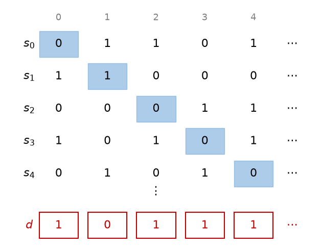

集合の大きさ
============

有限集合の大きさは要素の個数で測れる。では、自然数全体と整数全体ではどちらが「大きい」だろうか。本章では、写像を使って集合の大きさを比べる考え方を導入し、無限集合にも大きさの違いがあることを示す。

有限集合の要素数
----------------

有限集合 :math:`A` の要素の個数を :math:`|A|` と書く。有限集合の要素数について、次の法則が成り立つ。

.. list-table::
   :header-rows: 1
   :widths: 30 70

   * - 名称
     - 法則
   * - 和の法則
     - :math:`A \cap B = \emptyset` ならば :math:`|A \cup B| = |A| + |B|`
   * - 包除原理
     - :math:`|A \cup B| = |A| + |B| - |A \cap B|`
   * - 積の法則
     - :math:`|A \times B| = |A| \cdot |B|`
   * - 写像の個数
     - :math:`A` から :math:`B` への写像は :math:`|B|^{|A|}` 個ある
   * - べき集合の要素数
     - :math:`|\mathcal{P}(A)| = 2^{|A|}`

包除原理は、:math:`|A| + |B|` では :math:`A \cap B` の要素を 2 回数えているので、その分を引くという意味である。

写像の個数は、:math:`A` の各要素について像の選び方が :math:`|B|` 通りずつあることから、積の法則により得られる。

べき集合の要素数は、部分集合と写像の対応から分かる。:math:`A` の部分集合 :math:`X` に対し、

.. math::

   \chi_X(a) =
   \begin{cases}
   1 & (a \in X) \\
   0 & (a \notin X)
   \end{cases}

で定まる写像 :math:`\chi_X \colon A \to \{0, 1\}` を :math:`X` の特性関数という。部分集合 :math:`X` に特性関数 :math:`\chi_X` を対応させると、:math:`A` の部分集合全体と :math:`A` から :math:`\{0, 1\}` への写像全体の間の全単射が得られる。写像は :math:`2^{|A|}` 個あるので、部分集合も :math:`2^{|A|}` 個ある。

プログラミングでは、要素数 :math:`n` の集合の部分集合を :math:`n` ビットの整数で表すことがある。これは特性関数の値を各ビットに並べたものである。

鳩の巣原理
----------

.. admonition:: 鳩の巣原理

   有限集合 :math:`A` と :math:`B` について :math:`|A| > |B|` ならば、:math:`A` から :math:`B` への単射は存在しない。

「:math:`n + 1` 羽の鳩が :math:`n` 個の巣に入れば、2 羽以上が入る巣がある」という言い方で知られる。当たり前に見えるが応用は広い。たとえば、出力が 64 ビットのハッシュ関数を考えると、出力の値は :math:`2^{64}` 個しかない。入力となる文字列はそれより多いので、同じハッシュ値を持つ異なる文字列が必ず存在する。

濃度
----

有限集合では要素を数えて大きさを比べられるが、無限集合では要素を数え尽くせない。そこで、写像を使って大きさを比べる。

.. admonition:: 定義（濃度の比較）

   集合 :math:`A` から :math:`B` への全単射が存在するとき、:math:`A` と :math:`B` は濃度が等しいといい、:math:`|A| = |B|` と書く。:math:`A` から :math:`B` への単射が存在するとき、:math:`|A| \leq |B|` と書く。:math:`|A| \leq |B|` かつ :math:`|A| \neq |B|` のとき、:math:`|A| < |B|` と書く。

集合の大きさを表すこの概念を濃度という。有限集合については、濃度が等しいことと要素数が等しいことは同じである。また、:math:`|A| \leq |B|` かつ :math:`|B| \leq |A|` ならば :math:`|A| = |B|` であることが知られている（ベルンシュタインの定理）。

無限集合では、直観に反することが起こる。偶数全体の集合 :math:`E = \{0, 2, 4, \ldots\}` は :math:`\mathbb{N}` の真部分集合だが、:math:`n \mapsto 2n` は :math:`\mathbb{N}` から :math:`E` への全単射なので、:math:`|E| = |\mathbb{N}|` である。部分が全体と同じ濃度を持ちうることは、無限集合の特徴である。

可算集合
--------

.. admonition:: 定義（可算集合）

   :math:`\mathbb{N}` と濃度が等しい集合を可算集合という。有限集合または可算集合であることを高々可算であるという。可算集合でない無限集合を非可算集合という。

可算集合とは、要素に :math:`0, 1, 2, \ldots` と番号を付けて、漏れなく重複なく一列に並べられる集合のことである。

**整数全体** :math:`\mathbb{Z}` は可算集合である。:math:`0, -1, 1, -2, 2, \ldots` と並べればよい。式で書くと、

.. math::

   f(n) =
   \begin{cases}
   n / 2 & (n \text{ が偶数}) \\
   -(n + 1) / 2 & (n \text{ が奇数})
   \end{cases}

で定まる :math:`f \colon \mathbb{N} \to \mathbb{Z}` が全単射である。

**自然数の組全体** :math:`\mathbb{N} \times \mathbb{N}` も可算集合である。組 :math:`(m, n)` を :math:`m + n` の小さい順に、:math:`m + n` が等しいものは :math:`n` の小さい順に並べると、:math:`(0, 0), (1, 0), (0, 1), (2, 0), (1, 1), (0, 2), \ldots` とすべての組を一列に並べられる。

**有理数全体** :math:`\mathbb{Q}` も可算集合である。有理数は既約分数 :math:`p / q`\ （:math:`p \in \mathbb{Z}`、:math:`q` は正の整数）としてただ 1 通りに表せるので、組 :math:`(p, q)` に対応させれば :math:`\mathbb{Q}` から :math:`\mathbb{Z} \times \mathbb{N}` への単射が得られる。:math:`\mathbb{Z} \times \mathbb{N}` は上と同様に可算集合である。この単射の像は :math:`\mathbb{Z} \times \mathbb{N}` の無限部分集合であり、可算集合の無限部分集合は可算集合なので、像と濃度が等しい :math:`\mathbb{Q}` も可算集合である。

**有限の長さの文字列全体** も可算集合である。使える文字が有限種類なら、長さの短い順に、長さが等しいものは辞書順に並べればよい。プログラムのソースコードは有限の長さの文字列なので、書きうるプログラム全体は可算集合である。この事実は本章の最後で使う。

対角線論法
----------

では、非可算集合は存在するのだろうか。各項が 0 か 1 である無限列 :math:`s = (s(0), s(1), s(2), \ldots)` を 0-1 列と呼び、0-1 列全体の集合を :math:`S` とする。

.. admonition:: 定理

   0-1 列全体の集合 :math:`S` は非可算集合である。

**証明** :math:`S` が可算集合であると仮定して矛盾を導く。仮定より、:math:`S` のすべての要素を :math:`s_0, s_1, s_2, \ldots` と一列に並べられる。ここで、新しい 0-1 列 :math:`d` を

.. math::

   d(n) = 1 - s_n(n) \quad (n \in \mathbb{N})

で定める。すなわち :math:`d` の :math:`n` 番目の項は、:math:`s_n` の :math:`n` 番目の項を反転させたものである。すると、どの :math:`n` についても :math:`d` と :math:`s_n` は :math:`n` 番目の項が異なるので、:math:`d \neq s_n` である。これは :math:`d \in S` がこの並びに現れないことを意味し、すべての要素を並べたという仮定に矛盾する。□

次の図のように、並べた列の対角線上の項を反転させて :math:`d` を作るので、この論法を対角線論法という。

   対角線論法

0-1 列は、実数の 2 進展開や、:math:`\mathbb{N}` の部分集合の特性関数とみなせる。このことから、次の集合も非可算集合であることが示せる。

* 実数全体 :math:`\mathbb{R}`。厳密には、:math:`0.0111\ldots = 0.1000\ldots`\ （2 進表記）のように 1 つの実数に 2 通りの展開がある場合の扱いが必要だが、区間 :math:`[0, 1)` の実数を並べたと仮定して 10 進展開を使い、:math:`n` 番目の数の小数第 :math:`n + 1` 位が 5 でなければ 5、5 ならば 4 を並べた数を作れば、同じ論法で示せる。
* :math:`\mathbb{N}` のべき集合 :math:`\mathcal{P}(\mathbb{N})`。

したがって :math:`|\mathbb{N}| < |\mathbb{R}|` であり、無限集合にも大きさの違いがある。

カントールの定理
----------------

対角線論法は、任意の集合とそのべき集合の関係に一般化できる。

.. admonition:: 定理（カントールの定理）

   任意の集合 :math:`A` について、:math:`A` から :math:`\mathcal{P}(A)` への全射は存在しない。したがって :math:`|A| < |\mathcal{P}(A)|` である。

**証明** 写像 :math:`f \colon A \to \mathcal{P}(A)` を任意にとり、

.. math::

   D = \{a \in A \mid a \notin f(a)\}

とおく。:math:`D \in \mathcal{P}(A)` である。もし :math:`D = f(d)` となる :math:`d \in A` があったとすると、:math:`D` の定義より :math:`d \in D \iff d \notin f(d) = D` となり矛盾する。よって :math:`D` は :math:`f` の像に含まれず、:math:`f` は全射でない。また、:math:`a \mapsto \{a\}` は :math:`A` から :math:`\mathcal{P}(A)` への単射なので :math:`|A| \leq |\mathcal{P}(A)|` であり、全単射は存在しないので :math:`|A| < |\mathcal{P}(A)|` である。□

この定理から、:math:`|\mathbb{N}| < |\mathcal{P}(\mathbb{N})| < |\mathcal{P}(\mathcal{P}(\mathbb{N}))| < \cdots` と、いくらでも大きい濃度が存在することが分かる。

対角線論法の要点を有限の場合で確かめるサンプルコードを示す。後半では、:math:`A = \{0, 1, 2\}` から :math:`\mathcal{P}(A)` への写像 :math:`8^3 = 512` 個のすべてについて、証明中の集合 :math:`D` が像に含まれないことを確かめている。

:download:`diagonal.py <../examples/diagonal.py>`

.. literalinclude:: ../examples/diagonal.py
   :language: python
   :linenos:

実行結果は次のとおりである。

.. code-block:: text

   対角線から作った列: [1, 0, 1, 1, 1]
   一覧に含まれるか: False
   512 個の写像 A → P(A) のいずれも全射でない

計算可能性との関係
------------------

対角線論法は、プログラムで解けない問題が存在することも示す。

自然数を受け取って「はい」か「いいえ」を答える問題（判定問題）は、:math:`\mathbb{N}` から :math:`\{0, 1\}` への写像、すなわち 0-1 列と同一視できる。0-1 列全体は非可算集合である。一方、可算集合の節で述べたとおり、プログラム全体は可算集合である。したがって、プログラムで解ける判定問題は可算個しかなく、ほとんどの判定問題はどのプログラムでも解けない。

具体的な例として、停止性問題が知られている。これは「任意のプログラムと入力が与えられたとき、そのプログラムがその入力に対して停止するかどうかを判定する」問題である。仮に、これを判定する関数 ``halts`` が書けたとする。

.. code-block:: python
   :linenos:

   from collections.abc import Callable

   def halts(program: Callable[[object], object], argument: object) -> bool:
       """program(argument) が停止するなら True、停止しないなら False を返す（と仮定する）。"""
       ...

   def paradox(program: Callable[[object], object]) -> None:
       if halts(program, program):
           while True:  # 停止すると判定されたら、無限ループに入る
               pass
       # 停止しないと判定されたら、すぐに停止する

このとき ``paradox(paradox)`` は、``halts(paradox, paradox)`` が ``True`` なら停止せず、``False`` なら停止する。どちらにしても ``halts`` の判定は誤りになり、矛盾する。したがって ``halts`` は書けない。プログラムに自分自身を入力として与え、判定結果を反転させる構造は、対角線論法やカントールの定理の証明と同じである。
