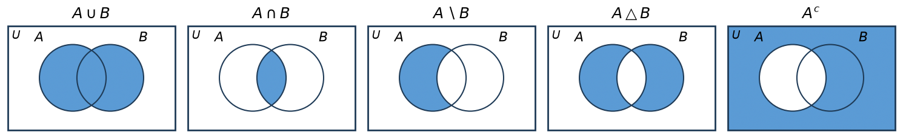

集合の基礎
==========

本章から集合を扱う。集合は数学のほぼすべての分野で共通の言葉として使われており、その性質は前章までの論理の言葉で記述される。

集合と要素
----------

.. admonition:: 定義（集合・要素）

   ものの集まりで、あるものがそれに属するかどうかが明確に定まるものを集合という。集合を構成する個々のものを、その集合の要素（または元）という。

:math:`a` が集合 :math:`A` の要素であることを :math:`a \in A` と書き、「:math:`a` は :math:`A` に属する」という。:math:`a` が :math:`A` の要素でないことを :math:`a \notin A` と書く。たとえば :math:`3 \in \mathbb{N}`、:math:`-3 \notin \mathbb{N}`、:math:`-3 \in \mathbb{Z}` である。

この定義は厳密なものではなく、素朴な説明である。何でも自由に集めて集合とみなすと矛盾が生じることが知られており、その問題は第 10 章で扱う。本書の範囲では、この素朴な理解で十分である。

集合の表し方
------------

集合の表し方には、要素を列挙する外延的記法と、要素が満たす条件を書く内包的記法がある。

.. list-table::
   :header-rows: 1
   :widths: 20 40 40

   * - 記法
     - 数学
     - Python
   * - 外延的記法
     - :math:`\{1, 2, 3\}`
     - ``{1, 2, 3}``
   * - 内包的記法
     - :math:`\{x \in \mathbb{Z} \mid x^2 < 10\}`
     - ``{x for x in range(-3, 4) if x * x < 10}``

内包的記法 :math:`\{x \in A \mid P(x)\}` は、集合 :math:`A` の要素のうち述語 :math:`P(x)` を満たすもの全体の集合を表す。Python の集合内包表記はこの記法にならったものである。ただし、Python では ``range(-3, 4)`` のように有限の範囲を具体的に与える必要がある。数学の記法では :math:`\mathbb{Z}` のような無限集合を範囲にとれる。

集合は要素の並び順や重複を区別しない。:math:`\{1, 2, 2\}` と :math:`\{2, 1\}` はどちらも :math:`\{1, 2\}` と同じ集合である。Python の ``set`` 型も同様である。

集合の要素は数である必要はなく、集合を要素とする集合も考えられる。たとえば :math:`\{1, \{1, 2\}\}` は、:math:`1` と :math:`\{1, 2\}` の 2 つを要素とする集合である。このとき :math:`\{1, 2\} \in \{1, \{1, 2\}\}` であるが、:math:`2 \notin \{1, \{1, 2\}\}` である。

部分集合と相等
--------------

.. admonition:: 定義（部分集合・相等）

   集合 :math:`A` の要素がすべて集合 :math:`B` の要素であるとき、:math:`A` は :math:`B` の部分集合であるといい、:math:`A \subseteq B` と書く。すなわち

   .. math::

      A \subseteq B \iff \forall x \, (x \in A \to x \in B)

   である。また、:math:`A` と :math:`B` が同じ要素を持つとき、:math:`A` と :math:`B` は等しいといい、:math:`A = B` と書く。すなわち

   .. math::

      A = B \iff \forall x \, (x \in A \leftrightarrow x \in B)

   である。

ここで :math:`\iff` は、左辺と右辺が同じ意味であることを表す。

:math:`A \subseteq B` かつ :math:`A \neq B` のとき、:math:`A` は :math:`B` の真部分集合であるといい、:math:`A \subsetneq B` と書く。:math:`\subseteq` と :math:`\subsetneq` を区別せず :math:`\subset` を使う文献もあるので、他の本を読むときは注意する。

:math:`P \leftrightarrow Q \equiv (P \to Q) \land (Q \to P)` より、:math:`A = B` であることは :math:`A \subseteq B` かつ :math:`B \subseteq A` であることと同じである。2 つの集合が等しいことを証明するときは、この 2 つの包含関係を別々に示すのが基本的な方法である。

要素であること（:math:`\in`）と部分集合であること（:math:`\subseteq`）は異なる。:math:`1 \in \{1, 2\}` であり :math:`\{1\} \subseteq \{1, 2\}` であるが、:math:`\{1\} \notin \{1, 2\}` である。

Python では、``a <= b`` で :math:`A \subseteq B`、``a < b`` で :math:`A \subsetneq B`、``a == b`` で :math:`A = B` を判定できる。

空集合
------

要素を 1 つも持たない集合を空集合といい、:math:`\emptyset` と書く。空集合は任意の集合 :math:`A` の部分集合である。:math:`x \in \emptyset` は常に偽なので、:math:`\forall x \, (x \in \emptyset \to x \in A)` は第 5 章で述べた空虚な真により真になるからである。

:math:`\emptyset` と :math:`\{\emptyset\}` は異なる。前者は要素を持たないが、後者は :math:`\emptyset` を要素として 1 つ持つ。

Python で空集合を作るには ``set()`` と書く。``{}`` は空の辞書になるので注意する。

集合演算
--------

議論の対象となるものをすべて含む集合 :math:`U` を定め、これを全体集合という。以下、集合 :math:`A` と :math:`B` は :math:`U` の部分集合とする。

.. admonition:: 定義（集合演算）

   .. list-table::
      :header-rows: 1
      :widths: 15 25 60

      * - 名称
        - 記号
        - 定義
      * - 和集合
        - :math:`A \cup B`
        - :math:`\{x \in U \mid x \in A \lor x \in B\}`
      * - 共通部分
        - :math:`A \cap B`
        - :math:`\{x \in U \mid x \in A \land x \in B\}`
      * - 差集合
        - :math:`A \setminus B`
        - :math:`\{x \in U \mid x \in A \land x \notin B\}`
      * - 補集合
        - :math:`A^{c}`
        - :math:`\{x \in U \mid x \notin A\}`
      * - 対称差
        - :math:`A \triangle B`
        - :math:`(A \setminus B) \cup (B \setminus A)`

:math:`A \cap B = \emptyset` のとき、:math:`A` と :math:`B` は互いに素であるという。

各集合演算をベン図で示す。四角形が全体集合 :math:`U`、2 つの円が :math:`A` と :math:`B` を表し、色を付けた部分が演算の結果である。

   集合演算のベン図

Python の ``set`` 型では、集合演算を次の演算子で計算できる。補集合を計算する演算子は無いので、全体集合との差集合として計算する。

.. list-table::
   :header-rows: 1
   :widths: 30 35 35

   * - 集合演算
     - 演算子
     - メソッド
   * - :math:`A \cup B`
     - ``a | b``
     - ``a.union(b)``
   * - :math:`A \cap B`
     - ``a & b``
     - ``a.intersection(b)``
   * - :math:`A \setminus B`
     - ``a - b``
     - ``a.difference(b)``
   * - :math:`A \triangle B`
     - ``a ^ b``
     - ``a.symmetric_difference(b)``
   * - :math:`A^{c}`
     - ``u - a``
     - ``u.difference(a)``
   * - :math:`A \cap B = \emptyset`
     - ``not (a & b)``
     - ``a.isdisjoint(b)``

集合演算と論理演算の対応
------------------------

集合演算の定義から分かるように、集合演算は論理演算と次のように対応している。

.. list-table::
   :header-rows: 1
   :widths: 50 50

   * - 集合
     - 論理
   * - :math:`A \cup B`
     - :math:`x \in A \lor x \in B`
   * - :math:`A \cap B`
     - :math:`x \in A \land x \in B`
   * - :math:`A^{c}`
     - :math:`\neg (x \in A)`
   * - :math:`A \triangle B`
     - :math:`x \in A \oplus x \in B`
   * - :math:`A \subseteq B`
     - :math:`\forall x \, (x \in A \to x \in B)`
   * - :math:`A = B`
     - :math:`\forall x \, (x \in A \leftrightarrow x \in B)`

この対応により、第 3 章の同値法則はそのまま集合の等式に翻訳できる。たとえば、ド・モルガンの法則と分配法則は次のようになる。

.. math::

   (A \cup B)^{c} &= A^{c} \cap B^{c} \\
   (A \cap B)^{c} &= A^{c} \cup B^{c} \\
   A \cap (B \cup C) &= (A \cap B) \cup (A \cap C) \\
   A \cup (B \cap C) &= (A \cup B) \cap (A \cup C)

集合の等式は、任意の要素 :math:`x` について両辺に属する条件が同値であることを示せば証明できる。たとえば :math:`(A \cup B)^{c} = A^{c} \cap B^{c}` は次のように示せる。

.. math::
   :nowrap:

   \[
   \begin{aligned}
   x \in (A \cup B)^{c}
   &\iff \neg (x \in A \lor x \in B) \\
   &\iff \neg (x \in A) \land \neg (x \in B) && \text{（ド・モルガンの法則）} \\
   &\iff x \in A^{c} \land x \in B^{c} \\
   &\iff x \in A^{c} \cap B^{c}
   \end{aligned}
   \]

このように要素に注目して集合の等式や包含関係を示す方法は、集合に関する証明の基本である。

集合族
------

集合を要素とする集合を集合族という。集合族を扱うときは、添字を付けて :math:`A_1, A_2, \ldots, A_n` のように書くことが多い。集合族全体の和集合と共通部分を次のように書く。

.. math::

   \bigcup_{i=1}^{n} A_i &= A_1 \cup A_2 \cup \cdots \cup A_n = \{x \mid \exists i \, (x \in A_i)\} \\
   \bigcap_{i=1}^{n} A_i &= A_1 \cap A_2 \cap \cdots \cap A_n = \{x \mid \forall i \, (x \in A_i)\}

右端の式の :math:`i` は :math:`1` から :math:`n` までの整数を動く。添字の範囲を無限にとって :math:`\bigcup_{i \in \mathbb{N}} A_i` のような和集合を考えることもできる。

べき集合
--------

.. admonition:: 定義（べき集合）

   集合 :math:`A` の部分集合全体の集合を :math:`A` のべき集合といい、:math:`\mathcal{P}(A)` と書く。

   .. math::

      \mathcal{P}(A) = \{X \mid X \subseteq A\}

たとえば :math:`A = \{a, b\}` ならば :math:`\mathcal{P}(A) = \{\emptyset, \{a\}, \{b\}, \{a, b\}\}` である。空集合と :math:`A` 自身も :math:`A` の部分集合なので、:math:`\mathcal{P}(A)` の要素になる。:math:`A` の要素が :math:`n` 個のとき、:math:`\mathcal{P}(A)` の要素は :math:`2^n` 個ある。このことは第 9 章で示す。

Python でべき集合を作るには注意が必要である。``set`` 型の要素はハッシュ可能でなければならず、``set`` 型自身はハッシュ可能でないため、``set`` 型の集合を ``set`` 型に入れることはできない。そのため、要素となる部分集合には変更不能な ``frozenset`` 型を使う。

直積
----

2 つのものを順序を付けて組にした :math:`(a, b)` を順序対という。順序対は、:math:`(a, b) = (c, d) \iff a = c \land b = d` を満たす。集合 :math:`\{a, b\}` と異なり、:math:`a \neq b` ならば :math:`(a, b) \neq (b, a)` である。

.. admonition:: 定義（直積）

   集合 :math:`A` と :math:`B` の要素からなる順序対全体の集合を :math:`A` と :math:`B` の直積といい、:math:`A \times B` と書く。

   .. math::

      A \times B = \{(a, b) \mid a \in A \land b \in B\}

たとえば :math:`\{1, 2\} \times \{x, y\} = \{(1, x), (1, y), (2, x), (2, y)\}` である。同様に、3 つ以上の集合の直積も、要素を順に並べた組の集合として定める。:math:`A` を :math:`n` 個並べた直積を :math:`A^n` と書く。座標平面 :math:`\mathbb{R}^2` は :math:`\mathbb{R} \times \mathbb{R}` のことである。

Python では、順序対は ``tuple`` 型で表し、直積は ``itertools.product`` で計算できる。リレーショナルデータベースのテーブルは、各列の値の集合の直積の部分集合とみなせる。この見方は次章の関係の定義につながる。

サンプルコード
--------------

集合演算・べき集合・直積を計算するサンプルコードを示す。

:download:`set_operation.py <../examples/set_operation.py>`

.. literalinclude:: ../examples/set_operation.py
   :language: python
   :linenos:

実行結果は次のとおりである。

.. code-block:: text

   A: [0, 2, 4, 6, 8]
   B: [0, 3, 6, 9]
   A ∪ B: [0, 2, 3, 4, 6, 8, 9]
   A ∩ B: [0, 6]
   A ∖ B: [2, 4, 8]
   A △ B: [2, 3, 4, 8, 9]
   A の補集合: [1, 3, 5, 7, 9]
   ド・モルガンの法則: True
   {0, 6} ⊆ A ∩ B: True
   べき集合の要素数: 8
      ∅
      {a}
      {b}
      {c}
      {a, b}
      {a, c}
      {b, c}
      {a, b, c}
   直積の要素数: 6
   {1, 2} × {x, y, z}: [(1, 'x'), (1, 'y'), (1, 'z'), (2, 'x'), (2, 'y'), (2, 'z')]
