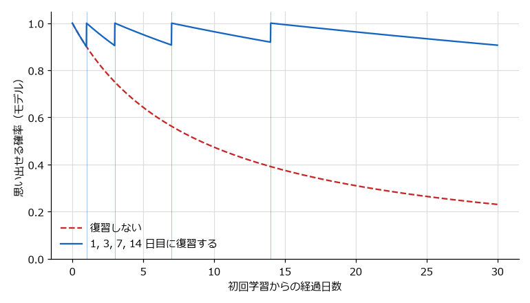

.. _ch03:

第 3 章 学習と記憶の仕組み
========================================================

効果的な学習法を理解するには、その前提となる記憶の仕組みを知っておく必要がある。なぜ再読よりも思い出す練習のほうが効果的なのか、なぜ一度にたくさん詰め込むと理解できなくなるのか、なぜ時間を空けて復習するとよいのか。これらの問いには、記憶の仕組みから説明できる部分が多い。本章では、認知心理学の代表的なモデルに沿って、感覚記憶・作業記憶・長期記憶、チャンクとスキーマ、認知負荷理論、符号化・貯蔵・検索、忘却、貯蔵強度と検索強度を順に説明する。

なお、ここで紹介するモデルは、記憶の働きを説明するための単純化された枠組みである。脳の中に「作業記憶」という部品がそのまま存在するわけではない。モデルは、学習法を選ぶときの見通しを与える道具として理解してほしい。

記憶のモデル
------------------------------------------------

三つの記憶
^^^^^^^^^^^^^^^^^^^^^^^^^^^^^^^^^^^^^^^^^^^^^^^^

Atkinson と Shiffrin [AtkinsonShiffrin1968]_ は、記憶を情報の流れとして捉え、感覚記憶、短期記憶、長期記憶の三つの貯蔵庫からなるモデルを提案した。現在では、短期記憶を単なる一時的な置き場ではなく、情報を保持しながら処理する場として捉え、作業記憶（working memory）と呼ぶことが多い。本書でも作業記憶と呼ぶ。

.. graphviz::
   :caption: 記憶のモデル（単純化したもの）
   :name: fig-ch03-memory-model

   digraph memory {
       rankdir=LR;
       graph [nodesep=0.5, ranksep=0.7];
       node [shape=box, style="rounded,filled", fillcolor="#e3f2fd", fontsize=12];
       edge [fontsize=10];

       input [label="外界の情報\n（文字・音・画像）", shape=plaintext, style=""];
       sensory [label="感覚記憶\nごく短時間保持"];
       working [label="作業記憶\n容量が小さい\n意識的な処理の場", fillcolor="#fff3e0"];
       longterm [label="長期記憶\n容量はほぼ無制限\n知識・スキーマ", fillcolor="#e8f5e9"];
       lost1 [label="消失", shape=plaintext, style=""];
       lost2 [label="消失", shape=plaintext, style=""];

       input -> sensory;
       sensory -> working [label="注意"];
       working -> longterm [label="符号化"];
       longterm -> working [label="検索"];
       sensory -> lost1 [style=dashed];
       working -> lost2 [style=dashed];
   }

:numref:`fig-ch03-memory-model` の流れを、技術書を読む場面で説明する。

* 感覚記憶: 目に入った文字や耳に入った音は、ごく短い時間だけ感覚記憶に保持される。注意を向けなかった情報はすぐに消える。
* 作業記憶: 注意を向けた情報は作業記憶に入る。作業記憶は、文章の意味を理解する、コードの動きを追う、二つの概念を比べるといった意識的な処理の場である。容量が小さく、保持できる時間も短い。
* 長期記憶: 作業記憶で処理された情報の一部が長期記憶に送られる（符号化）。長期記憶の容量は事実上無制限であり、必要なときに作業記憶へ呼び出される（検索）。

学習とは、長期記憶の中に、後で検索できる形で知識を蓄えることだと言える。ただし、作業記憶と長期記憶は一方通行ではない。新しい情報を理解するとき、作業記憶は長期記憶から関連する知識を呼び出して使う。Python を知っている人が Ruby の文法をすぐに理解できるのは、長期記憶にある Python の知識を作業記憶に呼び出して照合できるからである。

作業記憶の構成
^^^^^^^^^^^^^^^^^^^^^^^^^^^^^^^^^^^^^^^^^^^^^^^^

Baddeley と Hitch [Baddeley1974]_ は作業記憶を、注意を制御する中央実行系と、言語的な情報を保持する音韻ループ、視覚的・空間的な情報を保持する視空間スケッチパッドからなるモデルで説明した。後に Baddeley [Baddeley2000]_ は、これらの情報や長期記憶の情報を統合して一時的に保持するエピソード・バッファを加えている。

この区別は、図と文章を組み合わせた教材が理解を助ける理由の一つとして挙げられる。言語的な情報と視覚的な情報は、作業記憶の異なる部分で扱われると考えられるため、両方を適切に組み合わせると作業記憶をより有効に使える（二重符号化については :ref:`ch04` で扱う）。

作業記憶の容量
^^^^^^^^^^^^^^^^^^^^^^^^^^^^^^^^^^^^^^^^^^^^^^^^

作業記憶の容量の小ささは、学習を考えるうえで最も重要な制約である。Miller [Miller1956]_ は、人が一度に保持できる項目の数がおよそ 7 個前後であることを「魔法の数 7 ± 2」として論じた。その後の研究を整理した Cowan [Cowan2001]_ は、リハーサル（頭の中での繰り返し）などの方略を使えない条件では、保持できるのはおよそ 4 個前後のまとまりであると主張している。

いずれの数値を採るにしても、作業記憶が一度に扱える情報はごく少ない。初めて読む API リファレンスで、知らない関数名、引数、戻り値の型、例外が一度に現れると理解が追いつかなくなるのは、この容量を超えるためである。

チャンクとスキーマ
------------------------------------------------

チャンク
^^^^^^^^^^^^^^^^^^^^^^^^^^^^^^^^^^^^^^^^^^^^^^^^

作業記憶の容量は「項目の数」で数えるが、一つの項目にどれだけの情報を詰め込めるかは、その人の知識によって変わる。意味のあるまとまりとして扱われる単位をチャンクと呼ぶ。

例えば、``for i in range(len(items)):`` という 1 行は、Python を学び始めたばかりの人にとっては ``for``、``i``、``in``、``range``、``len``、``items`` などの要素の集まりである。一方、経験者にとっては「リストのインデックスを順に回すループ」という一つのチャンクであり、作業記憶をほとんど消費しない。熟達者が初心者よりも多くの情報を一度に扱えるのは、作業記憶そのものが大きいからではなく、長期記憶にある知識によって情報を大きなチャンクにまとめられるからである。チェスの熟達者を対象にしたこの種の研究は :ref:`ch07` で扱う。

スキーマ
^^^^^^^^^^^^^^^^^^^^^^^^^^^^^^^^^^^^^^^^^^^^^^^^

長期記憶の中で、関連する知識が構造化されたまとまりをスキーマと呼ぶ。スキーマは、個々の事実を並べたものではなく、事実どうしの関係、典型的なパターン、手順を含む知識の枠組みである。

Web アプリケーションの経験があるエンジニアは、「リクエストを受け取り、ルーティングし、処理を呼び、レスポンスを返す」というスキーマを持っている。新しい Web フレームワークを学ぶとき、このスキーマのどこに新しい概念が当てはまるかを考えれば、個々の機能を独立した事実として覚える必要がない。スキーマは、新しい情報を整理して受け入れる受け皿になる。

学習が進むと、スキーマは豊かになり、自動化される。自動化されたスキーマは作業記憶をほとんど使わずに働くため、空いた作業記憶をより高度な処理に回せる。キーボードの位置を意識しなくなったプログラマが、タイピングではなく設計に集中できるのと同じである。

認知負荷理論
------------------------------------------------

認知負荷とは
^^^^^^^^^^^^^^^^^^^^^^^^^^^^^^^^^^^^^^^^^^^^^^^^

作業記憶の容量の制約を学習の設計に結び付けたのが、Sweller [Sweller1988]_ が提唱した認知負荷理論である。認知負荷（cognitive load）とは、ある課題を処理するときに作業記憶にかかる負担のことである。Sweller らの整理 [Sweller2019]_ に沿うと、認知負荷は次のように分けられる。

.. list-table:: 認知負荷の種類
   :header-rows: 1
   :widths: 20 45 35
   :name: tbl-ch03-cognitive-load

   * - 種類
     - 内容
     - エンジニアの学習での例
   * - 内在的負荷
     - 学ぶ内容そのものの複雑さによる負荷。同時に関係を考えなければならない要素が多いほど大きい。
     - 非同期処理、並行処理、型システムの理論など、多くの要素が互いに関係する概念
   * - 外在的負荷
     - 教材の提示の仕方など、学習そのものとは関係のない要因による負荷
     - 説明とコードが離れたページに書かれている、不要な装飾や脱線が多い、用語が統一されていない
   * - 学習関連負荷
     - スキーマを構築するために使われる負荷
     - 例題を自分の言葉で説明する、既知の知識と比べる

学習関連負荷（germane load）の位置付けは研究者によって異なり、近年の整理では独立した負荷としてではなく、内在的負荷に作業記憶の資源を振り向けることとして説明されることもある [Sweller2019]_。本書では、学習に役立つ処理に作業記憶を使うことを指す言葉として扱う。

学習への含意
^^^^^^^^^^^^^^^^^^^^^^^^^^^^^^^^^^^^^^^^^^^^^^^^

認知負荷理論から導かれる原則は、作業記憶の容量を外在的負荷で浪費せず、内在的負荷を処理できる範囲に保つことである。独学者が自分でできる工夫としては、次のようなものがある。

* 外在的負荷を減らす: 説明とコードを並べて読めるようにする、画面を分けて公式ドキュメントとエディタを同時に表示する、通知を切る。
* 内在的負荷を調整する: 複雑な概念は要素に分けて学び、要素を理解してから組み合わせる。例えば、非同期処理を学ぶときは、イベントループ、コルーチン、タスクの順に一つずつ理解してから、全体の動きを追う。
* 前提知識を先に補う: 必要な前提知識が欠けていると、内在的負荷が大きくなりすぎる。理解が進まないときは、教材の難しさよりも前提知識の不足を疑う。

認知負荷理論はまた、同じ教材でも学習者の知識の量によって効果が変わることを示している。初心者には詳しい解説付きの例題が有効だが、ある程度知識がある学習者には冗長な説明がかえって負担になる。この現象（熟達化反転効果）と、例題から自力解決へ移る方法は :ref:`ch11` で扱う。

.. admonition:: 根拠の強さ: 中程度
   :class: evidence evidence-moderate

   認知負荷理論に基づく多くの効果（解き方を一つずつ示した例題で学ぶほうが、自力で問題を解くより初心者の学習に効果的であるというワークドエグザンプル効果など）は多数の実験で確認されている。一方で、認知負荷を直接測定する方法には課題があり、理論の細部については議論が続いている。

符号化・貯蔵・検索
------------------------------------------------

記憶の働きは、情報を長期記憶に入れる符号化、長期記憶に保持する貯蔵、必要なときに取り出す検索の三つの段階に分けて考えることができる。

符号化
^^^^^^^^^^^^^^^^^^^^^^^^^^^^^^^^^^^^^^^^^^^^^^^^

符号化は、作業記憶で処理した情報を長期記憶に入れる過程である。一般に、情報の意味を考え、既知の知識と関連付けて処理するほど、後で思い出しやすい形で符号化される。文字の形や音だけを見る浅い処理よりも、「なぜそうなるのか」「既に知っている何に似ているか」を考える深い処理のほうが記憶に残りやすい。これは記憶研究で広く共有されている一般的な傾向である。

例えば、Git の ``rebase`` を学ぶとき、コマンドの書式だけを覚えるよりも、「コミットを別の土台の上に積み直す操作であり、``merge`` と違って履歴が一直線になる」と意味と関係を理解して覚えるほうが、後で思い出しやすく、応用も利く。:ref:`ch04` で扱う精緻化質問と自己説明は、この深い処理を意図的に引き起こす方法である。

貯蔵
^^^^^^^^^^^^^^^^^^^^^^^^^^^^^^^^^^^^^^^^^^^^^^^^

長期記憶に入った情報は、時間をかけて安定した形になっていく。この過程を記憶の固定化（memory consolidation）と呼ぶ。固定化には睡眠が重要な役割を果たすと考えられている（:ref:`ch10` を参照）。

検索
^^^^^^^^^^^^^^^^^^^^^^^^^^^^^^^^^^^^^^^^^^^^^^^^

検索は、長期記憶から情報を取り出して作業記憶で使えるようにする過程である。日常の感覚では、検索は「保存したものを読み出すだけ」の操作に思える。しかし、記憶研究の重要な発見の一つは、検索が記憶そのものを変えるということである。思い出すという行為は、その記憶を強め、後で再び思い出しやすくする。この性質を学習に利用するのが、:ref:`ch04` で扱う検索練習である。

また、ある情報が長期記憶に「ある」ことと、それを必要なときに「思い出せる」ことは別である。試験の後で答えを見て「知っていたのに思い出せなかった」と感じる経験は、情報が貯蔵されていても検索に失敗することがあることを示している。

忘却
------------------------------------------------

エビングハウスの忘却曲線
^^^^^^^^^^^^^^^^^^^^^^^^^^^^^^^^^^^^^^^^^^^^^^^^

記憶を実験的に研究した最初期の人物が、19 世紀のドイツの心理学者 Ebbinghaus である [Ebbinghaus1885]_。Ebbinghaus は、意味を持たない音節（無意味つづり）のリストを自分自身で覚え、一定の時間が経った後に再び覚え直すのに必要な時間を測った。最初に覚えたときより少ない時間で覚え直せれば、その差は記憶が残っている分と考えられる（節約法）。

その結果、忘却は学習の直後に急速に進み、時間が経つにつれて緩やかになることが示された。この関係を表す曲線を忘却曲線と呼ぶ。Murre と Dros [MurreDros2015]_ は Ebbinghaus の実験を同じ方法で再現し、忘却曲線の形がおおむね再現されることを確認している。

忘却曲線については誤解も多い。よく「1 日経つと 7 割近くを忘れる」といった数値が引用されるが、これは無意味つづりを使った実験の結果である。しかも Ebbinghaus が測ったのは、同じリストを覚え直すのにかかる時間がどれだけ短くなったか（節約率）であり、思い出せる割合そのものではない。この数値は、意味のある内容や、理解を伴って学んだ内容にそのまま当てはまるわけではない。忘却の速さは、学ぶ内容、学び方、学習者の知識によって大きく変わる。忘却曲線から読み取るべきなのは具体的な数値ではなく、「忘却は学習の直後に速く進む」「復習しなければ記憶は失われていく」という一般的な傾向である。

.. admonition:: 根拠の強さ: 強い
   :class: evidence evidence-strong

   時間とともに保持が低下し、その低下が学習直後に大きいという傾向は、再現研究を含む多くの研究で確認されている。ただし、具体的な忘却の速さは材料や条件によって大きく異なる。

なぜ忘れるのか
^^^^^^^^^^^^^^^^^^^^^^^^^^^^^^^^^^^^^^^^^^^^^^^^

忘却の原因については、時間の経過とともに記憶が薄れるという考え方のほかに、他の記憶との干渉による説明がある。Wixted [Wixted2004]_ は、忘却の研究を整理し、新しく学んだ情報が、記憶がまだ固定化されていない時期の他の心的活動によって妨げられることが忘却の重要な要因であると論じている。

干渉は、エンジニアが似た技術を続けて学ぶときに問題になりやすい。例えば、Python と JavaScript の配列操作を同時期に学ぶと、メソッド名や引数の順序が混ざることがある。似たものを学ぶときは、違いを意識的に比べて整理することが有効である（:ref:`ch04` の交互学習と :ref:`ch06` の転移を参照）。

復習による忘却曲線の変化
^^^^^^^^^^^^^^^^^^^^^^^^^^^^^^^^^^^^^^^^^^^^^^^^

忘却曲線は固定されたものではなく、復習によって変化する。復習するたびに記憶は安定し、次に忘れるまでの時間が長くなると考えられている。:numref:`fig-ch03-forgetting-curve` は、この考え方を単純なモデルで表した模式図である。

   復習による忘却曲線の変化（簡易モデルによる模式図であり、実測値ではない）

この図では、ある時点で思い出せる確率（保持率）:math:`R` を、最後に学習してからの経過日数 :math:`t` と、記憶の安定性 :math:`S` を使って次の式で表している。

.. math::

   R(t) = \frac{1}{1 + \dfrac{t}{9S}}

:math:`S` は保持率が 0.9 まで下がるのにかかる日数に当たる。復習するたびに :math:`S` が大きくなるため、復習後の曲線は緩やかになる。図から読み取れるのは、復習しない場合は保持率が下がり続けるのに対し、間隔を広げながら復習すると、少ない回数で高い保持率を長く保てるということである。このモデルの詳細と、それを使った復習による保持率の変化の計算は :ref:`ch16` で扱う。

貯蔵強度と検索強度
------------------------------------------------

二つの強さ
^^^^^^^^^^^^^^^^^^^^^^^^^^^^^^^^^^^^^^^^^^^^^^^^

Bjork と Bjork [Bjork1992]_ は、記憶の強さを二つに分けて考える理論を提案した。これは「不使用の新理論（new theory of disuse）」と呼ばれる。

* 貯蔵強度（storage strength）: その記憶が、他の知識とどれだけしっかり結び付き、長期記憶に定着しているかを表す。一度高まると下がらず、学習を重ねるほど高まる。
* 検索強度（retrieval strength）: その記憶を、今この時点でどれだけ容易に思い出せるかを表す。時間が経つと下がり、思い出すと高まる。

例えば、子どもの頃に住んでいた家の電話番号は、何年も使っていないので今すぐには思い出せない（検索強度が低い）。しかし、ヒントがあれば思い出せたり、覚え直すのがとても速かったりする（貯蔵強度は高い）。逆に、試験の直前に詰め込んだ内容は、試験の時点ではすらすら思い出せる（検索強度が高い）が、試験が終わるとすぐに思い出せなくなる（貯蔵強度は低い）。

理論の重要な含意
^^^^^^^^^^^^^^^^^^^^^^^^^^^^^^^^^^^^^^^^^^^^^^^^

この理論の重要な主張は、検索強度が低いときに思い出したり学び直したりするほど、貯蔵強度が大きく高まるということである。すぐに思い出せる状態で繰り返しても、貯蔵強度はあまり高まらない。思い出しにくくなった状態で苦労して思い出すほうが、長期的な記憶を強める。

この主張は、学習者の直感に反する重要な結論につながる。

* 学習中の手応えは主に検索強度を反映する。同じ内容を続けて繰り返すと、すらすら思い出せるので覚えた気になるが、貯蔵強度はあまり高まっていない。
* 学習の成果として重要なのは貯蔵強度である。時間が経っても思い出せる、応用できるという力は、貯蔵強度に支えられる。
* したがって、学習中に少し苦労するような方法のほうが、長期的には効果が高いことがある。

:numref:`fig-ch03-forgetting-curve` のモデルでも、保持率が下がってから復習するほど安定性が大きく伸びるように設定している。これは、この理論の考え方を単純な式で表したものである。この考え方は、:ref:`ch04` で扱う「望ましい困難」の理論的な土台になっている。

.. admonition:: 根拠の強さ: 中程度
   :class: evidence evidence-moderate

   貯蔵強度と検索強度を区別する理論は、検索練習、分散学習、交互学習など多くの現象を統一的に説明でき、広く受け入れられている。ただし、二つの強さは直接観測できる量ではなく、理論的な構成概念である。

エンジニアの独学への応用
------------------------------------------------

本章の内容をエンジニアの独学に当てはめると、次のようになる。

* 一度に扱う新しい要素を減らす。新しいフレームワークを学ぶときは、最小構成のサンプルから始め、要素を一つずつ追加する。いきなり大きなサンプルアプリケーションを読み解こうとしない。
* 外在的負荷を減らす。解説とコードを並べて表示する、不要なタブや通知を閉じる、用語の定義を手元にまとめる。
* 既知の知識と結び付ける。新しい概念を学ぶときは「既に知っている何に似ているか、何が違うか」を考える。既存のスキーマが受け皿になる。
* 理解したかどうかは、教材を閉じて思い出せるかで確かめる。すらすら読めることは、思い出せることを意味しない。
* 忘れることを前提に計画する。学んだ内容は復習しなければ失われていく。復習の予定を最初から計画に組み込む（:ref:`ch15` を参照）。
* 似た技術を同時期に学ぶときは、違いを表にまとめるなどして、干渉を減らす。

まとめ
------------------------------------------------

* 記憶は、感覚記憶、作業記憶、長期記憶からなるモデルで説明できる。学習とは、長期記憶に後で検索できる形で知識を蓄えることである。
* 作業記憶の容量はごく小さい。熟達者は、長期記憶の知識によって情報を大きなチャンクにまとめることで、この制約を補っている。
* 長期記憶の中で構造化された知識（スキーマ）は、新しい情報を受け入れる受け皿になる。
* 認知負荷理論は、学習の設計を、外在的負荷を減らし内在的負荷を処理できる範囲に保つという観点から考える。
* 思い出すという行為は記憶を強める。情報が貯蔵されていることと、思い出せることは別である。
* 忘却は学習の直後に速く進むが、復習によって記憶は安定し、忘れにくくなる。
* 記憶には貯蔵強度と検索強度の二つの側面がある。思い出しにくくなってから思い出すほど、貯蔵強度は大きく高まる。
