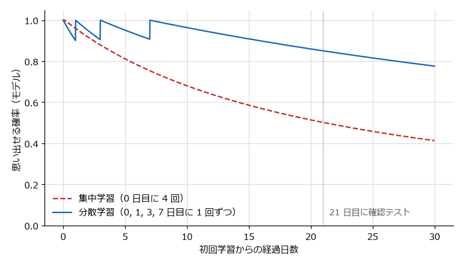

.. _ch04:

第 4 章 効果が確かめられた学習法
========================================================

学習法には、効果が繰り返し確かめられているものと、広く使われているのに効果が低いものがある。本章では、認知心理学と教育心理学の研究で効果が確かめられた学習法を紹介する。まず、代表的な学習法の有効性をまとめた Dunlosky らの評価を概観し、次に効果の高い学習法を一つずつ説明する。続いて、よく使われるのに効果が低い学習法とその理由を述べ、最後にこれらの学習法に共通する「望ましい困難」という考え方を説明する。

本章で紹介する学習法の多くは、:ref:`ch03` で説明した記憶の仕組み、特に「思い出すことが記憶を強める」「思い出しにくくなってから思い出すほど記憶が強まる」という性質に基づいている。

Dunlosky らによる 10 技法の評価
------------------------------------------------

Dunlosky ら [Dunlosky2013]_ は、学生がよく使う、あるいは研究で効果が報告されている 10 の学習技法を取り上げ、それぞれについて多くの研究を検討した。そして、学習者の年齢、学ぶ内容、テストの形式、保持期間などの幅広い条件で効果があるかどうかを基準に、各技法の有用性を高・中・低の三段階で評価した。

.. list-table:: Dunlosky ら（2013）による 10 技法の有用性の評価
   :header-rows: 1
   :widths: 22 58 20
   :name: tbl-ch04-dunlosky

   * - 技法
     - 内容
     - 有用性
   * - 練習テスト
     - 自分でテストする、問題を解く、フラッシュカードで思い出す
     - 高
   * - 分散学習
     - 学習を時間的に分散させる
     - 高
   * - 精緻化質問
     - 事実について「なぜそうなるのか」を自分で説明する
     - 中
   * - 自己説明
     - 学んだ内容や解き方の各ステップを自分に説明する
     - 中
   * - 交互学習
     - 異なる種類の問題や内容を混ぜて練習する
     - 中
   * - 要約
     - 学んだ内容の要約を書く
     - 低
   * - ハイライト・下線
     - 重要だと思う箇所に印を付ける
     - 低
   * - キーワード記憶法
     - 語呂合わせや連想するイメージで語句を覚える
     - 低
   * - イメージ化
     - 文章を読みながら内容を頭の中で絵にする
     - 低
   * - 再読
     - 一度読んだ教材をもう一度読む
     - 低

この評価で注意すべき点が二つある。一つは、「低」と評価された技法が無意味だという意味ではないことである。例えば要約は、うまく要約する訓練を受けた学習者には効果があるが、多くの学習者はその訓練を受けておらず、効果が条件に左右される。「低」は、幅広い条件で効果を期待できるだけの根拠が不足していることを意味する。もう一つは、この評価が主に学生の教科学習を対象にした研究に基づいていることである。エンジニアの独学に当てはめるときは、各技法の仕組みを理解したうえで応用する必要がある。

以下では、有用性が高いと評価された二つの技法と、中程度と評価された三つの技法を中心に説明する。

.. _ch04-retrieval:

検索練習
------------------------------------------------

検索練習とは
^^^^^^^^^^^^^^^^^^^^^^^^^^^^^^^^^^^^^^^^^^^^^^^^

検索練習（retrieval practice）とは、学んだ内容を記憶から思い出す練習である。教材を閉じて要点を書き出す、問題を解く、フラッシュカードで答えを思い出すといった活動がこれに当たる。テストを受けることで記憶が強まる現象をテスト効果（testing effect）と呼ぶ。Dunlosky らの「練習テスト」は、この検索練習を指している。

テストは、一般には学習の成果を「測る」ための道具と考えられている。しかし、学習研究の重要な発見の一つは、テストが学習の成果を「生み出す」ということである。:ref:`ch03` で述べたように、思い出すという行為そのものが記憶を強める。

代表的な研究
^^^^^^^^^^^^^^^^^^^^^^^^^^^^^^^^^^^^^^^^^^^^^^^^

Roediger と Karpicke [Roediger2006]_ は、大学生に短い文章を読ませた後、もう一度読み直すグループと、文章を見ずに内容を思い出して書き出すグループに分けた。最終テストを 5 分後に行うと、読み直したグループの成績のほうが高かった。ところが、2 日後と 1 週間後に行うと、思い出して書き出したグループの成績のほうが高かった。読み直しは短期的には有利に見えるが、長期的な保持では検索練習が上回るのである。

Karpicke と Roediger [Karpicke2008]_ は、外国語の単語を覚える実験で、一度正しく思い出せた単語をその後の学習から外す条件を比べた。その結果、思い出せた単語を「学習（見直し）」から外しても 1 週間後の成績はほとんど変わらなかったが、「テスト（思い出す練習）」から外すと成績が大きく下がった。一度思い出せたからといって検索練習をやめてしまうと、長期的な保持が損なわれることを示している。

検索練習の効果は、単純な暗記に限らない。Karpicke と Blunt [Karpicke2011]_ は、科学の文章を学ぶときに、検索練習を行うグループと、概念マップ（概念の関係を図に描く方法）を作るグループを比べた。1 週間後のテストでは、検索練習のグループのほうが、文章に直接書かれた内容だけでなく、推論を必要とする問題でも成績が高かった。

これらの結果は、多くのメタ分析で確認されている。Rowland [Rowland2014]_ や Adesope ら [Adesope2017]_ のメタ分析は、テストが再読などの方法と比べて長期的な保持を高めることを示している。Agarwal ら [Agarwal2021]_ は、実験室ではなく実際の学校の授業で行われた研究を整理し、検索練習の効果が教室の環境でも一貫して見られることを報告している。

.. admonition:: 根拠の強さ: 強い
   :class: evidence evidence-strong

   検索練習が再読と比べて長期的な保持を高めることは、複数のメタ分析と、教室での応用研究で一貫して支持されている。

思い出せなくても効果がある
^^^^^^^^^^^^^^^^^^^^^^^^^^^^^^^^^^^^^^^^^^^^^^^^

検索練習は、正しく思い出せたときだけ効果があるわけではない。Kornell ら [Kornell2009]_ は、答えを思い出そうとして失敗した後で正解を見ると、最初から正解を見て覚えるよりも記憶に残りやすいことを示した。Richland ら [Richland2009]_ は、学習する前に、まだ学んでいない内容についてのテスト（事前テスト）を受けると、その後の学習の効果が高まることを報告している。

つまり、答えを知らない段階でも「まず考えてみる」ことには価値がある。新しい章を読む前に、章末の問題や見出しを見て内容を予想してみる、公式ドキュメントで答えを探す前に自分で仮説を立てるといった行動は、検索練習の考え方を応用したものである。ただし、思い出そうとした後には必ず正解を確認する必要がある。正解を確認しないと、誤った答えをそのまま覚えてしまうおそれがある。

検索練習の方法
^^^^^^^^^^^^^^^^^^^^^^^^^^^^^^^^^^^^^^^^^^^^^^^^

独学で検索練習を行う方法には、次のようなものがある。

* 白紙に書き出す: 教材を閉じて、学んだ内容を白紙に書き出す。書き終えたら教材と照合し、抜けていた点や誤りを確認する。
* フラッシュカード: 問いと答えのカードを作り、問いを見て答えを思い出す。間隔反復ソフトを使うと復習のタイミングも管理できる（:ref:`ch16` を参照）。
* 問題を解く: 教材の練習問題、資格試験の過去問、競技プログラミングの問題などを、解説を見ずに解く。
* 何も見ずにコードを書く: チュートリアルで学んだ処理を、チュートリアルを見ずにもう一度書く。
* 説明する: 学んだ内容を、教材を見ずに他人や自分に説明する（:ref:`ch13` を参照）。

検索練習を行うと、思い出せないことや誤りに気付くため、学習が進んでいないように感じることがある。しかし、その「思い出せない」という経験は、:ref:`ch03` で説明した貯蔵強度を高める機会であると同時に、自分の理解の穴を正確に知る機会でもある。

.. _ch04-spacing:

分散学習
------------------------------------------------

分散学習とは
^^^^^^^^^^^^^^^^^^^^^^^^^^^^^^^^^^^^^^^^^^^^^^^^

分散学習（distributed practice）とは、同じ量の学習を一度にまとめて行うのではなく、時間を空けて複数回に分けて行う方法である。一度にまとめて行う方法を集中学習（massed practice）と呼ぶ。学習の総時間が同じでも、分散させたほうが長期的な保持が高まる現象を間隔効果（spacing effect）と呼ぶ。

Cepeda ら [Cepeda2006]_ は、分散学習に関する数多くの研究をメタ分析し、学習を分散させると集中させた場合よりも保持が高まることを確認した。この効果は、:ref:`ch03` で説明した Ebbinghaus の時代から知られている、学習研究で最も頑健な現象の一つである。

   集中学習と分散学習の比較（簡易モデルによる模式図であり、実測値ではない）

:numref:`fig-ch04-spacing` は、同じ 4 回の学習を、初日にまとめて行った場合と、日を空けて行った場合を :ref:`ch03` の簡易モデルで比べたものである。初日にまとめて繰り返すと、その時点ではよく覚えているが、記憶の安定性があまり伸びない。日を空けて、少し忘れかけたところで学び直すと、安定性が大きく伸び、長く記憶が保たれる。

最適な間隔
^^^^^^^^^^^^^^^^^^^^^^^^^^^^^^^^^^^^^^^^^^^^^^^^

どれくらいの間隔を空ければよいかは、いつまで覚えておきたいか（保持期間）によって変わる。Cepeda ら [Cepeda2008]_ は、多数の参加者を対象に、学習の間隔と最終テストまでの期間を組み合わせて調べた。その結果、保持期間が長くなるほど最適な間隔も長くなるが、保持期間に対する最適な間隔の比率は小さくなることが示された。1 週間後の試験に備えるなら 1 日程度、数か月から 1 年覚えておきたいなら数週間程度の間隔が目安になる。

ただし、厳密な最適値を求める必要はない。研究からは、間隔が短すぎるよりは長すぎるほうが損失が小さい傾向も示されている。実用上は、「1 日後、数日後、1 週間後、数週間後」のように、復習の間隔を徐々に広げていく方法が扱いやすい。間隔反復ソフトは、この間隔の調整を自動で行う道具である（:ref:`ch16` を参照）。

検索練習との組み合わせ
^^^^^^^^^^^^^^^^^^^^^^^^^^^^^^^^^^^^^^^^^^^^^^^^

分散学習は、検索練習と組み合わせると特に効果が高い。Latimier ら [Latimier2021]_ のメタ分析は、検索練習を時間的に分散させると、集中させた場合よりも長期的な保持が高まることを示している。Rawson と Dunlosky [Rawson2011]_ は、1 回の学習で正しく思い出せるまで検索練習を行い、それを日を空けて複数回繰り返す方法（連続的再学習）が、長期的な保持に効果的であることを示した。Carpenter ら [Carpenter2022]_ は、分散学習と検索練習に関する研究を整理し、二つを組み合わせることが学習の効果を高める有力な方法であるとまとめている。

.. admonition:: 根拠の強さ: 強い
   :class: evidence evidence-strong

   分散学習が集中学習よりも長期的な保持を高めることは、100 年以上にわたる多数の研究とメタ分析で一貫して支持されている。最適な間隔は保持期間に依存する。

分散学習を妨げるもの
^^^^^^^^^^^^^^^^^^^^^^^^^^^^^^^^^^^^^^^^^^^^^^^^

分散学習の効果がこれほど確かであるにもかかわらず、多くの学習者は集中学習を選ぶ。理由の一つは、集中学習のほうが学習中の手応えが大きいことである。同じ内容を続けて繰り返すと、2 回目、3 回目はすらすら思い出せるため、覚えたと感じる。しかし、その手応えは :ref:`ch03` で説明した検索強度を反映しているにすぎない。もう一つの理由は、分散学習には計画が必要なことである。試験の前日に詰め込むのは計画がなくてもできるが、分散学習は数日から数週間前から始めなければならない。

.. _ch04-interleaving:

交互学習
------------------------------------------------

交互学習とは
^^^^^^^^^^^^^^^^^^^^^^^^^^^^^^^^^^^^^^^^^^^^^^^^

交互学習（interleaved practice）とは、異なる種類の問題や内容を混ぜて練習する方法である。これに対して、同じ種類の問題をまとめて練習する方法をブロック学習（blocked practice）と呼ぶ。例えば、教科書の各章の練習問題をその章を読んだ直後に解くのはブロック学習であり、複数の章の問題を混ぜて解くのは交互学習である。

Rohrer と Taylor [Rohrer2007]_ は、さまざまな立体の体積を求める数学の問題を使って、ブロック学習と交互学習を比べた。練習中の正答率はブロック学習のほうが高かったが、1 週間後のテストでは交互学習のほうが大幅に高い成績を示した。Kornell と Bjork [Kornell2008]_ は、画家の作風を学ぶ課題で、一人の画家の作品をまとめて見るよりも、複数の画家の作品を混ぜて見るほうが、新しい作品の作者を正しく見分けられることを示した。この研究でも、多くの参加者は、まとめて見るほうが学べたと感じていた。

なぜ効果があるのか
^^^^^^^^^^^^^^^^^^^^^^^^^^^^^^^^^^^^^^^^^^^^^^^^

交互学習の効果は、主に二つの理由で説明される。

一つは、問題の種類を見分ける練習になることである。ブロック学習では、「この章の問題だから、この章の解き方を使えばよい」と分かっているので、どの解き方を使うべきかを判断する必要がない。交互学習では、問題を見て、どの解き方を使うべきかを毎回判断しなければならない。実際の仕事や試験では、問題に章の名前は付いていないので、この判断の練習が役に立つ。

もう一つは、似たものの違いに注目できることである。異なる種類のものを並べて比べると、それらを区別する特徴に気付きやすい。

効果が得られる条件
^^^^^^^^^^^^^^^^^^^^^^^^^^^^^^^^^^^^^^^^^^^^^^^^

交互学習の効果は、どんな内容にも同じように現れるわけではない。Brunmair と Richter [Brunmair2019]_ のメタ分析は、交互学習の効果が学ぶ内容によって大きく異なることを示した。絵画の作風のように、似ていて見分けにくいカテゴリーを学ぶ場合には効果が大きい一方で、単語の学習などでは効果が見られないばかりか、むしろ不利になる場合もある。

エンジニアの学習に当てはめると、交互学習は、複数の似た選択肢から適切なものを選ぶ力を身に付けたいときに特に有効だと考えられる。例えば、データ構造の選択（リスト、辞書、集合、ヒープ）、SQL の結合の種類、デザインパターンの使い分け、クラウドのストレージサービスの選択などである。一方で、まったく新しい概念を学び始めたばかりの段階では、まず一つの種類に集中して基本を理解し、ある程度理解してから他の種類と混ぜるほうがよい。

.. admonition:: 根拠の強さ: 中程度
   :class: evidence evidence-moderate

   交互学習の効果は多くの実験で示されているが、効果の大きさは学ぶ内容に強く依存する。似たカテゴリーを見分ける課題や数学の問題では効果が大きいが、効果が見られない材料もある。

精緻化質問と自己説明
------------------------------------------------

精緻化質問
^^^^^^^^^^^^^^^^^^^^^^^^^^^^^^^^^^^^^^^^^^^^^^^^

精緻化質問（elaborative interrogation）とは、学んだ事実について「なぜそうなるのか」「なぜこれは正しいのか」を自分に問い、説明を考える方法である。例えば、「Python のタプルは辞書のキーに使えるが、リストは使えない」という事実を学んだら、「なぜだろうか」と考える。すると、「辞書のキーはハッシュ値で管理されるため、変更可能なオブジェクトはキーにできない。タプルは変更できないが、リストは変更できる」という説明にたどり着く。この説明を考える過程で、新しい事実が既知の知識（ハッシュ、変更可能性）と結び付き、記憶に残りやすくなる。

Dunlosky ら [Dunlosky2013]_ によれば、精緻化質問は、学習者がその分野についてある程度の前提知識を持っている場合に特に効果がある。前提知識がまったくない場合、「なぜ」に答えられないか、誤った説明を作ってしまうおそれがある。

自己説明
^^^^^^^^^^^^^^^^^^^^^^^^^^^^^^^^^^^^^^^^^^^^^^^^

自己説明（self-explanation）とは、教材の内容や問題の解き方の各ステップについて、自分自身に説明しながら学ぶ方法である。Chi ら [Chi1989]_ は、物理の例題を学ぶ学生を観察し、成績の良い学生ほど、例題の各ステップについて「なぜこの式を使うのか」「この値はどこから来たのか」を自分に説明していることを見いだした。さらに Chi ら [Chi1994]_ は、文章を読みながら自己説明をするよう促すと、理解が深まることを実験で示した。Bisra ら [Bisra2018]_ のメタ分析は、自己説明を促すことが学習に効果をもたらすことを確認している。

自己説明は、エンジニアがコードを読むときに直接応用できる。他人のコードや公式ドキュメントのサンプルを読むとき、各行が何をしているかだけでなく、「なぜこう書いたのか」「別の書き方ではいけないのか」を説明しながら読む。説明できない箇所は理解が不足している箇所であり、調べるべき対象がはっきりする。自己説明を文章やコードのコメントとして書き出す方法は :ref:`ch13` で扱う。

.. admonition:: 根拠の強さ: 中程度
   :class: evidence evidence-moderate

   精緻化質問と自己説明は多くの研究で効果が示されている。ただし、効果は前提知識の量や課題の種類によって変わり、説明を考えるために時間がかかるという短所もある。

具体例と二重符号化
------------------------------------------------

具体例
^^^^^^^^^^^^^^^^^^^^^^^^^^^^^^^^^^^^^^^^^^^^^^^^

抽象的な概念は、具体例と組み合わせると理解しやすくなる。Willingham [Willingham2009]_ は、人は抽象的な概念を、既に知っている具体的なものを通じて理解すると論じている。例えば、「依存性の注入」という抽象的な説明だけを読んでも理解しにくいが、データベースへの接続をコンストラクタの引数として受け取るクラスの例を見ると、その意味と利点が分かりやすくなる。

ただし、具体例が一つだけだと、その例の表面的な特徴と概念の本質を区別できないことがある。複数の異なる具体例を比べ、共通する構造を見つけることが、概念を新しい場面に応用する力につながる（:ref:`ch06` の転移を参照）。

二重符号化
^^^^^^^^^^^^^^^^^^^^^^^^^^^^^^^^^^^^^^^^^^^^^^^^

二重符号化（dual coding）とは、言語的な情報と視覚的な情報の両方で内容を表現することである。Paivio [Paivio1986]_ の二重符号化理論は、言語と視覚的なイメージが別々の仕組みで処理され、両方で符号化された情報は思い出す手がかりが増えると主張した。Mayer [Mayer2009]_ は、文章だけの教材よりも、文章と図を適切に組み合わせた教材のほうが学習効果が高いことを多くの実験で示している。

エンジニアの学習では、アーキテクチャ図、シーケンス図、状態遷移図、データ構造の図などが二重符号化の手段になる。教材に図がなければ、自分で描いてみるとよい。図を描くこと自体が、要素の関係を整理する作業になる。ただし、Dunlosky らの評価で「イメージ化」の有用性が低いとされたように、文章を読みながら頭の中で絵を思い浮かべるだけでは効果が限られる。図は、内容の構造を表すものとして具体的に描くことが重要である。

生成効果
^^^^^^^^^^^^^^^^^^^^^^^^^^^^^^^^^^^^^^^^^^^^^^^^

ここまでの学習法に共通するのは、学習者が自分で何かを生み出す点である。Slamecka と Graf [Slamecka1978]_ は、単語を単に読むよりも、手がかりから自分で単語を生成したほうがよく記憶に残ることを示し、これを生成効果（generation effect）と名付けた。検索練習では答えを、精緻化質問や自己説明では説明を、図を描くときには図を、学習者自身が生成している。受け身で読むよりも、自分で生成する学習のほうが記憶に残りやすい。

効果が低い学習法
------------------------------------------------

Dunlosky らの評価で有用性が低いとされた技法のうち、独学者がよく使う再読、ハイライト、要約について、効果が低い理由を説明する。

再読
^^^^^^^^^^^^^^^^^^^^^^^^^^^^^^^^^^^^^^^^^^^^^^^^

再読は、学生が最もよく使う学習法の一つである。再読にまったく効果がないわけではないが、同じ時間を検索練習に使った場合と比べると効果が小さい。再読の問題は、2 回目以降は内容がすらすら読めるため、覚えたと錯覚しやすいことである。この錯覚（流暢性の錯覚）については :ref:`ch05` で詳しく扱う。

ハイライト・下線
^^^^^^^^^^^^^^^^^^^^^^^^^^^^^^^^^^^^^^^^^^^^^^^^

ハイライトや下線は、重要な箇所を見つける判断を伴うため、効果がありそうに思える。しかし、多くの研究では、ハイライトをしても学習の成果はあまり高まらなかった。ハイライトは読む作業の延長にすぎず、内容を思い出したり説明したりする処理を伴わないためと考えられる。また、引きすぎると重要な箇所の区別がつかなくなる。ハイライトを使うなら、後で検索練習の問いを作るための目印として使うとよい。

要約
^^^^^^^^^^^^^^^^^^^^^^^^^^^^^^^^^^^^^^^^^^^^^^^^

要約は、内容の要点を選び、自分の言葉で書き直す作業を伴うため、本来は効果が期待できる学習法である。しかし、Dunlosky らは、要約の効果が学習者の要約の技能に大きく左右されることを指摘している。教材の文章をそのまま書き写すような要約では効果が小さい。要約を検索練習と組み合わせ、教材を閉じてから自分の言葉で要点を書き出すようにすると、効果が高まると考えられる。

.. admonition:: 根拠の強さ: 強い
   :class: evidence evidence-strong

   再読やハイライトが、検索練習や分散学習と比べて効果が小さいことは、多くの研究で一貫して示されている。

.. _ch04-desirable-difficulties:

望ましい困難
------------------------------------------------

共通する原理
^^^^^^^^^^^^^^^^^^^^^^^^^^^^^^^^^^^^^^^^^^^^^^^^

検索練習、分散学習、交互学習には共通点がある。いずれも、学習中には難しく感じられ、成績も一時的に下がるが、長期的な保持や応用力は高まるという点である。Bjork と Bjork [Bjork2011]_ は、このように学習中に困難を生じさせるが、長期的な学習を促進する条件を望ましい困難（desirable difficulties）と呼んだ。

望ましい困難の背景には、:ref:`ch03` で説明した貯蔵強度と検索強度の区別がある。学習中の成績や手応えは検索強度を反映し、長期的な学習の成果は貯蔵強度を反映する。思い出しにくい状態で思い出そうとすることは、学習中の成績を下げるが、貯蔵強度を高める。

.. list-table:: 望ましい困難の例
   :header-rows: 1
   :widths: 25 40 35
   :name: tbl-ch04-desirable-difficulties

   * - 条件
     - 学習中に感じること
     - 長期的な効果
   * - 検索練習
     - 思い出せずに苦労する
     - 長期的な保持が高まる
   * - 分散学習
     - 前回の内容を忘れかけている
     - 長期的な保持が高まる
   * - 交互学習
     - 毎回解き方を選ぶ必要があり、正答率が下がる
     - 問題の種類を見分ける力が高まる
   * - 条件を変えた練習
     - 慣れた環境と違ってやりにくい
     - 新しい場面への応用力が高まる

表の「条件を変えた練習」は、同じ内容を、問題の設定や数値、環境などを少しずつ変えながら練習することである。毎回同じ条件で練習するより手応えは小さいが、Bjork と Bjork [Bjork2011]_ は望ましい困難の例の一つとして挙げている。例えば、同じアルゴリズムを、異なるデータ構造や入力の形式で何度か実装してみることがこれにあたる。

困難が「望ましい」条件
^^^^^^^^^^^^^^^^^^^^^^^^^^^^^^^^^^^^^^^^^^^^^^^^

すべての困難が望ましいわけではない。Bjork と Bjork [Bjork2011]_ は、困難が望ましいものになるのは、学習者がその困難に最終的に対処できる場合に限られると述べている。前提知識が足りず、どれだけ考えても答えにたどり着けない状態は、望ましい困難ではなく、単なる妨げである。:ref:`ch03` で述べたように、作業記憶の容量を超える内在的負荷は学習を妨げる。

例えば、初めて学ぶプログラミング言語で、解説を一切読まずにいきなり大きなプログラムを書こうとするのは、望ましい困難ではない。一方、チュートリアルで基本を学んだ後に、チュートリアルを見ずに同じプログラムを書き直すのは、望ましい困難である。

なお、適切に設計された課題では、指導を受ける前に自力で問題に取り組んで失敗することが、その後の学習を深めるという報告もある。Kapur [Kapur2008]_ はこれを生産的失敗（productive failure）と呼んだ。ただし、この効果が得られるのは、失敗の後に適切な指導が続く場合である。初心者に対しては指導付きの学習が基本であることは :ref:`ch02` で述べたとおりであり、生産的失敗はそれを否定するものではない。

.. admonition:: 根拠の強さ: 中程度
   :class: evidence evidence-moderate

   望ましい困難を構成する個々の現象（検索練習、分散学習、交互学習）の根拠は強い。一方で、どの程度の困難が望ましいかを事前に判断する方法は確立しておらず、学習者や課題に応じた調整が必要である。生産的失敗については、効果が得られる条件に関する研究が続いている。

エンジニアの独学への応用
------------------------------------------------

本章の学習法をエンジニアの独学に当てはめると、次のようになる。

* 読んだら閉じて書き出す: 技術書の 1 節を読んだら、本を閉じて要点を書き出し、本と照合する。これだけで、再読よりも効果的な学習になる。
* チュートリアルを 2 回やる: 1 回目は手順に沿って進め、2 回目は手順を見ずに同じものを作る。詰まったところが、理解できていない部分である。
* 自分用の問題集を作る: 学んだ内容から問いと答えを作り、間隔を空けて解き直す。サンプルコードの ``quiz.py`` を使うと、CSV の問題集から出題できる（:ref:`appendix-b` を参照）。
* 復習の間隔を広げる: 学んだ内容を、翌日、数日後、1 週間後、数週間後に復習する。間隔反復ソフトで管理するとよい（:ref:`ch16` を参照）。
* 似た技術を混ぜて練習する: 基本を学んだ後は、似た選択肢（データ構造、SQL の結合、クラウドサービスなど）の問題を混ぜて解き、どれを使うべきかを判断する練習をする。
* 「なぜ」を問いながら読む: 仕様や API の振る舞いを学ぶときは、「なぜこう設計されているのか」を考える。コードを読むときは、各行の意図を自分に説明する。
* 図を描く: 学んだシステムの構成やデータの流れを、自分で図に描く。
* 手応えを疑う: すらすら読める、すぐに解けるという感覚は、長期的な学習の指標にならない。少し苦労する学習のほうが、長期的には効果が高いことを覚えておく。

まとめ
------------------------------------------------

* Dunlosky ら（2013）は、10 の学習技法のうち、練習テスト（検索練習）と分散学習の有用性を「高」と評価した。精緻化質問、自己説明、交互学習は「中」、要約、ハイライト、キーワード記憶法、イメージ化、再読は「低」と評価された。
* 検索練習は、学んだ内容を思い出す練習である。思い出すことが記憶を強め、思い出せなかった場合でも、その後に正解を確認すれば効果がある。
* 分散学習は、学習を時間的に分散させる方法である。最適な間隔は保持期間に依存し、検索練習と組み合わせると特に効果が高い。
* 交互学習は、異なる種類の問題を混ぜて練習する方法である。問題の種類を見分ける力を高めるが、効果は学ぶ内容に依存する。
* 精緻化質問と自己説明は、「なぜ」を説明することで新しい知識を既知の知識と結び付ける。
* 具体例、図、自分で生成する活動は、理解と記憶を助ける。
* 再読やハイライトは、学習中の手応えは大きいが、効果は小さい。
* 学習中に困難を感じるが長期的な学習を促進する条件を望ましい困難と呼ぶ。ただし、学習者が最終的に対処できる困難でなければ望ましくはない。
