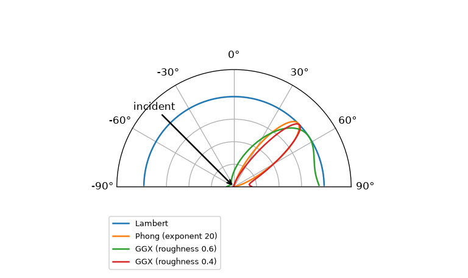

BRDF
====

前章では、表面に当たった光が鏡面反射と拡散反射に分かれることを見た。本章では、ある方向から来た光が、どの方向にどれだけ反射されるかを定量的に表す関数、BRDF を導入する。BRDF は PBR における「材質」の数学的な表現である。

BRDF の定義
-----------

表面上の点 :math:`\mathbf{x}` に、方向 :math:`\omega_i` から放射輝度 :math:`L_i` の光が、微小な立体角 :math:`d\omega_i` の範囲から入射しているとする。このとき点 :math:`\mathbf{x}` が受け取る放射照度は、式 :eq:`irradiance-integral` より :math:`dE = L_i \cos\theta_i \, d\omega_i` である。この光によって、点 :math:`\mathbf{x}` から方向 :math:`\omega_o` へ出ていく放射輝度が :math:`dL_o` だけ増えるとする。

:math:`dL_o` は :math:`dE` に比例すると考えてよい。その比例係数を BRDF（Bidirectional Reflectance Distribution Function、双方向反射率分布関数）と呼び、:math:`f_r` で表す。

.. math::
   :label: brdf-def

   f_r(\mathbf{x}, \omega_i, \omega_o) = \frac{dL_o(\mathbf{x}, \omega_o)}{dE(\mathbf{x}, \omega_i)} = \frac{dL_o(\mathbf{x}, \omega_o)}{L_i(\mathbf{x}, \omega_i) \cos\theta_i \, d\omega_i}

単位は 1/sr である。本書では、:math:`\omega_i` と :math:`\omega_o` をどちらも点 :math:`\mathbf{x}` から外向きの単位ベクトルとして表す。:math:`\omega_i` は光が来る方向（光源の方向）、:math:`\omega_o` は光が出ていく方向（観測者やカメラの方向）を指す。:math:`\theta_i` は法線 :math:`\mathbf{n}` と :math:`\omega_i` のなす角であり、:math:`\cos\theta_i = \mathbf{n} \cdot \omega_i` である。

上側の半球 :math:`\Omega` のあらゆる方向から光が入射する場合、方向 :math:`\omega_o` へ出ていく放射輝度は、各方向からの寄与を足し合わせて次のように書ける。

.. math::
   :label: reflection-equation

   L_o(\mathbf{x}, \omega_o) = \int_{\Omega} f_r(\mathbf{x}, \omega_i, \omega_o) \, L_i(\mathbf{x}, \omega_i) \cos\theta_i \, d\omega_i

これを反射方程式と呼ぶ。BRDF がわかれば、入射する光から反射光を計算できる。この式は「:doc:`rendering_equation`」で中心的な役割を果たす。

BRDF は一般に、入射方向と出射方向（それぞれ 2 つの角度で表される）の計 4 つの変数の関数である。多くの材質では、表面を法線のまわりに回転させても反射の仕方が変わらない。このような BRDF を等方性（isotropic）と呼ぶ。ヘアライン加工した金属のように、回転させると反射の仕方が変わるものは異方性（anisotropic）と呼ぶ。

物理的に妥当な BRDF の条件
--------------------------

どのような関数でも BRDF として物理的に意味があるわけではない。物理的に妥当な BRDF は、次の 3 つの条件を満たす。

非負性
   反射光が負になることはないので、:math:`f_r(\omega_i, \omega_o) \ge 0` である。

ヘルムホルツの相反性
   入射方向と出射方向を入れ替えても値が変わらない。すなわち :math:`f_r(\omega_i, \omega_o) = f_r(\omega_o, \omega_i)` である。光の経路は逆向きにたどっても同じ寄与を持つ、という性質であり、カメラ側からレイを飛ばすレイトレーシングの正当性を支えている。

エネルギー保存
   表面は受け取った以上の光を反射しない。ある方向 :math:`\omega_i` から入射した光のうち、反射される光の割合は 1 以下でなければならない。

   .. math::
      :label: energy-conservation

      \rho(\omega_i) = \int_{\Omega} f_r(\omega_i, \omega_o) \cos\theta_o \, d\omega_o \le 1 \quad (\text{すべての } \omega_i \text{ について})

   :math:`\rho(\omega_i)` を方向アルベドと呼ぶ。1 との差は、表面で吸収される（あるいは透過する）光の割合である。

PBR で用いる反射モデルは、これらの条件を満たすように（少なくとも大きく破らないように）作られている。

ランバート BRDF
---------------

最も単純な BRDF は、どの方向にも同じ値を持つ定数の BRDF である。

.. math::
   :label: lambert

   f_r(\omega_i, \omega_o) = \frac{\rho}{\pi}

ここで :math:`\rho`\ （0 以上 1 以下）は反射率であり、RGB の各成分ごとに与えれば物体の色を表す。この BRDF を持つ面をランバート面と呼ぶ。理想的な拡散反射を表すモデルであり、紙、素焼きの陶器、つや消しの塗装面などのよい近似になる。

分母の :math:`\pi` は、エネルギー保存の式 :eq:`energy-conservation` から決まる。式 :eq:`uniform-irradiance` と同じ計算により :math:`\int_{\Omega} \cos\theta_o \, d\omega_o = \pi` なので、

.. math::

   \rho(\omega_i) = \int_{\Omega} \frac{\rho}{\pi} \cos\theta_o \, d\omega_o = \frac{\rho}{\pi} \cdot \pi = \rho

となり、方向アルベドがちょうど :math:`\rho` になる。:math:`\pi` で割るのを忘れると、反射光が :math:`\pi` 倍（約 3 倍）明るくなってしまう。これは実装でよくある誤りである。

ランバート面からの反射光の放射輝度は、見る方向によらず一定である。ただし、現実の物体がすべてランバート面に近いわけではない。たとえば、ランバート面でできた球を正面から照らすと、縁に近いほど光が斜めに当たるため暗く見えるはずである。満月が縁まで一様な明るさの円盤に見えるのは、月面の反射がランバート面とは異なる性質を持つためである。

完全鏡面反射
------------

ランバート面と対極にあるのが、完全な鏡である。完全な鏡は、入射光を正反射方向だけに反射する。このような BRDF は、正反射方向以外では 0、正反射方向でだけ無限大となる関数（ディラックのデルタ関数）を用いて表される。実装上は、BRDF を通常の関数として評価する代わりに「反射方向にレイを 1 本飛ばし、フレネル反射率を掛ける」という特別な扱いをする。

現実の表面の多くは、ランバート面と完全な鏡の中間的な性質を持つ。その中間を物理的に表すのが、次章のマイクロファセット理論である。

従来の反射モデルとその問題点
----------------------------

PBR が普及する前に広く使われていたのが、Phong の反射モデル [Phong1975]_ である。Phong モデルでは、光源方向を :math:`\mathbf{l}`、観測者の方向を :math:`\mathbf{v}`、:math:`\mathbf{l}` の正反射方向を :math:`\mathbf{r}` として、反射光の強さを次のように計算する。

.. math::
   :label: phong

   I = k_d \, (\mathbf{n} \cdot \mathbf{l}) + k_s \, (\mathbf{r} \cdot \mathbf{v})^s

第 1 項が拡散反射、第 2 項がハイライト（鏡面反射）を表す。:math:`k_d`, :math:`k_s` は反射の強さ、:math:`s` はハイライトの鋭さを決めるパラメーターである。Blinn は、:math:`\mathbf{r} \cdot \mathbf{v}` の代わりに、:math:`\mathbf{l}` と :math:`\mathbf{v}` の中間の方向（ハーフベクトル）\ :math:`\mathbf{h}` を使った :math:`(\mathbf{n} \cdot \mathbf{h})^s` を用いる変形を提案した [Blinn1977]_。これを Blinn-Phong モデルと呼ぶ。

これらのモデルは計算が軽く、見た目もそれなりによいため長く使われてきたが、物理的には次の問題がある。

* エネルギー保存が保証されない。:math:`s` を大きくするとハイライトは鋭くなるが、反射されるエネルギーの総量は小さくなる。:math:`k_s` との組み合わせによっては、入射光より多くの光を反射することもある。
* フレネル効果がなく、浅い角度で反射が強くなる現象を再現できない。
* パラメーター :math:`s` が物理的な性質と直接対応しない。

:numref:`fig-brdf-lobes` は、入射角 45 度の光に対して、出射方向ごとの BRDF の値を入射面内で描いたものである。各曲線は最大値が 1 になるように正規化してある。

   入射面内での BRDF の形（入射角 45 度、最大値で正規化）

ランバート BRDF はすべての方向で一定なので半円になる。Phong モデルは、正反射方向（+45 度）を中心とした対称な山になる。次章で説明する GGX マイクロファセットモデルは、山の頂上が正反射方向よりも浅い角度の側にずれ、表面すれすれの方向へ裾が伸びた非対称な形になる。この「正反射方向からずれた山」は、実際の粗い表面で観測される性質である。

実測 BRDF
---------

BRDF は、測定装置を使って実際の材料から測ることもできる。代表的なものに、100 種類の材料の等方性 BRDF を測定した MERL BRDF データベース [Matusik2003]_ がある。実測データは、新しい反射モデルの精度を評価する基準として使われている。

まとめ
------

* BRDF は、入射方向から来た光が出射方向へどれだけ反射されるかを表す関数であり、PBR における材質の表現である。
* 物理的に妥当な BRDF は、非負性、ヘルムホルツの相反性、エネルギー保存を満たす。
* ランバート BRDF :math:`\rho / \pi` は理想的な拡散反射を表す。
* Phong モデルは物理的な条件を満たさず、PBR ではマイクロファセットモデルが使われる。
