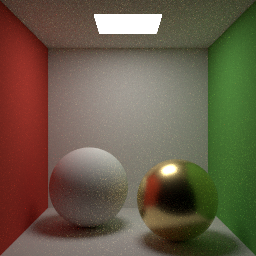

物理ベースレンダリング入門
==========================

本書は、CG を専門としないエンジニアに向けて、物理ベースレンダリング（PBR）の考え方と仕組みを解説する入門書である。光の物理量の定義から始めて、BRDF、レンダリング方程式、モンテカルロ積分を順に説明し、最後に NumPy と Pillow だけで動く小さなパストレーサーを読み解く。上の画像は、そのパストレーサーで描画したものである。

数式は避けずに示すが、それぞれの式が何を意味するのかを言葉と図で説明することを重視する。サンプルコードはすべて Python で書かれており、「:doc:`appendix_examples`」から閲覧・ダウンロードできる。

.. toctree::
   :maxdepth: 2
   :numbered:
   :caption: 本編

   introduction
   overview
   light_and_color
   radiometry
   light_matter
   brdf
   microfacet
   rendering_equation
   monte_carlo
   path_tracing
   practical_pbr
   advanced

.. toctree::
   :maxdepth: 1
   :caption: 付録

   appendix_math
   appendix_examples
   glossary
   references
