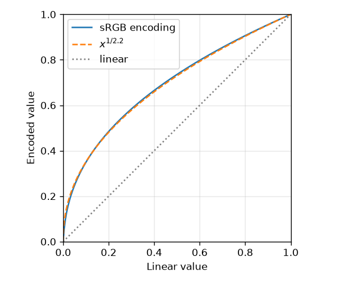

光と色の基礎
============

本章では、レンダリングで扱う「光」と「色」が何であるかを整理する。特に、計算に使う値と画面に表示する値を区別すること（リニアワークフロー）は、PBR を正しく実装するうえで欠かせない。

光の性質
--------

光は電磁波の一種である。人間の目に見える光（可視光）の波長は、およそ 380 nm から 780 nm の範囲にある。波長が短い側が紫や青、長い側が赤に見える。

光の振る舞いは、扱うスケールによって異なる方法で記述される。

波動光学
   光を波として扱う。干渉（シャボン玉の虹色）や回折（CD の表面の虹色）を説明できる。

幾何光学
   光を直進する線（光線）として扱う。物体の大きさが光の波長よりも十分に大きいときによい近似となる。

量子光学
   光を粒子（光子）の集まりとして扱う。光の放射や吸収の仕組みを説明できる。

一般的なレンダリングでは幾何光学を採用する。すなわち、光は均質な空間を直進し、物体の表面で反射・屈折する、と考える。本書でもこの立場をとる。干渉や回折のような波の性質に由来する現象は、必要な場合に限って近似的に扱う。

色はどのように知覚されるか
--------------------------

光そのものには「色」はなく、あるのは波長ごとの光の強さの分布（分光分布、スペクトル）である。色は、その光を受けた人間の視覚が生み出す感覚である。

人間の網膜には、色の知覚に関わる 3 種類の錐体細胞があり、それぞれ短波長（S）、中波長（M）、長波長（L）の光に強く反応する。脳は、この 3 種類の細胞の反応の強さの組み合わせから色を知覚する。そのため、分光分布が異なる光でも、3 種類の細胞の反応が同じであれば同じ色に見える。この現象を条件等色（メタメリズム）と呼ぶ。

条件等色があるおかげで、色は 3 つの数値で表せる。ディスプレイが赤（R）、緑（G）、青（B）の 3 色の光を混ぜるだけで多様な色を表示できるのはこのためである。多くのレンダラーも、光を波長ごとに扱う代わりに RGB の 3 成分で計算する。本書のサンプルコードも RGB で計算している。ただし、これは近似であり、波長に強く依存する現象（プリズムによる分光など）は RGB では正確に表せない。この点は「:doc:`advanced`」で補足する。

色空間と sRGB
-------------

「RGB の 3 つの数値」だけでは、実際の色は決まらない。R、G、B がそれぞれどのような色の光なのか（原色）と、3 つを等しく混ぜたときの白がどのような白なのか（白色点）を定める必要がある。これらを定めたものを色空間と呼ぶ。

現在のパソコンやウェブで標準的に使われる色空間は sRGB [IEC61966]_ である。sRGB は原色と白色点に加えて、数値をどのように符号化するか（伝達関数）も定めている。

sRGB の伝達関数は、光の物理的な強さに比例する値（線形な値）\ :math:`C_{\mathrm{linear}}` を、次の式で符号化値 :math:`C_{\mathrm{sRGB}}` に変換する。

.. math::
   :label: srgb-encode

   C_{\mathrm{sRGB}} =
   \begin{cases}
   12.92\, C_{\mathrm{linear}} & (C_{\mathrm{linear}} \le 0.0031308) \\
   1.055\, C_{\mathrm{linear}}^{1/2.4} - 0.055 & (C_{\mathrm{linear}} > 0.0031308)
   \end{cases}

この曲線は、おおよそ :math:`C_{\mathrm{linear}}^{1/2.2}` に等しい（:numref:`fig-srgb-curve`）。

   sRGB の符号化曲線

このように符号化するのは、人間の視覚が暗い部分の明るさの違いに敏感だからである。8 ビット（256 段階）という限られた階調を、暗い部分に多く割り当てることで、少ないビット数でも階調の段差が目立ちにくくなる。たとえば、物理的な明るさが白の 18% の灰色は、sRGB で符号化すると約 0.46（8 ビットで 118）になる。

リニアワークフロー
------------------

PBR で特に重要なのは、光の計算は必ず線形な値で行うことである。光の強さは足し算ができる量であり、2 つの光源で照らされた点の明るさは、それぞれの光源による明るさの和になる。この性質は線形な値でしか成り立たない。sRGB で符号化された値をそのまま足したり掛けたりすると、物理的に誤った結果になる。

そこで、次の手順で計算する。これをリニアワークフローと呼ぶ。

1. 入力となる色（テクスチャ画像の色や、色見本から選んだ色）が sRGB で符号化されている場合は、線形な値に変換する。
2. 光の計算をすべて線形な値で行う。
3. 最後に、表示のためにトーンマッピング（次節）と sRGB の符号化を行う。

ただし、テクスチャ画像のうち色を表さないもの（法線マップやラフネスマップなど）は、もともと線形な値として保存されているので、変換してはならない。この区別は「:doc:`practical_pbr`」で改めて扱う。

HDR とトーンマッピング
----------------------

現実の世界の明るさの幅は非常に広い。晴天の屋外と月明かりの夜とでは、明るさが数十万倍以上も異なる。物理に基づいて計算した値も、同じように広い範囲の値をとる。このように広い範囲の明るさを持つ画像を HDR（High Dynamic Range）画像と呼ぶ。

一方、一般的なディスプレイが表示できる明るさの範囲は限られており、計算結果をそのまま表示すると、明るい部分が白く飛んでしまう。そこで、HDR の値を表示できる範囲に収まるように変換する。この変換をトーンマッピング（tone mapping）と呼ぶ。

トーンマッピングの具体的な方法は「:doc:`practical_pbr`」で説明する。ここでは、物理的に正しい計算結果と、画面に表示される値とは別物であり、その間に「表示のための変換」が入るということを押さえておけばよい。

まとめ
------

* レンダリングでは、光を直進する光線として扱う幾何光学を用いる。
* 色は 3 つの数値で表せるため、多くのレンダラーは RGB で計算する。
* 光の計算は線形な値で行い、表示の直前にトーンマッピングと sRGB の符号化を行う。
