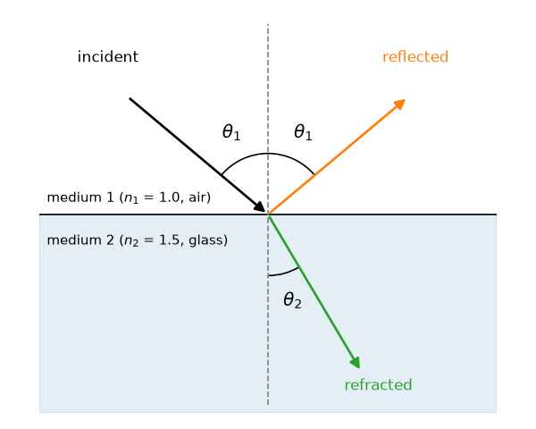
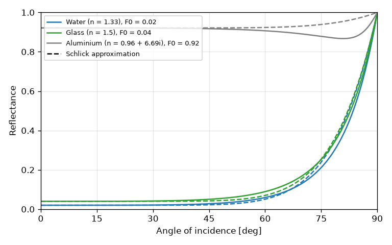

光と物質の相互作用
==================

光が物体の表面に当たると、一部は反射し、一部は物体の内部に入る。内部に入った光は、吸収されたり、散乱して再び表面から出てきたりする。本章では、これらの現象を物理的に整理し、次章以降の BRDF の土台とする。

反射と屈折
----------

滑らかな境界面に光が当たると、光は反射光と屈折光（透過光）に分かれる（:numref:`fig-snell`）。

   境界面での反射と屈折

反射の法則
   反射光は、法線に関して入射光と対称な方向に進む。入射角と反射角は等しい。この方向を正反射方向と呼ぶ。

スネルの法則
   屈折光の方向は、2 つの媒質の屈折率 :math:`n_1`, :math:`n_2` によって決まる。入射角を :math:`\theta_1`、屈折角を :math:`\theta_2` とすると、次の関係が成り立つ。

   .. math::
      :label: snell

      n_1 \sin\theta_1 = n_2 \sin\theta_2

屈折率は、真空中の光の速さと媒質中の光の速さの比である。主な物質の屈折率を\ :numref:`table-ior` に示す。

.. list-table:: 主な物質の屈折率（可視光での概略値）
   :name: table-ior
   :header-rows: 1
   :widths: 50 50

   * - 物質
     - 屈折率
   * - 真空
     - 1
   * - 空気
     - 約 1.0003
   * - 水
     - 約 1.33
   * - ガラス
     - 約 1.5
   * - ダイヤモンド
     - 約 2.42

屈折率の大きい媒質から小さい媒質へ光が進む場合（水中から空気中へ、など）、入射角がある角度を超えると、式 :eq:`snell` を満たす :math:`\theta_2` が存在しなくなり、光はすべて反射する。これを全反射と呼び、その境目の角度 :math:`\theta_c = \arcsin(n_2 / n_1)` を臨界角と呼ぶ。水から空気への臨界角は約 49 度である。

フレネル反射率
--------------

境界面に当たった光のうち、どれだけの割合が反射するかを表すのがフレネル反射率である。フレネル反射率は、屈折率と入射角によって決まり、マクスウェル方程式から導かれるフレネルの式で計算できる。

光の電場の振動方向（偏光）によって反射率は異なる。入射面（入射光と法線を含む平面）に垂直に振動する成分（s 偏光）と、入射面に平行に振動する成分（p 偏光）の反射率は、それぞれ次の式で表される。

.. math::
   :label: fresnel

   R_s = \left| \frac{n_1 \cos\theta_1 - n_2 \cos\theta_2}{n_1 \cos\theta_1 + n_2 \cos\theta_2} \right|^2, \qquad
   R_p = \left| \frac{n_2 \cos\theta_1 - n_1 \cos\theta_2}{n_2 \cos\theta_1 + n_1 \cos\theta_2} \right|^2

太陽光や電球の光のように偏光していない光に対しては、両者の平均 :math:`F = (R_s + R_p)/2` を反射率とする。残りの :math:`1 - F` が屈折光になる。境界面での反射と屈折だけを考えれば、反射光と屈折光のエネルギーの和は入射光のエネルギーに等しい。

光が垂直に入射する場合（:math:`\theta_1 = 0`）、空気（:math:`n_1 = 1`）から屈折率 :math:`n` の物質への反射率は、次の簡単な式になる。この値を :math:`F_0` と書く。

.. math::
   :label: f0

   F_0 = \left( \frac{n - 1}{n + 1} \right)^2

ガラス（:math:`n = 1.5`）では :math:`F_0 = 0.04`、水（:math:`n = 1.33`）では :math:`F_0 \approx 0.02` となる。つまり、ガラスや水に正面から光が当たると、反射するのはわずか数%であり、ほとんどの光は内部に入る。

入射角とフレネル反射率の関係を\ :numref:`fig-fresnel` に示す。

   入射角とフレネル反射率の関係（実線はフレネルの式、破線は Schlick 近似）

この図から次のことが読み取れる。

* 水やガラスの反射率は、入射角が 45 度程度までは :math:`F_0` からあまり変わらないが、それを超えると急激に大きくなり、90 度（表面すれすれの入射）で 1 に近づく。
* アルミニウムのような金属は、正面からでも反射率が非常に高い。

1 つ目の性質は、日常でも観察できる。湖を真上から見下ろすと水中が透けて見えるが、遠くの水面を浅い角度で見ると、空や対岸の景色が鏡のように映り込む。また、机の天板や床を浅い角度から見ると、照明が映り込んで見える。このように、どのような物質でも浅い角度から見ると強く光を反射する現象をフレネル効果と呼ぶ。PBR で作られた画像が自然に見える理由の 1 つは、この効果を正しく再現していることにある。

Schlick 近似
------------

フレネルの式は計算がやや重いため、レンダリングでは次の Schlick 近似 [Schlick1994]_ がよく使われる。

.. math::
   :label: schlick

   F(\theta) \approx F_0 + (1 - F_0)(1 - \cos\theta)^5

:numref:`fig-fresnel` の破線が Schlick 近似である。水やガラス（後述する誘電体）ではフレネルの式とよく一致している。金属では、80 度付近で反射率がわずかに下がる現象を再現できないが、見た目への影響は小さい。Schlick 近似の利点は、物質の性質を :math:`F_0` という 1 つの値（RGB なら 3 つの値）だけで指定できることである。

金属と誘電体
------------

物質は、光学的な性質から大きく金属（導体）と誘電体（非金属）に分けられる。PBR では、この区別が材質を表現するうえで最も基本的な分類になる。

金属
   金属の内部には自由に動ける電子が多数あり、内部に入った光はごく浅い距離（数十 nm 程度）で吸収される。そのため、金属の見た目はほぼ表面での反射だけで決まる。金属の屈折率は複素数 :math:`n + ik` で表され、虚部 :math:`k`\ （消衰係数）が大きいほど吸収が強い。:math:`F_0` は 0.5 から 1 程度と高い。金や銅のように、波長によって :math:`F_0` が大きく異なる金属は、反射光そのものに色が付く。

誘電体
   ガラス、水、プラスチック、木、石、布など、金属以外のほとんどの物質が誘電体である。多くの誘電体の :math:`F_0` は 0.02 から 0.05 程度と低く（ダイヤモンドなど屈折率の高い宝石は例外）、波長によってほとんど変わらないため、表面での反射光には色が付かない（照明の色がそのまま映る）。内部に入った光は、透明な物質ではそのまま通り抜け、不透明な物質では内部で散乱・吸収されたのち、一部が表面から出てくる。

:numref:`table-f0` に、代表的な物質の :math:`F_0` を示す。

.. list-table:: 代表的な物質の :math:`F_0`\ （線形な RGB 値。誘電体は屈折率からの計算値、金属は [RTR4]_ による）
   :name: table-f0
   :header-rows: 1
   :widths: 30 25 45

   * - 物質
     - 分類
     - :math:`F_0` (R, G, B)
   * - 水
     - 誘電体
     - 0.02, 0.02, 0.02
   * - ガラス、プラスチック
     - 誘電体
     - 0.04, 0.04, 0.04
   * - ダイヤモンド
     - 誘電体
     - 0.17, 0.17, 0.17
   * - 鉄
     - 金属
     - 0.56, 0.57, 0.58
   * - 銅
     - 金属
     - 0.96, 0.64, 0.54
   * - 金
     - 金属
     - 1.00, 0.78, 0.34
   * - アルミニウム
     - 金属
     - 0.91, 0.92, 0.92
   * - 銀
     - 金属
     - 0.97, 0.96, 0.92

拡散反射の正体
--------------

不透明な誘電体（塗装面、プラスチック、紙など）の色は、主に内部で散乱して表面から出てくる光によって決まる。内部に入った光は、顔料などの粒子に当たって何度も向きを変え、その間に特定の波長が吸収される。たとえば赤いプラスチックは、青や緑の光を多く吸収し、赤い光を多く残して外に返す。

何度も散乱を繰り返した光は、入射した方向の情報を失い、あらゆる方向にほぼ均等に出ていく。これが拡散反射（diffuse reflection）である。これに対し、表面で直接反射する光を鏡面反射（specular reflection）と呼ぶ。

つまり、不透明な誘電体の見た目は次の 2 つの成分の和として表せる。

* 鏡面反射：表面での反射。色は付かず、反射率はフレネル反射率に従う。
* 拡散反射：内部で散乱して出てくる光。物体固有の色が付く。

一方、金属には拡散反射がほとんどなく、鏡面反射だけで見た目が決まる。「:doc:`practical_pbr`」で説明するメタリック／ラフネスワークフローは、この物理的な区別をそのままパラメーターにしたものである。

表面下散乱
----------

上の説明では、内部で散乱した光は入射した点のすぐ近くから出てくると仮定した。実際には、光は内部で横方向にも移動し、入射点から離れた場所から出てくる。この移動距離が画素の大きさに比べて無視できない物質では、この現象を明示的に扱う必要がある。これを表面下散乱（subsurface scattering）と呼ぶ。

人間の肌、大理石、牛乳、ろうそくなどは、表面下散乱が顕著な物質である。耳に後ろから光が当たると赤く透けて見えるのは、光が皮膚の内部を通り抜けてくるためである。表面下散乱の扱いは本書の範囲を超えるため、「:doc:`advanced`」で簡単に紹介するにとどめる。

まとめ
------

* 滑らかな境界面では、光は反射の法則とスネルの法則に従って反射・屈折する。
* 反射する割合はフレネル反射率で決まり、浅い角度ほど大きくなる。レンダリングでは Schlick 近似がよく使われる。
* 金属は表面での反射だけで見た目が決まり、反射光に色が付くことがある。誘電体は表面での色の付かない反射と、内部散乱による色の付いた拡散反射の両方を持つ。
