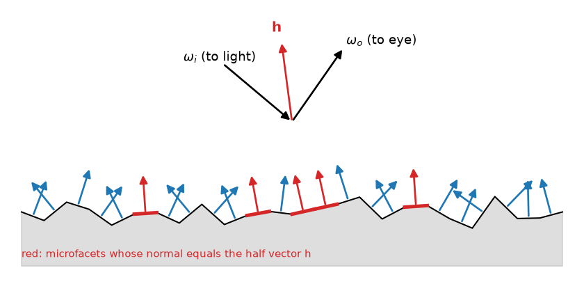
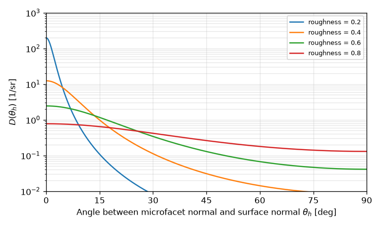
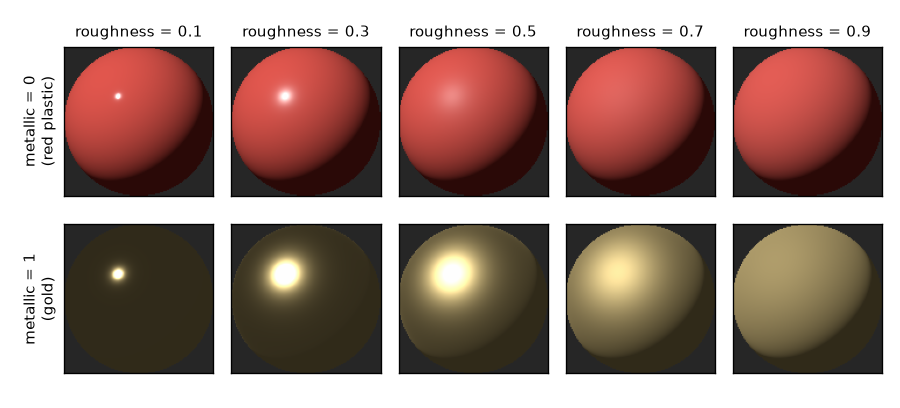

マイクロファセット理論
======================

現実の表面の多くは、完全な鏡でも理想的な拡散面でもない。つや消し加工した金属にはぼやけたハイライトが現れ、使い込んだ机の天板は鈍く光る。本章では、このような粗い表面の鏡面反射を物理的に表すマイクロファセット理論と、それに基づく Cook-Torrance モデルを説明する。

粗い表面のモデル化
------------------

肉眼では平らに見える表面も、顕微鏡で拡大すると細かな凹凸がある。マイクロファセット理論では、表面を、向きがばらばらな微小な平面（マイクロファセット、微小面）の集まりとみなす（:numref:`fig-microfacets`）。各微小面は完全な鏡として振る舞うと仮定する。

   マイクロファセットの模式図。赤で示した微小面だけが、光源からの光を観測者の方向へ反射する。

微小面の大きさは、光の波長よりは十分に大きく（幾何光学が使える）、1 画素に写る範囲よりは十分に小さい（個々の微小面は見分けられない）と仮定する。そのため、個々の微小面の形を記述する代わりに、微小面の向きの統計的な分布を使って反射を記述する。

光源の方向 :math:`\omega_i` から来た光を、観測者の方向 :math:`\omega_o` へ反射できるのは、法線がちょうど 2 つの方向の中間を向いている微小面だけである。この中間の方向をハーフベクトルと呼ぶ。

.. math::
   :label: half-vector

   \mathbf{h} = \frac{\omega_i + \omega_o}{\| \omega_i + \omega_o \|}

表面が滑らかなら、ほとんどの微小面の法線はマクロな法線 :math:`\mathbf{n}` の付近に集中し、:math:`\mathbf{h} \approx \mathbf{n}` となる方向、すなわち正反射方向の付近でだけ強く光る（鋭いハイライト）。表面が粗ければ、微小面の向きは大きくばらつき、広い範囲の方向で少しずつ光る（ぼやけたハイライト）。

Cook-Torrance モデル
--------------------

マイクロファセット理論に基づく鏡面反射の BRDF は、次の形で表される。この形は Cook と Torrance [CookTorrance1982]_ によってコンピューターグラフィックスに導入されたため、Cook-Torrance モデルと呼ばれる。

.. math::
   :label: cook-torrance

   f_{\mathrm{spec}}(\omega_i, \omega_o) = \frac{D(\mathbf{h}) \, F(\omega_o \cdot \mathbf{h}) \, G(\omega_i, \omega_o)}{4 \, (\mathbf{n} \cdot \omega_i)(\mathbf{n} \cdot \omega_o)}

分子の 3 つの項は、それぞれ次の意味を持つ。

.. list-table::
   :header-rows: 1
   :widths: 25 75

   * - 項
     - 意味
   * - :math:`D(\mathbf{h})`
     - 法線分布関数。法線が :math:`\mathbf{h}` を向いている微小面がどれだけあるか。
   * - :math:`F(\omega_o \cdot \mathbf{h})`
     - フレネル反射率。その微小面に当たった光のうち、どれだけが反射するか。
   * - :math:`G(\omega_i, \omega_o)`
     - 幾何減衰項。ほかの微小面に遮られずに光が届き、かつ観測者から見える微小面の割合。

分母の :math:`4 \, (\mathbf{n} \cdot \omega_i)(\mathbf{n} \cdot \omega_o)` は、微小面単位で考えた量をマクロな表面の BRDF に換算するための係数である。:math:`\mathbf{n} \cdot \omega_i` と :math:`\mathbf{n} \cdot \omega_o` は、微小面の面積をマクロな表面の面積に換算する際に現れ、係数 4 は、ハーフベクトルの微小な立体角と反射方向の微小な立体角の比（:math:`d\omega_h = d\omega_o / (4 \, \omega_o \cdot \mathbf{h})`）に由来する。詳しい導出は [Walter2007]_ や [PBR4]_ を参照されたい。

以下、各項を順に説明する。

法線分布関数 D
--------------

法線分布関数（Normal Distribution Function、NDF）\ :math:`D(\mathbf{m})` は、微小面の法線 :math:`\mathbf{m}` の分布を表す関数である。マクロな表面の単位面積あたり、法線が :math:`\mathbf{m}` の周りの単位立体角に含まれる微小面の面積を表す。微小面をマクロな表面に投影した面積の合計はマクロな表面の面積に等しいので、:math:`D` は次の正規化条件を満たす。

.. math::
   :label: ndf-normalization

   \int_{\Omega} D(\mathbf{m}) \, (\mathbf{n} \cdot \mathbf{m}) \, d\omega_m = 1

現在最も広く使われている法線分布関数は、GGX と呼ばれるものである。Walter らによって GGX の名で紹介され [Walter2007]_、のちに Trowbridge と Reitz が 1975 年に提案した分布 [TrowbridgeReitz1975]_ と同じであることがわかったため、Trowbridge-Reitz 分布とも呼ばれる。

.. math::
   :label: ggx

   D(\mathbf{m}) = \frac{\alpha^2}{\pi \left( (\mathbf{n} \cdot \mathbf{m})^2 (\alpha^2 - 1) + 1 \right)^2}

:math:`\alpha` は表面の粗さを表すパラメーターである。:math:`\alpha` が小さいほど分布は :math:`\mathbf{n}` の付近に鋭く集中し、大きいほどなだらかに広がる。

多くのレンダラーやゲームエンジンでは、ユーザーが指定するラフネス :math:`r`\ （0 以上 1 以下）から :math:`\alpha = r^2` として :math:`\alpha` を求める [Burley2012]_。こうすると、ラフネスを一定の割合で変化させたときに、見た目の粗さもほぼ一定の割合で変化するように感じられる。本書のサンプルコードもこの変換を用いている。

:numref:`fig-ggx` に、ラフネスごとの GGX 分布を示す。縦軸は対数目盛である。

   ラフネスごとの GGX 法線分布関数（縦軸は対数目盛）

GGX の特徴は、ピークから離れても値がなかなか 0 にならない「長い裾」を持つことである。これにより、ハイライトの周囲に柔らかい光のにじみが生じる。古くから使われている Beckmann 分布と比べて、実際の材料の測定結果とよく一致することが知られている。

フレネル項 F
------------

フレネル項には、前章の Schlick 近似（式 :eq:`schlick`）を用いることが多い。ここで注意すべきなのは、角度の余弦として :math:`\mathbf{n} \cdot \omega_o` ではなく :math:`\omega_o \cdot \mathbf{h}` を使うことである。光を反射しているのは法線が :math:`\mathbf{h}` の微小面であり、フレネル反射率はその微小面に対する入射角で決まるからである。

幾何減衰項 G
------------

粗い表面では、微小面の一部がほかの微小面の陰になる。光源から見て陰になっている微小面には光が届かず（シャドウイング）、観測者から見て陰になっている微小面は見えない（マスキング）。この影響を表すのが幾何減衰項 :math:`G` であり、0 以上 1 以下の値をとる。:math:`G` は、光や視線が表面すれすれの方向から来るときほど小さくなる。

:math:`G` を求める方法として最も広く使われているのが Smith のモデル [Smith1967]_ である。Smith のモデルでは、:math:`G` を入射方向と出射方向のマスキング関数 :math:`G_1` の積で近似する。

.. math::
   :label: smith-g

   G(\omega_i, \omega_o) \approx G_1(\omega_i) \, G_1(\omega_o)

GGX 分布に対する :math:`G_1` は次の式で表される。

.. math::
   :label: smith-g1

   G_1(\omega) = \frac{2 \, (\mathbf{n} \cdot \omega)}{(\mathbf{n} \cdot \omega) + \sqrt{\alpha^2 + (1 - \alpha^2)(\mathbf{n} \cdot \omega)^2}}

:math:`G` は法線分布関数 :math:`D` と矛盾しないように選ぶ必要がある。Heitz [Heitz2014]_ は、マスキング・シャドウイング関数の理論を整理し、Smith のモデルが物理的に妥当な選択であることを示した。

ラフネスと見た目
----------------

PBR の材質では、鏡面反射の BRDF（Cook-Torrance モデル）と拡散反射の BRDF（ランバート BRDF）を組み合わせて使うことが多い。このとき、表面で反射されなかった光（割合 :math:`1 - F`）だけが内部に入って拡散反射になると考え、ランバート BRDF に :math:`1 - F` を掛けてエネルギーの和が 1 を超えないようにすることが多い。:numref:`fig-roughness-spheres` は、平行光源 1 つで照らした球を、ラフネスと材質の種類を変えて描いたものである。描画に用いたコードは ``brdf_plot.py``\ （「:doc:`appendix_examples`」）にある。

   ラフネス（横方向）と材質（縦方向）を変えた球。上段は赤いプラスチック（誘電体）、下段は金（金属）。

この図から、次のことが読み取れる。

* ラフネスが小さいほどハイライトは小さく鋭くなり、大きいほど広くぼやける。
* ハイライトが広がるほど、ハイライトのピークの明るさは下がる。反射されるエネルギーの総量はほぼ一定であり、それが広い範囲に分散されるためである。Phong モデルとは異なり、この性質は式に組み込まれている。
* プラスチックのハイライトは白い（照明の色）が、金のハイライトは金色である。前章で説明した誘電体と金属の違いである。
* 金の球のうち、ハイライト以外の部分は暗い。金属には拡散反射がなく、この図では周囲に映り込む環境がないためである。実際の金属が金属らしく見えるのは、周囲の環境が映り込むからである。

なお、Cook-Torrance モデルは、光が微小面で 1 回だけ反射することを前提としている。実際には、粗い表面では微小面の間で複数回反射してから出ていく光もある。この光が無視されるため、ラフネスが大きいときには反射光がやや暗くなる。この問題を補正する手法も提案されているが、本書では扱わない。

まとめ
------

* マイクロファセット理論では、表面を完全な鏡である微小面の集まりとみなし、その向きの分布で粗さを表す。
* Cook-Torrance モデルは、法線分布関数 :math:`D`、フレネル項 :math:`F`、幾何減衰項 :math:`G` の積で鏡面反射の BRDF を表す。
* :math:`D` には GGX、:math:`G` には Smith のモデル、:math:`F` には Schlick 近似がよく使われる。
* ラフネスを変えてもエネルギーの総量はほぼ保たれ、ハイライトの広がりだけが変わる。
